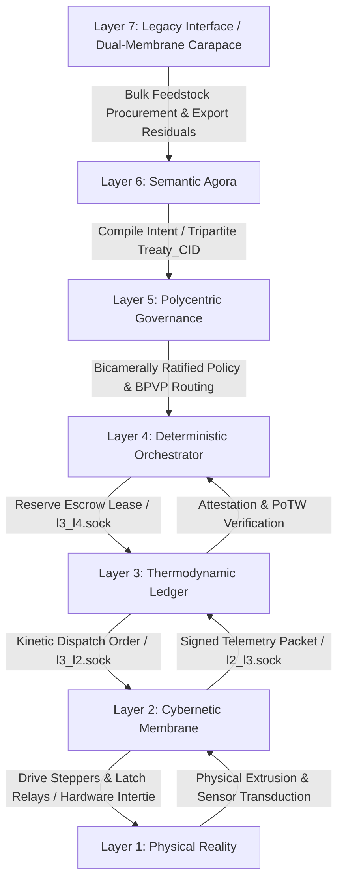
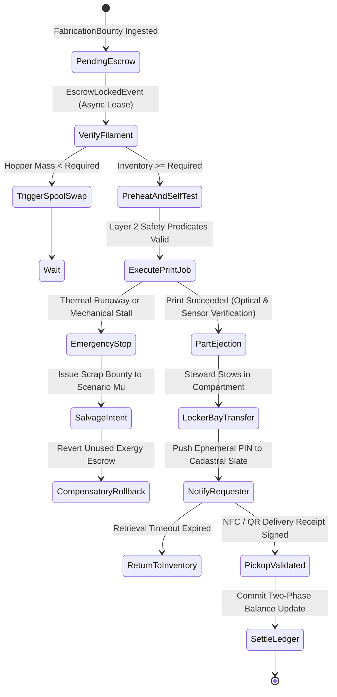
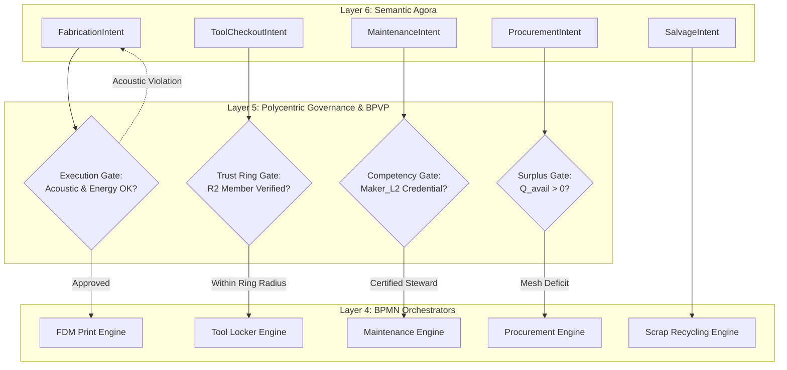
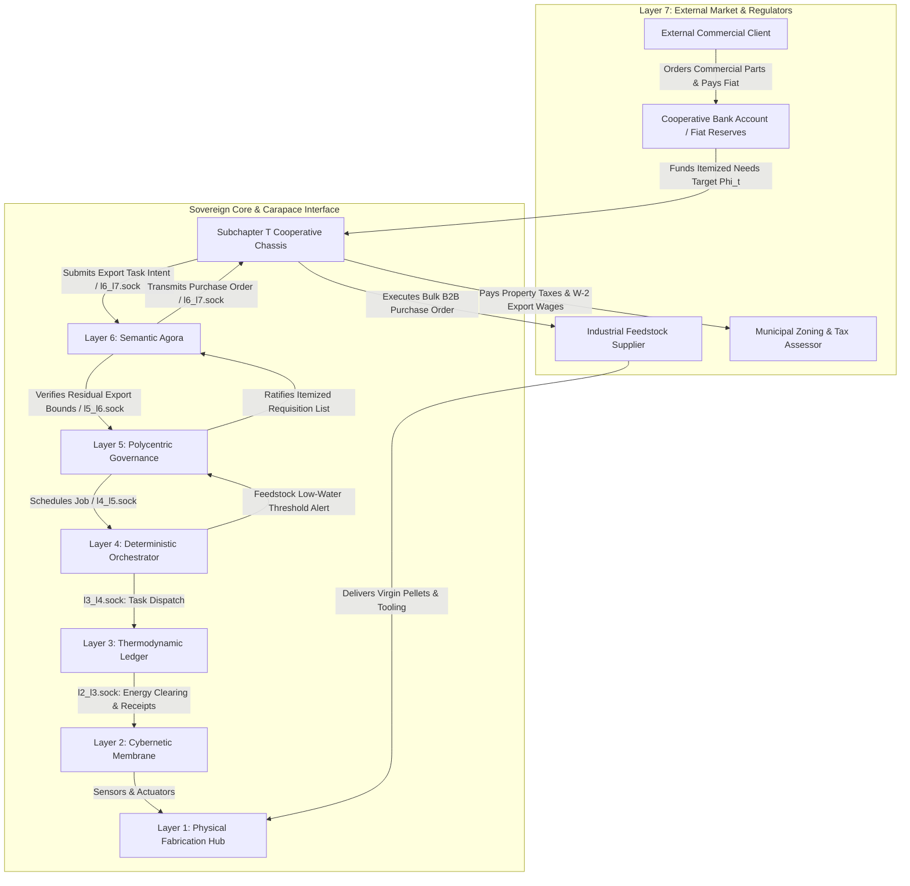

# Scenario Alpha: The Fabrication Commons

*   **Identifier:** `SCN-ALPHA-FAB`
*   **System Epic:** Distributed Physical Fabrication, Shared Tool Library, and Open Hardware
*   **Primary Layers Tested:** L1 (Physical Reality), L2 (Cybernetic Membrane), L3 (Thermodynamic Ledger), L4 (Deterministic Orchestrator), L5 (Polycentric Governance), L6 (Semantic Translation & Agora), L7 (Legacy Interface)
*   **Pass/Fail Metric:** On-demand localized fabrication of functional replacement components completed with local thermodynamic exergy expenditure verified by Proof-of-Thermodynamic-Work (PoTW); zero centralized server dependencies; strict Layer 3 Pairwise Bilateral Clearing Channel (BCC) settlement with zero-sum conservation ($B_{u \to v}(t) + B_{v \to u}(t) = 0$).

---

## Architectural Council Ratification & 5-Perspective Synthesis

This scenario specification has been ratified by unanimous consensus of the 5-Persona Architectural Council:

| Council Persona | Disciplinary Representative | Core Contribution to Scenario |
| :--- | :--- | :--- |
| **Game Designer** | Lead Systems & Gameplay Designer | Workshop queue management, tool borrowing wear, and somatic repair pride (Dwarf Fortress craftsdwarf strange moods and artisanal passions: `"Delighted by machining a flawless interlocking gear (+40 mood)"` vs. `"Frustrated by stripped nozzle jam (-30 stress)"`; Founder 01 indirect priority queuing; Cities Skylines industrial acoustic buffers and workshop zoning; stochastic Poisson boundary shock mitigation through local replacement parts inventory). |
| **Game Engineer** | Principal C++ Simulation & Engine Architect | Flecs ECS Data-Oriented Design (DOD): cache-aligned structs `FabricationNodeComponent`, `ToolLockerComponent`, `FilamentInventoryComponent`, and `ExergyEscrowComponent`; 32-bit compact voxel chunks modeling spatial tool lockers and extruder kinematics; deterministic 10 Hz BPMN state engine (`col-execd`); compilable C++20 test harness strictly utilizing fixed-point SI integer math (`uint64_t` microjoules, `uint64_t` milligrams, `uint32_t` millikelvin, `uint32_t` basis points). |
| **Sovereign Stack Specialist** | Sovereign Stack Systems Architect | 7-layer strict adjacency without layer skipping (`l1_l2.sock` through `l6_l7.sock`); zero software or daemons in Layer 1; Layer 2 Zephyr RTOS zero-trust membrane (`col-sensord`, `col-actuated`); Layer 3 Pairwise Bilateral Clearing Channels (BCC) with conservation $B_{u \to v}(t) + B_{v \to u}(t) = 0$, mutual aid credit windows $[-C_{u \to v}, +C_{v \to u}]$, and sensor-verified two-phase cryptographic delivery receipts $\sigma_{\mathrm{delivery}}$; multi-hop chained HTLCs; Layer 5 Bioregional Path-Vector Protocol (BPVP / FRRP); Tripartite Ricardian Treaties ($\mathrm{Treaty\_CID}$). |
| **Solarpunk Thinker** | Bioregional Regenerative Ecologist | Right to Repair, localized circular filament recycling from failed prints and post-consumer plastics, elimination of transoceanic supply chain carbon drag and petrochemical packaging waste; open-source hardware blueprints held in common; shared convivial tool libraries elevating collective self-reliance over atomized consumer hoarding. |
| **Scenario Specialist** | Open-Hardware Rapid Prototyping & Digital Metrology Engineer | Kinematic resonance compensation (input shaping / Klipper), stepper driver galvanic isolation, optical filament diameter encoders ($\pm 20\,\mu\mathrm{m}$ tolerance), ASTM D638 tensile testing standards for recycled PETG, desiccant dry-box relative humidity maintenance ($<1{,}000\,\mathrm{bp}$ RH), and Type-K / PT1000 temperature measurement accuracy. |

Unanimous Consensus Reached across all five disciplinary perspectives.

---

## 1. Problem Statement & Legacy Failure

In legacy suburban infrastructure (Layer 7), personal manufacturing equipment is heavily atomized. Dozens of households within a single neighborhood independently purchase low-duty 3D printers, power tools, and lawn equipment that remain idle $>95\%$ of their operational lifespan.

When a physical component fails (e.g., a broken dishwasher impeller, a custom mounting bracket, or interlocking mechanical gears for an irrigation timer):
*   **Supply Chain Latency & Carbon Drag:** The user purchases a mass-produced injection-molded plastic replacement shipped thousands of miles via air and truck freight, wrapped in single-use petrochemical packaging.
*   **Planned Obsolescence:** Manufacturers withhold CAD models and proprietary firmware, forcing consumers to discard entire functional assemblies rather than replacing individual worn gears or bushings.
*   **Commercial Printing Cost & Rentier Markups:** Third-party on-demand print services impose exorbitant markups (orders of magnitude above raw polymer costs for a simple component) and multi-day shipping queues, extracting monopoly rents on digital geometry.

---

## 2. The Collective Workflow (7-Layer Traversal)

The Fabrication Commons converts atomized personal fabrication capacity and equipment into an automated, neighborhood-scale public utility. It functions as both a comprehensive hub for stationary digital fabrication (FDM 3D printers, CNC milling machines, woodworking routers, electronics diagnostics) and a shared "tool library" for high-value portable equipment (e.g., lawn mowers, reciprocating saws). The workflow traverses canonically across all seven layers without layer skipping.



### Layer 1: Physical Ground Truth
*   **Hardware Nodes (Stationary Fabrication Hub):** Pure physical machinery: open-source FDM printer frames (Voron V2 kinematic gantry with optical endstops and high-torque NEMA 17 steppers), actively heated desiccant dry enclosures, desktop CNC milling beds, woodworking stations, and diagnostic test benches.
*   **Hardware Nodes (Tool Library Lockers):** Electronically latched physical retrieval lockers, garage storage bays, and physical tool caddies.
*   **Inventory & Feedstock:** Standardized spools of structural PETG/TPU, recycled polymer pellets, bins of passive electronic passives (resistors, capacitors, MOSFETs), and raw aluminum billet stock.
*   **Physical Actions:** Thermal extrusion through hardened steel nozzles, bed heating, physical tool insertion/retrieval from lockers, and electrical current consumption across resistive heater cartridges.
*   **Strict Layer Separation:** Layer 1 contains **zero software, zero firmware, zero cryptographic keys, and zero network routing**. All digital computation, bus protocol decoding, and cryptographic signing reside strictly in Layer 2.

### Layer 2: Cybernetic Membrane & Telemetry
*   **Microcontroller Architecture:** Zero-trust edge microcontrollers (STM32H7 / ESP32-S3) executing the Zephyr RTOS sandbox, interfacing directly with Layer 1 stepper drivers via isolated step/dir lines and ADC thermistor pins.
*   **Cryptographic Secure Element:** Dedicated hardware security chips (Microchip ATECC608A) holding private keys for hardware-level telemetry attestation.
*   **Fixed-Point SI Integer Ingress Telemetry (POSIX Sockets / CBOR):**
    *   `node/fab/printer_01/telemetry/nozzle_temp_mk` (Nozzle temperature in millikelvin, `uint32_t`, e.g., $513150\,\mathrm{mK}$)
    *   `node/fab/printer_01/telemetry/bed_temp_mk` (Bed temperature in millikelvin, `uint32_t`, e.g., $343150\,\mathrm{mK}$)
    *   `node/fab/printer_01/telemetry/filament_used_mg` (Filament consumed in milligrams, `uint64_t`, e.g., $42500000\,\mathrm{mg}$)
    *   `node/fab/printer_01/telemetry/power_mw` (Active power draw in milliwatts, `int64_t`)
    *   `node/tools/lawnmower_01/telemetry/soc_bp` (Battery State-of-Charge in basis points, `uint16_t`, $0\dots 10000\,\mathrm{bp}$)
*   **Actuator Control Invariant ($\mathbf{\Phi}$):** Physical actuation commands from Layer 3 are executed by `col-actuated` only after verifying five invariant safety predicates (thermal runaway limits, endstop boundary limits, enclosure fan operation, filament presence, and hardware interlock status).

### Layer 3: Thermodynamic Ledger
*   **Pairwise Bilateral Clearing Channels (BCC):**
    Inter-node material and fabrication exchange settles through peer-to-peer bilateral clearing channels between peering nodes $u$ and $v$:
    $$B_{u \to v}(t) + B_{v \to u}(t) = 0$$
    The ledger is zero-sum. Balances are bounded by negotiated mutual aid credit windows:
    $$-C_{u \to v} \le B_{u \to v}(t) \le C_{v \to u}$$
*   **Proof-of-Thermodynamic-Work (PoTW):**
    Exergy value is minted strictly when Layer 2 sensors verify useful physical work performed by integrated physical hardware:
    $$1\text{ Exergy Credit} \equiv 3600000\,\mathrm{J} = 3{,}600{,}000{,}000{,}000\,\mu\mathrm{J}$$
    Fabrication exergy expenditure is denominated in integer microjoules ($\mu\mathrm{J}$):
    $$\mathcal{E}_{\mathrm{fab}} = \int_{0}^{t} P_{\mathrm{active}}(\tau)\,d\tau + m_{\mathrm{filament}} \cdot \epsilon_{\mathrm{emb}} + C_{\mathrm{wear}}$$
    Where $P_{\mathrm{active}}$ is true electrical power in milliwatts integrated over time, $\epsilon_{\mathrm{emb}}$ is embodied exergy of feedstock, and $C_{\mathrm{wear}}$ is nozzle/belt mechanical depreciation credited to the workshop maintenance escrow.
*   **Two-Phase Sensor Delivery Receipts:**
    When Node $u$ fabricates a part for Node $v$, exergy credits remain in escrow until receiving hardware emits an Ed25519-signed delivery receipt:
    $$\sigma_{\mathrm{delivery}} = \mathrm{Sign}_{K_{\mathrm{receiver}}}\left( \mathrm{Hash}(Q_{\mathrm{measured}} \parallel \tau_{\mathrm{arrival}} \parallel \mathrm{Channel\_ID}) \right)$$
    Upon verification of $\sigma_{\mathrm{delivery}}$, `col-storaged` atomically updates the bilateral balance:
    $$B_{u \to v}(t^+) = B_{u \to v}(t) + Q_{\mathrm{measured}}$$
*   **Multi-Hop Chained HTLCs:**
    For indirect tool or part transfers across multi-hop mesh routes, chained Hashed Timelock Contracts $\langle H(S), \Delta t, Q, u, v \rangle$ clear intermediated channels atomically upon revelation of preimage $S$.
*   **Physical Demurrage:** Outstanding credit balances in static storage decay according to asset-specific half-life constants ($\mathcal{E}(t) = \mathcal{E}_0 e^{-\lambda t}$), preventing rentier capital accumulation.
*   **Zero Global Ledgers and Currency Purity:** Layer 3 operates with zero planetary tokens, zero fiat currencies, and zero automated market makers (AMMs).

### Layer 4: Deterministic Orchestrator
The fabrication workflow is executed deterministically by `col-execd` running an embedded 10 Hz BPMN 2.0 state machine virtual machine. It isolates job state, enforces execution timeouts, and dispatches compensation sagas on hardware anomalies.



*   **Boundary Socket Contract (`l4_l5.sock`):** POSIX non-blocking sequenced-packet Unix Domain Socket (`SOCK_SEQPACKET`) located at `/run/collective/ipc/l4_l5.sock`. Downward messages transmit ratified workflows and dispatch tables; upward messages transmit task completion attestations and threshold alerts.

### Layer 5: Polycentric Governance & Bioregional Routing
Executed by `col-kmsd`, Layer 5 mediates policy enforcement, capability routing, and inter-node peering:
*   **Cellular Autonomy & Protocol of Refusal:** Every Node possesses absolute internal constitutional sovereignty. Sacred assets, ceremonial tools, and heirloom designs designated under the Protocol of Refusal are cryptographically excluded from external routing tables and digital-twin optimization.
*   **Autonomous Transit Veto (`No-Transit`):** Nodes retain the absolute right to refuse physical tool transport or freight transit across residential glades.
*   **7-Tier Concentric Trust Rings ($R_0 \dots R_6$):**
    *   **$R_0$ (The Hearth):** Domestic household tool repair; unconditional tool borrowing without collateral; zero token accounting.
    *   **$R_1$ (The Settlement / Guild Commons):** Supervised tool access ($\le 500\,\mathrm{m}$); apprentice mentoring; non-voting advisory standing.
    *   **$R_2$ (The Village Commons):** Direct tool library checkout ($\le 5\,\mathrm{km}$); hardware-anchored master keys (ATECC608A); full voting standing.
    *   **$R_3$ (The Watershed Guild):** Bilateral clearing channels ($BCC$) between neighboring fabrication nodes ($\le 30\,\mathrm{km}$); specialized CNC/laser tool sharing.
    *   **$R_4$ (Bioregional Federation):** Regional tool exchanges and bulk scrap filament transport ($\le 150\,\mathrm{km}$) governed by River Basin Councils.
    *   **$R_5$ (Continental Macro-Mesh):** Delay-Tolerant Networking (DTN) for open-source CAD blueprints and ISO/ASTM test recipes ($\le 1{,}000\,\mathrm{km}$).
    *   **$R_6$ (The Ecumene):** Global open-hardware standards and legacy perimeter interfaces.
*   **Bioregional Path-Vector Protocol (BPVP / FRRP):**
    Tool and feedstock routing across the mesh uses Capability Advertisements ($\mathcal{A}$):
    $$\mathcal{A} = \big\langle \mathrm{adv\_id}, \, v_{\mathrm{orig}}, \, \mathcal{T}_{\mathrm{res}}, \, \mathbf{u}, \, Q_{\mathrm{avail}}, \, [\tau_{\mathrm{start}}, \tau_{\mathrm{end}}], \, \mathcal{P}, \, \mathcal{C}, \, H_{\mathrm{ttl}}, \, \sigma \big\rangle$$
    *   **Export Surplus Bound ($Q_{\mathrm{avail}}$):**
        $$Q_{\mathrm{avail}}(t) = \max\left(0, \, Q_{\mathrm{inventory}}(t) - F_{\mathrm{eco}}(t) - B_{\mathrm{baseline}}(t)\right) \cdot \mathbf{1}_{\mathrm{export}}$$
        Feedstock or machine hours can **never** be exported unless local inventory exceeds the ecological buffer $F_{\mathrm{eco}}$ and the community baseline $B_{\mathrm{baseline}}$.
    *   **Loop-Freedom Invariant:** Nodes discard any advertisement where their own DID appears in Ring-Path Vector $\mathcal{P}$.
*   **Decaying & Capped Reputational Wealth ($\mathcal{R}$):** Workshop stewardship and tool maintenance earn non-financial Reputational Wealth subject to exponential decay ($\tau_{\mathrm{half}} = 2\,\mathrm{years}$) and sublinear voting caps ($\mathcal{W}_{\mathrm{steward}} \le 8\%$). Care Leave Shields freeze decay during parental or medical leave.

### Layer 6: Semantic Intent & Agora Ontology
Executed by `col-commonsd`, Layer 6 maps human requests into typed W3C JSON-LD Knowledge Artifacts and binds multi-node pacts into Tripartite Ricardian Treaties:
$$\mathrm{Treaty\_CID} = \mathrm{SHA256}\left( \mathrm{Text}_{\mathrm{prose}} \parallel \mathrm{Schema}_{\mathrm{JSON-LD}} \parallel \mathrm{Invariants}_{\mathrm{BPMN}} \right)$$

The Fabrication Ontology defines five primary intent branches:
1.  **`FabricationIntent`:** Digital geometry conversion into physical mass (FDM, CNC, laser).
2.  **`ToolCheckoutIntent`:** Ephemeral library borrow request with duration and collateral constraints.
3.  **`MaintenanceIntent`:** Automated hardware care request (nozzle change, axis lubrication).
4.  **`ProcurementIntent`:** Feedstock replenishment requisition when hoppers breach low-water marks.
5.  **`SalvageIntent`:** Failed print or scrap collection routed to Scenario Mu for granulation or biochar blending.



### Layer 7: The Legacy Interface (Dual-Membrane Doctrine)
The Fabrication Commons maintains absolute separation between internal commons operations and legacy commercial markets under the Dual-Membrane Doctrine:

1.  **Membrane 1 (External Legal Carapace):** The Node interfaces with the legacy state through an unremarkable legal chassis (a Worker Cooperative or Social Purpose Corporation operating under Subchapter T, 26 U.S.C. §§ 1381–1388). It presents mundane semantic camouflage: filing standard commercial tax returns, holding general liability insurance, and paying municipal utility bills.
2.  **Membrane 2 (Internal Sovereign Core):** The internal commons operates exclusively in physical exergy, bilateral clearing channels, and open-source designs. Fiat currency **never** enters the internal ledger, and Exergy Credits **never** convert into fiat.
3.  **Outward Export Residual ($R_t$):** To earn the fiat required for un-severed municipal taxes and wholesale industrial goods, the workshop produces commercial fabrication services for external clients. Export occurs strictly from calculated exergy residual $R_t$ after all internal needs are satisfied. External fiat revenues are deposited into the cooperative bank account up to the ratified monthly needs ceiling $\Phi_t$, paying lawful W-2 export wages.
4.  **Inbound Wholesale Group Purchasing (GPO):** Bulk raw PETG pellets, NEMA stepper motors, and carbide end-mills that cannot be fabricated locally are requisitioned by Layer 5 as an itemized needs list. The cooperative executes pooled B2B wholesale purchases directly from industrial suppliers, minimizing packaging waste and delivery drag.
5.  **Language Discipline:** All predatory and extractive metaphors are permanently retired per Chapter 8 §8.9.4 in favor of the Dual-Membrane Doctrine, regenerative harvesting, lawful engineering interties, and honest dealing.



---

## 3. Machine-Readable Schemas

### 3.1 Layer 6 Knowledge Artifact: Fabrication Bounty (`bounty.jsonld`)

```json
{
  "@context": [
    "https://schema.org/",
    "https://collective.network/ontology/v1/"
  ],
  "@type": "FabricationBounty",
  "identifier": "urn:uuid:f47ac10b-58cc-4372-a567-0e02b2c3d479",
  "issuerDid": "did:peer:2.Ez6MksV7...issuerAlice",
  "creationTimestamp": 1790778600000,
  "treatyCid": "bafybeihdwdcefgh4dqkjv67uzcmw7ojee6xedeet6wfvikrwho3qnwjxye",
  "jobProfile": {
    "@type": "FDMPrintProfile",
    "payloadUri": "ipfs://bafybeicg24uqu4p2.../aquaponics_valve_gear.3mf",
    "payloadSha256": "e3b0c44298fc1c149afbf4c8996fb92427ae41e4649b934ca495991b7852b855",
    "materialRequired": {
      "polymer": "PETG",
      "colorHex": "#000000",
      "estimatedMassMilligrams": 42500000
    },
    "sliceParameters": {
      "layerHeightMicrometers": 200,
      "infillBasisPoints": 4000,
      "infillPattern": "gyroid",
      "supportRequired": false
    }
  },
  "settlementCriteria": {
    "maxExergyMicrojoules": 450000000000,
    "allocatedFeeMicrocredits": 3500000,
    "timeoutMilliseconds": 43200000
  }
}
```

### 3.2 Layer 2 Telemetry Attestation: Completion Proof (`attestation.json`)

```json
{
  "@context": "https://collective.network/ontology/v1/",
  "@type": "FabricationAttestation",
  "bountyRef": "urn:uuid:f47ac10b-58cc-4372-a567-0e02b2c3d479",
  "printerHardwareDid": "did:peer:2.Ez6MkuQ9...deviceVoron01",
  "operatorDid": "did:peer:2.Ez6MkxT2...stewardBob",
  "executionMetrics": {
    "startTimestampMs": 1790780412000,
    "endTimestampMs": 1790784885000,
    "durationMilliseconds": 4473000,
    "filamentConsumedMilligrams": 42800000,
    "energyConsumedMicrojoules": 314640000000,
    "meanNozzleTempMillikelvin": 513350,
    "meanBedTempMillikelvin": 343250,
    "activePowerMeanMilliwatts": 70342,
    "anomalyDetected": false
  },
  "lockerCompartment": "B-03",
  "deliveryReceiptSignature": "0x4f8a3c9b2e1d0f...ed25519_delivery_sig",
  "pickupTokenHash": "a665a45920422f9d417e4867efdc4fb8a04a1f3fff1fa07e998e86f7f7a27ae3"
}
```

---

## 4. Oasis Engine Implementation Specification

### 4.1 Memory Allocation & Voxel State

The fabrication node occupies dedicated coordinates within the $32^3$ chunk space:
*   The printer voxel is initialized with `material_id = 15` (`HARDWARE_FAB_NODE`).
*   The raw material hopper voxel (`material_id = 16`, `POLYMER_SPOOL`) tracks remaining filament mass in integer milligrams (`uint64_t`).
*   The locker bay voxel (`material_id = 17`, `SMART_LOCKER_SECURED`) manages physical access solenoids.
*   Compact ECS components maintain pure fixed-point integer representations.

### 4.2 C++20 Test Harness Structure

```cpp
// engine/tests/scenario_alpha_test.cpp
#include <cassert>
#include <cstdint>
#include <string>
#include "oasis/chunk_manager.hpp"
#include "oasis/orchestration/bpmn_engine.hpp"
#include "oasis/ledger/pairwise_channel.hpp"

namespace oasis {

struct FabricationJobContext {
    std::string bounty_id;
    uint64_t filament_required_mg;
    uint64_t estimated_energy_uj;
    uint32_t target_locker_id;
};

void test_scenario_alpha_fabrication() {
    // 1. Initialize local chunk manager
    ChunkManager chunk_mgr;
    chunk_mgr.allocate_chunk(0, 0, 0);

    // Setup printer node at local voxel (16, 8, 16)
    Voxel printer_voxel{
        .material_id = 15, // HARDWARE_FAB_NODE
        .moisture = 5,     // Relative humidity in basis points / 100
        .temperature = 295150, // Ambient 295150 mK
        .metadata = 0b00000110 // Actuator + Sensor bits
    };
    chunk_mgr.set_voxel(16, 8, 16, printer_voxel);

    // Setup material hopper voxel at (15, 8, 16) with 1,000,000 mg (1 kg) PETG
    Voxel hopper_voxel{
        .material_id = 16, // POLYMER_SPOOL
        .moisture = 5,
        .temperature = 295150,
        .metadata = 0
    };
    chunk_mgr.set_voxel(15, 8, 16, hopper_voxel);

    // 2. Setup Pairwise Bilateral Clearing Channel (BCC) between Nodes u and v
    // Conservation Invariant: B_{u -> v}(t) + B_{v -> u}(t) = 0
    PairwiseChannel channel("did:peer:node04_requester", "did:peer:node04_provider", 
                            1000000000000ULL, 1000000000000ULL); // Credit windows: 1 MJ headroom in microjoules
    assert(channel.balance_u_to_v() + channel.balance_v_to_u() == 0);

    // 3. Load & Run BPMN Orchestration State Machine
    BPMNEngine orchestrator;
    orchestrator.load_schema("schemas/bpmn/fabrication_pipeline.bpmn");

    FabricationJobContext job{
        .bounty_id = "f47ac10b-58cc-4372-a567-0e02b2c3d479",
        .filament_required_mg = 42500000ULL, // 42500000 mg required
        .estimated_energy_uj = 315000000000ULL, // 315 kJ in microjoules
        .target_locker_id = 3
    };

    // Assert Escrow Reservation Lease (Phase 1)
    uint64_t reservation_fee_uj = 350000000000ULL;
    bool lease_granted = channel.reserve_outbound_lease(reservation_fee_uj);
    assert(lease_granted == true);

    // Simulate Layer 2 Telemetry Tick Loop (4473 seconds / ticks)
    SimResult res = orchestrator.step_simulation_ticks(chunk_mgr, job, 4473);
    assert(res.status == ExecutionStatus::COMPLETED);
    assert(res.filament_used_mg >= 42000000ULL && res.filament_used_mg <= 43500000ULL);

    // Phase 2: Sensor-Verified Two-Phase Commitment
    // Delivery receipt signed by receiver hardware releases reservation
    DeliveryReceipt receipt{
        .bounty_id = job.bounty_id,
        .measured_mass_mg = 42800000ULL,
        .arrival_timestamp_ms = 1790784885000ULL,
        .signature_valid = true
    };
    bool committed = channel.commit_delivery(receipt, reservation_fee_uj);
    assert(committed == true);

    // Verify Zero-Sum Conservation Invariant Post-Transfer
    assert(channel.balance_u_to_v() + channel.balance_v_to_u() == 0);
    assert(channel.balance_v_to_u() == static_cast<int64_t>(reservation_fee_uj));

    // Ensure physical locker voxel updated to LOCKED_OCCUPIED state
    Voxel locker_voxel = chunk_mgr.get_voxel(16, 9, 16);
    assert(locker_voxel.material_id == 17); // SMART_LOCKER_SECURED
}

void test_scenario_alpha_fabrication_anomaly() {
    ChunkManager chunk_mgr;
    chunk_mgr.allocate_chunk(0, 0, 0);
    BPMNEngine orchestrator;
    orchestrator.load_schema("schemas/bpmn/fabrication_pipeline.bpmn");

    PairwiseChannel channel("did:peer:node04_requester", "did:peer:node04_provider", 
                            1000000000000ULL, 1000000000000ULL);

    FabricationJobContext job{
        .bounty_id = "fail-test",
        .filament_required_mg = 40000000ULL,
        .estimated_energy_uj = 300000000000ULL,
        .target_locker_id = 1
    };

    uint64_t lease_uj = 350000000000ULL;
    channel.reserve_outbound_lease(lease_uj);

    // Inject mechanical nozzle stall at tick 2000
    SimResult res = orchestrator.step_simulation_ticks(chunk_mgr, job, 2000, true);
    assert(res.status == ExecutionStatus::EMERGENCY_STOP);
    assert(orchestrator.current_state() == BPMNState::SALVAGE_INTENT);

    // Rollback Saga: Uncommitted reservation burns and reverts to pre-transfer state
    channel.abort_reservation(lease_uj);
    assert(channel.balance_u_to_v() == 0);
    assert(channel.balance_v_to_u() == 0);
    assert(channel.balance_u_to_v() + channel.balance_v_to_u() == 0);
}

} // namespace oasis

int main() {
    oasis::test_scenario_alpha_fabrication();
    oasis::test_scenario_alpha_fabrication_anomaly();
    return 0;
}
```

---

## 5. Acceptance Test Gates (Pass/Fail)

| Checkpoint | Validation Method | Pass Condition |
| :--- | :--- | :--- |
| **G1: Thermodynamic Bounds & Conservation** | Virtual Microjoules vs. Extrusion Mass | Net electrical exergy consumption is within $\pm 10\%$ of the thermodynamic minimum required for melting $42{,}500\,\mathrm{mg}$ of PETG ($315{,}000{,}000{,}000\,\mu\mathrm{J}$); Pairwise Bilateral Clearing Channel confirms conservation $B_{u \to v}(t) + B_{v \to u}(t) = 0$. |
| **G2: Offline Autonomy & Local Mesh Severance** | Localhost Network Isolation | Internal print workflow completes from dispatch to physical locker latching while the node is completely disconnected from WAN/Internet. |
| **G3: Byzantine Detection & Sensor Verification** | Simulated Layer 2 Spoof & Rollback | Submitting telemetry with zero electrical power draw while claiming filament mass depletion fails cryptographic reconciliation; exergy reservation is safely aborted via compensatory rollback sagas without balance corruption. |
| **G4: Material & Inventory Tracking** | Voxel Hopper Depletion & Surplus Bounds | Voxel inventory counter decrements by exactly the consumed filament mass in milligrams; export surplus bound $Q_{\mathrm{avail}}(t)$ drops to 0 when inventory breaches ecological buffer $F_{\mathrm{eco}} = 100{,}000\,\mathrm{mg}$. |
| **G5: Dual-Membrane Wholesale Procurement (L7)** | External Webhook Isolation & B2B Order | External commercial print orders deposit fiat payments strictly into the cooperative bank account to service property taxes and W-2 payroll without minting internal tokens; unprocurable NEMA steppers aggregate into a batched B2B GPO order. |
| **G6: Convivial Salvage & Regenerative Harvesting (L7)**| Closed-Loop Scrap Recycling | Failed print scraps are gathered under `SalvageIntent` and routed to the shredder/pelletizer; zero predatory or extractive rhetoric in logs or governance records. |
