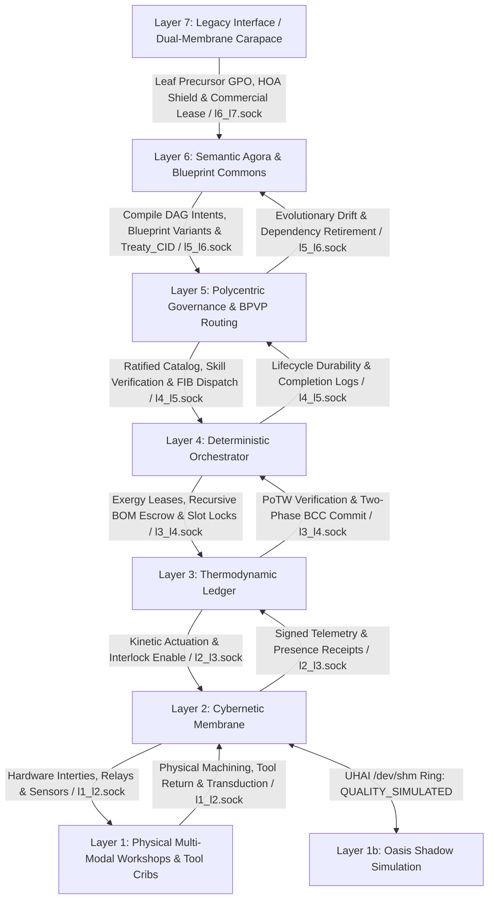
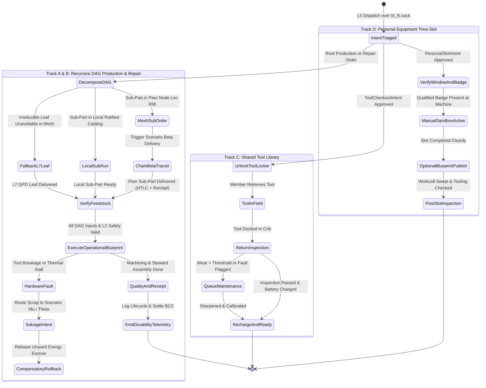
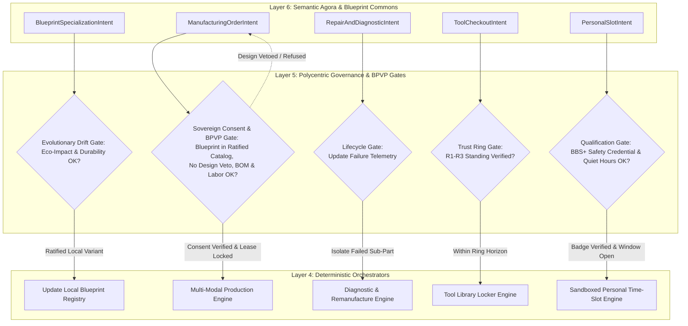
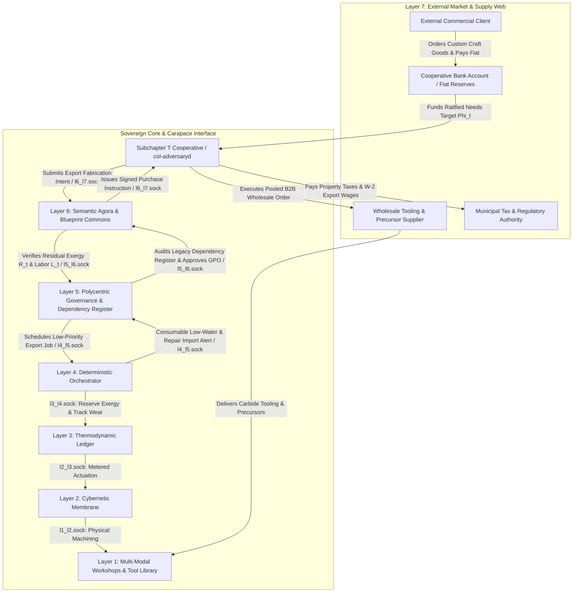

# Scenario Alpha: Distributed Design, Manufacturing, Repair & The Tool Commons

*   **Identifier:** `SCN-ALPHA-FAB`
*   **System Epic:** Bioregional Distributed Manufacturing, Parametric Blueprint Commons, Multi-Modal Workshop Capacity, Lifecycle Repair, Shared Tool Libraries, and Qualified Personal Maker Time-Slotting
*   **Primary Layers Tested:** L1 (Physical Reality), L1b (Oasis Shadow Simulation), L2 (Cybernetic Membrane), L3 (Thermodynamic Ledger), L4 (Deterministic Orchestrator), L5 (Polycentric Governance), L6 (Semantic Translation & Agora), L7 (Legacy Interface)
*   **Pass/Fail Metric:** End-to-end distributed design specialization, multi-modal manufacturing capacity advertisement, inter-node Bill of Materials (BOM) fulfillment, lifecycle repair feedback, shared tool library circulation, and credential-gated personal equipment time-slotting completed with verified Proof-of-Thermodynamic-Work (PoTW); zero centralized server dependencies; progressive evolutionary drift reducing Layer 7 dependency ($D_t$); and strict Layer 3 Pairwise Bilateral Clearing Channel (BCC) settlement with zero-sum conservation ($B_{u \to v}(t) + B_{v \to u}(t) = 0$).

---

## Architectural Council Ratification & 5-Perspective Synthesis

This scenario specification has been ratified by unanimous consensus of the 5-Persona Architectural Council to establish the macro-domain foundation for how The Collective designs, manufactures, repairs, and provisions materials and tools for its people:

| Council Persona | Disciplinary Representative | Core Contribution to Scenario |
| :--- | :--- | :--- |
| **Game Designer** | Lead Systems & Gameplay Designer | Multi-tiered workshop progression from Day-1 workbench carpentry to CNC metalworking, woodshops, polymer extrusion, and textile looms; tactical interplay between **Scheduled Collective Production**, **Shared Tool Library** circulation (borrowing tools multiplies construction/harvest efficiency and mood while accumulating tool wear), **Lifecycle Repair Loops**, and **Personal Time-Slotted Maker Sessions** (citizens booking workshop bays during off-peak windows for personal projects or *Dwarf Fortress* Strange Mood masterworks, gated by verified competency badges). |
| **Game Engineer** | Principal C++ Simulation & Engine Architect | Flecs ECS Data-Oriented Design (DOD): cache-aligned structs `WorkshopCapacityComponent`, `BlueprintVariantComponent`, `ToolLibraryLockerComponent`, `PersonalTimeSlotComponent`, `LifecycleDurabilityComponent`, and `ExergyEscrowComponent`; modular domain abstraction allowing **Oasis (Layer 1b)** to simulate a tractable subset of manufacturing modalities while collaborating upward across the `/dev/shm` UHAI boundary (`QUALITY_SIMULATED = 0x01`); compilable C++20 test harness strictly utilizing fixed-point SI integer math (`uint64_t` microjoules, `uint64_t` milligrams, `uint32_t` micrometers, `uint32_t` millikelvin, `uint32_t` basis points, `uint32_t` seconds). |
| **Sovereign Stack Specialist** | Sovereign Stack Systems Architect | Strict 7-layer adjacency without layer skipping (`l1_l2.sock` through `l6_l7.sock`, including `/run/collective/ipc/l4_l5.sock`); Layer 2 Zephyr RTOS zero-trust safety & interlock membrane (`col-sensord`, `col-actuated`); Layer 3 Pairwise Bilateral Clearing Channels (BCC) with conservation $B_{u \to v}(t) + B_{v \to u}(t) = 0$, mutual aid credit windows $[-C_{u \to v}, +C_{v \to u}]$, two-phase cryptographic delivery receipts $\sigma_{\mathrm{delivery}}$, and multi-hop chained HTLCs; Layer 5 Bioregional Path-Vector Protocol (BPVP / FRRP) advertising machine capacity, material stocks, and total cost (exergy + materials + wear + steward labor); evolutionary L5 policy drift minimizing the Layer 7 Dependency Ratio $D_t$. |
| **Solarpunk Thinker** | Bioregional Regenerative & Industrial Ecologist | Cosmopolitan Localism (*"Design Global, Manufacture Local"*): a planetary open-hardware blueprint commons adapted to local bioregional feedstocks (coppiced hardwoods from Scenario Eta, recycled alloys from Scenario Theta, reclaimed polymers from Scenario Mu); structural eradication of planned obsolescence via modular repairability and failure-mode telemetry feedback; neighborhood Tool Libraries replacing atomized consumer hoarding; protection of $R_0$ domestic tool sharing and unmonetized creative autonomy. |
| **Scenario Specialist** | Distributed Manufacturing & Open-Hardware Systems Architect | Multi-modal workshop taxonomy (Additive Polymer/Resin, Subtractive Woodshop & Joinery, Multi-Axis CNC & Metalworking, Electronics/Mechatronics, Industrial Textiles/Composites); parametric CAD/CAM blueprint specialization pairing L6 semantic BOMs with L4 BPMN operational routing sheets; non-destructive diagnostic and remanufacturing workflows; hardware interlock state machines transitioning cleanly between automated batch production and credentialed manual maker operation. |

Unanimous Consensus Reached across all five disciplinary perspectives.

---

## 1. Problem Statement, Legacy Failure & Domain Vision

In legacy industrial infrastructure (Layer 7), the design, manufacture, and maintenance of physical goods are severed from the communities that use them, producing three structural pathologies:
1.  **Intellectual Monopoly & Planned Obsolescence:** Corporations lock CAD geometries, schematics, and repair manuals behind proprietary walls, designing appliances, vehicles, and tools with brittle sub-components so a single worn bearing or fractured bracket forces the disposal of an entire assembly.
2.  **Transoceanic Supply Chain Fragility & Ecological Drag:** Everyday goods, spare parts, and building hardware are mass-produced in distant monoculture factories and shipped across oceans wrapped in single-use petrochemicals, embedding massive transport entropy while leaving local communities helpless during supply shocks.
3.  **Atomized Consumer Hoarding vs. Industrial Alienation:** At the household scale, dozens of neighbors redundantly purchase low-duty power tools, lawn mowers, and hobbyist machines that sit idle in private garages for over $9500\,\mathrm{bp}$ ($95\%$) of their lifespan. Simultaneously, industrial-grade machinery (CNC mills, timber jointers, metal lathes, welding bays) remains locked inside commercial factories where workers experience total alienation from what they make.

### The Collective Macro-Domain Vision
Scenario Alpha is not a narrow specification for a single 3D printer making trinkets; it is the architectural blueprint for **how The Collective designs, manufactures, repairs, and provisions materials, tools, and durable goods for its people**. 

Rather than attempting to replicate a massive, vertically integrated factory inside every neighborhood, The Collective operates as a **federated, bioregional manufacturing mesh**:
*   **Distributed Capacity Installation:** Individual Nodes install diverse physical manufacturing capacities—woodworking mills, CNC metalworking shops, polymer extruders, electronics labs, and textile looms—according to local steward skills and settlement needs.
*   **Mesh Capability & Cost Advertising:** Nodes advertise their installed manufacturing capabilities, available machine windows, and full production costs (incorporating thermodynamic exergy, material feedstock, tool wear, and skilled steward labor) to the bioregional mesh via Layer 5 (BPVP), backed by executable Layer 4 operational blueprints.
*   **Global Blueprint Commons with Local Nuances:** Every Node has access to a planetary open-source database of designs and the pooled material resources of the mesh, while retaining the creative capacity to fork and specialize blueprints for local materials, climate, and machinery.
*   **Repair & Evolutionary L5 Drift:** Repair and remanufacturing are first-class citizens. Empirical durability and failure telemetry feed back into Layer 5 governance, causing mesh policies to progressively **drift toward maximizing resource quality and longevity while reducing ecological impact and Layer 7 import dependence**.
*   **The Shared Tool Library:** Goods and tools that are naturally shared resources circulate through a tiered neighborhood and inter-node Tool Library rather than being hoarded privately.
*   **Time-Slotted Personal & Artisanal Use:** Outside of scheduled collective production workflows, manufacturing machinery can be time-slotted by any community member for personal, artistic, or experimental projects, provided they hold the required safety and competency qualifications.

This scenario intentionally captures a **rich, wide view of the entire distributed manufacturing domain** while sketching modular workflows that evolve over time—enabling **Oasis** to simulate, visualize, and collaborate on these mechanics even when implementing a focused subset at any given development stage.

---

## 2. The Six Pillars of Collective Design, Manufacture & Tool Stewardship

### Pillar I: Multi-Modal Workshop Capacity & Mesh Advertising
Nodes progressively install physical building and manufacturing capacity across five complementary workshop modalities:

| Modality Class | Representative Physical Equipment (L1) | Typical Outputs & Collective Goods |
| :--- | :--- | :--- |
| **1. Woodworking & Structural Joinery** | Sawmills, cabinet saws, helical planers, jointers, hollow-chisel mortisers, wood lathes, 3-axis CNC timber routers, steam-bending kilns. | Structural timber frames, insulated doors, cabinetry, tables, chairs, ergonomic tool handles, agricultural storage bins, beehive boxes. |
| **2. CNC Machining & Metalworking** | 3-to-5-axis CNC milling centers, precision metal lathes, plasma/fiber-laser sheet tables, hydraulic press brakes, TIG/MIG welding bays, heat-treat furnaces. | Mechanical gears, shafts, bearing housings, structural steel brackets, micro-hydro turbine runners, cargo-bike frames, rocket mass heater cores, hand-tool blades. |
| **3. Additive Polymer & Elastomer Forming** | High-speed CoreXY FDM extruders, SLA/MSLA photopolymer vats, pellet-fed large-format extruders, waste-polymer shredders & filament extruders, desiccant dry bays. | Custom microfluidic valves, TPU weatherproof seals and gaskets, electrical enclosures, assembly jigs, prosthetic sockets, rapid replacement appliance gears. |
| **4. Electronics, Winding & Mechatronics** | Precision PCB mills, pick-and-place assembly tables, hot-air reflow stations, stator coil winders, battery spot-welders, oscilloscope/logic test benches. | Layer 2 sensor/actuator carrier boards, MPPT solar charge controllers, brushless motor stators, battery pack busbars, LoRa mesh transceivers. |
| **5. Textiles, Cordage & Biocomposites** | Heavy-duty walking-foot sewing machines, ultrasonic seam welders, multi-harness looms, natural-fiber (hemp/flax/mycelium) compression molding presses. | Insulated bell-tent membranes, waterproof cargo tarps, climbing/rigging harnesses, workwear aprons, acoustic baffling panels, molded structural biocomposites. |

**Advertising Ratified Blueprints & Total Cost (Sovereign Voice in Production):**
A Node is never a voiceless, passive "job shop" forced to execute arbitrary toolpaths simply because it owns the machinery. Instead, each Node exercises total sovereign agency over what its workshops produce:
1.  **Catalog-Specific Capability Advertisements (`Ratified_Blueprint_Set`):** Through its Layer 5 daemon (`col-kmsd`), a Node advertises the **specific blueprints and specialized variants it has ratified and is willing to produce**, backed by tested Layer 4 operational recipes. Alongside each advertised `Blueprint_CID`, the Node publishes its **Total Production Cost Vector ($\mathbf{C}_{\mathrm{prod}}$)**:
    $$\mathbf{C}_{\mathrm{prod}} = \big\langle \mathrm{Blueprint\_CID}, \, \mathcal{E}_{\mathrm{active}}, \, \mathcal{E}_{\mathrm{feedstock}}, \, \mathcal{E}_{\mathrm{wear}}, \, L_{\mathrm{steward}}, \, \Delta t_{\mathrm{lead}} \big\rangle$$
    *   $\mathrm{Blueprint\_CID}$: Cryptographic identifier of the specific design the Node consents to manufacture.
    *   $\mathcal{E}_{\mathrm{active}}$: Direct electrical and thermal exergy required by the machinery (in integer microjoules, $\mu\mathrm{J}$).
    *   $\mathcal{E}_{\mathrm{feedstock}}$: Embodied thermodynamic cost and mass (in milligrams, $\mathrm{mg}$) of local raw materials consumed.
    *   $\mathcal{E}_{\mathrm{wear}}$: Amortized machine depreciation (spindle hours, cutter bit wear, nozzle abrasion) escrowed toward workshop maintenance.
    *   $L_{\mathrm{steward}}$: Skilled human craft and stewardship labor required for setup, fixturing, manual operations, post-processing, and quality inspection (measured in integer seconds, $\mathrm{s}$).
    *   $\Delta t_{\mathrm{lead}}$: Estimated queue + fabrication completion window (in milliseconds or seconds).
2.  **Unconditional Design Veto & Conscientious Refusal:** Nodes and their Stewards retain **absolute freedom to veto or refuse any design** they are uninterested in or ethically opposed to producing—even when their installed CNC mills, metal lathes, and 3D printers are physically capable of building it. For example, a Node may categorically refuse to manufacture weapon components, munitions, surveillance hardware, or disposable novelties. Custom or uncataloged fabrication requests from external peers must pass explicit Layer 5 guild review and Steward consent before they can be admitted to the Node's ratified catalog; individual Stewards also hold an inviolable right of conscientious refusal at the workcell level.

Under Layer 5 and Layer 3 rules, human craft labor ($L_{\mathrm{steward}}$) is **never** reduced to exploitative wage servitude: within a settlement it is honored via peer-attested **Reputational Wealth ($\mathcal{R}$)** in the Fabrication Guild and bounded by each Steward's voluntary self-reported capacity ceiling; across peering Nodes, labor-intensive fabrication orders are reciprocated through bilateral Stewardship Labor Dispatch, counter-seasonal resource deliveries, or agreed exergy clearing within Pairwise Bilateral Clearing Channels (BCC).

### Pillar II: Global Blueprint Commons & Local Specialization
Design in The Collective follows the principle of **Cosmopolitan Localism**: knowledge, physics, and engineering blueprints circulate globally as a universal commons, while physical matter is sourced and transformed as locally as thermodynamically possible.

1.  **Dual-Layer Blueprint Architecture (L6 Design + L4 Operational Recipe):**
    Every entry in the distributed Blueprint Commons (`col-commonsd`) is a content-addressed bundle linking:
    *   **Layer 6 Semantic Design (`BlueprintSpecification`):** Parametric CAD trees (OpenSCAD / STEP / 3MF), engineering tolerance callouts, exploded assembly/disassembly diagrams, and an abstract **Functional Bill of Materials (fBOM)** defined by material performance properties (e.g., `"ShearYield >= 250 MPa"`, `"FoodSafe = true"`) rather than rigid proprietary part numbers.
    *   **Layer 4 Operational Blueprint (`OperationalWorkflow`):** Deterministic BPMN state machines and parametric CAM toolpath generators executed by `col-execd`, orchestrating multi-stage production across automated machines and human workcells.
2.  **Local Nuance & Parametric Specialization (Forking):**
    A Node has the entire mesh's resources and the global blueprint database at its disposal, yet local climates, available feedstocks, and installed machine tools vary across bioregions. Stewards can create a **Localized Blueprint Variant (`BlueprintSpecialization`)** linked by cryptographic parentage (`parentBlueprintCid`) to the global master design:
    *   *Feedstock Specialization:* A watershed Node abundant in coppiced black locust and white oak (Scenario Eta) forks a global cargo-trailer blueprint—replacing welded tubular steel subframes with CNC-mortised, steam-bent hardwood laminations while keeping the standardized axle mounts identical.
    *   *Process Specialization:* A settlement lacking a 5-axis CNC mill specializes a micro-hydro impeller blueprint into a 2-piece investment-cast bronze hub (Scenario Theta) paired with 3-axis milled blades.
3.  **Recursive Workflow Chaining (DAG of Sub-Assemblies, Mesh Routing & Layer 7 Fallback):**
    Manufacturing a complex good (such as an electric cargo trike, a micro-hydro turbine, a CNC router, or a modular habitat unit) is never a flat, single-machine task—it is a **Recursive Directed Acyclic Graph (DAG) of Chained Workflows** that ties Scenario Alpha directly to **Scenario Beta (`SCN-BETA-TRANSIT`)** and all resource-producing scenarios (Eta, Theta, Mu, Nu, Xi):
    *   **Recursive BOM Decomposition:** When a root `ManufacturingOrderIntent` is initiated, Layer 4 (`col-execd`) and Layer 5 (`col-kmsd`) recursively traverse the blueprint's dependency tree from the final assembly down to raw precursors.
    *   **Tier 1 — Local Recursive Fabrication:** Any sub-assembly or intermediate part whose blueprint is in the local Node's ratified catalog and whose inputs exist in local stock spawns a child L4 operational workflow across local workshop bays.
    *   **Tier 2 — Federated Mesh Sub-Orders & Scenario Beta Transit Chaining:** If a sub-assembly requires machinery or feedstocks the local Node lacks (e.g., an induction-hardened steel shaft from Scenario Theta or a custom motor stator), Layer 5 matches the child intent against `Loc-RIB` BPVP capability advertisements from peered Nodes ($R_2 \dots R_4$). Accepting the child order at a sister Node automatically **chains into a Scenario Beta (`SCN-BETA-TRANSIT`) logistics workflow**, scheduling cargo-bike, EV utility van, or canal barge transport to deliver the finished sub-part to the parent Node's assembly bay, settled atomically via multi-hop HTLCs and two-phase sensor delivery receipts ($\sigma_{\mathrm{delivery}}$).
    *   **Tier 3 — Layer 7 Fallback for Irreducible Leaf Components:** When the recursive DAG traversal reaches a leaf component that **no reachable Node in the mesh can currently manufacture** (e.g., a specialized SiC MOSFET IC, precision ball-screw bearing, or carbide insert), the workflow does not stall; instead, it automatically spawns a bounded **Layer 7 Wholesale Procurement (`ProcurementIntent`)** for that specific leaf item, logs the dependency in the **Legacy Dependency Register**, and merges the imported part into the local assembly flow upon arrival.

### Pillar III: Lifecycle Repair & Evolutionary L5 Drift
Manufacturing and repair are unified into a single closed-loop lifecycle:

1.  **First-Class Repair & Remanufacturing Workflows:**
    Every durable item produced in the commons carries a physical identifier (laser-etched QR/DataMatrix or passive NFC tag) resolving to its exact `Blueprint_CID`, production batch attestation, and exploded repair tree. When an item experiences wear or mechanical failure:
    *   The item enters a **Diagnostic & Triage Workflow** at the local workshop.
    *   Rather than scrapping the product, Stewards inspect the exploded assembly, isolate the worn sub-component (e.g., a stripped gear, fatigued spring, dull cutter blade, or cracked housing), and trigger a targeted single-part fabrication or re-machining task.
    *   Irreparable fragments are routed via `SalvageIntent` to Scenario Mu / Scenario Theta for polymer re-granulation or metallurgical remelting.
2.  **Evolutionary L5 Governance Drift (Quality Up, Impact Down, L7 Dependence Down):**
    Every completed repair, premature component failure, and salvage event emits a signed **Lifecycle Telemetry Report** upward to Layer 5 and Layer 6. Over successive epochs, Layer 5 governance policies and BPVP routing heuristics **structurally drift** along three optimization vectors:
    *   **Vector 1 — Maximizing Resource Qualities & Durability:** Layer 5 tracks the empirical *Service-Hours-per-Megajoule* ($\eta_{\mathrm{durability}}$) of every blueprint variant. Designs with high modularity, standardized fasteners, and long mean-time-between-failures (MTBF) are automatically elevated as canonical defaults in `Loc-RIB`, while fragile designs that generate frequent repair tickets trigger redesign bounties in the Agora.
    *   **Vector 2 — Minimizing Ecological Impact:** Layer 5 dynamically weights the Thermodynamic Cost Functional $\mathcal{C}(\mathcal{P})$ to favor closed-loop salvaged feedstocks and regenerative bioregional materials over high-entropy virgin stocks, strictly enforcing local ecological floors ($F_{\mathrm{eco}}$).
    *   **Vector 3 — Asymptotic Reduction of Layer 7 Dependence ($D_t \to 0$):** Layer 5 maintains the **Legacy Dependency Register** (Chapter 8), calculating the settlement's Dependency Ratio:
        $$D_t = \frac{E^{\mathrm{fiat}}_t}{E^{\mathrm{in}}_t}$$
        Whenever recursive BOM trees or repair logs reveal recurring reliance on Layer 7 leaf imports, Layer 5 elevates those items to the top of the bioregional **Import-Substitution Priority Queue**. Neighboring Nodes coordinate via federation treaties to acquire the missing machine tooling or develop open-hardware equivalents—converting Layer 7 leaf imports into Mesh-fabricated branches and steadily retiring entries from the Legacy Dependency Register.

### Pillar IV: The Shared Tool Library
Because most hand tools, portable power tools, diagnostic instruments, and seasonal machines are needed intermittently by any single person, The Collective treats them as a **Shared Tool Commons** rather than atomized private commodities:

*   **Tiered Circulation Across Concentric Trust Rings:**
    *   **$R_0$ (The Hearth):** Everyday household tools (hammers, screwdrivers, sewing kits, kitchen knives) remain in unconditional, unmonitored domestic circulation with zero digital logging.
    *   **$R_1 / R_2$ (Settlement & Village Tool Cribs):** High-utility portable tools (cordless drills, circular saws, rotary hammers, thermal cameras, oscilloscopes, sewing machines, soil augers, cider presses, scaffolding) are housed in electronically latched neighborhood Tool Library bays and workshop cribs. Members check them out via `ToolCheckoutIntent`.
    *   **$R_3 / R_4$ (Watershed Mobile Tool Sharing):** Heavy, low-duty-cycle machinery (portable band-sawmills, hydraulic post-pounders, mini-excavators, mobile transformer oil-filter rigs) are shared across neighboring settlements via BPVP scheduling and bilateral clearing channels.
*   **Automated Condition Tracking & Preventative Care:**
    When a borrowed tool is returned to a Layer 1 locker bay, Layer 2 sensors verify physical presence, measure battery State-of-Charge (`soc_bp`), and log cumulative operating hours. If usage crosses a maintenance threshold—or if the borrower flags a dull blade or loose chuck upon return—Layer 4 automatically schedules a **`MaintenanceIntent`** (blade sharpening, bearing greasing, insulation testing, or calibration) before the tool is cleared for its next checkout.

### Pillar V: Time-Slotted Personal & Artisanal Use of Manufacturing Equipment
The workshop is a convivial space of human creativity, not merely a utilitarian fulfillment center. Outside of scheduled Layer 4 production workflows, **any piece of manufacturing equipment can be time-slotted by community members for personal, artistic, experimental, or educational use**.

1.  **Qualification-Gated Access (Integration with Scenario Kappa):**
    A member requests a personal machine window (e.g., 2 hours on the cabinet woodshop lathe, 90 minutes on the 3-axis CNC router, or an evening slot in the TIG welding booth) by submitting a **`PersonalSlotIntent`**. Layer 5 (`col-kmsd`) validates:
    *   **Competency Credential Verification:** The member presents a zero-knowledge BBS+ proof of an active, non-expired safety and operating credential matching the machine's hazard class (e.g., `Woodshop_Lathe_L2`, `CNC_Mill_Operator_L2`, `TIG_Welder_L3`).
    *   **Supervised Apprentice Mode:** If the member holds only a novice/apprentice credential (`L1`), the time-slot can still be booked provided a certified Steward (`L2/L3`) co-signs the slot as an in-person mentor, setting the Layer 2 hardware interlock to `ARMED_SUPERVISED`.
2.  **Schedule Arbitration & Boundary Constraints:**
    Layer 4 schedules personal time-slots into open capacity windows that do not preempt critical settlement survival jobs, while verifying that acoustic emissions respect neighborhood quiet hours (e.g., restricting high-decibel planer or plasma-table operation after dusk) and that microgrid energy reserves are above baseline.
3.  **Sandboxed Manual Operation & Open-Hardware Contribution:**
    When the member badges in at the physical machine to begin their slot, `col-execd` transitions the bay from `AUTOMATED_BPMN_QUEUE` to `PERSONAL_TIME_SLOT_ACTIVE`. Layer 2 continues enforcing non-negotiable physical safety invariants ($\mathbf{\Phi}$: dead-man switches, thermal cutoffs, dust collection airflow, optical light curtains), while granting the user full manual or local-CAM control. Items crafted during personal slots belong to the maker or their hearth; if a maker invents a useful jig, furniture piece, or tool improvement during their personal slot, they can one-click publish the CAD/CAM files to Layer 6 as a new contribution to the global Blueprint Commons.

### Pillar VI: Incremental Node Blueprints & Spatial Bootstrapping
A Fabrication Node does not spring into existence as a fully equipped industrial complex. The Blueprint Commons includes **Incremental Facility Blueprints (`NodeFacilityBlueprint`)** that guide a community from a single household seed into a purpose-built sovereign manufacturing hub across three evolutionary stages:

1.  **Stage 1 — The Suburban Garage Seed Node (`Node_Stage_1_Suburban_Garage`):**
    *   **Physical Footprint:** A single founder or household retrofits a standard residential garage with a neighborhood **Tool Library** smart-locker bank, a compact **Woodworking & Joinery Bench**, and a desktop **Polymer Extruder / Electronics Station** running on standard split-phase residential power + initial rooftop solar.
    *   **Layer 7 HOA & Municipal Interference Shielding:** Because suburban residential zones are heavily policed by Homeowners Associations (HOAs) and municipal code enforcement, Layer 7 (`col-adversaryd`) and Layer 4 apply strict protective camouflage and physical envelopes:
        *   *Legal Framing:* The garage tool library and workshop operate as a private, non-commercial unincorporated fraternal association (UUNAA § 6) among invited neighbors—maintaining zero street-facing signage, zero retail foot traffic, and zero commercial home-occupation triggers.
        *   *Acoustic, Visual & Electrical Envelopes:* Layer 2/4 enforces hard residential acoustic ceilings ($\le 550\,\mathrm{cB}$ at the property line), locks out high-decibel planers/routers outside midday hours, routes all tool pickups through scheduled driveway/porch locker slots to avoid parking congestion, and caps feeder draw to avoid residential transformer flags.
2.  **Stage 2 — The Light-Commercial Lease Shell (`Node_Stage_2_Commercial_Lease`):**
    *   **Physical Footprint:** As neighborhood participation, steward skills, and demand outgrow residential garage limits, the Node rents a small light-industrial bay or commercial storefront through its **Layer 7 Cooperative Carapace** (Subchapter T Worker Cooperative).
    *   **Self-Sustenance & Resource Accumulation:** Operating in a commercial/industrial zone legally unlocks three-phase power, heavy CNC milling centers, metal lathes, TIG welding bays, and commercial freight loading. Critically, the Layer 7 shell enables the Node to offer **high-craft commercial fabrication services** (using verified residual capacity $R_t, L_t$) to external legacy customers. Fiat revenue from these services pays the commercial lease, utility interties, and W-2 Living Threshold wages ($\tau_{\mathrm{live}}$), moving the Node to **complete financial self-sustenance** while accumulating a dedicated capital and land-acquisition reserve ($\Phi_{\mathrm{expansion}}$) alongside stockpiles of Collective-fabricated structural components.
3.  **Stage 3 — The Custom-Built Sovereign Fabrication Hub (`Node_Stage_3_Custom_Lot`):**
    *   **Land Liberation & Ecological Deconstruction:** Using the resources saved during Stage 2, the cooperative purchases either a vacant parcel or a blighted/obsolete suburban or commercial property. If an existing obsolete structure sits on the lot, the Node executes an **Ecological Deconstruction & Urban Mining Workflow** (chaining with Scenario Xi and Scenario Mu) to systematically dismantle the structure—reclaiming concrete as urbanite masonry, salvaging dimensional framing lumber, copper wiring, and steel beams, and remediating the soil.
    *   **State-of-the-Art Commons Construction:** The land is permanently removed from the speculative market into an **Irrevocable Community Land Trust / Perpetual Purpose Trust (PPT)**. Using the most advanced open-hardware architectural blueprints in Layer 6, the community constructs a custom, purpose-built Fabrication & Commons Node featuring passive-solar thermal mass, acoustic buffer zones, overhead gantry cranes, a 48V DC microgrid backbone, all five manufacturing modalities, and 24/7 street-accessible Tool Library cribs—capable of producing and repairing a vast catalog of goods for the entire watershed mesh.

### Pillar VII: Oasis Simulation Collaboration & Subset Modeling
Because Scenario Alpha spans a massive domain, its workflows are structured modularly so that **Oasis (the Layer 1b 3D Shadow Simulator)** can incorporate, test, and visually represent a representative subset of distributed manufacturing while collaborating seamlessly with the Sovereign Stack:

*   **Incremental Facility Progression in Gameplay:** Players experience the exact three-stage spatial evolution—starting in a constrained residential/camp seed workshop (managing acoustic and power limits), expanding into a self-sustaining workshop bay, and ecologically deconstructing obsolete ruins (`MAT_URBANITE_CHUNK`, salvaged timber) to erect a custom multi-modal Fabrication Hub.
*   **Recursive DAG & Multi-Source BOM Resolution:** When an Oasis settlement queues a complex structure or machine, the engine decomposes its BOM tree—crafting local sub-parts at installed stations, dispatching mesh sub-orders that trigger simulated Scenario Beta cargo deliveries, and highlighting remaining Layer 7 leaf imports so players can visually watch their settlement's Dependency Ratio $D_t$ decline as they unlock new workshop modalities.
*   **Tool Library & Wear Loop in Gameplay:** Agents in Oasis check out tools from the settlement Tool Locker before performing construction, earthworks, or forestry. Equipped tools boost work speed and reduce somatic caloric/stamina drain, while accumulating wear ticks that dynamically spawn workshop repair/sharpening tasks.
*   **Personal Time-Slots & Somatic/Psychological Homeostasis:** During off-shift hours or *Strange Moods*, simulated citizens book personal time-slots at workshop stations for creative crafting—restoring `Focus`, draining `Stress`, and generating unique high-durability artifacts or blueprint upgrades for the settlement.

---

## 3. The Collective Workflow (7-Layer Traversal)

All six operational flows of Scenario Alpha—**(1) Blueprint Specialization, (2) Recursive DAG Production & Mesh/L7 Fulfillment, (3) Lifecycle Repair, (4) Tool Library Checkout, (5) Personal Equipment Time-Slotting, and (6) Incremental Node Facility Expansion**—traverse canonically across the seven layers without layer skipping.



### Layer 1: Physical Ground Truth ( & Layer 1b: Oasis Simulation)
*   **Hardware Nodes (Multi-Modal Stationary Workshops):** Pure physical machinery across the settlement's fabrication bays (scaling from a Stage 1 residential garage woodshop/extruder bench to Stage 2 leased commercial bays and Stage 3 custom-built multi-modal halls): 3-axis CNC timber routers, helical planers, precision metal lathes, 3-to-5-axis CNC milling centers, TIG welding booths, CoreXY FDM polymer extruders, PCB milling/reflow stations, and industrial sewing/composite presses.
*   **Hardware Nodes (Shared Tool Library & Material Cribs):** Electronically latched physical tool lockers, charging racks, calibration cradles, and raw material stock racks (seasoned hardwood lumber stacks, ecologically salvaged urbanite/timber, recycled aluminum/steel bar stock, polymer filament/pellet hoppers, fastener bins).
*   **Physical Safety & Interlock Hardware:** Physical dead-man pedals, optical light curtains, emergency-stop mushroom contactors, dust-collector vacuum pressure switches, acoustic dampening enclosures, and badge/NFC reader coils at every machine station.
*   **Strict Layer Separation:** Layer 1 contains **zero software, zero firmware, zero cryptographic keys, and zero network routing**. All bus protocol decoding, sensor sampling, and cryptographic signing reside strictly in Layer 2. Meanwhile, **Layer 1b (Oasis)** models the digital-twin spatial voxel representation of these workshops, stockpiles, and agent interactions, emitting synthetic telemetry explicitly tagged with `QUALITY_SIMULATED (0x01)`.

### Layer 2: Cybernetic Membrane & Safety Interlocks
*   **Microcontroller Architecture:** Zero-trust edge microcontrollers (STM32H7 / ESP32-S3) executing the Zephyr RTOS sandbox (`col-sensord` and `col-actuated`), interfacing with Layer 1 motor drives, spindle VFDs, heater relays, and locker solenoids, paired with dedicated hardware security chips (Microchip ATECC608A).
*   **Fixed-Point SI Integer Ingress Telemetry (POSIX Sockets / CBOR):**
    *   `node/fab/cnc_mill_01/telemetry/spindle_power_mw` (Active spindle & axis power in milliwatts, `int64_t`)
    *   `node/fab/cnc_mill_01/telemetry/cutter_wear_um` (Estimated tool-tip wear in micrometers, `uint32_t`, e.g., $15\,\mu\mathrm{m}$)
    *   `node/fab/woodshop_01/telemetry/dust_airflow_ml_s` (Dust extraction airflow in milliliters per second, `uint32_t`)
    *   `node/fab/woodshop_01/telemetry/perimeter_acoustic_cb` (Property-line acoustic emission in centibels, `uint16_t`, e.g., $520\,\mathrm{cB}$ for Stage 1 HOA compliance)
    *   `node/fab/printer_01/telemetry/nozzle_temp_mk` (Extruder temperature in millikelvin, `uint32_t`, e.g., $513150\,\mathrm{mK}$)
    *   `node/fab/printer_01/telemetry/mass_consumed_mg` (Feedstock consumed in milligrams, `uint64_t`, e.g., $42500000\,\mathrm{mg}$)
    *   `node/tools/crib_01/telemetry/tool_present_mask` (Bitmask of docked library tools & charging states, `uint64_t`)
    *   `node/tools/rotary_hammer_04/telemetry/soc_bp` (Battery State-of-Charge in basis points, `uint16_t`, $0\dots 10000\,\mathrm{bp}$)
*   **Actuator Control & Qualification Interlock Invariant ($\mathbf{\Phi}$):** Physical machine contactors are energized by `col-actuated` only after verifying five hardware predicates: (1) valid Layer 3 exergy/time-slot lease, (2) hardware presence attestation of a qualified operator badge (or steward co-presence in `ARMED_SUPERVISED` mode), (3) dust/fume extraction active and acoustic emissions below zoning ceiling, (4) thermal and travel endstops within safe bounds, and (5) zero E-stop fault flags.

### Layer 3: Thermodynamic Ledger
*   **Pairwise Bilateral Clearing Channels (BCC):**
    Inter-node exchange of manufactured parts, recursive sub-assemblies, raw feedstocks, shared heavy tooling, and reciprocal fabrication labor settles through peer-to-peer bilateral clearing channels between peering nodes $u$ and $v$:
    $$B_{u \to v}(t) + B_{v \to u}(t) = 0$$
    Balances fluctuate strictly within ratified mutual aid credit windows:
    $$-C_{u \to v} \le B_{u \to v}(t) \le C_{v \to u}$$
*   **Proof-of-Thermodynamic-Work (PoTW) & Total Cost Accounting:**
    Exergy value is minted strictly when Layer 2 sensors verify useful physical work performed by integrated hardware:
    $$1\text{ Exergy Credit} \equiv 3600\text{ kJ} = 3{,}600{,}000{,}000{,}000\,\mu\mathrm{J}$$
    Total thermodynamic fabrication expenditure $\mathcal{E}_{\mathrm{fab}}$ is accounted in integer microjoules ($\mu\mathrm{J}$):
    $$\mathcal{E}_{\mathrm{fab}} = \int_{0}^{t} P_{\mathrm{active}}(\tau)\,d\tau + \sum_{k} m_{k} \cdot \epsilon_{\mathrm{emb},k} + \mathcal{E}_{\mathrm{wear}}$$
    where $P_{\mathrm{active}}$ is metered electrical/thermal power, $m_{k} \cdot \epsilon_{\mathrm{emb},k}$ is the embodied exergy of each material feedstock $k$ in the BOM, and $\mathcal{E}_{\mathrm{wear}}$ is machine tool depreciation credited to the workshop maintenance reserve. Human craft labor hours ($L_{\mathrm{steward}}$) are recorded alongside $\mathcal{E}_{\mathrm{fab}}$ to credit Steward Reputational Wealth ($\mathcal{R}$) and balance inter-node Stewardship Labor Dispatch without turning human care or domestic life into a commodity.
*   **Non-Financialization of $R_0$ Hearth & Personal Use:**
    Domestic tool sharing within the $R_0$ Hearth Sanctuary and personal educational/creative mentoring carry zero token accounting and zero financialization.
*   **Two-Phase Sensor Delivery Receipts:**
    When Node $u$ manufactures a component or lends a specialized tool to Node $v$, the reservation remains in escrow until the receiving hardware emits an Ed25519-signed delivery receipt:
    $$\sigma_{\mathrm{delivery}} = \mathrm{Sign}_{K_{\mathrm{receiver}}}\left( \mathrm{Hash}(Q_{\mathrm{measured}} \parallel \tau_{\mathrm{arrival}} \parallel \mathrm{Channel\_ID}) \right)$$
    Upon verification of $\sigma_{\mathrm{delivery}}$, `col-storaged` atomically updates the bilateral balance:
    $$B_{u \to v}(t^+) = B_{u \to v}(t) + Q_{\mathrm{measured}}$$
*   **Multi-Hop Chained HTLCs:**
    When a complex recursive assembly sources sub-components and Scenario Beta transit across intermediate mesh nodes, chained Hashed Timelock Contracts $\langle H(S), \Delta t, Q, u, v \rangle$ settle all intermediated bilateral channels atomically upon revelation of preimage $S$.
*   **Physical Demurrage & Currency Purity:** Static credit balances decay exponentially ($\mathcal{E}(t) = \mathcal{E}_0 e^{-\lambda t}$), and Layer 3 operates with zero global tokens, zero fiat currencies, and zero speculative markets.

### Layer 4: Deterministic Orchestrator
Executed by `col-execd` at a deterministic $10\,\mathrm{Hz}$ tick rate, Layer 4 coordinates the multi-track state machines of the Fabrication Commons:
1.  **Track A — Recursive DAG Manufacturing, Beta Transit Chaining & L7 Fallback:** Decomposes a root blueprint's Bill of Materials into a Directed Acyclic Graph (DAG) of child tasks: spawning local sub-assembly runs, dispatching inter-node sub-orders (chained with **Scenario Beta** transit workflows), issuing **Layer 7 `ProcurementIntent`** orders for irreducible leaf parts unavailable in the mesh, and sequencing final multi-machine assembly.
2.  **Track B — Lifecycle Repair & Diagnostics:** Routes damaged items through inspection, identifies the exact replacement part from the blueprint tree, schedules single-part fabrication, and emits empirical durability telemetry upon re-certification.
3.  **Track C — Tool Library Checkout & Maintenance:** Manages locker reservations, tracks return deadlines and battery recharge cycles (`soc_bp`), and automatically queues sharpening/calibration jobs when cumulative wear counters cross thresholds.
4.  **Track D — Personal Time-Slot Sandboxing:** Verifies L5 skill credentials and acoustic/energy windows, locks the machine bay against automated batch preemption for the booked duration, and delegates control to the local operator under L2 safety supervision.



*   **Boundary Socket Contract (`l4_l5.sock`):** POSIX non-blocking sequenced-packet Unix Domain Socket (`SOCK_SEQPACKET`) at `/run/collective/ipc/l4_l5.sock`. Downward frames carry ratified operational blueprints, BPVP Forwarding Information Base (FIB) routes, and verified time-slot authorizations; upward frames carry task completion attestations, tool wear alerts, and empirical component failure logs.

### Layer 5: Polycentric Governance, BPVP Routing & Evolutionary Drift
Executed by `col-kmsd`, Layer 5 governs how manufacturing capacities are advertised, how blueprints and materials are routed, who is qualified to operate hazardous equipment, and how the mesh evolves toward ecological autonomy:

*   **Cellular Autonomy, Sovereign Design Veto & Protocol of Refusal:** Every Node exercises absolute constitutional sovereignty over its workshops and what they produce:
    *   **Sovereign Design Veto:** A Node is never obligated to manufacture a design simply because its CNC mills, lathes, or 3D printers are physically capable of producing it. Nodes maintain an explicit **Ratified Blueprint Catalog (`Ratified_Catalog_Root`)** and an **Ethical Refusal Filter** (e.g., categorically vetoing weapon components, firearms receivers, munitions, or surveillance devices). Any incoming `ManufacturingOrderIntent` referencing an unratified or vetoed `Blueprint_CID` is deterministically rejected at the Layer 5 ingress filter before ever reaching Layer 4.
    *   **Sacred & Intimate Craft Protection:** Ceremonial vessels, culturally sacred carvings, and intimate hearth tools placed under the Protocol of Refusal are cryptographically excised from BPVP advertisements and external optimization.
*   **Autonomous Transit Veto (`No-Transit`):** Any Node may refuse heavy material freight or mobile machinery transport across its residential glades, forcing BPVP `Loc-RIB` tables to route around perimeter corridors.
*   **7-Tier Concentric Trust Rings ($R_0 \dots R_6$):**
    *   **$R_0$ (The Hearth):** Unconditional household tool sharing and domestic mending; zero surveillance or ledger logging.
    *   **$R_1$ (The Settlement / Guild Commons):** Supervised apprentice machine time-slots (`ARMED_SUPERVISED`, $\le 500\,\mathrm{m}$); local workbench access.
    *   **$R_2$ (The Village Commons):** Unsupervised personal equipment time-slotting for credentialed members ($\le 5\,\mathrm{km}$); automated Tool Library locker checkouts; full assembly voting standing.
    *   **$R_3$ (The Watershed Guild):** Pairwise BCC settlement for inter-node custom part fabrication, CNC/foundry capacity sharing, and mobile heavy tool lending ($\le 30\,\mathrm{km}$).
    *   **$R_4$ (Bioregional Federation):** Regional feedstock specialization, metallurgical billet exchange, and coordinated Import-Substitution campaigns ($\le 150\,\mathrm{km}$).
    *   **$R_5$ (Continental Macro-Mesh):** Delay-Tolerant Networking (DTN) synchronization of the global Open Hardware Blueprint Commons, parametric CAD libraries, and empirical failure-mode datasets ($\le 1{,}000\,\mathrm{km}$).
    *   **$R_6$ (The Ecumene):** Planetary open-hardware standards bodies and the Layer 7 commercial procurement perimeter.
*   **Bioregional Path-Vector Protocol (BPVP / FRRP):**
    Nodes advertise their ratified manufacturing catalog, shared tools, and surplus feedstocks via signed Capability Advertisements ($\mathcal{A}$):
    $$\mathcal{A} = \big\langle \mathrm{adv\_id}, \, v_{\mathrm{orig}}, \, \mathcal{T}_{\mathrm{res}}, \, \mathbf{u}, \, Q_{\mathrm{avail}}, \, [\tau_{\mathrm{start}}, \tau_{\mathrm{end}}], \, \mathcal{P}, \, \mathcal{C}, \, H_{\mathrm{ttl}}, \, \sigma \big\rangle$$
    where $\mathcal{T}_{\mathrm{res}} \in \{\mathrm{Exergy}, \mathrm{Mass}, \mathrm{Tool}, \mathrm{Service}\}$ covers raw materials (`Mass`), borrowable library equipment (`Tool`), and catalog-specific manufacturing capacity (`Service`), and $\mathbf{u}$ encodes the Merkle root/list of **Ratified Blueprint CIDs (`ratifiedBlueprintCids`) the Node consents to produce**, machine envelope specifications, total cost vector $\mathbf{C}_{\mathrm{prod}}$ (including steward labor), and required BBS+ safety credentials.
    *   **Export Surplus Bound ($Q_{\mathrm{avail}}$):**
        $$Q_{\mathrm{avail}}(t) = \max\left(0, \, Q_{\mathrm{inventory}}(t) - F_{\mathrm{eco}}(t) - B_{\mathrm{baseline}}(t)\right) \cdot \mathbf{1}_{\mathrm{export}}$$
        Neither raw materials nor workshop machine hours can be exported to external rings unless local ecological floors ($F_{\mathrm{eco}}$), local repair queues, and settlement survival baselines ($B_{\mathrm{baseline}}$) are fully satisfied.
    *   **Loop-Freedom Invariant:** Nodes immediately discard any advertisement where their own DID appears in the Ring-Path Vector $\mathcal{P}$.
*   **Evolutionary Drift Engine (Quality Maximization & L7 Retirement):**
    `col-kmsd` continuously evaluates upward repair and durability telemetry from Layer 4 to update its routing preference weights:
    1.  Blueprints with superior empirical longevity and repairability scores receive higher `Local_Pref` in `Loc-RIB`.
    2.  Blueprint variants substituting bioregional regenerative materials (e.g., coppiced hardwood or recycled alloy) for virgin imports reduce the path thermodynamic cost $\mathcal{C}(\mathcal{P})$.
    3.  Recurring Layer 7 imports logged in the **Legacy Dependency Register** trigger federated guild proposals to install local manufacturing tooling, driving the Dependency Ratio $D_t = E^{\mathrm{fiat}}_t / E^{\mathrm{in}}_t$ monotonically toward zero.
*   **Decaying & Capped Reputational Wealth ($\mathcal{R}$):** Stewards who maintain workshop tools, fulfill collective fabrication orders, author durable blueprint specializations, and mentor apprentices earn domain-specific Reputational Wealth in the Fabrication Guild, subject to exponential decay ($\tau_{\mathrm{half}} = 2\,\mathrm{years}$), sublinear voting caps ($\mathcal{W}_{\mathrm{steward}} \le 800\,\mathrm{bp}$), and private Care Leave Shields.

### Layer 6: Semantic Intent, Blueprint Commons & Agora Ontology
Executed by `col-commonsd`, Layer 6 maintains the distributed **Open Hardware Blueprint Commons** and compiles human/mesh intents into W3C JSON-LD Knowledge Artifacts and Tripartite Ricardian Treaties:
$$\mathrm{Treaty\_CID} = \mathrm{SHA256}\left( \mathrm{Text}_{\mathrm{prose}} \parallel \mathrm{Schema}_{\mathrm{JSON-LD}} \parallel \mathrm{Invariants}_{\mathrm{BPMN}} \right)$$

To support the full breadth of collective design, manufacture, repair, tool lending, and personal maker access, the Layer 6 Fabrication Ontology defines seven core intent branches:
1.  **`BlueprintSpecializationIntent`:** Publishes a localized parametric fork of a global blueprint (adapting materials, tolerances, or CAM toolpaths to local Node nuances) along with its L4 BPMN operational recipe.
2.  **`ManufacturingOrderIntent`:** Requests single-unit or batch production of a blueprint (assembling local + mesh BOM inputs, reserving machine & steward labor capacity).
3.  **`RepairAndDiagnosticIntent`:** Logs a worn or broken item for fault triage, targeted replacement-part fabrication, and empirical failure-mode reporting back to the blueprint lineage.
4.  **`ToolCheckoutIntent`:** Reserves a portable or mobile tool from the Shared Tool Library for a bounded window within verified Trust Ring constraints.
5.  **`PersonalSlotIntent`:** Books a time-slotted window on workshop manufacturing equipment for personal, artistic, or experimental use outside standard production procedures, gated by BBS+ qualification credentials.
6.  **`ProcurementIntent`:** Triggers federated BPVP discovery (or fallback L7 wholesale GPO requisition) when raw materials or specialized machine consumables breach low-water marks.
7.  **`SalvageIntent`:** Routes failed prints, machining swarf, sawdust, or end-of-life components to Scenario Mu / Scenario Theta / Scenario Eta for closed-loop material recovery.



### Layer 7: The Legacy Interface (Dual-Membrane Doctrine & Asymptotic Shrinkage)
The Fabrication Commons interfaces with the external legacy economy strictly through the Dual-Membrane Doctrine (`col-adversaryd`), designed to systematically obsolete itself over time:

1.  **Membrane 1 (External Legal Carapace):** The Node operates externally as a lawful Worker Cooperative or Social Purpose Corporation (Subchapter T, 26 U.S.C. §§ 1381–1388), supplemented by Inter-Cooperative Shared Services Agreements (SSAs) for regional CNC/foundry sharing and Uniform Unincorporated Nonprofit Association Act (UUNAA) mutual-aid pacts for neighborhood tool libraries.
2.  **Membrane 2 (Internal Sovereign Core):** Internally, all design, tool sharing, and fabrication run on open-source blueprints, physical exergy accounting, and bilateral clearing channels. Fiat currency **never** enters Layer 3, and Exergy Credits **never** convert into fiat.
3.  **Outward Craft Export from Verified Residuals ($R_t, L_t$):** When fiat currency is required to pay municipal property taxes or purchase un-substituted industrial precursors, the workshop fabricates high-craft custom goods (e.g., architectural timberwork, precision CNC components) for external commercial clients. Export orders use only verified exergy residual $R_t$ and voluntary export labor capacity $L_t$ after all internal survival, repair, and tool-library needs are met. Stewards performing export labor receive lawful W-2 wages up to the Living Threshold ($\tau_{\mathrm{live}}$), and commercial contracts include explicit curtailment clauses so human wellbeing and local baselines never degrade.
4.  **Inbound Wholesale Group Purchasing (GPO) & The Legacy Dependency Register:** Specialized industrial items not yet manufactured within the bioregional mesh (e.g., carbide end-mills, SiC power MOSFETs, precision linear rails, virgin polymer precursors) are tracked in Layer 5's **Legacy Dependency Register** and purchased in pooled B2B wholesale lots against ratified needs ceiling $\Phi_t$. As Nodes install new workshop tooling and specialize open-hardware blueprints to replace these imports, dependencies are formally retired and the Dependency Ratio $D_t$ shrinks monotonically toward zero.
5.  **Language Discipline:** All extractive metaphors are permanently retired per Chapter 8 in favor of the Dual-Membrane Doctrine, lawful engineering interties, regenerative harvesting, and honest craft dealing.



---

## 4. Machine-Readable Schemas

### 4.1 Layer 6 Knowledge Artifact: Specialized Blueprint & Production Order (`manufacturing_order.jsonld`)

This artifact illustrates a localized blueprint specialization (adapting a global solar-tracker drive bracket to use locally coppiced hardwood from Scenario Eta + a CNC-machined recycled bronze bushing from a peered foundry Node + a locally extruded TPU weather seal), along with its total cost vector (including steward labor).

```json
{
  "@context": [
    "https://schema.org/",
    "https://collective.network/ontology/v1/"
  ],
  "@type": "ManufacturingOrderIntent",
  "identifier": "urn:uuid:f47ac10b-58cc-4372-a567-0e02b2c3d479",
  "issuerDid": "did:peer:2.Ez6MksV7...issuerAlice",
  "creationTimestampMs": 1790778600000,
  "treatyCid": "bafybeihdwdcefgh4dqkjv67uzcmw7ojee6xedeet6wfvikrwho3qnwjxye",
  "blueprintProfile": {
    "@type": "BlueprintSpecialization",
    "blueprintCid": "bafybeicg24uqu4p2...local_locust_tracker_mount_v3",
    "parentBlueprintCid": "bafybeigdyrzt5sfp7...global_solar_tracker_mount_v1",
    "specializationNotes": "Substitutes steamed Black Locust structural arm (Scenario Eta) for imported 6061-T6 aluminum extrusion; retains standard ISO metric bronze sleeve bearing.",
    "operationalWorkflowUri": "ipfs://bafybeifx7...tracker_mount_multimodal.bpmn",
    "billOfMaterials": [
      {
        "componentId": "arm_structural_timber",
        "modalityRequired": "WOODSHOP_CNC_ROUTER_3AXIS",
        "materialClass": "HARDWOOD_BLACK_LOCUST_SEASONED",
        "sourceRing": "R1_LOCAL_STOCK",
        "massMilligrams": 1850000000
      },
      {
        "componentId": "bushing_sleeve_bronze",
        "modalityRequired": "METAL_LATHE_PRECISION",
        "materialClass": "ALLOY_SAE660_RECYCLED_BRONZE",
        "sourceRing": "R3_WATERSHED_PEER_NODE_07",
        "massMilligrams": 120000000
      },
      {
        "componentId": "seal_dust_gasket",
        "modalityRequired": "POLYMER_FDM_EXTRUDER",
        "materialClass": "ELASTOMER_TPU_RECYCLED",
        "sourceRing": "R1_LOCAL_STOCK",
        "massMilligrams": 42500000
      }
    ]
  },
  "productionCostVector": {
    "activeExergyMicrojoules": 1450000000000,
    "embodiedFeedstockMicrojoules": 2150000000000,
    "machineWearEscrowMicrojoules": 250000000000,
    "stewardCraftLaborSeconds": 2700,
    "estimatedLeadTimeMilliseconds": 14400000
  }
}
```

### 4.2 Layer 6 & Layer 2 Combined Schema: Personal Equipment Time-Slot & Completion Attestation (`personal_slot_attestation.json`)

This artifact shows a community member booking a 1-hour personal time-slot on the settlement's 3-axis CNC Woodshop Router using their Scenario Kappa qualification credential, alongside the Layer 2 hardware safety and completion attestation.

```json
{
  "@context": "https://collective.network/ontology/v1/",
  "@type": "PersonalTimeSlotAttestation",
  "slotIntentId": "urn:uuid:a19bc44e-81ff-4b10-9c12-7d88e1029a11",
  "machineHardwareDid": "did:peer:2.Ez6MkuQ9...deviceWoodshopRouter01",
  "memberPairwiseDid": "did:peer:2.Ez6MkxT2...makerMaya",
  "qualificationProof": {
    "credentialType": "Woodshop_CNC_Router_L2",
    "bbsPlusZeroKnowledgeProof": "0x9a8f7c6e5d4b3a21...bbs_zk_proof",
    "supervisionMode": "UNSUPERVISED_CERTIFIED"
  },
  "scheduledWindow": {
    "startTimestampMs": 1790790000000,
    "endTimestampMs": 1790793600000,
    "maxAcousticCentibels": 680,
    "allocatedExergyBudgetMicrojoules": 1800000000000
  },
  "layer2ExecutionMetrics": {
    "interlockPredicatesVerified": true,
    "dustExtractionMeanMlPerSec": 145000,
    "spindleActiveDurationSeconds": 2140,
    "energyConsumedMicrojoules": 1320000000000,
    "cutterWearDeltaMicrometers": 8,
    "emergencyStopTriggered": false
  },
  "commonsContribution": {
    "publishedToBlueprintCommons": true,
    "newBlueprintCid": "bafybeihk99...ergonomic_mortise_mallet_v1"
  },
  "hardwareSignature": "0x4f8a3c9b2e1d0f...atecc608a_ed25519_sig"
}
```

---

## 5. Oasis Engine Implementation Specification

### 5.1 Modular Domain Representation in Oasis (Layer 1b)
To allow **Oasis** to simulate and collaborate on distributed manufacturing without bogging down the real-time 60 FPS loop in low-level G-code parsing, the simulation models Scenario Alpha at the **Workcell, Blueprint BOM, Tool Library, and Time-Slot level**:
*   **Multi-Modal Workshop Voxels & ECS Stations:** Within the $32^3$ chunk space, workshop stations are represented by distinct voxel material IDs (`MAT_WORKSHOP_WOOD = 15`, `MAT_WORKSHOP_POLYMER = 16`, `MAT_WORKSHOP_METAL_CNC = 18`, `MAT_TOOL_LIBRARY_LOCKER = 17`) bound to `WorkshopCapacityComponent` structs tracking modality class, cutter/nozzle wear in micrometers, and active operational state (`IDLE`, `COLLECTIVE_PRODUCTION`, `REPAIR_TRIAGE`, `PERSONAL_TIME_SLOT`).
*   **Blueprint Specialization & Multi-Source BOM Resolution:** When an item or building component is queued, the Oasis orchestrator checks whether a localized blueprint variant reduces L7 imports, reserves local stockpile mass, and simulates BPVP sub-component fulfillment across Pairwise Bilateral Clearing Channels.
*   **Tool Library & Personal Time-Slot Simulation:** Simulated agents check out tools from `MAT_TOOL_LIBRARY_LOCKER` to gain construction/harvest efficiency bonuses while incrementing tool wear counters. During off-peak hours, qualified agents book `PERSONAL_TIME_SLOT` windows to craft personal items or resolve *Strange Moods*, directly improving psychological homeostasis.

### 5.2 C++20 Test Harness Structure (Fixed-Point SI Integer Math)

```cpp
// engine/tests/scenario_alpha_test.cpp
#include <cassert>
#include <cstdint>
#include <string>
#include <vector>

namespace oasis::scenario_alpha {

enum class WorkshopModality : uint8_t {
    WOODSHOP_JOINERY = 1,
    POLYMER_ADDITIVE = 2,
    CNC_METALWORKING = 3,
    ELECTRONICS_LAB  = 4,
    TEXTILE_LOOM     = 5
};

enum class StationMode : uint8_t {
    IDLE                    = 0,
    COLLECTIVE_PRODUCTION   = 1,
    REPAIR_AND_DIAGNOSTIC   = 2,
    PERSONAL_TIME_SLOT      = 3,
    MAINTENANCE_CALIBRATION = 4
};

enum class NodeFacilityStage : uint8_t {
    STAGE_1_SUBURBAN_GARAGE  = 1, // Tool library + woodshop bench (HOA acoustic/visual shield)
    STAGE_2_COMMERCIAL_LEASE = 2, // L7 cooperative shell lease, 3-phase CNC, self-sustaining
    STAGE_3_CUSTOM_SOVEREIGN = 3  // Purchased/deconstructed lot in PPT, full 5-modality hub
};

enum class DAGSourceTier : uint8_t {
    TIER_1_LOCAL_WORKSHOP     = 1,
    TIER_2_MESH_PEER_AND_BETA = 2, // Fabricated by peer Node + Scenario Beta transit
    TIER_3_LAYER7_LEAF_IMPORT = 3  // Irreducible leaf procured via L7 GPO
};

struct DAGComponentNode {
    std::string component_id;
    DAGSourceTier resolved_tier;
    uint64_t mass_mg;
    bool requires_beta_transit;
};

struct BlueprintVariant {
    std::string blueprint_cid;
    std::string parent_cid;
    uint64_t local_biomass_mg;       // Local regenerative material (e.g. hardwood/polymer)
    uint64_t mesh_peer_alloy_mg;     // Material sourced from R3 watershed peer node
    uint64_t l7_imported_mass_mg;    // Legacy imported material (targeted for drift -> 0)
    uint64_t required_exergy_uj;     // Total active + embodied exergy in microjoules
    uint32_t steward_labor_seconds;  // Skilled human craft labor in seconds
    uint32_t empirical_mtbf_hours;   // Measured durability for L5 evolutionary drift
};

struct SharedToolItem {
    uint32_t tool_id;
    uint16_t battery_soc_bp;         // 0 .. 10000 basis points
    uint32_t accumulated_wear_um;    // Wear in micrometers
    uint32_t maintenance_limit_um;   // Threshold triggering automated sharpening/repair
    bool checked_out;
};

struct WorkshopStation {
    NodeFacilityStage facility_stage;
    WorkshopModality modality;
    StationMode mode;
    uint16_t max_acoustic_cb;        // Centibel limit (<= 550 cB in Stage 1 Suburban Garage)
    uint32_t tool_wear_um;
    uint64_t local_feedstock_mg;
    uint64_t ecological_floor_mg;    // F_eco: inviolable local floor
    uint64_t baseline_reserve_mg;    // B_baseline: settlement survival reserve
};

// Layer 5 Export Surplus Bound: Q_avail = max(0, Q_inv - F_eco - B_base) * 1_export
inline uint64_t compute_export_surplus_mg(const WorkshopStation& st, bool export_ratified) {
    if (!export_ratified) return 0ULL;
    uint64_t floor_sum = st.ecological_floor_mg + st.baseline_reserve_mg;
    if (st.local_feedstock_mg <= floor_sum) return 0ULL;
    return st.local_feedstock_mg - floor_sum;
}

// Layer 5 Sovereign Design Consent & Veto Gate:
// Nodes only produce blueprints present in their ratified catalog and never produce vetoed items
inline bool is_blueprint_ratified_by_node(const std::vector<std::string>& ratified_catalog,
                                          const std::string& requested_blueprint_cid) {
    for (const auto& cid : ratified_catalog) {
        if (cid == requested_blueprint_cid) return true;
    }
    return false;
}

// Layer 4 Recursive DAG BOM Resolver: routes sub-assemblies to Local, Mesh (+Beta Transit), or L7 Leaf
inline DAGComponentNode resolve_dag_subcomponent(const std::string& comp_id,
                                                 uint64_t mass_mg,
                                                 bool in_local_catalog,
                                                 bool in_mesh_loc_rib) {
    if (in_local_catalog) {
        return {comp_id, DAGSourceTier::TIER_1_LOCAL_WORKSHOP, mass_mg, false};
    }
    if (in_mesh_loc_rib) {
        return {comp_id, DAGSourceTier::TIER_2_MESH_PEER_AND_BETA, mass_mg, true};
    }
    return {comp_id, DAGSourceTier::TIER_3_LAYER7_LEAF_IMPORT, mass_mg, true};
}

// Layer 5 Evolutionary Drift: returns true if candidate variant improves durability
// and strictly reduces Layer 7 dependency ratio (integer basis points comparison)
inline bool evaluate_l5_evolutionary_drift(const BlueprintVariant& incumbent,
                                           const BlueprintVariant& specialized) {
    uint64_t inc_total_mg = incumbent.local_biomass_mg + incumbent.mesh_peer_alloy_mg + incumbent.l7_imported_mass_mg;
    uint64_t spec_total_mg = specialized.local_biomass_mg + specialized.mesh_peer_alloy_mg + specialized.l7_imported_mass_mg;
    if (inc_total_mg == 0ULL || spec_total_mg == 0ULL) return false;

    // Dependency Ratio D_t in basis points: (l7_mass * 10000) / total_mass
    uint64_t inc_dependency_bp = (incumbent.l7_imported_mass_mg * 10000ULL) / inc_total_mg;
    uint64_t spec_dependency_bp = (specialized.l7_imported_mass_mg * 10000ULL) / spec_total_mg;

    return (spec_dependency_bp < inc_dependency_bp) &&
           (specialized.empirical_mtbf_hours >= incumbent.empirical_mtbf_hours);
}

// Pairwise Bilateral Clearing Channel (BCC) with zero-sum conservation
class PairwiseChannel {
public:
    PairwiseChannel(int64_t credit_limit_u_to_v, int64_t credit_limit_v_to_u)
        : limit_uv_(credit_limit_u_to_v), limit_vu_(credit_limit_v_to_u) {}

    bool reserve_lease(uint64_t amount_uj) {
        int64_t next_uv = balance_uv_ - static_cast<int64_t>(amount_uj);
        int64_t next_vu = balance_vu_ + static_cast<int64_t>(amount_uj);
        if (next_uv < -limit_uv_ || next_vu > limit_vu_) return false;
        escrowed_uj_ += amount_uj;
        return true;
    }

    bool commit_two_phase_receipt(uint64_t measured_uj, bool valid_ed25519_sig) {
        if (!valid_ed25519_sig || measured_uj > escrowed_uj_) return false;
        escrowed_uj_ -= measured_uj;
        balance_uv_ -= static_cast<int64_t>(measured_uj);
        balance_vu_ += static_cast<int64_t>(measured_uj);
        return true;
    }

    void abort_escrow(uint64_t amount_uj) {
        if (escrowed_uj_ >= amount_uj) escrowed_uj_ -= amount_uj;
    }

    int64_t balance_u_to_v() const { return balance_uv_; }
    int64_t balance_v_to_u() const { return balance_vu_; }

private:
    int64_t balance_uv_{0};
    int64_t balance_vu_{0};
    int64_t limit_uv_{0};
    int64_t limit_vu_{0};
    uint64_t escrowed_uj_{0};
};

void test_macro_manufacturing_and_tool_commons() {
    // 1. Stage 1 Bootstrap: Suburban Garage Seed Node (with HOA acoustic clamp <= 550 cB)
    WorkshopStation woodshop{
        .facility_stage = NodeFacilityStage::STAGE_1_SUBURBAN_GARAGE,
        .modality = WorkshopModality::WOODSHOP_JOINERY,
        .mode = StationMode::IDLE,
        .max_acoustic_cb = 550,
        .tool_wear_um = 10,
        .local_feedstock_mg = 50000000000ULL,
        .ecological_floor_mg = 10000000000ULL, // 10 kg ecological buffer
        .baseline_reserve_mg = 15000000000ULL  // 15 kg local repair baseline
    };
    assert(woodshop.max_acoustic_cb <= 550);

    // Advance Incremental Facility Blueprints: Stage 1 Garage -> Stage 2 Commercial Lease -> Stage 3 Custom Lot
    woodshop.facility_stage = NodeFacilityStage::STAGE_2_COMMERCIAL_LEASE;
    woodshop.max_acoustic_cb = 750; // Industrial zone acoustic allowance
    uint64_t salvaged_urbanite_mg = 2500000000000ULL; // Reclaimed from ecologically demolished structure
    if (salvaged_urbanite_mg > 0ULL) {
        woodshop.facility_stage = NodeFacilityStage::STAGE_3_CUSTOM_SOVEREIGN;
    }
    assert(woodshop.facility_stage == NodeFacilityStage::STAGE_3_CUSTOM_SOVEREIGN);

    // Verify BPVP export surplus bound: 50 kg - 10 kg - 15 kg = 25 kg available
    uint64_t q_avail = compute_export_surplus_mg(woodshop, true);
    assert(q_avail == 25000000000ULL);

    // 1b. Verify Sovereign Design Consent & Ethical Veto:
    // Even if physically capable of metal cutting & 3D printing, the Node only advertises and accepts
    // blueprints in its ratified catalog, deterministically vetoing prohibited designs (e.g. weapon parts).
    std::vector<std::string> node_ratified_catalog = {
        "bafy...local_locust_tracker_v3",
        "bafy...aquaponics_valve_gear_v2",
        "bafy...insulated_timber_door_v1"
    };
    assert(is_blueprint_ratified_by_node(node_ratified_catalog, "bafy...local_locust_tracker_v3") == true);
    assert(is_blueprint_ratified_by_node(node_ratified_catalog, "bafy...prohibited_weapon_receiver_v1") == false);

    // 1c. Verify Recursive DAG Workflow Chaining (Local + Mesh/Beta Transit + L7 Leaf Fallback)
    DAGComponentNode dag_arm = resolve_dag_subcomponent("arm_timber", 1850000000ULL, true, false);
    DAGComponentNode dag_bushing = resolve_dag_subcomponent("bushing_bronze", 120000000ULL, false, true);
    DAGComponentNode dag_mosfet = resolve_dag_subcomponent("sic_mosfet_die", 5000ULL, false, false);
    assert(dag_arm.resolved_tier == DAGSourceTier::TIER_1_LOCAL_WORKSHOP && !dag_arm.requires_beta_transit);
    assert(dag_bushing.resolved_tier == DAGSourceTier::TIER_2_MESH_PEER_AND_BETA && dag_bushing.requires_beta_transit);
    assert(dag_mosfet.resolved_tier == DAGSourceTier::TIER_3_LAYER7_LEAF_IMPORT && dag_mosfet.requires_beta_transit);

    // 2. Verify Blueprint Specialization & L5 Evolutionary Drift (reducing L7 dependence)
    BlueprintVariant global_master{
        .blueprint_cid = "bafy...global_tracker_v1",
        .parent_cid = "",
        .local_biomass_mg = 0ULL,
        .mesh_peer_alloy_mg = 200000000ULL,
        .l7_imported_mass_mg = 1800000000ULL, // 9000 bp (90%) L7 import dependence
        .required_exergy_uj = 5400000000000ULL,
        .steward_labor_seconds = 1800,
        .empirical_mtbf_hours = 8000
    };

    BlueprintVariant local_specialized{
        .blueprint_cid = "bafy...local_locust_tracker_v3",
        .parent_cid = "bafy...global_tracker_v1",
        .local_biomass_mg = 1850000000ULL,    // Locally coppiced Black Locust (Scenario Eta)
        .mesh_peer_alloy_mg = 120000000ULL,   // Recycled bronze bushing from R3 peer (Scenario Theta)
        .l7_imported_mass_mg = 0ULL,          // 0 bp L7 import dependence!
        .required_exergy_uj = 3850000000000ULL,
        .steward_labor_seconds = 2700,
        .empirical_mtbf_hours = 12000         // Higher durability verified via repair telemetry
    };

    assert(evaluate_l5_evolutionary_drift(global_master, local_specialized) == true);

    // 3. Execute Inter-Node Sub-Component Settlement via Pairwise BCC (Zero-Sum Conservation)
    PairwiseChannel bcc_channel(10000000000000ULL, 10000000000000ULL); // 10 MJ mutual aid window
    uint64_t bushing_exergy_cost_uj = 750000000000ULL;
    assert(bcc_channel.reserve_lease(bushing_exergy_cost_uj) == true);
    assert(bcc_channel.commit_two_phase_receipt(bushing_exergy_cost_uj, true) == true);
    assert(bcc_channel.balance_u_to_v() + bcc_channel.balance_v_to_u() == 0);

    // 4. Shared Tool Library Checkout, Wear Accumulation & Automated Maintenance Trigger
    SharedToolItem rotary_hammer{
        .tool_id = 402,
        .battery_soc_bp = 10000,
        .accumulated_wear_um = 480,
        .maintenance_limit_um = 500,
        .checked_out = false
    };

    // Member checks out tool in R2 Village Commons, uses it, and returns it to locker
    rotary_hammer.checked_out = true;
    rotary_hammer.battery_soc_bp = 3500;
    rotary_hammer.accumulated_wear_um += 35; // Crosses 500 um threshold (515 um)
    rotary_hammer.checked_out = false;

    if (rotary_hammer.accumulated_wear_um >= rotary_hammer.maintenance_limit_um) {
        woodshop.mode = StationMode::MAINTENANCE_CALIBRATION;
        // Steward sharpens/calibrates tool and recharges battery
        rotary_hammer.accumulated_wear_um = 0;
        rotary_hammer.battery_soc_bp = 10000;
        woodshop.mode = StationMode::IDLE;
    }
    assert(rotary_hammer.accumulated_wear_um == 0);
    assert(rotary_hammer.battery_soc_bp == 10000);

    // 5. Personal Equipment Time-Slot Booking (Credential-Gated Access)
    bool has_bbs_woodshop_credential = true;
    bool within_quiet_hours_limit = true;
    if (woodshop.mode == StationMode::IDLE && has_bbs_woodshop_credential && within_quiet_hours_limit) {
        woodshop.mode = StationMode::PERSONAL_TIME_SLOT;
    }
    assert(woodshop.mode == StationMode::PERSONAL_TIME_SLOT);
}

} // namespace oasis::scenario_alpha

int main() {
    oasis::scenario_alpha::test_macro_manufacturing_and_tool_commons();
    return 0;
}
```

---

## 6. Acceptance Test Gates (Pass/Fail)

| Checkpoint | Validation Method | Pass Condition |
| :--- | :--- | :--- |
| **G1: Ratified Blueprint Catalog Advertising, Design Veto & BCC Conservation** | BPVP Advertisement, Sovereign Veto & Bilateral Settlement Audit | Node broadcasts signed BPVP Capability Advertisements ($\mathcal{A}$) specifying the explicit `Ratified_Blueprint_Set` it consents to manufacture and their Total Production Cost Vectors $\mathbf{C}_{\mathrm{prod}}$ (active exergy, feedstock mass, wear escrow, and steward craft labor seconds); unratified or ethically refused designs (e.g., weapon components) are deterministically vetoed at Layer 5 regardless of physical machine capability; inter-node exchange settles via two-phase receipts ($\sigma_{\mathrm{delivery}}$) with strict zero-sum conservation $B_{u \to v}(t) + B_{v \to u}(t) = 0$. |
| **G2: Recursive DAG Workflow Chaining & Blueprint Specialization** | DAG BOM Decomposition, Scenario Beta Chaining & L7 Leaf Fallback | Complex assemblies decompose recursively into child sub-assembly tasks resolved across (1) local workshop bays, (2) peered mesh nodes chained into **Scenario Beta** transit deliveries via multi-hop HTLCs, and (3) Layer 7 wholesale GPO fallback for irreducible leaf components unavailable in the mesh. |
| **G3: Lifecycle Repair & Evolutionary L5 Drift ($D_t \to 0$)** | Repair Telemetry Ingestion & Route Re-Weighting | Damaged items trigger targeted single-part repair rather than full replacement; empirical failure/MTBF telemetry updates Layer 5 `Loc-RIB` weights to favor high-durability designs and monotonically decreases the settlement's Layer 7 Dependency Ratio $D_t = E^{\mathrm{fiat}}_t / E^{\mathrm{in}}_t$. |
| **G4: Shared Tool Library Circulation & Automated Care** | Locker Sensor Verification & Wear Thresholds | Portable tools circulate across $R_0 \dots R_3$ Trust Rings; returning a tool with accumulated wear exceeding its micrometer threshold ($\ge 500\,\mu\mathrm{m}$) automatically locks the tool from re-checkout until a `MaintenanceIntent` calibration and battery recharge (`10000 bp`) complete. |
| **G5: Qualified Personal Equipment Time-Slotting** | BBS+ Credential & Interlock Gate Verification | Community members holding valid Scenario Kappa BBS+ safety credentials book off-peak personal time-slots on manufacturing equipment (`PERSONAL_TIME_SLOT`); uncredentialed attempts are rejected by Layer 2 hardware interlocks unless co-signed by a present Steward (`ARMED_SUPERVISED`). |
| **G6: Incremental Node Blueprints & Dual-Membrane Shielding (L5/L7)** | Stage 1–3 Progression, HOA Shielding & Surplus Clamps | Node progresses cleanly from **Stage 1 Suburban Garage** (enforcing $\le 550\,\mathrm{cB}$ acoustic clamps and UUNAA fraternal shielding against HOA/municipal interference) to **Stage 2 Commercial Lease** (achieving self-sustenance via residual export services) to **Stage 3 Custom-Built / Ecologically Deconstructed Lot**; export surplus $Q_{\mathrm{avail}}(t)$ drops to $0$ whenever local inventory breaches $F_{\mathrm{eco}} + B_{\mathrm{baseline}}$. |
