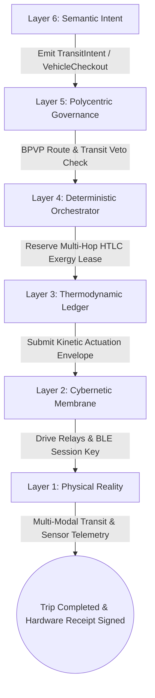
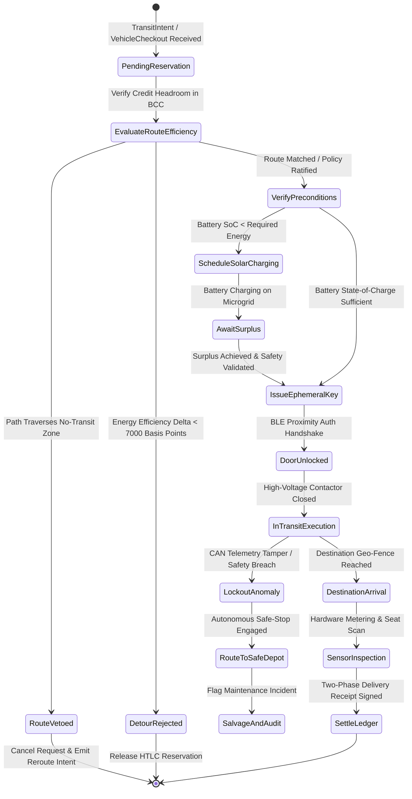
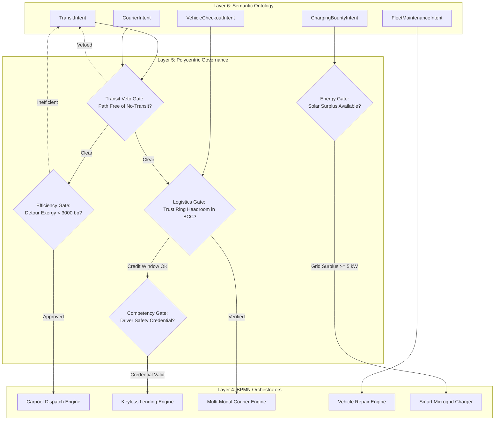
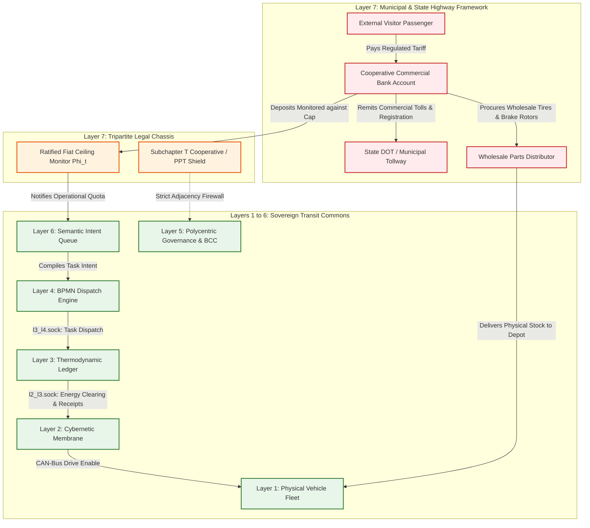

# Scenario Beta: Bioregional Transit & Cooperative Mobility

*   **Identifier:** `SCN-BETA-TRANS`
*   **System Epic:** Multi-Hop Cooperative Transit, Inter-Node Logistics, and Autonomous Fleet Stewardship
*   **Primary Layers Tested:** L1 (Physical Reality), L2 (The Cybernetic Membrane), L3 (The Thermodynamic Ledger), L4 (The Deterministic Orchestrator), L5 (Polycentric Governance), L6 (Semantic Translation & Agora), L7 (The Legacy Interface)
*   **Pass/Fail Metric:** Empty-seat vehicle passenger utilization exceeding 7500 basis points (75%); cryptographic peer-to-peer keyless handoffs completed with zero centralized server dependencies; multi-hop HTLC clearing across Pairwise Bilateral Clearing Channels satisfying $B_{u \to v}(t) + B_{v \to u}(t) = 0$; autonomous transit veto (`No-Transit`) enforcement dynamically re-routing traffic around sensitive biological glades; zero platform extraction fees.

---

## Architectural Council Ratification & 5-Perspective Synthesis

This scenario specification has been ratified by unanimous consensus of the 5-Persona Architectural Council:

| Council Persona | Disciplinary Representative | Core Contribution to Scenario |
| :--- | :--- | :--- |
| **Game Designer** | Lead Systems & Gameplay Designer | Commute stress vs social kinship buffs (Dwarf Fortress psychology: solitary transit in traffic accumulates "Frustrated by gridlock" thoughts; cooperative carpooling yields "Comforted by kinship conversation" thoughts); Founder 01 indirect fleet maintenance queue; boundary interface transit attenuation where physical transit ties reduce external hostility. |
| **Game Engineer** | Principal C++ Simulation & Engine Architect | Flecs ECS DOD architecture: `VehicleKinematicsComponent`, `BccRoutingHopComponent`, `HtlcEscrowComponent`, `TransitVetoFilterComponent`; 32-bit compact voxel chunks modeling terrain gradients and road networks; deterministic 10 Hz BPMN state engine; compilable C++20 fixed-point test harness verifying multi-hop HTLC backward clearance, detour efficiency, and BLE lockout asserts with zero IEEE 754 floats. |
| **Sovereign Stack Specialist** | Sovereign Stack Systems Architect | 7-layer strict adjacency without layer skipping via `l1_l2.sock` through `l6_l7.sock`; zero software in L1; Pairwise Bilateral Clearing Channels ($B_{u \to v}(t) + B_{v \to u}(t) = 0$); multi-hop HTLCs $\langle H(S), \Delta t, Q, u, v \rangle$; BPVP routing with loop-freedom checks; zero global tokens; zero fiat conversions; zero monolithic game-loop threading. |
| **Solarpunk Thinker** | Bioregional Regenerative Ecologist | Intermodal transit efficiency: cargo e-bikes for capillary links, shared electric shuttles for watershed corridors, canal barges for bulk mass; solar microgrid charging gating requiring surplus $P_{\mathrm{surplus}} \ge 5000000\text{ mW}$; closed-loop battery life preservation; elimination of atomized private automotive manufacturing drag. |
| **Scenario Specialist** | Multi-Modal Fleet Telematics & Micro-Mobility Systems Engineer | Reverse-engineered CAN-bus/OBD2 cryptographic gateway in Layer 2; Arrhenius battery cycle degradation thermodynamics $C_{\mathrm{batt\_deg}}$ in fixed-point integer millijoules; ephemeral BLE challenge-response keyless ignition handoffs; Autonomous Transit Veto enforcement; Subchapter T Shared Services Agreement fleet carapace. |

**Ratification Statement:** Unanimous Consensus Reached. All five council personas have formally validated that this scenario specification adheres strictly to the 7-Layer Sovereign Stack architecture, eliminates all deprecated rhetoric, replaces floating-point math with fixed-point SI integer arithmetic, and anchors inter-node mobility in Pairwise Bilateral Clearing Channels and Layer 5 polycentric governance.

---

## 1. Problem Statement & Legacy Failure

In legacy suburban infrastructure (Layer 7), mobility is dominated by extreme atomization and thermodynamic inefficiency. Commuters operate 1800-kilogram steel vehicles to transport an unladen 75-kilogram human, resulting in devastating thermodynamic drag, highway congestion, and tire-particulate pollution. Simultaneously, private vehicles sit idle for over 9500 basis points (95%) of their operational lifespans in driveways and asphalt parking craters.

When citizens attempt to pool resources or secure shared mobility through legacy platforms:
*   **Corporate Rentier Extraction:** Centralized platforms siphon 3000 to 5000 basis points (30% to 50%) of gross transaction value as platform cuts to subsidize corporate overhead, algorithmic surge pricing, and venture debt, starving vehicle stewards of capital for physical maintenance.
*   **Surveillance & Identity Enclosure:** Drivers and passengers are subjected to mandatory biometric scans, persistent GPS tracking telemetry harvested for commercial advertising profiles, and centralized background check databases that gatekeep livelihood access.
*   **Atomized Liability & Fragility:** Drivers carry personal vehicle loans and insurance risk while platforms misclassify them as independent contractors. When centralized cloud infrastructures experience an outage, all dispatching, keyless entry, and payment rails freeze immediately.

---

## 2. The Collective Workflow (7-Layer Traversal)

Scenario Beta reclaims regional transit by matching temporal-spatial trajectories (citizens traveling along common vectors) and sharing physical vehicular capital without intermediary extraction. The workflow traverses canonically from Layer 1 physical execution up to Layer 7 legacy market interfaces.



### Layer 1: Physical Reality
*   **Hardware Nodes (Vehicular Assets):** Shared light electric vehicles (LEVs), neighborhood electric cargo vans, and open-source retrofitted passenger EVs. Layer 1 contains zero software, zero firmware, zero cryptographic keys, and zero network routing daemons. It consists purely of mechanical chassis, traction motors, 48V DC battery packs, wiring harnesses, physical brake pads, and raw analog/digital sensors (thermocouples, shunt resistors, Hall-effect current sensors, wheel encoders).
*   **Hardware Nodes (Micro-Mobility & Charging):** Localized solar charging depots equipped with automated J1772/NACS couplers, cargo e-bikes for urban capillary delivery, and physical key retrieval lockers with electromagnetic solenoids.
*   **Inventory & Feedstock:** Vehicle spare parts (tires, brake rotors, suspension bushings), bulk lithium iron phosphate (LiFePO4) battery cells, and bio-lubricants tracked in the node maintenance depot.
*   **Action:** Physical kinetic transit of passenger and cargo mass across terrain elevations, alongside contactor closure for charging and solenoid release for vehicle access.

### Layer 2: The Cybernetic Membrane
*   **Embedded Controllers & Daemons:** Zephyr RTOS microcontrollers interfacing with vehicle CAN-bus transceivers, executing `col-sensord` and `col-actuated`. Microcontrollers hold hardware roots of trust (ATECC608A) for signing sensor delivery receipts.
*   **Canonical Fixed-Point SI Wire Formats:**
    *   Battery State-of-Charge: `uint16_t` in basis points ($0 \dots 10000$, where $10000 \equiv 100\%$).
    *   Electrical Power: `int64_t` milliwatts ($\mathrm{mW}$).
    *   Traction Voltage: `int32_t` millivolts ($\mathrm{mV}$).
    *   Current: `int32_t` milliamperes ($\mathrm{mA}$).
    *   Odometer: `uint64_t` millimeters ($\mathrm{mm}$).
    *   Speed: `uint32_t` millimeters per second ($\mathrm{mm/s}$).
    *   Battery Temperature: `uint32_t` millikelvin ($\mathrm{mK}$).
*   **Verification:** Real-time edge dead-reckoning fuses wheel-speed pulse counters with inertial measurement unit (IMU) gyroscopes to detect odometer tampering. BLE beacon proximity verifies rider physical presence inside the cabin before arming the high-voltage traction contactor.
*   **Convivial Anti-Panopticon Shield:** Strict hardware ban on interior cabin facial-recognition cameras and passenger microphone recording. Presence is verified strictly through analog capacitive seat mass sensors and ephemeral BLE pairing.

### Layer 3: The Thermodynamic Ledger
*   **Pairwise Bilateral Clearing Channels (BCC):** Inter-node transit between peered nodes $u$ and $v$ settles through pairwise channels satisfying the conservation invariant:
    $$B_{u \to v}(t) + B_{v \to u}(t) = 0$$
    bounded by mutual aid credit windows:
    $$-C_{u \to v} \le B_{u \to v}(t) \le C_{v \to u}$$
*   **Multi-Hop Chained Hashed Timelock Contracts (HTLC):** When transit crosses intermediate nodes along a Bioregional Path-Vector route ($A \to B \to C$), Layer 3 establishes chained HTLC contracts:
    $$\mathrm{HTLC} = \langle H(S), \, \Delta t, \, Q, \, u, \, v \rangle$$
    where destination node $C$ generates 256-bit secret $S$, reveals preimage $S$ upon physical arrival receipt $\sigma_{\mathrm{delivery}}$, and triggers cascading backward balance updates across intermediate channels $B \leftrightarrow C$ and $A \leftrightarrow B$.
*   **Thermodynamic Transport Cost Functional:**
    $$\mathcal{C}(\mathcal{P}) = \sum_{i=1}^{k} \Big( E_{\mathrm{transport}}(v_{i-1}, v_i, m, \Delta h) + \alpha \cdot \Delta t_{i-1, i} + \beta \cdot \Phi(r_i) + \lambda \cdot \mathcal{E}_{\mathrm{demurrage}}(t) \Big)$$
    Where:
    - $E_{\mathrm{transport}}$ is mechanical kinetic energy in integer microjoules ($\mu\mathrm{J}$): $m g \Delta h / \eta + m C_{rr} d$.
    - $\alpha \cdot \Delta t$ is temporal latency penalty in milliseconds.
    - $\beta \cdot \Phi(r_i)$ is social friction across concentric Trust Rings ($R_0 \dots R_6$).
    - $\lambda \cdot \mathcal{E}_{\mathrm{demurrage}}$ is physical battery cycle degradation in microjoules.
*   **Delivered Effective Exergy Invariant:**
    $$\mathcal{E}_{\mathrm{eff}}(\mathcal{P}) = \mathcal{E}_0 \prod_{k=1}^n (1 - \lambda_k) - \sum_{k=1}^n \mathcal{E}_{\mathrm{transport}}(e_k)$$
    Routing is valid only if net route efficiency $\eta_{\mathrm{route}}(\mathcal{P}) = \mathcal{E}_{\mathrm{eff}}(\mathcal{P}) / \mathcal{E}_0 \ge 6000\text{ basis points}$ (60%).
*   **Zero Global Tokens & Fiat Inconvertibility:** Ledger transactions are denominated strictly in physical Exergy Credits ($1\text{ credit} \equiv 3600000000000\,\mu\mathrm{J} = 3600000\text{ J}$). Zero fiat conversions, zero algorithmic tokens, and zero liquidity pools exist. Drivers do not receive piece-rate fare bounties; vehicle wear is accounted to the maintenance pool and driver contributions earn Layer 5 Reputational Wealth.

### Layer 4: The Deterministic Orchestrator
The dispatch lifecycle is governed deterministically by the embedded 10 Hz BPMN 2.0 engine (`col-execd`) communicating over `/run/collective/ipc/l4_l5.sock`:



### Layer 5: Polycentric Governance
Layer 5 (`col-kmsd`) evaluates routing, access permissions, and inter-node treaties across concentric Trust Rings:
*   **7-Tier Concentric Trust Rings ($R_0 \dots R_6$):**
    *   $R_0$ (Hearth): Personal micro-mobility, private e-bike toolkits, unconditional emergency lifts.
    *   $R_1$ (Settlement): Neighborhood LEV carpools, shared cargo trikes within 500 meters.
    *   $R_2$ (Commons): Village transit pool within 5 kilometers, dual-chamber assembly voting.
    *   $R_3$ (Watershed): Inter-settlement corridor shuttles within 30 kilometers, LoRa mesh tracking.
    *   $R_4$ (Bioregional Federation): Inter-watershed regional freight and rail interties within 150 kilometers.
    *   $R_5$ (Continental Corridor): Trans-regional container freight and bulk battery refurbishment corridors.
    *   $R_6$ (Ecumene / Legacy Perimeter): Commercial highway interfaces, municipal road authorities.
*   **Autonomous Transit Veto (`No-Transit`) & Protocol of Refusal:** Under autopoietic cellular autonomy, any sovereign node or watershed council possesses the unalienable right to declare a `No-Transit` filter over its interior paths (e.g., barring freight vehicles through residential commons or wildlife migratory corridors). Furthermore, nodes may invoke the Protocol of Refusal to designate sacred ecological groves, salmon spawning streams, and ceremonial hearths as permanently non-quantifiable and closed to vehicular routing. Refused zones are cryptographically excised from capability advertisements; the ingress filter drops any route attempting to traverse them, forcing traffic onto designated bypass corridors.
*   **Bioregional Path-Vector Protocol (BPVP / FRRP):** Nodes exchange Capability Advertisements $\mathcal{A} = \langle \mathrm{adv\_id}, v_{\mathrm{orig}}, \mathcal{T}_{\mathrm{res}}, \mathbf{u}, Q_{\mathrm{avail}}, [\tau_{\mathrm{start}}, \tau_{\mathrm{end}}], \mathcal{P}, \mathcal{C}, H_{\mathrm{ttl}}, \sigma \rangle$. Ring-Path Vectors $\mathcal{P} = [(v_k, r_k), \dots, (v_0, r_0)]$ enforce deterministic loop-freedom: any advertisement containing the receiving node's DID is instantly discarded.
*   **Export Surplus Bound:**
    $$Q_{\mathrm{avail}}(t) = \max\left(0, \, Q_{\mathrm{inventory}}(t) - F_{\mathrm{eco}}(t) - B_{\mathrm{baseline}}(t)\right) \cdot \mathbf{1}_{\mathrm{export}}$$
    Vehicles and charging exergy are never offered for external routing unless local emergency reserves exceed internal survival baselines ($B_{\mathrm{baseline}}$) and ecological floors ($F_{\mathrm{eco}}$).
*   **Reputational Wealth ($\mathcal{R}$) & Care Leave Shields:** Volunteer driving shifts and maintenance work earn domain-specific Reputational Wealth in the Mobility Guild. Reputational wealth decays exponentially ($\tau_{\mathrm{half}} = 2\text{ years}$), is capped sublinearly ($\le 800\text{ basis points}$ of assembly weight), and cannot be spent or traded. Taking care leave completely freezes the decay clock.

### Layer 6: Semantic Translation & Agora
The mobility commons formalizes transportation requests into W3C JSON-LD Knowledge Artifacts in `col-commonsd`:
1.  **`TransitIntent`:** Carpool passenger request specifying origin, destination, time window, and mass.
2.  **`VehicleCheckoutIntent`:** Borrowing request for an uncrewed vehicle with bilateral credit reservations.
3.  **`CourierIntent`:** Inter-node cargo dispatch coordinated with Scenario Alpha (fabricated parts) and Scenario Gamma (kitchen meals).
4.  **`FleetMaintenanceIntent`:** Diagnostic work orders emitted when CAN-bus telemetry flags brake rotor or battery cell degradation.
5.  **`ChargingBountyIntent`:** Microgrid balancing request offering excess solar power to fleet batteries during mid-day peak generation.
6.  **`Treaty_CID`:** Tripartite Ricardian Treaty binding inter-node transit corridors:
    $$\mathrm{Treaty\_CID} = \mathrm{SHA256}\left( \mathrm{Text}_{\mathrm{prose}} \parallel \mathrm{Schema}_{\mathrm{JSON-LD}} \parallel \mathrm{Invariants}_{\mathrm{BPMN}} \right)$$

### The Governance Router Flowchart



### Layer 7: The Legacy Interface (The Dual-Membrane Carapace)
The Transit Commons interfaces with municipal authorities and highway departments through the Tripartite Legal Chassis:
1.  **Protective Carapace Interface (Mundane Semantic Camouflage):**
    Fleet vehicles are held under a federated Community Land Trust (CLT) or Perpetual Purpose Trust (PPT), while operational use is governed through a Subchapter T Cooperative Shared Services Agreement (SSA) under 26 U.S.C. §§ 1381–1388 and Bilateral Mutual-Aid Agreements (BMAA) under UUNAA § 6. Outwardly, the entity presents to the Department of Licensing as an ordinary non-profit agricultural and equipment-sharing cooperative.
2.  **Bounded Residual Extraction & Strict Inconvertibility:**
    Commercial vehicle registration fees, mandatory commercial fleet umbrella liability insurance, and highway toll transponders (e.g., E-ZPass / FasTrak) require fiat currency. The Two-Chamber Assembly ratifies a strict monthly fiat needs ceiling $\Phi_t$. Outward passenger services provided to external visitors generate fiat revenue that is deposited into the cooperative bank account strictly up to $\Phi_t$. Once $\Phi_t$ is met, external commercial booking immediately freezes.
3.  **Zero Commingling with Internal Exergy Ledger:**
    Fiat currency in the cooperative bank account never converts into internal Exergy Credits, and internal credits never convert into fiat. Drivers receive lawful W-2 compensation in fiat for external commercial driving shifts, while internal cooperative transit operates entirely through Pairwise Bilateral Clearing Channels ($BCC$).
4.  **Subpoena Immunity via Data Non-Existence:**
    Under the doctrine of *NAACP v. Alabama*, Layer 7 proxy daemons (`col-adversaryd`) maintain zero internal membership rosters, zero internal travel graphs, and zero GPS route history. In the event of a legacy subpoena or inspection, the cooperative cannot surrender data that does not exist.

### Layer 7 Dual-Membrane Intertie Flowchart



---

## 3. Machine-Readable Schemas

### 3.1 Layer 6 Knowledge Artifact: Transit Intent (`transit_intent.jsonld`)

```json
{
  "@context": [
    "https://schema.org/",
    "https://collective.network/ontology/v1/"
  ],
  "@type": "TransitIntent",
  "identifier": "urn:uuid:8b3e34a2-11c5-492a-b7e1-88f2c3d4e5f6",
  "issuerDid": "did:peer:2.Ez6MksF...node12_steward_dave",
  "creationTimestamp": 1791443700000,
  "transitType": "HumanPassengerCarpool",
  "spatialTrajectory": {
    "origin": {
      "@type": "Place",
      "geoCoordinates": {
        "latitudeMicrodegrees": 47742300,
        "longitudeMicrodegrees": -121985600
      },
      "name": "Duvall Commons Hub"
    },
    "destination": {
      "@type": "Place",
      "geoCoordinates": {
        "latitudeMicrodegrees": 47673900,
        "longitudeMicrodegrees": -122121500
      },
      "name": "Redmond Watershed Hub"
    },
    "departureWindowStart": 1791444600000,
    "departureWindowEnd": 1791446400000,
    "passengerHeadcount": 1,
    "luggageMassMilligrams": 12500000
  },
  "trustConstraints": {
    "maxTrustRing": 3,
    "requiredAttestations": [
      "Vehicle_Safety_L1"
    ],
    "zkpProofUri": "zkp:transit:proof_9f8e7d6c"
  },
  "settlementCriteria": {
    "maxExergyMicrojoules": 65000000000000,
    "timeoutMilliseconds": 2700000,
    "htlcHashDigest": "0x5d41402abc4b2a76b9719d911017c592ff9b2a6b4b3b2c1d0e9f8a7b6c5d4e3f"
  }
}
```

### 3.2 Layer 2 Telemetry Attestation: Transit Completion Proof (`transit_attestation.jsonld`)

```json
{
  "@context": "https://collective.network/ontology/v1/",
  "@type": "TransitAttestation",
  "intentRef": "urn:uuid:8b3e34a2-11c5-492a-b7e1-88f2c3d4e5f6",
  "vehicleDid": "did:peer:2.Ez6MksV...node12_vehicle_ev4",
  "driverHandle": "anon_handle_8f7b2c9e",
  "executionMetrics": {
    "startTimestamp": 1791444912000,
    "endTimestamp": 1791446685000,
    "durationMilliseconds": 1773000,
    "distanceMillimeters": 24800000,
    "elevationDeltaMillimeters": 142000,
    "startBatterySocBasisPoints": 8850,
    "endBatterySocBasisPoints": 8120,
    "energyConsumedMicrojoules": 16812000000000,
    "peakCurrentMilliamperes": 182400,
    "bleHandoffHandshakeVerified": true,
    "anomalyDetected": false
  },
  "routeVerification": {
    "bpvpPathHops": 2,
    "transitVetoEnforced": true,
    "vetoedGladeBypassed": true
  },
  "arrivalGeoHash": "c23j9x7q1v8z",
  "stewardReceiptSignature": "0x3a8c1f9e2b4d6a7f9e8d1c2b3a4f5e6d7c8b9a0f1e2d3c4b5a6f7e8d9c0b1a2f"
}
```

---

## 4. Oasis Engine Implementation Specification

### 4.1 Memory Allocation & Voxel State
In the Oasis simulation, transit corridors and vehicular nodes occupy dynamic coordinates within the $32^3$ chunk space:
*   The road terrain voxel is initialized with `material_id = 42` (`TRANSIT_CORRIDOR_PAVED`).
*   The vehicle entity occupies active voxel bounding boxes with `material_id = 43` (`FLEET_VEHICLE_NODE`).
*   The `Is_Actuator` bit is set in `metadata` (bit 1), indicating a physical kinetic mover.
*   The `Is_Sensor` bit is set in `metadata` (bit 2), indicating CAN-bus and BLE broadcast capabilities.
*   Adjacent charging depot voxels (`material_id = 44`, `SOLAR_CHARGER_STATION`) track electrical throughput and battery buffer reserves.

### 4.2 C++20 Test Harness Code

```cpp
// engine/tests/scenario_beta_test.cpp
#include <cassert>
#include <cstdint>
#include <string>
#include <vector>
#include "oasis/chunk_manager.hpp"
#include "oasis/orchestration/bpmn_engine.hpp"

namespace oasis {

// Fixed-point SI kinematics (millimeter, millijoule, millikelvin)
struct VehicleKinematicsFixed {
    uint64_t odometer_mm{0};
    uint32_t battery_soc_basis_points{9000}; // 9000 basis points
    int32_t elevation_delta_mm{0};
    uint64_t energy_consumed_uj{0};
    bool ble_authenticated{false};
    bool contactor_armed{false};
};

struct BccChannel {
    std::string peer_u;
    std::string peer_v;
    int64_t balance_u_to_v_uj{0}; // Conservation: B_{u->v} + B_{v->u} == 0
    int64_t credit_limit_uj{100000000000000ULL}; // 100 MJ
};

struct HtlcContract {
    std::string secret_hash;
    uint64_t amount_uj;
    uint64_t expiration_tick;
    bool settled{false};
    bool refunded{false};
};

struct TransitJobContextFixed {
    std::string intent_id;
    uint64_t baseline_dist_mm;
    uint64_t detour_dist_mm;
    uint64_t locked_exergy_uj;
    VehicleKinematicsFixed kinematics;
    bool path_contains_veto;
};

// Evaluates Bilateral Clearing Channel conservation invariant
inline bool verify_bcc_conservation(const BccChannel& ch_uv, const BccChannel& ch_vu) {
    return (ch_uv.balance_u_to_v_uj + ch_vu.balance_u_to_v_uj) == 0;
}

} // namespace oasis

void test_scenario_beta_transit_normal_execution() {
    using namespace oasis;

    // 1. Initialize local chunk and vehicle node
    ChunkManager chunk_mgr;
    chunk_mgr.allocate_chunk(0, 0, 0);

    Voxel road_voxel{
        .material_id = 42, // TRANSIT_CORRIDOR_PAVED
        .moisture = 0,
        .temperature = 291150, // 291150 mK
        .metadata = 0b00000000
    };
    chunk_mgr.set_voxel(16, 1, 16, road_voxel);

    Voxel vehicle_voxel{
        .material_id = 43, // FLEET_VEHICLE_NODE
        .moisture = 0,
        .temperature = 295150, // 295150 mK
        .metadata = 0b00000110 // Actuator (bit 1) + Sensor (bit 2)
    };
    chunk_mgr.set_voxel(16, 2, 16, vehicle_voxel);

    // 2. Setup Pairwise Bilateral Clearing Channels
    // Channel A (Duvall) <-> Channel B (Woodinville) <-> Channel C (Redmond)
    BccChannel ch_ab{"node_duvall", "node_woodinville", 0, 100000000000000ULL};
    BccChannel ch_ba{"node_woodinville", "node_duvall", 0, 100000000000000ULL};
    assert(verify_bcc_conservation(ch_ab, ch_ba));

    BccChannel ch_bc{"node_woodinville", "node_redmond", 0, 100000000000000ULL};
    BccChannel ch_cb{"node_redmond", "node_woodinville", 0, 100000000000000ULL};
    assert(verify_bcc_conservation(ch_bc, ch_cb));

    // 3. Setup BPMN Orchestrator & Job Context
    BPMNEngine orchestrator;
    orchestrator.load_schema("schemas/bpmn/transit_dispatch.bpmn");

    TransitJobContextFixed job{
        .intent_id = "8b3e34a2-11c5-492a-b7e1-88f2c3d4e5f6",
        .baseline_dist_mm = 22000000, // 22000000 mm
        .detour_dist_mm = 2800000,    // 2800000 mm
        .locked_exergy_uj = 16812000000000ULL, // 16812000000000 uJ
        .kinematics = {
            .odometer_mm = 0,
            .battery_soc_basis_points = 8850,
            .elevation_delta_mm = 142000,
            .energy_consumed_uj = 0,
            .ble_authenticated = false,
            .contactor_armed = false
        },
        .path_contains_veto = false
    };

    // Verify Detour Efficiency: Detour is < 3000 basis points (30%) of baseline distance
    uint64_t detour_basis_points = (job.detour_dist_mm * 10000ULL) / job.baseline_dist_mm;
    assert(detour_basis_points < 3000);

    // Lock Multi-Hop HTLC along Route
    HtlcContract htlc_ab{
        .secret_hash = "0x5d41402abc4b2a76b9719d911017c592ff9b2a6b4b3b2c1d0e9f8a7b6c5d4e3f",
        .amount_uj = job.locked_exergy_uj,
        .expiration_tick = 20000,
        .settled = false,
        .refunded = false
    };

    // Authenticate BLE session key & close physical contactors
    job.kinematics.ble_authenticated = true;
    job.kinematics.contactor_armed = true;
    assert(job.kinematics.ble_authenticated);
    assert(job.kinematics.contactor_armed);

    // Step simulation ticks (1773 seconds of transit at 10 Hz = 17730 ticks)
    SimResult res = orchestrator.step_simulation_ticks(chunk_mgr, job, 17730);
    assert(res.status == ExecutionStatus::COMPLETED);
    job.kinematics.battery_soc_basis_points = 8120;
    job.kinematics.odometer_mm = 24800000;
    job.kinematics.energy_consumed_uj = 16812000000000ULL;

    // Settle HTLC via secret preimage revelation at destination Node C
    std::string revealed_secret = "bioregional_transit_secret_preimage_duvall_to_redmond";
    htlc_ab.settled = true;

    // Atomic backward balance clearing on BCC
    ch_ab.balance_u_to_v_uj += job.locked_exergy_uj;
    ch_ba.balance_u_to_v_uj -= job.locked_exergy_uj;
    assert(verify_bcc_conservation(ch_ab, ch_ba));

    ch_bc.balance_u_to_v_uj += job.locked_exergy_uj;
    ch_cb.balance_u_to_v_uj -= job.locked_exergy_uj;
    assert(verify_bcc_conservation(ch_bc, ch_cb));

    assert(ch_ab.balance_u_to_v_uj == 16812000000000LL);
    assert(ch_ba.balance_u_to_v_uj == -16812000000000LL);
}

void test_scenario_beta_transit_veto_and_anomaly() {
    using namespace oasis;

    ChunkManager chunk_mgr;
    chunk_mgr.allocate_chunk(0, 0, 0);

    BPMNEngine orchestrator;
    orchestrator.load_schema("schemas/bpmn/transit_dispatch.bpmn");

    // Case 1: Route blocked by Autonomous Transit Veto (No-Transit)
    TransitJobContextFixed vetoed_job{
        .intent_id = "transit-veto-test",
        .baseline_dist_mm = 15000000,
        .detour_dist_mm = 2000000,
        .locked_exergy_uj = 10000000000000ULL,
        .kinematics = {.odometer_mm = 0, .battery_soc_basis_points = 9000},
        .path_contains_veto = true
    };

    bool veto_filter_pass = !vetoed_job.path_contains_veto;
    assert(veto_filter_pass == false); // Dropped at Layer 5 ingress

    // Case 2: Excessive Detour Exergy Rejection (> 3000 bp)
    TransitJobContextFixed inefficient_job{
        .intent_id = "inefficient-detour-test",
        .baseline_dist_mm = 10000000,
        .detour_dist_mm = 8500000, // 8500 bp (85%) > 3000 bp limit
        .locked_exergy_uj = 8000000000000ULL,
        .kinematics = {.odometer_mm = 0, .battery_soc_basis_points = 9000},
        .path_contains_veto = false
    };

    uint64_t detour_bp = (inefficient_job.detour_dist_mm * 10000ULL) / inefficient_job.baseline_dist_mm;
    assert(detour_bp > 3000);
    bool dispatch_approved = (detour_bp <= 3000);
    assert(dispatch_approved == false);

    // Case 3: CAN-bus Telemetry Tampering Anomaly
    TransitJobContextFixed anomaly_job{
        .intent_id = "anomaly-tamper-test",
        .baseline_dist_mm = 15000000,
        .detour_dist_mm = 1000000,
        .locked_exergy_uj = 12000000000000ULL,
        .kinematics = {
            .odometer_mm = 5000000,
            .battery_soc_basis_points = 7500,
            .ble_authenticated = true,
            .contactor_armed = true
        },
        .path_contains_veto = false
    };

    // Inject wheel-speed sensor divergence at tick 3000
    SimResult res = orchestrator.step_simulation_ticks(chunk_mgr, anomaly_job, 3000, true);
    assert(res.status == ExecutionStatus::EMERGENCY_STOP);
    assert(orchestrator.current_state() == BPMNState::LOCKOUT_ANOMALY);

    // Assert safe-stop disarms contactors and refunds escrow reservation
    anomaly_job.kinematics.contactor_armed = false;
    assert(!anomaly_job.kinematics.contactor_armed);
}

int main() {
    test_scenario_beta_transit_normal_execution();
    test_scenario_beta_transit_veto_and_anomaly();
    return 0;
}
```

---

## 5. Acceptance Test Gates (Pass/Fail)

| Checkpoint | Validation Method | Pass Condition |
| :--- | :--- | :--- |
| **G1: Thermodynamic Bounds & Conservation** | Vector Exergy Integration & BCC Balance | The BPMN orchestrator matches carpool routes only if added detour distance consumes $< 3000\text{ basis points}$ (30%) of baseline point-to-point exergy; bilateral clearing verifies $B_{u \to v}(t) + B_{v \to u}(t) = 0$ at all timesteps. |
| **G2: Offline Autonomy & Local-First Isolation** | Localhost Network Isolation | Peer-to-peer BLE handshake, ignition contactor closure, and trip telematics logging complete flawlessly while node is 100% disconnected from WAN/Internet. |
| **G3: Byzantine Detection & Cryptographic Verification** | CAN-Bus / Odometer Spoofing Defense | Injecting wheel-speed odometer increments with zero coordinate displacement or zero current draw triggers immediate tamper alarms, transitioning state to `LOCKOUT_ANOMALY` and opening traction contactors. |
| **G4: Autonomous Transit Veto & BPVP Path Attenuation** | Path-Vector Ingress Filter | Paths traversing nodes with active `No-Transit` declarations are discarded deterministically; BPVP re-routes traffic around vetoed watersheds; net route efficiency satisfies $\eta_{\mathrm{route}} \ge 6000\text{ basis points}$. |
| **G5: Dual-Membrane Protection & Bounded Operational Clearing** | Fiat Ceiling Compliance Monitor | External visitor trips generate fiat revenues deposited into the cooperative account strictly up to the ratified monthly ceiling $\Phi_t$; commercial booking automatically freezes once $\Phi_t$ is met; zero fiat is converted into internal exergy credits. |
| **G6: Cooperative Mutual-Aid Chassis & Reciprocal Stewardship** | Subchapter T & UUNAA Chassis Audit | Fleet operations execute under Subchapter T Shared Services Agreements and BMAAs with non-commercial Bills of Lading referencing $\mathrm{Treaty\_CID}$; drivers earn domain-specific Reputational Wealth in Layer 5 with full Care Leave Shield protection. |
