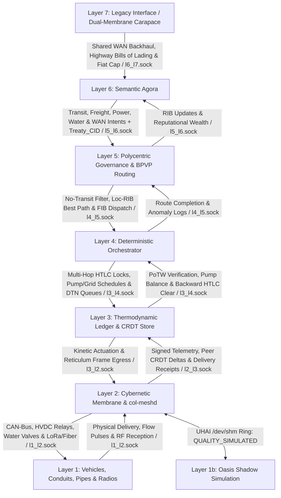
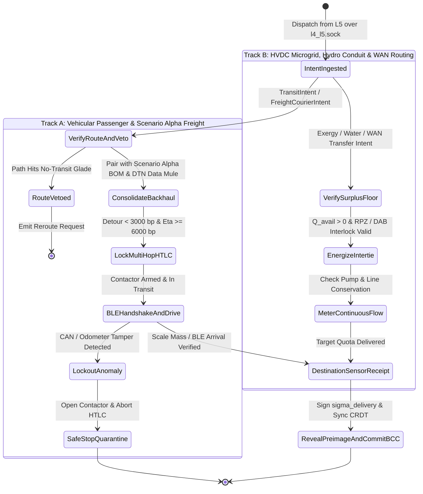
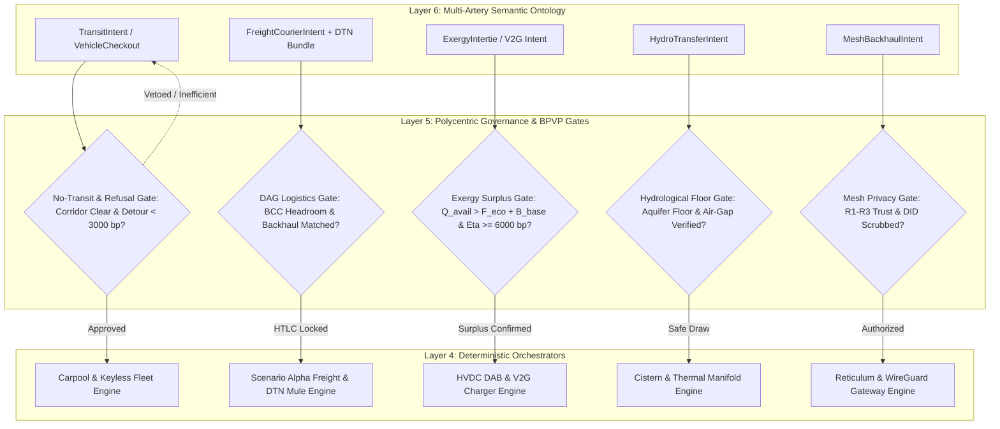
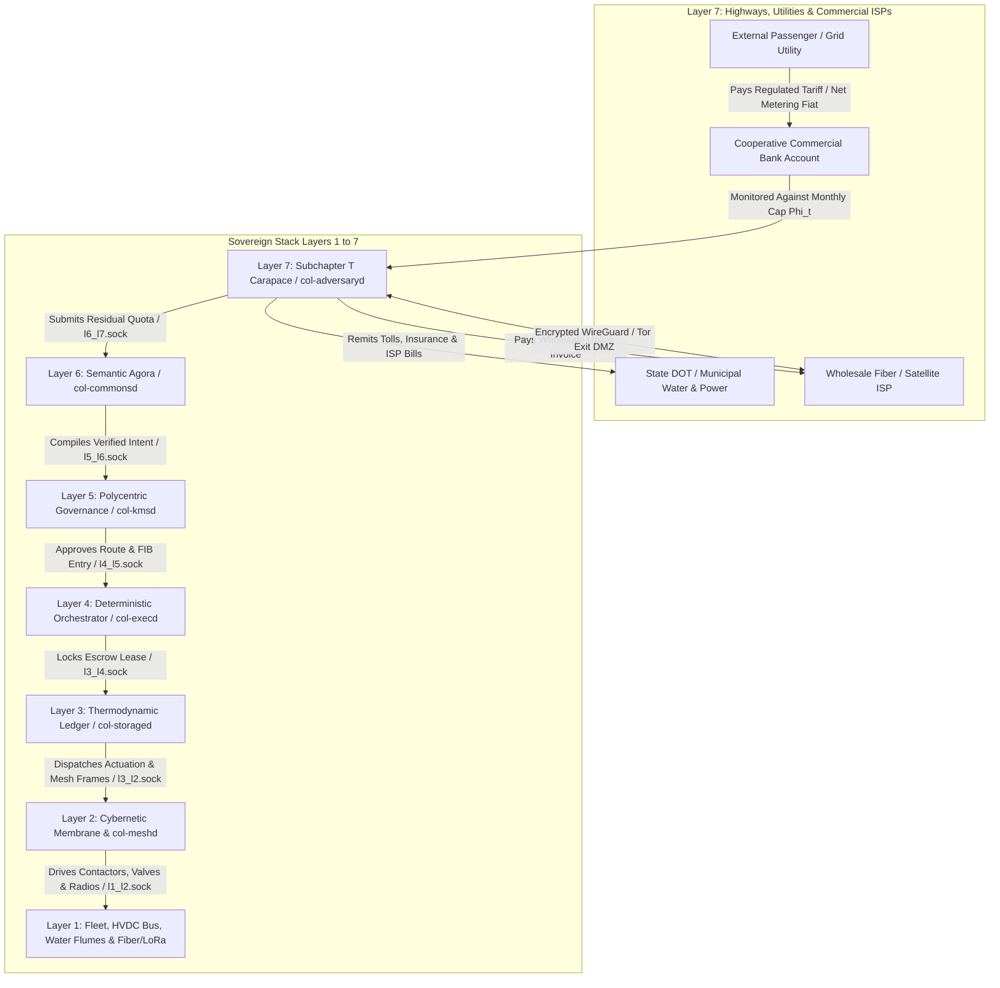

# Scenario Beta: Bioregional Logistics, Multi-Modal Distribution & The Mesh Arteries

*   **Identifier:** `SCN-BETA-TRANS`
*   **System Epic:** Five-Artery Bioregional Distribution (People, Scenario Alpha Materials & Freight, Electrical Exergy, Hydrological Water Loops, and Mesh Data/WAN Backhaul), Node Genesis Daemon Bring-Up, and Layer 3 Inter-Node Communication
*   **Primary Layers Tested:** L1 (Physical Reality), L1b (Oasis Shadow Simulation), L2 (Cybernetic Membrane & Reticulum Mesh), L3 (Thermodynamic Ledger & CRDT Sync), L4 (Deterministic Orchestrator), L5 (Polycentric Governance & BPVP Routing), L6 (Semantic Translation & Agora), L7 (Legacy Interface)
*   **Pass/Fail Metric:** Unified multi-modal distribution across all five physical/digital arteries completed with net route thermodynamic efficiency $\eta_{\mathrm{route}}(\mathcal{P}) \ge 6000\text{ basis points}$ ($60\%$); deterministic bottom-up Genesis spawning of the 7-layer daemon stack; partition-tolerant Layer 3 CRDT delta synchronization and multi-hop HTLC clearing across Pairwise Bilateral Clearing Channels satisfying $B_{u \to v}(t) + B_{v \to u}(t) = 0$; strict enforcement of Autonomous Transit Vetos (`No-Transit`) and hydrological mass-energy conservation; zero centralized cloud dependencies or platform extraction fees.

---

## Architectural Council Ratification & 5-Perspective Synthesis

This scenario specification has been ratified by unanimous consensus of the 5-Persona Architectural Council to establish the macro-domain circulatory system of The Collective:

| Council Persona | Disciplinary Representative | Core Contribution to Scenario |
| :--- | :--- | :--- |
| **Game Designer** | Lead Systems & Gameplay Designer | Five-artery logistics gameplay in Oasis: connecting **People Mobility** (convivial carpools vs. solitary gridlock stress), **Material & BOM Hauling** (moving Scenario Alpha sub-assemblies, timber, and urbanite between stockpiles and peer depots), **Microgrid Power Lines**, **Water/Thermal Pipes**, and **Mesh Comms Towers / Data Mules**; tactile "Red Lever" manual overrides during storm partitions; visible Genesis daemon bring-up sequence lighting up settlement HUD overlays (`F1–F4`). |
| **Game Engineer** | Principal C++ Simulation & Engine Architect | Flecs ECS Data-Oriented Design (DOD): `VehicleKinematicsComponent`, `FreightContainerComponent`, `MicrogridIntertieComponent`, `HydroConduitComponent`, `MeshLinkComponent`, and `DaemonSupervisorComponent`; Successive Over-Relaxation (SOR) electrical/fluid solver integration; deterministic 10 Hz BPMN state engine (`col-execd`); compilable C++20 fixed-point test harness verifying multi-modal routing, pump mass-energy balance, Genesis daemon bring-up, and Layer 3 CRDT/HTLC clearance with zero IEEE 754 floats. |
| **Sovereign Stack Specialist** | Sovereign Stack Systems Architect | Complete specification of **Node Genesis Daemon Spawning** (`col-sensord`/`col-actuated`/`col-membraned`/`col-meshd` $\to$ `col-storaged` $\to$ `col-execd` $\to$ `col-kmsd` $\to$ `col-commonsd`/`col-gatewayd` $\to$ `col-adversaryd`) across strict POSIX Unix Domain Sockets (`l1_l2.sock` through `l6_l7.sock`); deep specification of **Layer 3 Inter-Node Communication** (Pre-Partition Cryptographic Sharding $\mathcal{S}_{\mathrm{local}}(u)$, Automerge/Yrs CRDT vector-clock delta gossip over Reticulum/DTN, Two-Phase Delivery Receipts $\sigma_{\mathrm{delivery}}$, and chained multi-hop HTLCs $\langle H(S), \Delta t, Q, u, v \rangle$). |
| **Solarpunk Thinker** | Bioregional Regenerative Ecologist | Watershed-scale metabolism: replacing atomized 1800-kilogram solo automobiles and fossil-fuel freight with capillary cargo e-bikes, shared electric shuttles, canal barges, gravity-fed water flumes, asynchronous HVDC microgrid sharing, and Delay-Tolerant Networking (DTN) "sneakernet" data mules; strict protection of wildlife corridors via `No-Transit` vetos and unconditional $R_0$ survival baselines for water, power, and emergency transit. |
| **Scenario Specialist** | Multi-Modal Logistics, Microgrid & Mesh Telecommunications Engineer | CAN-bus/OBD2 vehicular telemetry and ephemeral BLE keyless handoffs; isolated $380\,\mathrm{V}$ HVDC Dual-Active-Bridge (DAB) inter-node power converters and $1:1$ dry isolation transformers; Reduced Pressure Zone (RPZ) and atmospheric air-gap hydrological backflow prevention; OS2 single-mode optical fiber, Semtech SX1262 LoRa ($915\,\mathrm{MHz}$), IEEE 802-11ah HaLow, and encrypted WireGuard/Tor Layer 7 WAN backhaul sharing. |

**Ratification Statement:** Unanimous Consensus Reached across all five disciplinary perspectives.

---

## 1. Problem Statement, Legacy Failure & Macro-Domain Vision

In legacy industrial infrastructure (Layer 7), the physical and digital arteries that sustain human settlements—passenger transit, material freight, electrical grids, municipal water mains, and internet telecommunications—are fragmented into extractive monopolies and brittle centralized topologies:
1.  **Atomized Passenger & Freight Waste:** Commuters pilot 1800-kilogram steel vehicles to move a single 75-kilogram human while private cars sit idle for over $9500\,\mathrm{bp}$ ($95\%$) of their lifespan. Simultaneously, commercial delivery vans run overlapping, half-empty routes to drop off single-use packaged parcels, while corporate ride-share and delivery platforms siphon $3000\,\mathrm{bp}$ to $5000\,\mathrm{bp}$ ($30\%$ to $50\%$) of gross transaction value and harvest continuous biometric and GPS surveillance.
2.  **Centralized Utility & Telecom Fragility:** Legacy AC electrical grids, pressurized water mains, and ISP backhauls are engineered as top-down radial trees with zero local autonomy. When a storm severs a transmission line or an ISP cloud authentication server fails, entire neighborhoods lose power, water pressure, and local communication simultaneously—even if abundant solar capacity, cistern water, and local compute sit yards away.
3.  **Severed Supply Webs:** Because material logistics, energy distribution, and data routing are locked inside separate corporate silos, local workshops cannot dynamically coordinate sub-assembly freight, share surplus microgrid power, or route data offline across peer neighborhoods.

### The Collective Macro-Domain Vision
Scenario Beta is the **Circulatory System and Multi-Modal Distribution Engine of The Collective**. Rather than treating "transit" narrowly as passenger carpooling, Scenario Beta establishes a unified physical and cybernetic logistics mesh across **five foundational distribution arteries**:
1.  **People Logistics:** Capillary micro-mobility, shared vehicle lending, and trajectory-matched cooperative transit.
2.  **Material, Tool & Sub-Assembly Freight (Tying Directly to Scenario Alpha):** Intra-node stockpile hauling and inter-node milk-runs, container consolidation, backhaul optimization, and mobile heavy tool transport that power Scenario Alpha's recursive DAG manufacturing and repair workflows.
3.  **Electrical Exergy Distribution:** Intra-node $48\,\mathrm{V}$ DC buses, inter-node asynchronous $380\,\mathrm{V}$ HVDC microgrid conduits, and vehicular mobile battery ferrying (V2G).
4.  **Hydrological & Thermal Fluid Distribution:** Gravity-fed rainwater/aquaponics flumes, potable water manifolds, greywater reed-bed loops, and buried PEX-a district heating cascades.
5.  **Data, Mesh Communications & Shared Internet Access (Plus Genesis Daemon Bring-Up & Layer 3 Sync):** Multi-tiered local-first data distribution over OS2 optical fiber, LoRa/HaLow Reticulum radio mesh, vehicular Delay-Tolerant Networking (DTN) "sneakernet" data mules, and federated Layer 7 WAN/Internet backhaul sharing—alongside the exact architecture for **how a Node spawns its 7-layer daemon stack at Genesis and how Layer 3 ledgers communicate across the mesh**.

---

## 2. The Six Pillars of Bioregional Distribution & Mesh Integration

| Distribution Artery | Physical Medium & Conduits (L1) | Routed Unit (SI Integer) | Primary Scenarios Linked |
| :--- | :--- | :--- | :--- |
| **1. Passenger Mobility** | Footpaths, cargo/passenger e-bikes, shared LEVs, watershed electric shuttles, canal ferries. | Passenger-millimeters & kinetic microjoules ($\mu\mathrm{J}$) | Scenario Zeta (Lodging), Epsilon (Coworking), Chi (Paramedic) |
| **2. Material & BOM Freight** | Hand-carts, utility e-trikes, electric cargo vans, standardized smart-containers, canal barges. | Mass in milligrams ($\mathrm{mg}$) & volume in milliliters ($\mathrm{mL}$) | **Scenario Alpha (Recursive DAG BOMs & Tool Library)**, Gamma, Eta, Theta, Mu |
| **3. Electrical Exergy** | $48\,\mathrm{V}$ DC internal busbars, $380\,\mathrm{V}$ HVDC inter-node feeders, DAB converters, V2G battery packs. | Electrical work in microjoules ($\mu\mathrm{J}$) & power in milliwatts ($\mathrm{mW}$) | Scenario Alpha (Workshops), Upsilon (Grid Shock), Tau (Genesis) |
| **4. Water & Thermal Fluids** | Gravity flumes, cistern balance pipes, RPZ air-gaps, buried twin-pipe PEX-a thermal loops. | Volume in milliliters ($\mathrm{mL}$) & thermal state in millikelvin ($\mathrm{mK}$) | Scenario Gamma (Kitchen), Eta (Agroforestry), Xi (Architecture) |
| **5. Data & WAN Backhaul** | Single-mode OS2 optical fiber, SX1262 LoRa, IEEE 802-11s/HaLow, vehicular DTN drives, L7 WireGuard/Tor uplinks. | Verified CBOR/CRDT frames (bytes) & bandwidth (bits/s) | Scenario Iota (Epistemic), Tau (Genesis), Alpha (Blueprint Commons) |

### Pillar I: Convivial Passenger Mobility (People Logistics)
Passenger transit replaces solitary automotive commuting with a tiered mobility commons across Concentric Trust Rings:
*   **Capillary Micro-Mobility ($R_0 \dots R_1$):** Walkable settlement cores, human-powered bicycles, shared cargo e-bikes, and low-speed accessibility pods operate unconditionally within residential glades, keeping heavy steel vehicles out of living spaces.
*   **Trajectory-Matched Carpooling & Keyless Fleet Sharing ($R_2 \dots R_3$):** For trips between villages and watershed hubs ($\le 30\,\mathrm{km}$), Layer 6 matches riders traveling along overlapping spatial-temporal vectors (`TransitIntent`) or authorizes uncrewed vehicle borrowing (`VehicleCheckoutIntent`) for members holding a verified `Vehicle_Safety_L1` credential. Detours are accepted only if incremental exergy expenditure remains below $3000\,\mathrm{bp}$ ($30\%$) of baseline point-to-point energy and total seat utilization targets $\ge 7500\,\mathrm{bp}$ ($75\%$).
*   **Convivial Anti-Panopticon Shield:** Interior cabin surveillance cameras, microphones, and persistent personal GPS histories are banned at the hardware level. Occupancy and handoffs are verified via analog capacitive seat mass sensors and ephemeral Bluetooth Low Energy (BLE) cryptographic challenge-response tokens.

### Pillar II: Material, Tool & Sub-Assembly Freight (Integration with Scenario Alpha)
Scenario Beta provides the physical logistics spine that turns Scenario Alpha's distributed workshops into a single bioregional production engine:
1.  **Chained Recursive DAG Freight:** When a Node in Scenario Alpha decomposes a complex blueprint into a recursive Directed Acyclic Graph (DAG) and sources child sub-assemblies from peered Nodes (e.g., cast bronze hubs from Node B in Scenario Theta, seasoned Black Locust beams from Node C in Scenario Eta, and PCBs from Node D), Layer 4 automatically chains each child `ManufacturingOrderIntent` into a Scenario Beta **`FreightCourierIntent`**.
2.  **Container Consolidation, Milk-Runs & Backhaul Optimization:** Rather than dispatching dedicated single-item trips, `col-execd` consolidates freight into standardized, modular smart-totes (equipped with passive NFC/QR manifests and shock/temperature loggers) along scheduled watershed milk-runs. The routing engine actively pairs outbound deliveries with reciprocal inbound backhauls (e.g., delivering finished CNC brackets to an agricultural Node and returning with kilned lumber or kitchen produce for Scenario Gamma), maximizing load factor and minimizing net transport entropy $E_{\mathrm{transport}}$.
3.  **Mobile Heavy Tool Library Transport:** When a settlement borrows a heavy shared asset from the $R_3 / R_4$ Tool Library (such as a portable band-sawmill, mobile hydraulic press, or trencher), Scenario Beta schedules the flatbed trailer tow, verifies hitch and brake safety predicates, and clears transport exergy across the borrower's Pairwise Bilateral Clearing Channel.

### Pillar III: Electrical Exergy Distribution & Asynchronous Microgrids
Electrical power is routed and accounted for as a first-class physical logistics flow:
1.  **Intra-Node $48\,\mathrm{V}$ DC Native Backbone:** Within each Node, solar MPPT controllers, wind/micro-hydro rectifiers, $\mathrm{LiFePO_4}$ battery banks, and workshop DC motor drives couple directly to a native $48\,\mathrm{V}$ DC bus (backed by supercapacitor ride-through rails), eliminating the $2600\,\mathrm{bp}$ ($26\%$) triple-conversion losses of legacy AC inverter topologies.
2.  **Inter-Node Asynchronous HVDC Interties ($R_1 \dots R_3$):** Synchronizing $60\,\mathrm{Hz}$ AC phase angles ($\delta$) across independent neighborhood microgrids invites catastrophic circulating currents and cascading brownouts. Instead, peered Nodes connect via buried $380\,\mathrm{V}$ (or $800\,\mathrm{V}$) **Asynchronous High-Voltage DC (HVDC) Interties** terminated by galvanically isolated Dual-Active-Bridge (DAB) DC-DC converters and $1:1$ dry isolation transformers. Power flows deterministically in integer milliwatts ($\mathrm{mW}$) only when commanded by a signed Layer 3/4 `ExergyTransferOrder`, with resistive line loss ($I^2 R \Delta t$) metered at both endpoints.
3.  **Vehicular Energy Ferrying (Mobile V2G Logistics):** For Nodes not yet connected by buried copper/aluminum feeders, the shared EV fleet doubles as a **Mobile Energy Packet Network**. During midday solar peaks, idle fleet vehicles absorb excess generation via bidirectional J1772/NACS chargers (`ChargingBountyIntent`) and physically drive or commute to energy-deficit peer Nodes, discharging into their local $48\,\mathrm{V}$ bus upon arrival.

### Pillar IV: Hydrological & Thermal Fluid Distribution (Water Logistics)
Water and thermal fluids circulate through gravity-prioritized, physically legible conduits:
1.  **Three-Stream Conduit Separation:**
    *   *Potable Water:* Roof rainwater cisterns and filtered well/spring headers feed domestic hearths and Scenario Gamma kitchens. Any fallback connection to a legacy municipal water main is physically isolated by a **Reduced Pressure Zone (RPZ)** assembly and an open vertical **Atmospheric Air Gap** ($\Delta h \ge 2 \times D_{\mathrm{pipe}}$), making back-siphonage contamination physically impossible.
    *   *Greywater & Ecological Filtration:* Domestic wash water routes by gravity through subsurface horizontal-flow constructed wetlands (*Typha* and *Phragmites* reed beds) and aquaponics swales.
    *   *District Thermal Cascade:* Buried, pre-insulated twin-pipe PEX-a conduits circulate $333150\,\mathrm{mK}$–$353150\,\mathrm{mK}$ ($60^\circ\mathrm{C}$–$80^\circ\mathrm{C}$) water from biochar pyrolysis kilns and compute-cluster heat exchangers to residential radiant floors and greenhouse root zones.
2.  **The "Red Lever" Rule & Pump Mass-Energy Conservation:** Every motorized valve and manifold features an external sight glass, analog Bourdon pressure gauge, and a physical **Red Brass Manual Override Lever** so human stewards can route water by hand if all electronics fail. When electric pumps lift water across head height $h_{\mathrm{head}}$, Layer 3 (`col-storaged`) cross-checks flow meter pulses against pump inverter power draw:
    $$\Delta E_{\mathrm{pump}} \ge \frac{\rho \cdot g \cdot Q_{\mathrm{water}} \cdot h_{\mathrm{head}}}{\eta_{\mathrm{motor}}}$$
    automatically quarantining any sensor that claims water delivery without commensurate thermodynamic work.

### Pillar V: Data, Mesh Communications, Shared WAN Access & Genesis Daemon Architecture
Data and connectivity are distributed across a resilient, multi-transport mesh that binds individual Nodes into a coherent organism without relying on corporate cloud servers:

1.  **Four-Tier Data & Internet Distribution Fabric:**
    *   **Tier 1 — Intra- & Inter-Building Optical Fiber ($R_0 \dots R_1$):** Buried armored single-mode OS2 optical fiber connects buildings within a settlement. Inter-building copper Ethernet is strictly prohibited to maintain galvanic isolation against lightning strikes and ground-potential rise.
    *   **Tier 2 — Sovereign RF Mesh ($R_1 \dots R_4$):** `col-meshd` operates the **Reticulum Network Stack (RNS)** over Semtech SX1262 LoRa ($915\,\mathrm{MHz}$), IEEE 802-11ah Wi-Fi HaLow, and IEEE 802-11s / $60\,\mathrm{GHz}$ point-to-point radios. This zero-configuration, cryptographically addressed mesh carries BPVP route advertisements, HTLC/BCC clearing messages, and emergency alerts across tens of kilometers even during total grid blackouts.
    *   **Tier 3 — Vehicular Delay-Tolerant Networking (DTN "Sneakernet" Data Mules, $R_2 \dots R_5$):** High-volume, latency-tolerant payloads—such as gigabyte-scale CAD/CAM updates to Scenario Alpha's Open Hardware Blueprint Commons, regional LiDAR/hydrological maps, and Scenario Iota epistemic archives—do not saturate low-bandwidth LoRa links. Instead, they are bundled into content-addressed IPFS/DTN archives and automatically synced onto solid-state storage arrays aboard shared transit vehicles and cargo e-bikes. As vehicles travel between depots, they physically ferry and optical/Wi-Fi-sync terabytes of data at nearly zero marginal exergy cost!
    *   **Tier 4 — Federated Layer 7 WAN / Internet Backhaul Sharing:** A settlement does not require every household to pay rent to a legacy telecom monopoly. Designated Gateway Nodes maintain bulk commercial fiber or satellite uplinks under their Layer 7 Cooperative Carapace (`col-adversaryd`) and advertise **Shared WAN Egress Capacity** over BPVP. Internal member traffic desiring legacy internet access routes over the local optical/wireless mesh into the Gateway Node's **Dual-Membrane Privacy Proxy** (scrubbing internal DIDs, stripping metadata, and multiplexing traffic through encrypted WireGuard/Tor exit tunnels), so external ISPs observe only aggregate cooperative business traffic.

2.  **Node Genesis: Spawning the 7-Layer Daemon Stack (Connection to Scenario Tau):**
    When a Node boots at **Cybernetic Ignition** (or spawns a sister node via Graceful Fission), the host supervisor initializes the decoupled POSIX daemon stack in strict bottom-up order, establishing non-blocking `SOCK_SEQPACKET` Unix Domain Sockets across every adjacent boundary:
    *   **Step 1 (Layer 1 & 1b Grounding):** Physical autonomous fail-safes (mechanical float valves, thermal fuses, $48\,\mathrm{V}$ DC battery bus) stabilize. If running in digital-twin or shadow mode, the **Oasis (`L1b`)** simulation engine maps the lock-free shared-memory ring buffer at `/dev/shm/uhai_telemetry.ring` (`QUALITY_SIMULATED = 0x01`).
    *   **Step 2 (Layer 2 Membrane Daemons):** `col-sensord`, `col-actuated`, `col-membraned`, and `col-meshd` spawn inside unprivileged `systemd` sandboxes, initialize the on-board Microchip ATECC608A hardware root of trust, bind `/run/collective/ipc/l1_l2.sock`, and open `/run/collective/ipc/l2_l3.sock`.
    *   **Step 3 (Layer 3 Ledger Daemon):** `col-storaged` mounts its immutable RocksDB Write-Ahead Log (WAL) and Automerge/Yrs CRDT state store, establishes the $1000\,\mathrm{ms}$ downward heartbeat lease over `/run/collective/ipc/l3_l2.sock` (preventing Layer 2 partition safe-stop), and opens `/run/collective/ipc/l3_l4.sock`.
    *   **Step 4 (Layer 4 Orchestrator Daemon):** `col-execd` boots the deterministic $10\,\mathrm{Hz}$ BPMN virtual machine, queries initial resource stocks from `col-storaged`, and opens `/run/collective/ipc/l4_l5.sock`.
    *   **Step 5 (Layer 5 Governance & Routing Daemon):** `col-kmsd` loads the Node's canonical DID, FROST threshold keys, Web-of-Trust Sparse Merkle Tree, and empty `Adj-RIB-In`, `Loc-RIB`, `FIB`, and `Adj-RIB-Out` tables, opening `/run/collective/ipc/l5_l6.sock`.
    *   **Step 6 (Layer 6 Agora & Gateway Daemons):** `col-commonsd` and `col-gatewayd` load the W3C JSON-LD ontologies, Blueprint Commons index, and local Cadastral Slate UI, opening `/run/collective/ipc/l6_l7.sock`.
    *   **Step 7 (Layer 7 Carapace Daemon):** `col-adversaryd` starts inside its records-firewalled DMZ container, enforcing the monthly fiat ceiling $\Phi_t$.
    *   **Step 8 (Inaugural Peering Handshake):** Once all local sockets report healthy, `col-kmsd` signs the Node's inaugural BPVP Capability Advertisement ($\mathcal{A}$) and pushes it down through `L5 -> L4 -> L3 -> L2 (col-meshd)` to announce the Node's presence, ratified fabrication catalog, and surplus capacities to neighboring Trust Rings.

3.  **How Layer 3 Communicates Across Nodes (Sharded CRDT Sync & Bilateral Clearing):**
    How do independent `col-storaged` daemons on different Nodes communicate without violating Strict Adjacency or relying on a global blockchain?
    *   **Strict Downward Encapsulation:** Layer 3 never opens direct WAN sockets. Inter-node ledger messages (BCC reservation requests, two-phase delivery receipts $\sigma_{\mathrm{delivery}}$, HTLC preimages $S$, and CRDT vector-clock deltas) are passed from `col-storaged` down `/run/collective/ipc/l3_l2.sock` to `col-meshd`, which encrypts and transports them over Reticulum (optical fiber, LoRa, HaLow, or vehicular DTN mule) to the peer Node's `col-meshd`, which delivers them up `/run/collective/ipc/l2_l3.sock` to the peer's `col-storaged`.
    *   **Pre-Partition Cryptographic Sharding:** Every physical asset (joules in a battery, milligrams in a hopper, liters in a cistern) is cryptographically sharded to the custody domain $\mathcal{D}_u$ of the Node physically holding it:
        $$\mathcal{S}_{\mathrm{local}}(u) = \left\{ \mathcal{E}_i \;\middle|\; \mathrm{Custodian}(\mathcal{E}_i) = u \;\land\; \mathrm{Location}(\mathcal{E}_i) \in \mathcal{D}_u \right\}$$
        If a landslide or storm severs all radio/fiber links between Node $u$ and Node $v$, both nodes continue operating internally at $100\%$ capability with zero split-brain risk because neither node can encumber remote shards.
    *   **Causal CRDT Convergence Upon Reconnection:** Pairwise Bilateral Clearing Channel ($BCC$) state between peered nodes $u$ and $v$ is structured as a causal Automerge/Yrs CRDT graph anchored by monotonic sequence counters and Ed25519 signatures. When an intermittent link (or a DTN vehicle mule) reconnects $u$ and $v$, their `col-storaged` daemons exchange merkle-diff vector clocks, replay any settled two-phase delivery receipts $\sigma_{\mathrm{delivery}}$ and HTLC preimages $S$, and deterministically converge to identical zero-sum channel balances ($B_{u \to v}(t) + B_{v \to u}(t) = 0$).

### Pillar VI: Oasis Simulation Collaboration & Subset Modeling
In **Oasis (Layer 1b)**, Scenario Beta bridges local settlement management with the living bioregional commonwealth:
*   **Visualizing the Five Arteries (`F1–F4` Info-Views):** Players toggle shader overlays to inspect electrical microgrid voltage/load (SOR solver), gravity water & thermal pipe pressures, pathfinding hauling/transit corridors, and LoRa/Reticulum radio coverage cones.
*   **Stockpile Hauling & Inter-Node Portals:** Agents physically haul loose resources (`MAT_CLAY_COB_LUMP`, `MAT_URBANITE_CHUNK`, timber, meals) locally, while inter-node Scenario Alpha sub-assemblies and `Arcadia (server-01)` trade packages arrive and depart via simulated cargo trikes, EV vans, and DTN data mules at boundary depot voxels.
*   **Live Daemon SITL Integration:** Oasis communicates outward over `/dev/shm/uhai_telemetry.ring` with the actual compiled Sovereign Stack daemons (`col-meshd`, `col-storaged`, `col-execd`, `col-kmsd`, `col-commonsd`, `col-gatewayd`, `col-adversaryd`), allowing developers and players to stress-test network partitions, `No-Transit` vetos, and multi-hop HTLC settlements in real time.

---

## 3. The Collective Workflow (7-Layer Traversal)

All five distribution modalities and inter-node ledger synchronizations traverse canonically across the seven layers without layer skipping.



### Layer 1: Physical Reality ( & Layer 1b: Oasis Simulation)
*   **Vehicular & Freight Hardware:** Shared light electric vehicles (LEVs), electric cargo vans, capillary cargo e-bikes, canal barges, standardized smart-freight containers, and electromagnetic key/container lockers.
*   **Electrical & Hydrological Conduits:** $48\,\mathrm{V}$ DC copper busbars, $380\,\mathrm{V}$ HVDC inter-node underground cables, $1:1$ dry isolation transformers, rainwater cisterns, mechanical brass float valves, RPZ backflow preventers, open atmospheric air gaps, manual **Red Brass Override Levers**, and buried insulated PEX-a thermal pipes.
*   **Telecommunications Hardware:** Buried armored single-mode OS2 optical fiber cores, Semtech SX1262 $915\,\mathrm{MHz}$ LoRa antennas, IEEE 802-11s/HaLow transceivers, and solid-state DTN storage bricks mounted inside fleet vehicles.
*   **Strict Layer Separation:** Layer 1 contains **zero software, zero firmware, zero cryptographic keys, and zero routing daemons**. It obeys only Ohm's law, fluid mechanics, and Newtonian kinematics. **Layer 1b (Oasis)** simulates the spatial voxel representation of these vehicles, roads, power lines, water pipes, and radio links, tagging all emitted frames with `QUALITY_SIMULATED (0x01)`.

### Layer 2: The Cybernetic Membrane & Reticulum Mesh (`col-sensord`, `col-actuated`, `col-membraned`, `col-meshd`)
*   **Embedded Controllers & Hardware Root of Trust:** Zephyr RTOS microcontrollers with $2500\,\mathrm{V}_{\mathrm{RMS}}$ galvanic isolation interfacing with vehicle CAN-FD buses, HVDC DAB converters, reed-switch water flow totalizers, and radio transceivers, signing batches via Microchip ATECC608A secure elements.
*   **Canonical Fixed-Point SI Wire Formats (CBOR over `/run/collective/ipc/l2_l3.sock`):**
    *   `node/transit/ev_04/telemetry/soc_bp`: Battery State-of-Charge (`uint16_t`, $0 \dots 10000\,\mathrm{bp}$).
    *   `node/transit/ev_04/telemetry/odometer_mm`: Cumulative distance (`uint64_t`, millimeters).
    *   `node/freight/tote_19/telemetry/cargo_mass_mg`: Verified container mass (`uint64_t`, milligrams).
    *   `node/grid/hvdc_intertie_01/telemetry/power_mw`: Active inter-node DC transfer (`int64_t`, milliwatts).
    *   `node/hydro/main_flume_01/telemetry/flow_ml_s`: Volumetric water flow (`uint32_t`, milliliters per second).
    *   `node/mesh/lora_01/telemetry/rssi_cbm`: Radio link signal strength (`int16_t`, centibel-milliwatts).
*   **Inter-Daemon Heartbeat Watchdog:** `col-membraned` requires a $1000\,\mathrm{ms}$ heartbeat over `/run/collective/ipc/l3_l2.sock` from `col-storaged`. If missed for $> 3000\,\mathrm{ms}$, Layer 2 declares an Upper-Stack Partition Event, safely brings active vehicles/pumps to a local homeostatic hold, and awaits human manual override or stack recovery.

### Layer 3: The Thermodynamic Ledger & Inter-Node Synchronization (`col-storaged`)
*   **Pairwise Bilateral Clearing Channels (BCC):** All inter-node transfers—whether passenger carpools, Scenario Alpha BOM freight, HVDC electricity, pumped water, or shared WAN backhaul—settle across pairwise channels between peering nodes $u$ and $v$:
    $$B_{u \to v}(t) + B_{v \to u}(t) = 0, \qquad -C_{u \to v} \le B_{u \to v}(t) \le C_{v \to u}$$
*   **Multi-Hop Chained Hashed Timelock Contracts (HTLC):** When a passenger trip, Scenario Alpha sub-assembly courier, or power wheeling transfer crosses intermediate nodes ($A \to B \to C$), Layer 3 locks chained HTLCs:
    $$\mathrm{HTLC} = \langle H(S), \, \Delta t, \, Q, \, u, \, v \rangle$$
    Destination node $C$ generates secret $S$ and reveals preimage $S$ only when its Layer 2 hardware signs the physical delivery receipt $\sigma_{\mathrm{delivery}}$ (e.g., cargo scale mass verification, bidirectional HVDC watt-hour integration, or arrival BLE handshake), atomically settling $B \leftrightarrow C$ and $A \leftrightarrow B$.
*   **Thermodynamic Transport Cost Functional & Route Efficiency Gate:**
    $$\mathcal{C}(\mathcal{P}) = \sum_{i=1}^{k} \Big( E_{\mathrm{transport}}(v_{i-1}, v_i, m, \Delta h) + \alpha \cdot \Delta t_{i-1, i} + \beta \cdot \Phi(r_i) + \lambda \cdot \mathcal{E}_{\mathrm{demurrage}}(t) \Big)$$
    where $E_{\mathrm{transport}}$ captures mechanical traction work ($m g \Delta h / \eta + m C_{rr} d$), hydraulic pumping work ($\rho g Q_{\mathrm{water}} h_{\mathrm{head}} / \eta_{\mathrm{motor}}$), or electrical line dissipation ($I^2 R \Delta t$). A candidate route $\mathcal{P}$ is valid only if Delivered Effective Exergy satisfies:
    $$\eta_{\mathrm{route}}(\mathcal{P}) = \frac{\mathcal{E}_{\mathrm{eff}}(\mathcal{P})}{\mathcal{E}_0} \ge 6000\text{ basis points } (60\%)$$
*   **Meshed Spatial Reasoning (Pump & Odometer Plausibility):** `col-storaged` cross-checks odometer pulses against IMU/geohash displacement and verifies water flow claims against pump electrical work (Equation $\Delta E_{\mathrm{pump}}$), placing spoofed sensors into **Passive Quarantine**.
*   **Zero Global Tokens & Survival Baseline Protection:** Transactions clear strictly in integer microjoules ($1\text{ Exergy Credit} \equiv 3600\text{ kJ} = 3{,}600{,}000{,}000{,}000\,\mu\mathrm{J}$). Domestic $R_0$ water, baseline heating, emergency paramedic transport, and internal mesh gossip are unconditional rights exempt from token accounting.

### Layer 4: The Deterministic Orchestrator (`col-execd`)
Communicating with Layer 5 over `/run/collective/ipc/l4_l5.sock` and Layer 3 over `/run/collective/ipc/l3_l4.sock`, the $10\,\mathrm{Hz}$ BPMN engine orchestrates multi-modal dispatch across all five arteries:



### Layer 5: Polycentric Governance & BPVP Routing (`col-kmsd`)
Layer 5 governs routing policy, sovereign territory protection, and resource discovery across the 7 Concentric Trust Rings:
*   **7-Tier Concentric Trust Rings ($R_0 \dots R_6$):**
    *   **$R_0$ (The Hearth):** Unconditional domestic potable water, baseline thermal comfort, personal micro-mobility, and emergency lifts; zero ledger tracking.
    *   **$R_1$ (The Settlement, $\le 500\,\mathrm{m}$):** Internal $48\,\mathrm{V}$ DC microgrid bus, gravity water flumes, OS2 optical fiber LAN, and cargo e-bike hauling.
    *   **$R_2$ (The Village Commons, $\le 5\,\mathrm{km}$):** Shared LEV carpools, neighborhood Scenario Alpha sub-assembly couriers, $380\,\mathrm{V}$ HVDC interties, and IEEE 802-11s/HaLow mesh links.
    *   **$R_3$ (The Watershed Guild, $\le 30\,\mathrm{km}$):** Inter-settlement electric shuttles, consolidated milk-run freight, mobile heavy tool library towing, LoRa RNS routing, and federated Layer 7 WAN backhaul sharing.
    *   **$R_4$ (Bioregional Federation, $\le 150\,\mathrm{km}$):** Canal barges, regional rail/freight corridors, and vehicular DTN data-mule synchronization.
    *   **$R_5$ (Continental Macro-Mesh, $\le 1{,}000\,\mathrm{km}$):** Long-haul inter-bioregional freight and DTN blueprint archival replication.
    *   **$R_6$ (The Ecumene / Legacy Perimeter):** State highway authorities, municipal water/power utility interties, and commercial telecom peering points.
*   **Autonomous Transit Veto (`No-Transit`) & Protocol of Refusal:** Every Node holds absolute cellular autonomy over its territory. A community may declare a `No-Transit` veto over residential glades, sacred groves, or salmon spawning streams—blocking heavy freight, high-voltage overhead lines, or autonomous vehicles. Vetoed corridors are cryptographically excised from BPVP announcements, forcing `Loc-RIB` engines to route around perimeter bypasses.
*   **Bioregional Path-Vector Protocol (BPVP / FRRP):**
    Nodes exchange signed Capability Advertisements $\mathcal{A} = \langle \mathrm{adv\_id}, v_{\mathrm{orig}}, \mathcal{T}_{\mathrm{res}}, \mathbf{u}, Q_{\mathrm{avail}}, [\tau_{\mathrm{start}}, \tau_{\mathrm{end}}], \mathcal{P}, \mathcal{C}, H_{\mathrm{ttl}}, \sigma \rangle$ across `Adj-RIB-In -> Loc-RIB -> FIB -> Adj-RIB-Out` tables for all five arteries ($\mathcal{T}_{\mathrm{res}} \in \{\mathrm{Exergy}, \mathrm{Mass}, \mathrm{Tool}, \mathrm{Service}\}$).
    *   **Export Surplus Bound:**
        $$Q_{\mathrm{avail}}(t) = \max\left(0, \, Q_{\mathrm{inventory}}(t) - F_{\mathrm{eco}}(t) - B_{\mathrm{baseline}}(t)\right) \cdot \mathbf{1}_{\mathrm{export}}$$
        No water, electrical power, vehicle capacity, or bandwidth may be exported if doing so would breach local aquifer/ecological floors ($F_{\mathrm{eco}}$) or settlement survival baselines ($B_{\mathrm{baseline}}$).
    *   **Loop-Freedom Invariant:** Any advertisement containing the receiving Node's DID in Ring-Path Vector $\mathcal{P}$ is discarded immediately.
*   **Reputational Wealth ($\mathcal{R}$) & Care Leave Shields:** Stewards who drive watershed shuttles, maintain HVDC/water manifolds, or steward mesh repeaters earn decaying, sublinearly capped ($\le 800\,\mathrm{bp}$) Reputational Wealth in the Mobility & Infrastructure Guild, protected by Care Leave Shields.

### Layer 6: Semantic Translation & Agora (`col-commonsd`)
Layer 6 compiles human and inter-scenario requests into W3C JSON-LD Knowledge Artifacts bound by Tripartite Ricardian Treaties ($\mathrm{Treaty\_CID}$):
1.  **`TransitIntent` & `VehicleCheckoutIntent`:** Passenger trajectory matching and uncrewed LEV lending.
2.  **`FreightCourierIntent`:** Inter-node material and sub-assembly transport chained directly from Scenario Alpha's recursive DAG BOMs, Scenario Gamma's food distribution, or Scenario Mu's salvage runs, piggybacking encrypted DTN data bundles.
3.  **`ExergyIntertieIntent` & `ChargingBountyIntent`:** Asynchronous HVDC power wheeling and mobile V2G battery balancing between peered microgrids.
4.  **`HydroTransferIntent`:** Inter-cistern gravity/pumped water balancing and district thermal loop circulation.
5.  **`MeshBackhaulIntent`:** Provisioning federated Layer 7 WAN/Internet tunnel access or scheduling high-priority DTN data-mule replication across nodes.



### Layer 7: The Legacy Interface (Dual-Membrane Carapace)
Executed by `col-adversaryd`, Layer 7 manages external highway, utility, and ISP interfaces while enforcing strict boundary isolation:
1.  **Tripartite Legal Chassis for Vehicles, Easements & Conduits:** Fleet vehicles, buried HVDC/water easements, and dark-fiber conduits are held in an Irrevocable Perpetual Purpose Trust (PPT) or Community Land Trust (CLT) and operated under Subchapter T Inter-Cooperative Shared Services Agreements (SSAs) and UUNAA § 6 Bilateral Mutual-Aid Agreements. When cooperative cargo vans transport Scenario Alpha sub-assemblies across public highways, `col-adversaryd` generates non-commercial inter-cooperative Bills of Lading referencing the governing SSA and $\mathrm{Treaty\_CID}$, avoiding UCC Article 2 commercial sale exposure.
2.  **Bounded Fiat Harvesting ($\Phi_t$) & Utility Interties:** To pay state vehicle registrations, highway tolls, commercial fleet insurance, and wholesale ISP uplink bills, the cooperative offers bounded commercial shuttle/freight services or sells excess solar power back to the legacy utility grid (across a $1:1$ dry isolation transformer) strictly up to the ratified monthly fiat ceiling $\Phi_t$. Fiat never converts into internal Exergy Credits.
3.  **Records Firewall & Subpoena Immunity (`NAACP v. Alabama`):** `col-adversaryd` stores zero internal travel graphs, zero passenger rosters, zero internal LoRa/Reticulum routing tables, and zero unencrypted WAN browsing logs.



---

## 4. Machine-Readable Schemas

### Layer 6 Knowledge Artifact: Multi-Modal Freight, Alpha BOM & DTN Data Mule Intent (`freight_courier_intent.jsonld`)

This artifact illustrates a chained Scenario Beta logistics dispatch that simultaneously transports a Scenario Alpha CNC-machined bronze bushing sub-assembly (`bushing_sleeve_bronze`), piggybacks a 4-gigabyte DTN Blueprint Commons update bundle on the vehicle's onboard solid-state cache, and locks a multi-hop HTLC across an intermediate watershed charging depot.

```json
{
  "@context": [
    "https://schema.org/",
    "https://collective.network/ontology/v1/"
  ],
  "@type": "FreightCourierIntent",
  "identifier": "urn:uuid:8b3e34a2-11c5-492a-b7e1-88f2c3d4e5f6",
  "issuerDid": "did:peer:2.Ez6MksF...node04_orchestrator",
  "creationTimestampMs": 1791443700000,
  "treatyCid": "bafybeihdwdcefgh4dqkjv67uzcmw7ojee6xedeet6wfvikrwho3qnwjxye",
  "chainedParentOrderRef": "urn:uuid:f47ac10b-58cc-4372-a567-0e02b2c3d479",
  "spatialTrajectory": {
    "originNodeDid": "did:peer:2.Ez6MkFoundry...node07_watershed_foundry",
    "intermediateRelayDid": "did:peer:2.Ez6MkDepot...node05_valley_solar_depot",
    "destinationNodeDid": "did:peer:2.Ez6MksV7...node04_fab_commons",
    "departureWindowStartMs": 1791444600000,
    "departureWindowEndMs": 1791448200000
  },
  "payloadManifest": {
    "smartContainerId": "TOTE-ALPHA-019",
    "physicalCargo": [
      {
        "componentId": "bushing_sleeve_bronze",
        "materialClass": "ALLOY_SAE660_RECYCLED_BRONZE",
        "massMilligrams": 120000000
      }
    ],
    "piggybackedDtnBundle": {
      "dtnBundleCid": "bafybeigdyrzt5sfp7...open_hardware_cad_sync_epoch_42",
      "payloadSizeBytes": 4294967296,
      "targetLayer": "L6_BLUEPRINT_COMMONS"
    },
    "reciprocalBackhaulScheduled": true,
    "backhaulCargoDescription": "Seasoned Black Locust offcuts for Node 07 foundry patterns"
  },
  "settlementCriteria": {
    "maxExergyMicrojoules": 18500000000000,
    "minRouteEfficiencyBasisPoints": 6000,
    "timeoutMilliseconds": 7200000,
    "htlcHashDigest": "0x5d41402abc4b2a76b9719d911017c592ff9b2a6b4b3b2c1d0e9f8a7b6c5d4e3f"
  }
}
```

### Layer 2 & Layer 3 Combined Attestation: Multi-Artery Delivery & CRDT Sync Receipt (`multi_artery_attestation.jsonld`)

```json
{
  "@context": "https://collective.network/ontology/v1/",
  "@type": "MultiArteryDeliveryAttestation",
  "intentRef": "urn:uuid:8b3e34a2-11c5-492a-b7e1-88f2c3d4e5f6",
  "vehicleHardwareDid": "did:peer:2.Ez6MksV...node07_cargo_ev2",
  "executionMetrics": {
    "startTimestampMs": 1791444912000,
    "endTimestampMs": 1791446685000,
    "distanceMillimeters": 24800000,
    "elevationDeltaMillimeters": 142000,
    "measuredCargoMassMilligrams": 120000000,
    "tractionEnergyMicrojoules": 16812000000000,
    "v2gExportedToDestinationMicrojoules": 7200000000000,
    "dtnBundleVerifiedBytes": 4294967296,
    "bleHandoffVerified": true,
    "anomalyDetected": false
  },
  "layer3CrdtSync": {
    "channelId": "bcc:node04:node07",
    "prePartitionShardVerified": true,
    "automergeVectorClockSeq": 1048,
    "htlcPreimageRevealed": "0x7f8e9d0c1b2a3f4e5d6c7b8a9f0e1d2c3b4a5f6e7d8c9b0a1f2e3d4c5b6a7f8e",
    "postCommitBalanceSumMicrojoules": 0
  },
  "hardwareReceiptSignature": "0x3a8c1f9e2b4d6a7f9e8d1c2b3a4f5e6d7c8b9a0f1e2d3c4b5a6f7e8d9c0b1a2f"
}
```

---

## 5. Oasis Engine Implementation Specification

### Five-Artery Voxel & ECS Representation in Oasis (Layer 1b)
Within the $32^3$ (and expanded $128 \times 32 \times 128$) chunk space of Oasis, Scenario Beta's infrastructure arteries occupy dedicated voxel material IDs and ECS components:
*   **Transit & Freight Corridors (`MAT_TRANSIT_CORRIDOR = 42`, `MAT_FLEET_VEHICLE = 43`):** Pathfinding nodes for pedestrian, cargo e-bike, and EV van movement hauling loose stockpile items and Scenario Alpha sub-assemblies.
*   **Electrical Microgrid Conduits (`MAT_SOLAR_CHARGER = 44`, `MAT_HVDC_INTERTIE = 45`):** Solved via Successive Over-Relaxation (SOR) in integer milliwatts and millivolts, modeling $48\,\mathrm{V}$ DC internal buses, $380\,\mathrm{V}$ HVDC peer interties, and V2G mobile battery buffering.
*   **Hydrological & Thermal Conduits (`MAT_RAINWATER_CISTERN = 12`, `MAT_SWALE = 5`, `MAT_THERMAL_PEX_PIPE = 46`):** Tracking water volume in milliliters, gravity head in millimeters, and thermal cascade state in millikelvin.
*   **Mesh Radio & Fiber Repeaters (`MAT_MESH_TRANSCEIVER = 47`):** Modeling OS2 optical fiber and LoRa/Reticulum radio links that transport `StateDeltaOp` and CRDT sync frames across `Arcadia (server-01)`.

### C++20 Test Harness Code (Fixed-Point SI Integer Math)

```cpp
// engine/tests/scenario_beta_test.cpp
#include <cassert>
#include <cstdint>
#include <string>
#include <vector>

namespace oasis::scenario_beta {

// 1. Node Genesis Daemon Bring-Up Order (Strict Bottom-Up Adjacency)
enum class StackDaemonLayer : uint8_t {
    L1B_OASIS_SIM    = 1, // /dev/shm/uhai_telemetry.ring (QUALITY_SIMULATED)
    L2_MEMBRANE_MESH = 2, // col-sensord, col-actuated, col-membraned, col-meshd (l1_l2.sock, l2_l3.sock)
    L3_LEDGER_CRDT   = 3, // col-storaged (l3_l2.sock heartbeat, l3_l4.sock)
    L4_ORCHESTRATOR  = 4, // col-execd (10 Hz BPMN, l4_l5.sock)
    L5_GOVERNANCE    = 5, // col-kmsd (BPVP RIB/FIB, Trust Rings, l5_l6.sock)
    L6_SEMANTIC      = 6, // col-commonsd, col-gatewayd (JSON-LD, Blueprint Commons, l6_l7.sock)
    L7_CARAPACE      = 7  // col-adversaryd (Dual-Membrane DMZ, Fiat Cap Phi_t)
};

struct GenesisBootState {
    uint8_t highest_active_layer{0};
    bool l2_l3_heartbeat_active{false};
    bool inaugural_bpvp_advertised{false};
};

inline bool spawn_next_genesis_daemon(GenesisBootState& state, StackDaemonLayer next_layer) {
    uint8_t target = static_cast<uint8_t>(next_layer);
    // Strict bottom-up adjacency: cannot spawn layer N until layer N-1 is active
    if (target != state.highest_active_layer + 1) return false;
    state.highest_active_layer = target;
    if (next_layer == StackDaemonLayer::L3_LEDGER_CRDT) {
        state.l2_l3_heartbeat_active = true; // 1000 ms heartbeat established over l3_l2.sock
    }
    if (next_layer == StackDaemonLayer::L7_CARAPACE && state.l2_l3_heartbeat_active) {
        state.inaugural_bpvp_advertised = true; // Node ready for Phase 5b BPVP peering
    }
    return true;
}

// 2. Layer 3 Pre-Partition Sharding, CRDT Vector-Clock Sync & Pairwise BCC
struct BccChannelCRDT {
    std::string node_u;
    std::string node_v;
    int64_t balance_u_to_v_uj{0};
    int64_t balance_v_to_u_uj{0};
    int64_t credit_limit_uj{100000000000000LL}; // 100 MJ mutual aid window
    uint64_t local_custody_shard_uj{0};         // S_local(u): physical exergy in local storage
    uint64_t vector_clock_seq{0};
};

inline bool verify_bcc_conservation(const BccChannelCRDT& ch) {
    return (ch.balance_u_to_v_uj + ch.balance_v_to_u_uj) == 0 &&
           ch.balance_u_to_v_uj >= -ch.credit_limit_uj &&
           ch.balance_u_to_v_uj <= ch.credit_limit_uj;
}

// Settles a multi-hop HTLC & advances causal CRDT vector clock upon hardware delivery receipt
inline bool commit_htlc_and_sync_crdt(BccChannelCRDT& hop_ab,
                                      BccChannelCRDT& hop_bc,
                                      uint64_t transfer_uj,
                                      bool valid_preimage_and_sensor_sig) {
    if (!valid_preimage_and_sensor_sig) return false;
    if (hop_ab.balance_u_to_v_uj - static_cast<int64_t>(transfer_uj) < -hop_ab.credit_limit_uj) return false;
    if (hop_bc.balance_u_to_v_uj - static_cast<int64_t>(transfer_uj) < -hop_bc.credit_limit_uj) return false;

    hop_ab.balance_u_to_v_uj -= static_cast<int64_t>(transfer_uj);
    hop_ab.balance_v_to_u_uj += static_cast<int64_t>(transfer_uj);
    hop_ab.vector_clock_seq += 1;

    hop_bc.balance_u_to_v_uj -= static_cast<int64_t>(transfer_uj);
    hop_bc.balance_v_to_u_uj += static_cast<int64_t>(transfer_uj);
    hop_bc.vector_clock_seq += 1;

    return verify_bcc_conservation(hop_ab) && verify_bcc_conservation(hop_bc);
}

// 3. Hydrological Mass-Energy Conservation Check (Pillar IV)
// Delta E_pump (uJ) >= (rho * g * Volume_L * head_m) / eta_motor
// Using integer math: 1 Liter lifted 1 meter requires ~9810000 uJ of ideal gravitational potential work
inline bool verify_pump_mass_energy_balance(uint64_t metered_pump_energy_uj,
                                            uint64_t claimed_volume_liters,
                                            uint32_t head_height_meters,
                                            uint32_t motor_efficiency_bp) {
    if (motor_efficiency_bp == 0 || motor_efficiency_bp > 10000) return false;
    uint64_t ideal_gravity_work_uj = claimed_volume_liters * static_cast<uint64_t>(head_height_meters) * 9810000ULL;
    uint64_t min_required_electrical_uj = (ideal_gravity_work_uj * 10000ULL) / motor_efficiency_bp;
    return metered_pump_energy_uj >= min_required_electrical_uj;
}

// 4. Asynchronous HVDC Microgrid & Route Efficiency Check (Pillar III)
inline bool verify_route_thermodynamic_efficiency(uint64_t initial_exergy_uj,
                                                  uint64_t line_and_traction_loss_uj,
                                                  uint32_t min_efficiency_bp) {
    if (initial_exergy_uj == 0 || line_and_traction_loss_uj >= initial_exergy_uj) return false;
    uint64_t delivered_eff_uj = initial_exergy_uj - line_and_traction_loss_uj;
    uint64_t route_efficiency_bp = (delivered_eff_uj * 10000ULL) / initial_exergy_uj;
    return route_efficiency_bp >= min_efficiency_bp;
}

void test_five_artery_distribution_and_mesh_genesis() {
    // Test 1: Deterministic Bottom-Up Genesis Daemon Bring-Up
    GenesisBootState boot{};
    // Attempting to spawn Layer 4 before Layer 2/3 must fail
    assert(spawn_next_genesis_daemon(boot, StackDaemonLayer::L4_ORCHESTRATOR) == false);
    // Canonical bottom-up spawn sequence (L1b -> L2 -> L3 -> L4 -> L5 -> L6 -> L7)
    assert(spawn_next_genesis_daemon(boot, StackDaemonLayer::L1B_OASIS_SIM) == true);
    assert(spawn_next_genesis_daemon(boot, StackDaemonLayer::L2_MEMBRANE_MESH) == true);
    assert(spawn_next_genesis_daemon(boot, StackDaemonLayer::L3_LEDGER_CRDT) == true);
    assert(boot.l2_l3_heartbeat_active == true);
    assert(spawn_next_genesis_daemon(boot, StackDaemonLayer::L4_ORCHESTRATOR) == true);
    assert(spawn_next_genesis_daemon(boot, StackDaemonLayer::L5_GOVERNANCE) == true);
    assert(spawn_next_genesis_daemon(boot, StackDaemonLayer::L6_SEMANTIC) == true);
    assert(spawn_next_genesis_daemon(boot, StackDaemonLayer::L7_CARAPACE) == true);
    assert(boot.inaugural_bpvp_advertised == true);

    // Test 2: Scenario Alpha Sub-Assembly Freight + DTN Data Mule + Multi-Hop HTLC Clearing
    BccChannelCRDT ch_node04_node05{"node04_fab", "node05_depot", 0, 0, 100000000000000LL, 50000000000000ULL, 100};
    BccChannelCRDT ch_node05_node07{"node05_depot", "node07_foundry", 0, 0, 100000000000000LL, 80000000000000ULL, 240};

    uint64_t freight_and_bushing_uj = 16812000000000ULL;
    assert(commit_htlc_and_sync_crdt(ch_node04_node05, ch_node05_node07, freight_and_bushing_uj, true) == true);
    assert(ch_node04_node05.vector_clock_seq == 101);
    assert(ch_node05_node07.vector_clock_seq == 241);
    assert(verify_bcc_conservation(ch_node04_node05) == true);
    assert(verify_bcc_conservation(ch_node05_node07) == true);

    // Test 3: HVDC Microgrid & Freight Route Thermodynamic Efficiency (>= 6000 bp)
    uint64_t offered_exergy_uj = 25000000000000ULL; // 25 MJ
    uint64_t transport_and_line_loss_uj = 4500000000000ULL; // 4500 kJ loss -> 8200 bp (82% efficiency)
    assert(verify_route_thermodynamic_efficiency(offered_exergy_uj, transport_and_line_loss_uj, 6000) == true);
    // Reject wasteful route with 18 MJ loss (2800 bp < 6000 bp threshold)
    assert(verify_route_thermodynamic_efficiency(offered_exergy_uj, 18000000000000ULL, 6000) == false);

    // Test 4: Hydrological Pump Mass-Energy Plausibility (Meshed Spatial Reasoning)
    // Lifting 1000 Liters across 20 meters at 8000 bp (80%) efficiency requires >= 245,250,000,000 uJ
    assert(verify_pump_mass_energy_balance(260000000000ULL, 1000ULL, 20, 8000) == true);
    // Spoofed flow meter claiming 1000 Liters with only 10,000,000 uJ pump draw is quarantined!
    assert(verify_pump_mass_energy_balance(10000000ULL, 1000ULL, 20, 8000) == false);

    // Test 5: Autonomous Transit Veto (No-Transit) & Carpool Detour Bound (< 3000 bp)
    bool path_hits_no_transit_glade = true;
    assert(!path_hits_no_transit_glade == false); // Dropped deterministically at L5 ingress
    uint64_t baseline_dist_mm = 22000000ULL;
    uint64_t detour_dist_mm = 2800000ULL; // 1272 bp (< 3000 bp limit)
    assert(((detour_dist_mm * 10000ULL) / baseline_dist_mm) < 3000ULL);
}

} // namespace oasis::scenario_beta

int main() {
    oasis::scenario_beta::test_five_artery_distribution_and_mesh_genesis();
    return 0;
}
```

---

## 6. Acceptance Test Gates (Pass/Fail)

| Checkpoint | Validation Method | Pass Condition |
| :--- | :--- | :--- |
| **G1: Five-Artery Thermodynamic Efficiency & BCC Conservation** | Multi-Modal Route & Bilateral Ledger Audit | Passenger detours consume $< 3000\,\mathrm{bp}$ ($30\%$) of baseline exergy; net route efficiency across freight, HVDC power, and pumped water satisfies $\eta_{\mathrm{route}}(\mathcal{P}) \ge 6000\,\mathrm{bp}$ ($60\%$); multi-hop HTLCs settle with strict zero-sum conservation $B_{u \to v}(t) + B_{v \to u}(t) = 0$. |
| **G2: Scenario Alpha Freight Chaining, Backhaul & DTN Data Mules** | Recursive DAG Courier & DTN Sync Audit | Child sub-assembly orders from Scenario Alpha automatically chain into consolidated `FreightCourierIntent` milk-runs with reciprocal backhaul matching and piggybacked Layer 6/3 DTN data bundles, completing offline without WAN servers. |
| **G3: Node Genesis Daemon Bring-Up & Layer 3 Sharded CRDT Sync** | Supervisor Boot & Partition Recovery Test | All 7 layers (`oasis`/`col-sensord`/`col-membraned`/`col-meshd` $\to$ `col-storaged` $\to$ `col-execd` $\to$ `col-kmsd` $\to$ `col-commonsd` $\to$ `col-adversaryd`) spawn in strict bottom-up order with active $1000\,\mathrm{ms}$ `l3_l2.sock` heartbeats; pre-partition sharding ($\mathcal{S}_{\mathrm{local}}(u)$) prevents split-brain during link loss and Automerge/Yrs CRDT vector clocks converge cleanly upon reconnection. |
| **G4: Hydrological & Vehicular Byzantine Sensor Verification** | Pump Work & CAN-Bus Plausibility Check | Submitting water flow pulses violating $\Delta E_{\mathrm{pump}} \ge \rho g Q_{\mathrm{water}} h_{\mathrm{head}} / \eta_{\mathrm{motor}}$ or odometer increments without IMU displacement triggers immediate **Passive Quarantine** in Layer 3 and safe-stop contactor opening in Layer 4. |
| **G5: Autonomous Transit Veto (`No-Transit`) & Surplus Floors** | BPVP Ingress Filter & Floor Clamp | Routes traversing `No-Transit` wildlife/residential glades are deterministically dropped at Layer 5 ingress; export surplus $Q_{\mathrm{avail}}(t)$ for power, water, vehicles, and WAN bandwidth clamps to $0$ if local reserves breach $F_{\mathrm{eco}} + B_{\mathrm{baseline}}$. |
| **G6: Dual-Membrane Carapace & Federated WAN Privacy (L7)** | Fiat Ceiling $\Phi_t$ & WireGuard/Tor Proxy Audit | Highway freight runs under non-commercial Subchapter T SSAs and $\mathrm{Treaty\_CID}$ Bills of Lading; shared Layer 7 WAN uplinks strip internal DIDs; external commercial services freeze automatically once monthly fiat target $\Phi_t$ is reached. |
