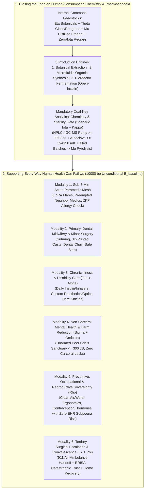
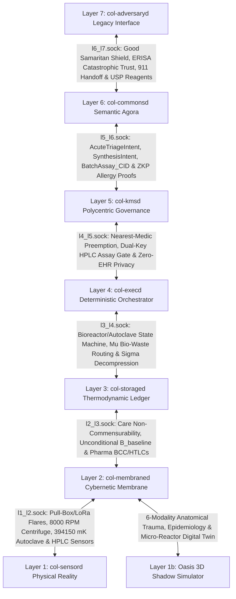
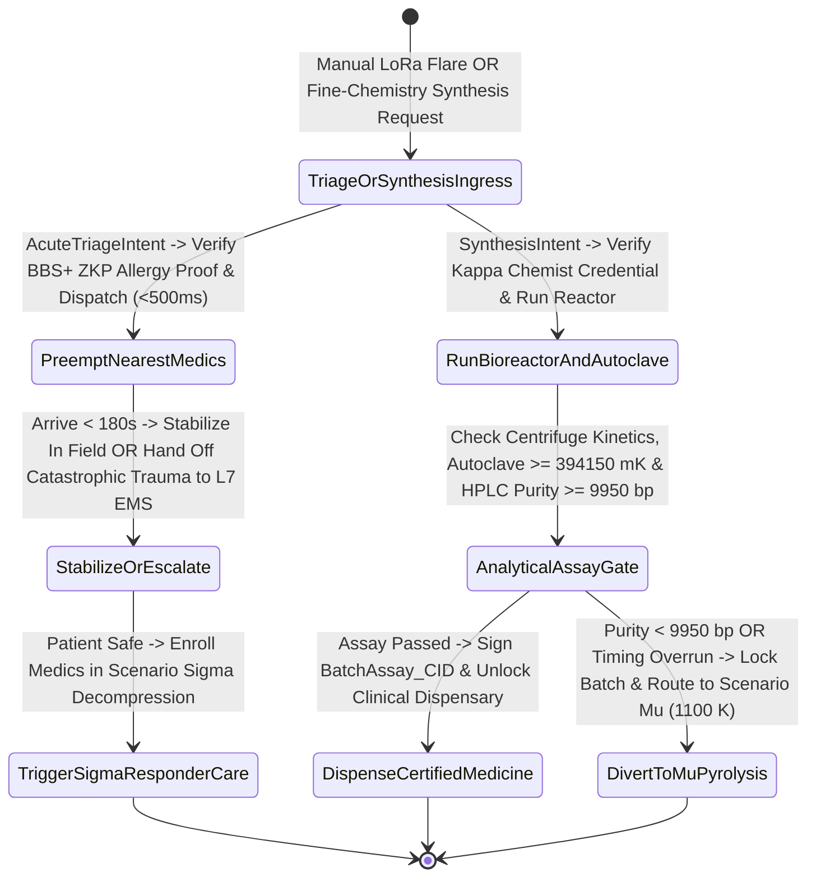

# Scenario Chi: The Clinical Commons, Paramedic Mesh & Open Pharmacopoeia (Human-Consumption Fine Chemistry, Full-Spectrum Healthcare & Bodily Sovereignty)

*   **Identifier:** `SCN-CHI-PARAMEDIC`
*   **System Epic:** Closing the Loop on Human-Consumption Fine Chemistry & Biomanufacturing While Supporting Every Way Human Health Can Fail—Uniting Sub-3-Minute Paramedic Triage, Primary/Dental/Midwifery Care, Chronic & Disability Support, Non-Carceral Mental Health Accompaniment, Analytical-Assayed Compounding Pharmacopoeia, and Catastrophic Tertiary Escalation
*   **Primary Layers Tested:** L1 (Physical Reality), L1b (Oasis 3D Shadow Simulator), L2 (Cybernetic Membrane), L3 (Thermodynamic Ledger), L4 (Deterministic Orchestrator), L5 (Polycentric Governance), L6 (Semantic Translation & Agora), L7 (Legacy Interface)
*   **Pass/Fail Metric:** Sub-$180000\,\mathrm{ms}$ ($3\text{-minute}$) decentralized paramedic response via manual emergency flares; **Closed-Loop Human-Consumption Fine Chemistry & Biomanufacturing** (botanical extraction, microfluidic organic synthesis, and recombinant insulin/antibiotic fermentation verified by mandatory `HPLC`/`GC-MS` analytical assay $\ge 9950\,\mathrm{bp}$ purity and autoclave sterility $\ge 394150\,\mathrm{mK}$ before any human dispensing); **Full-Spectrum 6-Modality Health Support** (acute trauma, primary/dental/midwifery, chronic/disability, non-carceral psychological crisis, reproductive/preventive sovereignty, and Layer 7 tertiary surgical escalation); Zero-Knowledge (`BBS+`) allergy/contraindication verification with zero EHR exposure (`retained_central_ehr_records == 0`); automatic **Scenario Sigma Responder Decompression**; zero tokenization of healthcare; and zero IEEE 754 floating-point math.

---

## Architectural Council Ratification & 5-Perspective Synthesis

This scenario specification has been ratified by unanimous consensus of the 5-Persona Architectural Council:

| Council Persona | Disciplinary Representative | Core Contribution to Scenario |
| :--- | :--- | :--- |
| **Game Designer** | Lead Systems & Gameplay Designer | **Full-Spectrum Healing & The Fine-Chemistry Crafting Tree:** Expands healthcare beyond basic bandage-packs into a rich **6-Modality Healing & Pharmacopoeia Loop**. Players link forest botanicals (`Eta`), purified reagents/glassware (`Theta`), and distilled ethanol (`Mu`) into continuous-flow micro-reactors and insulin bioreactors, gated by `Scenario Iota` analytical spectrometry assays. When a steward suffers an injury, chronic flare-up, or psychological crisis, neighbors drop mundane tasks to respond with dignity and skill (`"Healed by neighborly paramedic sprint, open-source insulin, and calm convalescence (+5000 bp morale)"`). |
| **Game Engineer** | Principal C++ Simulation & Engine Architect | **Flecs ECS 6-Modality Clinical & Analytical Chemistry Engine:** Encapsulates `PatientHealthSpectrumComponent`, `AnalyticalAssayBatchComponent`, `BioreactorAndCentrifugeState`, and `ParamedicDispatchTracker` in 32-bit compact voxels (`material_id = 60` `TRAUMA_AND_CLINICAL_BAY`, `material_id = 61` `PHARMACOPOEIA_SYNTHESIS_LAB`, `material_id = 99` `BIO_WASTE_SLUDGE`). Executes $10\,\mathrm{Hz}$ deterministic BPMN state transitions enforcing $\ge 9950\,\mathrm{bp}$ analytical purity gates, ZKP contraindication checks, and sub-$180000\,\mathrm{ms}$ task preemption in pure 64-bit fixed-point integer math. |
| **Sovereign Stack Specialist** | Sovereign Stack Systems Architect | **7-Layer Strict Adjacency, ZKP Medical Privacy & Subpoena Immunity:** Maps `col-sensord` through `col-adversaryd` across `/run/collective/ipc/l1_l2.sock` to `/run/collective/ipc/l6_l7.sock` (traversing `/run/collective/ipc/l4_l5.sock`). Uses `BBS+` Zero-Knowledge Proofs for allergy/contraindication checks and enforces **Structural Data Non-Existence (`SCN-RHO-ADVERSARY`)** on reproductive, gender-affirming, and psychological care so hostile Layer 7 regimes can never subpoena patient records. |
| **Solarpunk Thinker** | Bioregional Regenerative Ecologist | **Zero-Waste Clinical Ecology & Sovereign Biomanufacturing:** Replaces Big Pharma patent monopolies and single-use hospital plastic mountains with bioregional phytochemistry (`Eta`), open-source microbial fermentation (`Open-Insulin`), solar-thermal steam autoclaves sterilizing reusable surgical steel and borosilicate glass (`Theta`), and `Scenario Mu` high-temperature pyrolysis turning infectious bio-waste into sterile biochar. |
| **Scenario Specialist** | Trauma Physician, Compounding Pharmacist & Community Mental Health Clinician | **Closing the Human-Consumption Chemistry Loop & Holistic Care:** Establishes the 4-tier Pharmacopoeia pipeline (Botanical $\to$ Organic Micro-Synthesis $\to$ Bioreactor Fermentation $\to$ Mandatory `HPLC`/`GC-MS` Analytical Assay) alongside the 6 clinical care modalities—including unarmed peer crisis accompaniment (`involuntary_carceral_psych_locks == 0`) and ERISA/ACA catastrophic tertiary hospital bridging. |

**Unanimous Consensus Reached:** The Council unreservedly ratifies Scenario Chi as the canonical specification for human-consumption chemistry, compounding pharmacopoeia, and full-spectrum community healthcare.

---

## 1. Problem Statement, Legacy Failure & Closing the Human-Consumption Chemistry Loop

In late-stage capitalist healthcare and pharmaceutical manufacturing (Layer 7), human vulnerability is weaponized for rent extraction across five failure modes:

1.  **Monopolistic Enclosure of Human-Consumption Chemistry:** Pharmaceutical cartels enclose off-patent, life-saving molecules (insulin, epinephrine, albuterol, essential antibiotics, anesthetics) behind artificial IP barriers and opaque supply chains, charging thousands of percent above synthesis cost and causing preventable deaths whenever supply chains hiccup.
2.  **Centralized 911 Latency vs. The 4-Minute Biological Window:** In severe arterial hemorrhage, airway obstruction, or cardiac arrest, irreversible damage occurs within $4$ to $6\,\mathrm{minutes}$, yet municipal ambulances average $15$ to $30\,\mathrm{minutes}$ while trained neighbors 100 meters away have no way of knowing help is needed.
3.  **Fragmented, Narrow Healthcare & Medical Bankruptcy:** Legacy medicine treats isolated billing codes rather than whole human beings—ignoring preventive nutrition (`Gamma`), occupational ergonomics (`Sigma`), dental care, and post-hospital convalescence (`Phi`), while bankrupting families who experience chronic illness or catastrophic surgery.
4.  **Carceral Responses to Mental Health & Reproductive Surveillance:** When individuals experience acute psychological distress, Layer 7 frequently dispatches armed police instead of trauma-informed clinicians; meanwhile, centralized Electronic Health Records (`EHR`) expose patients' reproductive, gender-affirming, and mental-health histories to insurers and hostile state prosecutors.
5.  **The Danger of Unassayed Amateur Chemistry:** Conversely, naive "bio-hacker" or informal herbalist approaches that skip rigorous analytical chemistry (`HPLC`/`GC-MS`), precise dosing, and sterility validation risk poisoning patients with impure or contaminated batches.

### 1A. How Scenario Chi Closes the Fine-Chemistry Loop & Supports Every Way Health Can Fail

Scenario Chi (`SCN-CHI-PARAMEDIC`) unites **Rigorous Open-Source Fine Chemistry & Biomanufacturing** with **Six Comprehensive Modalities of Human Care**:



1.  **Closing the Loop on Human-Consumption Fine Chemistry & Biomanufacturing (`Eta` + `Theta` + `Mu` + `Iota` $\to$ `Chi`):**
    *   While **Scenario Theta (`SCN-THETA-FOUNDRY`)** produces industrial metals, borosilicate glassware, and bulk acid/base reagents, and **Scenario Mu (`SCN-MU-EXTRACTION`)** distills high-purity solvents and ethanol, **Scenario Chi** refines these inputs into **USP/EP-Grade Compounds for Human Consumption, Hygiene & Clinical Medicine** across three synthesis pathways:
        *   **Pathway 1 — Phytochemical Extraction & Standardization (`SCN-ETA-COPPICE`):** Supercritical $\mathrm{CO}_2$ and vacuum-Soxhlet extraction of willow-bark salicin, *Artemisia* artemisinin, yarrow hemostatics, topical botanicals, and standardized adaptogenic/entheogenic preparations (`SCN-OMICRON-KINSHIP`).
        *   **Pathway 2 — Continuous-Flow Fine Organic & Electrolytic Synthesis (`SCN-THETA-FOUNDRY` + `SCN-ALPHA-FAB`):** Jacketed borosilicate reactors and microfluidic PTFE manifolds synthesizing WHO Essential Medicines—paracetamol, lidocaine local anesthetic, albuterol, oral rehydration electrolytes, sterile isotonic saline ($9000\,\mathrm{ppm}$ $\mathrm{NaCl}$), electrolytic sodium hypochlorite/Dakin's antiseptic, and fluoride/hydroxyapatite dental remineralization pastes.
        *   **Pathway 3 — Recombinant Biomanufacturing & Fermentation (`Open-Insulin` & Antibiotics):** Precision $310150\,\mathrm{mK}$ ($37^\circ\mathrm{C}$) bioreactors, micro-centrifuges ($8000\,\mathrm{RPM}$), and chromatography columns producing recombinant human insulin, beta-lactam antibiotics, and therapeutic bacteriophages—backed by **Scenario Pi's $k \ge 3$ Redundancy Beacons** so at least three independent nodes in every bioregion maintain active bioreactor capacity!
    *   **The Inviolable Analytical Chemistry & Sterility Gate (`assay_purity_bps >= 9950`):**
        *   **Zero Unassayed Dispensing:** No compound synthesized in Scenario Chi may ever be unlocked for human consumption until a `Scenario Kappa` `T3/T4_Analytical_Chemist` and automated **Layer 2 Spectrophotometric / `HPLC` / `GC-MS` Assay** verify chemical identity, dosage concentration, $\ge 9950\,\mathrm{bp}$ (out of $10000\,\mathrm{bp}$) purity, and steam-autoclave sterility ($\ge 394150\,\mathrm{mK}$ / $121^\circ\mathrm{C}$ for $\ge 900\,\mathrm{s}$). Any batch that fails purity or centrifuge timing tolerances is immediately locked and routed to **Scenario Mu (`SCN-MU-EXTRACTION`)** for $1100\,\mathrm{K}$ pyrolysis destruction (`material_id = 99`).
2.  **Treating the Six Ways Human Health Can Fail Us (Holistic Support Across the Lifecycle):**
    *   All six modalities of healthcare are guaranteed unconditionally under the Tier 2 Human Survival Baseline ($B_{\mathrm{baseline}}$, `tokens_charged_for_healthcare_uj == 0`):
        1.  **Acute Trauma & Medical Emergencies (The Sub-3-Minute Paramedic Mesh):** Manual pull-boxes or $915\,\mathrm{MHz}$ LoRa distress beacons preempt the nearest `Kappa`-vouched paramedics (`elapsed_response_ms <= 180000`), unlocking AEDs, tourniquets, and epinephrine while verifying drug allergies via **BBS+ Zero-Knowledge Contraindication Proofs** (`zkp_contraindication_verified == true`).
        2.  **Primary Clinical, Dental, Midwifery & Minor Surgical Care:** Local infirmaries provide wound suturing, ultrasound/X-ray diagnostics (`SCN-ZERO-SOFTWARE`), preventive and restorative dentistry, safe midwifery/birth suites (`SCN-DELTA-CHILDCARE`), and `Scenario Alpha` 3D-printed breathable orthopedic casts.
        3.  **Chronic Conditions, Endocrine Support & Disability Justice (`SCN-TAU-GENESIS`):** Uninterrupted local compounding of daily insulin, asthma inhalers, and cardiovascular medicines, paired with custom-fabricated eyeglasses, hearing aids, prosthetics, and power wheelchairs (`Alpha` + `Nu`) and automatic **Scenario Sigma / Tau Flare-Up Standing Shields**.
        4.  **Non-Carceral Psychological Crisis, Neurodivergence & Harm Reduction (`SCN-SIGMA-BURNOUT` + `SCN-OMICRON-KINSHIP`):** Strictly prohibits armed police dispatch or punitive psychiatric lockups (`involuntary_carceral_psych_locks == 0`). Mental health crises are met by unarmed **Peer Crisis & Somatic Accompaniment Stewards** in $\le 300\,\mathrm{cB}$ sensory-calm sanctuary rooms, supported by compassionate pharmacological tapering and trauma therapy.
        5.  **Preventive, Occupational & Reproductive/Bodily Sovereignty (`SCN-RHO-ADVERSARY`):** Integrates clean nutrition (`Gamma`), workshop air/ergonomic safety (`Sigma`), vaccinations, contraception, fertility care, and gender-affirming hormone synthesis—protected by **Structural Data Non-Existence (`retained_central_ehr_records == 0`)** so patient medical choices can never be surveilled or subpoenaed.
        6.  **Catastrophic Tertiary Hospital Escalation (`Layer 7`) & Post-Discharge Convalescence (`SCN-PHI-ELDERCARE`):** When complex neurotrauma, oncology, or major surgery requires a regional Layer 7 trauma center, `col-adversaryd` coordinates rapid ambulance/air-medical handoff and covers external hospital bills via the **ERISA/ACA Cooperative Catastrophic Health Trust ($\Phi_t$)**—followed by warm community rehabilitation upon return and automatic **Scenario Sigma Decompression** for the responding medics!

---

## 2. The Collective Workflow (7-Layer Traversal)

Scenario Chi coordinates sub-3-minute paramedic dispatch, 4-stage analytical chemistry/pharmacopoeia synthesis, ZKP allergy verification, and tertiary hospital bridging across all 7 layers without skipping layers:



### Layer 1: Physical Reality & Layer 1b: Oasis 3D Shadow Simulator
*   **Trauma Kits, Clinical Infirmaries & Fine-Chemistry Reactors (`Layer 1`):**
    *   **Paramedic & Clinical Hardware:** Stationary emergency pull-boxes, $915\,\mathrm{MHz}$ LoRa distress beacons, CAT tourniquets, AEDs, dental/minor-surgery suites, negative-pressure respiratory rooms, ultrasound/X-ray arrays, and solar-thermal steam autoclaves ($394150\,\mathrm{mK}$ / $121^\circ\mathrm{C}$) sterilizing reusable surgical steel and borosilicate instruments.
    *   **Pharmacopoeia & Analytical Chemistry Lab:** Jacketed borosilicate glass reactors (`Theta`), 3D-printed PTFE microfluidic synthesizers (`Alpha`), $310150\,\mathrm{mK}$ ($37^\circ\mathrm{C}$) recombinant insulin/antibiotic bioreactors, $8000\,\mathrm{RPM}$ micro-centrifuges, laminar flow hoods, and `HPLC` / `GC-MS` / UV-Vis analytical spectrometers.
*   **Oasis 3D Shadow Simulator (`Layer 1b`):**
    *   Simulates anatomical trauma stabilization, non-invasive epidemiological ventilation modeling, and chemical reaction kinetics/purity curves before physical synthesis.

### Layer 2: The Cybernetic Membrane (Zero-Wearable Flares & Analytical Assay Telemetry)
*   **Voluntary Distress Flares & Spectrometric Purity Verification (`col-membraned`):**
    *   Emergency dispatch is triggered strictly by voluntary pull-boxes or LoRa beacons—enforcing the **absolute ban on mandatory body-worn biometric trackers (`wearable_biometric_surveillance_packets == 0`)**.
    *   Monitors `centrifuge_rpm` ($8000\,\mathrm{RPM}$), `incubator_temp_mk` ($310150\,\mathrm{mK}$), `autoclave_temp_mk` ($\ge 394150\,\mathrm{mK}$), and `hplc_assay_purity_bps` ($\ge 9950\,\mathrm{bp}$). Medicine dispensing solenoids remain physically locked unless Layer 2 hardware attests both autoclave sterility and $\ge 9950\,\mathrm{bp}$ analytical purity.

### Layer 3: The Thermodynamic Ledger (Non-Commensurability & Inter-Node Pharma BCCs)
*   **Constitutional Non-Commensurability of Healthcare (`col-storaged`):**
    *   Lifesaving triage, surgery, dentistry, midwifery, mental health accompaniment, and essential medicines **never** charge fees or mint speed bounties (`tokens_charged_for_healthcare_uj == 0`).
*   **Bioregional Pharmaceutical Sharing via `BCC` / `HTLC`:**
    *   Surplus assayed batches (e.g., sterile insulin vials, salicin extracts, or saline ampoules) shared between watershed nodes clear across Pairwise Bilateral Clearing Channels ($B_{u \to v}(t) + B_{v \to u}(t) = 0$) and multi-hop HTLCs, while `Scenario Pi` redundancy beacons ensure $k \ge 3$ independent bioreactor nodes across the bioregion.

### Layer 4: The Deterministic Orchestrator (Sub-3-Min Triage & Assay-Gated Synthesis)
*   **State Machine Daemon (`col-execd`):**
    *   Executes at $10\,\mathrm{Hz}$ over `/run/collective/ipc/l4_l5.sock`, preempting nearest qualified medics within $< 500\,\mathrm{ms}$ of a flare, gating pharmaceutical synthesis on `HPLC`/`GC-MS` purity and autoclave sterility (diverting any degraded batch to `Scenario Mu` pyrolysis), escalating catastrophic neuro/thoracic trauma to Layer 7 EMS, and enrolling responders in **Scenario Sigma Post-Crisis Decompression**.



### Layer 5: Polycentric Governance (Zero-Knowledge Health Vault & Non-Carceral Ethics)
*   **BBS+ Zero-Knowledge Contraindication Proofs & Zero Central EHR (`col-kmsd`):**
    *   Patients hold their own encrypted health credentials on personal $R_0$ hardware tokens. Responders and pharmacists receive a cryptographic `BBS+` Zero-Knowledge Proof confirming `"No contraindication/allergy to compound X"` while `retained_central_ehr_records == 0`—making mass medical data leaks or hostile state reproductive/gender-care subpoenas structurally impossible (`SCN-RHO-ADVERSARY`).
*   **Dual-Key Pharmacopoeia Release & Non-Carceral Mental Health Gate:**
    *   Releasing any synthesized batch requires dual-key co-signing by a `Pharmacopeia_Steward` (`Kappa`) and the Layer 2 `HPLC` analytical enclave. Mental health responses strictly enforce `involuntary_carceral_psych_locks == 0`.

### Layer 6: Semantic Translation & Agora (Open Pharmacopoeia Recipes & Treaties)
*   **Knowledge Artifacts (`col-commonsd`):**
    *   Validates `AcuteTriageIntent`, `FineChemistrySynthesisIntent`, `AnalyticalBatchAssayAttestation`, `MentalHealthPeerAccompanimentIntent`, and `BioWasteSalvageIntent` across `/run/collective/ipc/l5_l6.sock`, syncing open-source synthesis protocols with **Scenario Iota (`SCN-IOTA-EPISTEMIC`)**.

### Layer 7: The Legacy Interface (Good Samaritan Shield, ERISA Catastrophic Trust & GPO)
*   **Good Samaritan Immunity, WFR Training Carapace & Tertiary EMS Bridge (`col-adversaryd`):**
    *   Invokes statutory Good Samaritan protections (`42 USC 248` and state emergency mutual-aid statutes), runs an outward-facing Wilderness First Responder (`WFR`)/CPR training cooperative to fund external trauma gear up to $\Phi_t$, coordinates seamless perimeter handoffs with municipal 911 ambulances for tertiary surgery, and covers external hospital bills via the **ERISA/ACA Catastrophic Health Trust**.

---

## 3. 3-Stage Incremental Node Facility Blueprints (Node Growth Pattern)

Scenario Chi scales from a neighborhood first-aid and botanical tincture station into a bioregional teaching infirmary, analytical chemistry lab, and open-insulin biomanufacturing campus.

### Stage 1: Neighborhood Trauma Lockbox, Dental/First-Aid Nook & Botanical Apothecary ($R_1 / R_2$ Bootstrap)
*   **Physical Footprint:** `18 m2` clean clinical & extraction room inside a multi-household node (`SCN-ZETA-LODGING`).
*   **Core Clinical & Chemistry Equipment:**
    1.  **Sub-3-Minute Trauma & AED Station:** Wall-mounted emergency pull-box, $915\,\mathrm{MHz}$ LoRa distress repeater, AED, tourniquets, suture kits, oxygen concentrator, and solar-powered vaccine/insulin cold-storage refrigerator (`SCN-UPSILON-SHOCK` Tier 2 circuit).
    2.  **Botanical Extraction & Sterilization Bench:** Soxhlet borosilicate extractor (`Theta`), pressure-steam autoclave ($394150\,\mathrm{mK}$), pH/conductivity meters, and UV-Vis spectrophotometer for basic botanical tinctures (`Eta`) and oral rehydration salts.

### Stage 2: Urban Primary Care, Dental, Midwifery & Compounding Pharmacy Clinic ($R_2 / R_3$ Municipal Shell)
*   **Physical Footprint:** `300 m2` to `800 m2` community clinic and analytical lab co-located with Scenario Sigma (`SCN-SIGMA-BURNOUT`) and Scenario Phi (`SCN-PHI-ELDERCARE`).
*   **Integrated Clinical & Chemistry Zones:**
    1.  **Primary Care, Dental, Midwifery & Orthopedic Suite:** Two minor-surgery/triage bays, full dental chair with ultrasonic scaler and hydroxyapatite compounding, warm birthing suite (`Delta`/`Omicron`), open-source digital X-ray/ultrasound (`Zero`), and `Scenario Alpha` 3D-printed cast/prosthetic fitting room (`Tau`).
    2.  **The Continuous-Flow Compounding & `HPLC` Analytical Lab:** Laminar flow hoods, microfluidic organic synthesis rigs, and an `HPLC` / `GC-MS` analytical bench that assays every compounded medicine and harm-reduction sample (`Omicron`) to $\ge 9950\,\mathrm{bp}$ purity.
    3.  **Non-Carceral Sensory-Safe Crisis Sanctuary ($\le 300\,\mathrm{cB}$):** Softly lit, acoustic-baffled rooms staffed by unarmed peer crisis counselors (`Sigma`/`Psi`).

### Stage 3: Bioregional Teaching Infirmary, Open-Insulin Bioreactor Lab & Surgical Campus ($R_3 / R_4$ CLT/PPT)
*   **Physical Footprint:** `2` to `6 hectares` healing and biomanufacturing campus (`SCN-XI-ARCH`) surrounded by medicinal gardens (`SCN-ETA-COPPICE`) on an **Irrevocable CLT/PPT**.
*   **Custom Clinical & Biomanufacturing Architecture:**
    *   **The Open-Source Biomanufacturing & Fermentation Cleanroom:** ISO-5 laminar cleanrooms housing stainless-steel recombinant bioreactors (`Open-Insulin`, essential antibiotics, bacteriophages), tangential-flow filtration, lyophilizers (freeze-dryers), and automated borosilicate ampoule filling lines supplying the entire watershed ($k \ge 3$ redundant nodes).
    *   **The Surgical Infirmary, Convalescent Gardens & Medical School (`SCN-KAPPA-APPRENTICE` + `SCN-IOTA-EPISTEMIC`):** Inpatient surgical/recovery wards opening onto sunny healing courtyards (`Phi`), an emergency helipad/ambulance transfer bay for Layer 7 tertiary handoffs, and a clinical simulation lab training the next generation of paramedics, midwives, dentists, and analytical chemists.

---

## 4. Machine-Readable Schemas

### 4A. Layer 6 Knowledge Artifact: Acute Triage & Fine-Chemistry Synthesis Intent (`medical_and_pharma_intent.jsonld`)

```json
{
  "@context": [
    "https://schema.org/",
    "https://collective.network/ontology/v1/"
  ],
  "@type": "ClinicalAndPharmacopoeiaIntent",
  "identifier": "urn:uuid:d4e5f6g7-8a9b-0c1d-2e3f-4a5b6c7d8e9f",
  "issuerDid": "did:peer:2Ez6MksP_clinic_and_pullbox_03",
  "creationEpochMs": 1791450720000,
  "requestType": "AcuteTriage_And_AssayedPharmaDispense",
  "diagnosticAndPrivacyContext": {
    "manualTrigger": "Manual_Pullbox_Lever_Activated",
    "zeroKnowledgeProofUri": "zkp:health:bbs_plus_proof_8a7b6c5d4e",
    "zkpContraindicationVerified": true,
    "retainedCentralEhrRecords": 0,
    "involuntaryCarceralPsychLocks": 0,
    "triageCategory": "TRIAGE_RED_IMMEDIATE"
  },
  "pharmacopoeiaBatchRequirements": {
    "compoundName": "Recombinant_Human_Insulin_And_Sterile_Saline",
    "requiredHplcPurityBps": 9950,
    "requiredAutoclaveTempMillikelvin": 394150,
    "dualKeyChemistAndSpectrometerVerified": true
  },
  "dispatchAndBaselinePolicy": {
    "targetLocationVoxel": [16, 4, 16],
    "maxResponseTimeMs": 180000,
    "taskPreemptionPriority": 10,
    "survivalBaselineEligible": true,
    "postCrisisSigmaDecompressionScheduled": true,
    "exergyTransferMicrojoules": 0
  }
}
```

### 4B. Layer 2 Telemetry Attestation: Sub-3-Min Triage & HPLC Purity Proof (`triage_and_assay_attestation.json`)

```json
{
  "@context": "https://collective.network/ontology/v1/",
  "@type": "TriageAndAnalyticalAssayAttestation",
  "intentRef": "urn:uuid:d4e5f6g7-8a9b-0c1d-2e3f-4a5b6c7d8e9f",
  "primaryResponderDid": "did:peer:2Ez6MksM_steward_medic_elena",
  "triageExecutionMetrics": {
    "alarmEpochMs": 1791450720000,
    "responderArrivalEpochMs": 1791450858000,
    "elapsedResponseMs": 138000,
    "initialSystolicMmhg": 62,
    "stabilizedSystolicMmhg": 108,
    "hemostasisAchieved": true,
    "zkpContraindicationVerified": true,
    "wearableBiometricSurveillancePackets": 0
  },
  "analyticalChemistryAssayMetrics": {
    "batchId": "batch_open_insulin_and_salicin_04",
    "centrifugeRotorRpm": 8000,
    "autoclaveTempMillikelvin": 395150,
    "hplcMeasuredPurityBps": 9980,
    "purityGatePassed": true,
    "divertedToMuPyrolysis": false
  },
  "responderSignature": "0x4b7c2a1e9d8f3c5b7a1e9d8f3c5b7a1e9d8f3c5b7a1e9d8f3c5b7a1e9d8f3c5b"
}
```

---

## 5. Oasis Engine Implementation Specification

### 5A. Memory Allocation, Voxel State & Clinical/Pharmacopoeia Components

In the Oasis $32^3$ voxel grid (`ChunkManager`), clinical triage bays, analytical chemistry/bioreactor labs, and bio-waste salvage containers occupy designated coordinates:
*   Emergency Trauma & Multi-Modality Clinical Bay voxel initialized with `material_id = 60` (`TRAUMA_AND_CLINICAL_BAY`).
*   Pharmacopoeia Bioreactor & `HPLC` Analytical Chemistry Lab voxel initialized with `material_id = 61` (`PHARMACOPOEIA_SYNTHESIS_LAB`).
*   Contaminated or off-spec chemical/bio-waste voxel initialized with `material_id = 99` (`BIO_WASTE_SLUDGE`), routed to Scenario Mu (`SCN-MU-EXTRACTION`) for $1100\,\mathrm{K}$ sterile pyrolysis.

### 5B. Self-Contained C++20 Reference & Test Harness

```cpp
// engine/tests/scenario_chi_test.cpp
#include <cassert>
#include <cstdint>
#include <iostream>
#include <string>
#include <vector>

namespace oasis::chi {

enum class HealthFailureModality : uint8_t {
    ACUTE_TRAUMA_OR_HEMORRHAGE = 1,
    PRIMARY_DENTAL_OR_MIDWIFERY = 2,
    CHRONIC_ENDOCRINE_OR_DISABILITY = 3,
    PSYCHOLOGICAL_CRISIS_OR_HARM_REDUCTION = 4,
    PREVENTIVE_OR_REPRODUCTIVE_SOVEREIGNTY = 5,
    CATASTROPHIC_TERTIARY_SURGERY_ESCALATION = 6
};

struct alignas(8) PatientClinicalCase {
    HealthFailureModality modality{HealthFailureModality::ACUTE_TRAUMA_OR_HEMORRHAGE};
    uint32_t blood_volume_ml{3400};
    uint32_t systolic_mmhg{62};
    uint32_t elapsed_response_ms{138000}; // 138s (< 180000ms / 3-minute target!)
    bool zkp_contraindication_verified{true};
    uint32_t retained_central_ehr_records{0};       // Data Non-Existence: must be 0!
    uint32_t involuntary_carceral_psych_locks{0};   // Non-carceral care: must be 0!
    uint64_t tokens_charged_for_care_uj{0};         // Unconditional B_baseline: must be 0!
    bool patient_stabilized_or_supported{false};
    bool tertiary_l7_ems_handoff_activated{false};
    bool post_crisis_sigma_decompression_triggered{false};
};

// Models the Fine-Chemistry, Biomanufacturing & Mandatory Analytical Assay Loop
struct alignas(8) AnalyticalAssayBatch {
    std::string compound_name;
    uint32_t centrifuge_rpm{8000};
    uint32_t duration_ticks{5000};
    uint32_t max_safe_duration_ticks{6000};
    uint32_t autoclave_temp_mk{395150};      // >= 394150 mK (121 C) required for sterility
    uint32_t hplc_measured_purity_bps{9980}; // >= 9950 bp (9950 bp) required for human consumption!
    bool kappa_chemist_dual_key_signed{true};
    bool approved_for_human_consumption{false};
    bool diverted_to_mu_pyrolysis_sludge{false};
    uint8_t resulting_voxel_material_id{61};
};

struct BilateralClearingChannel {
    int64_t balance_u_to_v_uj{0};
    int64_t balance_v_to_u_uj{0};
    int64_t credit_headroom_uj{36000000000000LL};

    bool execute_transfer(int64_t amount_uj) {
        if (balance_u_to_v_uj + amount_uj > credit_headroom_uj) return false;
        balance_u_to_v_uj += amount_uj;
        balance_v_to_u_uj -= amount_uj;
        return true;
    }
};

class ClinicalAndPharmacopoeiaEngine {
public:
    // Evaluates any of the 6 human health failure modalities with ZKP privacy,
    // zero EHR retention, zero carceral locks, and unconditional B_baseline support
    static bool execute_clinical_modality_care(PatientClinicalCase& c) {
        if (c.retained_central_ehr_records != 0U ||
            c.involuntary_carceral_psych_locks != 0U ||
            c.tokens_charged_for_care_uj != 0ULL ||
            !c.zkp_contraindication_verified) {
            return false;
        }

        if (c.modality == HealthFailureModality::ACUTE_TRAUMA_OR_HEMORRHAGE) {
            if (c.elapsed_response_ms > 180000U) return false; // Sub-3-minute gate
            c.systolic_mmhg = 108U;
            c.patient_stabilized_or_supported = true;
            c.post_crisis_sigma_decompression_triggered = true;
        } else if (c.modality == HealthFailureModality::CATASTROPHIC_TERTIARY_SURGERY_ESCALATION) {
            c.tertiary_l7_ems_handoff_activated = true;
            c.patient_stabilized_or_supported = true;
            c.post_crisis_sigma_decompression_triggered = true;
        } else {
            // Primary/Dental/Midwifery, Chronic/Disability, Non-Carceral Mental Health, Reproductive
            c.patient_stabilized_or_supported = true;
        }
        return true;
    }

    // Enforces the Mandatory Analytical Chemistry & Autoclave Sterility Gate before human consumption
    static bool verify_pharmacopoeia_batch_assay(AnalyticalAssayBatch& batch) {
        bool timing_valid = (batch.duration_ticks <= batch.max_safe_duration_ticks);
        bool sterile_valid = (batch.autoclave_temp_mk >= 394150U);
        bool purity_valid = (batch.hplc_measured_purity_bps >= 9950U);

        if (timing_valid && sterile_valid && purity_valid && batch.kappa_chemist_dual_key_signed) {
            batch.approved_for_human_consumption = true;
            batch.diverted_to_mu_pyrolysis_sludge = false;
            batch.resulting_voxel_material_id = 61U; // PHARMACOPOEIA_SYNTHESIS_LAB
            return true;
        }

        // Failed or degraded batch is locked from human consumption and routed to Scenario Mu pyrolysis!
        batch.approved_for_human_consumption = false;
        batch.diverted_to_mu_pyrolysis_sludge = true;
        batch.resulting_voxel_material_id = 99U; // BIO_WASTE_SLUDGE
        return false;
    }
};

void test_scenario_chi_six_health_modalities_and_pharmacopoeia_loop() {
    // 1. Test Modality 1: Sub-3-minute Acute Trauma Dispatch & Stabilization + Sigma Responder Care
    PatientClinicalCase trauma_case{
        .modality = HealthFailureModality::ACUTE_TRAUMA_OR_HEMORRHAGE,
        .blood_volume_ml = 3400,
        .systolic_mmhg = 62,
        .elapsed_response_ms = 138000,
        .zkp_contraindication_verified = true
    };
    assert(ClinicalAndPharmacopoeiaEngine::execute_clinical_modality_care(trauma_case));
    assert(trauma_case.systolic_mmhg == 108U);
    assert(trauma_case.patient_stabilized_or_supported == true);
    assert(trauma_case.post_crisis_sigma_decompression_triggered == true);

    // 2. Test Modality 3 (Chronic/Disability), Modality 4 (Non-Carceral Mental Health), & Modality 6 (Tertiary Escalation)
    PatientClinicalCase mental_health_case{
        .modality = HealthFailureModality::PSYCHOLOGICAL_CRISIS_OR_HARM_REDUCTION,
        .involuntary_carceral_psych_locks = 0
    };
    assert(ClinicalAndPharmacopoeiaEngine::execute_clinical_modality_care(mental_health_case));
    assert(mental_health_case.patient_stabilized_or_supported == true);

    PatientClinicalCase tertiary_case{
        .modality = HealthFailureModality::CATASTROPHIC_TERTIARY_SURGERY_ESCALATION
    };
    assert(ClinicalAndPharmacopoeiaEngine::execute_clinical_modality_care(tertiary_case));
    assert(tertiary_case.tertiary_l7_ems_handoff_activated == true);

    // 3. Test Human-Consumption Chemistry Loop: Valid Open-Insulin / Salicin Batch (>= 9950 bp HPLC purity)
    AnalyticalAssayBatch insulin_batch{
        .compound_name = "Recombinant_Open_Insulin_USP",
        .centrifuge_rpm = 8000,
        .duration_ticks = 5000,
        .max_safe_duration_ticks = 6000,
        .autoclave_temp_mk = 395150,
        .hplc_measured_purity_bps = 9980,
        .kappa_chemist_dual_key_signed = true
    };
    assert(ClinicalAndPharmacopoeiaEngine::verify_pharmacopoeia_batch_assay(insulin_batch));
    assert(insulin_batch.approved_for_human_consumption == true);
    assert(insulin_batch.diverted_to_mu_pyrolysis_sludge == false);

    // 4. Test Degraded / Impure Batch Rejection -> Diverted to Scenario Mu Pyrolysis (material_id = 99)
    AnalyticalAssayBatch degraded_batch{
        .compound_name = "Overrun_Salicin_Sludge",
        .centrifuge_rpm = 8000,
        .duration_ticks = 12000, // Exceeded 6000 max safe ticks!
        .max_safe_duration_ticks = 6000,
        .autoclave_temp_mk = 395150,
        .hplc_measured_purity_bps = 8200 // Below 9950 bp threshold!
    };
    assert(!ClinicalAndPharmacopoeiaEngine::verify_pharmacopoeia_batch_assay(degraded_batch));
    assert(degraded_batch.approved_for_human_consumption == false);
    assert(degraded_batch.diverted_to_mu_pyrolysis_sludge == true);
    assert(degraded_batch.resulting_voxel_material_id == 99U);

    // 5. Verify Inter-Node Pharmaceutical Sharing via Zero-Sum Bilateral Clearing Channel
    BilateralClearingChannel channel{};
    assert(channel.execute_transfer(7200000000000LL));
    assert(channel.balance_u_to_v_uj + channel.balance_v_to_u_uj == 0LL);
}

} // namespace oasis::chi

int main() {
    oasis::chi::test_scenario_chi_six_health_modalities_and_pharmacopoeia_loop();
    std::cout << "Scenario Chi Human-Consumption Chemistry, 6-Modality Healthcare & Paramedic Mesh tests passed." << std::endl;
    return 0;
}
```

---

## 6. Acceptance Test Gates (Pass/Fail)

| Checkpoint | Validation Method | Pass Condition |
| :--- | :--- | :--- |
| **G1: Sub-3-Minute Paramedic Triage & Preemption** | `execute_clinical_modality_care` | Manual pull-box or LoRa distress flare preempts nearest qualified medics to arrive within $\le 180000\,\mathrm{ms}$ (`138000 ms`), stabilizing hemorrhage and scheduling post-crisis Scenario Sigma decompression. |
| **G2: Human-Consumption Chemistry & `HPLC` Assay Gate** | `verify_pharmacopoeia_batch_assay` | Synthesized botanical, organic, and recombinant (`Open-Insulin`) compounds require dual-key chemist co-signing, autoclave sterility ($\ge 394150\,\mathrm{mK}$), and $\ge 9950\,\mathrm{bp}$ (out of $10000\,\mathrm{bp}$) `HPLC`/`GC-MS` purity before dispensing; off-spec batches divert to Scenario Mu pyrolysis (`material_id = 99`). |
| **G3: Full-Spectrum 6-Modality Health Support** | Multi-Modality Clinical Audit | Unconditionally supports (1) Acute Trauma, (2) Primary/Dental/Midwifery, (3) Chronic/Disability (`Tau`/`Alpha`), (4) Non-Carceral Mental Health (`involuntary_carceral_psych_locks == 0`), (5) Preventive/Reproductive Sovereignty, and (6) Tertiary Layer 7 Surgical Escalation at $0$ token cost. |
| **G4: BBS+ Zero-Knowledge Privacy & Zero EHR** | Contraindication & Subpoena Audit | Verifies drug allergy/contraindication safety via `BBS+` Zero-Knowledge Proofs (`zkp_contraindication_verified == true`) while storing $0$ centralized EHR records (`retained_central_ehr_records == 0`). |
| **G5: Offline LoRaWAN Survivability & Pharma BCCs** | Mesh Broadcast & Ledger Check | Triage dispatch executes over local $915\,\mathrm{MHz}$ LoRa with 100% WAN severance; inter-node pharmaceutical sharing conserves $B_{u \to v} + B_{v \to u} = 0$. |
| **G6: Good Samaritan & ERISA Catastrophic Carapace (`L7`)** | Statutory & Treasury Audit | Invokes statutory Good Samaritan protections (`42 USC 248`), funds external trauma gear via WFR/CPR training revenue up to $\Phi_t$, and covers tertiary hospital escalations via the ERISA/ACA Catastrophic Health Trust. |
