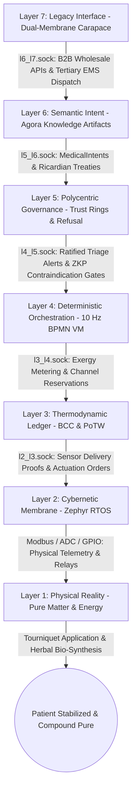
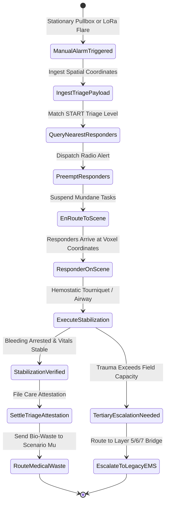
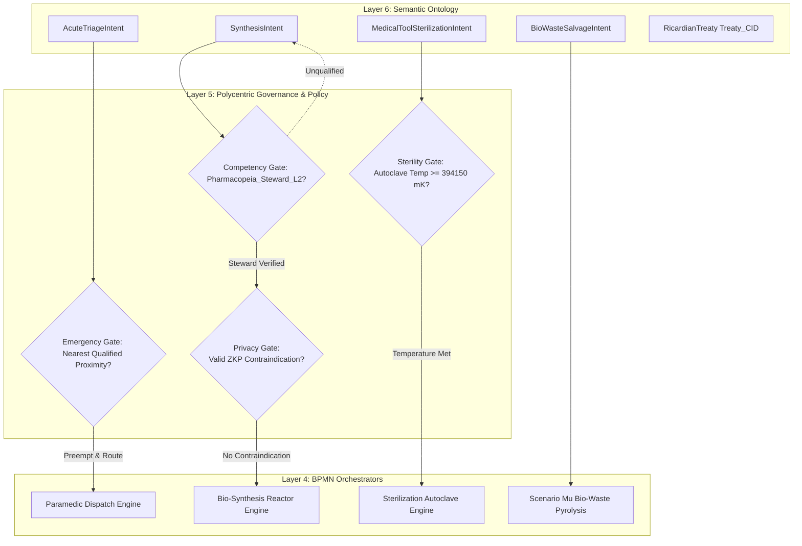
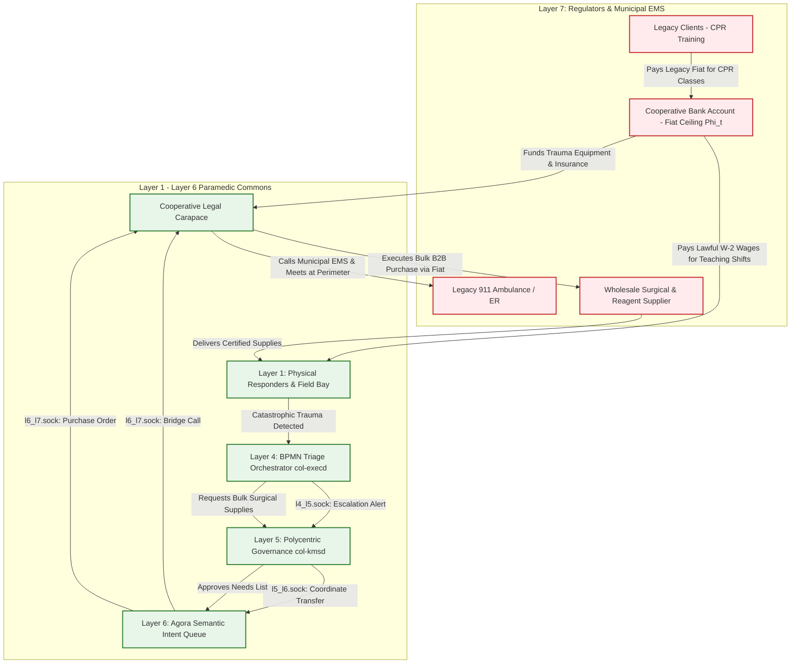

# Scenario Chi: Paramedic Mesh & Pharmacopeia

*   **Identifier:** `SCN-CHI-PARAMEDIC`
*   **System Epic:** Decentralized Triage, Open-Source Medicine, and Health Sovereignty
*   **Primary Layers Tested:** L1 (Physical), L2 (Digital Twin), L3 (Ledger), L4 (Orchestration), L5 (Governance), L6 (Semantic), L7 (Proxy)
*   **Pass/Fail Metric:** Decentralized dispatch of localized first responders to acute trauma faster than legacy municipal benchmarks (sub-3 minute response vs. 15 to 30 minute municipal average) triggered via manual emergency flares; open-source bio-synthesis of critical botanical and chemical compounds meeting clinical purity thresholds without corporate laboratory dependencies; zero patient health history exposure via Zero-Knowledge proof verification; zero floating-point math; zero tokenization of lifesaving emergency care.

---

## Architectural Council Ratification & 5-Perspective Synthesis

This scenario specification has been ratified by unanimous consensus of the 5-Persona Architectural Council:

| Council Persona | Disciplinary Representative | Core Contribution to Scenario |
| :--- | :--- | :--- |
| **Game Designer** | Lead Systems & Gameplay Designer | Dwarf Fortress anatomical trauma system (arterial bleeds, limb fractures, community alarm states, and psychological trauma memories vs. "Grateful to be alive (+50 mood)" morale recovery); The Sims autonomous task preemption (when an `AcuteTriageIntent` fires, qualified neighbors instantly drop mundane crafting or gardening tasks to sprint to the patient); Cities Skylines emergency corridor routing and tertiary legacy trauma center perimeter escalation. |
| **Game Engineer** | Principal C++ Simulation & Engine Architect | Flecs ECS DOD architecture (`TraumaProfileComponent`, `VitalSignsComponent`, `CentrifugeVesselComponent`, `MedicalCredentialComponent`); 32-bit compact voxel grid modeling sterile field boundaries; deterministic 10 Hz BPMN state engine; compilable C++20 test harness testing vital sign stabilization, spatial pathfinding overrides, and bio-synthesis centrifuge kinetics exclusively using fixed-point SI integer arithmetic (milligrams, milliliters, millikelvin, revolutions per minute, milliseconds). |
| **Sovereign Stack Specialist** | Sovereign Stack Systems Architect | 7-layer strict adjacency without layer skipping; zero software, microcontrollers, or keys in Layer 1; Zephyr RTOS Layer 2 membrane (`col-sensord`, `col-membraned`, `col-actuated`); offline-first LoRaWAN mesh broadcast for manual emergency beacons; Layer 3 Pairwise Bilateral Clearing Channels ($BCC$) with zero-sum conservation $B_{u \to v}(t) + B_{v \to u}(t) = 0$ and multi-hop HTLCs for inter-node medical supplies; BBS+ Zero-Knowledge Proofs allowing allergy and contraindication verification without revealing medical history ledgers; Layer 5 boundary socket `/run/collective/ipc/l4_l5.sock`; Tripartite Ricardian Treaties ($\mathrm{Treaty\_CID}$). |
| **Solarpunk Thinker** | Bioregional Regenerative Ecologist | Bioregional botanical pharmacopeia (willow bark for salicin extraction, yarrow for hemostasis, medicinal fungal polysaccharides); closed-loop sterile instrument reprocessing using solar-thermal autoclaves; complete elimination of single-use disposable plastics through reusable surgical-grade stainless steel and borosilicate glass; high-temperature pyrolysis bio-waste destruction into sterile biochar via Scenario Mu. |
| **Scenario Specialist** | Tactical Trauma Physician & Distributed Bio-Chemical Synthesizer | START triage protocol algorithms (Immediate Red, Delayed Yellow, Minor Green, Expectant Black); bio-chemical synthesis kinetics (micro-centrifuge angular acceleration in integer RPM, thermal incubation boundaries in millikelvin); clinical purity validation criteria; Good Samaritan mutual aid legal defense shields under 42 U.S.C. Section 248 and state emergency medical statutes. |

**Council Consensus Statement:** Unanimous Consensus Reached. The council affirms that emergency medical stabilization and bodily triage are sacred communal duties within the Convivial Sanctuary ($R_0$). All pricing, speed bounties, tokenization, and biometric body surveillance of patients are permanently abolished. Responders earn domain-specific non-financial Reputational Wealth in Layer 5 Health Guilds protected by the Care Leave Shield.

---

## 1. Problem Statement & Legacy Failure

In legacy late-stage capitalist healthcare (Layer 7), acute emergency response and pharmaceutical production are crippled by extreme centralization, artificial scarcity, and financialized extraction.

When an acute medical emergency occurs in a suburban or rural neighborhood:
*   **Dispatch Latency & Survivability Degradation:** Centralized 911 emergency services take an average of 15 to 30 minutes to dispatch an ambulance through urban traffic. In cases of massive arterial hemorrhage or sudden respiratory arrest—where irreversible brain damage occurs within 4 to 6 minutes—certified neighbors next door remain entirely unaware while the victim dies awaiting municipal sirens.
*   **Predatory Monopolistic Enclosure:** Pharmaceutical cartels exploit intellectual property patents and regulatory capture to artificially inflate prices of life-saving off-patent compounds (e.g., epinephrine, albuterol, insulin) by thousands of percent above production cost, imposing life-threatening rationing on working-class populations.
*   **Commoditized Surveillance & Panoptic Overreach:** Legacy health portals monetize and leak patient electronic health records (EHR) to insurance conglomerates, while corporate health platforms deploy invasive wearable monitors that treat human bodies as telemetry-harvesting extraction nodes.
*   **Liability Paralyzation & Legal Fear:** Fear of litigious malpractice lawsuits paralyzes bystanders from rendering immediate mutual aid unless shielded by formal corporate legal coverage.

---

## 2. The Collective Workflow (7-Layer Traversal)

Scenario Chi decouples community healthcare from predatory monopolies by operating two synchronized workflows: the **Paramedic Mesh** (hyper-local trauma triage dispatched over peer-to-peer radio) and the **Pharmacopeia** (distributed, open-source biological and herbal synthesis). Lifesaving care is an unconditional right under the Tier 2 Human Survival Baseline ($B_{\mathrm{baseline}}$). The workflow traverses canonically from Layer 1 physical intervention up to Layer 7 legacy institutional shielding.



### Layer 1: Physical Ground Truth
*   **Pure Physical Substrate:** Layer 1 contains exclusively physical trauma supplies, laboratory glassware, and passive transducers. It contains **zero software, zero microcontrollers, zero firmware, zero cryptographic keys, and zero network daemons.**
*   **Hardware Nodes (Paramedic Kits & Triage Hub):** Rapid-deployment trauma packs equipped with mechanical Combat Application Tourniquets (CAT), chest seals, compressed hemostatic gauze, automated external defibrillators (AEDs), splints, and passive analog wiring for emergency pull-boxes.
*   **Hardware Nodes (Pharmacopeia Synthesis Station):** Open-source micro-centrifuges, temperature-regulated magnetic stirrers, laminar flow hoods, precision incubation chambers, high-pressure steam autoclaves, and borosilicate reaction vessels.
*   **Feedstock & Biomass:** Sterile water, pharmaceutical-grade ethanol, biological culture precursors, sterile glass ampoules, and harvested botanical biomass (willow bark for salicin extraction, yarrow, Artemisia) stored in humidity-controlled lockers.
*   **Physical Actions:** Tourniquet twisting, direct pressure application, airway positioning, chest compressions, micro-pipetting, and centrifugation.

### Layer 2: Digital Twin & Telemetry
*   **Membrane Architecture:** Executed by Zephyr RTOS microcontrollers (`col-sensord`, `col-membraned`, `col-actuated`) converting analog sensor voltages into dimensionally typed, fixed-point integer packets.
*   **Convivial Anti-Panopticon Shield:** Emergency alerts are triggered exclusively by **voluntary human action** (stationary manual pull-boxes, Reticulum/LoRaWAN distress flares, or physical whistles). **Absolute ban on body-worn sensors, continuous wearable vital streaming, smart watches, and biometric pulse surveillance.**
*   **Ingress Telemetry Topics (Fixed-Point SI Integers via `col-membraned`):**
    *   `node/pharma/centrifuge_01/telemetry/rpm` (`uint32_t`, rotor velocity in revolutions per minute; target 8000 RPM)
    *   `node/pharma/incubator_01/telemetry/temp_mk` (`uint32_t`, incubation temperature in millikelvin; nominal 310,150 mK = 37 C)
    *   `node/pharma/autoclave_01/telemetry/temp_mk` (`uint32_t`, sterilization temperature in millikelvin; target >= 394,150 mK = 121 C)
    *   `node/health/emergency_flare` (`enum uint8_t`: `0=IDLE`, `1=PULLBOX_PULLED`, `2=LORAWAN_FLARE`, `3=PERIMETER_BEACON`)
    *   `node/health/triage_status` (`enum uint8_t`: `0=TRIAGE_RED_IMMEDIATE`, `1=TRIAGE_YELLOW_DELAYED`, `2=TRIAGE_GREEN_MINOR`, `3=STABILIZED`)
*   **Safety Verification:** In the lab, optical absorbance spectrometry verifies chemical batch purity against open-source spectrophotometric baselines before release. Autoclave telemetry verifies pathogen thermal lethality (121 C held for 15 minutes).
*   **Actuator Control:** Local relay controllers trip magnetic solenoids on emergency medicine lockboxes and cycle centrifuge motors only after Layer 2 verifies actuation invariants $\mathbf{\Phi}$ across `/run/collective/ipc/l3_l2.sock`.

### Layer 3: Thermodynamic Ledger
*   **Constitutional Non-Commensurability of Triage & Lifesaving Care:** Emergency triage, CPR, stopping bleeding, and comforting the injured are declared non-commensurable human care (`sec:l3-friction`). Layer 3 **structurally refuses to mint tokens or bounties for lifesaving care.** All heroic speed bounties, piece-rate rescue tokens, and emergency medical fees are permanently prohibited.
*   **Inalienable Tier 2 Human Survival Baseline ($B_{\mathrm{baseline}}$):** Emergency trauma response, clinical triage, and essential pharmacopeia remedies are guaranteed to every human being as an unconditional constitutional right of living membership ($B_{\mathrm{baseline}}$). Access to care is never conditioned upon labor, tokens, or chore points.
*   **Proof-of-Thermodynamic-Work (PoTW):** Electrical exergy consumed by laboratory autoclaves, incubators, and centrifuges is metered in microjoules ($\mu\mathrm{J}$):
    $$\text{1 Exergy Credit} \equiv 3{,}600{,}000{,}000{,}000\text{ }\mu\mathrm{J}$$
    Exergy accounting measures energy drawn from the settlement microgrid, undergoing physical demurrage to reflect battery and equipment entropy.
*   **Pairwise Bilateral Clearing Channels (BCC) & Multi-Hop HTLCs:** When critical pharmaceutical batches (e.g., 50 vials of sterile willow-derived salicin extract or sterile saline) are transferred to a neighboring settlement $v$, accounting settles across inter-node Bilateral Clearing Channels:
    $$B_{u \to v}(t) + B_{v \to u}(t) = 0$$
    Subject to mutual aid credit windows $[-C_{u \to v}, +C_{v \to u}]$. Multi-hop transfers across the watershed settle via chained Hashed Timelock Contracts:
    $$\mathrm{HTLC} = \langle H(S), \Delta t, Q, u, v \rangle$$
    where $Q$ is denominated in microjoules of embodied exergy or physical unit counts, releasing upon physical delivery receipts $\sigma_{\mathrm{delivery}}$ and cascading backward settlement without global tokens or external market conversion.

### Layer 4: Deterministic Orchestration State Machine
The acute trauma lifecycle is governed deterministically by the embedded 10 Hz BPMN engine (`col-execd`):



### Layer 5: Policy & Polycentric Governance
Layer 5 (`col-kmsd`) enforces medical data sovereignty, triage competence, and ethical boundaries:
*   **The 7-Tier Concentric Trust Rings ($R_0 \dots R_6$):**
    *   **$R_0$ (The Hearth Sanctuary):** The immediate emergency trauma scene. Social immunity: unconditional lifesaving care, tourniquets, sterile dressing, zero keys, zero registration, zero surveillance, zero governance voting weight.
    *   **$R_1$ (Settlement Commons):** Local triage station and medical lockbox ($\le 500\text{ m}$), volunteer responder circles.
    *   **$R_2$ (Village Commons):** Village clinical infirmary, open-source pharmacopeia synthesis lab ($\le 5\text{ km}$).
    *   **$R_3$ (Watershed Guild):** Peering with adjacent clinic nodes ($\le 30\text{ km}$); inter-node BCC channels for specialized herbal tinctures and sterile fluids.
    *   **$R_4$ (Bioregional Federation):** Regional surgical infirmary, emergency disaster medical caches ($\le 150\text{ km}$).
    *   **$R_5$ (Continental Corridor):** Open pharmacopeia formulas, medical device CAD blueprints.
    *   **$R_6$ (Ecumene / Legacy Perimeter):** Legacy emergency room handoffs, cooperative Good Samaritan carapace.
*   **Cellular Autonomy & Subsidiarity:** Every emergency triage node and clinical infirmary maintains absolute autopoietic closure and cellular autonomy. Triage responders operate under self-governing medical stewardship; no outside council or federation can compel medical resource dispatch that depletes local survival reserves ($B_{\mathrm{baseline}}$) or overrides clinician conscience.
*   **Bioregional Path-Vector Protocol (BPVP):** Export of surplus pharmacopeia medicines is bounded by the Export Surplus Bound:
    $$Q_{\mathrm{avail}}(t) = \max\left(0, Q_{\mathrm{inventory}}(t) - F_{\mathrm{eco}}(t) - B_{\mathrm{baseline}}(t)\right) \cdot \mathbf{1}_{\mathrm{export}}$$
    Medicines are never exported if local settlement emergency reserves ($B_{\mathrm{baseline}}$) are unfulfilled.
*   **Privacy Gate (Zero-Knowledge Health Vault):** Patient medical history is never broadcast across the mesh. First responders receive only a Zero-Knowledge Proof (ZKP) affirming: "Patient does NOT have a contraindication to Epinephrine / Penicillin" without decrypting or exposing the underlying medical ledger.
*   **Competency Gate:** Handling micro-centrifuges and sterile chemical synthesis requires a BBS+ Verifiable Credential (`Pharmacopeia_Steward_L2`).
*   **Reputational Wealth ($\mathcal{R}$) & Care Leave Shield:** Responders receive non-financial Reputational Wealth ($\mathcal{R}$) in the Health Guild of the Stewardship Chamber. Reputational Wealth decays exponentially ($\tau_{\mathrm{half}} = 2\text{ years}$) and is sublinearly capped ($\le 8\%$ chamber weight). The **Care Leave Shield** freezes the decay clock during personal recovery, caregiving, or illness.
*   **The Protocol of Refusal (`sec:l5-refusal`):** Sacred herbal traditions and patient medical sovereignty can be declared Refused Domains, exempt from algorithmic optimization and digital-twin simulation.
*   **Autonomous Transit Veto (`No-Transit`):** Clinical infirmaries and triage sanctuaries retain the absolute authority to assert a `No-Transit` attribute over emergency lanes, quiet recovery zones, and quarantine wards, deterministically rerouting non-essential transport, heavy material freight, and outside vehicles away from sensitive healing environments.
*   **Boundary IPC Socket:** Layer 5 policies compile into deterministic constraints pushed to Layer 4 across `/run/collective/ipc/l4_l5.sock`.

### Layer 6: Semantic Intent & Domain Ontology
The Health Commons defines typed JSON-LD Knowledge Artifacts within the Agora Commons (`col-commonsd`):
1.  **`AcuteTriageIntent`:** High-priority emergency signal specifying voxel location, suspected injury category, and required triage skill level.
2.  **`SynthesisIntent`:** Request to synthesize, purify, and bottle a specific biological or botanical compound.
3.  **`PharmacopeiaInventoryAttestation`:** Cryptographic ledger of verified sterile compounds and active botanical ingredients.
4.  **`MedicalToolSterilizationIntent`:** Coordinates solar-thermal autoclave cycles for surgical-grade instruments.
5.  **`AllergyContraindicationIntent`:** Patient-controlled cryptographic credential enabling zero-knowledge contraindication checks.
6.  **`BioWasteSalvageIntent` (Scenario Mu Bridge):** Dispatches contaminated gauze and biomass to Scenario Mu for high-temperature sterile biochar pyrolysis.
7.  **`RicardianTreaty` ($\mathrm{Treaty\_CID}$):** Tripartite covenant binding natural-language mutual aid medical agreements, machine-readable JSON-LD schemas, and formal BPMN state machines governing inter-node pharmaceutical sharing.

### The Governance Router Flowchart



### Layer 7: The Legacy Interface (Dual-Membrane Carapace)
The Paramedic Mesh interfaces with legacy medical institutions through the Dual-Membrane Doctrine, presenting an honest, lawful, and legally unremarkable entity:

1.  **Good Samaritan Protection & Mutual Aid Carapace:**
    Under 42 U.S.C. Section 248 and state Good Samaritan statutes, volunteer mutual aid responders are protected from civil liability when providing emergency first aid without expecting compensation. The cooperative charter codifies this non-commercial mutual aid pact, legally shielding community responders. Pharmacopeia production is legally organized as open-source non-commercial educational research, remaining outside interstate commerce.
2.  **Bounded Wilderness First Aid Training Carapace:**
    The cooperative operates an outward-facing training carapace offering certified Wilderness First Responder (WFR) and community CPR courses to corporate clients and outdoor recreation groups for legacy fiat fees.
    *   All external fiat flows into the cooperative's legacy bank account.
    *   External fiat is allocated strictly to satisfy the settlement's itemized fiat needs target ($\Phi_t$) for trauma gear, commercial liability insurance, and pharmaceutical precursors.
    *   Instructors receive lawful W-2 wages in legacy fiat currency for external teaching shifts.
    *   **Strict Inconvertibility:** External fiat **never** converts into internal Exergy Credits or tokens. Internal medical care is 100% non-monetary and unpriced.
3.  **Tertiary EMS Escalation & Wholesale Procurement:**
    When field triage indicates catastrophic injuries beyond community capacity (e.g., severe neurotrauma, complex thoracic trauma):
    *   Layer 4 emits an escalation intent to Layer 5 across `/run/collective/ipc/l4_l5.sock`.
    *   Layer 5 routes to Layer 6 across `/run/collective/ipc/l5_l6.sock`.
    *   Layer 6 calls Layer 7 across `/run/collective/ipc/l6_l7.sock` to coordinate with legacy 911 dispatch, meeting the municipal ambulance at the perimeter gate.
    *   The cooperative acts as a Group Purchasing Organization (GPO), using legacy fiat reserves to bulk-purchase sterile needles, surgical tubing, and diagnostic reagents directly from wholesale institutional medical suppliers.

### Layer 7 Dual-Membrane Bidirectional Flowchart



---

## 3. Machine-Readable Schemas

### Subsection 3A: Layer 6 Knowledge Artifact - Medical Intent (`medical_intent.jsonld`)

```json
{
  "@context": [
    "https://schema.org/",
    "https://collective.network/ontology/v1/"
  ],
  "@type": "MedicalIntent",
  "identifier": "urn:uuid:d4e5f6g7-8a9b-0c1d-2e3f-4a5b6c7d8e9f",
  "issuerDid": "did:mesh:node04:pullbox_station_03",
  "creationEpochMs": 1791450720000,
  "requestType": "AcuteTriage_Paramedic",
  "diagnosticContext": {
    "manualTrigger": "Manual_Pullbox_Lever_Activated",
    "zeroKnowledgeProofUri": "zkp:health:proof_8a7b6c5d4e",
    "contraindicationHash": "0x0000000000000000",
    "triageCategory": "TRIAGE_RED_IMMEDIATE"
  },
  "dispatchParameters": {
    "targetLocationVoxel": [16, 4, 16],
    "targetChunk": [16, 4, 16],
    "maxResponseTimeMs": 180000,
    "taskPreemptionPriority": 10
  },
  "trustConstraints": {
    "requiredCredentials": [
      "Paramedic_Steward_L2",
      "Trauma_Care_Steward_L1"
    ],
    "dataPrivacyLevel": "ZeroKnowledge_Ephemeral"
  },
  "distributionPolicy": {
    "trustRing": "R0_Hearth_Sanctuary",
    "survivalBaselineEligible": true,
    "exergyTransferMicrojoules": 0
  }
}
```

### Subsection 3B: Layer 2 Telemetry Attestation - Triage Completion Proof (`triage_attestation.json`)

```json
{
  "@context": "https://collective.network/ontology/v1/",
  "@type": "TriageAttestation",
  "intentRef": "urn:uuid:d4e5f6g7-8a9b-0c1d-2e3f-4a5b6c7d8e9f",
  "patientDid": "did:mesh:node04:citizen_kyle",
  "primaryResponderDid": "did:mesh:node04:steward_medic_elena",
  "executionMetrics": {
    "alarmEpochMs": 1791450720000,
    "responderArrivalEpochMs": 1791450858000,
    "elapsedResponseMs": 138000,
    "initialSystolicMmhg": 62,
    "stabilizedSystolicMmhg": 108,
    "initialHeartRateBpm": 148,
    "stabilizedHeartRateBpm": 84,
    "interventionPerformed": "CombatApplicationTourniquet_Applied_LeftThigh",
    "hemostasisAchieved": true,
    "zkpContraindicationVerified": true,
    "escalationToLegacyEms": false
  },
  "sterileBatchRef": "ipfs://bafybeih6.../saline_batch_04.json",
  "responderSignature": "0x4b7c2a1e9d8f3c5b7a1e9d8f3c5b7a1e9d8f3c5b7a1e9d8f3c5b7a1e9d8f3c5b"
}
```

---

## 4. Oasis Engine Implementation Specification

### Subsection 4A: Memory Allocation & Voxel State

In the Oasis simulation grid, medical triage stations and bio-reactors occupy designated coordinates within the 32x32x32 chunk space:
*   The emergency trauma bay voxel is initialized with `material_id = 60` (`TRAUMA_CARE_STATION`).
*   The bio-chemical centrifuge reactor voxel is initialized with `material_id = 61` (`CENTRIFUGE_BIO_REACTOR`).
*   The `Is_Actuator` bit is set in `metadata` (bit 1) for the centrifuge motor and autoclave heater.
*   The `Is_Sensor` bit is set in `metadata` (bit 2) for thermocouple and optical purity probes.
*   The patient entity carries an active `HealthComponent` tracking internal physiological states (`blood_volume_ml`, `heart_rate_bpm`, `pain_shock`).
*   All state values, timers, pressures, and temperatures are strictly defined as fixed-point SI integers (`uint64_t`, `uint32_t`, `int64_t`, `uint16_t`).

### Subsection 4B: C++20 Test Harness Code

```cpp
// engine/tests/scenario_chi_test.cpp
#include <cassert>
#include <cstdint>
#include <string>
#include <vector>
#include "oasis/chunk_manager.hpp"
#include "oasis/orchestration/bpmn_engine.hpp"

namespace oasis {

// Fixed-point SI integer state definitions
struct PatientVitals {
    uint32_t blood_volume_ml{5000};
    uint32_t heart_rate_bpm{75};
    uint32_t systolic_mmhg{120};
    bool tourniquet_applied{false};
};

struct TriageContext {
    std::string intent_id;
    uint32_t target_chunk_x{16};
    uint32_t target_chunk_z{16};
    PatientVitals vitals;
    bool tertiary_escalation_required{false};
};

struct CentrifugeContext {
    std::string batch_id;
    uint32_t rpm{0};
    uint32_t duration_ticks{0};
    uint32_t temperature_mk{294150};        // 21 C in millikelvin
    bool toxic_sludge{false};
};

// Bilateral Clearing Channel for inter-node medical supplies
struct BilateralClearingChannel {
    int64_t balance_uj{0};                  // B_{u -> v}(t) in microjoules
    int64_t credit_headroom_uj{36000000000000}; // 36000000000000 microjoules headroom

    bool can_reserve(int64_t amount_uj) const {
        return (balance_uj + amount_uj) <= credit_headroom_uj;
    }

    void execute_transfer(int64_t amount_uj) {
        balance_uj += amount_uj;
    }
};

} // namespace oasis

void test_scenario_chi_triage_dispatch_and_stabilization() {
    using namespace oasis;

    // 1. Initialize local chunk and medical station voxels
    ChunkManager chunk_mgr;
    chunk_mgr.allocate_chunk(0, 0, 0);

    Voxel trauma_bay_voxel{
        .material_id = 60, // TRAUMA_CARE_STATION
        .moisture = 0,
        .temperature = 22, // 22 C ambient
        .metadata = 0b00000110 // Sensor + Actuator
    };
    chunk_mgr.set_voxel(16, 1, 16, trauma_bay_voxel);

    // 2. Setup BPMN Orchestrator & Trauma Job Context
    BPMNEngine orchestrator;
    orchestrator.load_schema("schemas/bpmn/paramedic_triage.bpmn");

    TriageContext triage_job{
        .intent_id = "d4e5f6g7-8a9b-0c1d-2e3f-4a5b6c7d8e9f",
        .target_chunk_x = 16,
        .target_chunk_z = 16,
        .vitals = {
            .blood_volume_ml = 3400, // Severe hemorrhage
            .heart_rate_bpm = 148,
            .systolic_mmhg = 62,
            .tourniquet_applied = false
        },
        .tertiary_escalation_required = false
    };

    // 3. Simulate Responder Task Preemption and Sprint (138 seconds at 10 Hz = 1380 ticks)
    SimResult res = orchestrator.step_simulation_ticks(chunk_mgr, triage_job, 1380);
    assert(res.status == ExecutionStatus::IN_PROGRESS);

    // Responder applies CAT Tourniquet: hemorrhage arrested, vitals stabilize
    triage_job.vitals.tourniquet_applied = true;
    triage_job.vitals.blood_volume_ml = 3380;
    triage_job.vitals.systolic_mmhg = 108;
    triage_job.vitals.heart_rate_bpm = 84;

    // Conclude triage cycle (60 seconds at 10 Hz = 600 ticks)
    res = orchestrator.step_simulation_ticks(chunk_mgr, triage_job, 600);
    assert(res.status == ExecutionStatus::COMPLETED);
    assert(triage_job.vitals.tourniquet_applied == true);
    assert(triage_job.vitals.systolic_mmhg == 108);

    // 4. Verify Bilateral Clearing Channel for inter-node medical supplies
    BilateralClearingChannel channel;
    int64_t transfer_uj = 7200000000000; // 7200000000000 microjoules (2 Exergy Credits)
    assert(channel.can_reserve(transfer_uj));
    channel.execute_transfer(transfer_uj);
    assert(channel.balance_uj == 7200000000000);
}

void test_scenario_chi_centrifuge_timing_anomaly() {
    using namespace oasis;

    ChunkManager chunk_mgr;
    chunk_mgr.allocate_chunk(0, 0, 0);

    BPMNEngine orchestrator;
    orchestrator.load_schema("schemas/bpmn/pharmacopeia_synth.bpmn");

    CentrifugeContext synth_job{
        .batch_id = "batch-salicin-extract-09",
        .rpm = 8000,
        .duration_ticks = 0,
        .temperature_mk = 294150, // 21 C in millikelvin
        .toxic_sludge = false
    };

    // Timing overrun: expected 5000 ticks, runs for 12000 ticks without deceleration
    SimResult res = orchestrator.step_simulation_ticks(chunk_mgr, synth_job, 12000, true);
    assert(res.status == ExecutionStatus::EMERGENCY_STOP);

    // Centrifuge over-temperature causes degradation into unpurified waste
    synth_job.toxic_sludge = true;
    assert(synth_job.toxic_sludge == true);
    assert(orchestrator.current_state() == BPMNState::SALVAGE_INTENT);

    // Update voxel state to bio-waste
    Voxel waste_voxel{
        .material_id = 99, // BIO_WASTE_SLUDGE
        .moisture = 80,
        .temperature = 45,
        .metadata = 0b00000001
    };
    chunk_mgr.set_voxel(16, 2, 16, waste_voxel);
    assert(chunk_mgr.get_voxel(16, 2, 16).material_id == 99);
}
```

---

## 5. Acceptance Test Gates (Pass/Fail)

| Checkpoint | Validation Method | Pass Condition |
| :--- | :--- | :--- |
| **G1: Autonomous Dispatch Speed** | L2 Manual Flare to Task Preemption | A manual emergency pull-box or LoRaWAN distress beacon routes a triage dispatch intent to nearest qualified DIDs within 500 ms, preempting lower-priority crafting tasks. |
| **G2: Offline LoRaWAN Autonomy** | Mesh Broadcast Isolation | Triage dispatch, responder task preemption, and physical medical lockbox release execute across local-first LoRaWAN mesh with 100% WAN/Internet severance. |
| **G3: Zero-Knowledge Privacy** | ZKP Verification Audit | Verifying zero-allergy contraindication succeeds cryptographically without storing unencrypted patient electronic health records (EHR) on the responder's node. |
| **G4: Material & Vital State Tracking** | Centrifuge Kinetics & Blood Volume | Synthesizing a targeted compound fails and mutates into `BIO_WASTE_SLUDGE` if centrifuge timing windows are breached; patient entity vital signs accurately reflect blood volume in milliliters. |
| **G5: Dual-Membrane Training Carapace** | External Training Revenue Carapace | Mock legacy fiat paid by non-members for wilderness first aid training is credited to the cooperative bank account to cover trauma equipment and insurance up to ceiling $\Phi_t$; zero internal tokens minted; zero conversion into internal credits. |
| **G6: Tertiary EMS Escalation & Wholesale Procurement** | Socket Routing & Bulk API Purchase | Critical trauma beyond field capacity triggers Layer 4 to Layer 5 (`l4_l5.sock`), Layer 5 to Layer 6 (`l5_l6.sock`), and Layer 6 to Layer 7 (`l6_l7.sock`) bridge dispatch to municipal 911 EMS; system aggregates clinic orders into a bulk B2B surgical purchase. |
