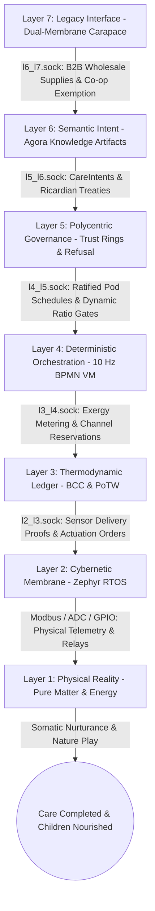
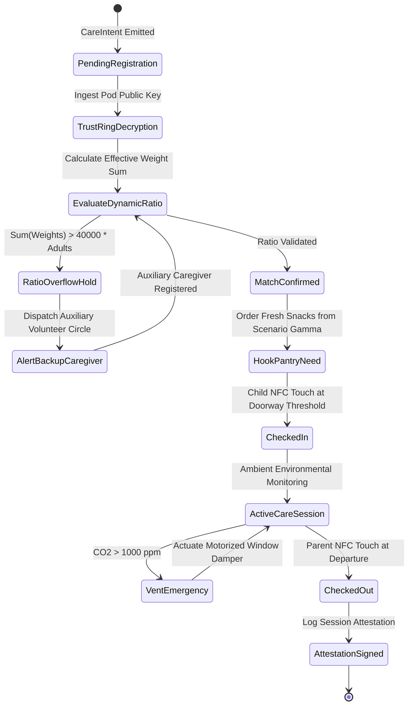
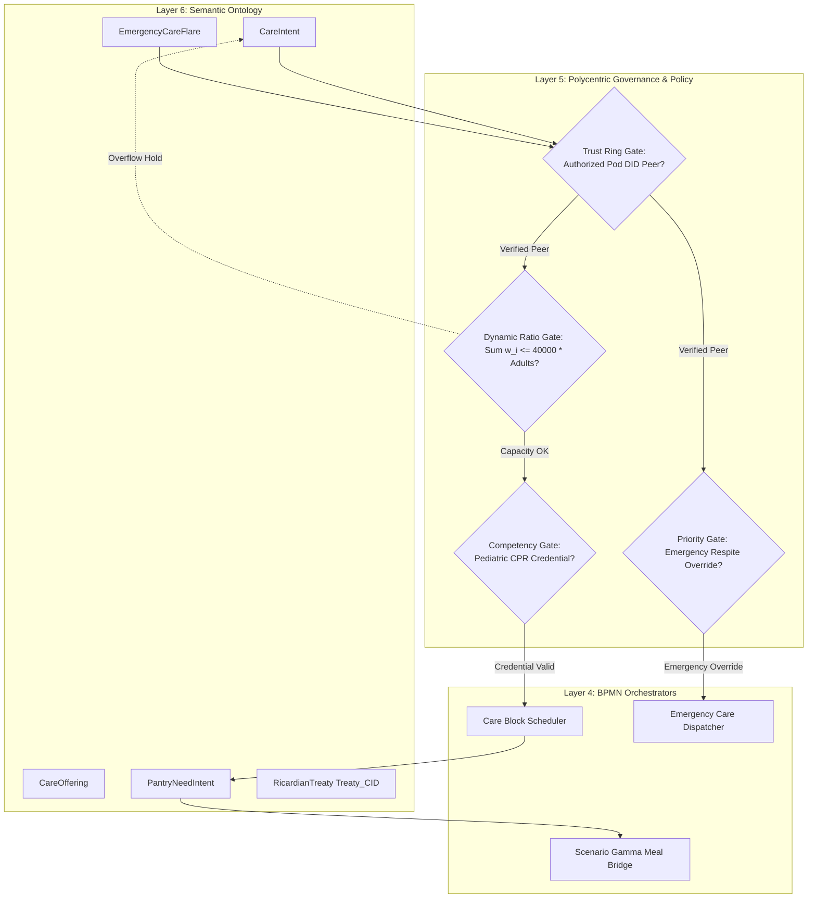
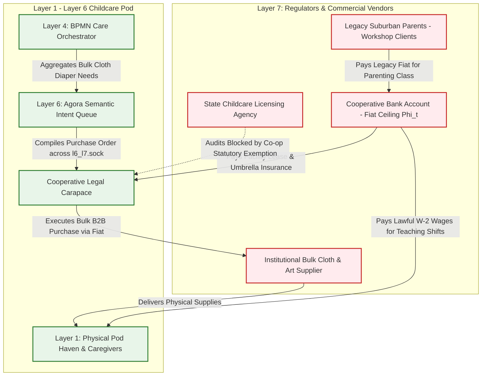

# Scenario Delta: Mutual Aid Childcare Pod

*   **Identifier:** `SCN-DELTA-CHILD`
*   **System Epic:** Trust Rings, Invisible Labor Valuation, Intergenerational Care, and Decentralized Scheduling
*   **Primary Layers Tested:** L1 (Physical), L2 (Digital Twin), L3 (Ledger), L4 (Orchestration), L5 (Governance), L6 (Semantic), L7 (Proxy)
*   **Pass/Fail Metric:** Decentralized scheduling of communal care blocks respecting dynamic adult-to-child support ratios; unconditional access to Tier 2 Human Survival Baseline ($B_{\mathrm{baseline}}$); non-financial Reputational Wealth recognition in Layer 5 Care Councils with Care Leave Shield; 0% state commercial daycare licensure violations through private cooperative shielding; zero floating-point math; zero tokenization of reproductive care.

---

## Architectural Council Ratification & 5-Perspective Synthesis

This scenario specification has been ratified by unanimous consensus of the 5-Persona Architectural Council:

| Council Persona | Disciplinary Representative | Core Contribution to Scenario |
| :--- | :--- | :--- |
| **Game Designer** | Lead Systems & Gameplay Designer | Dwarf Fortress parental stress and recovery psychology (parents with children in care lose "Overwhelmed by constant vigilance" stress debuffs, unlocking mental focus for high-tier crafting; elders caring for children gain "Felt cherished and vital to the tribe (+45 mood)" thoughts; children gain somatic social resilience); The Sims schedule management (drop-off/pickup chores coordinated smoothly across household chore queues without missed handoffs); Cities Skylines neighborhood-scale intergenerational pedestrian networks and school-forest pathways. |
| **Game Engineer** | Principal C++ Simulation & Engine Architect | Flecs ECS DOD architecture (`CaregiverProfileComponent`, `ChildProfileComponent`, `PodZoneBoundsComponent`, `SensoryEnvironmentComponent`); 32-bit compact voxel grid tracking playroom boundary zones; deterministic 10 Hz BPMN state engine; compilable C++20 test harness validating dynamic support ratio enforcement, NFC cryptographic check-ins, and ratio overflow rejections exclusively using fixed-point SI integer arithmetic (basis points, parts per million, millikelvin, milliseconds). |
| **Sovereign Stack Specialist** | Sovereign Stack Systems Architect | 7-layer strict adjacency without layer skipping; zero software, microcontrollers, or keys in Layer 1; Zephyr RTOS Layer 2 membrane (`col-sensord`, `col-membraned`, `col-actuated`); end-to-end encrypted Trust Ring gossip (child identities and schedules encrypted to pod pairwise DIDs, completely invisible to the general mesh); BBS+ Zero-Knowledge Proofs for pediatric CPR credentials without disclosing personal identities; Layer 5 boundary socket `/run/collective/ipc/l4_l5.sock`; Tripartite Ricardian Treaties ($\mathrm{Treaty\_CID}$). |
| **Solarpunk Thinker** | Bioregional Regenerative Ecologist | Intergenerational nature immersion (children spend care hours outdoors in Scenario Eta coppice woods and food forests, cultivating biophilic ecological literacy); closed-loop zero-waste caregiving (communal organic cloth diaper laundering rotated via solar-thermal drying yards, eliminating disposable petrochemical diapers); nourishing organic meals supplied directly from Scenario Gamma commons kitchen pantries. |
| **Scenario Specialist** | Neurodivergent-Affirming Pediatrician & Cooperative Care Sociologist | Individualized dynamic adult-to-child support ratio equation ($R_{\mathrm{eff}} = \sum w_i$ scaled in basis points from 10000 to 25000 for sensory overwhelm accommodation); indoor air quality telemetry standards (CO2 < 800 ppm); legal structuring of private mutual-aid babysitting cooperatives under state administrative code childcare exemptions (e.g., WAC 110-300 / RCW Title 43, Chapter 216). |

**Council Consensus Statement:** Unanimous Consensus Reached. The council affirms that nurturing children is sacred mutual aid within the Convivial Sanctuary ($R_0$) and Settlement Commons ($R_1$). All pricing, tokenization, hourly wages, and financialization of childcare labor are permanently abolished. Caregivers receive unconditional survival baselines and non-financial Reputational Wealth protected by the Care Leave Shield.

---

## 1. Problem Statement & Legacy Failure

In late-stage capitalist suburban society (Layer 7), childcare is broken by privatization, atomization, and commercial enclosure.

When families attempt to navigate early childhood in the legacy economy:
*   **Hyper-Atomization & Parental Burnout:** The nuclear family is isolated from communal support. Parents (disproportionately mothers) shoulder grueling 24/7 unpaid caregiving, leading to clinical burnout, chronic sleep deprivation, and forfeiture of creative and technical livelihoods.
*   **Enclosure of Invisible Care Labor:** Legacy GDP economics categorizes care work as economically unproductive because it generates no corporate shareholder surplus. When parents organize informal babysitting co-ops, exchanging fiat currency triggers municipal administrative fines or police actions for operating an "unlicensed commercial daycare."
*   **Institutional Warehousing & Generational Segregation:** Commercial daycares group 30 children into fluorescent-lit concrete rooms with rigid corporate curricula, while retirement homes segregate elders into lonely institutional isolation, severing the ancestral intergenerational loop of human culture.
*   **Extractive Monopolistic Costs:** Commercial infant care costs between 2,000 and 3,500 units of fiat per month per child—often exceeding household housing costs—yet the frontline childcare workers nurturing children are paid near-poverty wages, while private equity childcare chains extract massive shareholder dividends.

---

## 2. The Collective Workflow (7-Layer Traversal)

Scenario Delta creates sovereign, private **Trust Rings** that distribute childcare across a pod of parents, trusted neighbors, and elders. Care work is explicitly recognized as non-commensurable mutual aid. Caregivers receive unconditional access to the Tier 2 Human Survival Baseline ($B_{\mathrm{baseline}}$: guaranteed food from Scenario Gamma, warm shelter, and clinic access) and earn domain-specific non-financial Reputational Wealth ($\mathcal{R}$) within Layer 5 Care Councils, protected by the Care Leave Shield. The workflow traverses canonically from Layer 1 physical care up to Layer 7 cooperative legal shielding.



### Layer 1: Physical Ground Truth
*   **Pure Physical Substrate:** Layer 1 contains exclusively physical play structures, bedding, building blocks, and passive transducers. It contains **zero software, zero microcontrollers, zero firmware, zero cryptographic keys, and zero network daemons.**
*   **Hardware Nodes (Care Pod Havens):** Dedicated child-safe indoor living spaces, outdoor nature play gardens, quiet sensory retreat nooks, low-height sanitizing sinks, and passive analog wiring for sensors and mechanical latch solenoids.
*   **Hardware Nodes (Sensory & Air Quality Instrumentation):** Non-dispersive infrared (NDIR) $\text{CO}_2$ sensor chambers, analog acoustic decibel sound level meters, motorized fresh air window dampers, and passive 13560 kHz NFC arrival/departure touchpoints.
*   **Feedstock & Materials:** Reusable organic cotton cloth diapers, non-toxic beeswax crayons, open-ended wooden building blocks, watercolor paints, and pediatric first-aid supplies.
*   **Physical Actions:** Feeding, emotional co-regulation, somatic holding, storytelling, outdoor forest walks, and diaper changes.

### Layer 2: Digital Twin & Telemetry
*   **Membrane Architecture:** Executed by Zephyr RTOS microcontrollers (`col-sensord`, `col-membraned`, `col-actuated`) converting analog sensor voltages into dimensionally typed, fixed-point integer packets.
*   **Convivial Anti-Panopticon Shield:** Environmental monitoring is strictly confined to ambient room conditions. **Absolute ban on body-worn sensors, smartwatches, heart rate bands, cameras, and microphones in children's living spaces.**
*   **Ingress Telemetry Topics (Fixed-Point SI Integers via `col-membraned`):**
    *   `node/care/pod_alpha/telemetry/co2_ppm` (`uint32_t`, indoor air quality in parts per million; target < 800 ppm)
    *   `node/care/pod_alpha/telemetry/ambient_dba` (`uint32_t`, ambient sound pressure level in decibels; target < 65 dBA)
    *   `node/care/pod_alpha/telemetry/temp_mk` (`uint32_t`, thermal comfort in millikelvin; nominal 293,150 mK to 295,150 mK = 20 C to 22 C)
    *   `node/care/pod_alpha/handoff/nfc` (`uint64_t`, backpack NFC tag touch event timestamp in milliseconds)
    *   `node/care/pod_alpha/status` (`enum uint8_t`: `0=PREPARING`, `1=ACTIVE_SESSION`, `2=RATIO_OVERFLOW`, `3=CLOSED`)
*   **Safety Verification:** An NFC tag touch at the pod doorway verifies physical arrival and departure of children. NDIR $\text{CO}_2$ spikes above 1000 ppm trigger motorized fresh air ventilation dampers.
*   **Actuator Control:** Local relay controllers unlock pod safety gates upon valid NFC credentials and cycle window actuators only after Layer 2 verifies actuation invariants $\mathbf{\Phi}$ across `/run/collective/ipc/l3_l2.sock`.

### Layer 3: Thermodynamic Ledger
*   **Constitutional Non-Commensurability of Childcare:** Childcare, emotional nurturing, diaper changing, and bedtime stories are declared qualitative human care and mutual aid (`sec:l3-friction`). Layer 3 **structurally refuses to mint tokens, credits, or currency for childcare labor.** No caregiver hourly token rates, no child booking fees, and no chore bounties exist.
*   **Inalienable Tier 2 Human Survival Baseline ($B_{\mathrm{baseline}}$):** Caregivers and children have unconditional access to wholesome meals from Scenario Gamma, warm shelter, laundry facilities, and healthcare as an inalienable constitutional right of living membership ($B_{\mathrm{baseline}}$). Access is never conditioned upon labor hours, token balances, or chore points.
*   **Proof-of-Thermodynamic-Work (PoTW):** Physical electricity consumed by ventilation dampers, laundry washing machines, and lighting is metered in microjoules ($\mu\mathrm{J}$):
    $$\text{1 Exergy Credit} \equiv 3{,}600{,}000{,}000{,}000\text{ }\mu\mathrm{J}$$
    Metered exergy measures microgrid power drawn by shared physical infrastructure, subject to physical demurrage.
*   **Pairwise Bilateral Clearing Channels (BCC) & Multi-Hop HTLCs:** When shared physical childcare assets (e.g., an electric cargo trike or commercial cloth diaper laundering autoclave) are shared with a neighboring pod $v$, resource clearances settle across inter-node Bilateral Clearing Channels:
    $$B_{u \to v}(t) + B_{v \to u}(t) = 0$$
    Subject to mutual aid credit windows $[-C_{u \to v}, +C_{v \to u}]$. Multi-hop equipment sharing across the watershed settles via chained Hashed Timelock Contracts:
    $$\mathrm{HTLC} = \langle H(S), \Delta t, Q, u, v \rangle$$
    where $Q$ is denominated in microjoules of embodied exergy, releasing upon physical delivery receipts $\sigma_{\mathrm{delivery}}$ and cascading backward balance updates without global tokens or external market conversion.

### Layer 4: Deterministic Orchestration State Machine
The childcare pod lifecycle is governed deterministically by the embedded 10 Hz BPMN engine (`col-execd`):



### Layer 5: Policy & Polycentric Governance
Layer 5 (`col-kmsd`) enforces absolute privacy, child protection, and caregiver equity:
*   **The 7-Tier Concentric Trust Rings ($R_0 \dots R_6$):**
    *   **$R_0$ (The Hearth Sanctuary):** The immediate domestic nursery. Social immunity: unconditional food, warmth, zero keys, zero registration, zero biometric surveillance, zero governance voting weight.
    *   **$R_1$ (Settlement Commons):** Local childcare pod havens ($\le 500\text{ m}$), ephemeral pairwise DIDs (`did:peer`), rotational care circles, communal playgroups.
    *   **$R_2$ (Village Commons):** Shared nature play gardens, toy libraries, cargo trike pools ($\le 5\text{ km}$).
    *   **$R_3$ (Watershed Guild):** Peering with neighboring childcare pods ($\le 30\text{ km}$); inter-pod BCC channels for shared pediatric equipment and bulk supplies.
    *   **$R_4$ (Bioregional Federation):** Regional pediatric training circles, outdoor forest schools ($\le 150\text{ km}$).
    *   **$R_5$ (Continental Corridor):** Open neurodiversity accommodations, child development research, non-toxic toy designs.
    *   **$R_6$ (Ecumene / Legacy Perimeter):** Cooperative legal carapace, statutory licensing exemption management.
*   **Cellular Autonomy & Subsidiarity:** Every childcare pod maintains absolute autopoietic closure and cellular autonomy. No external council can compel a pod to admit children beyond safe ratios or override parental consent.
*   **Bioregional Path-Vector Protocol (BPVP):** Inter-pod resource requests and surplus pediatric supplies cascade across Trust Rings via BPVP capability advertisements $\mathcal{A}$ bounded by local cellular autonomy and the Export Surplus Bound:
    $$Q_{\mathrm{avail}}(t) = \max\left(0, Q_{\mathrm{inventory}}(t) - F_{\mathrm{eco}}(t) - B_{\mathrm{baseline}}(t)\right) \cdot \mathbf{1}_{\mathrm{export}}$$
    Surplus equipment is never exported if local pod needs are unfulfilled.
*   **Dynamic Support Ratio Policy Gate:** A care block requires that the effective child weight sum does not exceed the capacity of active caregivers:
    $$\sum_{i=1}^{k} w_i \le 40000 \cdot N_{\mathrm{caregivers}}$$
    where baseline weight is 10000 basis points, and individualized neurodivergent support accommodations scale up to 25000 basis points. If the ratio is breached, Layer 4 transitions to `RATIO_OVERFLOW_HOLD` and alerts auxiliary circle volunteers.
*   **Encrypted Trust Ring Scope:** Childcare intents, schedules, and allergy profiles are encrypted strictly to the pairwise DIDs of the pod Trust Ring (`did:peer` ring). Outside mesh nodes and network observers cannot query child schedules or identities.
*   **Caregiver Attestation Gate:** All active caregivers must hold a verified BBS+ Verifiable Credential (`Pediatric_CPR_Steward_L1`, `Safe_Sleep_Steward_L1`).
*   **Reputational Wealth ($\mathcal{R}$) & Care Leave Shield:** Caregiving hours are recognized through qualitative peer attestations contributing to non-financial Reputational Wealth ($\mathcal{R}$) in the Stewardship Chamber. Reputational Wealth decays exponentially ($\tau_{\mathrm{half}} = 2\text{ years}$) and is sublinearly capped ($\le 8\%$ chamber weight). When a parent or caregiver declares family care leave (parenting, newborn care, sickness, bereavement), the **Care Leave Shield** completely freezes the decay clock.
*   **The Protocol of Refusal (`sec:l5-refusal`):** Family domestic spaces and cultural parenting rituals can be declared Refused Domains, completely barring digital-twin simulation, sensor ingress, and algorithmic optimization.
*   **Autonomous Transit Veto (`No-Transit`):** Childcare pods and surrounding forest play sanctuaries hold the unconditional right to declare a `No-Transit` attribute over play corridors, nature school paths, and nursery perimeter lanes, deterministically excluding heavy logistical freight and motorized vehicular traffic to preserve uncompromised child safety and sensory peace.
*   **Boundary IPC Socket:** Layer 5 policies compile into deterministic constraints pushed to Layer 4 across `/run/collective/ipc/l4_l5.sock`.

### Layer 6: Semantic Intent & Domain Ontology
The Care Commons formalizes requests into typed JSON-LD Knowledge Artifacts within the Agora Commons (`col-commonsd`):
1.  **`CareIntent`:** Request to reserve care slots for specific children during a scheduled block, including support weight in basis points and allergen hashes.
2.  **`EmergencyCareFlare`:** Immediate call for emergency respite care due to parental injury, acute illness, or emotional distress.
3.  **`CareOffering`:** Host or elder offering spatial sanctuary and care hours for a designated block.
4.  **`PantryNeedIntent` (Scenario Gamma Bridge):** Caloric requirement notice routed to Scenario Gamma, matching children's specific allergies.
5.  **`NatureSchoolIntent` (Scenario Eta Bridge):** Coordinates outdoor excursion into Scenario Eta coppice woods and food forests.
6.  **`RicardianTreaty` ($\mathrm{Treaty\_CID}$):** Tripartite covenant binding natural-language childcare mutual-aid pacts, machine-readable JSON-LD operational parameters, and formal BPMN state machines governing inter-pod equipment sharing.

### The Governance Router Flowchart



### Layer 7: The Legacy Interface (Dual-Membrane Carapace)
The Childcare Pod interfaces with the legacy state through the Dual-Membrane Doctrine, presenting an honest, lawful, and legally unremarkable entity:

1.  **Statutory Exemption & Mutual Aid Carapace:**
    Under state administrative codes (e.g., WAC 110-300 / RCW Title 43, Chapter 216), informal babysitting exchanges among parents and private cooperative clubs without commercial fee exchange are legally exempt from commercial child care center licensing. The pod havens operate under a Consumer Housing Cooperative or Federated Land Trust carapace that holds general commercial umbrella liability coverage, shielding home hosts from liability lawsuits.
2.  **Bounded Parenting Workshop Carapace:**
    The cooperative hosts weekend positive parenting, pediatric first aid, and nature-schooling workshops for legacy suburban parents, charging legacy fiat fees.
    *   All external fiat flows into the cooperative's legacy bank account.
    *   External fiat is allocated strictly to satisfy the settlement's itemized fiat needs target ($\Phi_t$) for insurance premiums, mortgage or lease requirements, and bulk institutional purchases.
    *   Workshop instructors receive lawful W-2 wages in legacy fiat currency for external teaching shifts.
    *   **Strict Inconvertibility:** External fiat **never** converts into internal Exergy Credits or tokens. Internal childcare is 100% non-monetary and unpriced.
3.  **Regenerative Group Purchasing (GPO Wholesale Procurement):**
    The cooperative acts as a Decentralized Group Purchasing Organization (GPO). It aggregates requisitions for organic cotton cloth diapers, non-toxic wooden art supplies, and medical-grade sanitizers, executing bulk commercial purchase orders with wholesale institutional distributors, slashing retail packaging and intermediate transportation markups.

### Layer 7 Dual-Membrane Bidirectional Flowchart



---

## 3. Machine-Readable Schemas

### Subsection 3A: Layer 6 Knowledge Artifact - Care Intent (`care_intent.jsonld`)

```json
{
  "@context": [
    "https://schema.org/",
    "https://collective.network/ontology/v1/"
  ],
  "@type": "CareIntent",
  "identifier": "urn:uuid:a1b2c3d4-e5f6-7890-1234-56789abcdef0",
  "issuerDid": "did:mesh:node02:parent_sarah",
  "targetTrustRing": "did:mesh:ring:duvall_pod_alpha",
  "creationEpochMs": 1791444600000,
  "careRequirements": {
    "children": [
      {
        "childId": "child_maya_01",
        "ageMonths": 42,
        "supportWeightBps": 10000,
        "allergenHashes": [
          "0x1c7e9a...tree_nut"
        ]
      },
      {
        "childId": "child_leo_02",
        "ageMonths": 60,
        "supportWeightBps": 15000,
        "sensoryAccommodations": [
          "NoiseCancellingHeadphones_Available",
          "QuietSensoryNook_Required"
        ],
        "allergenHashes": []
      }
    ],
    "sessionDurationMs": 21600000,
    "targetLocationVoxel": [16, 1, 16]
  },
  "trustConstraints": {
    "requiredCredential": "Pediatric_CPR_Steward_L1",
    "dataPrivacyLevel": "PodEncrypted_ZeroKnowledge"
  },
  "distributionPolicy": {
    "trustRing": "R1_Settlement_Commons",
    "survivalBaselineEligible": true,
    "exergyTransferMicrojoules": 0
  }
}
```

### Subsection 3B: Layer 2 Telemetry Attestation - Pod Session Proof (`care_attestation.json`)

```json
{
  "@context": "https://collective.network/ontology/v1/",
  "@type": "CarePodSessionAttestation",
  "intentRef": "urn:uuid:a1b2c3d4-e5f6-7890-1234-56789abcdef0",
  "podHavenDid": "did:mesh:node02:space:pod_alpha_haven",
  "stewardCaregiverDid": "did:mesh:node02:steward_elder_gordon",
  "executionMetrics": {
    "sessionStartEpochMs": 1791448200000,
    "sessionEndEpochMs": 1791469800000,
    "durationMs": 21600000,
    "meanCo2Ppm": 684,
    "peakCo2Ppm": 760,
    "meanAmbientDba": 58,
    "ventilationActuationCount": 1,
    "checkedInChildrenCount": 2,
    "effectiveWeightSumBps": 25000,
    "caregiverCount": 1,
    "ratioMaintained": true,
    "organicMealsServedCount": 4
  },
  "edgeAttestationSignature": "0x3f7a1b9e2c4d8f5a6b0c2d4e6f8a1b3c5e7a9b1d3f5e7a9b1c3d5e7f9a1b3c5e"
}
```

---

## 4. Oasis Engine Implementation Specification

### Subsection 4A: Memory Allocation & Voxel State

In the Oasis simulation grid, childcare havens and sensory play zones occupy designated coordinates within the 32x32x32 chunk space:
*   The childcare pod haven voxel is initialized with `material_id = 70` (`CHILDCARE_POD_ZONE`).
*   The sensory quiet retreat voxel is initialized with `material_id = 71` (`SENSORY_NOOK_SANCTUARY`).
*   The outdoor nature play garden voxel is initialized with `material_id = 72` (`NATURE_PLAY_GARDEN`).
*   The `Is_Actuator` bit is set in `metadata` (bit 1) for safety gates and fresh-air ventilation dampers.
*   The `Is_Sensor` bit is set in `metadata` (bit 2) for NDIR $\text{CO}_2$ probes and acoustic decibel monitors.
*   The `ChunkManager` maintains an active entity occupancy list, tracking adult and child entity counts per chunk to validate the dynamic ratio policy.
*   All state values, timers, support weights, and air quality metrics are strictly defined as fixed-point SI integers (`uint64_t`, `uint32_t`, `int64_t`, `uint16_t`).

### Subsection 4B: C++20 Test Harness Code

```cpp
// engine/tests/scenario_delta_test.cpp
#include <cassert>
#include <cstdint>
#include <string>
#include <vector>
#include "oasis/chunk_manager.hpp"
#include "oasis/orchestration/bpmn_engine.hpp"

namespace oasis {

// Fixed-point SI integer state definitions
struct ChildEntity {
    std::string id;
    uint32_t support_weight_bps{10000}; // 10000 basis points baseline
    bool checked_in{false};
};

struct CarePodContext {
    std::string intent_id;
    uint32_t adult_caregiver_count{1};
    std::vector<ChildEntity> children;
    uint32_t session_duration_ms{21600000}; // 6 hours in milliseconds
    uint32_t mean_co2_ppm{650};
    uint64_t ventilation_energy_uj{0};      // Energy in microjoules
};

// Bilateral Clearing Channel for shared childcare equipment
struct BilateralClearingChannel {
    int64_t balance_uj{0};                  // B_{u -> v}(t) in microjoules
    int64_t credit_headroom_uj{36000000000000}; // 36000000000000 microjoules headroom

    bool can_reserve(int64_t amount_uj) const {
        return (balance_uj + amount_uj) <= credit_headroom_uj;
    }

    void execute_transfer(int64_t amount_uj) {
        balance_uj += amount_uj;
    }
};

} // namespace oasis

void test_scenario_delta_childcare_normal_execution() {
    using namespace oasis;

    // 1. Initialize local chunk and zone voxels
    ChunkManager chunk_mgr;
    chunk_mgr.allocate_chunk(0, 0, 0);

    Voxel pod_voxel{
        .material_id = 70, // CHILDCARE_POD_ZONE
        .moisture = 0,
        .temperature = 21, // 21 C ambient
        .metadata = 0b00000110 // Sensor + Actuator
    };
    chunk_mgr.set_voxel(16, 1, 16, pod_voxel);

    // 2. Setup BPMN Orchestrator & Care Job Context
    BPMNEngine orchestrator;
    orchestrator.load_schema("schemas/bpmn/childcare_pod.bpmn");

    CarePodContext job{
        .intent_id = "a1b2c3d4-e5f6-7890-1234-56789abcdef0",
        .adult_caregiver_count = 1,
        .children = {
            {.id = "child_maya_01", .support_weight_bps = 10000, .checked_in = false},
            {.id = "child_leo_02", .support_weight_bps = 15000, .checked_in = false}
        },
        .session_duration_ms = 21600000, // 6 hours
        .mean_co2_ppm = 684,
        .ventilation_energy_uj = 1800000000000 // 1800000000000 microjoules
    };

    // 3. Assert Dynamic Ratio Check: Total weight (25,000 bps) <= 40,000 bps * adult (1)
    uint32_t total_weight_bps = 0;
    for (const auto& child : job.children) {
        total_weight_bps += child.support_weight_bps;
    }
    uint32_t max_allowed_weight_bps = 40000 * job.adult_caregiver_count;
    assert(total_weight_bps <= max_allowed_weight_bps);

    // Check-in children via simulated NFC tag scan
    for (auto& child : job.children) {
        child.checked_in = true;
    }

    // Step simulation ticks (6 hours at 10 Hz = 216,000 ticks)
    SimResult res = orchestrator.step_simulation_ticks(chunk_mgr, job, 216000);
    assert(res.status == ExecutionStatus::COMPLETED);
    assert(job.mean_co2_ppm < 800);

    // 4. Verify Bilateral Clearing Channel for shared nursery equipment
    BilateralClearingChannel channel;
    int64_t transfer_uj = 1800000000000; // 1800000000000 microjoules
    assert(channel.can_reserve(transfer_uj));
    channel.execute_transfer(transfer_uj);
    assert(channel.balance_uj == 1800000000000);
}

void test_scenario_delta_ratio_overflow_anomaly() {
    using namespace oasis;

    ChunkManager chunk_mgr;
    chunk_mgr.allocate_chunk(0, 0, 0);

    BPMNEngine orchestrator;
    orchestrator.load_schema("schemas/bpmn/childcare_pod.bpmn");

    // Invalid job context: 1 adult attempting to care for 5 children (effective weight = 55,000 bps)
    CarePodContext invalid_job{
        .intent_id = "overflow-ratio-test",
        .adult_caregiver_count = 1,
        .children = {
            {.id = "c1", .support_weight_bps = 10000},
            {.id = "c2", .support_weight_bps = 10000},
            {.id = "c3", .support_weight_bps = 10000},
            {.id = "c4", .support_weight_bps = 10000},
            {.id = "c5", .support_weight_bps = 15000}
        },
        .session_duration_ms = 14400000,
        .mean_co2_ppm = 700,
        .ventilation_energy_uj = 0
    };

    uint32_t total_weight_bps = 0;
    for (const auto& child : invalid_job.children) {
        total_weight_bps += child.support_weight_bps;
    }
    uint32_t max_allowed_weight_bps = 40000 * invalid_job.adult_caregiver_count;
    assert(total_weight_bps > max_allowed_weight_bps);

    // Orchestrator evaluates policy gate and halts dispatch
    bool gate_approved = orchestrator.evaluate_policy_gate("EXECUTION_DYNAMIC_RATIO", total_weight_bps);
    assert(gate_approved == false);
    assert(orchestrator.current_state() == BPMNState::RATIO_OVERFLOW_HOLD);
}
```

---

## 5. Acceptance Test Gates (Pass/Fail)

| Checkpoint | Validation Method | Pass Condition |
| :--- | :--- | :--- |
| **G1: Dynamic Support Ratio Policy** | Dynamic Ratio Policy Gate | Attempting to dispatch a care session where effective child weight $\sum w_i > 40000\text{ bps} \cdot N_{\mathrm{adult}}$ mathematically triggers `RATIO_OVERFLOW_HOLD`. |
| **G2: Offline Local Mesh Autonomy** | Local Pod Network Severance | NFC drop-off/pick-up handoffs, environmental $\text{CO}_2$ logging, and damper relay actuations operate with 100% WAN/Internet severance over the local mesh. |
| **G3: Encrypted Trust Ring Privacy** | Pod Key Decryption Audit | A node outside the authorized pod Trust Ring querying the mesh receives zero schedule data, child identities, or telemetry logs. |
| **G4: Environmental Air Quality Gate** | NDIR Sensor Stream to Damper Relay | An indoor air quality spike exceeding 1000 ppm CO2 mathematically trips the Layer 2 GPIO relay, opening fresh-air dampers until CO2 drops below 800 ppm. |
| **G5: Dual-Membrane Workshop Carapace** | External Workshop Revenue Carapace | Mock legacy fiat paid by non-members for positive parenting workshops is credited to the cooperative bank account to cover facility insurance and lease up to ceiling $\Phi_t$; zero internal tokens minted; zero conversion into internal credits. |
| **G6: Regenerative Wholesale Procurement** | Bulk Non-Toxic Supply GPO | System pools 5 pod supply requisitions, triggering a single wholesale B2B purchase of organic cloth diapers and non-toxic materials via the cooperative carapace to eliminate retail packaging. |
