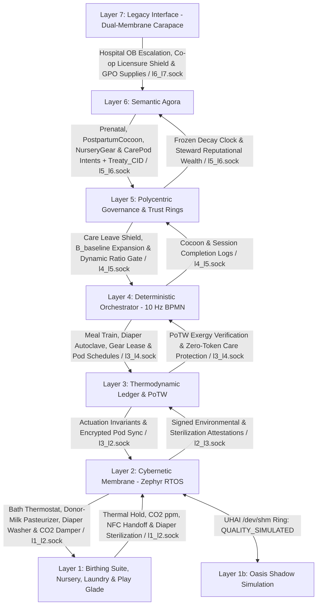
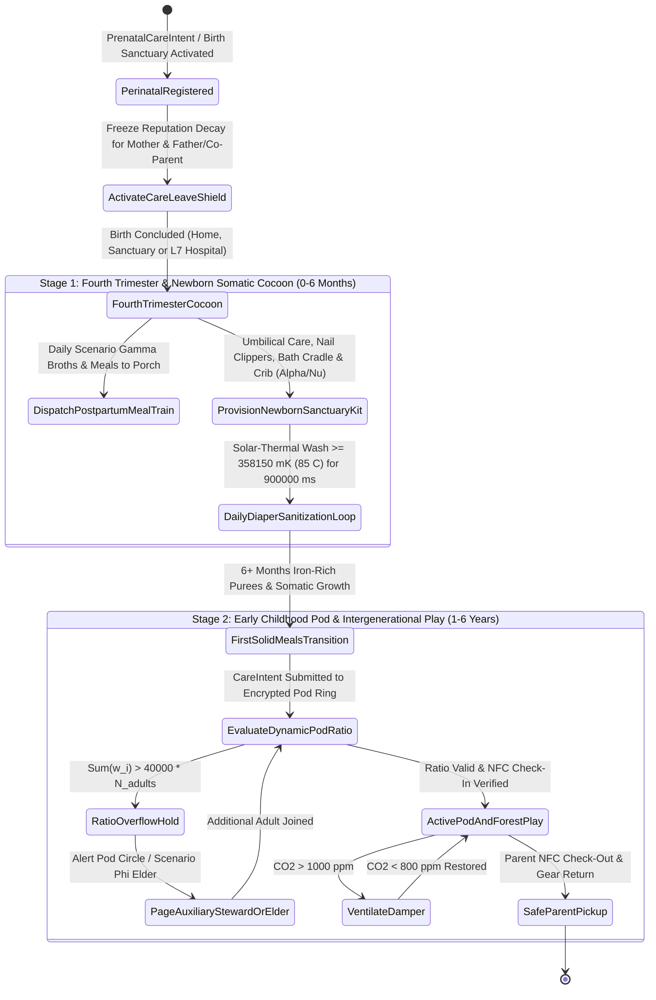
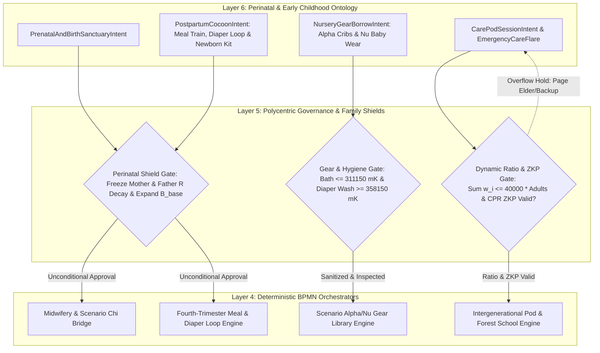

# Scenario Delta: The Perinatal, Postpartum, Newborn & Early Childhood Sanctuary Commons

*   **Identifier:** `SCN-DELTA-CHILD`
*   **System Epic:** Full-Spectrum Family & Early Life Stewardship: Prenatal Midwifery & Nutrition, Birth Sanctuary, Fourth-Trimester Postpartum Cocooning, Newborn Somatic Care (Feeding, Bathing, Umbilical & Nail Hygiene, Cloth Diaper Loops), Shared Nursery Gear Libraries, and Intergenerational Early Childhood Pods
*   **Primary Layers Tested:** L1 (Physical Reality), L1b (Oasis Shadow Simulation), L2 (Cybernetic Membrane), L3 (Thermodynamic Ledger), L4 (Deterministic Orchestrator), L5 (Polycentric Governance & Trust Rings), L6 (Semantic Translation & Agora), L7 (Legacy Interface)
*   **Pass/Fail Metric:** Complete social, nutritional, clinical, and material support across prenatal, birth, newborn, toddler, and early childhood stages with $0\text{ basis points}$ ($0\%$) commercial extraction; automatic activation of the Perinatal Care Leave Shield for both mother and father/co-parent upon third-trimester or birth registration; automatic expansion of household Tier 2 Survival Baselines ($B_{\mathrm{baseline}}$) for postpartum meal trains and sterilized diaper/nursery logistics; strict enforcement of thermostatic newborn bath anti-scald limits ($\le 311150\,\mathrm{mK} = 38^\circ\mathrm{C}$) and age/neurodivergent dynamic pod support ratios ($\sum w_i \le 40000 \cdot N_{\mathrm{adults}}$); zero floating-point math; zero quantization or tokenization of parental affection and reproductive care.

---

## Architectural Council Ratification & 5-Perspective Synthesis

This scenario specification has been ratified by unanimous consensus of the 5-Persona Architectural Council to establish how The Collective understands, honors, and governs the social and material needs of expectant families, mothers, fathers/co-parents, newborns, toddlers, and young children:

| Council Persona | Disciplinary Representative | Core Contribution to Scenario |
| :--- | :--- | :--- |
| **Game Designer** | Lead Systems & Gameplay Designer | Life-stage family gameplay in Oasis: instead of treating children as generic sprites dropped at a daycare box, Oasis models the **Perinatal & Early Childhood Continuum**—prenatal nesting, birth sanctuary support, the **Fourth Trimester Postpartum Cocoon** (where neighbors deliver Scenario Gamma meals so both mother and father can focus on newborn baths, umbilical care, first purees, and sleep), shared **Nursery Gear Libraries** (cribs, strollers, wooden toys from Scenario Alpha), and **Intergenerational Play Pods** pairing toddlers with elders (Scenario Phi). |
| **Game Engineer** | Principal C++ Simulation & Engine Architect | Flecs ECS Data-Oriented Design (DOD): `PerinatalHouseholdComponent`, `NewbornSomaticCareComponent`, `NurseryGearLeaseComponent`, `CarePodZoneComponent`, and `CareLeaveShieldComponent`; deterministic $10\,\mathrm{Hz}$ BPMN state engine (`col-execd`) orchestrating postpartum meal trains, autoclave diaper sanitization, and pod support ratios; self-contained C++20 fixed-point test harness (basis points, millikelvin, milliseconds, milligrams, microjoules) with zero IEEE 754 floats. |
| **Sovereign Stack Specialist** | Sovereign Stack Systems Architect | Strict 7-layer adjacency across POSIX Unix Domain Sockets (`l1_l2.sock` through `l6_l7.sock`); **Constitutional Non-Commensurability of Reproductive & Parental Affection** (`sec:l3-friction`—the stack never attempts to quantize love, nursing, or soothing a child, governing instead the protective social and physical infrastructure around the family); end-to-end encrypted `did:peer` Trust Ring privacy; BBS+ Zero-Knowledge Proofs for midwifery and pediatric CPR credentials; automatic Perinatal Care Leave Shield freezing guild reputation decay ($\mathcal{R}$). |
| **Solarpunk Thinker** | Bioregional Regenerative Ecologist | Abolishing the cruel nuclear-family isolation that forces fathers back to work days after birth and leaves mothers exhausted and alone; wrapping every new family in a village-scale mutual-aid cocoon; $100\%$ circular material stewardship via heirloom hardwood cribs/toys (Scenario Alpha), organic cotton/wool baby garments (Scenario Nu), solar-thermal ozone/steam cloth diaper laundering (eliminating $6{,}000+$ petrochemical disposable diapers per child), and forest-school immersion in Scenario Eta woods. |
| **Scenario Specialist** | Certified Nurse-Midwife, Neonatologist & Neurodivergent-Affirming Pediatrician | Clinical prenatal/postpartum midwifery protocols and Scenario Chi hospital escalation bridges; neonatal somatic care standards (clean dry umbilical cord stump care until natural separation at $7\text{–}14\text{ days}$, thermostatic $310150\,\mathrm{mK}$–$311150\,\mathrm{mK}$ infant baths, precision nail care, Holder pasteurization of donor human milk at $335650\,\mathrm{mK}$, and iron-rich $6\text{-month}$ complementary feeding); age-weighted and neurodivergent-affirming dynamic adult-to-child support ratios; statutory cooperative childcare exemptions. |

**Ratification Statement:** Unanimous Consensus Reached across all five disciplinary perspectives. The council affirms that human affection, parental bonding, and the nurturing of new life cannot and must never be quantized into tokens or metrics. Instead, The Collective governs the physical, nutritional, clinical, and scheduling commons around every family so that mothers, fathers, co-parents, and children flourish in unhurried dignity.

---

## 1. Problem Statement, Legacy Failure & Macro-Domain Vision

In legacy industrial-capitalist society (Layer 7), pregnancy, birth, postpartum recovery, and early childhood are fractured by nuclear-family isolation, workplace coercion, and commercial extraction:
1.  **Fractured Postpartum & Paternal Exile:** Immediately after childbirth—when a mother is physically recovering from labor or surgery and a newborn requires round-the-clock feeding, umbilical care, warm baths, and skin-to-skin co-regulation—legacy employers force fathers and co-parents back into wage labor within days or weeks. Mothers are left isolated in suburban apartments without extended kin, while fathers are robbed of the irreplaceable early months of bathing their baby, trimming tiny fingernails, preparing first meals, and sharing night watches.
2.  **Medicalized Alienation vs. Unsupported Risk:** Expectant families face a false binary between cold, conveyor-belt hospital obstetrics and unsupported home birth without rapid clinical backup, while prenatal and postpartum nutrition is left to commercial grocery stores and expensive synthetic supplements.
3.  **Disposable Consumer Waste & Financial Predation:** Every isolated household is pressured to purchase thousands of dollars of rapidly outgrown plastic bassinets, strollers, car seats, and $6{,}000+$ single-use petrochemical diapers per child, while commercial daycares charge $2{,}000$ to $3{,}500$ fiat units per month to warehouse infants and toddlers in high-ratio fluorescent rooms.
4.  **Bureaucratic Criminalization of Neighborly Care:** When parents attempt to form informal neighborhood care circles, state licensing bureaucracies treat mutual aid as an "unlicensed commercial business," while GDP accounting treats the raising of the next generation as having zero economic value.

### The Collective Macro-Domain Vision
Scenario Delta establishes the **Perinatal, Postpartum, Newborn & Early Childhood Sanctuary Commons of The Collective**. Rather than reducing childcare to a drop-off babysitting room for older kids, Scenario Delta recognizes the **complete developmental and social arc of early human life**—governing the material, nutritional, clinical, and scheduling resources around the family while keeping love and affection strictly non-quantized:
1.  **Prenatal Care, Maternal Nutrition & Co-Parent Preparation (`Trimesters 1–3`):** Midwifery care, targeted Scenario Gamma prenatal nutrition, father/co-parent hands-on readiness circles, and third-trimester workload relief.
2.  **Birth Sanctuary & Clinical Escalation Bridge:** Home or Birth-Suite midwifery care backed by high-priority Scenario Chi paramedic and Layer 7 hospital surgical transfer corridors.
3.  **The Fourth-Trimester Sanctuary & Newborn Somatic Care (`0 to 6 Months`):** Protecting the sacred parental cocoon—automating household meal deliveries (Scenario Gamma) and laundry relief so **both mother and father/co-parent** are completely free from guild labor obligations to share night waking, nursing/bottle support, umbilical stump care, warm infant baths, tiny nail trimming, and preparing initial baby meals.
4.  **Shared Nursery Gear Library & Closed-Loop Cloth Diaper Commons (`0 to 36 Months`):** Borrowing heirloom cribs, strollers, carriers, and developmental toys fabricated in Scenario Alpha and Nu, paired with daily solar-thermal steam/ozone cloth diaper laundering.
5.  **Infant, Toddler & Early Childhood Pods + Intergenerational Forest Play (`6 Months to 6 Years`):** Encrypted Trust Ring care pods with age- and neurodivergent-weighted dynamic support ratios, pairing young children with peers and Scenario Phi elders.
6.  **Polycentric Family Governance & Oasis Simulation Collaboration:** Unconditional family baseline expansion ($B_{\mathrm{baseline}}$), automatic Care Leave Shields, `No-Transit` nursery perimeters, and Oasis life-stage simulation.

---

## 2. The Six Pillars of Perinatal, Newborn & Early Childhood Stewardship

| Developmental Stage / Pillar | Core Family & Child Needs | Collective Infrastructure & Governance Support | Primary Scenarios Chained |
| :--- | :--- | :--- | :--- |
| **1. Prenatal Sanctuary (`Trimesters 1–3`)** | Maternal health monitoring, dense micronutrients (folate, iron, choline, DHA), co-parent skill preparation, physical rest. | Community midwifery clinic, automatic Scenario Gamma prenatal meal hooks, father/co-parent hands-on workshops, early **Care Leave Shield**. | **Scenario Gamma** (Prenatal Nutrition), **Scenario Chi** (Diagnostics). |
| **2. Birth & Midwifery (`Labor & Delivery`)** | Safe, calm birthing environment, hydrotherapy, neonatal resuscitation readiness, rapid surgical backup if needed. | Settlement Birthing Suite ($310150\,\mathrm{mK}$ birth pool, $\mathrm{O_2}$, warmers) + dedicated **Scenario Beta/Chi** emergency hospital transfer corridor. | **Scenario Chi** (Midwifery & Paramedic), **Scenario Beta** (Emergency Transit). |
| **3. Fourth Trimester & Newborn Care (`0–6 Months`)** | Unhurried maternal recovery, active father/co-parent bonding, umbilical stump care, warm baths, nail care, feeding, sleep protection. | **Full Parental Care Leave Shield** for both parents; daily doorstep meal train; sterile umbilical/grooming kits; thermostatic $310150\,\mathrm{mK}$ infant baths; Holder donor-milk pasteurizer. | **Scenario Gamma** (Postpartum Broths & First Purees), **Scenario Chi** (Postpartum Visits). |
| **4. Nursery Gear & Diaper Commons (`0–36 Months`)** | Safe bassinets, cribs, carriers, strollers, bath tubs, seasonal baby clothes, and $8\text{–}12$ clean diapers per day. | **Nursery Gear Library** (hardwood cribs/toys from Alpha; organic textiles from Nu) + daily **Solar-Thermal Autoclave Cloth Diaper Loop** ($\ge 358150\,\mathrm{mK}$). | **Scenario Alpha** (Cribs, High Chairs, Toys), **Scenario Nu** (Cloth Diapers & Baby Wear). |
| **5. Early Childhood Pods & Forest Play (`1–6 Years`)** | Peer socialization, sensory-safe play, outdoor biophilic discovery, intergenerational elder wisdom, parental respite hours. | Pod Havens ($R_1$) & Forest Play Glades ($R_2$); dynamic ratio gate ($\sum w_i \le 40000 \cdot N_{\mathrm{adults}}$); NDIR $\mathrm{CO_2} < 800\,\mathrm{ppm}$; `No-Transit` quiet zones. | **Scenario Phi** (Elder Storytelling), **Scenario Eta** (Forest School Glades). |
| **6. Family Governance & Oasis (`L1b`)** | Protection from surveillance, licensure harassment, and economic penalty for choosing to raise children. | Zero quantization of affection; automatic $B_{\mathrm{baseline}}$ household expansion; `did:peer` pod encryption; Layer 7 cooperative statutory exemption. | **Scenario Zeta** (Family Housing Adaptation), **Scenario Omicron** (Kinship). |

### Pillar I: Prenatal Care, Maternal Nutrition & Co-Parent Readiness
Stewardship begins as soon as a family chooses to share a `PrenatalCareIntent` within their trusted clinical/pod ring ($R_0 \dots R_2$):
1.  **Community Midwifery & Non-Invasive Clinical Care:** Certified nurse-midwives and clinical stewards (bridged with **Scenario Chi**) provide unhurried prenatal visits in warm sanctuary rooms—monitoring maternal blood pressure, hemoglobin/ferritin, glucose tolerance, fetal heart tones, and portable point-of-care ultrasound without uploading any health records to corporate clouds.
2.  **Targeted Prenatal Nutritional Provisioning (Scenario Gamma Hook):** Pregnancy dramatically increases maternal demand for bioavailable iron, folate, choline, calcium, iodine, Vitamin B12, and DHA omega-3 fatty acids. Layer 6 automatically links the household's `DietaryNeedIntent` to **Scenario Gamma**, guaranteeing priority allocation of choline-rich silvopasture eggs, folate-dense dark leafy greens, calcium-rich nixtamalized masa and goat dairy, kelp/mineral iodine, precision-fermented B12, and microalgal DHA.
3.  **Father & Co-Parent Hands-On Preparation Circles:** Even when a father or non-gestational partner does not physically carry the pregnancy, The Collective treats their preparation as foundational to family resilience. Experienced fathers, mothers, and elders host hands-on practicums covering:
    *   **Newborn Somatic Care Mastery:** Safely supporting a newborn's head and neck in a $310150\,\mathrm{mK}$ ($37^\circ\mathrm{C}$) warm bath; keeping the **umbilical cord stump** clean, dry, and un-irritated until natural separation; trimming paper-thin newborn fingernails and toenails with rounded safety clippers and glass emery files so infants do not scratch their faces; swaddling and ergonomic baby-wearing; and reading early hunger and tired cues.
    *   **Culinary & Postpartum Kitchen Prep:** Preparing nutrient-dense postpartum recovery meals for the mother and learning to steam, mash, and iron-fortify the child's first complementary meals (`6+ months`).

### Pillar II: Birth Sanctuary, Midwifery & Layer 7 Hospital Escalation Bridge
*   **Hearth & Sanctuary Births ($R_0 \dots R_1$):** For low-risk pregnancies, families may birth at home or in the settlement's **Birthing Sanctuary Suite**—a calm, acoustically insulated space equipped with a deep hydrotherapy birthing tub (supplied via an RPZ-isolated, UV-sterilized, mechanically thermostatted $310150\,\mathrm{mK}$ water manifold), radiant ceiling warmers for immediate skin-to-skin golden-hour bonding, neonatal resuscitation equipment, and uterine tonic/anti-hemorrhage medications managed by `Midwife_Steward_L2` practitioners.
*   **Seamless Layer 7 Obstetric Escalation:** If prenatal screening identifies a high-risk gestation (e.g., placenta previa, twin breech) or if intrapartum telemetry indicates maternal exhaustion, hemorrhage, or fetal distress, `col-execd` immediately dispatches a **Scenario Chi / Scenario Beta Priority Medical Transport** to the nearest Layer 7 hospital obstetric unit, with all hospital bills covered through the settlement's Layer 7 cooperative health-share/insurance reserve (`col-adversaryd`).

### Pillar III: The Fourth Trimester Sanctuary & Newborn Somatic Care (`0 to 6 Months`)
The first $12\text{ to } 24\text{ weeks}$ after birth ("The Fourth Trimester") are a critical physiological and emotional transition for mother, father/co-parent, and newborn.
1.  **Dual-Parent Care Leave Shield & Workload Liberation:**
    *   Upon birth (or beginning in the late third trimester), Layer 5 automatically activates the **Perinatal Care Leave Shield** for **both** the birth mother and the father/co-parent(s) for a baseline of $180\text{ to } 365\text{ days}$.
    *   Their Reputational Wealth ($\mathcal{R}$) decay clocks across all guilds (Fabrication, Transit, Forestry, Foundry, Kitchen) are **cryptographically frozen** (`decay_rate = 0`), and Layer 4 re-routes their normal guild maintenance shifts to the community pool. Neither parent suffers any loss of standing, voice, or access while dedicating themselves to their baby.
2.  **The Protective Household Cocoon (Meals, Laundry & Somatic Care):**
    *   Because the community handles external logistics—delivering hot **Scenario Gamma** postpartum meals (collagen bone broths, slow-braised stews, lactation-supporting oat/sesame bakes) to the family's insulated porch locker and collecting household laundry—the father/co-parent and mother can share the intimate daily care of their newborn without burnout:
    *   **Umbilical Cord Stump Hygiene (`Days 1–14`):** The Newborn Sanctuary Kit provides sterile organic cotton swabs, isotonic saline/antiseptic wash (when clinically indicated by Scenario Chi), and notched organic cotton newborn diaper wraps that fold below the umbilicus, allowing the father/co-parent to keep the umbilical area clean, dry, and exposed to air until natural separation and umbilical ring closure.
    *   **Thermostatically Protected Infant Baths (`310150 mK – 311150 mK`):** Newborn skin is thin and vulnerable to both hypothermia and scalding. Nursery bath mixing valves feature a Layer 1 **bimetallic thermostatic waxing element** physically locked to $\le 311150\,\mathrm{mK}$ ($38^\circ\mathrm{C}$, nominal $310150\,\mathrm{mK}$ / $37^\circ\mathrm{C}$) alongside a visible analog liquid-crystal thermometer and gently contoured wooden/silicone infant bath cradles.
    *   **Infant Nail, Skin & Nasal Care:** High-precision rounded baby nail clippers, fine glass files, cold-pressed calendula/chamomile skin balms (from Scenario Gamma/Eta herbs), and soft silicone nasal aspirators are provisioned in every newborn kit.
    *   **First Meals & Complementary Feeding (`6+ Months`):** As the infant transitions to solid foods around $6\text{ months}$, parents prepare iron- and zinc-rich initial meals (steamed and pureed root vegetables, pasture egg yolk emulsions, marrow broths, finely ground nixtamal porridge, and mashed legumes) using dedicated baby-food steamers and mills from the Nursery Library.
3.  **Lactation Support & Pasteurized Donor Human Milk Commons:**
    *   Postpartum doulas and lactation stewards visit the home (only upon explicit parental invitation) to assist with latch, positioning, or pumping.
    *   If a mother cannot or chooses not to breastfeed, or requires extra supply, the watershed guild ($R_2 \dots R_3$) operates a screened **Cooperative Human Milk Bank** utilizing automated **Holder Pasteurization** ($335650\,\mathrm{mK}$ / $62500\,\mathrm{m^\circ C}$ held for $1{,}800{,}000\,\mathrm{ms} = 30\text{ minutes}$, followed by rapid chill to $275150\,\mathrm{mK}$ / $2^\circ\mathrm{C}$) verified by Layer 2 thermocouples to inactivate viral/bacterial pathogens while preserving secretory $\mathrm{IgA}$ antibodies and human milk oligosaccharides (HMOs).

### Pillar IV: Shared Nursery Gear Library & Closed-Loop Cloth Diaper Commons
1.  **The Nursery Gear Library (Chained to Scenario Alpha & Scenario Nu):**
    *   Instead of every family buying and discarding short-lived commercial baby gear, the settlement maintains a **Cataloged Nursery Gear Library** ($R_1 \dots R_3$) managed via Layer 6 `NurseryGearBorrowIntent`:
    *   *Scenario Alpha Built Assets:* Solid hardwood bedside co-sleepers, cribs with non-toxic beeswax finishes, adjustable wooden high chairs (that convert from infant feeding chairs to adult desk chairs), baby bath basins, stair safety gates, stroller/bike trailers, and Montessori wooden sensory toys.
    *   *Scenario Nu Textile Assets:* Organic cotton muslin swaddles, merino wool sleep sacks, ergonomic woven wrap and soft-structured baby carriers, and bundled seasonal clothing sets (`0–3m`, `3–6m`, `6–12m`, `12–24m`, `2–4y`).
    *   When a child outgrows a size or asset, parents return it to the Nursery Depot where it is thermally sanitized, safety-inspected by a `Gear_Safety_Steward_L1`, and checked back into the commons inventory.
2.  **Closed-Loop Solar-Thermal Cloth Diaper & Wipe Service:**
    *   To eliminate the ecological disaster of petrochemical disposable diapers and spare parents endless home laundry, the settlement operates a daily **Closed-Loop Cloth Diaper Service**:
    *   Parents drop soiled organic cotton prefolds/fitted diapers and cloth wipes into sealed, odor-locked stainless porch pails.
    *   A neighborhood cargo e-trike (Scenario Beta) swaps full pails for fresh, warm stacks of clean diapers every morning.
    *   At the settlement laundry node, diapers undergo multi-stage pre-rinse (routing organic solids to Scenario Mu thermophilic biogas/compost digesters equipped with $> 338150\,\mathrm{mK}$ pathogen kill steps), followed by wash cycles in a commercial stainless drum washer at **$\ge 358150\,\mathrm{mK}$ ($85^\circ\mathrm{C}$) for $\ge 900{,}000\,\mathrm{ms}$ ($15\text{ minutes}$)** with dissolved ozone ($\mathrm{O_3}$) and solar-thermal steam drying—mathematically guaranteeing hospital-grade sterilization before reuse.

### Pillar V: Early Childhood Pods, Dynamic Support Ratios & Intergenerational Play (`1 to 6 Years`)
As infants grow into toddlers and young children, Scenario Delta expands their world beyond the nuclear household into trusted neighborhood **Care Pod Havens ($R_1$)** and **Forest Play Glades ($R_2$)**:
1.  **Age- & Neurodivergent-Weighted Dynamic Support Ratio Gate:**
    To ensure that caregivers are never overwhelmed and every child receives attentive, emotionally regulated care, Layer 5 and Layer 4 enforce a hard mathematical ceiling on each pod session:
    $$\sum_{i=1}^{k} w_i \le 40000 \cdot N_{\mathrm{adults}}$$
    where each child's support weight $w_i$ (in basis points) reflects both developmental stage and individualized sensory/neurodivergent accommodations:
    *   **Infants ($0\text{–}12\text{ months}$, during short parental respite blocks):** $w_i = 20000\,\mathrm{bp}$ (maximum $2$ infants per adult caregiver).
    *   **Toddlers ($12\text{–}30\text{ months}$):** $w_i = 13333\,\mathrm{bp}$ (maximum $3$ toddlers per adult caregiver).
    *   **Early Childhood ($30\text{–}72\text{ months}$):** Baseline $w_i = 10000\,\mathrm{bp}$ (maximum $4$ children per adult), dynamically scaling up to $25000\,\mathrm{bp}$ when a child's profile specifies high-support neurodivergent or physical accommodations.
    *   If a proposed check-in would cause $\sum w_i > 40000 \cdot N_{\mathrm{adults}}$, Layer 4 enters `RATIO_OVERFLOW_HOLD` and pages an auxiliary pod caregiver or elder before allowing check-in.
2.  **Intergenerational Kinship (Bridge to Scenario Phi & Scenario Eta):**
    *   Childcare pods are co-located with **Scenario Phi (`phi_elder.md`)** elder sanctuaries and **Scenario Eta (`eta_coppice.md`)** food-forest glades. Elders who wish to participate share storytelling, whittling, gardening, song, and calm emotional presence with toddlers, curing the twin plagues of nuclear-parental exhaustion and elder loneliness.

### Pillar VI: Unconditional Family Baselines, Non-Quantized Affection & Oasis Simulation
*   **Why Affection Is Never Quantized (`sec:l3-friction`):** A core constitutional axiom of The Sovereign Stack is that **love, affection, nursing, bathing a child, and family bonding are sacred qualitative realms that are corrupted if subjected to metric quantization or token pricing**. Layer 3 records **zero** "parenting points," **zero** hourly wages for caring for one's own or a neighbor's child, and **zero** behavioral scores on children.
*   **How The Collective Governs Family Needs Instead:** Rather than measuring affection, Layer 3 and Layer 5 govern the **objective material and social preconditions** that allow affection to flourish unhindered:
    1.  *Automatic Household $B_{\mathrm{baseline}}$ Expansion:* Registering a pregnancy or birth automatically increases the household's unconditional daily allocation of Scenario Gamma meals, potable hot water, winter radiant heating exergy, and cloth diaper/laundry cycles.
    2.  *Perinatal Care Leave Shield:* Freezing guild reputation decay ($\mathcal{R}$) for both parents.
    3.  *Environmental & Spatial Protection:* Enforcing `No-Transit` vehicular bans around nurseries/playgrounds and monitoring room $\mathrm{CO_2}$ ($< 800\,\mathrm{ppm}$), sound ($< 650\,\mathrm{cB}$), and bath water temperatures ($\le 311150\,\mathrm{mK}$).

### Pillar VII: Incremental Node Facility Blueprints (Domestic Nursery Circle to Intergenerational Campus)
Following the evolutionary node growth pattern established in Scenario Alpha and Scenario Gamma, a Perinatal & Childcare Node scales across **three progressive facility blueprints**:

1.  **Stage 1: Suburban Living-Room Care Circle & Garage Nursery Gear Nook (`R_0`–`R_1` Bootstrap):**
    *   **Physical Footprint:** Two to four neighboring families rotate playgroup mornings in a child-proofed living room and fenced backyard while storing shared cribs, strollers, bath basins, and newborn kits in a clean garage bay. Postpartum meal trains are cooked in neighbors' home kitchens and delivered in insulated totes.
    *   **Layer 7 Protective Carapace (Statutory Babysitting Co-op & HOA Shielding):** State agencies heavily regulate commercial daycares, and HOAs restrict home businesses. Stage 1 operates strictly under **Statutory Non-Monetary Parent Cooperative & Kinship Care Exemptions** (e.g., WAC 110-300 / RCW Title 43 Chapter 216)—zero fiat money or commercial fees ever change hands, parents remain in rotational mutual aid under a private **UUNAA § 6** covenant, and zero commercial signage or non-resident traffic triggers HOA interference.
2.  **Stage 2: Co-Located Mixed-Use Cooperative Suite (`R_1`–`R_3` Self-Sustenance):**
    *   **Physical Footprint:** As the neighborhood ring expands, the childcare pod co-locates inside a leased mixed-use commercial shell alongside a **Scenario Epsilon** coworking/administrative hub and a **Scenario Gamma** commissary kitchen. Parents can work in the quiet acoustic zone or fabrication studio just across the courtyard while remaining steps away to nurse an infant or join toddler lunch. Adds a commercial $\ge 358150\,\mathrm{mK}$ ($85^\circ\mathrm{C}$) solar-thermal cloth diaper sanitizer, dedicated sensory nook, and midwifery consultation room.
    *   **Layer 7 Self-Sustaining Carapace ($\Phi_t$):** Hosted under the master lease and commercial umbrella insurance of Scenario Epsilon's **Subchapter T Shared Services Carapace** (or licensed as an on-site cooperative member child-enrichment annex where parents remain on-premises), with lease and utility overhead funded by the hub's bounded Layer 7 revenue streams ($\Phi_t$) and weekend public parenting/first-aid workshops.
3.  **Stage 3: Custom-Built Perinatal Birthing Sanctuary, Forest School & Intergenerational Campus (`R_0`–`R_5` Bioregional Maturity):**
    *   **Physical Footprint:** Constructed on permanent **Community Land Trust (CLT) / Perpetual Purpose Trust (PPT)** land (either newly built with mass-timber/hempcrete via Scenario Xi or ecologically reclaimed from defunct suburban sprawl via Scenario Mu). Features a dedicated **Birthing Sanctuary Suite** (hydrotherapy birth pools, Holder donor-milk bank), Fourth-Trimester family recovery cottages, a full Scenario Alpha/Nu Nursery Gear & Diaper Commons, and indoor-outdoor Montessori play glades directly adjoining **Scenario Phi** elder gardens and **Scenario Eta** food forests.

---

## 3. The Collective Workflow (7-Layer Traversal)



### Layer 1: Physical Reality ( & Layer 1b: Oasis Shadow Simulation)
*   **Pure Physical Substrate:** Layer 1 contains exclusively physical nurseries, hydrotherapy tubs, wooden cribs, organic textiles, mechanical thermostats, and passive transducers. It contains **zero software, zero microcontrollers, zero firmware, zero cryptographic keys, and zero network daemons.**
*   **Perinatal & Newborn Hardware:** Warm hydrotherapy birth pools, radiant infant warmers, bimetallic anti-scald infant bath mixing valves (mechanically locked at $\le 311150\,\mathrm{mK} = 38^\circ\mathrm{C}$), Holder human-milk pasteurizer water baths, rounded stainless infant nail clippers/glass files, sterile umbilical cord care trays, and commercial solar-thermal cloth diaper tunnel washers ($\ge 358150\,\mathrm{mK} = 85^\circ\mathrm{C}$).
*   **Pod Haven & Play Glade Hardware:** Solid hardwood cribs, rockers, and high chairs (fabricated in Scenario Alpha), quiet sensory retreat nooks, NDIR $\mathrm{CO_2}$ optical chambers, analog decibel meters, motorized fresh-air window dampers, and passive $13560\,\mathrm{kHz}$ NFC check-in touchpoints.
*   **Manual Override ("Red Lever" Rule):** All nursery safety gates, bath mixing valves, window dampers, and insulated meal-train porch lockers include physical mechanical release latches operable by hand during total power outages.

### Layer 2: Cybernetic Membrane & Telemetry (`col-sensord`, `col-actuated`, `col-membraned`)
*   **Convivial Anti-Panopticon Shield:** **Cameras, microphones, baby-cry AI monitors connected to networks, and body-worn biometric trackers on infants or children are strictly prohibited at the hardware level.** Layer 2 monitors only non-invasive ambient room and equipment safety parameters:
*   **Canonical Fixed-Point SI Wire Formats (CBOR over `/run/collective/ipc/l2_l3.sock`):**
    *   `node/nursery/bath_mixer_01/telemetry/water_temp_mk`: Infant bath supply temperature (`uint32_t`, millikelvin; nominal $310150\,\mathrm{mK} = 37^\circ\mathrm{C}$, hard mechanical cutoff $> 311150\,\mathrm{mK} = 38^\circ\mathrm{C}$).
    *   `node/nursery/milk_bank_01/telemetry/pasteur_temp_mk`: Donor human milk Holder pasteurization temperature (`uint32_t`, millikelvin; $\ge 335650\,\mathrm{mK}$ for $1{,}800{,}000\,\mathrm{ms}$).
    *   `node/laundry/diaper_autoclave_01/telemetry/wash_temp_mk`: Cloth diaper sanitization drum temperature (`uint32_t`, millikelvin; required $\ge 358150\,\mathrm{mK} = 85^\circ\mathrm{C}$ for $\ge 900{,}000\,\mathrm{ms}$).
    *   `node/care/pod_alpha/telemetry/co2_ppm`: Indoor air quality (`uint32_t`, parts per million; target $< 800\,\mathrm{ppm}$, damper trip at $1000\,\mathrm{ppm}$).
    *   `node/care/pod_alpha/telemetry/ambient_cb`: Sound pressure level (`uint32_t`, centibels; target $< 650\,\mathrm{cB} = 65\,\mathrm{dBA}$).

### Layer 3: Thermodynamic Ledger (`col-storaged`)
*   **Constitutional Non-Commensurability of Reproductive & Parental Care (`sec:l3-friction`):** Pregnancy, childbirth, breastfeeding, bathing a newborn, tending an umbilical stump, trimming tiny nails, cooking first purees, and caring for children in neighborhood pods are **never** priced, tokenized, or metered as economic debt.
*   **Automatic Perinatal Baseline Expansion ($B_{\mathrm{baseline}}$):** When Layer 5 registers a `PrenatalCareIntent` or `PostpartumSanctuaryIntent`, Layer 3 automatically increments the household's unconditional $B_{\mathrm{baseline}}$ entitlement:
    $$\Delta B_{\mathrm{baseline}}(\mathrm{household}) = B_{\mathrm{prenatal\_or\_postpartum\_nutrition}} + B_{\mathrm{diaper\_sanitization\_exergy}} + B_{\mathrm{nursery\_thermal\_comfort}}$$
    ensuring that every new child is welcomed with abundant food, hot water, warmth, and clean linens without cost to the parents.
*   **Pairwise Bilateral Clearing Channels (BCC):** When neighboring settlements share specialized pediatric equipment, pasteurized donor milk reserves, or bulk cloth diaper autoclave capacity across $R_2 \dots R_4$, physical transport and machine exergy ($1\text{ Exergy Credit} \equiv 3{,}600{,}000{,}000{,}000\,\mu\mathrm{J}$) clear across zero-sum Pairwise BCCs ($B_{u \to v}(t) + B_{v \to u}(t) = 0$).

### Layer 4: Deterministic Orchestrator (`col-execd`)
Communicating with Layer 5 over `/run/collective/ipc/l4_l5.sock` and Layer 3 over `/run/collective/ipc/l3_l4.sock`, the $10\,\mathrm{Hz}$ BPMN state engine coordinates the full perinatal-to-early-childhood workflow:



### Layer 5: Polycentric Governance & Trust Rings (`col-kmsd`)
*   **Perinatal Care Leave Shield (`sec:l5-reputation`):** Both gestational mothers and non-gestational fathers/co-parents automatically receive the **Care Leave Shield** during late pregnancy, postpartum recovery, and early infancy. While active, the exponential decay constant $\lambda$ on their Reputational Wealth $\mathcal{R}$ in all technical and stewardship chambers is set to $0$, preventing any civic or guild marginalization of active parents.
*   **Encrypted Pairwise Pod Privacy (`did:peer`):** All pregnancy statuses, birth plans, newborn checkups, child identities, neurodivergent support weights ($w_i$), and pod schedules are encrypted strictly to the pairwise DIDs of the family's chosen $R_0/R_1$ Trust Ring. Outside nodes have zero visibility into family or child metadata.
*   **BBS+ Zero-Knowledge Credential Verification:** Midwives (`Midwife_Steward_L2`), postpartum doulas (`Postpartum_Steward_L1`), and pod caregivers (`Pediatric_CPR_Steward_L1`, `Safe_Sleep_Steward_L1`) prove competency via BBS+ ZKPs, while child allergen credentials gate Scenario Gamma snacks via the Cryptographic Anaphylactic Shield.
*   **Autonomous Transit Veto (`No-Transit`):** Residential newborn clusters, birthing suites, and outdoor childcare play glades assert an unconditional `No-Transit` attribute in BPVP, excluding heavy freight and high-speed vehicles and enforcing daytime acoustic limits ($\le 550\,\mathrm{cB}$).

### Layer 6: Semantic Translation & Domain Ontology (`col-commonsd`)
Layer 6 structures family and early-childhood support requests into W3C JSON-LD Knowledge Artifacts bound by Tripartite Ricardian Treaties ($\mathrm{Treaty\_CID}$):
1.  **`PrenatalAndBirthSanctuaryIntent`:** Registers maternal nutrition hooks with Scenario Gamma, schedules midwifery care, and pre-stages the Birthing Suite or Layer 7 hospital transfer readiness.
2.  **`PostpartumCocoonIntent`:** Activates the dual-parent **Care Leave Shield**, triggers the daily Scenario Gamma postpartum meal train, provisions the Newborn Somatic Care Kit (umbilical hygiene, infant bath cradle, nail care tools), and starts the daily cloth diaper sanitization loop.
3.  **`NurseryGearBorrowIntent`:** Checks out cribs, strollers, high chairs, baby carriers, and age-graded clothing bundles from the Scenario Alpha / Scenario Nu commons library.
4.  **`CarePodSessionIntent` & `EmergencyCareFlare`:** Schedules age- and neurodivergent-weighted pod care sessions or triggers immediate neighborhood respite care when a parent falls ill or needs emergency rest.



### Layer 7: The Legacy Interface (Dual-Membrane Carapace)
Executed by `col-adversaryd`, Layer 7 interfaces with civil registries, hospitals, and licensing bodies while protecting family autonomy:
1.  **Hospital Obstetric Bridge & Civil Birth Registration:** When a family chooses a hospital birth or requires an emergency intrapartum transfer, `col-adversaryd` coordinates seamless medical handoff and settles hospital invoices through the cooperative health-share/insurance treasury. Civil birth certificates and social security/passport documentation are processed at the parents' request without exposing internal mesh DIDs.
2.  **Statutory Cooperative Childcare Exemption:** Under state administrative codes (e.g., WAC 110-300 / RCW Title 43 Chapter 216), non-monetary mutual-aid care exchanges among parents and private housing-cooperative members are exempt from commercial daycare licensing, while the Land Trust / Cooperative Carapace maintains comprehensive umbrella liability coverage.
3.  **Wholesale Clinical & Pediatric GPO:** `col-adversaryd` aggregates bulk B2B procurement for sterile umbilical cord clamps, Vitamin K / erythromycin ophthalmic prophylaxis supplies, medical-grade silicone breast-pump membranes, and organic cotton diaper bolts.

---

## 4. Machine-Readable Schemas

### Layer 6 Knowledge Artifact: Fourth-Trimester Postpartum Cocoon & Newborn Care Intent (`postpartum_cocoon_intent.jsonld`)

This artifact illustrates how The Collective wraps a household (mother, hands-on father, and newborn daughter) in practical material and nutritional support—activating the dual-parent **Care Leave Shield**, scheduling daily Scenario Gamma postpartum meals, provisioning the Newborn Somatic Care Kit (umbilical hygiene, thermostatic bath cradle, infant nail care, and Scenario Alpha hardwood bassinet), and enrolling the household in the daily solar-thermal cloth diaper sanitization loop—while leaving family affection completely unquantized.

```json
{
  "@context": [
    "https://schema.org/",
    "https://collective.network/ontology/v1/"
  ],
  "@type": "PostpartumCocoonIntent",
  "identifier": "urn:uuid:d4e5f6a7-1122-4334-9988-776655443322",
  "householdRingDid": "did:peer:2.Ez6MkHearth...family_sanctuary_08",
  "creationEpochMs": 1791444600000,
  "treatyCid": "bafybeihdwdcefgh4dqkjv67uzcmw7ojee6xedeet6wfvikrwho3qnwjxye",
  "perinatalGovernanceShield": {
    "gestationalParentDid": "did:peer:2.Ez6MkMom...parent_elena",
    "coParentFatherDid": "did:peer:2.Ez6MkDad...parent_rafael",
    "freezeReputationDecayBothParents": true,
    "shieldDurationMilliseconds": 31536000000,
    "expandedHouseholdBaselineActive": true,
    "affectionQuantizationPermitted": false
  },
  "newbornSomaticSupportManifest": {
    "newbornAgeDays": 4,
    "umbilicalCordCareKitProvisioned": true,
    "notchedUmbilicalClothDiaperCount": 36,
    "infantNailClipperAndGlassFileKit": true,
    "thermostaticBathCradleMaxTempMillikelvin": 311150,
    "borrowedNurseryGearIds": [
      "ALPHA-HARDWOOD-CO-SLEEPER-014",
      "ALPHA-INFANT-BATH-BASIN-009",
      "NU-ORGANIC-SWADDLE-BUNDLE-022"
    ]
  },
  "chainedDailySupportWorkflows": {
    "scenarioGammaMealTrain": {
      "dailyPortionsDeliveredToPorch": 6,
      "dietaryProfile": "Postpartum_Iron_Collagen_Lactation_Support",
      "infantFirstMealsPrepKitScheduledAtMonth": 6
    },
    "dailyClothDiaperSanitizationLoop": {
      "pickupCadenceMilliseconds": 86400000,
      "requiredAutoclaveWashTempMillikelvin": 358150,
      "requiredWashHoldMilliseconds": 900000
    }
  },
  "distributionPolicy": {
    "trustRing": "R0_Hearth_Sanctuary",
    "survivalBaselineEligible": true,
    "exergyTransferMicrojoules": 0
  }
}
```

### Layer 2 & Layer 3 Combined Attestation: Newborn Hygiene, Diaper Sterilization & Early Childhood Pod Proof (`perinatal_and_pod_attestation.jsonld`)

```json
{
  "@context": "https://collective.network/ontology/v1/",
  "@type": "PerinatalAndPodSafetyAttestation",
  "intentRef": "urn:uuid:d4e5f6a7-1122-4334-9988-776655443322",
  "settlementNodeDid": "did:peer:2.Ez6MksN...node02_care_commons",
  "newbornAndLaundrySafetyMetrics": {
    "infantBathSupplyTempMillikelvin": 310350,
    "antiScaldMechanicalCutoffVerified": true,
    "donorMilkPasteurizationTempMillikelvin": 335650,
    "donorMilkHoldElapsedMs": 1800000,
    "diaperAutoclavePeakTempMillikelvin": 360150,
    "diaperAutoclaveHoldElapsedMs": 960000,
    "diaperThermalDisinfectionVerified": true
  },
  "toddlerPodSessionMetrics": {
    "activeAdultStewardsCount": 2,
    "checkedInChildren": [
      {
        "stage": "INFANT_8M_RESPITE",
        "supportWeightBps": 20000
      },
      {
        "stage": "TODDLER_22M",
        "supportWeightBps": 13333
      },
      {
        "stage": "PRESCHOOL_48M_NEURODIVERGENT_NOOK",
        "supportWeightBps": 20000
      },
      {
        "stage": "PRESCHOOL_54M",
        "supportWeightBps": 10000
      }
    ],
    "effectiveWeightSumBps": 63333,
    "maxAllowedCapacityBps": 80000,
    "dynamicRatioMaintained": true,
    "meanCo2Ppm": 640,
    "meanAmbientCentibels": 560,
    "noTransitPerimeterEnforced": true
  },
  "hardwareReceiptSignature": "0x3f7a1b9e2c4d8f5a6b0c2d4e6f8a1b3c5e7a9b1d3f5e7a9b1c3d5e7f9a1b3c5e"
}
```

---

## 5. Oasis Engine Implementation Specification

### Voxel & ECS Representation in Oasis (Layer 1b)
Within Oasis, Scenario Delta's perinatal, newborn, and early childhood spaces are represented by dedicated voxel material IDs and Flecs ECS components:
*   **Birthing & Postpartum Sanctuary Voxels (`MAT_BIRTHING_SANCTUARY = 68`, `MAT_NURSERY_HEARTH = 69`):** Modeling warm hydrotherapy birth pools ($310150\,\mathrm{mK}$), thermostatic newborn bath mixing stations ($\le 311150\,\mathrm{mK}$), and porch meal-train lockers linked to Scenario Gamma.
*   **Childcare Pod, Sensory Nook & Nature Play Voxels (`MAT_CHILDCARE_POD_ZONE = 70`, `MAT_SENSORY_NOOK_SANCTUARY = 71`, `MAT_NATURE_PLAY_GARDEN = 72`):** Tracking NDIR $\mathrm{CO_2}$ concentration in ppm, acoustic levels in centibels, and intergenerational occupancy (parents, children, and Scenario Phi elders).
*   **Solar-Thermal Diaper & Nursery Gear Depot Voxels (`MAT_DIAPER_AUTOCLAVE_LAUNDRY = 73`, `MAT_NURSERY_GEAR_LIBRARY = 74`):** Simulating closed-loop $\ge 358150\,\mathrm{mK}$ ($85^\circ\mathrm{C}$) cloth diaper sanitization and Scenario Alpha/Nu crib, stroller, and baby-garment borrowing.

### C++20 Test Harness Code (Fixed-Point SI Integer Math)

```cpp
// engine/tests/scenario_delta_test.cpp
#include <cassert>
#include <cstdint>
#include <string>
#include <vector>

namespace oasis::scenario_delta {

// 1. Pillar I & III: Dual-Parent Care Leave Shield & Postpartum Household Cocoon
struct PerinatalHouseholdState {
    bool mother_care_leave_shield_active{false};
    bool father_coparent_care_leave_shield_active{false};
    uint32_t mother_reputation_decay_bp{500};
    uint32_t father_reputation_decay_bp{500};
    uint64_t household_baseline_meals_per_day{2};
    bool umbilical_and_nail_care_kit_provisioned{false};
    bool affection_tokenized_or_quantized{false};
};

inline bool activate_fourth_trimester_cocoon(PerinatalHouseholdState& state) {
    // Constitutional invariant: affection and parenting love must NEVER be tokenized
    if (state.affection_tokenized_or_quantized) return false;
    // Activate Care Leave Shield for BOTH mother and father/co-parent
    state.mother_care_leave_shield_active = true;
    state.father_coparent_care_leave_shield_active = true;
    state.mother_reputation_decay_bp = 0; // Freeze reputation decay clock
    state.father_reputation_decay_bp = 0; // Freeze reputation decay clock
    // Expand household survival baseline (postpartum meal train from Scenario Gamma)
    state.household_baseline_meals_per_day = 6;
    state.umbilical_and_nail_care_kit_provisioned = true;
    return true;
}

// 2. Pillar III & IV: Newborn Bath Anti-Scald, Donor Milk Pasteurization & Cloth Diaper Sterilization
struct NewbornHygieneAndThermalSafety {
    uint32_t infant_bath_water_temp_mk{310150};       // Nominal 37 C (310,150 mK)
    uint32_t donor_milk_pasteur_temp_mk{335650};      // Holder pasteurization: 335,650 mK
    uint32_t donor_milk_hold_ms{1800000};             // 30 minutes (1,800,000 ms)
    uint32_t diaper_autoclave_temp_mk{360150};        // >= 85 C (358,150 mK)
    uint32_t diaper_autoclave_hold_ms{960000};        // >= 15 minutes (900,000 ms)
};

inline bool verify_newborn_thermal_and_hygiene_gates(const NewbornHygieneAndThermalSafety& hw) {
    // Infant bath water must sit in safe comfort window (36 C to 38 C: 309,150 mK to 311,150 mK)
    if (hw.infant_bath_water_temp_mk < 309150 || hw.infant_bath_water_temp_mk > 311150) return false;
    // Holder donor milk pasteurization requires >= 335,650 mK for >= 1,800,000 ms
    if (hw.donor_milk_pasteur_temp_mk < 335650 || hw.donor_milk_hold_ms < 1800000) return false;
    // Reusable organic cloth diaper sanitization requires >= 358,150 mK (85 C) for >= 900,000 ms
    if (hw.diaper_autoclave_temp_mk < 358150 || hw.diaper_autoclave_hold_ms < 900000) return false;
    return true;
}

// 3. Pillar V: Age- & Neurodivergent-Weighted Dynamic Pod Support Ratio Gate
enum class ChildDevelopmentalStage : uint8_t {
    INFANT_0_TO_12M     = 0, // Baseline weight 20,000 bp (max 2 per adult)
    TODDLER_12_TO_30M   = 1, // Baseline weight 13,333 bp (max 3 per adult)
    PRESCHOOL_30_TO_72M = 2  // Baseline weight 10,000 bp (max 4 per adult)
};

struct PodChildParticipant {
    std::string child_did;
    ChildDevelopmentalStage stage;
    uint32_t neurodivergent_accommodation_add_bp{0}; // Up to +15,000 bp individualized support
};

inline uint32_t compute_child_support_weight_bp(const PodChildParticipant& child) {
    uint32_t base_bp = 10000;
    if (child.stage == ChildDevelopmentalStage::INFANT_0_TO_12M) {
        base_bp = 20000;
    } else if (child.stage == ChildDevelopmentalStage::TODDLER_12_TO_30M) {
        base_bp = 13333;
    }
    return base_bp + child.neurodivergent_accommodation_add_bp;
}

inline bool verify_pod_dynamic_ratio_and_air_quality(const std::vector<PodChildParticipant>& children,
                                                     uint32_t active_adult_stewards,
                                                     uint32_t room_co2_ppm,
                                                     uint32_t room_noise_cb) {
    if (active_adult_stewards == 0) return false;
    // Ambient safety: CO2 < 800 ppm nominal (damper trip >= 1000 ppm) and noise <= 650 cB (65 dBA)
    if (room_co2_ppm >= 1000 || room_noise_cb > 650) return false;

    uint64_t total_weight_bp = 0;
    for (const auto& c : children) {
        total_weight_bp += compute_child_support_weight_bp(c);
    }
    uint64_t max_capacity_bp = 40000ULL * static_cast<uint64_t>(active_adult_stewards);
    return total_weight_bp <= max_capacity_bp;
}

void run_all_scenario_delta_tests() {
    // Test 1: Fourth-Trimester Postpartum Cocoon & Dual-Parent Care Leave Shield
    PerinatalHouseholdState family{};
    assert(activate_fourth_trimester_cocoon(family) == true);
    assert(family.mother_care_leave_shield_active == true);
    assert(family.father_coparent_care_leave_shield_active == true);
    assert(family.mother_reputation_decay_bp == 0);
    assert(family.father_reputation_decay_bp == 0);
    assert(family.household_baseline_meals_per_day == 6);
    assert(family.umbilical_and_nail_care_kit_provisioned == true);

    // Attempting to tokenize or quantize parental affection must fail constitutionally!
    PerinatalHouseholdState tokenized_violation{};
    tokenized_violation.affection_tokenized_or_quantized = true;
    assert(activate_fourth_trimester_cocoon(tokenized_violation) == false);

    // Test 2: Newborn Bath Anti-Scald, Donor Milk Pasteurization & Cloth Diaper Sterilization
    NewbornHygieneAndThermalSafety safe_nursery{};
    assert(verify_newborn_thermal_and_hygiene_gates(safe_nursery) == true);

    // Scalding bath water (315,150 mK = 42 C > 38 C mechanical limit) must be blocked!
    NewbornHygieneAndThermalSafety scald_hazard = safe_nursery;
    scald_hazard.infant_bath_water_temp_mk = 315150;
    assert(verify_newborn_thermal_and_hygiene_gates(scald_hazard) == false);

    // Insufficient cloth diaper wash temperature (333,150 mK = 60 C < 85 C threshold) must fail!
    NewbornHygieneAndThermalSafety underwashed_diapers = safe_nursery;
    underwashed_diapers.diaper_autoclave_temp_mk = 333150;
    assert(verify_newborn_thermal_and_hygiene_gates(underwashed_diapers) == false);

    // Test 3: Multi-Age & Neurodivergent Dynamic Support Ratio in Early Childhood Pod
    std::vector<PodChildParticipant> pod_children = {
        {"child_01", ChildDevelopmentalStage::INFANT_0_TO_12M, 0},          // 20,000 bp
        {"child_02", ChildDevelopmentalStage::TODDLER_12_TO_30M, 0},        // 13,333 bp
        {"child_03", ChildDevelopmentalStage::PRESCHOOL_30_TO_72M, 10000},  // 20,000 bp (neurodivergent support)
        {"child_04", ChildDevelopmentalStage::PRESCHOOL_30_TO_72M, 0}       // 10,000 bp
    };
    // Total weight = 63,333 bp; with 2 adult stewards (capacity 80,000 bp), session is approved
    assert(verify_pod_dynamic_ratio_and_air_quality(pod_children, 2, 640, 560) == true);
    // With only 1 adult steward (capacity 40,000 bp), 63,333 bp triggers RATIO_OVERFLOW_HOLD (false)
    assert(verify_pod_dynamic_ratio_and_air_quality(pod_children, 1, 640, 560) == false);
}

} // namespace oasis::scenario_delta

int main() {
    oasis::scenario_delta::run_all_scenario_delta_tests();
    return 0;
}
```

---

## 6. Acceptance Test Gates (Pass/Fail)

| Checkpoint | Validation Method | Pass Condition |
| :--- | :--- | :--- |
| **G1: Dual-Parent Care Leave Shield & Baseline Expansion** | Layer 5 Reputation & Layer 3 Baseline Audit | Registering a `PrenatalAndBirthSanctuaryIntent` or `PostpartumCocoonIntent` freezes Reputational Wealth ($\mathcal{R}$) decay clocks (`decay_rate = 0`) for **both** mother and father/co-parent and automatically expands household $B_{\mathrm{baseline}}$ meal/laundry/heating allocations with zero token charges. |
| **G2: Newborn Somatic & Thermal Safety Gates** | Layer 1/2 Hardware & Telemetry Check | Infant bath mixing valves mechanically clamp water temperature to $\le 311150\,\mathrm{mK}$ ($38^\circ\mathrm{C}$); donor milk Holder pasteurization verifies $\ge 335650\,\mathrm{mK}$ for $\ge 1{,}800{,}000\,\mathrm{ms}$; cloth diaper autoclaves verify $\ge 358150\,\mathrm{mK}$ ($85^\circ\mathrm{C}$) for $\ge 900{,}000\,\mathrm{ms}$. |
| **G3: Age- & Neurodivergent-Weighted Dynamic Pod Ratio** | BPMN Ratio Gate & Overflow Hold | Pod check-ins where $\sum w_i > 40000\,\mathrm{bp} \cdot N_{\mathrm{adults}}$ (with infants at $20000\,\mathrm{bp}$, toddlers at $13333\,\mathrm{bp}$, and preschoolers at $10000\text{–}25000\,\mathrm{bp}$) deterministically enter `RATIO_OVERFLOW_HOLD` and page auxiliary stewards/elders. |
| **G4: Encrypted Trust Ring & Anti-Panopticon Privacy** | Pairwise `did:peer` & Hardware Audit | Zero cameras, microphones, or wearable trackers exist in birthing suites, nurseries, or play pods; outside nodes querying the mesh receive zero pregnancy, newborn, or child schedule metadata. |
| **G5: Shared Nursery Gear Library & Scenario Chaining** | Cross-Scenario Intent Audit | `PostpartumCocoonIntent` and `NurseryGearBorrowIntent` automatically chain to **Scenario Gamma** (prenatal/postpartum meals & $6\text{-month}$ purees), **Scenario Alpha/Nu** (hardwood cribs, bath basins, cloth diapers, baby clothes), and **Scenario Chi** (midwifery & emergency OB transfer). |
| **G6: Non-Quantized Affection & Layer 7 Statutory Shield** | Constitutional Ledger & Carapace Audit | Layer 3 rejects any attempt to mint tokens or metrics for parental affection or childcare labor; Layer 7 cooperative carapace maintains statutory non-commercial childcare exemptions and hospital OB health-share coverage. |
