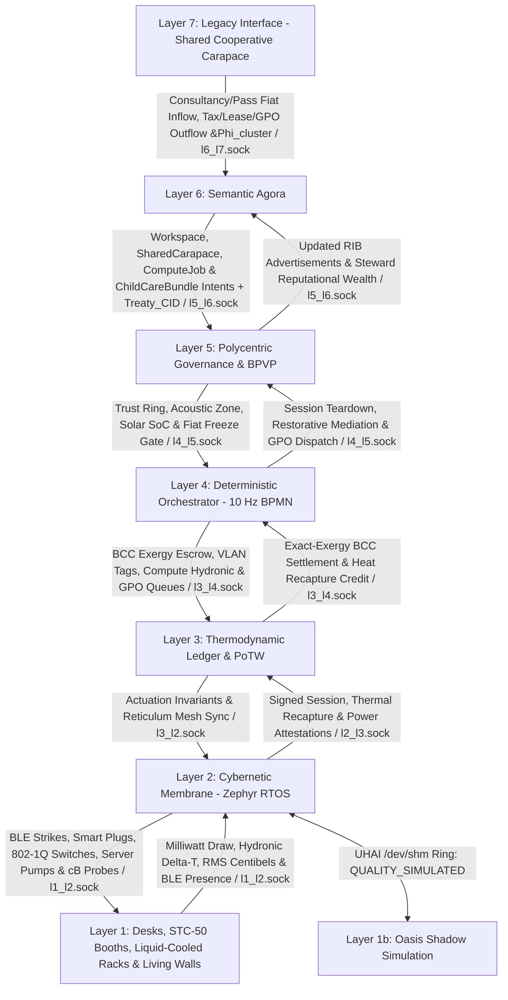
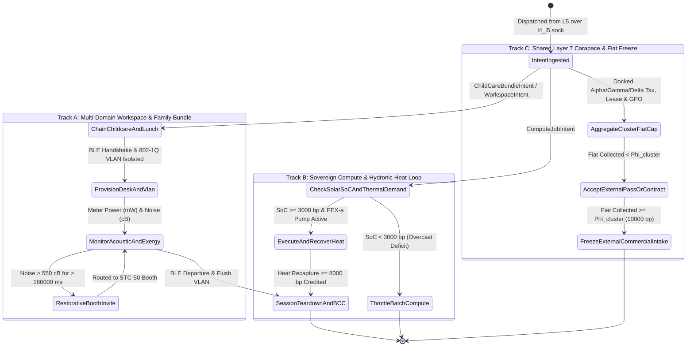

# Scenario Epsilon: The Business, Administrative, Compute & Shared Carapace Commons

*   **Identifier:** `SCN-EPSILON-COWORK`
*   **System Epic:** Cooperative Business & Administrative Back-Office, Primary Layer 7 Revenue-Capture Carapace ($\Phi_t$), Sovereign Compute & CAD/Media Studios, Multi-Domain Spatial Co-Location (with Alpha, Gamma & Delta), and Incremental Node Growth
*   **Primary Layers Tested:** L1 (Physical Reality), L1b (Oasis Shadow Simulation), L2 (Cybernetic Membrane), L3 (Thermodynamic Ledger), L4 (Deterministic Orchestrator), L5 (Polycentric Governance & BPVP), L6 (Semantic Translation & Agora), L7 (Legacy Interface & Shared Carapace)
*   **Pass/Fail Metric:** Autonomous spatial multiplexing, cryptographic BLE access, and isolated IEEE 802-1Q VLAN routing with zero front-desk surveillance; seamless operation as the **Shared Layer 7 Legal, Accounting, Insurance & GPO Carapace** for peered fabrication (Alpha), kitchen (Gamma), and childcare (Delta) nodes; high-efficiency external fiat capture via cooperative consultancy, design/software guilds, and workspace passes halting deterministically at the watershed's ratified monthly fiat ceiling $\Phi_t$; $\ge 8000\,\mathrm{bp}$ ($80\%$) compute waste-heat recovery into hydronic heating loops; zero workplace cameras, keystroke loggers, or audio recording buffers; zero floating-point math.

---

## Architectural Council Ratification & 5-Perspective Synthesis

This scenario specification has been ratified by unanimous consensus of the 5-Persona Architectural Council to establish the administrative, computational, legal-carapace, and third-place workspace engine of The Collective:

| Council Persona | Disciplinary Representative | Core Contribution to Scenario |
| :--- | :--- | :--- |
| **Game Designer** | Lead Systems & Gameplay Designer | Mixed-use guild-hall gameplay in Oasis: Scenario Epsilon is the **Administrative & Civic Nerve Center** that unlocks multi-domain buildings (e.g., Ground Floor: Scenario Gamma Cafe + Scenario Alpha Prototyping Lab + Scenario Delta Childcare Pod; Upper Floor: STC-50 Deep-Work Studio, Legal/Admin Guild Desk & Liquid-Cooled Server Vault); Deep Work focus buffs (`+35 mood, 2x CAD/research speed`), `SkillBeacon` serendipity pairing, and visible Layer 7 $\Phi_t$ tax/lease meter fulfillment protecting the entire settlement from municipal foreclosure. |
| **Game Engineer** | Principal C++ Simulation & Engine Architect | Flecs ECS Data-Oriented Design (DOD): `WorkspaceDeskComponent`, `SharedCarapaceLedgerComponent`, `ComputeRackThermalComponent`, `AcousticZoneComponent`, and `MultiDomainBuildingComponent`; 32-bit compact voxel acoustic attenuation and hydronic server-heat recapture solvers; deterministic $10\,\mathrm{Hz}$ BPMN state engine (`col-execd`); self-contained C++20 fixed-point test harness verifying multi-node $\Phi_t$ fiat-cap aggregation, compute waste-heat recovery, acoustic mediation, and BCC clearing with zero IEEE 754 floats. |
| **Sovereign Stack Specialist** | Sovereign Stack Systems Architect | Strict 7-layer adjacency across POSIX Unix Domain Sockets (`l1_l2.sock` through `l6_l7.sock`); **Carapace-as-a-Service (`col-adversaryd` Federation)** where an Epsilon Node hosts the Subchapter T legal, tax, insurance, and GPO procurement shell for smaller Stage 1/2 neighborhood nodes; dynamic IEEE 802-1Q VLAN isolation; Pairwise Bilateral Clearing Channels ($B_{u \to v}(t) + B_{v \to u}(t) = 0$) and multi-hop HTLCs; anonymous stewardship handles (`anon_handle_...`). |
| **Solarpunk Thinker** | Bioregional Regenerative Ecologist | Transforming sterile corporate office parks and dead retail strip malls into biophilic, multi-generational civic commons; indoor living plant walls (*Epipremnum*, *Chlorophytum*) bio-filtering VOCs; coupling liquid-cooled ARM/RISC-V compute clusters directly to **Scenario Beta/Gamma** radiant floor and greenhouse heating loops so every watt of computation warms living beings; demand-response compute throttling during overcast solar deficits. |
| **Scenario Specialist** | Cooperative Corporate Counsel, CPA & Acoustic/Spatial Architect | Tripartite Legal Chassis administration (Perpetual Purpose Trusts, Subchapter T `26 U.S.C. §§ 1381–1388` patronage accounting, UUNAA § 6 filings, property-tax escrow endowments, and umbrella liability pooling); Sound Transmission Class STC-50+ mass-timber/hempcrete acoustic separation enabling quiet intellectual work beside active workshops and kitchens; 3-stage incremental facility blueprints (`Home Study/Server Nook` $\to$ `Mixed-Use Storefront Lease` $\to$ `Custom Multi-Domain Guild Campus`). |

**Ratification Statement:** Unanimous Consensus Reached across all five disciplinary perspectives.

---

## 1. Problem Statement, Legacy Failure & Macro-Domain Vision

In late-stage financialized capitalism (Layer 7), cognitive work, business administration, computing infrastructure, and civic "Third Places" suffer from four structural pathologies:
1.  **Administrative & Legal Barrier to Entry for Grassroots Commons:** A neighborhood woodshop (Scenario Alpha), community kitchen (Scenario Gamma), or parent childcare circle (Scenario Delta) rarely fails for lack of physical skill—it fails because navigating municipal zoning codes, commercial general liability insurance, Subchapter T tax accounting, B2B wholesale purchasing, and property leases requires specialized legal and administrative overhead that small physical nodes cannot shoulder alone.
2.  **The Fiat Capture Bottleneck:** While transitioning toward bioregional autarky ($D_t \to 0$), every nascent settlement still faces mandatory external Layer 7 fiat obligations ($\Phi_t$): municipal property taxes, commercial leases, wholesale mineral/electronic imports, and ISP uplinks. Physical manufacturing and agricultural nodes have high material and land overhead per unit of external fiat earned, whereas knowledge work, engineering design, software development, media production, and shared workspace passes can harvest external fiat at high margins with minimal ecological draw.
3.  **Spatial Segregation & Atomization:** Legacy zoning isolates offices in sterile commuter business parks, separates parents from their children in distant daycares, and forces remote workers into lonely bedrooms or noisy commercial coffee shops that demand continuous purchases every two hours.
4.  **Surveillance Coworking & Wasted Compute Heat:** Corporate coworking chains deploy facial-recognition cameras, cloud-tethered smart locks, and network snooping, while corporate data centers burn megawatts of electricity on air-conditioning chillers to dump server heat into the atmosphere instead of heating neighboring homes and greenhouses.

### The Collective Macro-Domain Vision
Scenario Epsilon is **The Business, Administrative, Compute & Shared Layer 7 Carapace Commons of The Collective**. Far beyond a simple room of desks, Scenario Epsilon serves **six foundational macro-domain functions**:
1.  **The Cooperative Business & Administrative Back-Office (`Carapace-as-a-Service`):** Providing shared legal, tax, accounting, zoning compliance, insurance pooling, and Group Purchasing Organization (GPO) procurement for the entire local cluster of nodes (Alpha, Beta, Gamma, Delta, Eta, Nu).
2.  **The Primary Layer 7 Fiat Revenue-Capture Engine ($\Phi_t$):** Hosting outward-facing cooperative consultancies (software, CAD/structural engineering, ecological architecture, legal/CPA services, studio media) and external drop-in coworking memberships that cleanly and rapidly fund the settlement's bounded monthly fiat target $\Phi_t$ with minimal ecological footprint.
3.  **Multi-Domain Spatial Co-Location & Mixed-Use Symbiosis:** Architecturally integrating quiet deep-work and administrative studios with **Scenario Alpha** (fabrication/prototyping), **Scenario Gamma** (commons cafe & tiffin larder), **Scenario Delta** (on-site parent-proximate childcare pods), and **Scenario Iota** (epistemic libraries) under shared roofs and shared utility buses.
4.  **Sovereign Compute Vaults, CAD/Simulation Workstations & Hydronic Exergy Recapture:** Housing the settlement's high-density compute racks (running local AI/LLMs, OpenSCAD/FEA engineering, Oasis `L1b`, and `col-storaged` archival mirrors) with liquid-cooled heat exchangers feeding directly into the building's radiant heating and greenhouse loops.
5.  **Convivial Acoustic & Network Stewardship:** Zero-surveillance BLE access, hardware-enforced IEEE 802-1Q VLAN isolation, `SkillBeacon` serendipity matching, and restorative acoustic zoning.
6.  **Incremental Node Facility Blueprints (Bootstrap to Multi-Domain Guild Campus):** Scaling smoothly from a domestic home-office/server rack (`Stage 1`) to a leased mixed-use storefront (`Stage 2`) to a custom-built or ecologically deconstructed Multi-Domain Guild Campus (`Stage 3`).

---

## 2. The Six Pillars of the Business, Administrative & Workspace Commons

| Pillar Domain | Core Capabilities & Services | Layer 3 / Layer 5 / Layer 7 Invariant | Primary Scenarios Supported |
| :--- | :--- | :--- | :--- |
| **1. Shared Admin & Legal Carapace** | PPT/CLT land trust administration, Subchapter T tax/patronage accounting, UUNAA § 6 filings, umbrella insurance pooling, B2B GPO procurement. | Single federated `col-adversaryd` carapace shields multiple peered physical nodes; $100\%$ records-firewall subpoena immunity. | **All Scenarios** (especially Stage 1/2 Alpha, Gamma, Delta, Eta, Nu). |
| **2. Layer 7 Revenue-Capture Axis ($\Phi_t$)** | Outward-facing cooperative software/engineering/CAD consultancy, legal/accounting clinics, studio media, and drop-in day passes. | Aggregates cluster-wide fiat obligations $\Phi_{\mathrm{cluster}} = \sum \Phi_{t,i}$; freezes commercial billing automatically when $\Phi_{\mathrm{cluster}}$ is met. | **Scenario Alpha** (Blueprint CAD), **Scenario Xi** (Structural Engineering), **Scenario Omega** ($D_t \to 0$). |
| **3. Multi-Domain Spatial Symbiosis** | Acoustic STC-50+ zoned mixed-use hubs combining coworking/admin with kitchens, childcare pods, and maker labs. | Shared $48\,\mathrm{V}$ DC solar bus, shared PEX-a thermal loop, and paired `ChildCareBundleIntent` / `MealOffering` hooks. | **Scenario Alpha**, **Scenario Gamma**, **Scenario Delta**, **Scenario Lambda** (Evening Hall). |
| **4. Sovereign Compute & Heat Recapture** | Liquid-cooled ARM/RISC-V server clusters, GPU/CAD workstations, Oasis `L1b` simulation nodes, soundproof media booths. | $\ge 8000\,\mathrm{bp}$ ($80\%$) server thermal exergy recovered into hydronic water loops; non-essential compute throttles when microgrid $\mathrm{SoC} < 3000\,\mathrm{bp}$. | **Scenario Beta** (Mesh/WAN Gateway), **Scenario Iota** (Epistemic Archive), **Scenario Gamma** (Greenhouse Heat). |
| **5. Acoustic & Anti-Panopticon Commons** | Deep-work silent zones ($\le 550\,\mathrm{cB}$), collaborative commons, `SkillBeacon` matching, IEEE 802-1Q per-session VLANs. | Zero cameras, zero keystroke loggers, zero audio buffers; restorative mediation rather than algorithmic slashing. | **Scenario Kappa** (Apprenticeship Study), **Scenario Psi** (Mediation). |
| **6. Incremental Node Blueprints** | `Stage 1: Home Study & Basement Server` $\to$ `Stage 2: Mixed-Use Storefront Shell` $\to$ `Stage 3: Multi-Domain Guild Campus`. | Reinvests Stage 2 cooperative surplus into permanent Stage 3 CLT/PPT land acquisition, eliminating landlord rent permanently. | **Scenario Xi** (Biophilic Construction), **Scenario Mu** (Urban Deconstruction). |

### Pillar I: The Cooperative Business & Administrative Back-Office (`Carapace-as-a-Service`)
In The Collective, physical producers should not be drowned in legacy bureaucracy. Scenario Epsilon houses the **Administrative & Legal Stewardship Guild**, which operates as a shared back-office for the entire neighborhood or watershed cluster:
1.  **Umbrella Legal & Tax Administration:** Epsilon stewards maintain the legal standing of the **Irrevocable Perpetual Purpose Trust (PPT)**, **Community Land Trust (CLT)**, and **Subchapter T Cooperative Corporations (`26 U.S.C. §§ 1381–1388`)**. When a neighbor launches a Stage 1 garage woodshop (Scenario Alpha), a backyard kitchen/fermentation hub (Scenario Gamma), or a parent childcare pod (Scenario Delta), they do not need to pay corporate attorneys to form a standalone entity—they simply execute a **Tripartite Ricardian Treaty ($\mathrm{Treaty\_CID}$)** and **Bilateral Mutual-Aid / Shared Services Agreement** to dock under Epsilon's existing legal and insurance carapace!
2.  **Centralized Layer 7 Compliance, Zoning Defense & Insurance Pooling:** Epsilon's `col-adversaryd` daemon and legal stewards handle municipal building/health department correspondence, file Designated Forest Land (`RCW Title 84 Chapter 33`) or agricultural tax exemptions for Scenario Eta/Gamma lands, and pool commercial general liability, product liability, and vehicle fleet insurance across all docked nodes at institutional group rates.
3.  **Federated Group Purchasing Organization (GPO) Desk:** When Scenario Alpha needs bulk `6061-T6` aluminum bar stock, Scenario Gamma needs $1000\text{-kg}$ totes of solar sea salt ($\mathrm{NaCl}$), or Scenario Delta needs bolts of organic cotton diaper cloth, Layer 4 aggregates these `BoundaryProcurementOrder` intents into Scenario Epsilon's GPO purchasing desk, executing single wholesale B2B wire transfers that slash unit costs by $4000\text{–}6000\,\mathrm{bp}$ ($40\%\text{–}60\%$) and eliminate retail packaging.

### Pillar II: Primary Layer 7 Fiat Revenue-Capture Axis ($\Phi_t$ Engine)
Because intellectual, design, administrative, and digital services require zero raw material extraction and cross legacy boundaries effortlessly, Scenario Epsilon is the **primary engine for harvesting the bounded legacy fiat ($\Phi_t$) needed by the settlement cluster**:
1.  **Cluster-Wide Fiat Ceiling Aggregation ($\Phi_{\mathrm{cluster}}$):**
    Each docked node $i$ in the neighborhood reports its itemized monthly legacy fiat obligations (property taxes, remaining commercial lease payments, utility intertie fees, wholesale GPO requisitions, and Scenario Chi hospital insurance reserves) to form the ratified cluster fiat target:
    $$\Phi_{\mathrm{cluster}}(t) = \sum_{i \in \mathrm{Cluster}} \Phi_{t, i}$$
2.  **High-Efficiency Outward Revenue Channels:**
    To fulfill $\Phi_{\mathrm{cluster}}(t)$ with minimum labor hours and minimum ecological impact, Epsilon operates four outward-facing Layer 7 commercial membranes:
    *   *Cooperative Engineering, Software & CAD Consultancy:* Guild stewards perform bounded fixed-bid contracts for legacy clients—structural timber engineering, open-source software/firmware development, industrial PCB/CAD design, and ecological hydrological consulting.
    *   *Cooperative Accounting, Legal & Tax Clinic:* Providing bookkeeping, cooperative conversion consulting, and tax preparation to external small businesses and credit unions.
    *   *External Coworking Drop-In Passes & Conference/Studio Rentals:* Remote workers and local organizations purchase daily/monthly desk passes or rent soundproof podcast/video studios via standard credit-card rails.
    *   *Shared Storefront Showcase for Alpha & Gamma:* Epsilon's street-facing reception doubles as the commercial pickup counter for Scenario Alpha's custom-fabricated goods and Scenario Gamma's farm-to-table catering/bakery boxes.
3.  **Deterministic Automatic Freeze at $\Phi_{\mathrm{cluster}}(t)$:**
    Stewards working on external Layer 7 client contracts receive lawful W-2/patronage compensation, and net cooperative revenues flow into the Layer 7 commercial bank account to pay $\Phi_{\mathrm{cluster}}(t)$ and fund the **Land & Equipment Acquisition Reserve**. The moment cumulative monthly inflows satisfy $\Phi_{\mathrm{cluster}}(t)$, `col-adversaryd` automatically closes external commercial pass sales and new client intake for the remainder of the billing cycle—preventing capitalist growth drift and liberating stewards back to internal commons creativity!

### Pillar III: Multi-Domain Spatial Co-Location & Architectural Symbiosis
Scenario Epsilon is architecturally engineered to **share physical buildings and infrastructure** with other Collective scenarios, creating vibrant mixed-use neighborhood hubs:
*   **Vertical & Acoustic Co-Location Topology:**
    *   *Ground Floor (High Activity / Public & Semi-Public Membrane):* Houses **Scenario Gamma's** Commons Cafe, espresso bar, and smart tiffin locker bay at the street front; **Scenario Alpha's** light prototyping, electronics, and tool-library checkout bay in the rear service wing (with roll-up freight doors for **Scenario Beta** cargo trikes); and **Scenario Delta's** indoor-outdoor Childcare Pod opening onto a fenced rear garden.
    *   *Upper Floor / Acoustic Vault (Low Noise / Deep Focus):* Separated by mass-timber slabs, hempcrete insulation, and double-stud STC-50+ acoustic partitions ($\ge 500\,\mathrm{cB}$ sound transmission loss), the upper floor houses **Scenario Epsilon's** Deep-Work Silent Haven ($\le 550\,\mathrm{cB}$ ambient noise), collaborative design tables, soundproof telepresence booths, and administrative council chambers.
*   **Synchronized Family & Nourishment Workflows:**
    *   A mother or father arriving in the morning submits a single chained **`ChildCareBundleIntent`**: Layer 4 checks their toddler into the ground-floor Scenario Delta pod, reserves a quiet upstairs workstation with an isolated IEEE 802-1Q VLAN for the parent, and queues two hot Scenario Gamma lunches for midday family dining at the Hearth table!
    *   In the evening (after $18{:}00$), the collaborative workspace floor transforms via **`CommunityGatheringIntent`** into an assembly hall, classroom (**Scenario Kappa**), or acoustic concert venue (**Scenario Lambda**), achieving $16\text{-hour/day}$ spatial utilization.

### Pillar IV: Sovereign Compute Vaults, CAD Workstations & Hydronic Exergy Recapture
Instead of renting cloud servers from extractive tech monopolies, Scenario Epsilon physically hosts the settlement's high-density compute and design hardware:
1.  **Shared High-Performance Workstations & Media Studios:** Individual households do not need to buy idle high-end GPUs, 34-inch color-calibrated 4K displays, large-format architectural plotters, or studio condenser microphones. These assets live in Epsilon's shared studio pool, booked via `WorkspaceIntent` and `PrivateBoothIntent` and powered directly from the native $48\,\mathrm{V}$ DC solar bus.
2.  **Liquid-Cooled Sovereign Compute Racks & Thermal Cascade:**
    *   Epsilon's server vault houses the settlement's RK3588 / RISC-V / GPU compute blades (executing Oasis `L1b` spatial simulations, FreeCAD/OpenFOAM finite-element analysis for Scenario Alpha/Xi, local open-weight language/vision models for Scenario Iota, and encrypted CRDT/IPFS archival storage for `col-storaged`).
    *   **Thermodynamic Recapture Invariant:** Every server blade is fitted with copper direct-to-chip water blocks circulating dielectric/glycol fluid into a liquid-to-water heat exchanger coupled to **Scenario Beta's PEX-a hydronic manifold**. At least $8000\,\mathrm{bp}$ ($80\%$) of electrical exergy consumed by computation ($P_{\mathrm{compute}}$) is recovered as $323150\,\mathrm{mK}$–$333150\,\mathrm{mK}$ ($50^\circ\mathrm{C}$–$60^\circ\mathrm{C}$) thermal water that heats the coworking floors, pre-heats Scenario Gamma dishwashing/pasteurization water, or warms Scenario Delta nursery floors!
3.  **Solar Demand-Response Compute Scheduling:** When overcast winter weather drops the settlement microgrid's $\mathrm{LiFePO_4}$ battery State-of-Charge below $3000\,\mathrm{bp}$ ($30\%$), Layer 4 automatically throttles non-interactive batch compute jobs (rendering, archival re-indexing, batch FEA) while keeping interactive desks and life-safety daemons at $100\%$ availability.

### Pillar V: Convivial Anti-Panopticon & Restorative Acoustic Stewardship
*   **Zero Workplace Surveillance:** Interior cameras, keystroke loggers, screen-capture daemons, and audio recording buffers are banned at the hardware level. Desk occupancy is sensed via under-desk capacitive pads and ephemeral BLE handshakes, while acoustic sensors output scalar RMS centibels ($\mathrm{cB}$) only.
*   **Restorative Acoustic Mediation:** If conversation in the Deep-Work Silent Zone exceeds $550\,\mathrm{cB}$ ($55\,\mathrm{dBA}$) for $> 180{,}000\,\mathrm{ms}$ ($180\text{ seconds}$), Layer 4 never slashes reputation or locks out the member; instead, it gently pulses the desk's amber LED beacon and invites the conversing pair into an adjacent available STC-50 soundproof booth.

### Pillar VI: Incremental Node Facility Blueprints (Bootstrap to Multi-Domain Guild Campus)
Scenario Epsilon follows the same **three-stage incremental node growth pattern** as Scenarios Alpha, Gamma, and Delta—and often serves as the legal and financial catalyst that enables the entire neighborhood cluster to advance from Stage 1 to Stage 3:

1.  **Stage 1: Domestic Home-Office, Basement Compute Rack & Study Circle (`R_0`–`R_1` Bootstrap):**
    *   **Physical Footprint:** A steward's spare bedroom study or finished basement housing $2\text{–}4$ ergonomic workstations, the neighborhood's inaugural $48\,\mathrm{V}$ DC battery + 2U ARM compute cluster (with hydronic heat routed into the home's hot-water tank), a shared architectural printer/scanner, and a weekly cooperative legal/bookkeeping table.
    *   **Layer 7 Protective Carapace (Home-Occupation & UUNAA Shielding):** Operates as a zero-traffic home office and private unincorporated study association (**UUNAA § 6**). External consultancy billing runs cleanly through a nascent Subchapter T LLC/Co-op registered to a commercial registered-agent address, protecting the residential parcel from HOA or municipal commercial-traffic citations.
2.  **Stage 2: Leased Mixed-Use Storefront / Co-Working, Cafe & Shared Carapace Hub (`R_1`–`R_3` Self-Sustenance):**
    *   **Physical Footprint:** Using initial consultancy savings, the guild leases a commercial storefront or flex office/warehouse building under IBC Group B classification. This single lease becomes the **Mixed-Use Anchor Hub** for the neighborhood: housing $20+$ hot-desks, soundproof booths, and the legal/accounting back-office alongside a Stage 2 **Scenario Gamma** cafe/commissary, a Stage 2 **Scenario Delta** parent-on-site childcare suite, and a Stage 2 **Scenario Alpha** prototyping/tool library!
    *   **Layer 7 Self-Sustaining Carapace ($\Phi_t$):** External drop-in passes, studio rentals, and cooperative consultancy contracts pay the master commercial lease, fiber uplink, and umbrella insurance for all co-located scenarios while rapidly accumulating surplus capital in a dedicated **CLT/PPT Land Acquisition Escrow**.
3.  **Stage 3: Custom-Built / Ecologically Deconstructed Multi-Domain Guild Hall & Sovereign Compute Campus (`R_0`–`R_5` Bioregional Maturity):**
    *   **Physical Footprint:** Once the Land Acquisition Escrow reaches target capacity, the cooperative purchases a vacant urban lot or acquires a defunct commercial strip-mall/office building (ecologically deconstructing asphalt and concrete into urbanite and timber via **Scenario Mu/Xi**) and transfers title into an **Irrevocable Perpetual Purpose Trust (PPT) / Community Land Trust (CLT)**.
    *   **Permanent Sovereign Operations:** Constructed using open-source mass-timber, hempcrete, and living-wall blueprints, the Stage 3 Guild Campus permanently eliminates commercial landlord rent—collapsing $\Phi_{\mathrm{cluster}}(t)$ down to minimal municipal property taxes and hosting watershed-scale compute vaults, epistemic libraries (**Scenario Iota**), governance chambers (**Scenario Pi**), and multi-domain production labs.

---

## 3. The Collective Workflow (7-Layer Traversal)



### Layer 1: Physical Reality ( & Layer 1b: Oasis Shadow Simulation)
*   **Spatial & Acoustic Hardware:** Ergonomic standing desks (fabricated in Scenario Alpha from Scenario Eta hardwood), STC-50+ mass-timber/hempcrete acoustic partitions, soundproof telepresence/recording pods, vertical biophilic living plant walls (*Epipremnum aureum*), and mechanical ventilation heat-recovery exchangers (HRVs).
*   **Electrical, Network & Compute Hardware:** Native $48\,\mathrm{V}$ DC desk USB-C PD ($100\,\mathrm{W}$–$240\,\mathrm{W}$) buses, DIN-rail solid-state relays, BLE door strikes with mechanical interior egress bars ("Red Lever" rule), enterprise managed switches with hardware IEEE 802-1Q VLAN tagging, and liquid-cooled ARM/RISC-V/GPU server racks coupled via brazed-plate heat exchangers to buried PEX-a hydronic loops.
*   **Strict Layer Separation:** Layer 1 contains **zero software, zero firmware, zero cryptographic keys, and zero network routing daemons.**

### Layer 2: The Cybernetic Membrane (`col-sensord`, `col-actuated`, `col-membraned`, `col-meshd`)
*   **Convivial Anti-Panopticon Hardware Shield:**
    *   **Zero cameras, zero keystroke loggers, zero screen-monitoring software, and zero audio recording buffers.**
    *   Acoustic transducers compute RMS sound pressure in hardware and emit scalar integer centibels ($\mathrm{cB}$) only; speech cannot be reconstructed from the signal.
*   **Canonical Fixed-Point SI Wire Formats (CBOR over `/run/collective/ipc/l2_l3.sock`):**
    *   `node/workspace/desk_12/telemetry/power_mw`: Active DC/AC desk power draw (`int64_t`, milliwatts).
    *   `node/workspace/zone_silent/telemetry/noise_cb`: Scalar RMS sound pressure (`uint32_t`, centibels; Deep-Work limit $\le 550\,\mathrm{cB} = 55\,\mathrm{dBA}$).
    *   `node/compute/rack_01/telemetry/elec_in_mw` & `thermal_out_mw`: Compute electrical input and hydronic heat recovery (`int64_t`, milliwatts; target $\eta_{\mathrm{heat\_recapture}} \ge 8000\,\mathrm{bp}$).
    *   `node/workspace/zone_silent/telemetry/voc_ppb` & `illuminance_clx`: Air quality (`uint32_t`, ppb) and daylight illuminance (`uint32_t`, centilux).

### Layer 3: The Thermodynamic Ledger (`col-storaged`)
*   **Pairwise Bilateral Clearing Channels (BCC) & Exact-Exergy Settlement:**
    Internal members and visiting stewards from peered watershed nodes never pay speculative landlord rent. Workspace and compute usage settles across zero-sum Pairwise BCCs ($B_{u \to v}(t) + B_{v \to u}(t) = 0$) based on exact thermodynamic work net of recovered hydronic heat:
    $$\Delta \mathcal{E}_{\mathrm{work}} = \Delta t_{\mathrm{session}} \cdot C_{\mathrm{spatial}} + \int_{0}^{T} \Big( P_{\mathrm{desk}}(t) + P_{\mathrm{compute}}(t) - \dot{Q}_{\mathrm{hydronic\_recovered}}(t) \Big) dt + C_{\mathrm{wear}}$$
    where $\dot{Q}_{\mathrm{hydronic\_recovered}}(t)$ credits the compute job for useful thermal exergy delivered to the building's radiant heating or Scenario Gamma hot-water manifolds during heating seasons!
*   **Cluster-Wide Fiat Ceiling Ledger Verification (Non-Convertibility):**
    Layer 3 tracks physical exergy and mass flows exclusively ($1\text{ Exergy Credit} \equiv 3{,}600{,}000{,}000{,}000\,\mu\mathrm{J}$), while maintaining a read-only cryptographic mirror of the cluster's monthly fiat obligation completion ratio ($\Phi_{\mathrm{collected}} / \Phi_{\mathrm{cluster}}$ in basis points) reported from Layer 7 (`col-adversaryd`) so Layer 5 can trigger the automatic commercial freeze at $10000\,\mathrm{bp}$ ($100\%$).

### Layer 4: The Deterministic Orchestrator (`col-execd`)
Communicating with Layer 5 over `/run/collective/ipc/l4_l5.sock` and Layer 3 over `/run/collective/ipc/l3_l4.sock`, the $10\,\mathrm{Hz}$ BPMN engine orchestrates workspace sessions, multi-domain bundles, compute heat recovery, and shared carapace administration:



### Layer 5: Polycentric Governance & BPVP (`col-kmsd`)
*   **Federated Carapace-as-a-Service Governance:** Peered physical nodes (Alpha, Gamma, Delta, Eta, Nu) dock with an Epsilon Administrative Node via ratified Tripartite Ricardian Treaties ($\mathrm{Treaty\_CID}$). Each docked node retains $100\%$ autopoietic cellular autonomy over its own internal operations, vetos, and schedules; Epsilon's administrative stewards hold **zero command authority** over docked nodes, acting strictly as a fiduciary shared-services membrane for tax, legal, insurance, and GPO execution.
*   **Acoustic Stewardship, Anonymous Handles & Care Leave Shields:** Noise excursions never trigger algorithmic slashing. Administrative, legal, accounting, and facility-cleaning stewards claim tasks via cryptographic anonymous handles (`anon_handle_...`) and earn decaying, sublinearly capped ($\le 800\,\mathrm{bp}$) Reputational Wealth ($\mathcal{R}$), protected by Care Leave Shields.

### Layer 6: Semantic Translation & Agora (`col-commonsd`)
Layer 6 compiles workspace, compute, and shared-carapace requests into W3C JSON-LD Knowledge Artifacts:
1.  **`WorkspaceIntent` & `PrivateBoothIntent`:** Books quiet desks, collaborative tables, or STC-50 recording/telepresence booths, optionally paired with a `SkillBeacon` and a **`ChildCareBundleIntent`** (chaining Scenario Delta childcare and Scenario Gamma Hearth meals).
2.  **`SharedCarapaceDockingIntent`:** Registers a peered Scenario Alpha, Gamma, or Delta node under Epsilon's Subchapter T legal, insurance, tax-escrow, and B2B GPO procurement umbrella, contributing its itemized monthly fiat obligations ($\Phi_{t,i}$) to $\Phi_{\mathrm{cluster}}(t)$.
3.  **`ComputeAndSimulationIntent`:** Schedules batch CAD/FEA, Oasis `L1b` simulation, or epistemic model jobs on Epsilon's liquid-cooled server racks with hydronic heat recovery routing.

```mermaid
graph TD
    subgraph Layer 6: Workspace, Compute & Shared Carapace Ontology
        L6_Work[WorkspaceIntent + ChildCareBundleIntent]
        L6_Dock[SharedCarapaceDockingIntent: <br>Alpha, Gamma & Delta Legal/GPO Docking]
        L6_Comp[ComputeAndSimulationIntent: <br>CAD/FEA, Oasis L1b & Local AI]
    end

    subgraph Layer 5: Polycentric Governance Gates
        P_Zone{Acoustic & Bundle Gate: <br>Noise <= 550 cB & Delta/Gamma Slots Ready?}
        P_Cap{Cluster Fiat Ceiling Gate: <br>Sum Phi_t,i Ratified & Inflow < Phi_cluster?}
        P_Solar{Exergy & Thermal Gate: <br>Microgrid SoC >= 3000 bp & Hydronic Loop Open?}
    end

    subgraph Layer 4: Deterministic BPMN Orchestrators
        BPMN_Space[Mixed-Use Desk, VLAN & Family Bundle Engine]
        BPMN_Admin[Subchapter T Tax, Insurance & GPO Carapace Engine]
        BPMN_Rack[Liquid-Cooled Compute & PEX-a Heat Engine]
    end

    L6_Work --> P_Zone
    P_Zone -->|Approved| BPMN_Space

    L6_Dock --> P_Cap
    P_Cap -->|Below Ceiling| BPMN_Admin
    P_Cap -.->|Phi_cluster Reached: Freeze External Sales| BPMN_Admin

    L6_Comp --> P_Solar
    P_Solar -->|Solar Surplus / Thermal Need| BPMN_Rack
    P_Solar -.->|SoC < 3000 bp: Defer Batch Job| L6_Comp
```

### Layer 7: The Legacy Interface (The Shared Dual-Membrane Carapace)
Executed by `col-adversaryd`, Scenario Epsilon is the flagship operator of the **Tripartite Legal Chassis**:
1.  **The Three Interlocking Legal Entities:**
    *   *Irrevocable Perpetual Purpose Trust (PPT) / Community Land Trust (CLT):* Holds title to real estate, mixed-use buildings, and heavy infrastructure, permanently removing land from the speculative market.
    *   *Subchapter T Cooperative Corporation (`26 U.S.C. §§ 1381–1388`):* Operates the outward-facing consultancy, coworking pass system, commercial lease, umbrella insurance, and B2B GPO procurement desk, deducting patronage refunds and shared operating costs lawfully.
    *   *Unincorporated Nonprofit Association (`UUNAA § 6`):* Governs internal non-monetary mutual aid among members with statutory legal standing and subpoena-immune records isolation (`NAACP v. Alabama`).
2.  **Bounded Cluster Fiat Harvesting ($\Phi_{\mathrm{cluster}}$) & Automatic Freeze:** All external consultancy invoices and drop-in pass fees flow into the cooperative bank account to pay property taxes, commercial leases, insurance, and wholesale GPO orders for the entire local node cluster, halting automatically once $\Phi_{\mathrm{cluster}}(t)$ is satisfied.

---

## 4. Machine-Readable Schemas

### Layer 6 Knowledge Artifact: Multi-Domain Workspace, Childcare Bundle & Shared Carapace Manifest (`epsilon_multi_domain_bundle.jsonld`)

This artifact illustrates Scenario Epsilon's full scope inside a **Stage 2 Mixed-Use Cooperative Hub**: a parent engineer books a Deep-Work CAD workstation with a chained **Scenario Delta** toddler pod slot and **Scenario Gamma** lunch (`ChildCareBundleIntent`), runs a liquid-cooled structural FEA compute job whose waste heat warms the downstairs nursery floor, and docks the hub's **Shared Layer 7 Carapace** across peered Alpha, Gamma, and Delta nodes.

```json
{
  "@context": [
    "https://schema.org/",
    "https://collective.network/ontology/v1/"
  ],
  "@type": "MultiDomainWorkspaceAndCarapaceIntent",
  "identifier": "urn:uuid:d3f4a9c2-88bb-4e1a-9f01-7c3d2e1f4a5b",
  "issuerDid": "did:peer:2.Ez6MksF...node04_creator_jules",
  "targetFacilityDid": "did:peer:2.Ez6MksP...duvall_mixed_use_guild_hub",
  "facilityStageBlueprint": "STAGE_2_MIXED_USE_COMMERCIAL_LEASE_HUB",
  "creationTimestampMs": 1791446400000,
  "treatyCid": "bafybeihdwdcefgh4dqkjv67uzcmw7ojee6xedeet6wfvikrwho3qnwjxye",
  "workspaceAndComputeSpec": {
    "zoneType": "DeepWork_AcousticSilent_UpperFloor",
    "acousticToleranceCentibels": 550,
    "sessionDurationMilliseconds": 14400000,
    "isolatedVlanRequired": true,
    "liquidCooledComputeJob": {
      "jobType": "SCENARIO_ALPHA_CNC_TRUSS_FEA_SIMULATION",
      "estimatedElectricalInputMicrojoules": 1440000000000,
      "minHydronicHeatRecaptureBasisPoints": 8000,
      "targetThermalSink": "GROUND_FLOOR_DELTA_NURSERY_RADIANT_SLAB"
    }
  },
  "coLocatedScenarioBundles": {
    "chainedChildcareIntentRef": "urn:uuid:a1b2c3d4-e5f6-7890-1234-56789abcdef0",
    "coLocatedDeltaPodZone": "GROUND_FLOOR_SOUTH_GARDEN_POD",
    "chainedGammaHearthLunchRef": "urn:uuid:c9e1b2a4-5678-1234-abcd-9876543210ef",
    "coLocatedAlphaPrototypingBay": "GROUND_FLOOR_REAR_FAB_ANNEX"
  },
  "sharedLayer7CarapaceAggregation": {
    "dockedNodes": [
      "did:peer:2.Ez6MksA...node04_alpha_fab_commons",
      "did:peer:2.Ez6MksG...node04_gamma_commissary_hearth",
      "did:peer:2.Ez6MksD...node02_delta_care_pod"
    ],
    "clusterMonthlyFiatTargetCents": 1250000,
    "currentMonthFiatCollectedCents": 1180000,
    "landAcquisitionEscrowContributionCents": 350000,
    "autoFreezeExternalSalesAtTarget": true
  },
  "settlementCriteria": {
    "maxExergyMicrojoules": 2500000000000,
    "timeoutMilliseconds": 1800000,
    "htlcHashDigest": "0x3b8c1f9e2b4d6a7f9e8d1c2b3a4f5e6d7c8b9a0f1e2d3c4b5a6f7e8d9c0b1a2f"
  }
}
```

### Layer 2 & Layer 3 Combined Attestation: Workspace, Compute Heat Recapture & Carapace Freeze Proof (`epsilon_session_attestation.jsonld`)

```json
{
  "@context": "https://collective.network/ontology/v1/",
  "@type": "WorkspaceAndCarapaceAttestation",
  "intentRef": "urn:uuid:d3f4a9c2-88bb-4e1a-9f01-7c3d2e1f4a5b",
  "anonStewardHandle": "anon_handle_7c4d1e9b",
  "facilityDid": "did:peer:2.Ez6MksP...duvall_mixed_use_guild_hub",
  "executionMetrics": {
    "actualDurationMilliseconds": 14400000,
    "bleHandshakeVerified": true,
    "assignedVlanTag": 204,
    "deskEnergyConsumedMicrojoules": 648000000000,
    "computeElectricalInputMicrojoules": 1440000000000,
    "computeHydronicHeatRecoveredMicrojoules": 1209600000000,
    "computeHeatRecaptureEfficiencyBasisPoints": 8400,
    "netExergyBilledAfterHeatCreditMicrojoules": 878400000000,
    "maxAmbientNoiseCentibels": 512,
    "acousticViolationFlagged": false
  },
  "layer7CarapaceStatus": {
    "externalConsultancyInvoiceClearedCents": 70000,
    "updatedClusterFiatCollectedCents": 1250000,
    "clusterFiatCeilingReachedBasisPoints": 10000,
    "externalCommercialIntakeFrozen": true
  },
  "edgeAttestationSignature": "0x7a3c8e1b5d9f2a4e6c8b0d1f3e5a7c9b1d3f5a7e9c1b3d5f7a9b1c3d5e7f9a1b"
}
```

---

## 5. Oasis Engine Implementation Specification

### Voxel & ECS Representation in Oasis (Layer 1b)
Within Oasis, Scenario Epsilon enables multi-domain co-located guild buildings and sovereign compute infrastructure:
*   **Coworking, Admin & Soundproof Booth Voxels (`MAT_COWORKING_DESK_NODE = 80`, `MAT_SOUNDPROOF_POD_ENCLOSURE = 81`, `MAT_BIOPHILIC_LIVING_WALL = 82`):** Simulating cognitive focus buffs, STC-50+ acoustic attenuation across walls/floors, VOC absorption, and IEEE 802-1Q VLAN session state.
*   **Liquid-Cooled Sovereign Compute Vault Voxels (`MAT_LIQUID_COMPUTE_RACK = 83`):** Coupled to both the $48\,\mathrm{V}$ DC electrical solver (`MAT_SOLAR_CHARGER`) and the PEX-a hydronic thermal solver (`MAT_THERMAL_PEX_PIPE = 46`), converting electrical milliwatts into useful thermal millikelvin for adjacent rooms and greenhouses.
*   **Shared Layer 7 Carapace & GPO Desk Voxels (`MAT_SHARED_CARAPACE_ADMIN_DESK = 84`):** Tracking the cluster's monthly fiat ceiling $\Phi_{\mathrm{cluster}}$, GPO bulk orders, and progressive facility stage upgrades (`Stage 1 Home Office` $\to$ `Stage 2 Mixed-Use Storefront` $\to$ `Stage 3 CLT/PPT Guild Campus`).

### C++20 Test Harness Code (Fixed-Point SI Integer Math)

```cpp
// engine/tests/scenario_epsilon_test.cpp
#include <cassert>
#include <cstdint>
#include <string>
#include <vector>

namespace oasis::scenario_epsilon {

// 1. Pillar I & II: Shared Layer 7 Carapace & Cluster-Wide Fiat Ceiling (Phi_cluster)
struct DockedNodeFiatObligation {
    std::string node_did;
    uint64_t monthly_tax_and_lease_cents{0};
    uint64_t monthly_insurance_and_gpo_cents{0};
};

struct SharedCarapaceState {
    std::vector<DockedNodeFiatObligation> docked_nodes;
    uint64_t land_acquisition_escrow_target_cents{0};
    uint64_t cumulative_fiat_collected_cents{0};
    bool external_commercial_intake_frozen{false};
};

inline uint64_t compute_cluster_fiat_ceiling_cents(const SharedCarapaceState& carapace) {
    uint64_t total_cents = carapace.land_acquisition_escrow_target_cents;
    for (const auto& node : carapace.docked_nodes) {
        total_cents += (node.monthly_tax_and_lease_cents + node.monthly_insurance_and_gpo_cents);
    }
    return total_cents;
}

inline bool record_external_carapace_revenue(SharedCarapaceState& carapace, uint64_t inbound_fiat_cents) {
    if (carapace.external_commercial_intake_frozen) return false;
    uint64_t ceiling_cents = compute_cluster_fiat_ceiling_cents(carapace);
    carapace.cumulative_fiat_collected_cents += inbound_fiat_cents;
    // Automatically freeze external commercial pass/consultancy intake once Phi_cluster is reached!
    if (carapace.cumulative_fiat_collected_cents >= ceiling_cents) {
        carapace.external_commercial_intake_frozen = true;
    }
    return true;
}

// 2. Pillar IV: Sovereign Compute Hydronic Heat Recapture & Solar Demand-Response
struct ComputeRackJob {
    uint64_t electrical_input_uj{0};
    uint64_t hydronic_heat_recovered_uj{0};
    uint32_t microgrid_soc_bp{0}; // 0..10000 bp
    bool is_batch_deferrable{true};
};

inline bool verify_compute_dispatch_and_heat_recapture(const ComputeRackJob& job,
                                                       uint64_t& net_exergy_charged_uj) {
    // Demand-response: defer non-essential batch compute when solar battery SoC < 3000 bp (30%)
    if (job.is_batch_deferrable && job.microgrid_soc_bp < 3000) return false;
    if (job.electrical_input_uj == 0 || job.hydronic_heat_recovered_uj > job.electrical_input_uj) return false;

    // Verify liquid-cooled PEX-a heat recapture efficiency >= 8000 bp (80%)
    uint64_t recapture_bp = (job.hydronic_heat_recovered_uj * 10000ULL) / job.electrical_input_uj;
    if (recapture_bp < 8000) return false;

    // Credit the compute job for useful thermal exergy delivered to downstairs nursery/greenhouse
    net_exergy_charged_uj = job.electrical_input_uj - job.hydronic_heat_recovered_uj;
    return true;
}

// 3. Pillar III & VI: 3-Stage Incremental Node Growth & Acoustic Co-Location Isolation
enum class EpsilonFacilityStage : uint8_t {
    STAGE_1_HOME_OFFICE_SERVER_NOOK      = 1,
    STAGE_2_MIXED_USE_STOREFRONT_LEASE   = 2,
    STAGE_3_CLT_MULTI_DOMAIN_GUILD_HALL  = 3
};

struct MixedUseCoLocationSpec {
    EpsilonFacilityStage stage;
    uint32_t workshop_or_cafe_noise_cb{780};     // 78 dBA in ground-floor workshop/cafe
    uint32_t partition_stc_attenuation_cb{500};  // STC-50 partition (-50 dBA / -500 cB)
    uint32_t deep_work_internal_noise_cb{480};   // 48 dBA inside upstairs quiet zone
    bool childcare_pod_co_located{false};
};

inline bool verify_mixed_use_acoustic_co_location(const MixedUseCoLocationSpec& spec) {
    uint32_t transmitted_noise_cb = (spec.workshop_or_cafe_noise_cb > spec.partition_stc_attenuation_cb)
                                        ? (spec.workshop_or_cafe_noise_cb - spec.partition_stc_attenuation_cb)
                                        : 0;
    // Both transmitted workshop noise and internal quiet-zone noise must remain <= 550 cB (55 dBA)
    return transmitted_noise_cb <= 550 && spec.deep_work_internal_noise_cb <= 550;
}

void run_all_scenario_epsilon_tests() {
    // Test 1: Shared Layer 7 Carapace Aggregating Alpha, Gamma & Delta Obligations + Auto-Freeze
    SharedCarapaceState carapace{
        .docked_nodes = {
            {"node04_alpha_fab", 350000, 120000},   // Lease/tax + insurance/GPO
            {"node04_gamma_hearth", 220000, 110000},
            {"node02_delta_pod", 50000, 50000}
        },
        .land_acquisition_escrow_target_cents = 350000, // Saving for Stage 3 CLT lot purchase
        .cumulative_fiat_collected_cents = 1180000,
        .external_commercial_intake_frozen = false
    };
    assert(compute_cluster_fiat_ceiling_cents(carapace) == 1250000ULL);
    // Final 70,000-cent consultancy invoice reaches the 1,250,000-cent ceiling and triggers freeze!
    assert(record_external_carapace_revenue(carapace, 70000) == true);
    assert(carapace.external_commercial_intake_frozen == true);
    // Subsequent commercial bookings are deterministically rejected for the rest of the month
    assert(record_external_carapace_revenue(carapace, 5000) == false);

    // Test 2: Liquid-Cooled Sovereign Compute Heat Recapture (>= 8000 bp) & Solar Throttling
    ComputeRackJob fea_job{
        .electrical_input_uj = 1440000000000ULL,
        .hydronic_heat_recovered_uj = 1209600000000ULL, // 8400 bp (84% recovered to nursery floor)
        .microgrid_soc_bp = 7500,
        .is_batch_deferrable = true
    };
    uint64_t net_billed_uj = 0;
    assert(verify_compute_dispatch_and_heat_recapture(fea_job, net_billed_uj) == true);
    assert(net_billed_uj == 230400000000ULL); // Only unrecovered entropy is billed!

    // Overcast solar deficit (SoC = 2200 bp < 3000 bp) defers batch compute job
    ComputeRackJob low_battery_job = fea_job;
    low_battery_job.microgrid_soc_bp = 2200;
    assert(verify_compute_dispatch_and_heat_recapture(low_battery_job, net_billed_uj) == false);

    // Test 3: Mixed-Use Co-Location Acoustic Isolation (STC-50 Partition above Alpha/Gamma)
    MixedUseCoLocationSpec stage2_hub{
        .stage = EpsilonFacilityStage::STAGE_2_MIXED_USE_STOREFRONT_LEASE,
        .workshop_or_cafe_noise_cb = 820,    // 82 dBA downstairs workshop
        .partition_stc_attenuation_cb = 520, // STC-52 mass-timber/hempcrete floor -> 300 cB transmitted
        .deep_work_internal_noise_cb = 512,  // 512 cB (<= 550 cB limit)
        .childcare_pod_co_located = true
    };
    assert(verify_mixed_use_acoustic_co_location(stage2_hub) == true);
}

} // namespace oasis::scenario_epsilon

int main() {
    oasis::scenario_epsilon::run_all_scenario_epsilon_tests();
    return 0;
}
```

---

## 6. Acceptance Test Gates (Pass/Fail)

| Checkpoint | Validation Method | Pass Condition |
| :--- | :--- | :--- |
| **G1: Shared Layer 7 Carapace & Cluster Fiat Freeze ($\Phi_{\mathrm{cluster}}$)** | Multi-Node Carapace Ledger Audit | Epsilon's `col-adversaryd` aggregates monthly tax, lease, insurance, and GPO obligations across docked Alpha, Gamma, and Delta nodes into $\Phi_{\mathrm{cluster}}(t)$ and automatically freezes external commercial pass/consultancy intake the moment $\Phi_{\mathrm{cluster}}(t)$ is reached. |
| **G2: Sovereign Compute Hydronic Heat Recapture & Solar Shedding** | Thermal & Electrical Shunt Audit | Liquid-cooled compute racks recover $\ge 8000\,\mathrm{bp}$ ($80\%$) of electrical input into the PEX-a hydronic heating manifold (crediting net exergy on the BCC ledger), and automatically defer batch compute jobs when microgrid battery $\mathrm{SoC} < 3000\,\mathrm{bp}$. |
| **G3: Multi-Domain Spatial Co-Location & Family Bundling** | Acoustic STC & Chained Intent Check | STC-50+ structural partitions keep transmitted noise from co-located ground-floor Alpha/Gamma bays $\le 550\,\mathrm{cB}$ in the Deep-Work zone; submitting a `ChildCareBundleIntent` atomically books an upstairs desk, a downstairs Scenario Delta pod slot, and Scenario Gamma meals. |
| **G4: 3-Stage Incremental Node Growth Trajectory** | Facility Blueprint & Escrow Progression | Supports progression from `Stage 1` (Home Office / UUNAA Study Circle) $\to$ `Stage 2` (Leased Mixed-Use Storefront Hub) $\to$ `Stage 3` (Custom-Built or Ecologically Deconstructed CLT/PPT Multi-Domain Guild Campus), permanently eliminating landlord lease obligations at Stage 3. |
| **G5: Convivial Anti-Panopticon & VLAN Isolation** | Hardware & Switch Inspection | Zero workplace cameras, keystroke loggers, or audio recording buffers exist; each session receives a cryptographically isolated IEEE 802-1Q VLAN and settles exact microjoules via anonymous handles (`anon_handle_...`). |
| **G6: Restorative Acoustic Stewardship** | Centibel Sensor & BPMN State Audit | Sustained noise $> 550\,\mathrm{cB}$ for $> 180{,}000\,\mathrm{ms}$ in the Deep-Work zone triggers gentle amber beacon modulation and invites participants to an STC-50 booth with zero algorithmic reputation slashing. |
