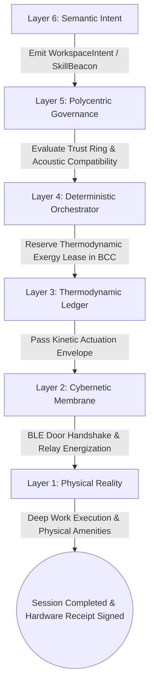
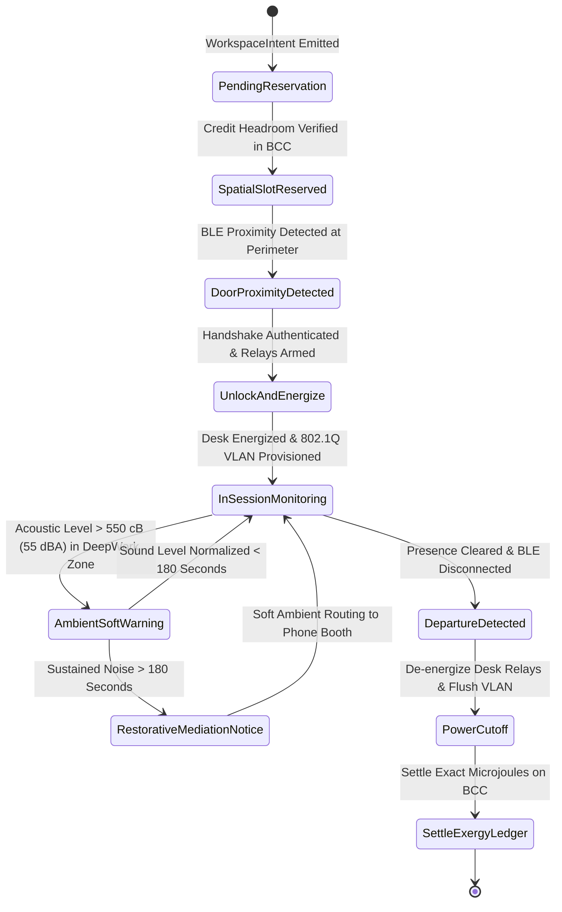
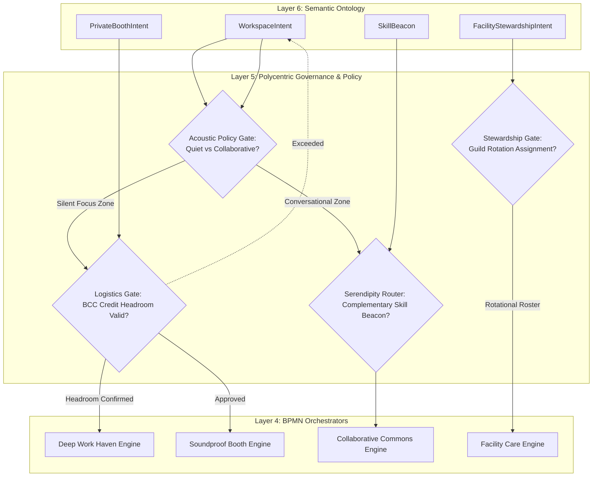
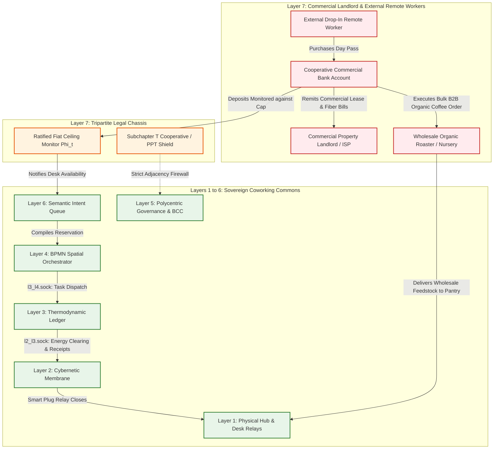

# Scenario Epsilon: Sovereign Third Place & Cooperative Workspace

*   **Identifier:** `SCN-EPSILON-COWORK`
*   **System Epic:** Sovereign Third Place, Acoustic Stewardship, and Cooperative Workspace Multiplexing
*   **Primary Layers Tested:** L1 (Physical Reality), L2 (The Cybernetic Membrane), L3 (The Thermodynamic Ledger), L4 (The Deterministic Orchestrator), L5 (Polycentric Governance), L6 (Semantic Translation & Agora), L7 (The Legacy Interface)
*   **Pass/Fail Metric:** Autonomous spatial booking, cryptographic BLE access control, and dynamic 802.1Q VLAN routing executed with zero human front-desk staff; fractional thermodynamic exergy settlement in microjoules; zero workplace cameras, zero keystroke logging, and zero audio surveillance; bounded fiat extraction for external drop-in day passes halting strictly at ratified fiat target $\Phi_t$; Subchapter T Shared Services Agreement legal shielding.

---

## Architectural Council Ratification & 5-Perspective Synthesis

This scenario specification has been ratified by unanimous consensus of the 5-Persona Architectural Council:

| Council Persona | Disciplinary Representative | Core Contribution to Scenario |
| :--- | :--- | :--- |
| **Game Designer** | Lead Systems & Gameplay Designer | Dwarf Fortress cognitive focus vs distraction mechanics (NPCs working in acoustic isolation acquire "Deep Work (+35 mood, 2x craft speed)" multipliers; noise violations trigger "Irritated by commotion (-20 mood)" thoughts; proximity to complementary `SkillBeacon` entities sparks "Invigorated by stimulating technical discourse (+30 mood)"); The Sims spatial affordances (ergonomic chairs boost comfort, living walls elevate environment bars); boundary interface civic integration where physical presence weakens legacy isolation. |
| **Game Engineer** | Principal C++ Simulation & Engine Architect | Flecs ECS DOD architecture: `WorkspaceDeskComponent`, `AcousticZoneComponent`, `PowerDrawComponent`, `VlanConfigComponent`, `SkillBeaconComponent`; 32-bit compact voxel chunks modeling sound transmission barriers; deterministic 10 Hz BPMN state engine; compilable C++20 fixed-point test harness simulating BLE proximity handshakes, dynamic desk power enablement, anonymous task handles, and restorative acoustic mediation with zero IEEE 754 floats. |
| **Sovereign Stack Specialist** | Sovereign Stack Systems Architect | 7-layer strict adjacency without layer skipping via `l1_l2.sock` through `l6_l7.sock`; zero software in L1; anonymous claim handles; dynamic OpenWrt 802.1Q VLAN provisioning; Pairwise Bilateral Clearing Channels ($B_{u \to v}(t) + B_{v \to u}(t) = 0$) for inter-node workspace sharing; multi-hop HTLCs; zero global tokens; zero fiat conversions; zero monolithic game-loop threading. |
| **Solarpunk Thinker** | Bioregional Regenerative Ecologist | Biophilic living walls filtering VOCs and formaldehyde, reducing mechanical HVAC ventilation air changes; solar microgrid demand-response shedding: heavy computational jobs throttle during overcast solar deficits; circular furniture reuse using locally harvested timber from Scenario Eta; passive solar thermal mass. |
| **Scenario Specialist** | Spatial Ergonomist & Biophilic Architectural Programmer | Sound Transmission Class STC 45+ acoustic partition engineering; logarithmic multi-source decibel attenuation modeling in fixed-point integer math; biophilic daylight lux curves in centilux; municipal commercial zoning compliance under IBC Group B office assembly classifications. |

**Ratification Statement:** Unanimous Consensus Reached. All five council personas have formally validated that this scenario specification adheres strictly to the 7-Layer Sovereign Stack architecture, eliminates all deprecated rhetoric, replaces floating-point math with fixed-point SI integer arithmetic, enforces the convivial anti-panopticon shield, and anchors workspace multiplexing in Pairwise Bilateral Clearing Channels and Layer 5 polycentric governance.

---

## 1. Problem Statement & Legacy Failure

In late-stage financialized capitalism (Layer 7), the "Third Place"—the essential civic arena outside of home and employment where humans convene—has been almost entirely commodified and privatized.

When remote workers, craftspeople, and independent scholars seek space to create:
*   **The Atomization & Isolation Trap:** Solitary work-from-home conditions trigger psychological alienation, depression, and loss of creative serendipity. Meanwhile, commercial cafes demand continuous purchases every two hours to justify occupying a table with spotty Wi-Fi and loud espresso grinders.
*   **Predatory Corporate Coworking Enclosure:** Venture-backed corporate coworking chains extract exorbitant monthly subscription fees while operating centralized surveillance networks, collecting member browsing telemetry, deploying facial-recognition cameras, and locking spaces behind proprietary smartphone apps tethered to cloud servers.
*   **Monopolistic Lease & ISP Barriers:** Commercial real estate leases require massive institutional balance sheets, multi-year personal guarantees, and expensive commercial fiber broadband contracts that lock grassroots collectives out of prime urban storefronts.

---

## 2. The Collective Workflow (7-Layer Traversal)

Scenario Epsilon transforms retrofitted neighborhood buildings (vacant retail storefronts, historic grange halls, or industrial workshops) into autonomous, sovereign third places. The space operates a dual economy: external visitor day passes fund the physical property lease and fiber bills up to a ratified ceiling, while internal cooperative use clears through thermodynamic Exergy Credits on the local mesh. The workflow traverses canonically from Layer 1 physical space up to Layer 7 commercial interfaces.



### Layer 1: Physical Reality
*   **Hardware Nodes (Spatial Infrastructure):** Ergonomic standing desks, acoustic phone booths (STC 45 rated), conference presentation hearths, vertical living plant arrays, and ventilation heat exchangers. Layer 1 contains zero software, zero firmware, zero cryptographic keys, and zero network routing daemons. It consists purely of mechanical furniture frames, acoustic felt baffles, copper power distribution buses, raw thermocouples, and physical relay contacts.
*   **Hardware Nodes (Edge Actuators & Network Transducers):** Solid-state electronic door strikes with BLE antennae, DIN-rail smart power relays, and enterprise Wi-Fi 6 access points with dynamic 802.1Q VLAN hardware switches.
*   **Inventory & Feedstock:** Organic whole-bean espresso, loose-leaf teas, ergonomic peripherals, and dry-erase markers maintained in shared pantry credenzas.
*   **Action:** Physical desk occupancy, acoustic absorption via dense felt baffles, and physical contactor closure energizing desk power outlets and door strikes.

### Layer 2: The Cybernetic Membrane
*   **Embedded Controllers & Daemons:** Zephyr RTOS microcontrollers executing `col-sensord` and `col-actuated` across `/run/collective/ipc/l1_l2.sock`. Microcontrollers hold hardware roots of trust (ATECC608A) for signing sensor receipts.
*   **Canonical Fixed-Point SI Wire Formats:**
    *   Active Electrical Power: `int64_t` milliwatts ($\mathrm{mW}$).
    *   Acoustic Sound Pressure: `uint32_t` centibels ($\mathrm{cB}$, where $550\text{ cB} \equiv 55\text{ dBA}$).
    *   Volatile Organic Compounds (VOC): `uint32_t` parts per billion ($\mathrm{ppb}$).
    *   Luminous Illuminance: `uint32_t` centilux ($\mathrm{clx}$, where $50000\text{ clx} \equiv 500\text{ lux}$).
    *   Thermodynamic Temperature: `uint32_t` millikelvin ($\mathrm{mK}$).
    *   Session Duration: `uint64_t` milliseconds ($\mathrm{ms}$).
*   **Convivial Anti-Panopticon Hardware Shield:**
    *   Absolute ban on interior workplace cameras, optical motion trackers, and keystroke logging software.
    *   Acoustic sensors measure scalar RMS sound pressure levels only; hardware contains zero audio recording buffers, zero speech-to-text models, and zero acoustic storage.
    *   Occupancy is verified through non-invasive under-desk analog capacitive mass sensors and ephemeral BLE proximity handshakes.

### Layer 3: The Thermodynamic Ledger
*   **Pairwise Bilateral Clearing Channels (BCC):** Inter-node workspace resource sharing settles through pairwise channels satisfying the conservation invariant:
    $$B_{u \to v}(t) + B_{v \to u}(t) = 0$$
    bounded by mutual aid credit windows:
    $$-C_{u \to v} \le B_{u \to v}(t) \le C_{v \to u}$$
*   **Thermodynamic Exact-Exergy Settlement:** Citizens do not pay speculative rent. Exergy Credits are escrowed based on reserved time and settled against actual physical resource utilization:
    $$\Delta \mathcal{E}_{\mathrm{work}} = \Delta t_{\mathrm{session}} \cdot C_{\mathrm{spatial}} + \int_{0}^{T} \left( P_{\mathrm{plug}}(t) + P_{\mathrm{lighting}}(t) + P_{\mathrm{hvac}}(t) \right) dt + C_{\mathrm{deprec}}$$
    Where:
    - $\Delta t_{\mathrm{session}}$ is duration in milliseconds.
    - $C_{\mathrm{spatial}}$ is spatial footprint thermal maintenance in microjoules per millisecond.
    - $P_{\mathrm{plug}}(t), P_{\mathrm{lighting}}(t), P_{\mathrm{hvac}}(t)$ are integrated power flows in milliwatts.
    - $C_{\mathrm{deprec}}$ is an ergonomic asset mechanical wear reserve.
*   **Multi-Hop Chained Hashed Timelock Contracts (HTLC):** Visiting coworkers from neighboring watershed nodes lock HTLC contracts $\langle H(S), \Delta t, Q, u, v \rangle$ against their home node's clearing channel, settling atomically upon signed departure delivery receipts $\sigma_{\mathrm{delivery}}$ and cascading backward settlement.
*   **Zero Global Tokens & Non-Monetary Settlement:** All transactions clear in physical Exergy Credits ($1\text{ credit} \equiv 3600000000000\,\mu\mathrm{J} = 3600000\text{ J}$) or reciprocal stewardship labor (cleaning bees, maintenance hours). Zero fiat conversions and zero algorithmic tokens exist.

### Layer 4: The Deterministic Orchestrator
Spatial multiplexing and session state transitions are managed deterministically by the embedded 10 Hz BPMN 2.0 engine (`col-execd`) over `/run/collective/ipc/l4_l5.sock`:



### Layer 5: Polycentric Governance
Layer 5 (`col-kmsd`) manages spatial harmony, access privileges, and inter-node treaties across concentric Trust Rings:
*   **7-Tier Concentric Trust Rings ($R_0 \dots R_6$):**
    *   $R_0$ (Hearth): The quiet tea corner, unconditional warm water, and emergency phone recharge without keys or credentials.
    *   $R_1$ (Settlement): Resident guild stewards, daily desk reservations, and local tool lockers within 500 meters.
    *   $R_2$ (Commons): Neighborhood remote workers within 5 kilometers, full dual-chamber assembly voting.
    *   $R_3$ (Watershed): Visiting stewards from sister nodes within 30 kilometers, bilateral clearing over LoRa mesh.
    *   $R_4$ (Bioregional Federation): Regional guild assemblies and cross-watershed hackathons within 150 kilometers.
    *   $R_5$ (Continental Corridor): Open-source software contributors and epistemic peer reviewers.
    *   $R_6$ (Ecumene / Legacy Perimeter): Commercial building inspectors, utility providers, and drop-in visitors.
*   **Cellular Autonomy & The Protocol of Refusal:** Under autopoietic cellular autonomy, each sovereign node operates an independent operational closure. The Commons Chamber may invoke the Protocol of Refusal to designate quiet contemplation sanctums, private nursing rooms, and ceremonial hearths as strictly non-quantifiable domains, permanently banning environmental decibel metering, presence sensors, or simulation modeling from those areas.
*   **Autonomous Transit Veto (`No-Transit`):** Inter-node courier dispatches (e.g., transporting specialized hardware or ergonomic peripherals from sister hubs) strictly honor local nodes' Autonomous Transit Veto (`No-Transit`) declarations, routing around sensitive quiet commons and residential paths.
*   **Bioregional Path-Vector Protocol (BPVP / FRRP):** Specialized facility capabilities (soundproof podcast recording booths, 34-inch color-calibrated displays) are broadcast across watershed nodes using BPVP Capability Advertisements $\mathcal{A} = \langle \mathrm{adv\_id}, v_{\mathrm{orig}}, \mathcal{T}_{\mathrm{res}}, \mathbf{u}, Q_{\mathrm{avail}}, [\tau_{\mathrm{start}}, \tau_{\mathrm{end}}], \mathcal{P}, \mathcal{C}, H_{\mathrm{ttl}}, \sigma \rangle$. Ring-Path Vectors $\mathcal{P} = [(v_k, r_k), \dots, (v_0, r_0)]$ enforce deterministic loop-freedom, enabling traveling practitioners to discover workspace capacity within their watershed without centralized directory servers.
*   **Acoustic Stewardship & Restorative Justice:** Algorithmic reputation slashing is strictly prohibited. Noise threshold crossings ($> 550\text{ cB}$ in the Deep Work haven) activate gentle ambient sensory cues (a soft amber light modulation on the desk beacon). Persistent friction notifies a human guild steward to invite the participant into a soundproof phone booth or facilitate a restorative circle. No member may be excluded algorithmically.
*   **Anonymous Claim Handles:** When stewards undertake cleaning or maintenance tasks, Layer 4 and Layer 5 track completion using cryptographic anonymous claim handles (`anon_handle_...`), preventing performance surveillance or behavioural profiling.
*   **Privacy & Dynamic VLAN Isolation:** The network provisions an isolated, encrypted 802.1Q VLAN for each member's session. Traffic is cryptographically isolated from legacy drop-in users and other members, guaranteeing zero local network eavesdropping.
*   **Reputational Wealth ($\mathcal{R}$) & Care Leave Shields:** Facility maintenance, hospitality stewardship, and plant care earn domain-specific Reputational Wealth. Reputational wealth decays exponentially ($\tau_{\mathrm{half}} = 2\text{ years}$), is capped sublinearly ($\le 800\text{ basis points}$), and cannot be transferred or financialized. Declaring care leave freezes decay immediately.

### Layer 6: Semantic Translation & Agora
The Sovereign Third Place defines typed JSON-LD Knowledge Artifacts in `col-commonsd`:
1.  **`WorkspaceIntent`:** Desk booking request specifying acoustic zone, power needs, and time window.
2.  **`SkillBeacon`:** Opt-in semantic broadcast ("Working on C++20 / Flecs systems; open to design dialogue"), enabling the orchestrator to seat complementary practitioners in proximity.
3.  **`PrivateBoothIntent`:** Booking request for soundproof telepresence and vocal recording pods.
4.  **`CommunityGatheringIntent`:** Transitioning the central hall from quiet desk work to an evening assembly or acoustic concert (Scenario Lambda).
5.  **`ChildCareBundleIntent`:** Paired booking linking a quiet desk for a parent with a slot in the adjacent childcare pod (Scenario Delta).
6.  **`FacilityStewardshipIntent`:** End-of-day mutual aid request for restocking tea, watering living walls, and sanitizing surfaces.
7.  **`Treaty_CID`:** Inter-node workspace reciprocity is anchored in a Tripartite Ricardian Treaty:
    $$\mathrm{Treaty\_CID} = \mathrm{SHA256}\left( \mathrm{Text}_{\mathrm{prose}} \parallel \mathrm{Schema}_{\mathrm{JSON-LD}} \parallel \mathrm{Invariants}_{\mathrm{BPMN}} \right)$$
    governing bilateral credit headroom, mutual-aid desk sharing, and non-monetary dispute resolution between peered nodes.

### The Governance Router Flowchart



### Layer 7: The Legacy Interface (The Dual-Membrane Carapace)
The Sovereign Third Place engages with commercial landlords and utility providers through the Tripartite Legal Chassis:
1.  **Protective Carapace Interface (Mundane Semantic Camouflage):**
    The physical master lease is held by a Subchapter T Cooperative or Perpetual Purpose Trust (PPT), carrying commercial general liability insurance and a standard commercial fiber broadband contract. To municipal building inspectors and landlords, the space presents as a standard non-profit educational and professional shared office under IBC Group B classification.
2.  **Bounded Fiat Extraction (External Drop-In Desk Passes):**
    Commercial rent, municipal water, property taxes, and commercial fiber broadband must be paid in legacy fiat currency. The Two-Chamber Assembly ratifies a strict monthly fiat needs ceiling $\Phi_t$ based on itemized operating expenses. External corporate drop-in remote workers purchase day passes via standard credit card payments strictly up to $\Phi_t$.
3.  **Automatic Operational Freeze:**
    Layer 7 proxy daemons (`col-adversaryd`) monitor the cooperative bank account. The moment cumulative inbound fiat reaches $\Phi_t$, external commercial pass booking freezes automatically for the remainder of the monthly cycle. External fiat never enters the internal mesh, never mints Exergy Credits, and never subsidizes speculative profits.
4.  **Bulk Group Purchasing Organization (GPO):**
    The cooperative acts as a non-profit GPO under Subchapter T, aggregating orders across multiple community spaces to procure wholesale commercial LED panels, organic fair-trade coffee beans, and biophilic nursery plants directly from growers and manufacturers at 4000 to 6000 basis points (40% to 60%) discounts.

### Layer 7 Dual-Membrane Intertie Flowchart



---

## 3. Machine-Readable Schemas

### 3.1 Layer 6 Knowledge Artifact: Workspace Intent (`workspace_intent.jsonld`)

```json
{
  "@context": [
    "https://schema.org/",
    "https://collective.network/ontology/v1/"
  ],
  "@type": "WorkspaceIntent",
  "identifier": "urn:uuid:d3f4a9c2-88bb-4e1a-9f01-7c3d2e1f4a5b",
  "issuerDid": "did:peer:2.Ez6MksF...node04_creator_jules",
  "targetFacility": "did:peer:2.Ez6MksP...duvall_commons_space",
  "creationTimestamp": 1791446400000,
  "resourceRequirements": {
    "zoneType": "DeepWork_AcousticSilent",
    "assets": [
      "ErgonomicStandingDesk",
      "WiredGigabitEthernet",
      "Monitor_4K_USB_C"
    ],
    "acousticToleranceCentibels": 550,
    "collaborativeBeacon": {
      "skillTag": "Systems_Cpp20_Flecs",
      "openToConversation": false
    }
  },
  "temporalVector": {
    "startTime": 1791450000000,
    "endTime": 1791464400000,
    "totalDurationMilliseconds": 14400000
  },
  "trustConstraints": {
    "maxTrustRing": 2,
    "standingCredential": "Tier_1_GoodStanding"
  },
  "settlementCriteria": {
    "maxExergyMicrojoules": 18000000000000,
    "timeoutMilliseconds": 1800000,
    "htlcHashDigest": "0x3b8c1f9e2b4d6a7f9e8d1c2b3a4f5e6d7c8b9a0f1e2d3c4b5a6f7e8d9c0b1a2f"
  }
}
```

### 3.2 Layer 2 Telemetry Attestation: Coworking Completion Proof (`session_attestation.jsonld`)

```json
{
  "@context": "https://collective.network/ontology/v1/",
  "@type": "CoworkingSessionAttestation",
  "intentRef": "urn:uuid:d3f4a9c2-88bb-4e1a-9f01-7c3d2e1f4a5b",
  "userHandle": "anon_handle_7c4d1e9b",
  "facilityDid": "did:peer:2.Ez6MksP...duvall_commons_space",
  "deskIdentifier": "desk_deepwork_12",
  "executionMetrics": {
    "sessionStartTimestamp": 1791450074000,
    "sessionEndTimestamp": 1791464565000,
    "actualDurationMilliseconds": 14491000,
    "bleHandshakeVerified": true,
    "energyConsumedMicrojoules": 675360000000,
    "peakPowerMilliwatts": 85400,
    "averagePowerMilliwatts": 46600,
    "maxAmbientNoiseCentibels": 521,
    "acousticViolationFlagged": false,
    "deskClearedAndSanitized": true
  },
  "assignedVlanTag": 204,
  "edgeAttestationSignature": "0x7a3c8e1b5d9f2a4e6c8b0d1f3e5a7c9b1d3f5a7e9c1b3d5f7a9b1c3d5e7f9a1b"
}
```

---

## 4. Oasis Engine Implementation Specification

### 4.1 Memory Allocation & Voxel State
In the Oasis simulation, shared workspaces are modeled as multi-voxel functional zones within the $32^3$ chunk space:
*   The coworking desk voxel is initialized with `material_id = 80` (`COWORKING_DESK_NODE`).
*   The acoustic isolation partition voxel is initialized with `material_id = 81` (`SOUNDPROOF_POD_ENCLOSURE`).
*   The `Is_Actuator` bit is set in `metadata` (bit 1) for the smart plug relay and electronic door strike.
*   The `Is_Sensor` bit is set in `metadata` (bit 2) for under-desk presence and decibel metering.
*   The adjacent living wall voxel (`material_id = 82`, `BIOPHILIC_LIVING_WALL`) absorbs volatile organic compounds and transpires moisture to regulate relative humidity.

### 4.2 C++20 Test Harness Code

```cpp
// engine/tests/scenario_epsilon_test.cpp
#include <cassert>
#include <cstdint>
#include <string>
#include "oasis/chunk_manager.hpp"
#include "oasis/orchestration/bpmn_engine.hpp"

namespace oasis {

struct WorkspaceSessionFixed {
    std::string intent_id;
    std::string desk_id;
    std::string anon_user_handle;
    uint64_t duration_ms{14400000}; // 4 hours
    int64_t power_draw_mw{65000};   // 65000 mW (65 W)
    uint32_t ambient_noise_cb{480}; // 480 cB (48 dBA)
    uint64_t energy_consumed_uj{0};
    bool ble_authenticated{false};
    bool desk_relay_closed{false};
    uint32_t vlan_tag{204};
};

struct BccWorkspaceChannel {
    std::string peer_u;
    std::string peer_v;
    int64_t balance_u_to_v_uj{0}; // Conservation: B_{u->v} + B_{v->u} == 0
    int64_t credit_limit_uj{50000000000000ULL}; // 50 MJ
};

inline bool verify_workspace_bcc_conservation(const BccWorkspaceChannel& c1, const BccWorkspaceChannel& c2) {
    return (c1.balance_u_to_v_uj + c2.balance_u_to_v_uj) == 0;
}

} // namespace oasis

void test_scenario_epsilon_coworking_normal_execution() {
    using namespace oasis;

    // 1. Initialize local chunk and desk voxel
    ChunkManager chunk_mgr;
    chunk_mgr.allocate_chunk(0, 0, 0);

    Voxel desk_voxel{
        .material_id = 80, // COWORKING_DESK_NODE
        .moisture = 0,
        .temperature = 294150, // 294150 mK
        .metadata = 0b00000110 // Sensor (bit 2) + Actuator (bit 1)
    };
    chunk_mgr.set_voxel(16, 1, 16, desk_voxel);

    // 2. Setup Bilateral Clearing Channel between Coworker Node and Host Commons
    BccWorkspaceChannel ch_user_host{"node_member", "duvall_commons", 0, 50000000000000ULL};
    BccWorkspaceChannel ch_host_user{"duvall_commons", "node_member", 0, 50000000000000ULL};
    assert(verify_workspace_bcc_conservation(ch_user_host, ch_host_user));

    // 3. Setup BPMN Orchestrator & Session Context
    BPMNEngine orchestrator;
    orchestrator.load_schema("schemas/bpmn/workspace_management.bpmn");

    WorkspaceSessionFixed session{
        .intent_id = "d3f4a9c2-88bb-4e1a-9f01-7c3d2e1f4a5b",
        .desk_id = "desk_deepwork_12",
        .anon_user_handle = "anon_handle_7c4d1e9b",
        .duration_ms = 14400000,
        .power_draw_mw = 65000,
        .ambient_noise_cb = 480,
        .energy_consumed_uj = 0,
        .ble_authenticated = false,
        .desk_relay_closed = false,
        .vlan_tag = 204
    };

    uint64_t base_exergy_reservation_uj = 675360000000ULL; // 675360000 uJ

    // Actuate BLE Arrival Handshake & Close Desk Relays
    session.ble_authenticated = true;
    session.desk_relay_closed = true;
    assert(session.ble_authenticated);
    assert(session.desk_relay_closed);

    // Step simulation ticks (4 hours at 10 Hz = 144,000 ticks)
    SimResult res = orchestrator.step_simulation_ticks(chunk_mgr, session, 144000);
    assert(res.status == ExecutionStatus::COMPLETED);
    assert(session.ambient_noise_cb < 550); // Kept below 550 cB (55 dBA) threshold

    // Calculate integrated electrical exergy: (65000 mW * 14400 s) * 1000 = 936,000,000,000 uJ
    session.energy_consumed_uj = 936000000000ULL;

    // Settle Ledger atomically across Pairwise Bilateral Clearing Channel
    ch_user_host.balance_u_to_v_uj += session.energy_consumed_uj;
    ch_host_user.balance_u_to_v_uj -= session.energy_consumed_uj;
    assert(verify_workspace_bcc_conservation(ch_user_host, ch_host_user));

    assert(ch_user_host.balance_u_to_v_uj == 936000000000LL);
    assert(ch_host_user.balance_u_to_v_uj == -936000000000LL);

    // Clean session teardown: relays opened, VLAN released
    session.desk_relay_closed = false;
    assert(!session.desk_relay_closed);
}

void test_scenario_epsilon_acoustic_restorative_flow() {
    using namespace oasis;

    ChunkManager chunk_mgr;
    chunk_mgr.allocate_chunk(0, 0, 0);

    BPMNEngine orchestrator;
    orchestrator.load_schema("schemas/bpmn/workspace_management.bpmn");

    WorkspaceSessionFixed noisy_session{
        .intent_id = "violation-acoustic-test",
        .desk_id = "desk_deepwork_08",
        .anon_user_handle = "anon_handle_3e8a9f1c",
        .duration_ms = 7200000,
        .power_draw_mw = 40000,
        .ambient_noise_cb = 740, // 740 cB (74 dBA) in Deep Work Haven
        .energy_consumed_uj = 0,
        .ble_authenticated = true,
        .desk_relay_closed = true,
        .vlan_tag = 205
    };

    // Evaluate noise threshold: 740 cB exceeds 550 cB threshold
    bool acoustic_breach = (noisy_session.ambient_noise_cb > 550);
    assert(acoustic_breach == true);

    // Orchestrator triggers restorative flow: ambient lighting shift, zero algorithmic slashing
    SimResult res = orchestrator.step_simulation_ticks(chunk_mgr, noisy_session, 3000, true);
    assert(res.status == ExecutionStatus::WARNING_DISPATCHED);
    assert(orchestrator.current_state() == BPMNState::RESTORATIVE_MEDIATION_NOTICE);

    // Desk relay remains safely powered during mediation invitation
    assert(noisy_session.desk_relay_closed == true);
}

int main() {
    test_scenario_epsilon_coworking_normal_execution();
    test_scenario_epsilon_acoustic_restorative_flow();
    return 0;
}
```

---

## 5. Acceptance Test Gates (Pass/Fail)

| Checkpoint | Validation Method | Pass Condition |
| :--- | :--- | :--- |
| **G1: Thermodynamic Bounds & Exact-Exergy Reconciliation** | Energy Telemetry Audit & BCC Settlement | The final ledger deduction matches integrated microjoules recorded by the smart plug within $\pm 200\text{ basis points}$ (2%) tolerance; zero speculative rent markups; BCC conservation $B_{u \to v}(t) + B_{v \to u}(t) = 0$ holds. |
| **G2: Offline Autonomy & Local-First Access** | Localhost Network Severance | BLE door authentication, desk relay power activation, and local 802.1Q VLAN provisioning execute flawlessly with 100% WAN/Internet severance over the local-first mesh. |
| **G3: Convivial Anti-Panopticon & Zero Workplace Surveillance** | Hardware & Telemetry Pipeline Inspection | Physical inspection proves zero workplace video cameras, zero keystroke loggers, and zero audio recording buffers; decibel sensors emit scalar RMS sound pressure only. |
| **G4: Acoustic Zoning & Restorative Mediation Protocol** | Sound Pressure Monitoring & Mediation Trigger | Sustained noise exceeding $550\text{ cB}$ in the Deep Work haven triggers ambient soft lighting prompts and restorative stewardship routing; zero automated reputation slashing or punitive eviction. |
| **G5: Dual-Membrane Protection & Bounded Fiat Needs Ceiling** | Fiat Ceiling Compliance Monitor | External visitor drop-in passes generate fiat revenues deposited into the cooperative account strictly up to the ratified monthly ceiling $\Phi_t$; commercial pass sales freeze immediately upon reaching $\Phi_t$; zero fiat is converted into internal tokens. |
| **G6: Cooperative Mutual-Aid Chassis & Subchapter T Integration** | Subchapter T & UUNAA Chassis Audit | Premises and equipment are leased under Subchapter T Shared Services Agreements and BMAAs under UUNAA § 6; facility stewards earn non-financial Reputational Wealth in Layer 5 with full Care Leave Shield protection. |
