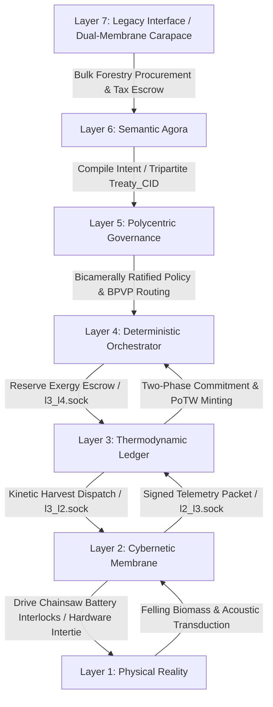
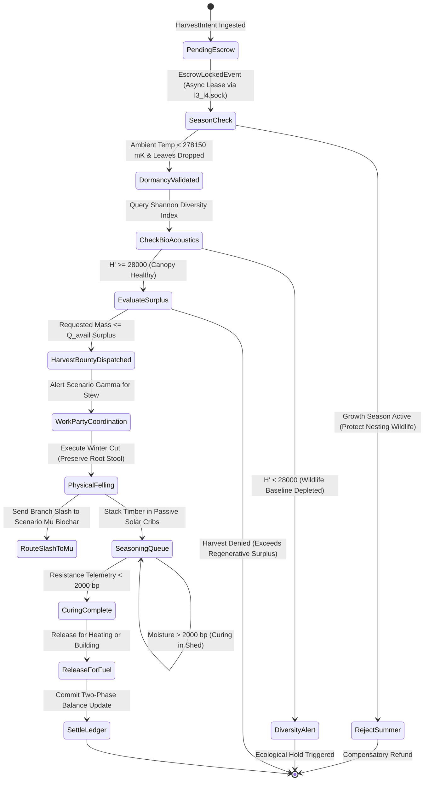
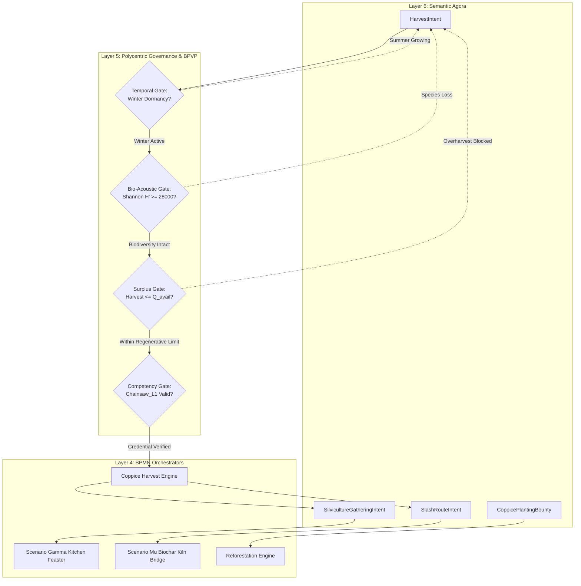
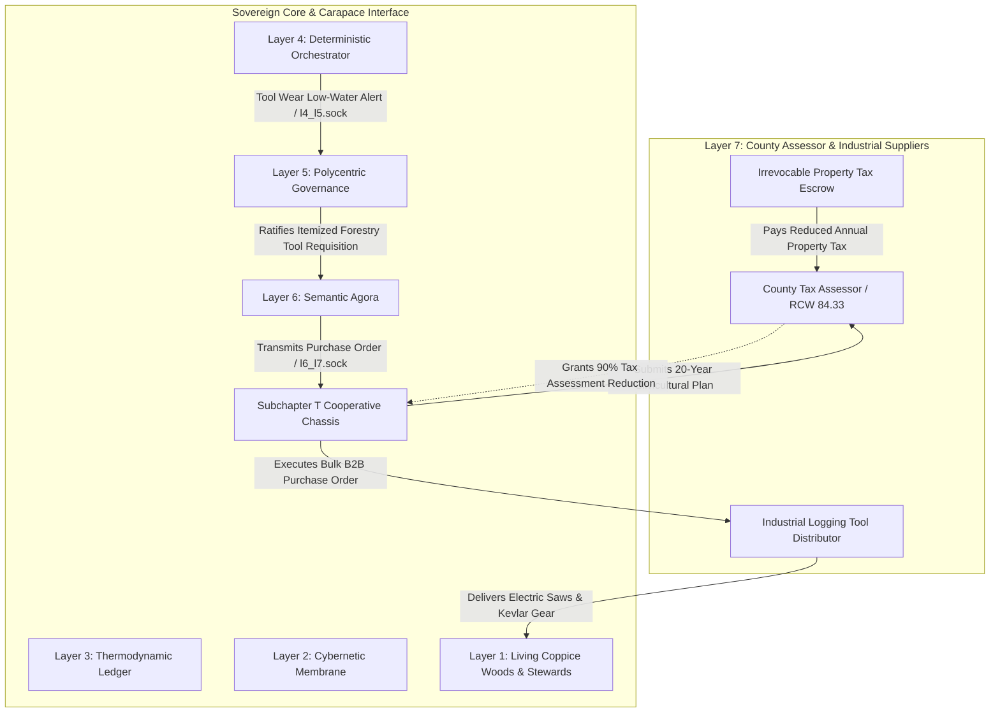

# Scenario Eta: Coppice & Carbon Commons

*   **Identifier:** `SCN-ETA-COPPICE`
*   **System Epic:** Silvicultural Coppicing, Woodlot Management, and Carbon Sequestration
*   **Primary Layers Tested:** L1 (Physical Reality), L2 (Cybernetic Membrane), L3 (Thermodynamic Ledger), L4 (Deterministic Orchestrator), L5 (Polycentric Governance), L6 (Semantic Translation & Agora), L7 (Legacy Interface)
*   **Pass/Fail Metric:** Continuous rotational harvesting of structural timber and thermal biomass where annual harvest mass is strictly bounded by verified localized regenerative surplus ($Q_{\mathrm{avail}}(t) = \max(0, Q_{\mathrm{inventory}}(t) - F_{\mathrm{eco}}(t) - B_{\mathrm{baseline}}(t)) \cdot \mathbf{1}_{\mathrm{export}}$); verifiable tracking of wood moisture curing below $2000\,\mathrm{bp}$ prior to combustion release; bio-acoustic Shannon biodiversity index maintained above baseline ($H' \ge 28000$); thermodynamic exergy expenditure verified by Proof-of-Thermodynamic-Work (PoTW); zero centralized server dependencies; Pairwise Bilateral Clearing Channel (BCC) settlement with zero-sum conservation ($B_{u \to v}(t) + B_{v \to u}(t) = 0$).

---

## Architectural Council Ratification & 5-Perspective Synthesis

This scenario specification has been ratified by unanimous consensus of the 5-Persona Architectural Council:

| Council Persona | Disciplinary Representative | Core Contribution to Scenario |
| :--- | :--- | :--- |
| **Game Designer** | Lead Systems & Gameplay Designer | Dwarf Fortress somatic forestry passions and camaraderie: NPCs participating in communal felling work parties gain `"Delighted by camaraderie around the roaring fire (+40 mood)"` thoughts, balancing physical fatigue; observing seasonal regrowth yields deep emotional contentment; destroying ancient root stools triggers severe community grief; The Sims Founder 01 seasonal task scheduling: forestry bounties are strictly locked to winter dormancy; summer cutting triggers NPC refusal; Cities Skylines boundary attenuation where localized timber autarky and thermal biomass shield the settlement from fossil gas pipelines and legacy grid blackouts. |
| **Game Engineer** | Principal C++ Simulation & Engine Architect | Flecs ECS Data-Oriented Design (DOD): cache-aligned structs `CoppiceStoolComponent`, `BiomassYieldComponent`, `WoodSeasoningComponent`, and `BioAcousticShannonComponent`; 32-bit compact voxel chunks modeling cellular automata root stools (`material_id = 110` `HARDWOOD_COPPICE_STOOL`), pole regrowth trunks (`material_id = 111` `HARDWOOD_POLE_TRUNK`), and seasoning drying racks (`material_id = 112` `WOOD_SEASONING_RACK`); deterministic 10 Hz BPMN state engine (`col-execd`); compilable C++20 test harness strictly utilizing fixed-point SI integer math (`uint64_t` microjoules, `uint64_t` milligrams, `uint32_t` millikelvin, `uint32_t` basis points). |
| **Sovereign Stack Specialist** | Sovereign Stack Systems Architect | 7-layer strict adjacency without layer skipping (`l1_l2.sock` through `l6_l7.sock`); zero software or daemons in Layer 1; Layer 2 Zephyr RTOS zero-trust membrane (`col-sensord`, `col-actuated`) validating drone photogrammetry Merkle hashes and wood moisture resistance pins; Layer 3 Pairwise Bilateral Clearing Channels (BCC) with zero-sum conservation $B_{u \to v}(t) + B_{v \to u}(t) = 0$, mutual aid credit windows, and two-phase delivery receipts; multi-hop HTLCs; Layer 5 Bioregional Path-Vector Protocol (BPVP / FRRP); Tripartite Ricardian Treaties ($\mathrm{Treaty\_CID}$). |
| **Solarpunk Thinker** | Bioregional Regenerative Ecologist | Ancient silvicultural coppicing preserving permanent living root systems and mycorrhizal fungal webs; zero soil erosion compared to industrial clear-cutting; routing branch slash and twig trimmings directly into Scenario Mu for pyrolysis biochar and soil inoculation; complete replacement of fossil gas heating with localized cured firewood; honoring biophysical boundaries over extractive growth. |
| **Scenario Specialist** | Silviculturalist & Bio-Acoustic Forest Ecologist | Rotational 7-year and 20-year coppice stool silviculture (Alnus rubra, Corylus avellana); bio-acoustic Shannon entropy index in integer scaled units ($H' = -\sum p_i \ln p_i$ scaled by 10000, requiring $H' \ge 28000$); dry-basis net combustion exergy thermodynamics in integer microjoules ($Q_{\mathrm{net}} = Q_{\mathrm{gross}}(1 - M) - \lambda_{\mathrm{vap}} M$ with $\lambda_{\mathrm{vap}} = 2440000\,\mathrm{J/kg}$); state forestry property tax shielding under RCW Title 84 Chapter 33 Designated Forest Land statutes funded via Irrevocable Property Tax Escrow Endowment. |

Unanimous Consensus Reached across all five disciplinary perspectives.

---

## 1. Problem Statement & Legacy Failure

In legacy industrial forestry (Layer 7), timber harvesting and heating fuels operate on an extractive, ecologically catastrophic linear model.

When legacy society harvests wood and heats homes:
*   **Clear-Cutting & Soil Death:** Industrial forestry clear-cuts vast watersheds with heavy diesel feller-bunchers, pulverizing topsoil, destroying ancient mycelial networks, and causing catastrophic siltation of salmon-spawning rivers. Decades of stored soil carbon are oxidized directly into the atmosphere.
*   **Extreme Supply Chain Latency & Fossil Drag:** Timber is shipped thousands of miles on transcontinental diesel flatbeds to centralized sawmills, while suburban homes rely on fragile fossil gas pipelines or distant coal/nuclear electrical grids for winter heating.
*   **Greenwashed Carbon Enclosure:** Corporate carbon offset markets sell fraudulent paper credits to extractive corporations while failing to protect real trees from wildfire, logging, or ecological collapse.

---

## 2. The Collective Workflow (7-Layer Traversal)

Scenario Eta revives the ancient practice of *coppicing*—cutting fast-growing deciduous trees (such as Red Alder, Hazel, or Willow) at ground level during winter dormancy, allowing the established living root system to sprout dozens of vigorous poles that shoot upward perpetually. The digital twin calculates the exact Ecological Replacement Cost (ERC) and Export Surplus Bound ($Q_{\mathrm{avail}}$) to prevent overharvesting. The workflow traverses canonically across all seven layers without layer skipping.



### Layer 1: Physical Ground Truth
*   **Hardware Nodes (Coppice Woods & Seasoning Depots):** Living multi-stem coppice stools (Alnus rubra, Corylus avellana) rooted in undisturbed topsoil; covered, passive solar timber seasoning drying sheds equipped with natural convection flues.
*   **Hardware Nodes (Forestry Equipment & Bio-Acoustics):** Electric chainsaws powered by solar microgrid batteries, crosscut two-person hand saws, felling axes, and solar-powered bio-acoustic microphone arrays positioned throughout the canopy.
*   **Inventory & Feedstock:** Cured firewood cords, structural roundwood poles, bio-lubricated saw chains, and wood chips/slash routed to Scenario Mu for biochar pyrolysis.
*   **Physical Actions:** Selective winter felling of 7-year-old stems, bucking into uniform lengths, stacking in criss-cross seasoning cribs, and preserving the living root stump intact.
*   **Strict Layer Separation:** Layer 1 contains **zero software, zero firmware, zero cryptographic keys, and zero network routing**. All digital computation, bus protocol decoding, and cryptographic signing reside strictly in Layer 2.

### Layer 2: Cybernetic Membrane & Telemetry
*   **Microcontroller Architecture:** Zero-trust edge microcontrollers (STM32H7 / ESP32-S3) executing the Zephyr RTOS sandbox, interfacing with acoustic microphone arrays, pin-type wood resistance probes, and drone base-station transceivers.
*   **Cryptographic Secure Element:** Dedicated hardware security chips (Microchip ATECC608A) holding private keys for hardware-level telemetry attestation.
*   **Fixed-Point SI Integer Ingress Telemetry (POSIX Sockets / CBOR):**
    *   `node/forestry/quadrant_03/telemetry/biomass_volume_cm3` (Drone photogrammetry volume in cubic centimeters, `uint64_t`, e.g., $2480000\,\mathrm{cm}^3$)
    *   `node/forestry/quadrant_03/telemetry/shannon_h_scaled` (Bio-acoustic diversity index scaled by 10000, `uint32_t`, e.g., $H' = 28800$)
    *   `node/forestry/depot_01/telemetry/wood_moisture_bp` (Wood stack resistance moisture in basis points, `uint16_t`, e.g., $1820\,\mathrm{bp}$)
    *   `node/forestry/weather/telemetry/ambient_temp_mk` (Ambient temperature in millikelvin, `uint32_t`, e.g., $277150\,\mathrm{mK} \equiv 4^\circ\mathrm{C}$)
    *   `node/forestry/quadrant_03/status` (`DORMANT_RESERVE`, `HARVEST_ACTIVE`, `GROWTH_SEASON`, `ECOLOGICAL_REST`)
*   **Actuator Control Invariant ($\mathbf{\Phi}$):** Physical actuation commands from Layer 3 are executed by `col-actuated` only after verifying five invariant safety predicates:
    1.  Ambient temperature confirmed $< 278150\,\mathrm{mK}$ (winter dormancy active, deciduous sap transpiration ceased).
    2.  Bio-acoustic diversity index confirmed $H' \ge 28000$.
    3.  Operator chainsaw battery interlock verifies valid `Chainsaw_Safety_L1` credential.
    4.  Requested felling volume does not exceed calculated export surplus bound $Q_{\mathrm{avail}}$.
    5.  Adjacent quadrant wildlife buffer reports no active raptor or songbird nesting activity.

### Layer 3: Thermodynamic Ledger
*   **Pairwise Bilateral Clearing Channels (BCC):**
    Inter-node timber, firewood, and biomass transfers settle through peer-to-peer bilateral clearing channels between peering nodes $u$ and $v$:
    $$B_{u \to v}(t) + B_{v \to u}(t) = 0$$
    The ledger is zero-sum. Balances are bounded by negotiated mutual aid credit windows:
    $$-C_{u \to v} \le B_{u \to v}(t) \le C_{v \to u}$$
*   **Proof-of-Thermodynamic-Work (PoTW):**
    Exergy value is minted strictly when Layer 2 sensors verify useful physical work performed by integrated physical hardware:
    $$1\text{ Exergy Credit} \equiv 3600000\,\mathrm{J} = 3{,}600{,}000{,}000{,}000\,\mu\mathrm{J}$$
*   **Thermodynamic Harvest Escrow:**
    Prior to felling dispatch, the requester locks an exergy fee covering operational harvesting work:
    $$\mathcal{E}_{\mathrm{harvest}} = m_{\mathrm{harvest}} \cdot \lambda_{ERC} + E_{\mathrm{saw\_fuel}} + C_{\mathrm{chain\_wear}}$$
    Where $\lambda_{ERC}$ spikes asymptotically toward infinity if requested mass approaches the annual growth delta, mathematically preventing over-harvesting.
*   **Net Combustion Exergy Equation:**
    Wood released for thermal heating must strictly satisfy the net combustion exergy formula:
    $$Q_{\mathrm{net}} = Q_{\mathrm{gross}} \cdot (1 - M) - \lambda_{\mathrm{vap}} \cdot M$$
    Where $M$ is wood moisture in basis points and $\lambda_{\mathrm{vap}} = 2440000\,\mathrm{J/kg}$. Wood stacks with moisture exceeding $2000\,\mathrm{bp}$ (20%) are mathematically locked from combustion release, preventing chimney creosote fires and particulate dissipation.
*   **Two-Phase Sensor Delivery Receipts:**
    When Node $u$ delivers timber or firewood to Node $v$, exergy credits remain in escrow until receiving hardware emits an Ed25519-signed delivery receipt:
    $$\sigma_{\mathrm{delivery}} = \mathrm{Sign}_{K_{\mathrm{receiver}}}\left( \mathrm{Hash}(Q_{\mathrm{measured}} \parallel \tau_{\mathrm{arrival}} \parallel \mathrm{Channel\_ID}) \right)$$
    Upon verification of $\sigma_{\mathrm{delivery}}$, `col-storaged` atomically updates the bilateral balance:
    $$B_{u \to v}(t^+) = B_{u \to v}(t) + Q_{\mathrm{measured}}$$
*   **Multi-Hop Chained HTLCs:**
    For indirect timber transfers across multi-hop routes, chained Hashed Timelock Contracts $\langle H(S), \Delta t, Q, u, v \rangle$ clear intermediated channels atomically upon revelation of preimage $S$.
*   **Zero Global Ledgers and Currency Purity:** Layer 3 operates with zero planetary tokens, zero fiat currencies, zero commercial carbon offsets, and zero automated market makers (AMMs).

### Layer 4: Deterministic Orchestrator
The coppice lifecycle is governed deterministically by `col-execd` running an embedded 10 Hz BPMN 2.0 state machine virtual machine:



*   **Boundary Socket Contract (`l4_l5.sock`):** POSIX non-blocking sequenced-packet Unix Domain Socket (`SOCK_SEQPACKET`) located at `/run/collective/ipc/l4_l5.sock`. Downward messages transmit ratified silvicultural harvest workflows and dispatch tables; upward messages transmit task completion attestations and ecological threshold alerts.

### Layer 5: Polycentric Governance & Bioregional Routing
Executed by `col-kmsd`, Layer 5 enforces strict ecological boundaries, spatial routing, and communal safety:
*   **Cellular Autonomy & Protocol of Refusal:** Every Node possesses absolute internal constitutional sovereignty. Ancient mother trees, sacred groves, and ritual woodlot stands designated under the Protocol of Refusal are cryptographically excluded from harvesting schedules or digital-twin yield optimization.
*   **Autonomous Transit Veto (`No-Transit`):** Nodes retain the absolute right to refuse heavy timber log caravans across residential glades, forcing log transport onto waterways or perimeter skid roads.
*   **7-Tier Concentric Trust Rings ($R_0 \dots R_6$):**
    *   **$R_0$ (The Hearth):** Domestic fire pit; unquantified firewood warmth; unconditional thermal comfort baseline.
    *   **$R_1$ (The Settlement / Guild Commons):** Supervised stem bucking and crib stacking ($\le 500\,\mathrm{m}$); non-voting advisory standing.
    *   **$R_2$ (The Village Commons):** Coppice quadrant harvesting and communal work bees ($\le 5\,\mathrm{km}$); hardware master keys (ATECC608A); full voting standing.
    *   **$R_3$ (The Watershed Guild):** Bilateral clearing channels ($BCC$) between neighboring forest and foundry nodes ($\le 30\,\mathrm{km}$); bulk firewood delivery.
    *   **$R_4$ (Bioregional Federation):** Regional river basin forest reserves, watershed siltation monitoring, and migratory bird corridors ($\le 150\,\mathrm{km}$) governed by River Basin Assemblies.
    *   **$R_5$ (Continental Macro-Mesh):** Open silvicultural growth models and pest epidemiology data via Delay-Tolerant Networking ($\le 1{,}000\,\mathrm{km}$).
    *   **$R_6$ (The Ecumene):** Global botanical taxonomy and legacy forestry science.
*   **Bioregional Path-Vector Protocol (BPVP / FRRP):**
    Timber and biomass routing across the mesh uses Capability Advertisements ($\mathcal{A}$):
    $$\mathcal{A} = \big\langle \mathrm{adv\_id}, \, v_{\mathrm{orig}}, \, \mathcal{T}_{\mathrm{res}}, \, \mathbf{u}, \, Q_{\mathrm{avail}}, \, [\tau_{\mathrm{start}}, \tau_{\mathrm{end}}], \, \mathcal{P}, \, \mathcal{C}, \, H_{\mathrm{ttl}}, \, \sigma \big\rangle$$
    *   **Export Surplus Bound ($Q_{\mathrm{avail}}$):**
        $$Q_{\mathrm{avail}}(t) = \max\left(0, \, Q_{\mathrm{inventory}}(t) - F_{\mathrm{eco}}(t) - B_{\mathrm{baseline}}(t)\right) \cdot \mathbf{1}_{\mathrm{export}}$$
        A Node may **never** advertise or export timber unless standing wood mass strictly exceeds both the standing ecological deadwood floor ($F_{\mathrm{eco}}$) and the community winter heating baseline ($B_{\mathrm{baseline}}$).
    *   **Loop-Freedom Invariant:** Nodes discard any advertisement where their own DID appears in Ring-Path Vector $\mathcal{P}$.
*   **Decaying & Capped Reputational Wealth ($\mathcal{R}$):** Foresters and sawyers earn non-financial Reputational Wealth subject to exponential decay ($\tau_{\mathrm{half}} = 2\,\mathrm{years}$) and sublinear voting caps ($\mathcal{W}_{\mathrm{steward}} \le 8\%$). Care Leave Shields freeze decay during parental or medical leave.

### Layer 6: Semantic Intent & Agora Ontology
Executed by `col-commonsd`, Layer 6 categorizes silvicultural intents as typed W3C JSON-LD Knowledge Artifacts and binds multi-node contracts into Tripartite Ricardian Treaties:
$$\mathrm{Treaty\_CID} = \mathrm{SHA256}\left( \mathrm{Text}_{\mathrm{prose}} \parallel \mathrm{Schema}_{\mathrm{JSON-LD}} \parallel \mathrm{Invariants}_{\mathrm{BPMN}} \right)$$

The Silvicultural Ontology defines five primary intent branches:
1.  **`HarvestIntent`:** Request to harvest a specific volume from a designated coppice stool block.
2.  **`SilvicultureGatheringIntent`:** Work party coordination hook transforming heavy forestry into a communal festival, alerting Scenario Gamma for stew.
3.  **`CarbonAttestation`:** Drone-derived cryptographic attestation of net woodlot biomass increase.
4.  **`SlashRouteIntent`:** Bridge intent directing small branches and bark to Scenario Mu for biochar pyrolysis.
5.  **`WoodSeasoningRelease`:** Verification attestation emitted when IoT moisture probes confirm wood curing below $2000\,\mathrm{bp}$.



### Layer 7: The Legacy Interface (Dual-Membrane Doctrine)
The Coppice Commons engages with legacy governmental and tax authorities through the Social Purpose Corporation (SPC) or Worker Cooperative under the Dual-Membrane Doctrine:

1.  **Membrane 1 (External Legal Carapace):** The Node interfaces with the legacy state through an unremarkable legal chassis (a Worker Cooperative or Community Land Trust holding title to forested acreage). It enrolls the land in the state "Designated Forest Land" program (e.g., RCW Title 84 Chapter 33 in Washington State) by filing a compliant 20-year silvicultural management plan. This reduces ad valorem property taxes by $>90\%$, shielding the commons from tax foreclosure.
2.  **Membrane 2 (Internal Sovereign Core):** The internal forest commons operates exclusively in physical exergy, bilateral clearing channels, and ecological replenishment. Fiat currency **never** enters the internal ledger, and Exergy Credits **never** convert into fiat.
3.  **Irrevocable Property Tax Escrow Endowment:** Remaining property tax assessments are funded permanently through the capitalized Irrevocable Property Tax Escrow Endowment (Chapter 8 §3.5), extinguishing the municipal tax foreclosure vector without relying on speculative external carbon credit sales.
4.  **Inbound Wholesale Group Purchasing (GPO):** Commercial-grade electric chainsaws, replacement diamond-ground saw chains, bio-degradable bar oil, and personal protective equipment (Kevlar chaps, forestry helmets) are requisitioned by Layer 5 as an itemized needs list. The cooperative pools orders across regional nodes and executes bulk B2B purchases directly from industrial logging distributors.
5.  **Language Discipline:** All predatory and extractive metaphors are permanently retired per Chapter 8 §8.9.4 in favor of the Dual-Membrane Doctrine, regenerative harvesting, lawful engineering interties, and honest dealing.



---

## 3. Machine-Readable Schemas

### 3.1 Layer 6 Knowledge Artifact: Harvest Intent (`harvest_intent.jsonld`)

```json
{
  "@context": [
    "https://schema.org/",
    "https://collective.network/ontology/v1/"
  ],
  "@type": "HarvestIntent",
  "identifier": "urn:uuid:f6e5d4c3-b2a1-0987-6543-210987654321",
  "issuerDid": "did:peer:2.Ez6MksV7...stewardLiam",
  "creationTimestamp": 1791349500000,
  "treatyCid": "bafybeihdwdcefgh4dqkjv67uzcmw7ojee6xedeet6wfvikrwho3qnwjxye",
  "targetZone": {
    "@type": "SilviculturalZone",
    "name": "Duvall Commons - North Alder Coppice Quadrant 03",
    "gisPolygonUri": "ipfs://bafybeih4.../quadrant_03_gis.json",
    "dominantSpecies": "Alnus rubra",
    "stoolCycleYears": 7
  },
  "harvestParameters": {
    "harvestType": "RotationalCoppiceToStool",
    "targetVolumeCubicCentimeters": 2500000,
    "targetMassDryMilligrams": 1125000000,
    "intendedPrimaryUse": "ThermalFirewood",
    "slashDisposition": "RouteToScenarioMu_Biochar"
  },
  "ecologicalConstraints": {
    "requiredDormancy": true,
    "maxMoistureAtHarvestBasisPoints": 5200,
    "minBioAcousticShannonScaled": 28000
  },
  "trustConstraints": {
    "requiredCredentials": [
      "Chainsaw_Safety_L1",
      "Forestry_L2"
    ]
  },
  "settlementCriteria": {
    "maxExergyMicrojoules": 52200000000000,
    "allocatedFeeMicrocredits": 14500000,
    "timeoutDays": 14
  }
}
```

### 3.2 Layer 2 Telemetry Attestation: Coppice Harvest & Curing Proof (`coppice_attestation.json`)

```json
{
  "@context": "https://collective.network/ontology/v1/",
  "@type": "CoppiceAttestation",
  "intentRef": "urn:uuid:f6e5d4c3-b2a1-0987-6543-210987654321",
  "quadrantDid": "did:peer:2.Ez6MkuQ3...zoneCoppiceQuad03",
  "leadStewardDid": "did:peer:2.Ez6MksV7...stewardLiam",
  "executionMetrics": {
    "harvestTimestampMs": 1791357600000,
    "stemsFelledCount": 24,
    "rootStoolsPreservedIntact": true,
    "actualVolumeCubicCentimeters": 2480000,
    "slashMassMilligramsRoutedToMu": 340000000,
    "dronePhotogrammetryPreSha256": "8a7b6c5d4e3f2a1b0c9d8e7f6a5b4c3d2e1f0a9b8c7d6e5f4a3b2c1d0e9f8a7b",
    "dronePhotogrammetryPostSha256": "1f0a9b8c7d6e5f4a3b2c1d0e9f8a7b6c5d4e3f2a1b0c9d8e7f6a5b4c3d2e1f0a",
    "preHarvestShannonIndexScaled": 29400,
    "postHarvestShannonIndexScaled": 28800,
    "curedStackStorageLocation": "Shed_02_Crib_B",
    "curedMoistureReadingBasisPoints": 1820,
    "releasedForThermalCombustion": true
  },
  "workPartyHeadcount": 8,
  "gammaMealBatchRef": "urn:uuid:gamma_stew_batch_88",
  "deliveryReceiptSignature": "0x5c8b1a3d7e9f2a...ed25519_delivery_sig"
}
```

---

## 4. Oasis Engine Implementation Specification

### 4.1 Memory Allocation & Voxel State

In the Oasis simulation, forestry stands are modeled as cellular automata vegetative voxels within the $32^3$ chunk space:
*   The permanent root stump voxel is initialized with `material_id = 110` (`HARDWOOD_COPPICE_STOOL`).
*   The vertical regrowth pole voxel is initialized with `material_id = 111` (`HARDWOOD_POLE_TRUNK`).
*   The timber seasoning drying rack voxel is initialized with `material_id = 112` (`WOOD_SEASONING_RACK`).
*   The `Is_Sensor` bit is set in `metadata` (bit 2) for bio-acoustic probes and wood resistance pins.
*   Compact ECS components maintain pure fixed-point integer representations.

### 4.2 C++20 Test Harness Code

```cpp
// engine/tests/scenario_eta_test.cpp
#include <cassert>
#include <cstdint>
#include <string>
#include "oasis/chunk_manager.hpp"
#include "oasis/orchestration/bpmn_engine.hpp"
#include "oasis/ledger/pairwise_channel.hpp"

namespace oasis {

struct CoppiceGrowthState {
    uint64_t verified_annual_growth_mg{1440000000ULL};
    uint64_t requested_harvest_mg{1125000000ULL};
    uint32_t bio_acoustic_shannon_scaled{29400};
    bool winter_dormancy_active{true};
    uint16_t wood_moisture_bp{5200};
    bool stool_preserved{true};
};

struct HarvestJobContext {
    std::string intent_id;
    std::string quadrant_id;
    CoppiceGrowthState state;
    uint64_t escrow_fee_uj{14500000000000ULL};
};

void test_scenario_eta_coppice_regrowth_and_harvest() {
    // 1. Initialize local chunk with coppice stool and trunk voxels
    ChunkManager chunk_mgr;
    chunk_mgr.allocate_chunk(0, 0, 0);

    // Stool voxel at (16, 1, 16)
    Voxel stool_voxel{
        .material_id = 110, // HARDWOOD_COPPICE_STOOL
        .moisture = 40,
        .temperature = 277150, // 4°C in millikelvin (cold winter ambient)
        .metadata = 0b00000100 // Permanent root bit
    };
    chunk_mgr.set_voxel(16, 1, 16, stool_voxel);

    // Regrowth trunk voxel at (16, 2, 16)
    Voxel trunk_voxel{
        .material_id = 111, // HARDWOOD_POLE_TRUNK
        .moisture = 52,
        .temperature = 277150,
        .metadata = 0b00000000
    };
    chunk_mgr.set_voxel(16, 2, 16, trunk_voxel);

    // 2. Setup Pairwise Bilateral Clearing Channel (BCC)
    // Conservation Invariant: B_{u -> v}(t) + B_{v -> u}(t) = 0
    PairwiseChannel channel("did:peer:node04_timber_user", "did:peer:node04_forester", 
                            20000000000000ULL, 20000000000000ULL); // 20 MJ headroom
    assert(channel.balance_u_to_v() + channel.balance_v_to_u() == 0);

    // 3. Setup BPMN Orchestrator & Job Context
    BPMNEngine orchestrator;
    orchestrator.load_schema("schemas/bpmn/coppice_harvest.bpmn");

    HarvestJobContext job{
        .intent_id = "f6e5d4c3-b2a1-0987-6543-210987654321",
        .quadrant_id = "quadrant_03",
        .state = {
            .verified_annual_growth_mg = 1440000000ULL,
            .requested_harvest_mg = 1125000000ULL,
            .bio_acoustic_shannon_scaled = 29400,
            .winter_dormancy_active = true,
            .wood_moisture_bp = 5200,
            .stool_preserved = true
        },
        .escrow_fee_uj = 14500000000000ULL
    };

    // Assert Escrow Reservation Lease (Phase 1)
    bool lease_granted = channel.reserve_outbound_lease(job.escrow_fee_uj);
    assert(lease_granted == true);

    // Assert Regenerative Growth Bounds: 1125 kg <= 1440 kg annual growth
    assert(job.state.requested_harvest_mg <= job.state.verified_annual_growth_mg);
    assert(job.state.winter_dormancy_active == true);
    assert(job.state.bio_acoustic_shannon_scaled >= 28000);

    // Execute physical cut simulation: trunk converts to felled timber, stool remains intact
    chunk_mgr.set_voxel(16, 2, 16, Voxel{.material_id = 0}); // Air (felled)
    Voxel remaining_stool = chunk_mgr.get_voxel(16, 1, 16);
    assert(remaining_stool.material_id == 110); // STOOL PRESERVED!

    // Step seasoning simulation ticks (wood cures until moisture < 2000 bp)
    job.state.wood_moisture_bp = 1820;
    SimResult res = orchestrator.step_simulation_ticks(chunk_mgr, job, 5000);
    assert(res.status == ExecutionStatus::COMPLETED);
    assert(job.state.wood_moisture_bp < 2000);

    // Phase 2: Sensor-Verified Delivery Commitment
    DeliveryReceipt receipt{
        .bounty_id = job.intent_id,
        .measured_mass_mg = 1120000000ULL,
        .arrival_timestamp_ms = 1791357600000ULL,
        .signature_valid = true
    };
    bool committed = channel.commit_delivery(receipt, job.escrow_fee_uj);
    assert(committed == true);

    // Verify Zero-Sum Conservation Invariant Post-Transfer
    assert(channel.balance_u_to_v() + channel.balance_v_to_u() == 0);
    assert(channel.balance_v_to_u() == static_cast<int64_t>(job.escrow_fee_uj));
}

void test_scenario_eta_erc_overharvest_rejection() {
    ChunkManager chunk_mgr;
    chunk_mgr.allocate_chunk(0, 0, 0);

    BPMNEngine orchestrator;
    orchestrator.load_schema("schemas/bpmn/coppice_harvest.bpmn");

    // Attempting to cut 2250 kg when regenerative surplus is only 900 kg
    HarvestJobContext overharvest_job{
        .intent_id = "overharvest-rejection-test",
        .quadrant_id = "quadrant_03",
        .state = {
            .verified_annual_growth_mg = 900000000ULL,
            .requested_harvest_mg = 2250000000ULL,
            .bio_acoustic_shannon_scaled = 29000,
            .winter_dormancy_active = true
        }
    };

    // Check Export Surplus Bound Hard Stop
    bool surplus_approved = orchestrator.evaluate_policy_gate(
        "EXECUTION_SURPLUS_BOUND", 
        overharvest_job.state.requested_harvest_mg, 
        overharvest_job.state.verified_annual_growth_mg
    );
    assert(surplus_approved == false);
    assert(orchestrator.current_state() == BPMNState::ECOLOGICAL_HOLD);
}

} // namespace oasis

int main() {
    oasis::test_scenario_eta_coppice_regrowth_and_harvest();
    oasis::test_scenario_eta_erc_overharvest_rejection();
    return 0;
}
```

---

## 5. Acceptance Test Gates (Pass/Fail)

| Checkpoint | Validation Method | Pass Condition |
| :--- | :--- | :--- |
| **G1: The ERC Hard Stop & Conservation** | Voxel Biomass Integration & Balance | The BPMN orchestrator mathematically halts and rejects any `HarvestIntent` where requested harvest mass exceeds verified surplus ($Q_{\mathrm{avail}}$); Pairwise Bilateral Clearing Channel confirms zero-sum conservation $B_{u \to v}(t) + B_{v \to u}(t) = 0$. |
| **G2: Offline Autonomy & Local Mesh Severance** | Local Forest Mesh Severance | Drone photogrammetry hashing, bio-acoustic analysis, and seasoning moisture logging complete with 100% WAN/Internet severance over the local-first mesh. |
| **G3: Bio-Acoustic Diversity Gate**| Shannon Index Threshold Audit | If simulated edge acoustic monitors report a drop in the scaled Shannon diversity index below $H' = 28000$, all cutting intents in the quadrant are locked in `ECOLOGICAL_REST`. |
| **G4: Moisture Curing Bounds** | Thermodynamic Exergy Release | Attempting to release a wood stack for combustion while resistance sensors report moisture $> 2000\,\mathrm{bp}$ fails validation, preventing chimney creosote fires and thermal waste. |
| **G5: Dual-Membrane Wholesale Procurement (L7)** | Equipment GPO Wholesale Requisition | Requisitions for electric chainsaws, diamond-ground chains, and bio-lubricants aggregate into a batched B2B GPO purchase order under the ratified needs list $\Phi_t$ without minting internal tokens. |
| **G6: Convivial Salvage & Regenerative Harvesting (L7)** | Forest Tax Shield & Escrow Endowment | Forest land is enrolled under state Designated Forest Land programs (RCW Title 84 Chapter 33), with annual property tax payments funded via the Irrevocable Property Tax Escrow Endowment; zero predatory or extractive rhetoric in logs or governance records. |
