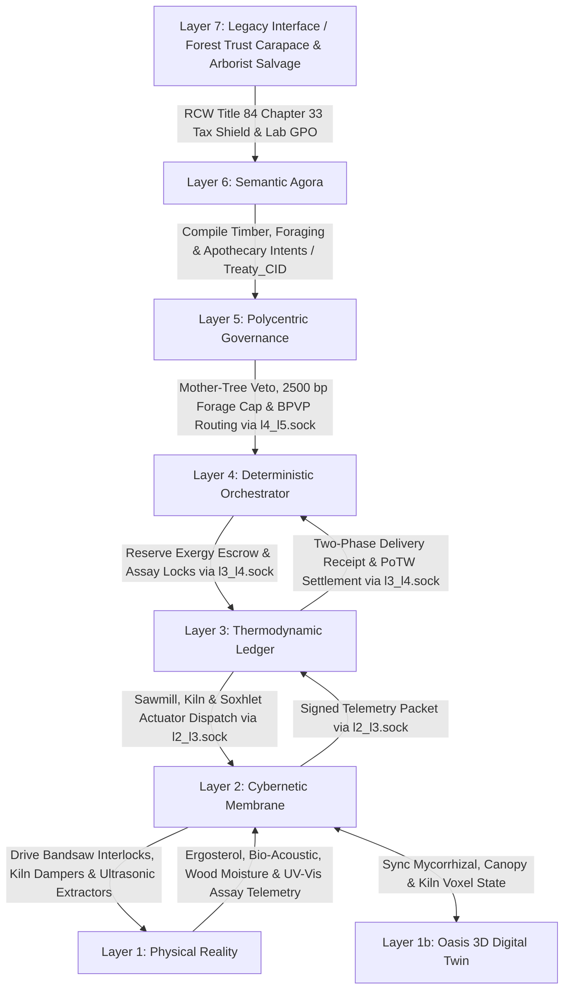
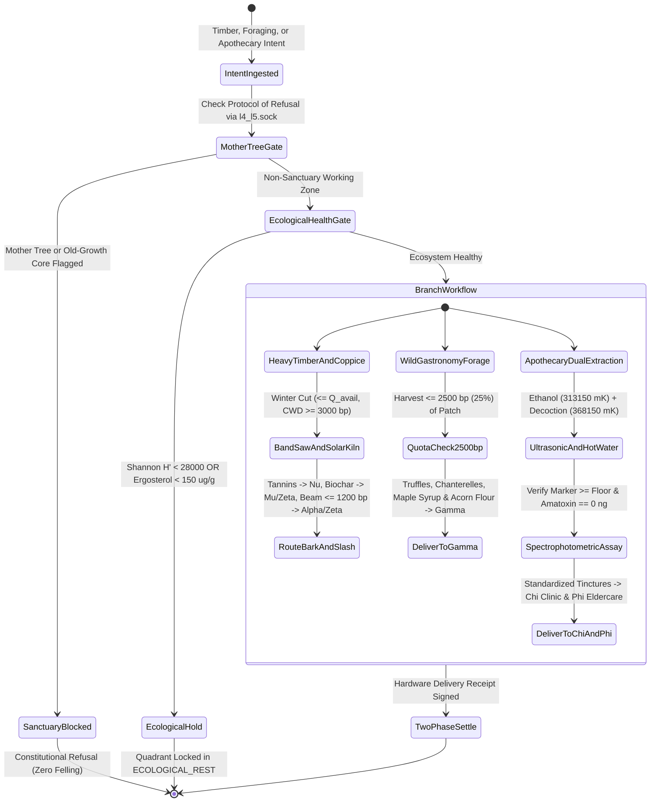

# Scenario Eta: Silviculture, Heavy Structural Timber, Mycorrhizal Wild Ecosystems, Forest Gastronomy & Botanical/Mycological Apothecary Commons

*   **Identifier:** `SCN-ETA-COPPICE`
*   **System Epic:** Multi-Tier Silviculture (Coppice-with-Standards & Heavy Timber Milling), Mycorrhizal Fungal Network & Mother-Tree Sanctuary Stewardship, Exotic Forest Gastronomy, Botanical/Mycological Pharmaceutical Extraction, Pyrolysis Biochar & 3-Stage Forest Node Evolution
*   **Primary Layers Tested:** L1 (Physical Reality), L1b (Oasis 3D Digital Twin & Biome Simulator), L2 (Cybernetic Membrane), L3 (Thermodynamic Ledger), L4 (Deterministic Orchestrator), L5 (Polycentric Governance), L6 (Semantic Translation & Agora), L7 (Legacy Interface)
*   **Pass/Fail Metric:** Continuous rotational harvesting of coppice poles and selective single-tree/windfall heavy structural timber strictly bounded by verified localized regenerative surplus ($Q_{\mathrm{avail}}(t) = \max(0, Q_{\mathrm{inventory}}(t) - F_{\mathrm{eco}}(t) - B_{\mathrm{baseline}}(t)) \cdot \mathbf{1}_{\mathrm{export}}$) with $\ge 3000\,\mathrm{bp}$ ($30\%$) coarse woody debris retained on the forest floor; unconditional Layer 5 `Protocol of Refusal` protection for mycorrhizal Mother-Tree hubs (`is_mother_tree_sanctuary == true`) and rhizosphere fungal ergosterol biomarkers ($\ge 150\,\mu\mathrm{g/g}$ dry soil); bio-acoustic Shannon biodiversity index maintained above baseline ($H' \ge 28000$); solar-kiln moisture curing verified at $\le 1200\,\mathrm{bp}$ ($12\%$) for structural timber and $< 2000\,\mathrm{bp}$ ($20\%$) for thermal firewood; wild gastronomy and medicinal foraging capped at $\le 2500\,\mathrm{bp}$ ($25\%$) of observed patch yield; botanical and mycological pharmaceutical extracts verified for active marker concentration (`ug_per_ml`) with zero amatoxin/heavy-metal contamination; Pairwise Bilateral Clearing Channel (BCC) settlement with zero-sum conservation ($B_{u \to v}(t) + B_{v \to u}(t) = 0$).

---

## Architectural Council Ratification & 5-Perspective Synthesis

This scenario specification has been ratified by unanimous consensus of the 5-Persona Architectural Council:

| Council Persona | Disciplinary Representative | Core Contribution to Scenario |
| :--- | :--- | :--- |
| **Game Designer** | Lead Systems & Gameplay Designer | *Dwarf Fortress* somatic forestry passions, mycological lore, and seasonal festival rhythms: Stewards participating in winter timber felling and spring truffle/chanterelle foraging gain `"Deeply grounded by the ancient forest canopy (+45 mood)"`; discovering a high-connectivity Mother Tree unlocks rare symbiotic fungal fruiting buffs across adjacent forest chunks; violating a Mother Tree or over-foraging wild patches triggers severe community grief and immediate `ECOLOGICAL_REST` locks. *The Sims* seasonal task scheduling locks timber felling to winter dormancy while opening spring sap-tapping, summer berry/herb gathering, and autumn mushroom/mast harvests. *Cities: Skylines* supply-chain mastery chains heavy structural beams to Scenario Alpha/Zeta, exotic forest delicacies to Scenario Gamma, and neuro-regenerative/antimicrobial extracts to Scenario Chi/Phi. |
| **Game Engineer** | Principal C++ Simulation & Engine Architect | Flecs ECS Data-Oriented Design (DOD): cache-aligned structs `SilvicultureStandComponent`, `MycorrhizalNetworkComponent`, `SolarKilnCuringComponent`, `ForestGastronomyForageComponent`, and `ApothecaryExtractionComponent`; 32-bit compact voxel chunks modeling coppice stools (`material_id = 110` `HARDWOOD_COPPICE_STOOL`), heavy timber standards (`material_id = 113` `HEAVY_TIMBER_STANDARD`), mycorrhizal rhizosphere soil (`material_id = 114` `MYCORRHIZAL_RHIZOSPHERE`), solar dehumidification kilns (`material_id = 112` `SOLAR_TIMBER_KILN`), and Soxhlet/ultrasonic apothecary extractors (`material_id = 115` `APOTHECARY_EXTRACTOR`); deterministic 10 Hz BPMN 2 state engine (`col-execd`); compilable C++20 test harness strictly utilizing fixed-point SI integer math. |
| **Sovereign Stack Specialist** | Sovereign Stack Systems Architect | 7-layer strict adjacency without layer skipping (`l1_l2.sock` through `l6_l7.sock`, with `/run/collective/ipc/l4_l5.sock` explicitly bridging governance and orchestration); zero software or daemons in Layer 1; Layer 2 Zephyr RTOS zero-trust membrane (`col-sensord`, `col-actuated`) validating drone photogrammetry hashes, pin-type wood resistance probes, rhizosphere soil ergosterol/impedance sensors, and UV-Vis spectrophotometric apothecary assays; Layer 3 Pairwise Bilateral Clearing Channels (BCC) with zero-sum conservation $B_{u \to v}(t) + B_{v \to u}(t) = 0$ and multi-hop HTLCs; Layer 5 Bioregional Path-Vector Protocol (BPVP / FRRP) and Mother-Tree `Protocol of Refusal`. |
| **Solarpunk Thinker** | Bioregional Regenerative Ecologist | Transforming forestry from clear-cut industrial monocultures into multi-story *Coppice-with-Standards* and continuous-cover old-growth sanctuaries; honoring the subterranean mycorrhizal fungal web ("Wood-Wide Web") that redistributes carbon, minerals, and immune signals across tree species; zero-waste utilization where bark tannins tan Scenario Nu leather, branch slash becomes Scenario Mu biochar, canopy mast and gourmet fungi enrich Scenario Gamma kitchens, and forest secondary metabolites heal citizens in Scenario Chi/Phi; 3-Stage node evolution from urban arborist tree-salvage to permanent Community Forest Trusts. |
| **Scenario Specialist** | Silviculturalist, Mycologist & Ethnobotanical Pharmacognosist | Multi-tier silviculture pairing $7\text{-year}$ understory coppice (*Alnus rubra*, *Robinia pseudoacacia*, *Corylus avellana*, *Salix*) with $60\text{–}120\text{-year}$ overstory heavy timber standards (*Pseudotsuga menziesii*, *Thuja plicata*, *Quercus alba*); low-impact skyline cable/winch logging and solar-kiln lumber drying ($\le 1200\,\mathrm{bp}$); ectomycorrhizal truffle/chanterelle symbiosis and log-grown *Hericium erinaceus* / *Grifola frondosa*; dual hot-water ($368150\,\mathrm{mK}$) and ethanol ultrasonic/Soxhlet extraction of fungal $\beta$-glucans, erinacines/hericenones, willow-bark salicin, *Usnea* usnic acid, and conifer pinene resins; state forestry tax shielding under `RCW Title 84 Chapter 33`. |

Unanimous Consensus Reached across all five disciplinary perspectives.

---

## 1. Problem Statement & Legacy Failure

In legacy industrial capitalism (Layer 7), forests are treated as dead standing lumber warehouses, while wild fungi, forest foods, and botanical medicines are either eradicated by herbicides or enclosed by pharmaceutical patents:

1.  **Clear-Cutting, Soil Compaction & Mycorrhizal Extinction:** Industrial logging clear-cuts entire watersheds with $30\text{-ton}$ diesel feller-bunchers, compacting rhizosphere soil pores, severing ancient ectomycorrhizal fungal networks, and spraying glyphosate to kill nitrogen-fixing deciduous "weed trees" like Red Alder and Birch so monoculture conifer plantations can be planted in sterile soil.
2.  **Destructive Slash Burning & Fossil Kilns:** Up to $4000\,\mathrm{bp}$ ($40\%$) of felled tree biomass (branches, tops, bark) is piled and burned in open air, choking valleys with particulate smoke while timber is hauled hundreds of miles on diesel trucks to fossil-gas-fired kilns.
3.  **Loss of Forest Gastronomy & Synthetic Pharmacopoeia:** Legacy agriculture bulldozes complex forest ecosystems to plant annual grain monocultures, destroying native mast trees, wild berries, and symbiotic edible fungi. Simultaneously, legacy medicine isolates single synthetic molecules in petrochemical labs while discarding the synergistic immunomodulatory, neuro-regenerative, and antimicrobial phytochemistry of living forest ecosystems.
4.  **Land Speculation & Timber REITs:** Timber Real Estate Investment Trusts (REITs) liquidate mature stands on $25\text{-year}$ financialized discount cycles to pay Wall Street dividends, leaving rural communities with eroded hillsides, silted salmon rivers, and high wildfire risk.

---

## 2. Macro-Domain Architecture: The Six Pillars of the Forest, Mycological & Apothecary Commons

Scenario Eta transforms forestry into the **Silviculture, Heavy Structural Timber, Mycorrhizal Wild Ecosystems, Forest Gastronomy & Botanical/Mycological Apothecary Commons**. It operates across six tightly integrated pillars that chain directly to Scenarios Alpha, Beta, Gamma, Zeta, Mu, Nu, Xi, Phi, and Chi:

### Pillar I: Multi-Tier Silviculture & Heavy Structural Timber Sourcing (`Coppice-with-Standards` & Solar Milling)
Rather than choosing between thin firewood poles or destructive clear-cutting, Scenario Eta manages forests as multi-layered **Coppice-with-Standards** and **Continuous-Cover Selection Forests**:
*   **Understory Rotational Coppice ($5\text{–}12\,\mathrm{Year}$ Cycle):** Fast-growing nitrogen-fixing Red Alder (*Alnus rubra*), rot-resistant Black Locust (*Robinia pseudoacacia*), Hazel (*Corylus avellana*), Sweet Chestnut (*Castanea sativa*), and Willow (*Salix*) are coppiced at ground level during winter dormancy ($T_{\mathrm{ambient}} < 278150\,\mathrm{mK}$ / $5^\circ\mathrm{C}$). The established living root stool and its mycorrhizal fungal partners remain undisturbed, sending up vigorous straight poles for tool handles, woven wattle, mushroom logs, furniture stock, and seasoned hearth fuel.
*   **Overstory Heavy Structural "Standards" ($60\text{–}120\,\mathrm{Year}$ Selective & Windfall Harvest):** Rising above the coppice understory, spaced canopy standards—Douglas Fir (*Pseudotsuga menziesii*), Western Red Cedar (*Thuja plicata*), White Oak (*Quercus alba*), and mature Black Locust—grow into massive, clear-grained structural trunks. Standards are harvested strictly via **single-tree selection** or **storm windfall salvage** using low-impact portable electric winches, suspended skyline cables, or draft-animal skidding—**never** heavy tracked machinery that crushes soil structure.
*   **On-Site Electric Bandsaw Milling & Solar-Thermal Dehumidification Kilns:** Heavy logs are milled on-site via $48\,\mathrm{V}$ / $380\,\mathrm{V}$ DC electric horizontal bandsaw mills into heavy structural beams, mortise-and-tenon posts, live-edge slabs, and Cross-Laminated Timber (CLT) lamellas for [Scenario Alpha (`alpha_fabrication.md`)](file:///Users/raffaine/dev/collective/docs/scenarios/alpha_fabrication.md), [Scenario Zeta (`zeta_lodging.md`)](file:///Users/raffaine/dev/collective/docs/scenarios/zeta_lodging.md), and [Scenario Xi (`xi_architecture.md`)](file:///Users/raffaine/dev/collective/docs/scenarios/xi_architecture.md). Milled lumber is stacked in solar-thermal heat-pump dehumidification kilns (supplemented by pyrolysis syngas heat) until pin-type resistance probes confirm structural equilibrium moisture content $\le 1200\,\mathrm{bp}$ ($12\%$) for joinery/CLT timber and $< 2000\,\mathrm{bp}$ ($20\%$) for thermal firewood.

### Pillar II: Complex Wild Ecosystems & Mycorrhizal Fungal Network Stewardship ("The Wood-Wide Web")
Scenario Eta treats the subterranean **mycorrhizal fungal network** as the primary vital organ of the forest:
*   **Mother-Tree Hub Protection (`Protocol of Refusal`):** In a mature forest, ancient "Mother Trees" are linked to hundreds of neighboring trees and understory seedlings through shared ectomycorrhizal and arbuscular mycorrhizal fungal mycelium, shuttling fixed carbon, phosphorus, water, and insect-defense chemical warnings across species boundaries. Layer 5 cryptographically registers mapped Mother Trees and old-growth groves under the **Protocol of Refusal** (`is_mother_tree_sanctuary == true`), making it mathematically impossible for Layer 4 (`col-execd`) to schedule felling within their root-crown protection radius.
*   **Rhizosphere Fungal Biomarker & Bio-Acoustic Gates:** Before any quadrant can open for harvest, Layer 2 edge telemetry must verify both canopy fauna health via bio-acoustic Shannon entropy ($H' \ge 28000$) and subterranean fungal vitality via rhizosphere soil ergosterol concentration ($\ge 150\,\mu\mathrm{g}$ ergosterol per gram of dry soil, quantifying active fungal membrane biomass).
*   **Coarse Woody Debris Floor ($F_{\mathrm{eco}} \ge 3000\,\mathrm{bp}$):** At least $3000\,\mathrm{bp}$ ($30\%$) of natural deadfall, standing snags, and nurse logs are permanently left on the forest floor to shelter salamanders, cavity-nesting owls, nitrogen-fixing bacteria, and saprotrophic wood-decay fungi.
*   **Native Mycorrhizal Inoculant Propagation:** Forest stewards cultivate native ectomycorrhizal spore slurries and undisturbed forest leaf-mold blocks to inoculate new tree plantings and regenerate compacted agricultural soils in [Scenario Gamma (`gamma_kitchen.md`)](file:///Users/raffaine/dev/collective/docs/scenarios/gamma_kitchen.md).

### Pillar III: Exotic Forest Gastronomy & Symbiotic Wild Foraging (Chaining to Scenario Gamma)
A healthy, multi-story mycorrhizal forest yields extraordinary culinary ingredients that industrial agriculture cannot replicate, supplying [Scenario Gamma (`gamma_kitchen.md`)](file:///Users/raffaine/dev/collective/docs/scenarios/gamma_kitchen.md) commissary kitchens and feasts:
*   **Symbiotic Ectomycorrhizal & Saprotrophic Gourmet Fungi:**
    *   *Mycorrhizal Wild & Orcharded Fungi:* Inoculating the root systems of Hazel and White Oak coppice standards with culinary truffles (*Tuber oregonense*, *Tuber melanosporum*), alongside wild-foraged Golden Chanterelles (*Cantharellus formosus*), Porcini (*Boletus edulis*), Matsutake (*Tricholoma magnivelare*), and spring Morels (*Morchella*).
    *   *Shaded Hardwood Totem & Bolt Cultivation:* Inoculating freshly cut winter Red Alder and Oak bolts with culinary-medicinal Lion's Mane (*Hericium erinaceus*), Maitake / Hen-of-the-Woods (*Grifola frondosa*), Shiitake (*Lentinula edodes*), and Oyster mushrooms (*Pleurotus ostreatus*).
*   **Tree Saps, Conifer Tips & Botanical Ferments:** Late-winter tapping of Bigleaf Maple (*Acer macrophyllum*), Sugar Maple (*Acer saccharum*), and Birch (*Betula*) trees—boiled over coppice-wood evaporator pans into mineral-rich maple and birch syrups; spring harvesting of vitamin-C-rich Sitka Spruce tips (*Picea sitchensis*), Douglas Fir tips, wild ramps (*Allium tricoccum*), and golden pine pollen for [Scenario Gamma (`gamma_kitchen.md`)](file:///Users/raffaine/dev/collective/docs/scenarios/gamma_kitchen.md) Koji miso glazes, botanical vinegars, and herbal infusions.
*   **Forest Mast Flours & Understory Berries:** Harvesting Sweet Chestnuts, Hazelnuts, Black Walnuts, and White Oak acorns (cold-water leached of bitter tannins in copper vats and stone-milled into rich, gluten-free forest pastry flours), paired with understory Evergreen Huckleberries (*Vaccinium ovatum*), Elderberries (*Sambucus*), and Thimbleberries.
*   **The 1-in-4 Ethical Foraging Quota Gate (`ForagingQuotaIntent`):** To prevent tragedy-of-the-commons over-foraging, Layer 5 enforces a strict ecological foraging cap: human stewards may harvest at most $\le 2500\,\mathrm{bp}$ ($25\%$) of any observed wild mushroom patch, ramp colony, berry guild, or sap flow, leaving $\ge 7500\,\mathrm{bp}$ ($75\%$) for wildlife nutrition and spore/seed dispersal.

### Pillar IV: Sovereign Forest Apothecary — Botanical & Mycological Pharmaceuticals (Chaining to Scenario Chi & Phi)
Plants and fungi synthesize complex secondary metabolites (terpenoids, alkaloids, phenolic glycosides, immunomodulatory polysaccharides) to defend against pathogens and communicate across the rhizosphere. Scenario Eta operates a **Forest Pharmacognosy & Dual-Extraction Apothecary Lab** that supplies standardized, laboratory-verified botanical and mycological preparations to [Scenario Chi (`chi_paramedic.md`)](file:///Users/raffaine/dev/collective/docs/scenarios/chi_paramedic.md) medical clinics and [Scenario Phi (`phi_elder.md`)](file:///Users/raffaine/dev/collective/docs/scenarios/phi_elder.md) eldercare sanctuaries:
*   **Mycological Dual-Extraction (Hot-Water $\beta$-Glucans + Ethanol Triterpenoids/Diterpenes):**
    Medicinal forest fungi contain both water-soluble structural polysaccharides ($\beta\text{-}(1,3)(1,6)\text{-D-glucans}$ locked inside chitin cell walls) and alcohol-soluble terpenoids. The Apothecary Lab executes a two-stage extraction: (1) ultrasonic chitin cell-wall disruption and food-grade ethanol Soxhlet/maceration ($313150\,\mathrm{mK}$ / $40^\circ\mathrm{C}$) to capture fragile terpenoids, followed by (2) pressurized hot-water decoction ($368150\,\mathrm{mK}$ / $95^\circ\mathrm{C}$) of the marc to release $\beta$-glucans, recombining both fractions into standardized hydro-ethanolic tinctures or freeze-dried powders:
    *   *Lion's Mane (`Hericium erinaceus`):* Standardized for **hericenones** (fruiting body) and **erinacines** (mycelium), which cross the blood-brain barrier to stimulate Nerve Growth Factor (NGF) synthesis and myelin repair for [Scenario Phi (`phi_elder.md`)](file:///Users/raffaine/dev/collective/docs/scenarios/phi_elder.md) neuro-protection.
    *   *Turkey Tail (`Trametes versicolor`) & Reishi (`Ganoderma tsugae`):* Standardized for **Polysaccharide-K (PSK)**, **Polysaccharide-Peptide (PSP)**, and ganoderic acid triterpenes for innate natural-killer (NK) immune modulation and respiratory resilience.
    *   *Agarikon (`Fomitopsis officinalis`) & Chaga (`Inonotus obliquus`):* Rare old-growth antiviral/antibacterial polypores propagated via **sterile lab agar tissue culture** cloned from wild fruiting bodies without ever cutting down or stripping rare wild old-growth conks.
*   **Botanical Bark, Resin & Lichen Phytochemicals:**
    *   *Willow Bark Salicin (`Salix alba` / `Salix lucida`):* Stripping inner phloem/cambium bark from harvested $3\text{-year}$ coppice willow wands (zero tree mortality) and extracting **salicin** ($\ge 15000\,\mu\mathrm{g/mL}$), the natural prodrug metabolized by the human liver into salicylic acid for analgesia, fever reduction, and anti-inflammatory care in [Scenario Chi (`chi_paramedic.md`)](file:///Users/raffaine/dev/collective/docs/scenarios/chi_paramedic.md).
    *   *Conifer Oleoresin & Steam-Distilled Terpenes (`Pseudotsuga`, `Abies`, `Pinus`):* Collecting wound pitch from felled timber logs and steam-distilling volatile **$\alpha$-pinene, $\beta$-pinene, and limonene** essential oils (bronchodilator and surface antiseptic) plus purified **colophony rosin** compounded with beeswax into antimicrobial wound-closure salves.
    *   *Usnea Lichen Antibacterial Tinctures (`Usnea longissima` / `Usnea barbata`):* Gathered strictly from wind-felled canopy branches after winter storms; dual-extracted for **usnic acid**, a potent narrow-spectrum antimicrobial effective against Gram-positive *Staphylococcus* and *Streptococcus* skin/wound infections.
    *   *Elderberry & Oregon Grape Root (`Sambucus caerulea`, `Mahonia aquifolium`):* Standardized for antiviral cyanidin-3-glucoside anthocyanins and antimicrobial **berberine** alkaloids.
*   **Chromatographic & Spectrophotometric Purity Gate (`PharmacopoeiaBatchAttestation`):**
    Natural medicine in The Collective is never guesswork. Every apothecary batch is tested via High-Performance Thin-Layer Chromatography (HPTLC) and UV-Vis spectrophotometry to verify: (1) active marker concentration meets the therapeutic floor (`active_marker_ug_per_ml >= min_therapeutic_ug_per_ml`), (2) zero amatoxin/muscarine mycotoxin cross-contamination (`amatoxin_detected_ng == 0`), and (3) heavy metals (lead, arsenic, cadmium, mercury—which fungi can bioaccumulate from polluted soils) remain strictly below $100\,\mathrm{ppb}$.

### Pillar V: Pyrolysis Biochar, Bark Tannins & Zero-Smoke Nutrient Closure (Chaining to Scenario Mu, Nu & Zeta)
*   **Bark Stripping for Vegetable Leather Tanning & Mordants (Scenario Nu):** Before milling Oak, Alder, or Hemlock logs, bark is stripped and routed to hot-water leaching vats to extract rich **condensed tannins** for [Scenario Nu (`nu_fashion.md`)](file:///Users/raffaine/dev/collective/docs/scenarios/nu_fashion.md) non-toxic leather tanning (replacing toxic hexavalent chromium) and natural textile dye mordanting.
*   **Flame-Cap Pyrolysis Biochar & Wood Vinegar (Scenario Mu & Zeta):** All branch slash, sawmill edgings, and spent bark are pyrolyzed in low-oxygen Flame-Cap / Top-Lit UpDraft (TLUD) kilns at $\ge 823150\,\mathrm{mK}$ ($550^\circ\mathrm{C}$). Volatile syngas is combusted cleanly to heat the solar timber drying kilns (zero smoke), yielding recalcitrant high-surface-area **biochar** ($\ge 8000\,\mathrm{bp}$ fixed carbon) routed to [Scenario Zeta (`zeta_lodging.md`)](file:///Users/raffaine/dev/collective/docs/scenarios/zeta_lodging.md) dry sanitation vaults and [Scenario Mu (`mu_extraction.md`)](file:///Users/raffaine/dev/collective/docs/scenarios/mu_extraction.md) thermophilic composters to permanently sequester carbon and recharge forest soils.

### Pillar VI: 3-Stage Incremental Node Facility Blueprints (Urban Arborist Salvage to Community Forest Trust)
Just like Scenarios Alpha through Zeta, a Scenario Eta node does not need to start by buying $500\,\mathrm{acres}$ of timberland:
1.  **Stage 1 — Urban Arborist Salvage, Backyard Log-Milling & Home Apothecary Bootstrap:**
    *   *Physical Footprint:* A suburban driveway/backyard woodyard and garage apothecary bench ($30\text{–}60\,\mathrm{m}^2$).
    *   *Operations:* Municipal tree services and urban arborists cut down thousands of tons of mature street and yard hardwoods (Oak, Maple, Cedar, Walnut, Cherry) every year and normally pay tipping fees to dump or chip them. A Stage 1 node registers as an arborist drop-off partner, receiving high-grade urban sawlogs and woodchips for free. Stewards slab logs using a low-noise electric chainsaw mill or portable track bandsaw during daytime hours ($\le 600\,\mathrm{cB}$), cure slabs in a passive backyard solar kiln, inoculate shaded backyard totem bolts with Lion's Mane and Shiitake, and run a countertop glass Soxhlet/ultrasonic dual-extraction apothecary bench.
    *   *Layer 7 Legal & Municipal Shield:* Shielded under **UUNAA § 6** (private unincorporated member association sharing wood and herbal preparations among members) and state Cottage Herbal/Craft exemptions, with zero retail walk-in signage.
2.  **Stage 2 — Leased Peri-Urban Woodlot, Portable Hydraulic Sawmill & Certified Extraction Lab:**
    *   *Physical Footprint:* A $10\text{–}40\,\mathrm{acre}$ leased peri-urban woodlot or regenerating second-growth parcel with a $200\,\mathrm{m}^2$ pole-barn sawmill yard and cleanroom apothecary lab, docked to a [Scenario Epsilon (`epsilon_coworking.md`)](file:///Users/raffaine/dev/collective/docs/scenarios/epsilon_coworking.md) legal/accounting carapace.
    *   *Operations & Self-Sustenance:* Operates a $380\,\mathrm{V}$ DC solar-powered hydraulic bandsaw mill, a heat-pump dehumidification timber kiln, a $500\text{-log}$ shaded mushroom yard, flame-cap biochar kilns, and a cGMP-compliant botanical/mycological extraction lab with HPTLC/UV-Vis assay instrumentation. Bounded external Layer 7 sales ($\Phi_t$) of kiln-dried live-edge hardwood slabs, gourmet wild/log mushrooms to restaurants, maple syrup, and dual-extracted Lion's Mane/Reishi tinctures pay the lease and accumulate capital in the **Forest Land Acquisition Escrow**.
3.  **Stage 3 — Custom-Built / Ecologically Restored Community Forest Trust & Old-Growth Sanctuary:**
    *   *Physical Footprint:* Acquiring $100\text{–}1000+\,\mathrm{acres}$ of degraded industrial clear-cut or cut-over timberland into an **Irrevocable Community Forest Trust (CFT) / Perpetual Purpose Trust (PPT)**.
    *   *Operations:* Enrolled in state **Designated Forest Land** tax programs (e.g., `RCW Title 84 Chapter 33`, reducing property tax assessments by $> 9000\,\mathrm{bp}$ / $90\%$, with the remainder permanently endowed via the Irrevocable Property Tax Escrow Endowment). Stewards ecologically restore salmon watersheds, re-inoculate depleted soils with native mycorrhizal fungi, establish permanent Mother-Tree Old-Growth Sanctuaries, and manage rotational Coppice-with-Standards zones that supply heavy structural CLT timber, firewood, gourmet forest foods, biochar, and pharmaceuticals to the bioregional mesh in perpetuity.

---

## 3. The Collective Workflow (7-Layer Traversal)

The workflow traverses canonically across all seven layers without layer skipping:



### Layer 1: Physical Ground Truth
*   **Silvicultural Canopy & Mycorrhizal Rhizosphere:** Multi-stem coppice stools (*Alnus rubra*, *Robinia pseudoacacia*, *Corylus avellana*, *Salix*), mature heavy timber standards (*Pseudotsuga menziesii*, *Thuja plicata*, *Quercus alba*), inviolable Mother-Tree hubs, coarse woody nurse logs, and ectomycorrhizal/arbuscular fungal mycelial mats.
*   **Sawmill, Kiln & Biochar Hardware:** Electric chainsaws, portable electric capstan winches, horizontal bandsaw mills, solar-thermal heat-pump dehumidification timber kilns, and Flame-Cap TLUD pyrolysis biochar retorts with syngas heat exchangers.
*   **Forest Gastronomy & Apothecary Hardware:** Shaded hardwood mushroom totem yards, stainless-steel sap evaporator pans, copper acorn-tannin leaching vats, $28\,\mathrm{kHz}$ ultrasonic cell-wall disruptors, borosilicate Soxhlet ethanol extractors, $368150\,\mathrm{mK}$ ($95^\circ\mathrm{C}$) jacketed hot-water decoction kettles, and HPTLC / UV-Vis spectrophotometric assay benches.
*   **Strict Layer Separation:** Layer 1 contains **zero software, zero firmware, zero cryptographic keys, and zero network routing**. All digital signal conditioning, bus decoding, and cryptographic signing execute strictly in Layer 2.

### Layer 2: Cybernetic Membrane & Telemetry
*   **Microcontroller Architecture:** Zero-trust edge microcontrollers (`STM32H7` / `ESP32-S3`) running the Zephyr RTOS sandbox (`col-sensord`, `col-actuated`) paired with `ATECC608A` hardware cryptographic secure elements.
*   **Fixed-Point SI Integer Ingress Telemetry (POSIX Sockets / CBOR):**
    *   `node/forestry/quadrant_03/telemetry/biomass_volume_cm3` (Drone photogrammetry standing volume in $\mathrm{cm}^3$, `uint64_t`)
    *   `node/forestry/quadrant_03/telemetry/shannon_h_scaled` (Bio-acoustic diversity index scaled by $10000$, `uint32_t`, requiring $H' \ge 28000$)
    *   `node/forestry/quadrant_03/telemetry/ergosterol_ug_per_g` (Rhizosphere fungal membrane biomarker in $\mu\mathrm{g/g}$ dry soil, `uint32_t`, requiring $\ge 150\,\mu\mathrm{g/g}$)
    *   `node/forestry/kiln_01/telemetry/structural_timber_moisture_bp` (Pin resistance moisture in basis points, `uint16_t`, requiring $\le 1200\,\mathrm{bp}$ for structural beams and $< 2000\,\mathrm{bp}$ for firewood)
    *   `node/apothecary/batch_19/telemetry/active_marker_ug_per_ml` (UV-Vis / HPTLC quantified phytochemical/mycological marker in $\mu\mathrm{g/mL}$, `uint32_t`)
    *   `node/apothecary/batch_19/telemetry/amatoxin_detected_ng` (Mycotoxin safety screen in nanograms, `uint32_t`, requiring `== 0`)
*   **Actuator Control Invariant ($\mathbf{\Phi}$):** Physical actuation commands from Layer 3 are executed by `col-actuated` only after verifying six safety predicates:
    1.  Target tree/zone is **not** flagged as a Mother-Tree Sanctuary (`is_mother_tree_sanctuary == false`).
    2.  Ambient temperature confirmed $< 278150\,\mathrm{mK}$ ($5^\circ\mathrm{C}$) for timber/coppice felling (winter dormancy active, bird nesting absent), or seasonal sap/foraging window verified.
    3.  Bio-acoustic diversity index confirmed $H' \ge 28000$ and rhizosphere fungal ergosterol $\ge 150\,\mu\mathrm{g/g}$.
    4.  Requested timber harvest preserves $\ge 3000\,\mathrm{bp}$ ($30\%$) coarse woody debris floor ($F_{\mathrm{eco}}$) and does not exceed regenerative surplus $Q_{\mathrm{avail}}$; wild foraging does not exceed $2500\,\mathrm{bp}$ ($25\%$) of observed patch yield.
    5.  Sawmill/chainsaw battery interlock verifies valid `Chainsaw_Safety_L1` or `Sawyer_Bandsaw_L2` credential.
    6.  Apothecary release locks verify `amatoxin_detected_ng == 0`, heavy metals $< 100\,\mathrm{ppb}$, and `active_marker_ug_per_ml >= min_therapeutic_ug_per_ml`.

### Layer 3: Thermodynamic Ledger
*   **Pairwise Bilateral Clearing Channels (BCC):**
    All inter-node transfers of structural CLT beams ([Scenario Alpha](file:///Users/raffaine/dev/collective/docs/scenarios/alpha_fabrication.md) / [Scenario Zeta](file:///Users/raffaine/dev/collective/docs/scenarios/zeta_lodging.md)), gourmet mushrooms and maple syrup ([Scenario Gamma](file:///Users/raffaine/dev/collective/docs/scenarios/gamma_kitchen.md)), medicinal extracts ([Scenario Chi](file:///Users/raffaine/dev/collective/docs/scenarios/chi_paramedic.md) / [Scenario Phi](file:///Users/raffaine/dev/collective/docs/scenarios/phi_elder.md)), bark tannins ([Scenario Nu](file:///Users/raffaine/dev/collective/docs/scenarios/nu_fashion.md)), and pyrolysis biochar ([Scenario Mu](file:///Users/raffaine/dev/collective/docs/scenarios/mu_extraction.md)) settle through Pairwise Bilateral Clearing Channels:
    $$B_{u \to v}(t) + B_{v \to u}(t) = 0, \quad -C_{u \to v} \le B_{u \to v}(t) \le C_{v \to u}$$
*   **Thermodynamic Harvest, Milling & Extraction Accounting:**
    $$\mathcal{E}_{\mathrm{total}} = m_{\mathrm{harvest}} \cdot \lambda_{\mathrm{ERC}} + E_{\mathrm{winch\_saw}} + E_{\mathrm{solar\_kiln}} + E_{\mathrm{extraction}} + C_{\mathrm{blade\_wear}}$$
    Where $\lambda_{\mathrm{ERC}}$ spikes asymptotically toward infinity if requested harvest approaches annual regenerative growth, mathematically preventing deforestation.
*   **Dry-Basis Net Combustion & Structural Curing Invariants:**
    Firewood stacks must satisfy $Q_{\mathrm{net}} = Q_{\mathrm{gross}}(1 - M) - \lambda_{\mathrm{vap}} M$ with $M < 2000\,\mathrm{bp}$, while heavy structural timber for [Scenario Alpha](file:///Users/raffaine/dev/collective/docs/scenarios/alpha_fabrication.md) / [Scenario Zeta](file:///Users/raffaine/dev/collective/docs/scenarios/zeta_lodging.md) is locked in the solar dehumidification kiln until $M \le 1200\,\mathrm{bp}$ ($12\%$) to prevent structural warping or mortise shrinkage.

### Layer 4: Deterministic Orchestrator
The multi-branch silvicultural, gastronomic, and apothecary workflows are governed deterministically by `col-execd` running an embedded 10 Hz BPMN 2 virtual machine communicating with Layer 5 over `/run/collective/ipc/l4_l5.sock`:



*   **Boundary Socket Contract (`l4_l5.sock`):** Non-blocking `SOCK_SEQPACKET` Unix Domain Socket at `/run/collective/ipc/l4_l5.sock`. Downward messages deliver ratified silvicultural harvest polygons, Mother-Tree exclusion masks, $2500\,\mathrm{bp}$ wild-foraging quotas, and pharmacopoeia assay thresholds; upward messages report completed harvests, kiln moisture logs, and bio-acoustic/ergosterol alerts.

### Layer 5: Polycentric Governance & Bioregional Routing
Executed by `col-kmsd`, Layer 5 enforces ecological sovereignty across the bioregion:
*   **Mother-Tree & Sacred Grove Protocol of Refusal:** Any ancient Mother Tree, old-growth stand, or rare fungal habitat (*Fomitopsis officinalis* host trees) designated by the settlement or watershed council is cryptographically excluded from timber optimization or harvesting.
*   **Export Surplus Bound ($Q_{\mathrm{avail}}$) with $3000\,\mathrm{bp}$ Deadwood Floor ($F_{\mathrm{eco}}$):**
    $$Q_{\mathrm{avail}}(t) = \max\left(0, \, Q_{\mathrm{inventory}}(t) - F_{\mathrm{eco}}(t) - B_{\mathrm{baseline}}(t)\right) \cdot \mathbf{1}_{\mathrm{export}}$$
    Where $F_{\mathrm{eco}}(t) \ge 3000\,\mathrm{bp}$ ($30\%$) of natural deadwood/coarse woody debris and $B_{\mathrm{baseline}}(t)$ covers local settlement winter heating and structural repair needs.
*   **7-Tier Concentric Trust Rings ($R_0 \dots R_6$):**
    *   **$R_0$ (The Hearth):** Unconditional winter firewood warmth and household herbal teas; zero ledger tracking.
    *   **$R_1$ (The Settlement Commons):** Supervised coppice stacking, mushroom log inoculation, and acorn leaching ($\le 500\,\mathrm{m}$).
    *   **$R_2$ (The Village Commons):** Certified bandsaw milling, solar kiln operation, wild mushroom/herb foraging, and apothecary extraction ($\le 5\,\mathrm{km}$); full governance standing.
    *   **$R_3$ (The Watershed Guild):** Pairwise BCC exchange of structural CLT beams, biochar, bark tannins, gourmet fungi, and botanical extracts across neighboring nodes ($\le 30\,\mathrm{km}$).
    *   **$R_4 \dots R_6$ (Bioregional to Global Commons):** River-basin wildlife corridor treaties, open-source pharmacopoeia monographs, HPTLC reference spectra, and mycological spore/tissue-culture exchange.

### Layer 6: Semantic Intent & Agora Ontology
Executed by `col-commonsd`, Layer 6 binds silvicultural, gastronomic, and apothecary intents into Tripartite Ricardian Treaties ($\mathrm{Treaty\_CID}$):
1.  **`HeavyTimberAndCoppiceIntent`:** Requests structural beams (cured to $\le 1200\,\mathrm{bp}$) or thermal firewood ($< 2000\,\mathrm{bp}$) for [Scenario Alpha](file:///Users/raffaine/dev/collective/docs/scenarios/alpha_fabrication.md) or [Scenario Zeta](file:///Users/raffaine/dev/collective/docs/scenarios/zeta_lodging.md).
2.  **`ForestGastronomyForageIntent`:** Coordinates seasonal harvesting of truffles, chanterelles, log-grown Lion's Mane/Maitake, maple/birch sap, spruce tips, and leached acorn flour for [Scenario Gamma](file:///Users/raffaine/dev/collective/docs/scenarios/gamma_kitchen.md), enforcing the $\le 2500\,\mathrm{bp}$ patch quota.
3.  **`ApothecaryExtractionIntent`:** Orders dual-extracted medicinal fungi (*Hericium*, *Trametes*, *Ganoderma*, tissue-cultured *Fomitopsis*) or botanical phytochemicals (willow salicin, *Usnea* usnic acid, conifer pinene salves) for [Scenario Chi](file:///Users/raffaine/dev/collective/docs/scenarios/chi_paramedic.md) and [Scenario Phi](file:///Users/raffaine/dev/collective/docs/scenarios/phi_elder.md).
4.  **`BiocharAndTanninCascadeIntent`:** Routes stripped bark to [Scenario Nu](file:///Users/raffaine/dev/collective/docs/scenarios/nu_fashion.md) leather/dye vats and pyrolysis biochar to [Scenario Mu](file:///Users/raffaine/dev/collective/docs/scenarios/mu_extraction.md) and [Scenario Zeta](file:///Users/raffaine/dev/collective/docs/scenarios/zeta_lodging.md).

### Layer 7: The Legacy Interface (Dual-Membrane Doctrine)
1.  **Designated Forest Land Tax Shield (`RCW Title 84 Chapter 33`):** In Stage 2 and Stage 3, the Node's external legal carapace (hosted via [Scenario Epsilon (`epsilon_coworking.md`)](file:///Users/raffaine/dev/collective/docs/scenarios/epsilon_coworking.md)) enrolls forested acreage in state Designated Forest Land or Timber Open-Space programs by filing a compliant 20-year multi-tier silvicultural plan. This reduces ad valorem property taxes by $> 9000\,\mathrm{bp}$ ($> 90\%$), with remaining tax assessments paid automatically by the Irrevocable Property Tax Escrow Endowment.
2.  **Urban Arborist Salvage Agreements (Stage 1 Bootstrap):** Interfaces with Layer 7 municipal public-works departments and commercial tree-care companies to divert felled urban hardwood trunks from landfills into Stage 1 sawmills at zero feedstock cost.
3.  **Bounded Specialty Timber, Gourmet Mushroom & Apothecary Exports ($\Phi_t$):** Surplus kiln-dried live-edge slabs, gourmet forest mushrooms, maple syrup, and laboratory-assayed herbal/mushroom tinctures may be sold to external Layer 7 buyers via the Cooperative Carapace to capitalize the Forest Land Acquisition Escrow and fund B2B GPO procurement of bandsaw blades, food-grade ethanol, borosilicate glassware, and HPTLC plates.

---

## 4. Machine-Readable Schemas

### 4A. Layer 6 Knowledge Artifact: Multi-Tier Timber, Gastronomy & Apothecary Treaty (`forest_commons_intent.jsonld`)

```json
{
  "@context": [
    "https://schema.org/",
    "https://collective.network/ontology/v1/"
  ],
  "@type": "ForestCommonsMultiIntent",
  "identifier": "urn:uuid:7c9e6679-7425-40de-944b-e07fc1f90ae7",
  "issuerDid": "did:peer:2.Ez6MksV7...stewardLiam",
  "creationTimestampMs": 1791349500000,
  "treatyCid": "bafybeihdwdcefgh4dqkjv67uzcmw7ojee6xedeet6wfvikrwho3qnwjxye",
  "nodeEvolutionStage": "STAGE_3_COMMUNITY_FOREST_TRUST",
  "targetQuadrant": {
    "name": "Duvall Watershed Sanctuary - Mixed Coppice-with-Standards Zone 04",
    "motherTreeSanctuaryExcluded": true,
    "minCoarseWoodyDebrisFloorBp": 3000,
    "minBioAcousticShannonScaled": 28000,
    "minRhizosphereErgosterolUgPerG": 150
  },
  "heavyTimberAndCoppiceOrder": {
    "species": "Pseudotsuga_menziesii_and_Robinia_pseudoacacia",
    "harvestMethod": "WindfallSalvageAndWinterCoppice",
    "targetStructuralBeamVolumeCm3": 1800000,
    "maxStructuralMoistureBp": 1200,
    "downstreamRecipient": "SCN_ALPHA_AND_SCN_ZETA_CLT",
    "barkTanninRouting": "SCN_NU_LEATHER_TANNING",
    "slashBiocharRouting": "SCN_MU_AND_SCN_ZETA_SANITATION"
  },
  "forestGastronomyForageOrder": {
    "items": [
      "Cantharellus_formosus_Golden_Chanterelle",
      "Tuber_oregonense_Oregon_White_Truffle",
      "Acer_macrophyllum_Bigleaf_Maple_Syrup",
      "Quercus_alba_Cold_Leached_Acorn_Flour"
    ],
    "maxPatchHarvestQuotaBp": 2500,
    "downstreamRecipient": "SCN_GAMMA_COMMISSARY_HEARTH"
  },
  "apothecaryPharmacopoeiaOrder": {
    "formulationName": "Neuro_And_Antimicrobial_Forest_Extract_Batch_19",
    "botanicalAndMycologicalSources": [
      "Hericium_erinaceus_FruitingBody_And_Mycelium",
      "Trametes_versicolor_Turkey_Tail",
      "Salix_lucida_Coppice_Inner_Bark_Salicin",
      "Usnea_longissima_Stormfall_Lichen"
    ],
    "extractionProtocol": "Ultrasonic_Ethanol_313150mK_Plus_HotWater_Decoction_368150mK",
    "minActiveMarkerUgPerMl": 15000,
    "maxAllowedAmatoxinNg": 0,
    "downstreamRecipients": [
      "SCN_CHI_PARAMEDIC_CLINIC",
      "SCN_PHI_ELDERCARE_SANCTUARY"
    ]
  }
}
```

### 4B. Layer 2 Telemetry Attestation: Mycorrhizal, Kiln & Apothecary Assay Proof (`forest_apothecary_attestation.json`)

```json
{
  "@context": "https://collective.network/ontology/v1/",
  "@type": "ForestAndApothecaryAttestation",
  "intentRef": "urn:uuid:7c9e6679-7425-40de-944b-e07fc1f90ae7",
  "quadrantDid": "did:peer:2.Ez6MkuQ3...zoneForestQuad04",
  "ecologicalAndMycorrhizalMetrics": {
    "motherTreesUntouchedVerified": true,
    "preHarvestShannonIndexScaled": 29600,
    "postHarvestShannonIndexScaled": 29100,
    "rhizosphereErgosterolUgPerG": 185,
    "retainedCoarseWoodyDebrisBp": 3400,
    "wildForagePatchHarvestedBp": 2100
  },
  "sawmillAndKilnMetrics": {
    "milledStructuralTimberCm3": 1800000,
    "solarKilnFinalMoistureBp": 1140,
    "firewoodCribFinalMoistureBp": 1780,
    "pyrolysisBiocharProducedMg": 420000000,
    "condensedBarkTanninExtractedMg": 38000000
  },
  "apothecarySpectrophotometricAssay": {
    "batchId": "APOTH_BATCH_2026_19",
    "ethanolExtractionTempMk": 313150,
    "decoctionExtractionTempMk": 368150,
    "quantifiedBetaGlucanAndErinacineUgPerMl": 18400,
    "quantifiedSalicinAndUsnicAcidUgPerMl": 16200,
    "amatoxinDetectedNg": 0,
    "heavyMetalsTotalPpb": 18,
    "releasedForClinicalUse": true
  },
  "hardwareSignature": "0x9d4e2a8c1f7b3e...atecc608a_ed25519_sig"
}
```

---

## 5. Oasis Engine Implementation Specification

### 5A. Modular Domain Representation in Oasis (Layer 1b)

In the Oasis 3D Digital Twin, Scenario Eta is modeled across surface canopy voxels, subterranean rhizosphere voxels, sawmill/kiln stations, and the Forest Apothecary lab within the $32^3$ chunk space:
*   `material_id = 110` (`HARDWOOD_COPPICE_STOOL`): Multi-stem deciduous root stool that regrows poles every $7$ simulated years when cut during winter dormancy.
*   `material_id = 113` (`HEAVY_TIMBER_STANDARD`): Long-rotation canopy standard (*Pseudotsuga*, *Thuja*, *Quercus*) yielding structural CLT/beam timber (`<= 1200 bp` moisture) when selectively felled or salvaged from windfalls.
*   `material_id = 114` (`MYCORRHIZAL_RHIZOSPHERE`): Subterranean fungal network voxel connecting tree roots; boosts adjacent tree growth, spawns symbiotic gourmet fungi (truffles, chanterelles), and tracks soil `ergosterol_ug_per_g`.
*   `material_id = 112` (`SOLAR_TIMBER_KILN`): Cures milled green lumber and firewood using solar-thermal and pyrolysis syngas heat.
*   `material_id = 115` (`APOTHECARY_EXTRACTOR`): Dual-extraction Soxhlet/ultrasonic vessel converting medicinal fungi, willow bark, conifer resin, and *Usnea* lichen into clinical tinctures and salves for Scenarios Chi and Phi.

### 5B. C++20 Test Harness Code (Fixed-Point SI Integer Math)

```cpp
// engine/tests/scenario_eta_test.cpp
#include <cassert>
#include <cstdint>
#include <string>

namespace collective::scenario_eta {

// 1. Pillar I & II: Multi-Tier Silviculture, Mother-Tree Sanctuary & Mycorrhizal Health Gates
struct ForestQuadrantState {
    bool is_mother_tree_sanctuary{false};
    bool winter_dormancy_active{true};
    uint32_t ambient_temp_mk{276150};              // 3 C (276,150 mK)
    uint32_t shannon_biodiversity_scaled{29100};   // Must be >= 28000
    uint32_t rhizosphere_ergosterol_ug_per_g{185}; // Must be >= 150 ug/g dry soil
    uint64_t standing_biomass_mg{10000000000ULL};  // 10,000 kg total standing biomass
    uint64_t coarse_woody_debris_floor_mg{3200000000ULL}; // >= 3000 bp (30%) deadwood floor
    uint64_t local_heating_and_build_baseline_mg{2000000000ULL};
    uint64_t requested_harvest_mg{1500000000ULL};
    uint16_t structural_beam_moisture_bp{1140};    // Must be <= 1200 bp (12%) for CLT/joinery
    uint16_t firewood_moisture_bp{1780};           // Must be < 2000 bp (20%) for combustion
};

inline bool verify_silviculture_and_mycorrhizal_gates(const ForestQuadrantState& q,
                                                      uint64_t& export_surplus_avail_mg) {
    // Constitutional Protocol of Refusal: Mother-Tree Sanctuaries can NEVER be felled
    if (q.is_mother_tree_sanctuary) return false;

    // Winter dormancy (< 278,150 mK = 5 C), bio-acoustics (H' >= 28000), and mycorrhizal ergosterol (>= 150 ug/g)
    if (!q.winter_dormancy_active || q.ambient_temp_mk >= 278150) return false;
    if (q.shannon_biodiversity_scaled < 28000) return false;
    if (q.rhizosphere_ergosterol_ug_per_g < 150) return false;

    // Coarse woody debris floor must be >= 3000 bp (30%) of standing biomass for saprotrophic fungi & fauna
    if (q.standing_biomass_mg == 0) return false;
    uint64_t cwd_ratio_bp = (q.coarse_woody_debris_floor_mg * 10000ULL) / q.standing_biomass_mg;
    if (cwd_ratio_bp < 3000) return false;

    // Calculate regenerative surplus Q_avail = max(0, Q_inventory - F_eco - B_baseline)
    uint64_t protected_mass_mg = q.coarse_woody_debris_floor_mg + q.local_heating_and_build_baseline_mg;
    if (q.standing_biomass_mg <= protected_mass_mg) {
        export_surplus_avail_mg = 0;
        return false;
    }
    export_surplus_avail_mg = q.standing_biomass_mg - protected_mass_mg;
    if (q.requested_harvest_mg > export_surplus_avail_mg) return false;

    // Verify Solar-Kiln moisture bounds: <= 1200 bp for structural timber, < 2000 bp for firewood
    if (q.structural_beam_moisture_bp > 1200 || q.firewood_moisture_bp >= 2000) return false;
    return true;
}

// 2. Pillar III: Exotic Forest Gastronomy & Ethical Wild Foraging Quota (<= 2500 bp / 25% of Patch)
struct WildForagingPatchState {
    std::string species_name;
    uint64_t observed_patch_yield_mg{0};
    uint64_t requested_forage_mg{0};
    bool mycorrhizal_host_roots_undisturbed{true};
};

inline bool verify_ethical_wild_foraging_quota(const WildForagingPatchState& patch) {
    if (!patch.mycorrhizal_host_roots_undisturbed || patch.observed_patch_yield_mg == 0) return false;
    // Stewards may harvest at most 2500 bp (25%) of observed fruiting/sap yield, leaving >= 75% for wildlife & spores
    uint64_t harvest_share_bp = (patch.requested_forage_mg * 10000ULL) / patch.observed_patch_yield_mg;
    return harvest_share_bp <= 2500;
}

// 3. Pillar IV: Forest Apothecary Dual-Extraction & Spectrophotometric Purity Gate
struct ApothecaryExtractBatch {
    std::string formulation_id;
    uint32_t ethanol_maceration_temp_mk{313150};   // 40 C (313,150 mK) for triterpenes/erinacines
    uint32_t hot_water_decoction_temp_mk{368150};  // 95 C (368,150 mK) for beta-glucans/salicin
    uint32_t active_marker_ug_per_ml{0};
    uint32_t min_therapeutic_ug_per_ml{15000};
    uint32_t amatoxin_detected_ng{0};              // Must be strictly 0 ng
    uint32_t heavy_metals_total_ppb{0};            // Must be < 100 ppb
    bool rare_polypore_wild_conk_destroyed{false}; // Agarikon must be lab tissue-cultured, never wild-stripped
};

inline bool verify_apothecary_batch_release(const ApothecaryExtractBatch& batch) {
    if (batch.rare_polypore_wild_conk_destroyed) return false;
    if (batch.amatoxin_detected_ng > 0 || batch.heavy_metals_total_ppb >= 100) return false;
    if (batch.ethanol_maceration_temp_mk < 303150 || batch.ethanol_maceration_temp_mk > 333150) return false;
    if (batch.hot_water_decoction_temp_mk < 363150 || batch.hot_water_decoction_temp_mk > 373150) return false;
    return batch.active_marker_ug_per_ml >= batch.min_therapeutic_ug_per_ml;
}

// 4. Layer 3 Pairwise Bilateral Clearing Channel (BCC) Settlement
struct BccForestryChannel {
    int64_t balance_forest_to_peer_uj{0};
    int64_t balance_peer_to_forest_uj{0};
    int64_t credit_limit_uj{500000000000000LL};
};

inline bool settle_forest_commons_delivery(BccForestryChannel& ch, uint64_t delivered_exergy_uj) {
    if (ch.balance_peer_to_forest_uj + static_cast<int64_t>(delivered_exergy_uj) > ch.credit_limit_uj) {
        return false;
    }
    ch.balance_peer_to_forest_uj += static_cast<int64_t>(delivered_exergy_uj);
    ch.balance_forest_to_peer_uj -= static_cast<int64_t>(delivered_exergy_uj);
    return (ch.balance_peer_to_forest_uj + ch.balance_forest_to_peer_uj) == 0;
}

void run_all_scenario_eta_tests() {
    // Test 1: Multi-Tier Silviculture, Mycorrhizal Ergosterol & Solar-Kiln Structural Timber Curing
    ForestQuadrantState working_stand{};
    uint64_t avail_surplus_mg = 0;
    assert(verify_silviculture_and_mycorrhizal_gates(working_stand, avail_surplus_mg) == true);
    assert(avail_surplus_mg == 4800000000ULL);

    // Attempting to harvest a Mother-Tree Sanctuary must unconditionally fail!
    ForestQuadrantState mother_tree_violation = working_stand;
    mother_tree_violation.is_mother_tree_sanctuary = true;
    assert(verify_silviculture_and_mycorrhizal_gates(mother_tree_violation, avail_surplus_mg) == false);

    // Depleted mycorrhizal ergosterol (< 150 ug/g) or uncured structural timber (> 1200 bp) must fail!
    ForestQuadrantState fungal_depletion = working_stand;
    fungal_depletion.rhizosphere_ergosterol_ug_per_g = 95;
    assert(verify_silviculture_and_mycorrhizal_gates(fungal_depletion, avail_surplus_mg) == false);

    ForestQuadrantState wet_timber = working_stand;
    wet_timber.structural_beam_moisture_bp = 1650; // Too wet for structural CLT/joinery
    assert(verify_silviculture_and_mycorrhizal_gates(wet_timber, avail_surplus_mg) == false);

    // Test 2: Exotic Forest Gastronomy & 2500 bp (25%) Ethical Wild Foraging Quota
    WildForagingPatchState chanterelle_patch{
        .species_name = "Cantharellus_formosus",
        .observed_patch_yield_mg = 8000000ULL, // 8 kg fruiting observed
        .requested_forage_mg = 1600000ULL,     // 1,600 g harvested (2000 bp = 20% <= 2500 bp cap)
        .mycorrhizal_host_roots_undisturbed = true
    };
    assert(verify_ethical_wild_foraging_quota(chanterelle_patch) == true);

    // Greedy foraging (> 2500 bp of patch) must be blocked!
    WildForagingPatchState over_foraged = chanterelle_patch;
    over_foraged.requested_forage_mg = 3000000ULL; // 3750 bp (> 2500 bp limit)
    assert(verify_ethical_wild_foraging_quota(over_foraged) == false);

    // Test 3: Forest Apothecary Dual-Extraction & Spectrophotometric Assay Gate
    ApothecaryExtractBatch lions_mane_salicin_batch{
        .formulation_id = "APOTH_BATCH_2026_19",
        .ethanol_maceration_temp_mk = 313150,
        .hot_water_decoction_temp_mk = 368150,
        .active_marker_ug_per_ml = 18400,
        .min_therapeutic_ug_per_ml = 15000,
        .amatoxin_detected_ng = 0,
        .heavy_metals_total_ppb = 18,
        .rare_polypore_wild_conk_destroyed = false
    };
    assert(verify_apothecary_batch_release(lions_mane_salicin_batch) == true);

    // Any trace of amatoxin (> 0 ng) or destruction of wild old-growth Agarikon conks must fail!
    ApothecaryExtractBatch contaminated_batch = lions_mane_salicin_batch;
    contaminated_batch.amatoxin_detected_ng = 5;
    assert(verify_apothecary_batch_release(contaminated_batch) == false);

    // Test 4: Pairwise BCC Zero-Sum Settlement for CLT Beams, Truffles & Apothecary Tinctures
    BccForestryChannel bcc{};
    assert(settle_forest_commons_delivery(bcc, 42000000000000ULL) == true);
    assert(bcc.balance_peer_to_forest_uj + bcc.balance_forest_to_peer_uj == 0);
}

} // namespace collective::scenario_eta

int main() {
    collective::scenario_eta::run_all_scenario_eta_tests();
    return 0;
}
```

---

## 6. Acceptance Test Gates (Pass/Fail)

| Checkpoint | Validation Method | Pass Condition |
| :--- | :--- | :--- |
| **G1: Mother-Tree Sanctuary & Regenerative Surplus Gate** | Voxel Biomass, CWD Floor & Protocol of Refusal Audit | `col-execd` unconditionally blocks any felling in a Mother-Tree Sanctuary (`is_mother_tree_sanctuary == true`), enforces a $\ge 3000\,\mathrm{bp}$ ($30\%$) coarse woody debris floor ($F_{\mathrm{eco}}$), and halts any `HarvestIntent` exceeding $Q_{\mathrm{avail}}$. |
| **G2: Mycorrhizal Ergosterol & Bio-Acoustic Health Gate** | Edge Sensor Threshold Verification | Quadrants automatically lock into `ECOLOGICAL_REST` if bio-acoustic Shannon diversity drops below $H' = 28000$ or if rhizosphere soil fungal ergosterol drops below $150\,\mu\mathrm{g/g}$. |
| **G3: Solar-Kiln Structural Timber & Firewood Curing Bounds** | Pin-Resistance Moisture Telemetry | Heavy structural timber beams and CLT lamellas for Scenarios Alpha/Zeta are locked until moisture $\le 1200\,\mathrm{bp}$ ($12\%$); thermal firewood is locked until moisture $< 2000\,\mathrm{bp}$ ($20\%$). |
| **G4: Exotic Forest Gastronomy & 2500 bp Foraging Cap** | Patch Yield Quota Verification | Wild foraging of truffles, chanterelles, morels, ramps, berries, and saps for Scenario Gamma is capped at $\le 2500\,\mathrm{bp}$ ($25\%$) of observed patch yield, preserving $\ge 7500\,\mathrm{bp}$ ($75\%$) for wildlife and spore dispersal. |
| **G5: Forest Apothecary Dual-Extraction & Assay Gate** | HPTLC / UV-Vis Spectrophotometric Attestation | Medicinal mushroom (*Hericium*, *Trametes*, *Ganoderma*, tissue-cultured *Fomitopsis*) and botanical (willow salicin, *Usnea* usnic acid, conifer pinene) batches for Scenarios Chi/Phi must verify `active_marker_ug_per_ml >= min_therapeutic_ug_per_ml`, `amatoxin_detected_ng == 0`, and heavy metals $< 100\,\mathrm{ppb}$. |
| **G6: 3-Stage Node Evolution & Designated Forest Tax Shield (L7)** | Stage 1–3 Blueprint & `RCW Title 84 Chapter 33` Audit | Verifies evolutionary progression from Stage 1 urban arborist salvage (`$0` feedstock cost, UUNAA § 6 shield) to Stage 2 leased sawmill/apothecary yard to Stage 3 Community Forest Trust enrolled in Designated Forest Land tax reduction ($> 9000\,\mathrm{bp}$ tax shield paid via Irrevocable Property Tax Escrow Endowment). |
