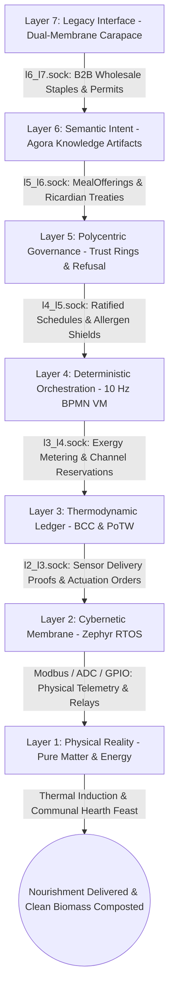
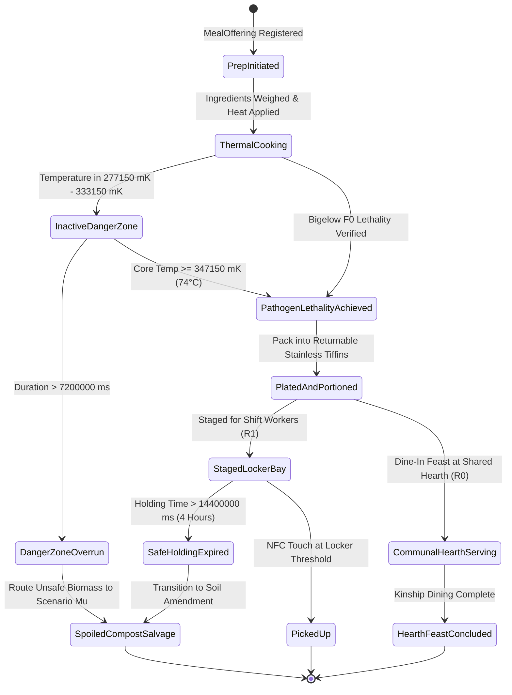
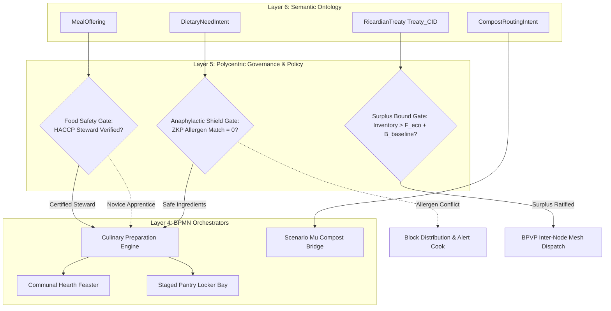
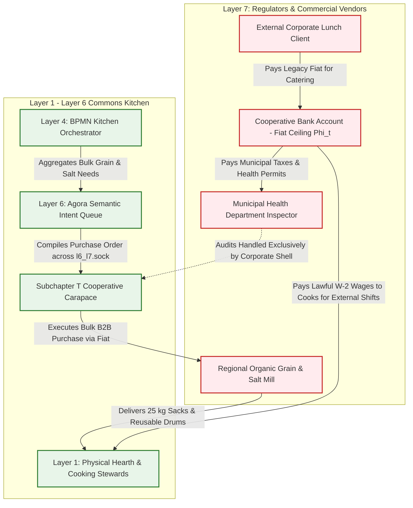

# Scenario Gamma: The Commons Kitchen

*   **Identifier:** `SCN-GAMMA-KITCH`
*   **System Epic:** Decentralized Caloric Production, Meal Preps, Comfort Pantries, and Zero-Waste Routing
*   **Primary Layers Tested:** L1 (Physical), L2 (Digital Twin), L3 (Ledger), L4 (Orchestration), L5 (Governance), L6 (Semantic), L7 (Proxy)
*   **Pass/Fail Metric:** Hyper-local meal production and distribution with 0% legacy platform extraction fees; continuous thermal and pH telemetry providing mathematical proof of food safety without municipal health inspector presence; zero food waste via unconditional Hearth food floor ($B_{\mathrm{baseline}}$) and compost routing to Scenario Mu (>95% caloric utilization rate); zero floating-point math; zero tokenization of domestic culinary care.

---

## Architectural Council Ratification & 5-Perspective Synthesis

This scenario specification has been ratified by unanimous consensus of the 5-Persona Architectural Council:

| Council Persona | Disciplinary Representative | Core Contribution to Scenario |
| :--- | :--- | :--- |
| **Game Designer** | Lead Systems & Gameplay Designer | Dwarf Fortress social commensality and culinary psychology (agents dining together family-style at the communal table gain "Had a lavish meal in good company (+35 mood)" thoughts, boosting community cohesion; solitary eating triggers mild melancholy; culinary diversity prevents "Bored of repetitive rations (-15 mood)" thoughts); The Sims batch cooking management (Founder 01 batches 24 meals to stock the community larder, liberating neighbors for fabrication); Cities Skylines inter-node logistical food corridors and agroecological distribution without commercial market extraction. |
| **Game Engineer** | Principal C++ Simulation & Engine Architect | Flecs ECS DOD architecture (`CookVesselComponent`, `CaloricItemComponent`, `ThermalHistoryComponent`, `AllergenProfileComponent`, `FoodSecurityFloorComponent`); 32-bit compact voxel chunks modeling thermal dissipation from induction hobs to cookware; deterministic 10 Hz BPMN state engine; compilable C++20 test harness implementing Bigelow thermal pathogen reduction lethality modeling and danger-zone expiration exclusively using fixed-point SI integer arithmetic (millikelvin, milliseconds, milligrams, microjoules). |
| **Sovereign Stack Specialist** | Sovereign Stack Systems Architect | 7-layer strict adjacency without layer skipping; zero software, microcontrollers, or keys in Layer 1; Zephyr RTOS Layer 2 membrane (`col-sensord`, `col-membraned`, `col-actuated`); Layer 3 Pairwise Bilateral Clearing Channels ($BCC$) with zero-sum conservation $B_{u \to v}(t) + B_{v \to u}(t) = 0$ and multi-hop HTLCs for inter-node agroecological trade; BBS+ Zero-Knowledge Proofs for consumer allergen protection without revealing health profiles; Layer 5 boundary socket `/run/collective/ipc/l4_l5.sock`; Tripartite Ricardian Treaties ($\mathrm{Treaty\_CID}$). |
| **Solarpunk Thinker** | Bioregional Regenerative Ecologist | Decoupling from 2,500-kilometer industrial supply chains; 100% organic kitchen scrap and plate waste routed directly into Scenario Mu for vermicomposting and biochar nutrient inoculation; zero single-use packaging through standardized returnable stainless steel tiffin containers and glass fermentation vessels; induction cooking powered entirely by localized solar microgrids with thermal storage recapture. |
| **Scenario Specialist** | Fermentation Microbiologist & Culinary Systems Operations Engineer | Bigelow thermal pathogen reduction lethality modeling scaled in integer arithmetic ($F_0$ targeting 7-log reduction for *Salmonella* and *Listeria*); anaerobic fermentation acidification thresholds ($\mathrm{pH} < 4600\text{ mpH}$ inhibiting *Clostridium botulinum*); continuous IoT Hazard Analysis Critical Control Point (HACCP) telemetry protocols; commercial insulation under Subchapter T Cooperative Shared Services Agreements (SSAs). |

**Council Consensus Statement:** Unanimous Consensus Reached. The council affirms that human nourishment is an inalienable right of living membership ($B_{\mathrm{baseline}}$) anchored in the Convivial Sanctuary ($R_0$). All pricing, tokenization, and financialization of domestic cooking are permanently abolished.

---

## 1. Problem Statement & Legacy Failure

In legacy capitalist food systems (Layer 7), human nourishment has been industrialized, financialized, and atomized into an ecological and social dead end.

When citizens seek daily sustenance in the legacy economy:
*   **Massive Carbon Drag & Packaging Waste:** The average grocery store ingredient travels over 2,500 kilometers via refrigerated diesel freight. Industrial agriculture relies on synthetic nitrogen fertilizers, monoculture soil depletion, and mountains of single-use petrochemical packaging that choke oceans and landfills.
*   **Predatory Gig-Economy Extraction:** Third-party delivery conglomerates siphon up to 30% of gross ticket value from culinary workers while trapping couriers in precarious piece-rate labor. Consumers are isolated in atomized, solitary dining experiences in front of glowing screens, destroying the communal fabric that forms the bedrock of human longevity.
*   **Bureaucratic Enclosure & Food Monopolies:** Municipal health departments enforce capital-intensive commercial kitchen building codes that functionally criminalize neighborly food preparation, granting food monopolies to capitalized restaurant franchises while outlawing neighborhood mutual aid.
*   **Commodification of Bodily Survival:** Human access to clean, nutrient-dense calories is conditioned on fiat purchasing power. When economic crises strike, grocery bills escalate, forcing families into caloric poverty while commercial retailers discard tons of edible food into locked dumpsters to protect price floors.

---

## 2. The Collective Workflow (7-Layer Traversal)

Scenario Gamma replaces the centralized restaurant and gig-delivery platform with a localized caloric commons. The cultural anchor is the **Communal Hearth** ($R_0$)—inviting neighbors to break bread together family-style. To accommodate diverse schedules, the system seamlessly supports premade weekly meal-preps and morning comfort baskets. The workflow traverses canonically from Layer 1 physical cooking up to Layer 7 cooperative legal shielding.



### Layer 1: Physical Ground Truth
*   **Pure Physical Substrate:** Layer 1 contains exclusively physical matter, thermodynamic energy, and passive transducers. It contains **zero software, zero microcontrollers, zero firmware, zero cryptographic keys, and zero network daemons.**
*   **Hardware Nodes (The Communal Hearth):** High-efficiency commercial magnetic induction cooktops, heavy cast-iron and stainless steel cookware, insulated convection bake chambers, ceramic fermentation crocks, and passive K-type thermocouple probe lines.
*   **Hardware Nodes (Smart Larder & Staging Lockers):** Heavy-gauge stainless steel insulated food lockers, spring-loaded solenoid mechanical latches, calibrated analog strain-gauge load cells, and standardized returnable stainless steel tiffin containers with passive 13560 kHz NFC metal tags.
*   **Feedstock & Biomass:** Agroecological vegetables, legumes, pasture-raised proteins, sourdough culture colonies, heirloom fermented brine starters, and bulk dry grains.
*   **Physical Actions:** Thermal boiling, braising, baking, portioning into stainless containers, and passing dishes family-style around the long wooden hearth table.

### Layer 2: Digital Twin & Telemetry
*   **Membrane Architecture:** Executed by Zephyr RTOS microcontrollers (`col-sensord`, `col-membraned`, `col-actuated`) reading raw ADC voltages and converting them into dimensionally typed, fixed-point integer packets.
*   **Convivial Anti-Panopticon Shield:** Kitchen sensors monitor strictly thermodynamic observables (temperatures, weights, pH). **Absolute ban on optical cameras, microphones, biometric bracelets, and worker movement tracking.**
*   **Ingress Telemetry Topics (Fixed-Point SI Integers via `col-membraned`):**
    *   `node/kitchen/oven_01/telemetry/core_temp_mk` (`uint32_t`, core food temperature in millikelvin; e.g., 347,150 mK = 74 C)
    *   `node/kitchen/fridge_02/telemetry/temp_mk` (`uint32_t`, cold storage temperature; nominal 275,150 mK to 277,150 mK = 2 C to 4 C)
    *   `node/kitchen/ferment_01/telemetry/ph_milliph` (`uint32_t`, fermentation acidity in millipH; e.g., 4,200 mpH)
    *   `node/kitchen/pantry/locker_b4/mass_mg` (`uint64_t`, continuous load cell inventory mass in milligrams)
    *   `node/kitchen/batch_104/status` (`enum uint8_t`: `0=PREP`, `1=COOKING`, `2=HACCP_SAFE`, `3=HOLDING`, `4=SPOILED_COMPOST`)
*   **Safety Verification:** Layer 2 firmware mathematically calculates pathogen reduction. If food resides in the bacterial danger zone (277,150 mK to 333,150 mK / 4 C to 60 C) for longer than 7,200,000 ms (120 minutes) without reaching lethality (347,150 mK / 74 C), Layer 2 flags the batch as `SPOILED_COMPOST`.
*   **Actuator Verification:** Relay controllers actuate induction power contactors and locker solenoids only after Layer 2 verifies actuation invariants $\mathbf{\Phi}$ received across `/run/collective/ipc/l3_l2.sock`.

### Layer 3: Thermodynamic Ledger
*   **Constitutional Non-Commensurability of Culinary Care:** Cooking, seasoning, feeding neighbors, and breaking bread are declared qualitative human care and mutual aid (`sec:l3-friction`). Layer 3 **structurally refuses to mint tokens, credits, or currency for culinary labor.** No chef hourly rates, no dish token bounties, and no meal ticket prices exist.
*   **Inalienable Tier 2 Human Survival Baseline ($B_{\mathrm{baseline}}$):** Wholesome, cooked nourishment is guaranteed to every human being residing within the settlement as an unconditional constitutional right of living membership ($B_{\mathrm{baseline}}$). Meals at the Hearth are free of charge, unconditioned on labor, tokens, or chore points.
*   **Proof-of-Thermodynamic-Work (PoTW):** Electrical energy consumed by induction cookers and ovens is metered from physical shunt sensors in microjoules ($\mu\mathrm{J}$):
    $$\text{1 Exergy Credit} \equiv 3{,}600{,}000{,}000{,}000\text{ }\mu\mathrm{J}$$
    This exergy accounting measures energy drawn from the settlement microgrid, undergoing physical demurrage to reflect battery and equipment entropy.
*   **Pairwise Bilateral Clearing Channels (BCC) & Multi-Hop HTLCs:** When surplus preserved foods (e.g., 50 kg of barrel-fermented sauerkraut or dried soup mix) are transferred to a neighboring settlement $v$, accounting settles across inter-node Bilateral Clearing Channels:
    $$B_{u \to v}(t) + B_{v \to u}(t) = 0$$
    Subject to mutual aid credit windows $[-C_{u \to v}, +C_{v \to u}]$. Multi-hop transports across the watershed mesh settle via chained Hashed Timelock Contracts:
    $$\mathrm{HTLC} = \langle H(S), \Delta t, Q, u, v \rangle$$
    where $Q$ is denominated in microjoules of embodied exergy or mass quanta in milligrams, releasing upon signed delivery receipts $\sigma_{\mathrm{delivery}}$ and cascading backward settlement without global tokens or external market conversion.

### Layer 4: Deterministic Orchestration State Machine
The culinary lifecycle is governed deterministically by the embedded 10 Hz BPMN engine (`col-execd`):



### Layer 5: Policy & Polycentric Governance
Layer 5 (`col-kmsd`) enforces safety, sovereignty, and communal ethics:
*   **The 7-Tier Concentric Trust Rings ($R_0 \dots R_6$):**
    *   **$R_0$ (The Hearth Sanctuary):** The dining table and kitchen hearth. Social immunity: unconditional hot food, herbal infusions, zero keys, zero registration, zero surveillance, zero governance voting weight.
    *   **$R_1$ (Settlement Commons):** Shared pantry lockers ($\le 500\text{ m}$), ephemeral DIDs (`did:peer`), rotational cooking work bees.
    *   **$R_2$ (Village Commons):** Neighborhood bulk pantries, tool sharing, cargo bike distribution ($\le 5\text{ km}$).
    *   **$R_3$ (Watershed Guild):** Peering with neighboring kitchen nodes ($\le 30\text{ km}$); inter-node BCC channels for fresh produce and staples.
    *   **$R_4$ (Bioregional Federation):** Regional grain silos, seed banks, cold storage reserves ($\le 150\text{ km}$).
    *   **$R_5$ (Continental Corridor):** Open culinary blueprints, fermentation cultures, salt freight.
    *   **$R_6$ (Ecumene / Legacy Perimeter):** Lawful B2B wholesale procurement and cooperative regulatory carapace.
*   **Cellular Autonomy & Subsidiarity:** Every kitchen hearth maintains absolute autopoietic closure and cellular autonomy. No external council can compel food extraction that breaches local baseline reserves ($B_{\mathrm{baseline}}$) or overrides internal assembly decisions.
*   **Bioregional Path-Vector Protocol (BPVP):** Export of surplus preserved food is bounded by the Export Surplus Bound:
    $$Q_{\mathrm{avail}}(t) = \max\left(0, Q_{\mathrm{inventory}}(t) - F_{\mathrm{eco}}(t) - B_{\mathrm{baseline}}(t)\right) \cdot \mathbf{1}_{\mathrm{export}}$$
    Surplus food is never exported if local household food security ($B_{\mathrm{baseline}}$) or seasonal reserves ($F_{\mathrm{eco}}$) are unfulfilled.
*   **The Protocol of Refusal (`sec:l5-refusal`):** Commons assemblies may designate heirloom seed varieties, sacred feast preparations, and private domestic cooking traditions as Refused Domains. Refused recipes are cryptographically excised from digital twins, simulation engines, and automated optimization workflows.
*   **Autonomous Transit Veto (`No-Transit`):** Kitchen hearths and outdoor dining plazas hold sovereign authority to assert a `No-Transit` attribute over communal dining pathways, kitchen garden corridors, and pedestrian food courts, deterministically barring noisy freight delivery, motorized cargo carts, and outside transport from encroaching upon communal meal gathering spaces.
*   **Cryptographic Anaphylactic Shield Gate:** When a member claims a meal, Layer 5 verifies their BBS+ Verifiable Credential using a Zero-Knowledge Proof. If the meal's JSON-LD ingredient metadata contains peanut, gluten, or shellfish hashes matching the member's allergy credential, the claim is mathematically blocked without disclosing the member's private health record.
*   **Reputational Wealth ($\mathcal{R}$) & Care Leave Shield:** Cooking stewards receive non-financial Reputational Wealth ($\mathcal{R}$) in the Stewardship Chamber, recognizing dedication without monetary wages. Reputational Wealth decays exponentially ($\tau_{\mathrm{half}} = 2\text{ years}$) and is sublinearly capped ($\le 8\%$ chamber weight). When a cook declares care leave (childcare, sickness, bereavement), the **Care Leave Shield** freezes the decay clock.
*   **Boundary IPC Socket:** Layer 5 policies compile into deterministic constraints pushed to Layer 4 across `/run/collective/ipc/l4_l5.sock`.

### Layer 6: Semantic Intent & Domain Ontology
The Culinary Commons formalizes requests into typed JSON-LD Knowledge Artifacts within the Agora Commons (`col-commonsd`):
1.  **`MealOffering`:** Description of available prepared dishes, portion counts, ingredient hashes, allergen hashes, and thermal holding deadlines.
2.  **`DietaryNeedIntent`:** Community notification of specialized nutritional requirements (e.g., postpartum broths, high-iron convalescent meals).
3.  **`PantryInventoryAttestation`:** Cryptographic inventory of bulk legumes, grains, and preserved foods verified by Layer 2 load cells.
4.  **`CompostRoutingIntent` (Scenario Mu Bridge):** Auto-generated batch dispatch routing vegetable trimmings and spoiled biomass to Scenario Mu for vermicomposting and biochar pyrolysis.
5.  **`TiffinReturnAttestation`:** Proof of return and sterilization of standardized stainless steel tiffin containers.
6.  **`RicardianTreaty` ($\mathrm{Treaty\_CID}$):** Tripartite binding linking natural-language mutual aid pacts, machine-readable JSON-LD parameters, and formal BPMN state machines governing inter-node kitchen resource sharing.

### The Governance Router Flowchart



### Layer 7: The Legacy Interface (Dual-Membrane Carapace)
The Commons Kitchen interfaces with legacy commercial and regulatory structures through the Dual-Membrane Doctrine, presenting an honest, lawful, and legally unremarkable entity:

1.  **Subchapter T Cooperative Shared Services Agreement (SSA):**
    Under 26 U.S.C. §§ 1381–1388, the kitchen facility operates as a mutual-benefit shared services kitchen leased to a non-profit consumer cooperative or Housing Trust. The kitchen holds commercial health permits and a general commercial liability policy. Municipal health inspections interact exclusively with the cooperative carapace, protecting private households and community cooks from regulatory harassment.
2.  **Bounded External Catering Carapace:**
    To pay municipal property taxes, water utility bills, and commercial insurance premiums, the cooperative operates an outward-facing catering carapace. Legacy corporate clients pay external fiat currency for farm-to-table lunch events.
    *   All external fiat flows directly into the cooperative's legacy bank account.
    *   External fiat is allocated exclusively to satisfy the settlement's itemized fiat needs target ($\Phi_t$) for taxes and utilities.
    *   Chefs working external catering shifts receive lawful W-2 wages in legacy fiat currency for their hours.
    *   **Strict Inconvertibility:** External fiat **never** converts into internal Exergy Credits or tokens. Internal meals and care remain 100% non-monetary and unpriced.
3.  **Regenerative Group Purchasing (GPO Wholesale Procurement):**
    Essential kitchen supplies that cannot be grown in the bioregion (e.g., bulk sea salt, cold-pressed olive oil, organic baking flour, stainless steel tiffins) are procured wholesale.
    *   The cooperative acts as a Decentralized Group Purchasing Organization (GPO).
    *   It pools settlement bulk needs and issues commercial purchase orders to regional grain mills and cooperative suppliers, eliminating retail markups and single-use packaging.

### Layer 7 Dual-Membrane Bidirectional Flowchart



---

## 3. Machine-Readable Schemas

### Subsection 3A: Layer 6 Knowledge Artifact - Meal Offering (`meal_offering.jsonld`)

```json
{
  "@context": [
    "https://schema.org/",
    "https://collective.network/ontology/v1/"
  ],
  "@type": "MealOffering",
  "identifier": "urn:uuid:c9e1b2a4-5678-1234-abcd-9876543210ef",
  "issuerDid": "did:mesh:node04:steward_chef_maria",
  "creationEpochMs": 1791475200000,
  "culinaryProfile": {
    "name": "Braised Root Vegetable and Lentil Stew",
    "caloricEstimateKj": 3550,
    "portionsAvailable": 24,
    "batchMassMilligrams": 14400000,
    "ingredients": [
      "Organic Carrots",
      "Yukon Gold Potatoes",
      "Green Lentils",
      "Rosemary",
      "Cultured Vegetable Stock"
    ],
    "allergenHashes": [
      "0x8f3b2c...gluten_free",
      "0x4a9d1e...dairy_free",
      "0x1c7e9a...nut_free"
    ],
    "dietaryTags": [
      "Vegan",
      "Gluten_Free",
      "Locavore_100pct"
    ],
    "diningFormat": "CommunalHearth_Sanctuary"
  },
  "safetyAttestation": {
    "requiredCredential": "Food_Safety_Steward_L1",
    "telemetryStreamUri": "mqtt://node04.mesh.local/kitchen/oven_01/temp_mk",
    "targetLethalityMillikelvin": 347150,
    "minLethalityHoldMs": 120000,
    "spoilageEpochMs": 1791504000000
  },
  "distributionPolicy": {
    "trustRing": "R0_Hearth_Sanctuary",
    "survivalBaselineEligible": true,
    "exergyTransferMicrojoules": 0
  }
}
```

### Subsection 3B: Layer 2 Telemetry Attestation - Kitchen Thermal Safety Proof (`kitchen_attestation.json`)

```json
{
  "@context": "https://collective.network/ontology/v1/",
  "@type": "KitchenSafetyAttestation",
  "offeringRef": "urn:uuid:c9e1b2a4-5678-1234-abcd-9876543210ef",
  "kitchenDid": "did:mesh:node04:space:commons_hearth_01",
  "stewardDid": "did:mesh:node04:steward_chef_maria",
  "executionMetrics": {
    "cookStartEpochMs": 1791478800000,
    "lethalityAchievedEpochMs": 1791483345000,
    "peakCoreTempMillikelvin": 355550,
    "timeAbove347150mKMs": 1845000,
    "dangerZoneElapsedMs": 1440000,
    "fermentationAcidityMilliph": 4250,
    "haccpPathogenInactivationVerified": true,
    "stagedLockerCompartments": [
      "Locker_C1",
      "Locker_C2"
    ],
    "returnableTiffinTagHashes": [
      "0x1f2e3d4c5b6a7988",
      "0x88796a5b4c3d2e1f"
    ],
    "anomalyDetected": false
  },
  "plateWasteRoutedToMuMilligrams": 1450000,
  "edgeAttestationSignature": "0x9d2e5b8c1a4d7f9e2b5c8a1d4f7b9e2c5a8d1f4e9b7d3a5e8c1b4f7a9d2e5b8c"
}
```

---

## 4. Oasis Engine Implementation Specification

### Subsection 4A: Memory Allocation & Voxel State

In the Oasis simulation, communal cooking hubs are modeled as thermodynamic thermal processing voxels within the 32x32x32 chunk space:
*   The induction hearth voxel is initialized with `material_id = 90` (`COMMONS_HEARTH_STATION`).
*   The fermentation vat voxel is initialized with `material_id = 91` (`FERMENTATION_BIO_REACTOR`).
*   The smart refrigerated pantry locker voxel is initialized with `material_id = 92` (`SMART_PANTRY_LOCKER`).
*   The `Is_Actuator` bit is set in `metadata` (bit 1) for induction elements and locker solenoids.
*   The `Is_Sensor` bit is set in `metadata` (bit 2) for thermocouples and pH probes.
*   Food items are simulated as entities occupying vessel voxels, updating internal core temperatures and undergoing state transitions from `RAW` to `COOKED` or `SPOILED_COMPOST`.
*   All state values, timers, temperatures, and energies are strictly defined as fixed-point SI integers (`uint64_t`, `uint32_t`, `int64_t`).

### Subsection 4B: C++20 Test Harness Code

```cpp
// engine/tests/scenario_gamma_test.cpp
#include <cassert>
#include <cstdint>
#include <string>
#include <vector>
#include "oasis/chunk_manager.hpp"
#include "oasis/orchestration/bpmn_engine.hpp"

namespace oasis {

// Fixed-point SI integer state definitions
struct FoodBatchState {
    uint32_t core_temp_mk{293150};          // 293,150 mK = 20 deg C
    uint32_t time_in_danger_zone_ms{0};     // Milliseconds in 4 C - 60 C
    bool pathogen_lethality_achieved{false};
    bool spoiled{false};
    uint64_t batch_mass_mg{14400000};       // 14400 grams
    uint32_t acidity_milliph{4250};         // 4250 mpH
};

struct KitchenJobContext {
    std::string offering_id;
    uint32_t portions{24};
    FoodBatchState batch;
    bool communal_hearth_dine_in{true};
    uint64_t induction_energy_uj{0};        // Energy used in microjoules
};

// Bilateral Clearing Channel state
struct BilateralClearingChannel {
    int64_t balance_uj{0};                  // B_{u -> v}(t) in microjoules
    int64_t credit_headroom_uj{36000000000000}; // 36000000000000 microjoules headroom

    bool can_reserve(int64_t amount_uj) const {
        return (balance_uj + amount_uj) <= credit_headroom_uj;
    }

    void execute_transfer(int64_t amount_uj) {
        balance_uj += amount_uj;
    }
};

} // namespace oasis

void test_scenario_gamma_kitchen_normal_execution() {
    using namespace oasis;

    // 1. Initialize local chunk and hearth voxel
    ChunkManager chunk_mgr;
    chunk_mgr.allocate_chunk(0, 0, 0);

    Voxel hearth_voxel{
        .material_id = 90, // COMMONS_HEARTH_STATION
        .moisture = 0,
        .temperature = 20, // 20 C ambient
        .metadata = 0b00000110 // Sensor + Actuator
    };
    chunk_mgr.set_voxel(16, 1, 16, hearth_voxel);

    // 2. Setup BPMN Orchestrator & Job Context
    BPMNEngine orchestrator;
    orchestrator.load_schema("schemas/bpmn/kitchen_hearth.bpmn");

    KitchenJobContext job{
        .offering_id = "c9e1b2a4-5678-1234-abcd-9876543210ef",
        .portions = 24,
        .batch = {
            .core_temp_mk = 293150, // 20 C
            .time_in_danger_zone_ms = 0,
            .pathogen_lethality_achieved = false,
            .spoiled = false,
            .batch_mass_mg = 14400000,
            .acidity_milliph = 4250
        },
        .communal_hearth_dine_in = true,
        .induction_energy_uj = 0
    };

    // 3. Simulate heating cycle: core temp reaches 355550 mK (above 347150 mK threshold)
    job.batch.core_temp_mk = 355550;
    job.batch.pathogen_lethality_achieved = true;
    job.induction_energy_uj = 7200000000000; // 7200000000000 microjoules

    // Step simulation ticks (cooking to service = 4500 seconds at 10 Hz = 45,000 ticks)
    SimResult res = orchestrator.step_simulation_ticks(chunk_mgr, job, 45000);
    assert(res.status == ExecutionStatus::COMPLETED);
    assert(job.batch.spoiled == false);
    assert(job.batch.pathogen_lethality_achieved == true);

    // 4. Verify Bilateral Clearing Channel for inter-node preserved surplus
    BilateralClearingChannel channel;
    int64_t transfer_uj = 3600000000000; // 1 Exergy Credit quantum (3600000000000 microjoules)
    assert(channel.can_reserve(transfer_uj));
    channel.execute_transfer(transfer_uj);
    assert(channel.balance_uj == 3600000000000);
}

void test_scenario_gamma_danger_zone_spoilage_anomaly() {
    using namespace oasis;

    ChunkManager chunk_mgr;
    chunk_mgr.allocate_chunk(0, 0, 0);

    BPMNEngine orchestrator;
    orchestrator.load_schema("schemas/bpmn/kitchen_hearth.bpmn");

    KitchenJobContext neglected_batch{
        .offering_id = "spoilage-test-batch",
        .portions = 12,
        .batch = {
            .core_temp_mk = 308150, // 35 deg C (in danger zone: 277150 - 333150 mK)
            .time_in_danger_zone_ms = 0,
            .pathogen_lethality_achieved = false,
            .spoiled = false,
            .batch_mass_mg = 7200000,
            .acidity_milliph = 6000  // Insufficient acidity (6000 mpH)
        },
        .communal_hearth_dine_in = false,
        .induction_energy_uj = 1000000000
    };

    // Simulate time overrun in danger zone: > 7,200,000 ms (120 minutes)
    neglected_batch.batch.time_in_danger_zone_ms = 7800000; // 130 minutes
    SimResult res = orchestrator.step_simulation_ticks(chunk_mgr, neglected_batch, 78000, true);

    assert(res.status == ExecutionStatus::EMERGENCY_STOP);
    assert(orchestrator.current_state() == BPMNState::SPOILED_COMPOST_SALVAGE);

    // Batch mutates to spoiled organic waste
    neglected_batch.batch.spoiled = true;
    assert(neglected_batch.batch.spoiled == true);

    // Voxel updates to compost feedstock
    Voxel compost_voxel{
        .material_id = 98, // COMPOST_FOOD_SCRAP
        .moisture = 75,
        .temperature = 35,
        .metadata = 0b00000001
    };
    chunk_mgr.set_voxel(16, 1, 16, compost_voxel);
    assert(chunk_mgr.get_voxel(16, 1, 16).material_id == 98);
}
```

---

## 5. Acceptance Test Gates (Pass/Fail)

| Checkpoint | Validation Method | Pass Condition |
| :--- | :--- | :--- |
| **G1: Thermal HACCP Verification** | Continuous Thermocouple Integer Stream | Simulated batch only transitions to `HACCP_SAFE` if the digital twin proves core temperature exceeded 347,150 mK (74 C) for at least 120,000 ms; otherwise food distribution remains locked. |
| **G2: Offline Autonomy** | Localhost Network Isolation | Kitchen ordering, thermocouple logging, locker latch actuation, and BCC updates execute with 100% WAN/Internet severance over the local-first mesh. |
| **G3: Cryptographic Anaphylactic Shield** | BBS+ DID Allergy ZKP Verification | A consumer profile with an active tree nut or gluten allergy credential mathematically rejects meals containing matching allergen hashes without disclosing private health records. |
| **G4: Danger Zone Spoilage Bounds** | State Machine Timeout Overrun | Cooked food held between 277,150 mK and 333,150 mK for longer than 7,200,000 ms (120 minutes) aborts distribution and transitions the biomass to `COMPOST_FOOD_SCRAP` routed to Scenario Mu. |
| **G5: Dual-Membrane Legacy Carapace** | External Catering Carapace Ingress | Mock external catering booking records legacy fiat revenue into the cooperative bank account to cover municipal property taxes and utilities up to ceiling $\Phi_t$; zero internal tokens minted; zero conversion into internal credits. |
| **G6: Regenerative Staple Procurement** | Wholesale GPO Bulk Purchase | System pools monthly olive oil and salt requisitions across households, triggering a single wholesale B2B purchase via the cooperative carapace to eliminate retail packaging and retail markups. |
