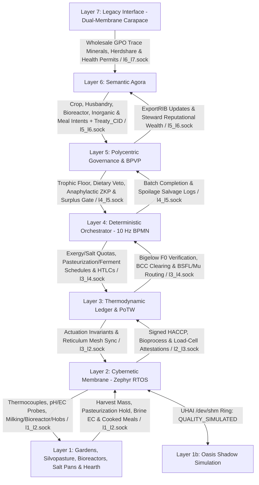
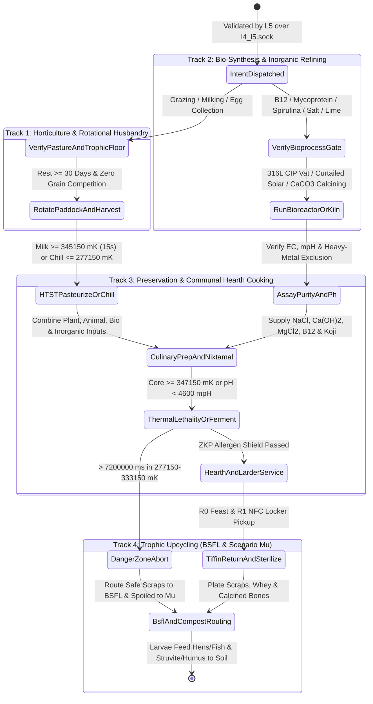
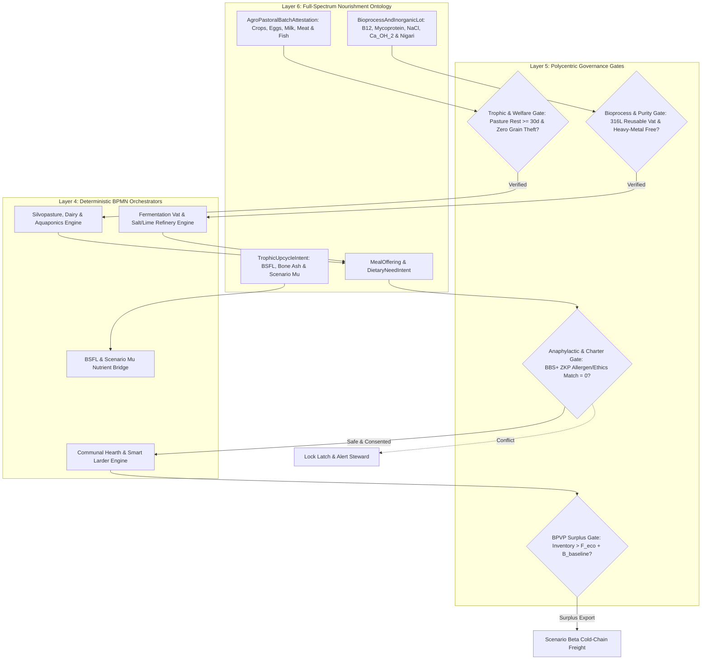

# Scenario Gamma: Bioregional Food Production, Regenerative Husbandry, Bio-Synthesis, Inorganic Culinary Chemistry & The Commons Kitchen

*   **Identifier:** `SCN-GAMMA-KITCH`
*   **System Epic:** End-to-End Bioregional Nourishment: Agroecological Horticulture, Rotational Animal Husbandry (Eggs, Milk/Dairy, Meat & Aquaculture), Ecologically Sound Microbial/Algal Bio-Synthesis, Inorganic Food-Grade Mineral Chemistry, Preservation & The Communal Hearth
*   **Primary Layers Tested:** L1 (Physical Reality), L1b (Oasis Shadow Simulation), L2 (Cybernetic Membrane), L3 (Thermodynamic Ledger), L4 (Deterministic Orchestrator), L5 (Polycentric Governance & BPVP), L6 (Semantic Translation & Agora), L7 (Legacy Interface)
*   **Pass/Fail Metric:** Complete settlement caloric, protein, micronutrient, and electrolyte sovereignty with $0\text{ basis points}$ ($0\%$) legacy platform extraction; strict enforcement of the Trophic Non-Competition Invariant ($0\,\mathrm{mg}$ of human-edible grain diverted to livestock when local human reserves sit below $B_{\mathrm{baseline}}$) and Bioprocess Ecological Gate ($\mathrm{EROI}_{\mathrm{bio}} > 10000\,\mathrm{bp}$ or powered by curtailed solar surplus); mathematical proof of HACCP thermal lethality ($T_{\mathrm{core}} \ge 347150\,\mathrm{mK}$), pasteurization, fermentation acidification ($\mathrm{pH} < 4600\,\mathrm{mpH}$), and inorganic purity; $> 9500\,\mathrm{bp}$ ($95\%$) nutrient loop closure via Black Soldier Fly Larvae (BSFL) and Scenario Mu composting; zero floating-point math; zero tokenization of domestic culinary care.

---

## Architectural Council Ratification & 5-Perspective Synthesis

This scenario specification has been ratified by unanimous consensus of the 5-Persona Architectural Council to encompass the full food production, husbandry, bio-synthesis, inorganic chemistry, and culinary metabolism of The Collective:

| Council Persona | Disciplinary Representative | Core Contribution to Scenario |
| :--- | :--- | :--- |
| **Game Designer** | Lead Systems & Gameplay Designer | Full-chain nourishment gameplay in Oasis: tending **Horticultural Gardens & Greenhouses**, moving **Rotational Pasture Poultry & Dairy Goats/Cattle**, tending **Aquaponics & Photobioreactor Vats**, refining **Inorganic Salts & Nixtamal Lime**, and batch-cooking at the **Communal Hearth ($R_0$)**; Dwarf Fortress social commensality (`"Had a lavish meal in good company (+35 mood)"` vs. repetitive ration fatigue); visible nutrient-loop closure where kitchen scraps feed Black Soldier Fly Larvae (BSFL) that feed laying hens and trout. |
| **Game Engineer** | Principal C++ Simulation & Engine Architect | Flecs ECS Data-Oriented Design (DOD): `CropBedComponent`, `PastureHerdComponent`, `BioreactorVatComponent`, `InorganicSaltLotComponent`, `CookVesselComponent`, and `AllergenProfileComponent`; 32-bit voxel thermal/moisture cellular automata; deterministic $10\,\mathrm{Hz}$ BPMN state engine (`col-execd`); self-contained C++20 fixed-point test harness verifying Bigelow thermal lethality, silvopasture carrying capacity, curtailed-solar precision fermentation, nixtamalization/brine stoichiometry, and BCC clearing with zero IEEE 754 floats. |
| **Sovereign Stack Specialist** | Sovereign Stack Systems Architect | Strict 7-layer adjacency across POSIX Unix Domain Sockets (`l1_l2.sock` through `l6_l7.sock`); Constitutional Non-Commensurability of domestic culinary care (`sec:l3-friction`) alongside inter-node Pairwise Bilateral Clearing Channels ($B_{u \to v}(t) + B_{v \to u}(t) = 0$) and multi-hop HTLCs for bioregional dairy, grain, salt, and preserved-food exchange; BBS+ Zero-Knowledge Proofs for cryptographic anaphylactic shielding; Node-level sovereign dietary and husbandry vetos under the Protocol of Refusal. |
| **Solarpunk Thinker** | Bioregional Regenerative Ecologist | Rejecting both industrial CAFOs and high-entropy disposable-plastic lab-meat cleanrooms; establishing **Holistic Rotational Silvopasture** (animals converting non-human-edible pasture cellulose and food waste into eggs, milk, and meat while building topsoil carbon), **Solar-Coupled Microbial & Microalgal Bio-Synthesis** (synthesizing Vitamin B12, rennet, mycoprotein, and hydrogen-oxidizing single-cell protein from curtailed solar power and captured $\mathrm{CO_2}$), and $100\%$ circular phosphorus/nitrogen recovery. |
| **Scenario Specialist** | Agroecologist, Fermentation Bioprocess Engineer & Food Chemist | Bigelow thermal lethality ($F_0$) and HTST milk pasteurization ($345150\,\mathrm{mK}$ for $15000\,\mathrm{ms}$) in integer millikelvin; anaerobic lacto-fermentation acidification ($\mathrm{pH} < 4600\,\mathrm{mpH}$); **Inorganic Culinary Chemistry** ($\mathrm{NaCl}$ solar evaporation, $\mathrm{CaCO_3} \to \mathrm{CaO} \to \mathrm{Ca(OH)_2}$ nixtamalization lime calcining/slaking, $\mathrm{MgCl_2}$ *nigari* and $\mathrm{CaSO_4}$ coagulants, $\mathrm{K_2CO_3}$ wood-ash potash, and $\mathrm{NaHCO_3}$ buffering); Subchapter T Cooperative Shared Services and Farm-to-Consumer Herdshare legal shielding. |

**Ratification Statement:** Unanimous Consensus Reached across all five disciplinary perspectives. The council affirms that human nourishment is an inalienable right of living membership ($B_{\mathrm{baseline}}$) anchored in the Convivial Sanctuary ($R_0$), while providing a complete bioregional production engine for plant, fungal, animal, bio-synthesized, and inorganic food streams.

---

## 1. Problem Statement, Legacy Failure & Macro-Domain Vision

In legacy industrial food systems (Layer 7), the production of plants, animal proteins, microbial ingredients, mineral salts, and prepared meals is split across ecologically destructive monopolies:
1.  **Monoculture Depletion & Industrial CAFO Cruelty:** Legacy agriculture strips topsoil with synthetic Haber-Bosch ammonia and glyphosate while confining billions of animals in Concentrated Animal Feeding Operations (CAFOs). Over $4000\,\mathrm{bp}$ ($40\%$) of global arable grain is fed to confined livestock at a $7000\,\mathrm{bp}$ to $9000\,\mathrm{bp}$ ($70\%$ to $90\%$) caloric conversion loss, turning human-edible crops into toxic manure lagoons and antibiotic-resistant pathogens.
2.  **Greenwashed High-Entropy "Lab Food" vs. Real Bioprocessing:** In response to CAFO failures, venture-capitalized corporations promote pharmaceutical-grade mammalian tissue culture ("lab-grown meat") that relies on ultra-refined corn-syrup media, synthetic growth factors, single-use petrochemical bioreactor bags, and massive cleanroom electricity—resulting in an embodied exergy and plastic footprint orders of magnitude worse than regenerative pasture.
3.  **Severed Mineral & Preservation Chemistry:** Households are reduced to passive consumers of ultra-processed packaged goods because knowledge and local production of foundational inorganic food chemistry—evaporated culinary salt ($\mathrm{NaCl}$), nixtamalization slaked lime ($\mathrm{Ca(OH)_2}$), tofu/cheese mineral coagulants ($\mathrm{MgCl_2}$, $\mathrm{CaSO_4}$), and fermentation brines—have been enclosed behind industrial chemical supply chains.
4.  **Predatory Delivery Extraction & Bureaucratic Enclosure:** At the point of consumption, gig-delivery platforms siphon $3000\,\mathrm{bp}$ ($30\%$) of meal value while municipal health codes criminalize neighborly food sharing and condition human caloric survival on fiat wealth.

### The Collective Macro-Domain Vision
Scenario Gamma is **how The Collective Produces, Grows, Husbands, Bio-Synthesizes, Refines, Preserves, and Cooks Nourishment for its People**. Rather than treating the Commons Kitchen as an isolated stove that magically receives groceries, Scenario Gamma unifies the entire metabolic food web across **six integrated pillars**:
1.  **Agroecological Plant & Mycelial Production:** Intensive polyculture market gardens, perennial food forests, passive solar greenhouses, and hardwood-substrate mushroom fruiting chambers.
2.  **Regenerative Animal Husbandry & Coupled Aquaponics (Eggs, Milk, Meat, Fish & Honey):** Holistic rotational silvopasture poultry, dairy goats/sheep/cattle, recirculating aquaponics, and apiculture operating strictly on non-human-edible forage, crop byproducts, and Black Soldier Fly Larvae (BSFL).
3.  **Ecologically Sound Bio-Synthesized & Fermented Ingredients:** Rejecting disposable-plastic mammalian cell culture in favor of zero-waste stainless-steel **Precision & Biomass Fermentation** (synthesizing Vitamin B12, microbial rennet, mycoprotein, and essential amino acids), **Photobioreactor Microalgae** (*Spirulina*, *Chlorella*), and **Solar-to-Protein Hydrogen-Oxidizing Bacteria** powered by curtailed microgrid solar surplus.
4.  **Inorganic & Mineral Culinary Ingredients:** Local extraction, kiln calcining, brine fractionation, and cooperative GPO stockpiling of essential inorganic food compounds ($\mathrm{NaCl}$, $\mathrm{Ca(OH)_2}$, $\mathrm{MgCl_2}$, $\mathrm{CaSO_4}$, $\mathrm{K_2CO_3}$, $\mathrm{NaHCO_3}$, and trace electrolytes).
5.  **Primary Processing, Preservation & The Communal Hearth Kitchen ($R_0$):** Grain milling, nixtamalization, oil pressing, artisan cheesemaking, curing/smoking, lacto-fermentation, and family-style communal dining alongside $R_1$ shift-worker smart larders.
6.  **Closed-Loop Nutrient Recovery & Oasis Simulation Collaboration:** Routing $100\%$ of organic residues through BSFL insect bioconversion, bone calcining, and Scenario Mu thermophilic composting/struvite precipitation.

---

## 2. The Six Pillars of Bioregional Nourishment

| Food Stream Pillar | Primary Outputs | Core Ecological / Thermodynamic Invariant | Cross-Scenario Dependencies |
| :--- | :--- | :--- | :--- |
| **1. Plant & Mycelial Agroecology** | Vegetables, tubers, grains, tree nuts, culinary/medicinal mushrooms. | Keyline soil moisture retention & positive soil organic carbon ($\Delta \mathrm{SOC} \ge 0$). | Scenario Eta (Sawdust/Mulch), Beta (Water Flumes), Mu (Compost/Struvite). |
| **2. Animal Husbandry & Aquaponics** | Pasture eggs, raw/pasteurized milk, butter, cheese, yogurt, poultry/ruminant meat, fish, honey. | **Trophic Non-Competition Invariant:** $0\,\mathrm{mg}$ human-edible grain diverted below $B_{\mathrm{baseline}}$; paddock rest $\ge 30\text{ days}$. | Scenario Eta (Silvopasture Canopy), Alpha (Milking/Hive Hardware), Beta (Cold-Chain Totes). |
| **3. Bio-Synthesized & Microbial Foods** | Vitamin B12, chymosin rennet, *Fusarium* mycoprotein, *Spirulina*, $\mathrm{H_2}$-oxidizing single-cell protein. | **Bioprocess Ecological Gate:** Reusable `316L` stainless vats only; zero single-use plastics; $\mathrm{H_2}$ electrolysis runs strictly on curtailed solar surplus. | Scenario Alpha (Stainless Bioreactors), Beta ($48\,\mathrm{V}$ DC Surplus), Mu (Biogas $\mathrm{CO_2}$ Feed). |
| **4. Inorganic & Mineral Ingredients** | Culinary/brining salt ($\mathrm{NaCl}$), slaked lime ($\mathrm{Ca(OH)_2}$), *nigari* ($\mathrm{MgCl_2}$), gypsum ($\mathrm{CaSO_4}$), potash ($\mathrm{K_2CO_3}$), baking soda ($\mathrm{NaHCO_3}$). | Heavy-metal exclusion assay; stoichiometric pH/salinity verification ($\sigma_{\mathrm{EC}}$, $\mathrm{mpH}$). | Scenario Theta (Kiln Calcining of $\mathrm{CaCO_3}$), Beta ($R_4/R_5$ Salt Freight), L7 GPO. |
| **5. Preservation & Commons Kitchen** | Nixtamal masa, milled flour, pressed oils, lacto-ferments, cured meats, hot communal meals ($R_0$). | Bigelow lethality ($F_0 \ge 7\text{-log}$), HTST pasteurization, $\mathrm{pH} < 4600\,\mathrm{mpH}$, ZKP Anaphylactic Shield. | Scenario Alpha (Induction Hobs & Stainless Tiffins), Beta (District Thermal PEX-a). |
| **6. Trophic & Nutrient Loop Closure** | Black Soldier Fly Larvae (BSFL) feed, bone-ash calcium phosphate, vermicompost, struvite crystals. | $\ge 9500\,\mathrm{bp}$ ($95\%$) biomass & phosphorus recapture; $25 \le C:N \le 30$. | Scenario Mu (Pyrolysis Biochar & Struvite Recovery). |

### Pillar I: Agroecological Plant, Orchard & Mycelial Production
Plant and fungal calories form the thermodynamic foundation of the settlement diet:
*   **Bio-Intensive Market Gardens & Passive Solar Greenhouses ($R_1$):** Irrigated by Scenario Beta's gravity-fed rainwater cisterns and warmed in winter by buried PEX-a hydronic root-zone loops carrying waste heat from biochar kilns and compute clusters ($293150\,\mathrm{mK}$–$298150\,\mathrm{mK}$ / $20^\circ\mathrm{C}$–$25^\circ\mathrm{C}$).
*   **Perennial Silvopasture Guilds ($R_2 \dots R_3$):** Multi-strata food forests pairing blight-resistant chestnuts, hazelnuts, walnuts, apples, and nitrogen-fixing autumn olive/sea-buckthorn with understory berry guilds, providing perennial starch and lipid yields without annual tillage.
*   **Mycelial Fruiting Chambers (Lignocellulose Upcycling):** Clean hardwood sawdust from Scenario Alpha woodshops and Scenario Eta coppice trimmings are pasteurized with waste steam and inoculated with oyster (*Pleurotus ostreatus*), shiitake (*Lentinula edodes*), and lion's mane (*Hericium erinaceus*) spawn. The fungi convert indigestible lignin and cellulose into high-protein fruiting bodies while leaving behind spent mushroom substrate (SMS) rich in digestible fungal mycelia that serves as premium supplemental fodder for ruminant livestock and compost worms.

### Pillar II: Regenerative Animal Husbandry & Coupled Aquaponics (Eggs, Milk, Meat, Fish & Honey)
The Collective integrates animal-sourced foods not as industrialized commodities, but as **ecological keystone guilds** that close nutrient cycles and convert non-human-edible biomass into dense, bioavailable proteins, fats, and fat-soluble vitamins ($A$, $D_3$, $K_2$, heme iron, and $B_{12}$):

1.  **The Trophic Non-Competition & Carrying-Capacity Invariant:**
    To prevent the thermodynamic waste of CAFO grain-feeding, Layer 3 and Layer 5 enforce a hard biophysical rule: **livestock are never fed human-edible grains or legumes if local or watershed human caloric reserves sit below the survival baseline ($B_{\mathrm{baseline}}$)**. Instead, animal husbandry is sized strictly to the bioregion's **Non-Competitive Trophic Surplus**:
    $$M_{\mathrm{herd\_max}} = \frac{E_{\mathrm{pasture\_cellulose}} + E_{\mathrm{crop\_byproducts}} + E_{\mathrm{BSFL\_protein}}}{E_{\mathrm{metabolic\_demand\_per\_head}}}$$
    *   **Leader-Follower Rotational Silvopasture:** Small dairy and meat herds (dairy goats, sheep, heritage dual-purpose cattle) graze silvopasture paddocks beneath Scenario Eta coppice trees for $24$–$48\text{ hours}$ before moving via solar-charged electric poly-wire to the next paddock, enforcing a $\ge 30\text{ to } 60\text{-day}$ grass recovery period that pumps root exudates into deep soil carbon.
    *   **Pasture Poultry & Waterfowl Tractors (`Eggs & Poultry Meat`):** Mobile chicken and duck coops follow $3\text{ days}$ behind the ruminants, scratching through manure pats, consuming fly larvae and orchard pests, sanitizing the pasture, and converting kitchen vegetable trimmings and **Black Soldier Fly Larvae (`Hermetia illucens`)** into golden-yolked eggs and rotational poultry meat.
2.  **Sanitary Milking, HTST Pasteurization & Artisan Dairy Processing (`Milk, Butter, Yogurt & Cheese`):**
    *   Nodes operating dairy parlors use stainless-steel vacuum milking pulsators (fabricated and maintained via Scenario Alpha) discharging directly into jacketed cooling bulk tanks ($275150\,\mathrm{mK}$ / $2^\circ\mathrm{C}$).
    *   Milk is either consumed fresh under verified herd-health protocols or routed through a continuous plate heat exchanger for **High-Temperature Short-Time (HTST) Pasteurization** ($T \ge 345150\,\mathrm{mK}$ / $72^\circ\mathrm{C}$ held for $\ge 15000\,\mathrm{ms}$), cultured with heirloom thermophilic/mesophilic starters into yogurt, kefir, and butter, or coagulated with microbial chymosin and aged in subterranean $284150\,\mathrm{mK}$ ($11^\circ\mathrm{C}$), $8500\,\mathrm{bp}$ ($85\%$ RH) cheese caves.
3.  **Humane On-Site Harvesting & Nose-to-Tail Utilization (`Meat, Bone Broth, Tallow & Hides`):**
    *   Animals never endure stressful industrial transport or slaughterhouse assembly lines. Harvesting is conducted on-pasture by certified `Humane_Steward_L2` specialists using instantaneous captive-bolt stunning and mobile stainless-steel chill trailers.
    *   **Zero-Waste Nose-to-Tail Mandate:** $100\%$ of the animal is honored and utilized: prime cuts and organ meats nourish the Hearth; fat is rendered into shelf-stable cooking tallow/lard and Scenario Gamma/Mu soap stock; bones are pressure-simmered for $86{,}400{,}000\,\mathrm{ms}$ ($24\text{ hours}$) into mineral-rich collagen broths before being calcined into calcium-phosphate fertilizer; and hides are routed directly to **Scenario Nu (`nu_fashion.md`)** for vegetable-tanned leather work boots and aprons.
4.  **Coupled Recirculating Aquaponics (`Fish & Greens`):**
    *   Greenhouse fish tanks (tilapia, trout, or freshwater carp/prawns) Regulated by Layer 1 mechanical bell siphons circulate ammonia-rich water ($NH_4^+$) through gravel biofilters colonized by *Nitrosomonas* ($NH_4^+ \to NO_2^-$) and *Nitrobacter* ($NO_2^- \to NO_3^-$), delivering nitrate-rich irrigation directly to heavy-feeding leafy greens and fruiting tomatoes before returning purified water to the fish tanks.
5.  **Sovereign Dietary & Husbandry Autonomy (`Protocol of Refusal`):**
    *   Just as Nodes in Scenario Alpha hold an unconditional veto over weapon blueprints, every Node in Scenario Gamma holds absolute sovereignty over its dietary and husbandry charter. A Node may ratify a **Vegan / Plant-Only Charter**, a **Vegetarian Sanctuary Charter** (eggs, honey, and dairy with zero slaughter), or a **Full Silvopasture Charter**. BPVP announcements carry explicit dietary provenance tags (`Provenance_Plant`, `Provenance_Dairy_Egg`, `Provenance_Silvopasture_Meat`, `Provenance_BioSynthesized`) so every node and individual can filter imports according to their ethical and spiritual convictions.

### Pillar III: Ecologically Sound Bio-Synthesized & Fermented Ingredients
How does The Collective approach "synthesized" food without falling into the ecological disaster of corporate ultra-processing and disposable-plastic cleanrooms?

 Layer 5 and Layer 3 enforce the **Bioprocess Ecological Gate**: any bio-synthesized food pathway is permitted **only** if it operates in reusable, clean-in-place (`CIP`) `316L` stainless-steel or borosilicate glass vessels (zero single-use plastic bags), uses local agricultural byproducts or captured $\mathrm{CO_2}$/curtailed solar energy as feedstock, and avoids pharmaceutical mammalian growth factors. Under this gate, mammalian tissue-culture "lab meat" is rejected as an exergy sink, while **three high-leverage bio-synthesis pathways** are actively deployed across watershed guild nodes ($R_2 \dots R_4$):

1.  **Precision Fermentation of Critical Micronutrients & Enzymes (`Vitamin B12, Chymosin & Essential Amino Acids`):**
    *   In plant-forward or low-meat settlements, **Vitamin B12 (cobalamin)**, **chymosin (rennet)**, **taurine**, **riboflavin ($B_2$)**, and limiting amino acids (**L-lysine**, **L-methionine**) are synthesized locally in $100\text{-Liter}$ jacketed `316L` stainless bioreactors using non-pathogenic food-grade bacteria (*Propionibacterium freudenreichii* for Vitamin B12; *Kluyveromyces lactis* or *Aspergillus niger* for chymosin) fed on cheese whey permeate, beet/sorghum molasses, or hydrolyzed agricultural starches.
    *   A single $100\text{-Liter}$ fermentation batch of *P. freudenreichii* synthesizes enough bioavailable Vitamin B12 to meet the annual nutritional requirement of an entire $500\text{-person}$ village, eliminating dependence on Layer 7 pharmaceutical supply chains!
2.  **Filamentous Mycoprotein & Koji Bioprocessing (*Fusarium venenatum*, *Aspergillus oryzae*, *Rhizopus oligosporus*):**
    *   Aerobic airlift fermenters and solid-state incubation trays convert low-value carbohydrate side-streams (broken grain, potato starch wash-water, brewery spent grain) and inorganic ammonium salts into fibrous, complete-protein **mycoprotein** ($4500\,\mathrm{bp}$ / $45\%$ dry-weight protein with meat-like mycelial texture), tempeh cakes, and enzyme-rich **koji** (*Aspergillus oryzae*).
    *   Koji amylases and proteases break down starches and proteins into umami-rich **miso**, **tamari**, and **amino pastes** at room temperature ($303150\,\mathrm{mK}$ / $30^\circ\mathrm{C}$), replacing energy-intensive industrial chemical hydrolysis.
3.  **Solar-Coupled Autotrophic Single-Cell Protein & Photobioreactor Microalgae (`Sunlight + CO2 + Water -> Complete Protein`):**
    *   **Photobioreactor Microalgae (*Arthrospira platensis / Spirulina* & *Chlorella*):** Illuminated glass tube manifolds warmed by compute waste heat and sparged with clean $\mathrm{CO_2}$ scrubbed from alcoholic/lactic fermentation vats produce a $6000\,\mathrm{bp}$ ($60\%$) complete-protein biomass rich in iron, beta-carotene, and essential fatty acids in alkaline bicarbonate media ($\mathrm{pH} \approx 9500\,\mathrm{mpH}$–$10500\,\mathrm{mpH}$, which naturally prevents contamination by foreign microbes).
    *   **Hydrogen-Oxidizing Bacterial Protein (*Cupriavidus necator* / "Solar Protein Flour"):** During sunny seasons when a Node's $\mathrm{LiFePO_4}$ batteries reach $10000\,\mathrm{bp}$ ($100\%$) State-of-Charge, surplus solar PV generation would otherwise be curtailed (wasted as heat). Instead, Layer 4 routes curtailed $48\,\mathrm{V}$ DC power into a PEM/alkaline water electrolyzer ($2\mathrm{H_2O} \to 2\mathrm{H_2} + \mathrm{O_2}$) that feeds dissolved $\mathrm{H_2}$, $\mathrm{O_2}$, captured $\mathrm{CO_2}$, and recovered mineral nitrogen into a bioreactor of *Cupriavidus necator* (a natural soil bacterium). After thermal pasteurization and nucleic-acid reduction, the dried golden flour contains $6500\,\mathrm{bp}$–$7000\,\mathrm{bp}$ ($65\%$–$70\%$) complete protein with an amino-acid profile rivaling whey and egg white—converting curtailed photons directly into multi-year shelf-stable food security reserves at $10\times$ the land-use efficiency of field crops!

### Pillar IV: Inorganic & Mineral Culinary Ingredients (Production, Refining & Stoichiometry)
Biological crops and proteins cannot sustain human life or be safely preserved without **inorganic mineral chemistry**. Scenario Gamma elevates inorganic food-grade ingredients to a first-class production and logistics domain:

1.  **Sodium Chloride ($\mathrm{NaCl}$ — Culinary, Brining & Electrolyte Salt):**
    *   **Why It Is Indispensable:** Human nerve conduction and cellular osmotic balance require $\sim 2000\text{ to } 5000\,\mathrm{mg/day}$ of $\mathrm{NaCl}$. Furthermore, all anaerobic lacto-fermentation (sauerkraut, kimchi, pickles) and meat/fish curing depend on precise salt concentrations ($200\,\mathrm{bp}$ to $350\,\mathrm{bp}$ mass ratio) to lower water activity ($a_w$) and selectively favor *Lactobacillus* over putrefactive bacteria.
    *   **Production & Mesh Sourcing:** Coastal Nodes ($R_3 \dots R_5$) operate shallow solar evaporation ponds and stainless finishing pans heated by Scenario Mu/Theta kiln waste heat:
        *   *Fractional Crystallization:* As seawater concentrates, less-soluble **calcium carbonate ($\mathrm{CaCO_3}$)** and **calcium sulfate ($\mathrm{CaSO_4 \cdot 2H_2O}$, gypsum)** precipitate first at specific gravity $1120\text{–}1210\,\mathrm{g/L}$ and are raked out; pure food-grade **sodium chloride ($\mathrm{NaCl}$)** crystallizes between $1214\,\mathrm{g/L}$ and $1250\,\mathrm{g/L}$ ($25^\circ\text{–}29^\circ\text{ Baum\'e}$); and the remaining magnesium-rich bittern liquid above $1250\,\mathrm{g/L}$ is harvested as **Nigari ($\mathrm{MgCl_2}$)**!
        *   Inland Nodes trade surplus grain, timber, or fabricated tools over Scenario Beta's $R_4/R_5$ canal/freight corridors for coastal sea salt or inland halite rock salt, backed by a multi-year Layer 7 GPO strategic salt reserve.
2.  **Calcium Hydroxide ($\mathrm{Ca(OH)_2}$ — Food-Grade Slaked Lime / *Cal* for Nixtamalization):**
    *   **Why It Is Indispensable:** Eating untreated maize as a primary staple causes fatal pellagra (Vitamin B3/niacin deficiency) because niacin is chemically bound as niacytin. **Nixtamalization**—simmering and steeping dried corn in an alkaline solution of $100\,\mathrm{bp}$ ($1\%$ by corn mass) **calcium hydroxide ($\mathrm{Ca(OH)_2}$, $\mathrm{pH} \approx 12400\,\mathrm{mpH}$)** at $363150\,\mathrm{mK}$ ($90^\circ\mathrm{C}$)—hydrolyzes hemicellulose pericarp hulls, liberates bioavailable niacin, cross-links zein proteins for dough elasticity (*masa*), reduces mycotoxins (fumonisins/aflatoxins) by $> 9000\,\mathrm{bp}$ ($90\%$), and increases dietary calcium by $700\%$!
    *   **Local Closed-Loop Synthesis:** Nodes synthesize food-grade $\mathrm{Ca(OH)_2}$ directly by calcining assayed high-purity limestone, washed oyster/clam shells, or sterilized kitchen eggshells in **Scenario Theta (`theta_foundry.md`)** electric/solar kilns at $1173150\,\mathrm{mK}$ ($900^\circ\mathrm{C}$):
        $$\mathrm{CaCO_3 (s)} \xrightarrow{\Delta H,\; 1173150\,\mathrm{mK}} \mathrm{CaO (s,\text{ Quicklime})} + \mathrm{CO_2 (g)}$$
        followed by controlled exothermic hydration (slaking) in purified water:
        $$\mathrm{CaO (s)} + \mathrm{H_2O (l)} \longrightarrow \mathrm{Ca(OH)_2 (s,\text{ Food-Grade Slaked Lime})} + 65\,\mathrm{kJ/mol}$$
3.  **Mineral Protein Coagulants ($\mathrm{MgCl_2}$ *Nigari*, $\mathrm{CaSO_4 \cdot 2H_2O}$ Gypsum & $\mathrm{CaCl_2}$):**
    *   Divalent cations ($\mathrm{Mg}^{2+}$ and $\mathrm{Ca}^{2+}$) cross-link negatively charged soy glycinin/beta-conglycinin proteins and milk casein micelles. Coastal bittern *nigari* ($\mathrm{MgCl_2 \cdot 6H_2O}$) and fractional marine gypsum ($\mathrm{CaSO_4 \cdot 2H_2O}$) coagulate soy milk into firm, calcium- and magnesium-rich **tofu**, while food-grade calcium chloride ($\mathrm{CaCl_2}$) restores curd firmness in pasteurized goat and cow milk during cheesemaking.
4.  **Alkaline Wood-Ash Potash ($\mathrm{K_2CO_3}$), Sodium Bicarbonate ($\mathrm{NaHCO_3}$) & Trace Electrolytes:**
    *   **Potash Lye Water (*Kansui* / $\mathrm{K_2CO_3}$):** Leaching clean, white hardwood ash (from Scenario Eta beech/oak/maple burned in hearth ovens) with boiling rainwater, filtering through linen/charcoal, and evaporating yields potassium carbonate ($\mathrm{K_2CO_3}$), used for alkaline ramen noodles, Bavarian pretzels, hominy, and olive debittering.
    *   **Sodium Bicarbonate ($\mathrm{NaHCO_3}$), Potassium Iodide ($\mathrm{KI}$) & Bioreactor Nutrient Salts ($\mathrm{KH_2PO_4}$, $\mathrm{MgSO_4 \cdot 7H_2O}$):** Bubbling captured fermentation $\mathrm{CO_2}$ through saturated sodium carbonate solution precipitates food-grade baking soda ($\mathrm{NaHCO_3} \downarrow$), which serves both as a culinary leavening agent and as the essential carbon/pH buffer for *Spirulina* photobioreactors. Essential trace minerals lacking in local glacial/inland soils—specifically **iodine** (sourced from dried coastal kelp *Saccharina latissima* or Layer 7 GPO $\mathrm{KI}$), **selenium**, and **zinc**—are metered in integer micrograms per kilogram of table salt.

### Pillar V: Primary Processing, Preservation & The Communal Hearth Kitchen ($R_0$)
Raw harvests, milk, eggs, bio-synthesized proteins, and inorganic salts converge in the settlement's processing and culinary commons:
*   **Primary Food Processing Bay ($R_1$):** Stone burr grain mills, nixtamal wet-grinding *molinos*, cold-press oil expellers (sunflower, hazelnut, camelina, olive), HTST dairy pasteurizers, smokehouses, and solar/heat-pump food dehydrators.
*   **The Communal Hearth Sanctuary ($R_0$):** The cultural heart of the settlement. Neighbors gather around long wooden tables to share hot, freshly cooked family-style meals. In $R_0$, nourishment is an unconditional human right ($B_{\mathrm{baseline}}$): zero tokens, zero meal tickets, zero labor requirements, and zero surveillance.
*   **Shift-Worker Smart Larders & Returnable Stainless Tiffins ($R_1$):** For members working night shifts (e.g., Scenario Chi paramedics, kiln monitors, or parents with newborns), meals and fresh eggs/milk/yogurt are portioned into standardized `304` stainless-steel tiffins and glass jars (tagged with passive $13560\,\mathrm{kHz}$ NFC identifiers) and staged in thermally monitored refrigerated ($275150\,\mathrm{mK}$–$277150\,\mathrm{mK}$) or heated ($\ge 336150\,\mathrm{mK}$) locker bays.

### Pillar VI: Closed-Loop Trophic & Nutrient Recovery (BSFL & Scenario Mu Bridge)
Zero organic matter or mineral phosphorus leaves the settlement as "waste":
1.  **Tier 1 — Black Soldier Fly Larvae (`Hermetia illucens`) Trophic Upcycling:** Pre-consumer vegetable trimmings, spent brewer's/mycoprotein grains, and whey that are still fresh are fed to automated BSFL bioconversion trays. Within $14\text{ days}$, the larvae convert food scraps into $4200\,\mathrm{bp}$ ($42\%$) protein / $3500\,\mathrm{bp}$ ($35\%$) lipid living feed for pasture hens and aquaponic trout/tilapia, while leaving behind chitin-rich **frass** that triggers systemic induced resistance against pests in garden soils.
2.  **Tier 2 — Bone Calcining & Eggshell Mineral Loop:** Simmered broth bones and crushed eggshells are either calcined into pure calcium hydroxyapatite ($\mathrm{Ca_{10}(PO_4)_6(OH)_2}$) and slaked lime ($\mathrm{Ca(OH)_2}$) or ground as slow-release calcium grit for laying hens (which require $\sim 4000\,\mathrm{mg}$ of calcium per egg laid!).
3.  **Tier 3 — Scenario Mu Thermophilic Composting & Struvite Recovery:** Spoiled batches, plate scrapings, and livestock bedding route via `CompostRoutingIntent` to **Scenario Mu (`mu_extraction.md`)**, where they are blended with woodchips ($25 \le C:N \le 30$) for thermophilic composting ($\ge 328150\,\mathrm{mK}$ / $55^\circ\mathrm{C}$ for pathogen eradication) and combined with magnesium oxide ($\mathrm{MgO}$) urine-diversion reactors to precipitate **struvite ($\mathrm{MgNH_4PO_4 \cdot 6H_2O}$)**, closing $> 9500\,\mathrm{bp}$ ($95\%$) of the settlement's nitrogen and phosphorus loops.

### Pillar VII: Incremental Node Facility Blueprints (Bootstrap to Agroecological Campus)
 mirroring Scenario Alpha's evolutionary node architecture, a Food & Culinary Node does not require a multi-acre farm or commercial cannery on Day 1. Layer 6 and Oasis provide **three progressive facility blueprints** that allow a community to bootstrap from a suburban backyard and scale organically into a self-sustaining bioregional food campus:

1.  **Stage 1: Suburban Backyard Homestead, Micro-Flock & Domestic Hearth (`R_0`–`R_1` Bootstrap):**
    *   **Physical Footprint:** A steward's suburban backyard keyline garden, garage mushroom/fermentation rack, and home kitchen—featuring intensive raised beds, a quiet backyard laying-hen coop ($4\text{–}8$ hens fed on kitchen trimmings and BSFL), ceramic lacto-fermentation crocks, and family-style neighborhood potlucks.
    *   **Layer 7 Protective Carapace (HOA, Municipal Poultry & Cottage-Food Shielding):** Suburban Homeowners Associations (HOAs) and municipal codes frequently restrict front-yard vegetable beds, backyard hens, or home food sharing. Stage 1 operates strictly as a **Private Unincorporated Food Club Association (UUNAA § 6)** backed by state Right-to-Garden and Cottage Food exemptions: zero roosters are kept, deep-litter biochar bedding (Scenario Mu) eliminates ammonia odor completely, and zero commercial walk-in traffic occurs at the residence.
2.  **Stage 2: Leased Commercial Commissary Kitchen, Cafe Storefront & Peri-Urban Plot (`R_1`–`R_3` Self-Sustenance):**
    *   **Physical Footprint:** As the neighborhood ring grows, stewards lease a certified commercial commissary kitchen or mixed-use storefront (often co-located with a **Scenario Epsilon** coworking/administrative hub and a **Scenario Alpha** light workshop) paired with a leased peri-urban market-garden and greenhouse plot. Adds commercial magnetic induction ranges, walk-in cold rooms ($275150\,\mathrm{mK}$), `316L` stainless precision-fermentation vats (Vitamin B12, koji, mycoprotein), and a $24\text{-hour}$ NFC smart tiffin locker bay.
    *   **Layer 7 Self-Sustaining Carapace ($\Phi_t$):** Operated under a **Subchapter T Cooperative Shared Services Agreement (SSA)** with full municipal health department licensing. By offering bounded external farm-to-table catering, artisan sourdough/ferment subscriptions, or shared commissary hours to legacy clients up to the monthly fiat ceiling $\Phi_t$ (managed via Scenario Epsilon's administrative carapace), the node covers its commercial lease, utility bills, and insurance while accumulating a capital reserve for permanent land acquisition.
3.  **Stage 3: Custom-Built Agroecological Commons, Silvopasture Estate & Bioprocess Campus (`R_0`–`R_5` Bioregional Maturity):**
    *   **Physical Footprint:** Utilizing accumulated cooperative reserves to acquire an agricultural parcel or ecologically deconstruct/remediate a defunct commercial property (via Scenario Mu/Xi), the settlement builds a permanent facility held in an **Irrevocable Perpetual Purpose Trust (PPT) / Community Land Trust (CLT)**. Integrates rotational silvopasture paddocks (dairy goats/cattle, mobile poultry tractors), coupled greenhouse aquaponics, full `316L` stainless bioprocessing and curtailed-solar $\mathrm{H_2}$-protein vats, kiln-coupled nixtamal lime/salt refining, subterranean cheese caves, and a timber-framed $150\text{-seat}$ Communal Hearth Sanctuary.

---

## 3. The Collective Workflow (7-Layer Traversal)



### Layer 1: Physical Reality ( & Layer 1b: Oasis Shadow Simulation)
*   **Pure Physical Substrate:** Layer 1 contains exclusively living organisms, physical matter, chemical reactions, and passive transducers. It contains **zero software, zero microcontrollers, zero firmware, zero cryptographic keys, and zero network daemons.**
*   **Horticultural, Husbandry & Aquaponic Hardware:** Gravity drip lines, mechanical bell siphons, brass float valves, solar-pulsed pasture poly-wire, mobile chicken tractors, `316L` stainless-steel vacuum milking buckets, plate heat-exchanger pasteurizers, and insulated subterranean cheese/charcuterie aging vaults.
*   **Bioprocess & Inorganic Chemistry Hardware:** Jacketed `316L` stainless-steel precision fermentation vessels with mechanical spargers and clean-in-place (`CIP`) spray balls, borosilicate glass *Spirulina* photobioreactor tubes, PEM water electrolyzers (coupled to the $48\,\mathrm{V}$ DC solar bus), solar brine evaporation pans, and ceramic/cast-iron nixtamalization cauldrons.
*   **Communal Hearth & Smart Larder Hardware:** Commercial magnetic induction cooktops, heavy cast-iron/stainless cookware, ceramic lacto-fermentation crocks, calibrated strain-gauge load cells, and returnable stainless-steel tiffins with passive $13560\,\mathrm{kHz}$ NFC tags.
*   **Manual Override ("Red Lever" Rule):** All water valves, bioreactor pressure-relief vents (spring-loaded ASME PRVs at $4\,\mathrm{bar}$), pasture gates, and pantry locker latches include physical mechanical overrides so humans can feed animals, vent vats, and access food by hand during total power/compute outages.

### Layer 2: Cybernetic Membrane & Telemetry (`col-sensord`, `col-actuated`, `col-membraned`)
*   **Convivial Anti-Panopticon Shield:** Sensors monitor strictly thermodynamic, chemical, and biological process variables (temperature, mass, pH, electrical conductivity, dissolved oxygen). **Optical cameras, microphones, and worker biometric/motion trackers are prohibited at the hardware level.**
*   **Canonical Fixed-Point SI Wire Formats (CBOR over `/run/collective/ipc/l2_l3.sock`):**
    *   `node/pasture/paddock_04/telemetry/rest_elapsed_ms`: Elapsed pasture recovery duration (`uint64_t`, milliseconds; required $\ge 2{,}592{,}000{,}000\,\mathrm{ms} = 30\text{ days}$).
    *   `node/dairy/pasteurizer_01/telemetry/temp_mk`: Milk HTST core temperature (`uint32_t`, millikelvin; target $\ge 345150\,\mathrm{mK} = 72^\circ\mathrm{C}$ for $\ge 15000\,\mathrm{ms}$).
    *   `node/bioreactor/vat_02/telemetry/dissolved_o2_ug_l`: Bioreactor dissolved oxygen (`uint32_t`, micrograms per liter) and `ph_milliph` (`uint32_t`, millipH).
    *   `node/inorganic/brine_01/telemetry/density_mg_ml`: Fractional salt crystallization brine density (`uint32_t`, milligrams per milliliter; $\mathrm{NaCl}$ window $1214\text{–}1250\,\mathrm{mg/mL}$) and `conductivity_us_cm` (`uint32_t`, microsiemens per centimeter).
    *   `node/kitchen/oven_01/telemetry/core_temp_mk`: Cooking vessel core temperature (`uint32_t`, millikelvin; pathogen lethality $\ge 347150\,\mathrm{mK} = 74^\circ\mathrm{C}$).
    *   `node/kitchen/ferment_01/telemetry/ph_milliph`: Anaerobic fermentation acidity (`uint32_t`, millipH; botulism inhibition $< 4600\,\mathrm{mpH}$).
*   **Edge Safety Verification:** Layer 2 computes continuous Bigelow thermal lethality integrals ($F_0$) and danger-zone timers. If cooked food or unpasteurized dairy resides between $277150\,\mathrm{mK}$ and $333150\,\mathrm{mK}$ ($4^\circ\mathrm{C}$ to $60^\circ\mathrm{C}$) for $> 7{,}200{,}000\,\mathrm{ms}$ ($120\text{ minutes}$) without achieving lethality or acidification ($< 4600\,\mathrm{mpH}$), Layer 2 flags the batch `SPOILED_BSFL_OR_COMPOST` and locks the consumer pantry latch.

### Layer 3: Thermodynamic Ledger (`col-storaged`)
*   **Constitutional Non-Commensurability of Domestic Culinary Care (`sec:l3-friction`):** Cooking meals at the Hearth, feeding neighbors, and tending kitchen gardens for settlement subsistence are acts of qualitative mutual aid. Layer 3 **structurally refuses to mint tokens, credits, or prices for domestic meals.** Every resident enjoys an unconditional constitutional claim to nourishing meals under the Tier 2 Human Survival Baseline ($B_{\mathrm{baseline}}$).
*   **Trophic Non-Competition & Curtailed-Solar Accounting:**
    *   Layer 3 tracks settlement edible grain reserves against $B_{\mathrm{baseline}}$. Any attempt to allocate human-edible grain lots to livestock feed while human reserves sit below $B_{\mathrm{baseline}} + F_{\mathrm{eco}}$ is rejected at the ledger level.
    *   Autotrophic hydrogen-oxidizing single-cell protein electrolysis (`Vat_H2_SCP`) is metered against the microgrid's real-time `Curtailment_Surplus_Flag` ($\mathrm{SoC} \ge 9800\,\mathrm{bp}$ and $\dot{E}_{\mathrm{solar}} > \dot{E}_{\mathrm{load}}$), storing otherwise-wasted solar microjoules as shelf-stable protein mass ($1\text{ Exergy Credit} \equiv 3{,}600{,}000{,}000{,}000\,\mu\mathrm{J}$).
*   **Inter-Node Bilateral Clearing Channels (BCC) & Multi-Hop HTLCs:** When specialized nodes exchange surplus bioregional foodstuffs across $R_2 \dots R_5$ (e.g., an upland silvopasture node exporting aged goat cheese and wool to a valley node in exchange for nixtamalized corn masa, precision-fermented Vitamin B12, and coastal sea salt $\mathrm{NaCl}$ + *nigari* $\mathrm{MgCl_2}$), transport is chained through **Scenario Beta (`FreightCourierIntent`)** and cleared across Pairwise BCCs:
    $$B_{u \to v}(t) + B_{v \to u}(t) = 0, \qquad -C_{u \to v} \le B_{u \to v}(t) \le C_{v \to u}$$
    using multi-hop HTLCs $\langle H(S), \Delta t, Q, u, v \rangle$ that settle atomically upon destination Layer 2 load-cell and cold-chain temperature verification ($\sigma_{\mathrm{delivery}}$).

### Layer 4: Deterministic Orchestrator (`col-execd`)
Communicating with Layer 5 over `/run/collective/ipc/l4_l5.sock` and Layer 3 over `/run/collective/ipc/l3_l4.sock`, the $10\,\mathrm{Hz}$ BPMN state engine coordinates the four interconnected production tracks:



### Layer 5: Polycentric Governance & BPVP (`col-kmsd`)
Layer 5 enforces ecological floors, ethical sovereignty, and health safety across the 7 Concentric Trust Rings ($R_0 \dots R_6$):
*   **Export Surplus Bound ($Q_{\mathrm{avail}}$):**
    $$Q_{\mathrm{avail}}(t) = \max\left(0, \, Q_{\mathrm{inventory}}(t) - F_{\mathrm{eco}}(t) - B_{\mathrm{baseline}}(t)\right) \cdot \mathbf{1}_{\mathrm{export}}$$
    No grain, dairy, eggs, preserved ferments, or mineral salts can be advertised for export over BPVP unless local seed/soil ecological floors ($F_{\mathrm{eco}}$, including livestock winter hay reserves and minimum pasture sward height) and settlement human caloric/electrolyte baselines ($B_{\mathrm{baseline}}$, $30\text{-day}$ buffer) are $10000\,\mathrm{bp}$ ($100\%$) satisfied.
*   **Sovereign Dietary Charter & Protocol of Refusal (`sec:l5-refusal`):** Each Node's assembly ratifies its local `Dietary_And_Husbandry_Charter` and heirloom recipe protections. Nodes can veto animal slaughter, synthetic additives, or specific allergens at their boundary while freely exchanging compatible staples across the watershed mesh.
*   **Cryptographic Anaphylactic & Dietary Shield Gate (BBS+ ZKP):** When a member picks up a meal tiffin or fermented product, Layer 5 verifies their BBS+ Verifiable Credential via Zero-Knowledge Proof against the batch's recursive ingredient and allergen Merkle tree (checking peanuts, tree nuts, dairy lactose/casein, eggs, shellfish, soy, gluten, or ethical dietary exclusions), blocking incompatible latches mathematically without revealing medical or religious records.
*   **Reputational Wealth ($\mathcal{R}$) & Care Leave Shields:** Herders, market gardeners, fermentation microbiologists, salt/lime refiners, and hearth cooks earn decaying, sublinearly capped ($\le 800\,\mathrm{bp}$) Reputational Wealth in the Nourishment & Ecology Guild, protected by Care Leave Shields.

### Layer 6: Semantic Translation & Domain Ontology (`col-commonsd`)
Layer 6 represents the complete nourishment web using W3C JSON-LD Knowledge Artifacts bound by Tripartite Ricardian Treaties ($\mathrm{Treaty\_CID}$):
1.  **`AgroPastoralBatchAttestation`:** Certifies crop harvests, silvopasture paddock rest duration ($\ge 30\text{ days}$), non-competitive feed provenance, egg/milk yields, and HTST pasteurization telemetry.
2.  **`BioprocessAndInorganicLot`:** Certifies precision-fermented micronutrients (Vitamin B12, chymosin), mycoprotein/*Spirulina*/solar-hydrogen protein batches, and refined inorganic culinary compounds ($\mathrm{NaCl}$, $\mathrm{Ca(OH)_2}$, $\mathrm{MgCl_2}$, $\mathrm{CaSO_4}$, $\mathrm{K_2CO_3}$, $\mathrm{NaHCO_3}$) with stoichiometric purity and conductivity ($\sigma_{\mathrm{EC}}$) proofs.
3.  **`MealOffering` & `DietaryNeedIntent`:** Describes prepared Hearth dishes, recursive ingredient lineages (plant, animal, bio-synthesized, and inorganic), allergen hashes, and therapeutic nutrition requests (e.g., high-iron postpartum bone/kelp broths).
4.  **`TrophicUpcycleIntent`:** Directs whey, spent grain, and kitchen trimmings to Black Soldier Fly Larvae (`BSFL`) reactors, bone/eggshell calcining kilns, and Scenario Mu composting/struvite units.



### Layer 7: The Legacy Interface (Dual-Membrane Carapace)
Executed by `col-adversaryd`, Layer 7 shields internal food sovereignty from regulatory harassment while interfacing cleanly with legacy supply chains when needed:
1.  **Subchapter T Cooperative SSA & Private Herdshare / Food Club Covenants:**
    *   In jurisdictions where municipal codes restrict neighborly food sharing or raw/artisan dairy distribution, the settlement operates under a **Subchapter T Consumer Cooperative Shared Services Agreement (26 U.S.C. §§ 1381–1388)**, a **Private Ministerial / Unincorporated Food Association (UUNAA)**, and contractual **Undivided-Interest Herdshare Bills of Sale** (where members co-own the dairy herd and receive milk/eggs as a return on their own livestock equity rather than a retail commercial sale).
    *   For meat harvesting, mobile cooperative custom-exempt butchery units (`7 U.S.C. § 601 et seq.` Custom Slaughter Exemption for livestock co-owners) or state-inspected cooperative abattoirs ensure $100\%$ legal compliance without relying on corporate meatpacking cartels.
2.  **Bounded External Farm-to-Table Catering & Artisan Cheese/Ferment Exports ($\Phi_t$):**
    *   To harvest the legacy fiat required for land taxes and commercial insurance up to the monthly ceiling $\Phi_t$, the cooperative carapace sells surplus artisan aged cheeses, sourdough, honey, or farm-to-table catering to external Layer 7 buyers. Once $\Phi_t$ is reached, external sales pause automatically.
3.  **Strategic Inorganic & Trace-Mineral GPO:**
    *   For inland Nodes lacking local halite deposits or marine kelp beds, `col-adversaryd` pools bioregional demand into bulk B2B Group Purchasing Organization (GPO) orders for $1000\text{-kg}$ totes of food-grade solar sea salt ($\mathrm{NaCl}$), potassium iodide ($\mathrm{KI}$), and trace selenium/zinc salts, storing a $5\text{-year}$ strategic buffer in dry settlement vaults.

---

## 4. Machine-Readable Schemas

### Layer 6 Knowledge Artifact: Multi-Source Nourishment & Inorganic Processing Manifest (`nourishment_production_lot.jsonld`)

This artifact demonstrates how a single Hearth culinary batch (`Nixtamal Tamales with Pasture Egg, Aged Goat Cheese, Koji-Miso & B12 Fortification`) chains together all four upstream input classes: **Agroecological Plant** (heirloom flint corn), **Animal-Sourced** (rotational silvopasture goat cheese & BSFL-fed hen eggs), **Bio-Synthesized** (curtailed-solar *Cupriavidus* protein flour & precision-fermented Vitamin B12 in `316L` stainless steel), and **Inorganic Mineral Chemistry** (kiln-calcined/slaked $\mathrm{Ca(OH)_2}$ nixtamal lime and fractional coastal $\mathrm{NaCl}$).

```json
{
  "@context": [
    "https://schema.org/",
    "https://collective.network/ontology/v1/"
  ],
  "@type": "MealOffering",
  "identifier": "urn:uuid:c9e1b2a4-5678-1234-abcd-9876543210ef",
  "issuerDid": "did:peer:2.Ez6MksF...node04_hearth_steward",
  "creationEpochMs": 1791475200000,
  "treatyCid": "bafybeihdwdcefgh4dqkjv67uzcmw7ojee6xedeet6wfvikrwho3qnwjxye",
  "culinaryProfile": {
    "name": "Nixtamalized Heirloom Corn Tamales with Silvopasture Goat Cheese, Pasture Eggs & Umami Koji Broth",
    "portionsAvailable": 36,
    "batchMassMilligrams": 21600000,
    "caloricEstimateMicrojoules": 185000000000,
    "multiStreamInputLineage": {
      "plantAndFungalInputs": [
        {
          "ingredient": "Heirloom_Oaxacan_Green_Dent_Maize",
          "massMilligrams": 8000000,
          "soilCarbonDeltaPositive": true
        },
        {
          "ingredient": "Hardwood_Sawdust_Shiitake_Mushrooms",
          "massMilligrams": 2200000
        }
      ],
      "animalSourcedInputs": [
        {
          "ingredient": "Silvopasture_Aged_Goat_Cheese",
          "massMilligrams": 2400000,
          "paddockRestElapsedMs": 3888000000,
          "humanEdibleGrainFedMilligrams": 0,
          "htstPasteurizationVerified": true
        },
        {
          "ingredient": "Pasture_Tractor_Hen_Eggs_BSFL_Fed",
          "massMilligrams": 1800000,
          "humanEdibleGrainFedMilligrams": 0
        }
      ],
      "bioSynthesizedInputs": [
        {
          "ingredient": "Precision_Fermented_Cobalamin_B12_Culture",
          "activeCobalaminMicrograms": 180,
          "vesselType": "STAINLESS_316L_CIP_BIOREACTOR",
          "singleUsePlasticMassMilligrams": 0
        },
        {
          "ingredient": "Curtailed_Solar_H2_Oxidizing_Protein_Flour",
          "massMilligrams": 1200000,
          "poweredByCurtailedSolarSurplus": true
        }
      ],
      "inorganicMineralInputs": [
        {
          "compoundFormula": "Ca(OH)2",
          "commonName": "Calcined_Shell_Slaked_Nixtamal_Lime",
          "massMilligrams": 80000,
          "reactionSteepPhMilliph": 12400,
          "niacinBioavailabilityUnlocked": true
        },
        {
          "compoundFormula": "NaCl_plus_KI",
          "commonName": "Fractional_Solar_Sea_Salt_Kelp_Iodized",
          "massMilligrams": 320000,
          "brineHarvestDensityMgMl": 1225
        }
      ]
    },
    "allergenHashes": [
      "0x8f3b2c...gluten_free",
      "0x9e1a4d...contains_dairy_goat",
      "0x7b2c8f...contains_avian_egg"
    ],
    "provenanceTags": [
      "Provenance_Plant",
      "Provenance_Dairy_Egg",
      "Provenance_BioSynthesized",
      "Inorganic_Nixtamal_Verified"
    ],
    "diningFormat": "CommunalHearth_Sanctuary"
  },
  "safetyAttestation": {
    "requiredCredential": "Food_Safety_Steward_L1",
    "targetLethalityMillikelvin": 347150,
    "minLethalityHoldMs": 120000,
    "spoilageEpochMs": 1791504000000
  },
  "distributionPolicy": {
    "trustRing": "R0_Hearth_Sanctuary",
    "survivalBaselineEligible": true,
    "exergyTransferMicrojoules": 0
  }
}
```

### Layer 2 & Layer 3 Combined Attestation: HACCP, Bioprocess & Trophic Loop Proof (`kitchen_bioprocess_attestation.jsonld`)

```json
{
  "@context": "https://collective.network/ontology/v1/",
  "@type": "KitchenAndBioprocessAttestation",
  "offeringRef": "urn:uuid:c9e1b2a4-5678-1234-abcd-9876543210ef",
  "kitchenDid": "did:peer:2.Ez6MksH...node04_commons_hearth_01",
  "executionMetrics": {
    "nixtamalSteepTempMillikelvin": 363150,
    "nixtamalSteepPhMilliph": 12400,
    "dairyHtstTempMillikelvin": 345650,
    "dairyHtstHoldElapsedMs": 16500,
    "cookPeakCoreTempMillikelvin": 369150,
    "timeAbove347150mKMs": 2400000,
    "dangerZoneElapsedMs": 920000,
    "fermentationAcidityMilliph": 4180,
    "haccpPathogenInactivationVerified": true,
    "anomalyDetected": false
  },
  "trophicNutrientLoop": {
    "wheyAndTrimmingsToBsflMilligrams": 3400000,
    "eggShellsToCalciningKilnMilligrams": 210000,
    "plateScrapsToScenarioMuCompostMilligrams": 890000,
    "netBiomassRecoveryBasisPoints": 9850
  },
  "hardwareReceiptSignature": "0x9d2e5b8c1a4d7f9e2b5c8a1d4f7b9e2c5a8d1f4e9b7d3a5e8c1b4f7a9d2e5b8c"
}
```

---

## 5. Oasis Engine Implementation Specification

### Voxel & ECS Representation in Oasis (Layer 1b)
Within Oasis, Scenario Gamma's full-chain food production and kitchen infrastructure are represented by dedicated voxel material IDs and Flecs ECS components:
*   **Plant & Mycelial Voxels (`MAT_AGRO_CROP_BED = 88`, `MAT_MYCELIUM_CHAMBER = 89`):** Simulating soil moisture (`0..255`), root-zone temperature in millikelvin, and sawdust-to-mushroom conversion.
*   **Animal Husbandry & Aquaponics Voxels (`MAT_SILVOPASTURE_PADDOCK = 93`, `MAT_AQUAPONICS_TANK = 94`, `MAT_BSFL_BIOCONVERTER = 95`):** Tracking pasture sward recovery timers, non-competitive feed balances (BSFL larvae + crop residues), egg/milk/meat yields, and mechanical bell-siphon nitrification cycles.
*   **Bio-Synthesis & Inorganic Chemistry Voxels (`MAT_FERMENTATION_BIOREACTOR = 91`, `MAT_INORGANIC_SALT_LIME_REFINERY = 96`):** Modeling `316L` stainless precision fermentation, curtailed-solar hydrogen-oxidizing single-cell protein synthesis, fractional $\mathrm{NaCl}$ / $\mathrm{MgCl_2}$ brine crystallization, and $\mathrm{Ca(OH)_2}$ nixtamalization lime slaking.
*   **Communal Hearth & Smart Larder Voxels (`MAT_COMMONS_HEARTH_STATION = 90`, `MAT_SMART_PANTRY_LOCKER = 92`, `MAT_COMPOST_FOOD_SCRAP = 98`):** Simulating induction cooking, Bigelow thermal pathogen lethality, BBS+ ZKP allergen latch gating, and communal dining mood buffs.

### C++20 Test Harness Code (Fixed-Point SI Integer Math)

```cpp
// engine/tests/scenario_gamma_test.cpp
#include <cassert>
#include <cstdint>
#include <string>
#include <vector>

namespace oasis::scenario_gamma {

// 1. Pillar II: Regenerative Animal Husbandry & Trophic Non-Competition Gate
struct SilvopastureHerdState {
    uint64_t paddock_rest_elapsed_ms{0};
    uint64_t min_required_rest_ms{2592000000ULL}; // 30 days in milliseconds
    uint64_t human_edible_grain_fed_mg{0};
    uint64_t pasture_and_bsfl_feed_mg{0};
    uint32_t milk_htst_temp_mk{0};
    uint32_t milk_htst_hold_ms{0};
};

inline bool verify_regenerative_husbandry_gate(const SilvopastureHerdState& herd,
                                               bool human_grain_surplus_above_baseline) {
    // Must respect minimum 30-day paddock recovery to build soil organic carbon
    if (herd.paddock_rest_elapsed_ms < herd.min_required_rest_ms) return false;
    // Trophic Non-Competition Invariant: zero human-edible grain fed unless human baseline is 100% full
    if (!human_grain_surplus_above_baseline && herd.human_edible_grain_fed_mg > 0) return false;
    // HTST Dairy Pasteurization check: >= 345,150 mK (72 C) for >= 15,000 ms (15 seconds)
    if (herd.milk_htst_temp_mk < 345150 || herd.milk_htst_hold_ms < 15000) return false;
    return herd.pasture_and_bsfl_feed_mg > 0;
}

// 2. Pillar III: Ecologically Sound Bio-Synthesis Gate (Precision Fermentation & Solar SCP)
struct BioprocessBatchSpec {
    bool reusable_316l_or_glass_vessel{false};
    uint64_t single_use_plastic_consumables_mg{0};
    bool mammalian_pharmaceutical_growth_media{false};
    bool uses_electrolysis_h2_feed{false};
    uint32_t microgrid_battery_soc_bp{0}; // 0..10000 bp
    bool solar_curtailment_active{false};
};

inline bool verify_ecological_bioprocess_gate(const BioprocessBatchSpec& bio) {
    // Reject single-use plastic bags and high-entropy mammalian pharmaceutical cell culture
    if (!bio.reusable_316l_or_glass_vessel) return false;
    if (bio.single_use_plastic_consumables_mg > 0) return false;
    if (bio.mammalian_pharmaceutical_growth_media) return false;
    // Autotrophic H2-oxidizing single-cell protein electrolysis only runs on curtailed solar surplus
    if (bio.uses_electrolysis_h2_feed) {
        if (bio.microgrid_battery_soc_bp < 9800 || !bio.solar_curtailment_active) return false;
    }
    return true;
}

// 3. Pillar IV: Inorganic Culinary Chemistry (Nixtamalization Ca(OH)2 & Fractional NaCl Brine)
struct InorganicChemistryLot {
    uint64_t dry_maize_mass_mg{0};
    uint64_t slaked_lime_ca_oh_2_mg{0};
    uint32_t nixtamal_steep_ph_milliph{0};
    uint32_t nixtamal_steep_temp_mk{0};
    uint32_t solar_brine_density_mg_ml{0}; // NaCl crystallization window: 1214..1250 mg/mL
    bool heavy_metal_exclusion_passed{false};
};

inline bool verify_inorganic_nixtamal_and_salt(const InorganicChemistryLot& chem) {
    if (!chem.heavy_metal_exclusion_passed || chem.dry_maize_mass_mg == 0) return false;
    // Slaked lime Ca(OH)2 dose must be between 80 bp and 150 bp of dry maize mass
    uint64_t lime_ratio_bp = (chem.slaked_lime_ca_oh_2_mg * 10000ULL) / chem.dry_maize_mass_mg;
    if (lime_ratio_bp < 80 || lime_ratio_bp > 150) return false;
    // Alkaline hydrolysis requires pH >= 12,000 mpH and steep temp >= 358,150 mK (85 C)
    if (chem.nixtamal_steep_ph_milliph < 12000 || chem.nixtamal_steep_temp_mk < 358150) return false;
    // Fractional seawater evaporation: pure NaCl precipitates between 1214 and 1250 mg/mL
    // (CaSO4 precipitates below 1210 mg/mL; MgCl2 nigari remains dissolved above 1250 mg/mL)
    if (chem.solar_brine_density_mg_ml < 1214 || chem.solar_brine_density_mg_ml > 1250) return false;
    return true;
}

// 4. Pillar V & VI: Thermal HACCP Lethality, ZKP Allergen Shield & Nutrient Loop Closure
struct CulinaryHearthBatch {
    uint32_t peak_core_temp_mk{293150};
    uint32_t hold_above_347150mk_ms{0};
    uint32_t time_in_danger_zone_ms{0};
    uint32_t ferment_acidity_milliph{4200};
    uint32_t consumer_allergen_conflict_count{0};
    uint64_t total_organic_residue_mg{0};
    uint64_t recovered_to_bsfl_and_mu_mg{0};
};

inline bool verify_haccp_and_trophic_closure(const CulinaryHearthBatch& batch) {
    // Danger zone overrun (> 120 minutes = 7,200,000 ms between 4 C and 60 C) spoils batch
    if (batch.time_in_danger_zone_ms > 7200000) return false;
    // Must achieve thermal pathogen lethality (>= 347,150 mK / 74 C for >= 120,000 ms)
    if (batch.peak_core_temp_mk < 347150 || batch.hold_above_347150mk_ms < 120000) return false;
    // Fermented side-components must sit below 4600 mpH to inhibit Clostridium botulinum
    if (batch.ferment_acidity_milliph >= 4600) return false;
    // BBS+ ZKP Anaphylactic Shield must report zero allergen conflicts
    if (batch.consumer_allergen_conflict_count > 0) return false;
    // Nutrient loop closure must recover >= 9500 bp (95%) of organic residues to BSFL/Scenario Mu
    if (batch.total_organic_residue_mg == 0) return false;
    uint64_t recovery_bp = (batch.recovered_to_bsfl_and_mu_mg * 10000ULL) / batch.total_organic_residue_mg;
    return recovery_bp >= 9500;
}

void run_all_scenario_gamma_tests() {
    // Test 1: Regenerative Husbandry (Silvopasture Dairy & BSFL-Fed Pasture Eggs)
    SilvopastureHerdState valid_herd{
        .paddock_rest_elapsed_ms = 3888000000ULL, // 45 days rest (> 30 days)
        .min_required_rest_ms = 2592000000ULL,
        .human_edible_grain_fed_mg = 0,           // Zero human grain diverted
        .pasture_and_bsfl_feed_mg = 45000000ULL,  // Fed on silvopasture forage + BSFL larvae
        .milk_htst_temp_mk = 345650,              // Above 345,150 mK (72 C) threshold
        .milk_htst_hold_ms = 16500                // 16,500 ms (> 15,000 ms)
    };
    assert(verify_regenerative_husbandry_gate(valid_herd, false) == true);

    // CAFO-style grain diversion when human baseline is not in surplus must be blocked!
    SilvopastureHerdState cafo_violation = valid_herd;
    cafo_violation.human_edible_grain_fed_mg = 5000000ULL;
    assert(verify_regenerative_husbandry_gate(cafo_violation, false) == false);

    // Test 2: Bio-Synthesized Ingredients (Precision Fermentation B12 & Curtailed-Solar H2 Protein)
    BioprocessBatchSpec solar_scp_batch{
        .reusable_316l_or_glass_vessel = true,
        .single_use_plastic_consumables_mg = 0,
        .mammalian_pharmaceutical_growth_media = false,
        .uses_electrolysis_h2_feed = true,
        .microgrid_battery_soc_bp = 9950,
        .solar_curtailment_active = true
    };
    assert(verify_ecological_bioprocess_gate(solar_scp_batch) == true);

    // Reject disposable-plastic pharmaceutical mammalian "lab meat" bioreactor
    BioprocessBatchSpec disposable_lab_meat = solar_scp_batch;
    disposable_lab_meat.single_use_plastic_consumables_mg = 850000ULL;
    disposable_lab_meat.mammalian_pharmaceutical_growth_media = true;
    assert(verify_ecological_bioprocess_gate(disposable_lab_meat) == false);

    // Test 3: Inorganic Culinary Chemistry (Ca(OH)2 Nixtamalization & Fractional NaCl Brine)
    InorganicChemistryLot nixtamal_and_salt{
        .dry_maize_mass_mg = 8000000ULL,     // 8 kg heirloom maize
        .slaked_lime_ca_oh_2_mg = 80000ULL,  // 80 g slaked lime (100 bp = 1% mass ratio)
        .nixtamal_steep_ph_milliph = 12400,  // 12,400 mpH
        .nixtamal_steep_temp_mk = 363150,    // 90 C steep
        .solar_brine_density_mg_ml = 1225,   // Pure NaCl precipitation window (1214..1250 mg/mL)
        .heavy_metal_exclusion_passed = true
    };
    assert(verify_inorganic_nixtamal_and_salt(nixtamal_and_salt) == true);

    // Reject brine harvested too early in the CaSO4 gypsum precipitation window (1150 mg/mL)
    InorganicChemistryLot impure_brine = nixtamal_and_salt;
    impure_brine.solar_brine_density_mg_ml = 1150;
    assert(verify_inorganic_nixtamal_and_salt(impure_brine) == false);

    // Test 4: Communal Hearth HACCP Lethality, ZKP Allergen Gate & BSFL/Mu Loop Closure
    CulinaryHearthBatch hearth_feast{
        .peak_core_temp_mk = 369150,
        .hold_above_347150mk_ms = 2400000,
        .time_in_danger_zone_ms = 920000,
        .ferment_acidity_milliph = 4180,
        .consumer_allergen_conflict_count = 0,
        .total_organic_residue_mg = 4500000ULL,
        .recovered_to_bsfl_and_mu_mg = 4432500ULL // 9850 bp recovered
    };
    assert(verify_haccp_and_trophic_closure(hearth_feast) == true);

    // Danger-zone overrun (> 7,200,000 ms) must fail HACCP gate and route to compost
    CulinaryHearthBatch spoiled_batch = hearth_feast;
    spoiled_batch.time_in_danger_zone_ms = 7800000;
    assert(verify_haccp_and_trophic_closure(spoiled_batch) == false);
}

} // namespace oasis::scenario_gamma

int main() {
    oasis::scenario_gamma::run_all_scenario_gamma_tests();
    return 0;
}
```

---

## 6. Acceptance Test Gates (Pass/Fail)

| Checkpoint | Validation Method | Pass Condition |
| :--- | :--- | :--- |
| **G1: Regenerative Husbandry & Trophic Non-Competition** | Silvopasture Rest & Feed Ledger Audit | Livestock paddocks enforce $\ge 2{,}592{,}000{,}000\,\mathrm{ms}$ ($30\text{ days}$) recovery between grazings; $0\,\mathrm{mg}$ of human-edible grain is fed to livestock unless local human reserves exceed $B_{\mathrm{baseline}} + F_{\mathrm{eco}}$; dairy pasteurization verifies $T \ge 345150\,\mathrm{mK}$ ($72^\circ\mathrm{C}$) for $\ge 15000\,\mathrm{ms}$. |
| **G2: Ecological Bio-Synthesis Gate** | Bioreactor Vessel & Curtailment Audit | Precision fermentation (Vitamin B12, chymosin, mycoprotein) and photobioreactor *Spirulina* execute exclusively in reusable `316L` stainless/glass vessels with $0\,\mathrm{mg}$ single-use plastic; hydrogen-oxidizing single-cell protein electrolysis runs strictly when microgrid $\mathrm{SoC} \ge 9800\,\mathrm{bp}$ during solar curtailment. |
| **G3: Inorganic Culinary Chemistry Verification** | Stoichiometric & Density Telemetry Check | Kiln-calcined/slaked $\mathrm{Ca(OH)_2}$ nixtamalization achieves $\mathrm{pH} \ge 12000\,\mathrm{mpH}$ at $80\text{–}150\,\mathrm{bp}$ lime-to-maize mass ratio; fractional solar brine harvests food-grade $\mathrm{NaCl}$ within $1214\text{–}1250\,\mathrm{mg/mL}$ and separates $\mathrm{MgCl_2}$ *nigari* coagulant above $1250\,\mathrm{mg/mL}$. |
| **G4: Thermal HACCP & Fermentation Safety** | Continuous Thermocouple & pH Stream | Cooked batches unlock consumer distribution only after core temperature exceeds $347150\,\mathrm{mK}$ ($74^\circ\mathrm{C}$) for $\ge 120000\,\mathrm{ms}$ and fermented goods verify $< 4600\,\mathrm{mpH}$; batches held between $277150\,\mathrm{mK}$ and $333150\,\mathrm{mK}$ for $> 7{,}200{,}000\,\mathrm{ms}$ automatically divert to Scenario Mu compost. |
| **G5: Sovereign Dietary Veto & Anaphylactic ZKP Shield** | BPVP Provenance Filter & BBS+ ZKP Check | Nodes enforce their ratified dietary charter (Plant-Only, Vegetarian Dairy/Egg, or Full Silvopasture) via BPVP provenance tags; consumer BBS+ allergy/dietary credentials block incompatible locker latches with zero disclosure of private medical records. |
| **G6: Trophic Loop Closure & Dual-Membrane Carapace** | BSFL/Mu Mass Balance & Fiat Cap $\Phi_t$ | $\ge 9500\,\mathrm{bp}$ ($95\%$) of whey, trimmings, shells, bones, and plate scraps are upcycled into BSFL feed, calcined calcium-phosphate/lime, or Scenario Mu compost/struvite; domestic $R_0$ meals remain $100\%$ unpriced while external catering/cheese exports pause at monthly fiat ceiling $\Phi_t$. |
