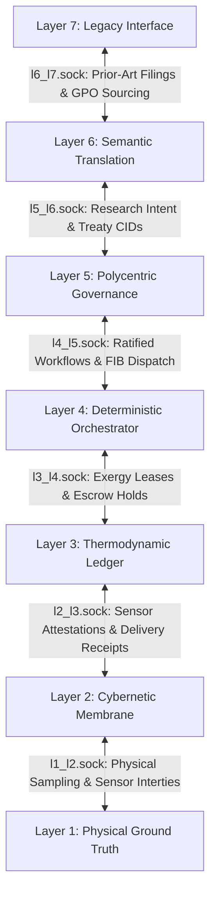
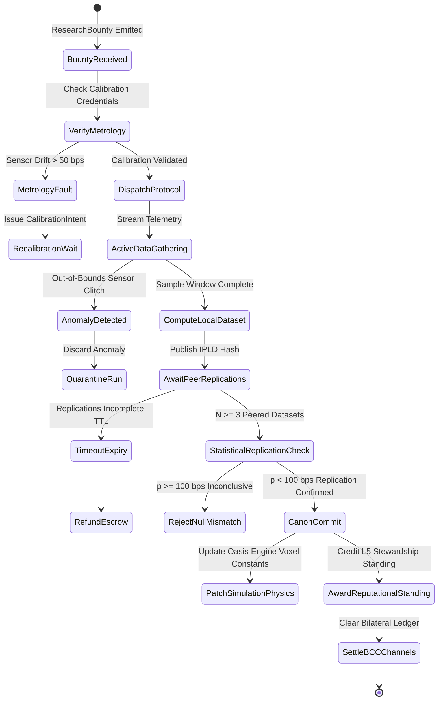
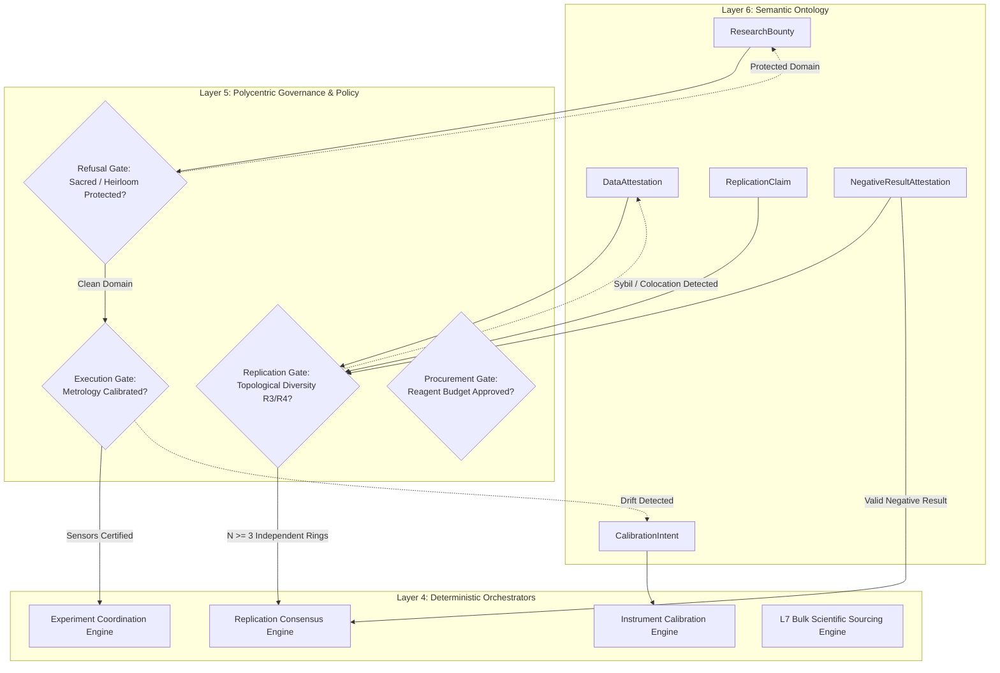
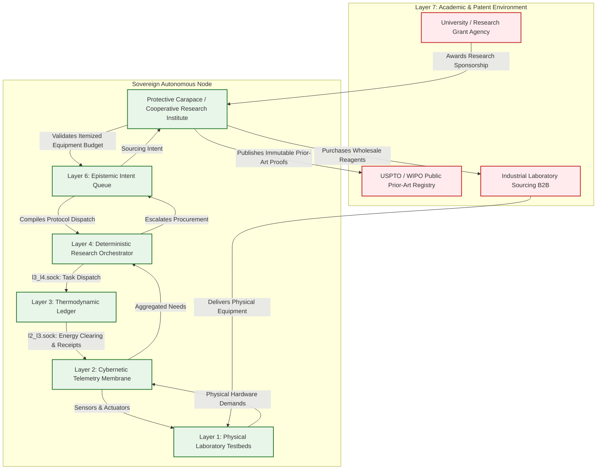

# Scenario Iota: The Epistemic Mesh (Open Science & Empirical Replication)

*   **Identifier:** `SCN-IOTA-EPISTEMIC`
*   **System Epic:** Decentralized Open Science, Distributed Empirical Metrology, and Epistemic Peer Replication
*   **Primary Layers Tested:** L1 (Physical), L2 (Cybernetic Membrane), L3 (Thermodynamic Ledger), L4 (Deterministic Orchestrator), L5 (Polycentric Governance), L6 (Semantic Translation & Agora), L7 (Legacy Interface)
*   **Pass/Fail Metric:** Successful multi-node empirical experiment replication across at least 3 topologically independent Autonomous Nodes in Trust Rings `R_3` and `R_4` with statistical significance `p < 100 bps`; zero IEEE 754 floating-point math; zero proprietary patent rent extraction; pairwise Bilateral Clearing Channel (BCC) instrument clearance; zero centralized servers; permanent Copyleft and Defensive Patent License protection.

---

## Architectural Council Ratification & 5-Perspective Synthesis

This scenario specification has been ratified by unanimous consensus of the 5-Persona Architectural Council:

| Council Persona | Disciplinary Representative | Core Contribution to Scenario |
| :--- | :--- | :--- |
| **Game Designer** | Lead Systems & Gameplay Designer | **Dwarf Fortress Psychology & Scholarly Debates:** Implements intellectual discovery and peer inquiry. Agents studying empirical hypotheses experience profound mood buffs (`"Illuminated by verified empirical discovery (+35 mood)"`) or resilience from reproducible negative results (`"Saved collective community exergy by disproving flawed hypothesis (+15 mood)"`). **The Sims Indirect Control:** Founder 01 prioritizes community research queues (e.g., local soil moisture retention vs. photovoltaic conversion efficiency). **Municipal University Interties:** Coordinates non-profit research sponsorships through lawful university interties to fund specialized laboratory tooling without compromising communal autonomy. |
| **Game Engineer** | Principal C++ Simulation & Engine Architect | **Data-Oriented Design (DOD):** Encapsulates laboratory benches and testing beds into compact 32-bit voxels (`material_id = 45` `RESEARCH_BENCH`, `material_id = 46` `SOIL_TEST_BED`) in 32-cubed chunks. Flecs ECS systems evaluate replication consensus across independent nodes at 10 Hz determinism. Dynamic simulation patching updates global physics parameters (e.g., `SOIL_WATER_RETENTION_COEFFICIENT`) using integer basis points upon cryptographic consensus. C++20 harness uses fixed-point SI integer arithmetic (`uint64_t` microjoules, `uint32_t` millikelvin, zero floating-point math). |
| **Sovereign Stack Specialist** | Sovereign Stack Systems Architect | **7-Layer Strict Adjacency & Pairwise BCC:** Enforces strict socket boundaries without layer skipping (`l1_l2.sock` through `l6_l7.sock`). Zero software in Layer 1. Pairwise Bilateral Clearing Channels (BCC) govern multi-node instrument sharing across Trust Rings `R_3` and `R_4` with conservation `B_{u -> v}(t) + B_{v -> u}(t) = 0`, bounded credit windows `[-C_{u -> v}, +C_{v -> u}]`, and two-phase delivery receipts `sigma_delivery`. Multi-hop HTLCs settle chained laboratory requests. BBS+ Zero-Knowledge Proofs guarantee Sybil-resistant anonymous peer review. Protective Carapace Interface deploys Defensive Patent License `DPL v1.1` and immutable prior-art Merkle proofs. |
| **Solarpunk Thinker** | Bioregional Regenerative Ecologist | **Thermodynamic Open Knowledge & Convivial Tools:** Replaces academic publishing cartels and seed patents with an open science commons. Formulates scientific discovery as physical entropy reduction grounded in Proof-of-Thermodynamic-Work (PoTW; 3600 kJ per credit). Directs research toward microclimatic agronomic resilience (native polycultures, biochar inoculation) using open-source hardware instrumentation (3D-printed digital microscopes, open spectrophotometers, soil probe arrays). |
| **Scenario Specialist** | Open-Hardware Metrologist & Computational Epistemologist | **Sensor Calibration & Replication Rigor:** Formulates distributed sensor metrology tolerances (drift threshold `<= 50 bps`), statistical significance criteria (`p < 100 bps` across at least 3 topologically diverse Autonomous Nodes), verifiable compute proofs for raw sensor streams, and Open Source Hardware Association (OSHWA) copyleft covenants. Protocol of Refusal protects sacred heirloom seeds and indigenous knowledge from digital quantification or simulation. |

**Unanimous Consensus Reached:** This specification was formally ratified by all 5 personas on 2026-10-11, resolving all epistemic, thermodynamic, and governance requirements into a unified implementation.

---

## 1. Problem Statement & Legacy Failure

In legacy commercial infrastructure (Layer 7), scientific discovery has been enclosed by corporate monopolies and academic cartels:
*   **The Academic Paywall & Publishing Cartel:** Publicly funded research is surrendered to commercial publishers who lock findings behind steep paywalls, extracting multi-billion dollar profit margins while denying citizen scientists and smallholders access to vital agronomic and medical data.
*   **The Replication Crisis & Publication Bias:** Commercial prestige algorithms reward sensational, non-reproducible breakthroughs while actively suppressing negative results. This systemic bias causes catastrophic thermodynamic waste, as independent teams unknowingly repeat identical failed experiments.
*   **Patent Enclosure of Ecological Survival:** Agrochemical and pharmaceutical conglomerates patent indigenous crop strains, localized soil microorganisms, and open-hardware manufacturing geometries. Small-scale bioregional innovations (e.g., microclimate-optimized biochar amendments in the Duvall watershed) are ignored because they cannot be commodified into global corporate products.

---

## 2. The Collective Workflow (7-Layer Traversal)

The Epistemic Mesh transforms science from an ivory-tower publishing contest into a localized, empirical public utility. Grounded in physical sensor telemetry and distributed validation, it models empirical truth as verified physical knowledge that optimizes both community practice and the Oasis engine digital twin simulation.



### Layer 1: Physical Ground Truth
*   **Hardware Reality:** Pure physical matter and energy. Layer 1 contains zero software, zero firmware, zero cryptographic keys, and zero network routing.
*   **Physical Laboratory Apparatus:** Open-source laboratory stations, 3D-printed digital microscopes, open-hardware spectrophotometers, soil capacitance testbeds, micro-climate field plots, bioreactor fermenters, and mechanical test rigs (e.g., tensile testing frames for recycled structural polymers).
*   **Physical Sensors & Instrumentation:** Calibrated platinum resistance temperature detectors (PT100 RTDs), soil frequency-domain reflectometry (FDR) probes, optical diffraction gratings, quartz cuvettes, and K-type thermocouple junctions terminating at passive terminal blocks.
*   **Inventory & Physical Feedstock:** Reference calibration fluids, certified soil samples, reagent test kits, standardized crop seeds, and mechanical testing specimens.
*   **Physical Action:** Soil amending, thermal cycling, optical density absorption, tensile pulling, and mechanical stressing performed by human stewards and sampled by passive physical transducers.

### Layer 2: The Cybernetic Membrane
*   **Microcontroller Architecture:** Hardened low-power microcontrollers (e.g., ESP32-S3 or STM32 running Zephyr RTOS) isolated from Layer 1 physical matter.
*   **Sensor Ingress (`col-sensord`):**
    *   `node/lab/soil_bed_04/telemetry/capacitance_vwc` (Volumetric Water Content in basis points: `10000 bps = 100%`)
    *   `node/lab/soil_bed_04/telemetry/soil_temp_mk` (Millikelvin: `294150 mK = 21 deg C`)
    *   `node/lab/spectro_01/telemetry/absorbance_mpu` (Milli-absorbance units at 600 nm)
    *   `node/lab/rig_02/status` (`CALIBRATING`, `LOGGING`, `RUN_COMPLETE`, `DRIFT_FAULT`)
*   **Fixed-Point SI Integer Wire Encoding:** All analog-to-digital converter (ADC) signals are mapped strictly into scaled SI integers: microjoules (`uint64_t`), millikelvin (`uint32_t`), basis points (`uint32_t`), millivolts (`int32_t`), and milligrams (`uint64_t`). IEEE 754 floating-point numbers are strictly forbidden.
*   **Living Mirror Bridge:** Lock-free shared memory (`/dev/shm`) ring buffer exposes sensor batches to `col-membraned`.
*   **Convivial Anti-Panopticon Shield:** Edge firmware enforces a strict ban on facial recognition, iris scanning, and workplace cameras. Instrumentation monitors physical specimens and soil beds, never human worker biometrics.

### Layer 3: The Thermodynamic Ledger
*   **Pairwise Bilateral Clearing Channels (BCC):** Inter-node research collaboration and analytical instrument access are settled through peer-to-peer bilateral channels between peered Autonomous Nodes `u` and `v`:
    $$B_{u \to v}(t) + B_{v \to u}(t) = 0$$
*   **Mutual Aid Credit Windows:**
    $$-C_{u \to v} \le B_{u \to v}(t) \le C_{v \to u}$$
    Credit limits are ratified via Layer 6 Ricardian Treaties (`Treaty_CID`) to accommodate seasonal agricultural cycles and scientific instrument usage.
*   **Two-Phase Delivery Receipts:** Transfer of physical laboratory samples or calibrated reagents requires sensor-verified confirmation:
    $$\sigma_{\mathrm{delivery}} = \mathrm{Sign}_{K_{\mathrm{receiver}}}\left( \mathrm{Hash}(Q_{\mathrm{measured}} \parallel \tau_{\mathrm{arrival}} \parallel \mathrm{Channel\_ID}) \right)$$
*   **Multi-Hop Chained HTLCs:** Multi-node replication requests traversing intermediate nodes use chained Hashed Timelock Contracts:
    $$\mathrm{HTLC} = \langle H(S), \, \Delta t, \, Q, \, u, \, v \rangle$$
    Where secret preimage `S` is revealed upon verified empirical completion, atomically clearing intermediate channels without a central clearinghouse.
*   **Proof-of-Thermodynamic-Work (PoTW):** Physical exergy consumed by laboratory hardware (heating incubators, centrifuge motors, drying ovens) is metered in standard integer quanta:
    $$\text{Exergy Credit}_{\mathrm{quantum}} \equiv 3600\text{ kJ} = 3{,}600{,}000{,}000{,}000\,\mu\mathrm{J}$$
*   **Physical Demurrage:** Stored exergy balances decay over time according to storage entropy:
    $$\mathcal{E}(t) = \mathcal{E}_0 e^{-\lambda t}$$
*   **Non-Monetary Clearance:** Outstanding channel balances settle through reciprocal analytical testing services, guild labor dispatch, or bioregional Commons Jubilee during regional ecological shocks.
*   **Zero Global Tokens & Fiat Inconvertibility:** Zero global tokens, zero liquidity pools, zero AMMs. Exergy credits never convert to fiat currency, and fiat currency never purchases exergy credits.

### Layer 4: The Deterministic Orchestrator
*   **State Machine Daemon:** `col-execd` executes a 10 Hz deterministic BPMN 2.0 virtual machine over POSIX non-blocking sequenced-packet Unix Domain Sockets (`/run/collective/ipc/l4_l5.sock` and `l3_l4.sock`).
*   **Contention Priority & Baselines:** Experimental energy allocations are prioritized below Tier 1 Ecological Floors (`F_eco`) and Tier 2 Human Survival Baselines (`B_baseline`). Laboratory compute and heating shed automatically during grid constraints.
*   **Anonymous Claim Handles:** Research tasks operate on anonymous claim handles; worker identity is never correlated with machine logs.



### Layer 5: Polycentric Governance
*   **Key Management & Policy Daemon:** `col-kmsd` operates partitioned SQLCipher databases and Sparse Merkle Trees (SMT), isolated from Layer 3 ledgers.
*   **Autopoietic Cellular Autonomy:** Every Autonomous Node retains absolute constitutional sovereignty ("the parts" vs. "the whole"). No external body can force a Node to violate its ecological floors or release research assets.
*   **7-Tier Concentric Trust Rings (`R_0` to `R_6`):**
    *   `R_0` (The Convivial Sanctuary / Hearth): Unconditional open library access and basic reference literature; zero keys, zero registration, zero tracking.
    *   `R_1` (The Settlement Lab): Supervised student research and apprentice metrology; ephemeral pairwise DIDs (`did:peer`).
    *   `R_2` (The Commons Lab): Shared analytical benches, soil test rigs; master keys in hardware security chips (ATECC608A); full voting standing.
    *   `R_3` (The Watershed Cluster): Sibling nodes within 30 km; microgrid interties; Bilateral Clearing Channels; empirical replication testing.
    *   `R_4` (The Bioregional Federation): River basin federation within 150 km; multi-hop BPVP capability routing; threshold signatures (FROST / BLS).
    *   `R_5` (The Continental Corridor): Trans-continental delay-tolerant open science mesh; long-baseline ecological monitoring.
    *   `R_6` (The Ecumene / Legacy Perimeter): Defensive publication to public patent registries; DMZ proxy gateways.
*   **Bioregional Path-Vector Protocol (BPVP / FRRP):** Governs physical resource routing across mesh topologies:
    $$\mathcal{A} = \big\langle \mathrm{adv\_id}, \, v_{\mathrm{orig}}, \, \mathcal{T}_{\mathrm{res}}, \, \mathbf{u}, \, Q_{\mathrm{avail}}, \, [\tau_{\mathrm{start}}, \tau_{\mathrm{end}}], \, \mathcal{P}, \, \mathcal{C}, \, H_{\mathrm{ttl}}, \, \sigma \big\rangle$$
    *   Export Surplus Bound: $Q_{\mathrm{avail}}(t) = \max\left(0, Q_{\mathrm{inventory}}(t) - F_{\mathrm{eco}}(t) - B_{\mathrm{baseline}}(t)\right) \cdot \mathbf{1}_{\mathrm{export}}$
    *   Ring-Path Vector: $\mathcal{P} = [(v_k, r_k), \dots, (v_0, r_0)]$ with Loop-Freedom Invariant discarding self-referential routes in $O(D)$ time.
    *   Thermodynamic Cost Functional $\mathcal{C}(\mathcal{P})$ accounts for transport energy, perishability, and Trust Ring friction.
    *   Dynamic Request Cascading widens progressively: $R_0/R_1 \to R_2 \to R_3 \to R_4$.
*   **Protocol of Refusal (`sec:l5-refusal`):** Commons Chamber designation protecting heirloom crop genetics, sacred botanical rites, and traditional ecological knowledge from quantification, commercial patenting, or digital-twin simulation.
*   **Autonomous Transit Veto (`No-Transit`):** Epistemic laboratories and quiet study cloisters maintain the sovereign authority to assert a `No-Transit` attribute over surrounding campus trails and research observatory buffers, deterministically preventing heavy material transit, vibration-heavy freight, or noisy vehicle routing from perturbing sensitive calibration instruments or intellectual sanctuary.
*   **Bicameral Polity & Reputational Wealth:**
    *   Commons Chamber (1 person = 1 vote) ratifies research goals, ecological floors, and Protocol of Refusal declarations.
    *   Stewardship Chamber weights technical methodology by domain-specific Reputational Wealth ($\mathcal{R}_{\mathrm{epistemic}}$).
    *   Mathematical governors: Exponential decay $\mathcal{R}(t) = \mathcal{R}_0 e^{-\frac{\ln(2)}{\tau_{\mathrm{half}}} t}$ ($\tau_{\mathrm{half}} = 1\dots 3\text{ years}$); Sublinear cap $\mathcal{W}_{\mathrm{steward}} = \min(\mathcal{W}_{\max}, \kappa \ln(1 + \mathcal{R}))$ with maximum 8 percent individual voting weight limit; Care Leave Shield freezing decay during caregiving.
    *   Scientific discoveries earn non-financial Reputational Wealth, not spendable tokens.

### Layer 6: Semantic Translation & Agora
*   **Tripartite Ricardian Treaties:**
    $$\mathrm{Treaty\_CID} = \mathrm{SHA256}\left( \mathrm{Text}_{\mathrm{prose}} \parallel \mathrm{Schema}_{\mathrm{JSON-LD}} \parallel \mathrm{Invariants}_{\mathrm{BPMN}} \right)$$
    Inter-node research treaties bind natural language scientific covenants, machine-readable JSON-LD parameters (channel bounds, sensor predicates), and formal BPMN state machines.
*   **Agora Semantic Knowledge Branches:**
    1.  `ResearchBounty`: Formal inquiry specifying independent/dependent variables and replication thresholds.
    2.  `DataAttestation`: Empirical telemetry bundle with Merkle-DAG hashes and calibration certificates.
    3.  `ReplicationClaim`: Proof of independent replication execution by a peer Autonomous Node.
    4.  `NegativeResultAttestation`: Verifiable proof of an unconfirmed hypothesis, rewarded equally in Reputational Wealth.
    5.  `CalibrationIntent`: Metrological recalibration dispatch for drifting sensors.
    6.  `CurriculumIntent`: Hand-off of validated empirical protocols to Scenario Kappa (Apprenticeship).



### Layer 7: The Legacy Interface
*   **Dual-Membrane Doctrine:** Strict separation between Membrane 1 (external legal carapace) and Membrane 2 (internal sovereign core). The cooperative entity acts as an honest, fully compliant non-profit research institute or agricultural cooperative, presenting Mundane Semantic Camouflage to legacy state authorities.
*   **Tripartite Legal Chassis:**
    1.  Bilateral Mutual-Aid Agreements (BMAA) under UUNAA Section 6;
    2.  Subchapter T Shared Services Agreements (SSAs) under 26 U.S.C. Sections 1381 through 1388;
    3.  Federated Land Trust conservation easements.
*   **Lawful Research Sponsorship & Equipment Procurement:**
    *   The cooperative entity lawfully receives university research grants, foundation fellowships, or non-profit sponsorships in legacy legal tender.
    *   *Meshing-First Rule:* Outward procurement occurs strictly against itemized capital equipment lists (quartz cuvettes, gas chromatography columns, high-purity reagents) up to a ratified fiat ceiling $\Phi_t$.
    *   Fiat funds remain strictly within legacy commercial banking rails; they are never converted into internal exergy credits.
*   **Defensive Prior-Art Membrane:** All research findings, open hardware CAD geometries, and agronomic recipes are automatically deposited to public patent registries with immutable SHA-256 Merkle proofs and Defensive Patent License `DPL v1.1` covenants, legally preventing corporate patent enclosure.



---

## 3. Machine-Readable Schemas

### 3.1 Layer 6 Knowledge Artifact: Research Bounty (`research_bounty.jsonld`)

```json
{
  "@context": [
    "https://schema.org/",
    "https://collective.network/ontology/v1/",
    "https://w3id.org/dpl/v1"
  ],
  "@type": "ResearchBounty",
  "identifier": "urn:uuid:4f5a6b7c-8d9e-0f1a-2b3c-4d5e6f7a8b9c",
  "issuerDid": "did:peer:2.Ez6MksG...agronomist_lee",
  "creationTimestamp": "2026-10-01T10:00:00Z",
  "researchDomain": "RegenerativeAgronomy_SoilHydrology",
  "hypothesis": {
    "claim": "Amending local alluvial clay soil with 15 percent volume fraction pyrolyzed biochar increases saturated volumetric water content without nitrogen immobilization.",
    "independentVariables": [
      {
        "name": "Biochar_Volume_Fraction_Bps",
        "testedValueBps": 1500,
        "toleranceBps": 100
      }
    ],
    "dependentVariables": [
      {
        "name": "Soil_Moisture_Capacitance_VWC_Bps",
        "expectedDeltaBps": 2200
      },
      {
        "name": "Nitrate_Ppb",
        "expectedThresholdPpb": 25000
      }
    ]
  },
  "replicationProtocol": {
    "minimumReplicatingNodes": 3,
    "statisticalSignificanceThresholdBps": 100,
    "requiredSensors": [
      "Capacitive_VWC_Probe_L2",
      "K_Type_Soil_Thermocouple"
    ],
    "durationSeconds": 5184000,
    "metrologyDriftLimitBps": 50
  },
  "settlementCriteria": {
    "reputationalWealthRewardPoints": 40,
    "replicatorReputationalRewardPoints": 25,
    "escrowTimeoutSeconds": 6480000,
    "clearingChannelCapacityUj": 3600000000000
  },
  "defensiveLicenseUri": "https://defensivepatentlicense.org/license/1.1"
}
```

### 3.2 Layer 2 Telemetry Attestation: Replication Proof (`replication_attestation.json`)

```json
{
  "@context": "https://collective.network/ontology/v1/",
  "@type": "EpistemicReplicationAttestation",
  "bountyRef": "urn:uuid:4f5a6b7c-8d9e-0f1a-2b3c-4d5e6f7a8b9c",
  "attestingNode": "did:peer:2.Ez6MkwQ...device_lab_station_03",
  "executionMetrics": {
    "startTime": "2026-10-02T08:00:00Z",
    "endTime": "2026-11-01T08:00:00Z",
    "durationSeconds": 2592000,
    "meanVolumetricWaterContentBps": 3840,
    "controlVolumetricWaterContentBps": 3020,
    "calculatedDeltaBps": 2715,
    "pValueBps": 42,
    "sensorCalibrationDriftBps": 18,
    "sampleCount": 2592000,
    "telemetryIpidHash": "bafybeigdyrzt5sfp7udm7hu76uh7y26nf3efuylqabf3oclgtqy55fbzdi"
  },
  "metrologyVerification": {
    "sensorSerialNumber": "SEN-CAP-DUV-091",
    "lastCalibrationDate": "2026-09-30T14:15:00Z",
    "calibrationCertUri": "ipfs://bafkreiah7j5q.../calib_cert.json"
  },
  "reconciliationStatus": "CONFIRMED_REPLICATED"
}
```

---

## 4. Oasis Engine Implementation Specification

### 4.1 Memory Allocation & Voxel State
The epistemic research node coordinates simulation testing in chunk space (32-cubed voxels via `ChunkManager`):
*   Research bench initialized with `material_id = 45` (`RESEARCH_BENCH`) with `metadata` bitmask `0b00000110` (`Is_Actuator | Is_Sensor`).
*   The experimental testbed occupies contiguous voxels `(16, 8, 16)` to `(20, 8, 20)` initialized with `material_id = 46` (`SOIL_TEST_BED`).
*   Dynamic physics patch alters global simulation constant using fixed-point integer basis points: `SOIL_WATER_RETENTION_BPS` is upgraded from `3000` to `3800` (representing 30 percent to 38 percent moisture retention) upon validated replication.

### 4.2 C++20 Test Harness Structure

```cpp
// engine/tests/scenario_iota_epistemic_test.cpp
#include <cassert>
#include <cstdint>
#include <string>
#include <vector>
#include "oasis/chunk_manager.hpp"
#include "oasis/orchestration/bpmn_engine.hpp"
#include "oasis/ledger/bilateral_clearing_channel.hpp"

namespace oasis {

struct ExperimentContext {
    std::string bounty_id;
    uint32_t replicating_nodes_required;
    uint32_t significance_alpha_bps; // 100 bps = 1%
    uint32_t baseline_retention_bps; // 3000 bps = 30%
    uint32_t target_retention_bps;   // 3800 bps = 38%
};

void test_scenario_iota_replication_consensus() {
    // 1. Initialize local chunk manager and testbed voxels
    ChunkManager chunk_mgr;
    chunk_mgr.allocate_chunk(0, 0, 0);

    Voxel bench_voxel{
        .material_id = 45, // RESEARCH_BENCH
        .moisture_bps = 1000,
        .temperature_mk = 294150, // 21 deg C
        .metadata = 0b00000110    // Actuator + Sensor bits
    };
    chunk_mgr.set_voxel(16, 8, 16, bench_voxel);

    // 2. Setup Bilateral Clearing Channels for 3 Independent Replicating Nodes
    // Conservation equation: B_{u -> v}(t) + B_{v -> u}(t) = 0
    std::string node_originator = "did:peer:2.Ez6MksG_agronomist_lee";
    std::string node_repl1 = "did:peer:2.Ez6MkwQ_lab_station_03";
    std::string node_repl2 = "did:peer:2.Ez6MkrP_lab_station_01";
    std::string node_repl3 = "did:peer:2.Ez6MktL_lab_station_05";

    // Channel capacities denominated in integer microjoules (3600 MJ = 3600000000000 uJ)
    uint64_t credit_capacity_uj = 3600000000000ULL;
    BilateralChannel chan1(node_originator, node_repl1, credit_capacity_uj);
    BilateralChannel chan2(node_originator, node_repl2, credit_capacity_uj);
    BilateralChannel chan3(node_originator, node_repl3, credit_capacity_uj);

    assert(chan1.balance_u_to_v_uj() + chan1.balance_v_to_u_uj() == 0);

    // 3. Load & Run Deterministic BPMN Orchestrator
    BPMNEngine orchestrator;
    orchestrator.load_schema("schemas/bpmn/epistemic_replication.bpmn");

    ExperimentContext exp{
        .bounty_id = "4f5a6b7c-8d9e-0f1a-2b3c-4d5e6f7a8b9c",
        .replicating_nodes_required = 3,
        .significance_alpha_bps = 100, // p < 100 bps
        .baseline_retention_bps = 3000,
        .target_retention_bps = 3800
    };

    // Escrow lock: Exergy lease reserved in Layer 3 (1800 MJ in microjoules)
    uint64_t lease_uj = 1800000000000ULL;
    orchestrator.emit_event(EscrowInitiatedEvent{node_originator, lease_uj});
    orchestrator.await_event<EscrowLockedEvent>();

    // Ingest 3 independent verified replication telemetry events in fixed-point SI
    // Parameters: Node DID, Retention in basis points (3840 bps), p-value in bps (42 bps)
    orchestrator.ingest_telemetry_proof(node_repl1, 3840, 42);
    orchestrator.ingest_telemetry_proof(node_repl2, 3790, 61);
    orchestrator.ingest_telemetry_proof(node_repl3, 3860, 38);

    SimResult res = orchestrator.step_simulation_ticks(chunk_mgr, 1440);
    assert(res.status == ExecutionStatus::COMPLETED);
    assert(orchestrator.current_state() == BPMNState::CANON_COMMITTED);

    // Execute Two-Phase Delivery Settlement across Bilateral Clearing Channels
    uint64_t settlement_uj = 600000000000ULL; // 600 MJ per replicator
    chan1.commit_receipt("sig_repl1", settlement_uj);
    chan2.commit_receipt("sig_repl2", settlement_uj);
    chan3.commit_receipt("sig_repl3", settlement_uj);

    // Assert zero-sum conservation holds across all bilateral channels
    assert(chan1.balance_u_to_v_uj() + chan1.balance_v_to_u_uj() == 0);
    assert(chan2.balance_u_to_v_uj() + chan2.balance_v_to_u_uj() == 0);
    assert(chan3.balance_u_to_v_uj() + chan3.balance_v_to_u_uj() == 0);

    // Assert simulation physics constant dynamically patched in engine
    assert(chunk_mgr.get_global_physics_param_uint("SOIL_WATER_RETENTION_BPS") >= 3800);
}

void test_scenario_iota_sensor_drift_quarantine() {
    ChunkManager chunk_mgr;
    chunk_mgr.allocate_chunk(0, 0, 0);
    BPMNEngine orchestrator;
    orchestrator.load_schema("schemas/bpmn/epistemic_replication.bpmn");
    std::string node_originator = "did:peer:2.Ez6MksG_agronomist_lee";
    std::string node_faulty = "did:peer:2.Ez6MkwQ_lab_station_03";

    uint64_t lease_uj = 1800000000000ULL;
    orchestrator.emit_event(EscrowInitiatedEvent{node_originator, lease_uj});
    orchestrator.await_event<EscrowLockedEvent>();

    // Inject sensor drift anomaly (drift = 140 bps > 50 bps tolerance limit)
    orchestrator.inject_sensor_fault_bps(node_faulty, 140);
    SimResult res = orchestrator.step_simulation_ticks(chunk_mgr, 100, true);

    assert(res.status == ExecutionStatus::EMERGENCY_STOP);
    assert(orchestrator.current_state() == BPMNState::METROLOGY_FAULT);

    // Physics parameters remain untouched during quarantine
    assert(chunk_mgr.get_global_physics_param_uint("SOIL_WATER_RETENTION_BPS") == 3000);
}

} // namespace oasis
```

---

## 5. Acceptance Test Gates (Pass/Fail)

| Checkpoint | Validation Method | Pass Condition |
| :--- | :--- | :--- |
| **G1: Thermodynamic Metrology Bounds** | Proof-of-Thermodynamic-Work Audit | Energy accounting strictly denominated in fixed-point microjoules (3600 kJ per credit); zero floating-point math; zero unbacked token generation for speculative claims. |
| **G2: Offline Autonomy** | Localhost Network Isolation | Distributed replication protocol, local consensus verification, and simulation physics patching execute to completion across local Reticulum and LoRa mesh while disconnected from the global Internet. |
| **G3: Byzantine Detection & Sybil Defense** | Topology & Trust Ring Audit | Replicating nodes must be distinct Autonomous Nodes residing in Trust Rings `R_3` or `R_4` with divergent cryptographic roots of trust (ATECC608A) and geofenced coordinates; co-located spoofing attempts fail admission. |
| **G4: Material Tracking & Physics Patch** | Voxel Engine Constant Update | Verified empirical discovery directly alters `SOIL_WATER_RETENTION_BPS` in the C++ engine from 3000 to 3800, extending simulated crop survival under drought conditions without crashes. |
| **G5: Dual-Membrane Research Sponsorship (L7)** | External Bank Ingestion & Needs List | External research grants in statutory currency are deposited in the cooperative bank account under the Meshing-First rule, used strictly for itemized equipment procurement up to ceiling `Phi_t`; zero conversion into internal credits. |
| **G6: Prior-Art Defensive Shield & Equipment Pooling (L7)** | Wholesale GPO & Immutable Timestamps | Specialized optical components are procured via Subchapter T Shared Services Agreements, while experimental datasets are deposited with immutable SHA-256 Merkle proofs to public prior-art databases under Defensive Patent License `DPL v1.1`. |
