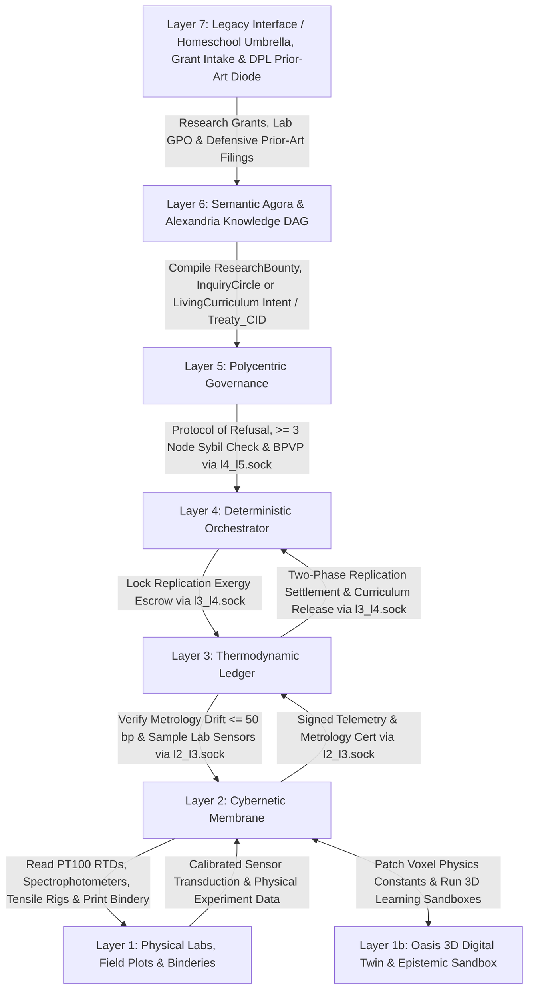
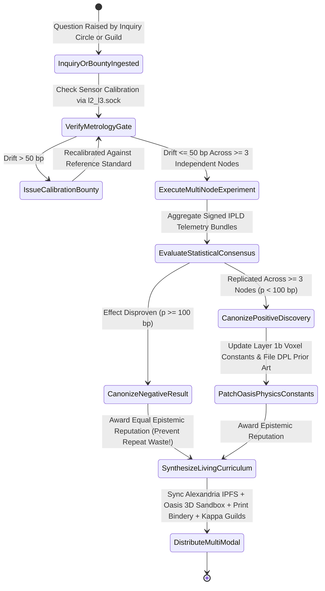

# Scenario Iota: The Epistemic & Pedagogical Mesh (Open Science, Citizen Laboratories, Living Knowledge Distribution & Post-Prussian Lifelong Learning Commons)

*   **Identifier:** `SCN-IOTA-EPISTEMIC`
*   **System Epic:** Dismantling the Factory-School & Academic Publishing Cartel: Multi-Age Inquiry Circles, Offline Alexandria Knowledge Mirrors, Interactive Oasis 3D Learning Sandboxes, Print-on-Demand Binderies, Distributed Empirical R&D & Metrology Across All Domains, Negative-Result Parity, Seed/Cultivar Commons & 3-Stage Node Evolution
*   **Primary Layers Tested:** L1 (Physical Laboratories, Print Binderies & Field Plots), L1b (Oasis 3D Interactive Learning Sandbox & Physics-Constant Calibration), L2 (Cybernetic Metrology Membrane), L3 (Thermodynamic Ledger), L4 (Deterministic Orchestrator), L5 (Polycentric Epistemic Governance & Defensive Prior Art), L6 (Semantic Translation, Living Curriculum DAG & Agora), L7 (Legacy Homeschool/Umbrella Shield, Grant Intake & Patent Prior-Art Diode)
*   **Pass/Fail Metric:** Complete abolition of tuition debt, corporate journal paywalls, and coercive factory-school grading (`tuition_fiat_cents == 0`, `student_surveillance_sensors == 0`, `coercive_bell_curve_grading == false`); multi-node empirical experiment replication across $\ge 3$ topologically independent Autonomous Nodes in Trust Rings $R_3 \dots R_5$ with calibrated sensor drift $\le 50\,\mathrm{bp}$ and statistical significance $p < 100\,\mathrm{bp}$ ($1\%$); equal Reputational Wealth ($\mathcal{R}_{\mathrm{epistemic}}$) parity for verified negative results; automatic compilation of replicated findings into both **Oasis Layer 1b physics patches** and multi-modal **Living Curriculum Modules** (offline Alexandria IPFS bundles, 3D Oasis sandboxes, tactile lab kits, and printed books); Pairwise Bilateral Clearing Channel (BCC) settlement with zero-sum conservation ($B_{u \to v}(t) + B_{v \to u}(t) = 0$).

---

## Architectural Council Ratification & 5-Perspective Synthesis

This scenario specification has been ratified by unanimous consensus of the 5-Persona Architectural Council:

| Council Persona | Disciplinary Representative | Core Contribution to Scenario |
| :--- | :--- | :--- |
| **Game Designer** | Lead Systems & Gameplay Designer | *Abolishing the Factory Classroom in Favor of Living Discovery:* In Oasis, there are no sterile rows of school desks where NPCs grind passive XP bars. Instead, children, youth, adults, and elders form **Multi-Age Inquiry Circles** that learn mathematics, chemistry, biology, and ethics by running real experiments in the garden, foundry, forest, and citizen lab. *Dwarf Fortress* scholarly & polymath moods: Discovering a drought-hardy seed cross, disproving a flawed hypothesis (`"Saved collective community exergy by disproving flawed hypothesis (+25 mood)"`), or printing an illustrated field guide at the community bindery yields `"Illuminated by shared empirical discovery (+40 mood)"`. |
| **Game Engineer** | Principal C++ Simulation & Engine Architect | Flecs ECS Data-Oriented Design (DOD): cache-aligned structs `MultiAgeInquiryCircleComponent`, `AlexandriaKnowledgeMirrorComponent`, `MetrologyCalibrationComponent`, `EmpiricalReplicationConsensusComponent`, and `DynamicPhysicsPatchComponent`; compact 32-bit Voxels (`material_id = 45` `CITIZEN_RESEARCH_BENCH`, `material_id = 46` `AGRO_SEED_TEST_BED`, `material_id = 47` `ALEXANDRIA_SERVER_AND_BINDERY`, `material_id = 48` `METROLOGY_CALIBRATION_VAULT`); live patching of Oasis simulation constants (`SOIL_WATER_RETENTION_BPS`) upon 3-node replication; compilable C++20 test harness strictly utilizing fixed-point SI integer math. |
| **Sovereign Stack Specialist** | Sovereign Stack Systems Architect | 7-layer strict adjacency without layer skipping (`l1_l2.sock` through `l6_l7.sock`, with `/run/collective/ipc/l4_l5.sock` bridging epistemic governance and orchestration); zero software in Layer 1; Layer 2 Zephyr RTOS membrane (`col-sensord`) enforcing metrology calibration drift bounds ($\le 50\,\mathrm{bp}$) and anti-panopticon privacy (`student_surveillance_sensors == 0`); Layer 3 Pairwise Bilateral Clearing Channels (BCC) with zero-sum conservation $B_{u \to v}(t) + B_{v \to u}(t) = 0$; Layer 5 `No-Transit` quiet observatory vetoes, `Protocol of Refusal` for sacred/indigenous knowledge, and Layer 7 Defensive Patent License (`DPL v1`) prior-art timestamping. |
| **Solarpunk Thinker** | Bioregional Regenerative Ecologist | Dismantling both the 19th-century Prussian factory-school model (which conditions youth for alienated corporate wage labor) and the academic publishing/patent cartel; treating scientific inquiry and lifelong polymathic education as an unconditional, joyous commons; distributing knowledge simultaneously through offline P2P digital libraries, interactive 3D Oasis simulations, Socratic local AI tutors, and physical risograph-printed books and tactile lab kits. |
| **Scenario Specialist** | Open-Hardware Metrologist, Critical Pedagogue & Computational Epistemologist | Multi-modal pedagogy (Montessori/Freirean critical inquiry + Socratic seminars + citizen laboratory experimentation); distributed sensor metrology calibration ($\le 50\,\mathrm{bp}$ drift against primary reference standards); statistical replication rigor ($p < 100\,\mathrm{bp}$ across $\ge 3$ independent $R_3/R_4$ nodes); open-pollinated heirloom seed & spore breeding libraries; state homeschool/umbrella-school statutory shielding for Stage 1 learning pods. |

Unanimous Consensus Reached across all five disciplinary perspectives.

---

## 1. Problem Statement & Legacy Failure

In legacy industrial and corporate society (Layer 7), the creation and distribution of human knowledge are crippled by two interlocking institutions—the **Prussian Factory-School System** and the **Academic Publishing & Patent Cartel**:

1.  **The Market-Oriented Factory School:** Designed in the 19th century to produce compliant factory workers and bureaucratic clerks, legacy schooling segregates children by birth-year into windowless classrooms, enforces passive obedience to bells and standardized multiple-choice tests, ranks human beings on artificial bell curves, and severs theoretical concepts from living ecosystems and physical craft. Students graduate alienated from nature, traumatized by competitive grading, and unable to grow food, repair tools, or design experiments.
2.  **The Credentialist University Debt Trap:** Higher education has been financialized into a trillion-dollar real-estate and student-loan cartel that rations access to laboratories, libraries, and mentorship behind crippling lifetime fiat debt.
3.  **The Academic Paywall & Replication Crisis:** Publicly and philanthropically funded research is handed gratis to commercial publishing monopolies (Elsevier, Springer, Wiley) that lock findings behind paywalls while prestige-driven publication bias rewards flashy, non-reproducible claims and suppresses negative results—causing massive thermodynamic waste as laboratories unknowingly repeat failed experiments.
4.  **Corporate Patent Enclosure of Life & Tools:** Agrochemical and pharmaceutical conglomerates patent crop genetics, medicinal compounds, and scientific instruments, criminalizing seed saving and independent citizen research.

---

## 2. Macro-Domain Architecture: The Six Pillars of the Epistemic & Pedagogical Commons

**Scenario Iota** is how The Collective **discovers, verifies, synthesizes, and distributes knowledge across generations**. It dismantles the static, market-oriented school and university system, replacing it with a lifelong, decentralized **Epistemic & Pedagogical Mesh** that links seamlessly with [Scenario Delta (`delta_childcare.md`)](file:///Users/raffaine/dev/collective/docs/scenarios/delta_childcare.md) (early childhood wonder), [Scenario Kappa (`kappa_apprenticeship.md`)](file:///Users/raffaine/dev/collective/docs/scenarios/kappa_apprenticeship.md) (hands-on vocational guild mastery), and [Scenario Phi (`phi_elder.md`)](file:///Users/raffaine/dev/collective/docs/scenarios/phi_elder.md) (elder wisdom and mentorship).

### Pillar I: Dismantling the Prussian Factory-School — Multi-Age Inquiry Circles & Problem-Based Polymathy
Scenario Iota abolishes compulsory age-segregated desk rows, standardized bell-curve grading, and tuition fees (`tuition_fiat_cents == 0`, `coercive_bell_curve_grading == false`):
*   **Multi-Age Inquiry Circles ($6\text{ to }100\,\mathrm{Years}$):**
    Following early childhood play in [Scenario Delta (`delta_childcare.md`)](file:///Users/raffaine/dev/collective/docs/scenarios/delta_childcare.md), young learners join self-directed, multi-age Inquiry Circles facilitated by rotating domain stewards, [Scenario Phi (`phi_elder.md`)](file:///Users/raffaine/dev/collective/docs/scenarios/phi_elder.md) elder scholars, and older peers.
*   **Phenomenon- & Problem-Based Learning Embedded in the Settlement:**
    Mathematics, physics, chemistry, biology, history, linguistics, and philosophy are never taught as sterile, disconnected abstractions ("Why do I need to learn calculus?"). Instead, learners master foundational theory by investigating real bioregional phenomena across the settlement's nodes:
    *   *Mathematics, Physics & Thermodynamics:* Learned by modeling fluid head and solar microgrid curves in [Scenario Beta (`beta_transit.md`)](file:///Users/raffaine/dev/collective/docs/scenarios/beta_transit.md), calculating phase-change enthalpy in [Scenario Theta (`theta_foundry.md`)](file:///Users/raffaine/dev/collective/docs/scenarios/theta_foundry.md), and writing deterministic fixed-point algorithms in [Scenario Zero (`zero_software.md`)](file:///Users/raffaine/dev/collective/docs/scenarios/zero_software.md).
    *   *Chemistry, Biology & Ecology:* Learned by assaying soil ergosterol and botanical tinctures in [Scenario Eta (`eta_coppice.md`)](file:///Users/raffaine/dev/collective/docs/scenarios/eta_coppice.md), monitoring fermentation kinetics in [Scenario Gamma (`gamma_kitchen.md`)](file:///Users/raffaine/dev/collective/docs/scenarios/gamma_kitchen.md), and analyzing struvite crystallization in [Scenario Mu (`mu_extraction.md`)](file:///Users/raffaine/dev/collective/docs/scenarios/mu_extraction.md).
    *   *Humanities, Ethics, History & Rhetoric:* Learned through Socratic seminars, multilingual literature circles, restorative justice simulations ([Scenario Psi (`psi_mediation.md`)](file:///Users/raffaine/dev/collective/docs/scenarios/psi_mediation.md)), and drafting real Layer 6 Ricardian Treaties and Layer 5 constitutional proposals.
*   **Portfolio Mastery & Direct Bridge to Scenario Kappa:**
    Instead of grades or GPA rankings, learners build an open cryptographic portfolio of completed inquiries, replicated experiments, essays, and artistic works. When a learner wishes to operate hazardous physical machinery or practice clinical/engineering trades, their theoretical portfolio feeds directly into [Scenario Kappa (`kappa_apprenticeship.md`)](file:///Users/raffaine/dev/collective/docs/scenarios/kappa_apprenticeship.md) for hands-on psychomotor mentorship and `L1/L2/L3` safety certification.

### Pillar II: Multi-Modal Living Knowledge Distribution (Alexandria Mesh, Oasis 3D Sandboxes, Socratic AI & Print Bindery)
Knowledge in The Collective is never locked in a static textbook that goes out of date or behind an internet connection that can be severed. Scenario Iota distributes living knowledge across **four synchronized modalities**:
1.  **The Offline-First Alexandria Mesh Library (`AlexandriaKnowledgeDAG`):**
    Every node hosts a complete local mirror of the **Alexandria Commons**—millions of open-access texts, multilingual encyclopedias, peer-replicated scientific datasets, open-hardware schematics, historical archives, and sheet music—stored on content-addressed IPFS/IPLD Merkle trees and synced over [Scenario Beta (`beta_transit.md`)](file:///Users/raffaine/dev/collective/docs/scenarios/beta_transit.md) fiber, Reticulum radio, and vehicular DTN sneakernet drives.
2.  **Interactive 3D Oasis Epistemic Sandboxes (Layer 1b Experiential Pedagogy):**
    Whenever a scientific concept or empirical discovery is canonized, Layer 6 links it to an interactive **Oasis 3D Simulation Sandbox** (built via [Scenario Zero (`zero_software.md`)](file:///Users/raffaine/dev/collective/docs/scenarios/zero_software.md)). Learners can shrink down to observe mycorrhizal nutrient exchange between tree roots, tweak PID parameters on a virtual induction furnace until it stabilizes, or simulate watershed flood hydrology at $1000\times$ speed—learning by *playing with the underlying laws of physics and ecology*.
3.  **Zero-Surveillance Local Socratic AI Tutors:**
    Learners have access to open-weight **Socratic AI Tutors** running locally on settlement hardware ([Scenario Epsilon](file:///Users/raffaine/dev/collective/docs/scenarios/epsilon_coworking.md) / [Scenario Zero](file:///Users/raffaine/dev/collective/docs/scenarios/zero_software.md)). Unlike corporate ed-tech (which harvests student keystrokes and attention metrics), the Socratic Tutor runs with **zero student surveillance (`student_surveillance_sensors == 0`)**, adapts to neurodivergent learning styles (dyslexia, ADHD, autism, visual/auditory preferences), translates any paper or lecture into the learner's native tongue, and uses the Socratic method—asking thought-provoking questions and suggesting physical lab experiments rather than handing out rote answers.
4.  **On-Site Risograph Print Bindery & Alpha-Fabricated Tactile Lab Kits:**
    Because deep reading and tactile manipulation require freedom from glowing screens, Scenario Iota nodes operate high-speed **soy-ink Risograph & Archival Book Binderies** (printing bound curriculum readers, laboratory notebooks, and illustrated botanical guides on recycled/hemp paper) and chain intents to [Scenario Alpha (`alpha_fabrication.md`)](file:///Users/raffaine/dev/collective/docs/scenarios/alpha_fabrication.md) to manufacture open-source **Tactile Science Kits** (3D-printed `OpenFlexure` sub-micron microscopes, quartz-cuvette spectrophotometers, geometry manipulatives, and electronics breadboards).

### Pillar III: Full-Spectrum Citizen & Bioregional R&D Laboratories (Serving All 25 Scenarios)
Scenario Iota dissolves the wall between "school" and "research institute": the same laboratories where learners explore science are the primary R&D and quality-assurance engines for the entire settlement:
*   **Materials, Metallurgy & Structural Testing Lab:** Universal tensile/compression test frames, Charpy impact testers, XRF spectrometers, and thermal-conductivity rigs testing recycled alloys, geopolymers, and timber joints for [Scenario Alpha](file:///Users/raffaine/dev/collective/docs/scenarios/alpha_fabrication.md), [Scenario Theta](file:///Users/raffaine/dev/collective/docs/scenarios/theta_foundry.md), and [Scenario Xi](file:///Users/raffaine/dev/collective/docs/scenarios/xi_architecture.md).
*   **Agroecological, Heirloom Seed-Breeding & Soil Microbiome Lab:** Open-pollinated regional seed banks, germination chambers, nanopore DNA/RNA sequencers, and fluorescence microscopes breeding climate-resilient crops and assaying mycorrhizal/compost inoculants for [Scenario Gamma](file:///Users/raffaine/dev/collective/docs/scenarios/gamma_kitchen.md), [Scenario Eta](file:///Users/raffaine/dev/collective/docs/scenarios/eta_coppice.md), and [Scenario Mu](file:///Users/raffaine/dev/collective/docs/scenarios/mu_extraction.md).
*   **Analytical Chemistry, Pharmacognosy & Environmental Toxicology Lab:** HPTLC/HPLC chromatography, UV-Vis spectrophotometers, and water/soil heavy-metal and coliform assay benches supporting [Scenario Chi](file:///Users/raffaine/dev/collective/docs/scenarios/chi_paramedic.md) clinical diagnostics and [Scenario Eta](file:///Users/raffaine/dev/collective/docs/scenarios/eta_coppice.md) herbal standardization.
*   **Primary & Secondary Metrology Calibration Vault:** Maintains traceable reference weights, triple-point-of-water temperature cells ($273160\,\mathrm{mK}$), voltage references, and gauge blocks to calibrate Layer 2 sensors across every node in the watershed (`sensor_drift_bp <= 50`).

### Pillar IV: Distributed Empirical Replication ($N \ge 3$), Negative-Result Parity & Live Oasis Physics Patching
*   **Multi-Node Replication Consensus ($N \ge 3$ Independent Nodes in $R_3 \dots R_5$):**
    When a researcher or Inquiry Circle publishes a hypothesis (`ResearchBounty`) and initial dataset (`DataAttestation`), `col-execd` broadcasts replication invitations across peered watershed and bioregional nodes. A claim is ratified into the Epistemic Canon **only** when at least $3$ topologically independent nodes (with verified calibrated sensors, `drift_bp <= 50`) reproduce the effect at $p < 100\,\mathrm{bp}$ ($1\%$) significance.
*   **Equal Reputational Standing for Negative Results (`NegativeResultAttestation`):**
    To permanently cure publication bias, disproving a hypothesis or proving that a proposed technique fails under local conditions earns **100% equal Reputational Wealth ($\mathcal{R}_{\mathrm{epistemic}}$)** as a positive result, protecting the entire mesh from repeating dead-end experiments.
*   **Automatic Oasis Physics-Constant Patching & Living Curriculum Update:**
    The moment a discovery achieves 3-node replication consensus, Layer 4 triggers two automatic downstream actions:
    1.  *Oasis Engine Calibration:* Updates the corresponding fixed-point physical constant in **Oasis (Layer 1b)** (e.g., updating `SOIL_WATER_RETENTION_BPS` from $3000$ to $3800\,\mathrm{bp}$), so the settlement's predictive digital twin immediately reflects verified empirical truth.
    2.  *Living Curriculum Synthesis:* Emits a `LivingCurriculumUpdateIntent` that appends the new experimental protocol, dataset, and interactive simulation module to the Alexandria Library and [Scenario Kappa (`kappa_apprenticeship.md`)](file:///Users/raffaine/dev/collective/docs/scenarios/kappa_apprenticeship.md) guild syllabi—reducing the lag between scientific discovery and classroom/workshop education from $20\,\mathrm{years}$ to **zero seconds**!

### Pillar V: Epistemic Sovereignty, Defensive Prior-Art Shield & Protocol of Refusal
*   **Defensive Patent License (`DPL v1`) & Prior-Art Diode:** All public discoveries, seed lineages, and open-hardware instruments are cryptographically timestamped and pushed via Layer 7 to global patent offices (USPTO/WIPO) as immutable prior art under the Defensive Patent License, legally blocking corporate patent trolls from enclosing Collective research.
*   **Indigenous & Heirloom `Protocol of Refusal`:** Sacred ethnobotanical knowledge, medicinal rites, and protected heirloom cultivars designated by the Commons Chamber under the Protocol of Refusal are cryptographically excluded from external publication or digital-twin extraction.

### Pillar VI: 3-Stage Incremental Node Facility Blueprints
1.  **Stage 1 — Suburban Living-Room Inquiry Pod, Offline Alexandria Box & Garage Citizen-Science Bench:**
    *   *Physical Footprint:* A suburban living room, backyard garden test plot, and garage workbench ($20\text{–}45\,\mathrm{m}^2$).
    *   *Operations:* Neighborhood families liberate their children from the factory-school grind by forming a **Multi-Age Homeschool / Unschooling Inquiry Cooperative**. Equipped with a silent local Alexandria IPFS/Kiwix server + Socratic AI Tutor, a tabletop risograph/bookbinder, [Scenario Alpha](file:///Users/raffaine/dev/collective/docs/scenarios/alpha_fabrication.md)-printed `OpenFlexure` microscopes, and calibrated soil/water sensors, learners conduct real neighborhood ecology and materials experiments that participate in mesh-wide replication bounties.
    *   *Layer 7 Legal & Municipal Shield:* Legally shielded under state **Homeschooling / Private Umbrella School statutes** and **UUNAA § 6** private educational associations—satisfying compulsory education laws with zero standardized-test coercion and zero HOA/zoning commercial traffic.
2.  **Stage 2 — Co-Located Community Lyceum, Citizen Bio/Materials Lab, Seed Library & Print Bindery:**
    *   *Physical Footprint:* A $150\text{–}400\,\mathrm{m}^2$ learning commons and laboratory co-located inside a [Scenario Epsilon (`epsilon_coworking.md`)](file:///Users/raffaine/dev/collective/docs/scenarios/epsilon_coworking.md) commercial/mixed-use shell alongside [Scenario Alpha (`alpha_fabrication.md`)](file:///Users/raffaine/dev/collective/docs/scenarios/alpha_fabrication.md) and [Scenario Delta (`delta_childcare.md`)](file:///Users/raffaine/dev/collective/docs/scenarios/delta_childcare.md).
    *   *Operations & Self-Sustenance:* Houses calibrated analytical benches (UV-Vis, HPTLC, PCR, tensile testers), a regional Heirloom Seed & Spore Library, an archival print bindery, and multi-age Socratic seminar rooms. Captures external Layer 7 fiat ($\Phi_t$) by offering certified agricultural soil/water/contaminant testing to regional farms, securing non-profit research/education grants, and running community science workshops—accumulating capital in the **Bioregional Conservatory Land Escrow**.
3.  **Stage 3 — Custom-Built Bioregional Open Conservatory, Metrology Institute & Seed Sanctuary (CLT/PPT):**
    *   *Physical Footprint:* Purpose-built timber-and-stone campus on permanent Community Land Trust (CLT) acreage, protected by a Layer 5 `No-Transit` vibration and dark-sky buffer.
    *   *Operations:* Replaces the legacy debt-trap university with a free, lifelong **Open Conservatory & Research Institute** housing primary metrology standards, citizen biotechnology and materials labs, an optical/print archival library, cryogenic heirloom seed vaults, and amphitheaters uniting children, researchers, guild masters, and elders.

---

## 3. The Collective Workflow (7-Layer Traversal)

The epistemic inquiry, empirical replication, and living knowledge distribution workflow traverses all seven layers without layer skipping:



### Layer 1: Physical Ground Truth
*   **Laboratory, Metrology & Seed Hardware:** 3D-printed `OpenFlexure` optical microscopes, quartz-cuvette UV-Vis spectrophotometers, HPTLC/HPLC rigs, tensile/compression mechanical test frames, PT100 4-wire RTDs, triple-point-of-water calibration cells ($273160\,\mathrm{mK}$), and climate-controlled heirloom seed germination vaults.
*   **Pedagogical & Print Bindery Hardware:** Multi-age Socratic seminar tables, soy-ink risograph duplicators, thermal/thread archival bookbinders, and [Scenario Alpha](file:///Users/raffaine/dev/collective/docs/scenarios/alpha_fabrication.md)-fabricated tactile science kits.
*   **Strict Layer Separation:** Layer 1 contains **zero software, zero firmware, zero cryptographic keys, and zero network routing**.

### Layer 2: Cybernetic Membrane & Telemetry
*   **Metrology & Anti-Panopticon Membrane:** `col-sensord` samples laboratory transducers in fixed-point SI integer units, verifying valid calibration certificates (`sensor_drift_bp <= 50`) while enforcing a hardware-level ban on classroom/laboratory human surveillance (`student_surveillance_sensors == 0`).
*   **Fixed-Point SI Integer Ingress Telemetry (POSIX Sockets / CBOR):**
    *   `node/lab/soil_bed_04/telemetry/capacitance_vwc_bp` (Volumetric Water Content in basis points, `uint16_t`)
    *   `node/lab/spectro_01/telemetry/absorbance_mau` (Milli-absorbance units at target wavelength, `uint32_t`)
    *   `node/lab/metrology_01/telemetry/calibration_drift_bp` (Measured drift against primary standard in basis points, `uint16_t`, requiring $\le 50\,\mathrm{bp}$)
    *   `node/lyceum/bindery_01/telemetry/printed_curriculum_volumes` (Bound physical readers produced, `uint32_t`)

### Layer 3: Thermodynamic Ledger
*   **Pairwise Bilateral Clearing Channels (BCC) for Shared Instrumentation & Replication:**
    When Node $u$ commissions empirical replication or specialized analytical testing (e.g., GC-MS or tensile testing) from Peered Lab Node $v$, laboratory exergy and reagent costs settle over Pairwise Bilateral Clearing Channels:
    $$B_{u \to v}(t) + B_{v \to u}(t) = 0, \quad -C_{u \to v} \le B_{u \to v}(t) \le C_{v \to u}$$
*   **Unconditional Decommodification of Education & Knowledge:**
    Access to Inquiry Circles, mentorship, the Alexandria Library, Socratic AI tutors, printed books, and Oasis 3D learning sandboxes carries **zero tuition fee, zero debt, and zero per-copy charge** (`tuition_fiat_cents == 0`, `tuition_exergy_uj == 0`).

### Layer 4: Deterministic Orchestrator
`col-execd` orchestrates empirical replication, Oasis physics patching, and living curriculum distribution at 10 Hz over `/run/collective/ipc/l4_l5.sock`:



*   **Boundary Socket Contract (`l4_l5.sock`):** Non-blocking `SOCK_SEQPACKET` Unix Domain Socket at `/run/collective/ipc/l4_l5.sock`. Downward messages transmit ratified research treaties, `Protocol of Refusal` boundaries, and curriculum compilation rules; upward messages report 3-node replication proofs, sensor drift alerts, and Oasis physics-constant patch attestations.

### Layer 5: Polycentric Governance & Bioregional Routing
Executed by `col-kmsd`, Layer 5 protects epistemic integrity and pedagogical freedom:
*   **Abolition of Coercive Grading & Student Surveillance:** Layer 5 constitutionally prohibits bell-curve ranking, standardized test gatekeeping, tuition debt, and classroom biometric/attention tracking.
*   **Topological Anti-Sybil Replication Gate:** To prevent a single node from forging "peer replication", `col-kmsd` verifies that the $\ge 3$ replicating nodes reside in distinct Autonomous Nodes across Rings $R_3 \dots R_5$ with independent hardware roots of trust (`ATECC608A`).
*   **Autonomous Transit Veto (`No-Transit`):** Quiet study cloisters, precision metrology vaults, and astronomical/bio-acoustic observatories enforce `No-Transit` buffers against heavy freight vibration and light pollution.

### Layer 6: Semantic Intent & Agora Ontology
Executed by `col-commonsd`, Layer 6 binds research and living education into Tripartite Ricardian Treaties ($\mathrm{Treaty\_CID}$):
1.  **`ResearchAndReplicationBounty`:** Formalizes an empirical hypothesis, dependent/independent variables, required sensor calibration (`<= 50 bp`), and $\ge 3\text{-node}$ replication criteria.
2.  **`NegativeResultAttestation`:** Cryptographically canons a disproven hypothesis with full reputational parity.
3.  **`LivingCurriculumCompilationIntent`:** Compiles a newly replicated discovery into a 4-modality educational package (Alexandria text/dataset, Oasis 3D interactive sandbox scene, risograph print layout, and Scenario Alpha lab-kit BOM) and pushes it to Inquiry Circles and [Scenario Kappa (`kappa_apprenticeship.md`)](file:///Users/raffaine/dev/collective/docs/scenarios/kappa_apprenticeship.md) guilds.

### Layer 7: The Legacy Interface (Dual-Membrane Doctrine)
1.  **Homeschool / Private Umbrella School Statutory Shield (Stage 1 & 2):** Protects Multi-Age Inquiry Circles from compulsory factory-school truancy enforcement and state curriculum mandates while issuing legally recognized high-school equivalency / transcript portfolios when young citizens interact with legacy institutions.
2.  **Defensive Prior-Art Diode (`DPL v1`):** Automatically publishes SHA-256 Merkle timestamps of Collective inventions, seed crosses, and open-hardware instruments to public patent registries to prevent corporate patent enclosure.
3.  **Certified Analytical Testing & Research Grant Carapace ($\Phi_t$):** Captures external Layer 7 fiat ($\Phi_t$) through agricultural soil/water/contaminant lab services and non-profit research grants to fund bulk B2B GPO procurement of optical components, chromatography columns, and analytical reagents.

---

## 4. Machine-Readable Schemas

### 4A. Layer 6 Knowledge Artifact: Empirical Research Bounty & Living Curriculum Synthesis (`epistemic_curriculum_intent.jsonld`)

```json
{
  "@context": [
    "https://schema.org/",
    "https://collective.network/ontology/v1/",
    "https://w3id.org/dpl/v1"
  ],
  "@type": "EpistemicResearchAndCurriculumIntent",
  "identifier": "urn:uuid:4f5a6b7c-8d9e-0f1a-2b3c-4d5e6f7a8b9c",
  "issuerDid": "did:peer:2.Ez6MksG...inquiryCircle_04_and_agronomist_lee",
  "creationTimestampMs": 1790848800000,
  "nodeEvolutionStage": "STAGE_2_COMMUNITY_LYCEUM_AND_CITIZEN_LAB",
  "researchDomain": "RegenerativeAgronomy_And_SoilHydrology",
  "hypothesis": {
    "claim": "Amending alluvial clay soil with 1500 bp volume fraction mycorrhizal-charged biochar increases volumetric water content by >= 800 bp without nitrate immobilization.",
    "testedBiocharFractionBp": 1500,
    "expectedMoistureDeltaBp": 800
  },
  "replicationProtocol": {
    "minimumIndependentReplicatingNodes": 3,
    "statisticalSignificanceThresholdBp": 100,
    "maxAllowedSensorDriftBp": 50,
    "negativeResultReputationParity": true
  },
  "livingPedagogyDistribution": {
    "tuitionFiatCents": 0,
    "tuitionExergyMicrojoules": 0,
    "coerciveBellCurveGradingPermitted": false,
    "studentSurveillanceSensors": 0,
    "compileToAlexandriaIpfsDag": true,
    "compileToOasis3dLearningSandbox": true,
    "compileToRisographPrintBindery": true,
    "compileToAlphaTactileLabKitBom": "bafybeihk99_openflexure_and_soil_kit_v2",
    "handoffToScenarioKappaGuilds": true
  },
  "defensivePatentLicense": "DPL_v1_Public_Prior_Art"
}
```

### 4B. Layer 2 & Layer 1b Combined Attestation: 3-Node Replication, Oasis Physics Patch & Curriculum Release (`epistemic_attestation.json`)

```json
{
  "@context": "https://collective.network/ontology/v1/",
  "@type": "EpistemicReplicationAndCurriculumAttestation",
  "bountyRef": "urn:uuid:4f5a6b7c-8d9e-0f1a-2b3c-4d5e6f7a8b9c",
  "replicatingNodes": [
    "did:peer:2.Ez6MkwQ_duvall_citizen_lab_03",
    "did:peer:2.Ez6MkrP_carnation_agro_lab_01",
    "did:peer:2.Ez6MktL_snoqualmie_forest_lab_05"
  ],
  "empiricalMetrics": {
    "maxObservedSensorDriftBp": 18,
    "controlSoilMoistureBp": 3000,
    "replicatedMeanMoistureBp": 3840,
    "combinedPValueBp": 42,
    "replicationConfirmed": true
  },
  "oasisSimulationPatch": {
    "parameterPatched": "SOIL_WATER_RETENTION_BPS",
    "previousValueBp": 3000,
    "newValueBp": 3840
  },
  "livingCurriculumRelease": {
    "alexandriaModuleCid": "bafybeigdyrzt5sfp7udm7hu76uh7y26nf3efuylqabf3oclgtqy55fbzdi",
    "oasisInteractiveSandboxSceneId": "SANDBOX_TERRA_PRETA_HYDROLOGY_3D",
    "risographReadersPrintedCount": 120,
    "studentSurveillanceTelemetryCount": 0
  },
  "hardwareSignature": "0x6f2d8a4c9e1b3f...atecc608a_ed25519_sig"
}
```

---

## 5. Oasis Engine Implementation Specification

### 5A. Modular Domain Representation in Oasis (Layer 1b)

In the Oasis 3D Digital Twin, Scenario Iota is represented as both the settlement's **R&D Laboratory & Metrology Complex** and its **Multi-Age Living Lyceum**:
*   `material_id = 45` (`CITIZEN_RESEARCH_BENCH`): Multi-purpose analytical bench (UV-Vis, HPTLC, tensile rig, `OpenFlexure` microscopy) where citizens and multi-age Inquiry Circles run experiments.
*   `material_id = 46` (`AGRO_SEED_TEST_BED`): Controlled field plot and heirloom seed-breeding bed.
*   `material_id = 47` (`ALEXANDRIA_SERVER_AND_BINDERY`): Combines the local offline IPFS/Kiwix knowledge mirror, Socratic local AI tutor node, and soy-ink risograph book bindery.
*   `material_id = 48` (`METROLOGY_CALIBRATION_VAULT`): Vibration-isolated reference standard vault calibrating Layer 2 sensors (`drift <= 50 bp`).
*   **Dynamic Physics Patching & Curriculum Buffs:** When 3-node replication succeeds in Oasis, global voxel simulation constants (such as `SOIL_WATER_RETENTION_BPS` or `SOLAR_KILN_EFFICIENCY_BPS`) dynamically upgrade in real time, and new Living Curriculum modules unlock faster skill progression in [Scenario Kappa (`kappa_apprenticeship.md`)](file:///Users/raffaine/dev/collective/docs/scenarios/kappa_apprenticeship.md)!

### 5B. C++20 Test Harness Structure (Fixed-Point SI Integer Math)

```cpp
// engine/tests/scenario_iota_epistemic_test.cpp
#include <cassert>
#include <cstdint>
#include <string>
#include <vector>

namespace collective::scenario_iota {

// 1. Pillar I & II: Post-Prussian Living Pedagogy & Multi-Modal Knowledge Distribution Gate
struct LivingPedagogyAndDistributionState {
    uint64_t tuition_fiat_cents{0};                  // Must be 0 (zero debt/tuition)
    uint64_t tuition_exergy_uj{0};                   // Must be 0
    uint32_t student_surveillance_sensors{0};        // Must be 0 (anti-panopticon Socratic learning)
    bool coercive_bell_curve_grading{false};         // Must be false (portfolio mastery, not factory ranking)
    bool multi_age_inquiry_circle_active{true};
    bool synced_to_offline_alexandria_dag{true};
    bool compiled_to_oasis_3d_sandbox{true};
    bool printed_by_risograph_bindery{true};
    bool handed_off_to_scenario_kappa{true};
};

inline bool verify_living_pedagogy_and_distribution(const LivingPedagogyAndDistributionState& ped) {
    // Constitutional education invariants: zero tuition, zero surveillance, zero factory bell-curve grading
    if (ped.tuition_fiat_cents > 0 || ped.tuition_exergy_uj > 0) return false;
    if (ped.student_surveillance_sensors > 0 || ped.coercive_bell_curve_grading) return false;
    if (!ped.multi_age_inquiry_circle_active) return false;

    // Must distribute knowledge across all 4 living modalities (Offline Digital + 3D Sandbox + Print + Guilds)
    return ped.synced_to_offline_alexandria_dag &&
           ped.compiled_to_oasis_3d_sandbox &&
           ped.printed_by_risograph_bindery &&
           ped.handed_off_to_scenario_kappa;
}

// 2. Pillar III & IV: 3-Node Empirical Replication, Metrology Drift Gate, Negative-Result Parity & Oasis Patch
struct PeerReplicationNodeReport {
    std::string node_did;
    uint16_t sensor_calibration_drift_bp{0};         // Must be <= 50 bp (5 permille)
    uint16_t measured_retention_bp{0};
    uint16_t p_value_bp{0};                          // < 100 bp (1%) for positive confirmation
};

struct EpistemicExperimentOutcome {
    bool valid_execution{false};
    bool positive_effect_confirmed{false};
    bool negative_result_canonized{false};
    uint32_t researcher_reputation_awarded{0};
    uint16_t patched_oasis_soil_retention_bp{3000};
};

inline EpistemicExperimentOutcome evaluate_replication_and_patch_oasis(
    const std::vector<PeerReplicationNodeReport>& reports,
    uint16_t baseline_soil_retention_bp) {

    EpistemicExperimentOutcome out{};
    out.patched_oasis_soil_retention_bp = baseline_soil_retention_bp;

    // Require at least 3 topologically independent replicating nodes in R3..R5
    if (reports.size() < 3) return out;
    if (reports[0].node_did == reports[1].node_did ||
        reports[1].node_did == reports[2].node_did ||
        reports[0].node_did == reports[2].node_did) {
        return out; // Sybil / co-located node spoofing rejected!
    }

    uint64_t sum_retention_bp = 0;
    bool all_statistically_significant = true;
    for (const auto& r : reports) {
        // Metrology Gate: any sensor with drift > 50 bp invalidates the run and triggers CalibrationIntent
        if (r.sensor_calibration_drift_bp > 50) {
            return out;
        }
        sum_retention_bp += r.measured_retention_bp;
        if (r.p_value_bp >= 100) {
            all_statistically_significant = false;
        }
    }

    out.valid_execution = true;
    // Equal Reputational Wealth Parity (40 points) whether the hypothesis is confirmed OR disproven!
    out.researcher_reputation_awarded = 40;

    if (all_statistically_significant) {
        out.positive_effect_confirmed = true;
        out.patched_oasis_soil_retention_bp = static_cast<uint16_t>(sum_retention_bp / reports.size());
    } else {
        // Reproducible Negative Result: canonized to prevent mesh-wide wasted exergy, physics constant unchanged
        out.negative_result_canonized = true;
    }
    return out;
}

// 3. Layer 3 Pairwise Bilateral Clearing Channel (BCC) Settlement
struct BccEpistemicChannel {
    int64_t balance_origin_to_peer_uj{0};
    int64_t balance_peer_to_origin_uj{0};
    int64_t credit_limit_uj{10000000000000ULL};
};

inline bool settle_replication_instrument_bcc(BccEpistemicChannel& ch, uint64_t instrument_exergy_uj) {
    if (ch.balance_origin_to_peer_uj + static_cast<int64_t>(instrument_exergy_uj) > ch.credit_limit_uj) {
        return false;
    }
    ch.balance_origin_to_peer_uj += static_cast<int64_t>(instrument_exergy_uj);
    ch.balance_peer_to_origin_uj -= static_cast<int64_t>(instrument_exergy_uj);
    return (ch.balance_origin_to_peer_uj + ch.balance_peer_to_origin_uj) == 0;
}

void run_all_scenario_iota_tests() {
    // Test 1: Post-Prussian Living Pedagogy & 4-Modality Knowledge Distribution
    LivingPedagogyAndDistributionState valid_lyceum{};
    assert(verify_living_pedagogy_and_distribution(valid_lyceum) == true);

    // Charging tuition, installing classroom surveillance cameras, or factory bell-curve grading MUST FAIL!
    LivingPedagogyAndDistributionState factory_school_violation = valid_lyceum;
    factory_school_violation.coercive_bell_curve_grading = true;
    assert(verify_living_pedagogy_and_distribution(factory_school_violation) == false);

    LivingPedagogyAndDistributionState tuition_violation = valid_lyceum;
    tuition_violation.tuition_fiat_cents = 500000;
    assert(verify_living_pedagogy_and_distribution(tuition_violation) == false);

    // Test 2A: 3-Node Empirical Replication Consensus & Dynamic Oasis Physics Constant Patching
    std::vector<PeerReplicationNodeReport> positive_reps = {
        {"did:peer:duvall_lab_03", 18, 3840, 42},
        {"did:peer:carnation_lab_01", 22, 3790, 61},
        {"did:peer:snoqualmie_lab_05", 15, 3860, 38}
    };
    auto pos_outcome = evaluate_replication_and_patch_oasis(positive_reps, 3000);
    assert(pos_outcome.valid_execution == true);
    assert(pos_outcome.positive_effect_confirmed == true);
    assert(pos_outcome.patched_oasis_soil_retention_bp == 3830); // Upgraded from 3000 bp to 3830 bp!
    assert(pos_outcome.researcher_reputation_awarded == 40);

    // Test 2B: Reproducible Negative Result Parity (Equal Reputation, Physics Constant Untouched)
    std::vector<PeerReplicationNodeReport> negative_reps = {
        {"did:peer:duvall_lab_03", 12, 3010, 4500},
        {"did:peer:carnation_lab_01", 19, 2990, 5200},
        {"did:peer:snoqualmie_lab_05", 14, 3005, 4800}
    };
    auto neg_outcome = evaluate_replication_and_patch_oasis(negative_reps, 3000);
    assert(neg_outcome.valid_execution == true);
    assert(neg_outcome.negative_result_canonized == true);
    assert(neg_outcome.researcher_reputation_awarded == 40); // Equal honor for disproving flawed hypothesis!
    assert(neg_outcome.patched_oasis_soil_retention_bp == 3000);

    // Test 2C: Metrology Drift Fault (> 50 bp) Quarantines Experiment
    std::vector<PeerReplicationNodeReport> drifted_reps = positive_reps;
    drifted_reps[1].sensor_calibration_drift_bp = 140; // > 50 bp drift limit
    auto drift_outcome = evaluate_replication_and_patch_oasis(drifted_reps, 3000);
    assert(drift_outcome.valid_execution == false);

    // Test 3: Pairwise BCC Zero-Sum Instrument Exergy Settlement
    BccEpistemicChannel bcc{};
    assert(settle_replication_instrument_bcc(bcc, 600000000000ULL) == true);
    assert(bcc.balance_origin_to_peer_uj + bcc.balance_peer_to_origin_uj == 0);
}

} // namespace collective::scenario_iota

int main() {
    collective::scenario_iota::run_all_scenario_iota_tests();
    return 0;
}
```

---

## 6. Acceptance Test Gates (Pass/Fail)

| Checkpoint | Validation Method | Pass Condition |
| :--- | :--- | :--- |
| **G1: Post-Prussian Pedagogy & Zero Tuition/Surveillance** | Constitutional Education Audit | Verifies `tuition_fiat_cents == 0`, `tuition_exergy_uj == 0`, `student_surveillance_sensors == 0`, and `coercive_bell_curve_grading == false` across all Multi-Age Inquiry Circles. |
| **G2: 4-Modality Living Knowledge Distribution** | Alexandria, Oasis, Print & Kappa Sync | Every canonized discovery automatically compiles into an offline Alexandria IPFS bundle, an interactive 3D Oasis learning sandbox, a soy-ink risograph printed reader, and a Scenario Kappa guild syllabus update. |
| **G3: 3-Node Topological Replication & Metrology Drift Gate** | Sybil & Calibration Audit (`<= 50 bp`) | Requires $\ge 3$ independent Autonomous Nodes in Rings $R_3 \dots R_5$ with verified sensor calibration drift $\le 50\,\mathrm{bp}$; any sensor drift $> 50\,\mathrm{bp}$ halts the run and triggers a `CalibrationIntent`. |
| **G4: Negative-Result Parity & Dynamic Oasis Physics Patch** | Reputation & Voxel Constant Check | Reproducible negative results earn 100% equal Reputational Wealth ($\mathcal{R}_{\mathrm{epistemic}}$) as positive breakthroughs; positive replications ($p < 100\,\mathrm{bp}$) dynamically patch Oasis voxel constants (`SOIL_WATER_RETENTION_BPS`). |
| **G5: Defensive Prior-Art Diode (`DPL v1`) & Protocol of Refusal** | Patent Timestamp & Refusal Filter | Public discoveries are timestamped to global prior-art registries under `DPL v1`, while sacred/indigenous knowledge and protected heirloom seeds under the Protocol of Refusal are blocked from external export. |
| **G6: 3-Stage Node Evolution & Homeschool/Grant Carapace (L7)** | Stage 1–3 Blueprint Audit | Verifies progression from Stage 1 living-room homeschool/unschool inquiry pod (statutory umbrella shield) to Stage 2 co-located Community Lyceum & Citizen Lab to Stage 3 Bioregional Open Conservatory & Metrology Institute CLT. |
