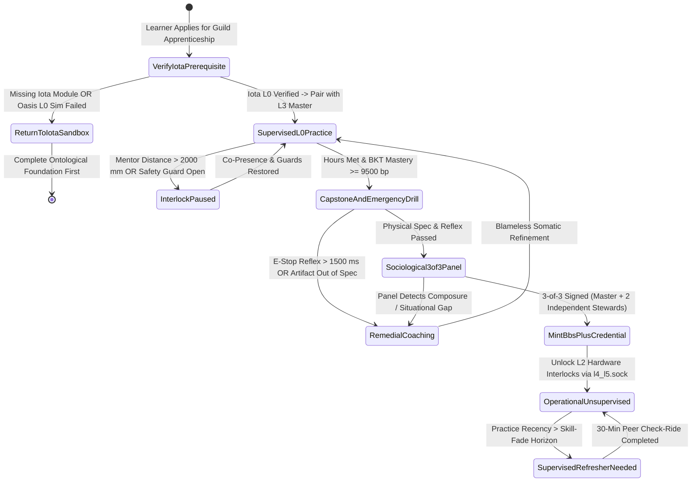

# Scenario Kappa: The Apprenticeship & Preparedness Protocol (Sociological Validation of Knowledge, Somatic Guild Mastery & Cryptographic Capability Interlocks)

*   **Identifier:** `SCN-KAPPA-APPRENTICE`
*   **System Epic:** Bridging Scenario Iota's Ontological Truth to Sociological Validation of Preparedness: The 4-Tier Somatic Mastery Ladder (`L0`–`L3`) Across All 25 Domains, 3-of-3 Independent Peer & Master Capstone Evaluation, Privacy-Preserving `BBS+` Zero-Knowledge Hardware Interlocks, Skill-Fade Recertification, *Wanderjahre* Journeyman Exchanges & 3-Stage Guild Node Evolution
*   **Primary Layers Tested:** L1 (Physical Machine Interlocks, Simulators & Capstone Artifacts), L1b (Oasis 3D Pre-Qualification Sandbox & Emergency Drill Twin), L2 (Cybernetic Membrane, Proximity Co-Presence & Contactor Relays), L3 (Thermodynamic Tool-Wear Ledger & Non-Commensurable Mentorship Care), L4 (Deterministic BKT Mastery & Interlock Orchestrator), L5 (Polycentric Guild Governance, 3-of-3 Sociological Multi-Sig & `BBS+` Credentials), L6 (Semantic Translation, Rubric Ontology & Agora), L7 (State Trade-License Bridge, Surplus Machinery Intake & Alamo Labor Bifurcation)
*   **Pass/Fail Metric:** Strict separation and integration between Scenario Iota (ontological/theoretical truth) and Scenario Kappa (sociological and somatic validation of the holder's preparedness to safely apply that knowledge); mandatory 3-of-3 independent cryptographic evaluation (`1 Master + 2 Independent Guild Stewards`) plus Bayesian Knowledge Tracing mastery $\mathrm{P}(L) \ge 9500\,\mathrm{bp}$ ($95\%$) and emergency-stop reflex verification ($\le 1500\,\mathrm{ms}$) prior to issuing `BBS+` Zero-Knowledge Verifiable Credentials; autonomous Layer 2 physical contactor unlocking (`col-actuated`) with zero worker surveillance cameras (`workplace_surveillance_cameras == 0`); automatic skill-fade step-down to `ARMED_SUPERVISED` if practice recency exceeds domain horizon; zero fiat tuition debt (`fiat_tuition_debt_cents == 0`) and zero monetization of mentorship care; Pairwise Bilateral Clearing Channel (BCC) settlement for shared tool wear with zero-sum conservation ($B_{u \to v}(t) + B_{v \to u}(t) = 0$).

---

## Architectural Council Ratification & 5-Perspective Synthesis

This scenario specification has been ratified by unanimous consensus of the 5-Persona Architectural Council:

| Council Persona | Disciplinary Representative | Core Contribution to Scenario |
| :--- | :--- | :--- |
| **Game Designer** | Lead Systems & Gameplay Designer | *The Iota-to-Kappa Synthesis (Truth $\to$ Preparedness):* In Oasis, reading a manual or running a sandbox in Scenario Iota gives an NPC theoretical understanding (`L0`), but operating a $1323150\,\mathrm{mK}$ bronze foundry, felling a mature Douglas Fir, or assisting a birth requires **Scenario Kappa's sociological validation of preparedness**. *Dwarf Fortress* master-apprentice bonds and *Wanderjahre* pride: Apprentices shadowing masters learn $4\times$ faster and avoid catastrophic workshop accidents; passing a 3-steward Guild Capstone Trial triggers `"Honored by the Guild as a trusted Steward of the Craft (+45 mood)"`. |
| **Game Engineer** | Principal C++ Simulation & Engine Architect | Flecs ECS Data-Oriented Design (DOD): cache-aligned structs `GuildPreparednessComponent`, `BayesianMasteryTrackerComponent`, `SociologicalMultiSigReviewComponent`, `SkillFadeRecencyComponent`, and `HardwareContactorInterlockComponent`; compact 32-bit Voxels (`material_id = 50` `INTERLOCKED_HAZARD_MACHINE`, `material_id = 51` `GUILD_TEACHING_WORKBENCH`, `material_id = 52` `CAPSTONE_METROLOGY_INSPECTION_RIG`); integer-only Bayesian Knowledge Tracing (`uint32_t` basis points); compilable C++20 test harness strictly utilizing fixed-point SI integer math. |
| **Sovereign Stack Specialist** | Sovereign Stack Systems Architect | 7-layer strict adjacency without layer skipping (`l1_l2.sock` through `l6_l7.sock`, with `/run/collective/ipc/l4_l5.sock` bridging guild credential governance and interlock orchestration); zero software in Layer 1; Layer 2 Zephyr RTOS membrane (`col-sensord`, `col-actuated`) verifying bilateral UWB/BLE cryptographic co-presence ($\le 2000\,\mathrm{mm}$) for `L0` apprentices and `BBS+` Zero-Knowledge Proofs for `L1/L2/L3` operators without revealing identity; Layer 3 Pairwise Bilateral Clearing Channels (BCC) with zero-sum conservation $B_{u \to v}(t) + B_{v \to u}(t) = 0$. |
| **Solarpunk Thinker** | Bioregional Regenerative Ecologist | Replacing corporate credentialism, gatekept licensing cartels, and crippling student loan debt with convivial, intergenerational guild mentorship; recognizing that dangerous or life-critical tools require genuine human judgment, emotional composure, and peer accountability—not a multiple-choice paper certificate; keeping mentorship completely uncommodified (`pedagogical_care_monetized_uj == 0`) while honoring *Wanderjahre* journeymen who cross-pollinate repair and ecological craft across watersheds. |
| **Scenario Specialist** | Guild Pedagogue, Human-Factors Safety Engineer & Vocational Ergonomist | Universal 4-Tier Preparedness Ladder (`L0` Observer, `L1` Operator, `L2` Maintainer/Diagnostician, `L3` Master Evaluator); objective psychomotor & emergency-reflex rubrics (`e_stop_reaction_ms <= 1500`); 3-of-3 anti-nepotism sociological peer review; skill-fade recertification horizons and blameless near-miss postmortems; Layer 7 statutory trade-license mapping (Journeyman Electrician, Plumber, AWS Welder, EMT, Midwife) and `26 USC Section 501c3` surplus trade-school machinery acquisition. |

Unanimous Consensus Reached across all five disciplinary perspectives.

---

## 1. Problem Statement & Legacy Failure

In legacy capitalist infrastructure (Layer 7), the validation of human skill and preparedness is broken in two opposite, equally dangerous ways:

1.  **Paper Credentialism Disconnected from Embodied Preparedness:** Commercial universities and online certification mills issue degrees based on written exams and tuition payments without evaluating whether the graduate has the somatic composure, situational awareness, or tactile skill to safely handle high-energy machinery, clinical emergencies, or ecological interventions.
2.  **The Debt-Gated Licensing Cartel:** Where practical trade schools and professional boards do exist, access is rationed behind tens of thousands of dollars in compounding student debt, artificial guild quotas, and bureaucratic gatekeeping designed to inflate commercial prices rather than spread community self-reliance.
3.  **Deskilling, Gig-Economy Atomization & Workplace Surveillance:** Instead of investing in master-apprentice lineages that cultivate deep diagnostic mastery, legacy corporations deskill workers into disposable gig operators monitored by invasive AI workplace cameras, keystroke loggers, and posture trackers—leading to high injury rates and the extinction of tacit repair craft.

---

## 2. Macro-Domain Architecture: The Six Pillars of Sociological Preparedness & Guild Mastery

 Within the horizontal architecture of The Collective:
*   **Scenario Zero** provides the software, OS, simulation, and digital tools;
*   **Scenario Alpha** fabricates the physical tools, parts, and machines;
*   **Scenario Beta** distributes the items, materials, energy, water, and data;
*   **Scenario Epsilon** hosts the organizational, legal, and administrative carapace;
*   **Scenario Iota** discovers, verifies, and distributes the **ontological truth** (the underlying scientific and theoretical knowledge); and
*   **Scenario Kappa** provides the **sociological validation of that truth in human hands**—evaluating, mentoring, and certifying a person's **preparedness** (somatic skill, safety reflexes, ethical judgment, and composure under pressure) to apply Scenario Iota's knowledge across every physical and social domain of The Collective.

### Pillar I: The Ontological-to-Sociological Bridge & The 4-Tier Preparedness Ladder (`L0` $\to$ `L3`)
Scenario Kappa establishes a universal **4-Tier Preparedness Architecture** that governs human interaction with tools, infrastructure, ecosystems, and clinical care across all 25 Scenarios:
1.  **`L0` — Ontological & Virtual Readiness (The Scenario Iota Bridge):**
    *   *How Achieved:* The learner completes the theoretical inquiry module in [Scenario Iota (`iota_epistemic.md`)](file:///Users/raffaine/dev/collective/docs/scenarios/iota_epistemic.md) (via Multi-Age Inquiry Circles, Alexandria texts, and Socratic tutors) **and** passes the interactive 3D safety & process simulation in **Oasis (Layer 1b)**.
    *   *Sociological Standing & Interlock State:* Authorized to enter the physical workshop, laboratory, kitchen, or clinic as an **Apprentice Observer**, and to operate interlocked equipment **only** when Layer 2 (`col-sensord`) verifies cryptographic UWB/BLE co-presence ($\le 2000\,\mathrm{mm}$) of an `L2`/`L3` mentor holding the dual-hand enable switch (`interlock_state = ARMED_SUPERVISED`).
2.  **`L1` — Certified Somatic Operator (Independent Routine Execution):**
    *   *How Achieved:* Completes required co-present supervised practice hours, reaches Bayesian Knowledge Tracing mastery $\mathrm{P}(L) \ge 9500\,\mathrm{bp}$ ($95\%$), passes an unannounced physical **Emergency Reflex Drill** (`e_stop_reaction_ms <= 1500`), and passes a **3-of-3 Sociological Capstone Evaluation** (`1 Mentoring Master + 2 Independent Guild Stewards`).
    *   *Sociological Standing & Interlock State:* Unlocks Layer 2 hardware contactors (`interlock_state = OPERATIONAL_UNSUPERVISED`) for routine production and personal time-slots (e.g., running a 3-axis wood router in [Scenario Alpha](file:///Users/raffaine/dev/collective/docs/scenarios/alpha_fabrication.md), operating a solar kiln in [Scenario Eta](file:///Users/raffaine/dev/collective/docs/scenarios/eta_coppice.md), or running a pressure-canning retort in [Scenario Gamma](file:///Users/raffaine/dev/collective/docs/scenarios/gamma_kitchen.md)).
3.  **`L2` — Diagnostic Maintainer, Customizer & Domain Co-Signer:**
    *   *How Achieved:* Demonstrates deep troubleshooting, machine teardown/rebuilding, metrology calibration, and edge-case crisis management verified by a watershed guild convocation ($R_2/R_3$).
    *   *Sociological Standing & Interlock State:* Authorized to open locked maintenance panels, calibrate Layer 2 transducers, adapt/specialize blueprints in [Scenario Alpha](file:///Users/raffaine/dev/collective/docs/scenarios/alpha_fabrication.md), co-sign domain software releases in [Scenario Zero](file:///Users/raffaine/dev/collective/docs/scenarios/zero_software.md), and supervise `L0` apprentices.
4.  **`L3` — Master Pedagogue, Sociological Evaluator & Safety Arbiter:**
    *   *How Achieved:* Proven track record of safe `L2` stewardship plus demonstrated pedagogical empathy, communication clarity, and ethical soundness ratified by the Guild Assembly.
    *   *Sociological Standing & Interlock State:* Authorized to design apprenticeship syllabi, lead multi-student guild cohorts, sit on 3-of-3 Capstone Evaluation Panels, and lead blameless safety postmortems.

### Pillar II: Cross-Domain Guild Mentorship Coverage (Serving Every Scenario in the Stack)
Scenario Kappa is not limited to metalworking; it is the horizontal sociological preparedness engine for **every guild family**:
*   **Fabrication, Metallurgy & Construction Guilds (Scenarios Alpha, Theta, Nu, Xi):** `Woodshop_CNC_L1/L2`, `Metal_Lathe_5Axis_L2`, `Foundry_Induction_Pour_L1/L2`, `Glassblowing_Lehr_L1`, `Structural_Timber_Rigging_L2`, `Industrial_Loom_Maintainer_L2`.
*   **Infrastructure, Logistics & Cybernetics Guilds (Scenarios Zero, Beta, Epsilon):** `HVDC_380V_Live_Switching_L2`, `Potable_Water_RPZ_Sanitation_L2`, `Heavy_Cargo_Trailer_Transit_L1`, `RTOS_Safety_Firmware_Architect_L2`, `HSM_Key_Ceremony_Steward_L3`.
*   **Agroecological, Silvicultural & Biorefinery Guilds (Scenarios Gamma, Eta, Mu):** `Chainsaw_Directional_Felling_L1/L2`, `Apothecary_Soxhlet_HPTLC_Assay_L2`, `Retort_Canning_Botulinum_Safety_L1`, `Anaerobic_Biogas_H2S_Scrubber_L2`, `Brownfield_Hazard_Retort_L2`.
*   **Clinical, Perinatal & Somatic Care Guilds (Scenarios Delta, Phi, Chi):** `Neonatal_Resuscitation_Midwifery_L2`, `Paramedic_Trauma_Airway_L2`, `Clinical_IV_Compounding_L2`, `Elder_Mobility_And_Dementia_Care_L1/L2`.
*   **Epistemic, Security & Restorative Justice Guilds (Scenarios Iota, Rho, Psi):** `Primary_Metrology_Calibration_L2`, `Restorative_Mediation_Facilitator_L2`, `Adversarial_RedTeam_Operator_L2`.

### Pillar III: Sociological Evaluation of Preparedness (3-of-3 Anti-Nepotism Panels, Emergency Drills & `BBS+` ZKP Credentials)
Why does Scenario Kappa insist on **sociological validation** rather than automated computer grading alone?
*   **Evaluating the Whole Human Steward (Composure, Care & Situational Judgment):**
    An automated sensor can measure whether a weld coupon holds $310500\,\mathrm{kPa}$ of tensile stress, but only experienced human peers can judge whether an apprentice maintains calm situational awareness when a crucible splashes, communicates clearly with a birthing mother in distress, respects ecological boundaries when no one is watching, and knows when to ask for help.
*   **The 3-of-3 Anti-Nepotism Multi-Sig Panel (`Master + 2 Independent Stewards`):**
    To prevent favoritism, clique gatekeeping, or rubber-stamping, every `L1/L2/L3` Capstone Evaluation requires **three distinct Ed25519 cryptographic signatures**:
    1.  The candidate's mentoring `L3` Master (attesting to consistent daily habits and somatic growth); and
    2.  **Two independent `L2/L3` Stewards** (drawn from different households or neighboring $R_2/R_3$ nodes) who inspect the physical capstone artifact on the metrology rig **and** observe the candidate's live performance during an unscripted **Emergency Reflex & Judgment Drill**.
*   **Privacy-Preserving `BBS+` Zero-Knowledge Hardware Interlocks (Anti-Panopticon Workplace):**
    Once the 3-of-3 panel signs the `CompetencyAttestation`, Layer 5 (`col-kmsd`) issues a W3C Verifiable Credential using **BBS+ threshold signatures** stored on the steward's personal hardware token.
    *   When the steward steps up to an interlocked machine (`col-actuated`), their token executes a local challenge-response over NFC/BLE, proving in zero knowledge: *"The holder possesses a valid, non-expired `Foundry_Safety_L1` credential signed by Watershed Guild $R_3$"* **without disclosing the worker's identity, DID, or personal history**.
    *   Layer 2 energizes the machine contactor with **zero workplace cameras, zero biometric scanners, and zero worker-tracking logs** (`workplace_surveillance_cameras == 0`).

### Pillar IV: Skill-Fade Recertification, Blameless Near-Miss Learning & Care-Leave Protection
Preparedness is not a static piece of paper earned once at age twenty and forgotten:
*   **Dynamic Skill-Fade Horizons (`recertification_horizon_days`):**
    Every high-hazard credential specifies a domain-appropriate practice recency window (e.g., $180\,\mathrm{days}$ for neonatal resuscitation or $365\,\mathrm{days}$ for induction furnace pouring). If a steward has not logged active practice or a refresher drill in **Oasis Layer 1b** within that window, their credential never vanishes punitively—instead, Layer 2 gracefully steps its interlock mode down from `OPERATIONAL_UNSUPERVISED` to `ARMED_SUPERVISED` until they complete a 30-minute peer refresher check-ride!
*   **Care-Leave Shield Integration (Chaining to Scenario Delta & Phi):**
    When a steward activates a Postpartum/Newborn Care Leave Shield ([Scenario Delta](file:///Users/raffaine/dev/collective/docs/scenarios/delta_childcare.md)) or Elder Care Shield ([Scenario Phi](file:///Users/raffaine/dev/collective/docs/scenarios/phi_elder.md)), their pedagogical Reputational Wealth ($\mathcal{R}_{\mathrm{pedagogy}}$) decay is frozen (`decay_rate = 0`), and upon return the guild hosts a warm, stigma-free hands-on re-orientation session to restore full `OPERATIONAL_UNSUPERVISED` standing.
*   **Blameless Near-Miss Sociological Circles:**
    If a physical safety interlock trips (e.g., a SawStop brake cartridge fires, a furnace Klixon switch trips, or a clinical dosage alert triggers), the system never fines or shames the operator. Instead, a **Blameless Guild Safety Circle** convenes within $48\,\mathrm{hours}$ to examine whether fatigue ([Scenario Sigma](file:///Users/raffaine/dev/collective/docs/scenarios/sigma_burnout.md)), tool wear, or a gap in [Scenario Iota](file:///Users/raffaine/dev/collective/docs/scenarios/iota_epistemic.md)'s curriculum contributed—updating mesh-wide safety protocols so every node benefits.

### Pillar V: Inter-Node Journeyman Rotations (*Wanderjahre*) & Traveling Master Convoys
*   **The Bioregional *Wanderjahre* (Journeyman Years):**
    Once an apprentice achieves `L1/L2` standing in their home settlement ($R_2$), they are encouraged to embark on seasonal **Journeyman Rotations** across peered nodes in Rings $R_3 \dots R_5$ (staying in [Scenario Zeta (`zeta_lodging.md`)](file:///Users/raffaine/dev/collective/docs/scenarios/zeta_lodging.md) hospitality suites via work-trade barter and BCC clearing). Traveling journeymen learn regional nuances—such as coastal boatbuilding, alpine timber joinery, or desert water harvesting—while bringing fresh innovations back to their home node.
*   **Traveling Master Convoys for Bootstrap Nodes:**
    When a new Stage 1 or Stage 2 node is bootstrapping (see [Scenario Tau (`tau_genesis.md`)](file:///Users/raffaine/dev/collective/docs/scenarios/tau_genesis.md)) and lacks a local `L3` Master in a critical trade (e.g., $380\,\mathrm{V}$ microgrid intertie or midwifery), Layer 5 BPVP routes a `TravelingMasterClinicIntent` across $R_3/R_4$, dispatching a visiting Master and mobile teaching bench via [Scenario Beta (`beta_transit.md`)](file:///Users/raffaine/dev/collective/docs/scenarios/beta_transit.md) to train and certify the new node's founding stewards on-site.

### Pillar VI: Layer 7 Dual-Certification Bridge & 3-Stage Incremental Node Blueprints
*   **Layer 7 Statutory Trade-License Bridge (Zero-Debt State Journeyman & Clinical Licenses):**
    Through the [Scenario Epsilon (`epsilon_coworking.md`)](file:///Users/raffaine/dev/collective/docs/scenarios/epsilon_coworking.md) Cooperative Carapace, Scenario Kappa registers with legacy state authorities as a **State-Recognized Apprenticeship Sponsor & Accredited Vocational Provider**. Supervised hours and capstone evaluations logged in Layer 4 (`LaborLogAttestation`) automatically compile into statutory state apprenticeship transcripts—enabling Collective stewards to sit for state **Journeyman Electrician, Plumber, HVAC, AWS Certified Welder, EMT/Paramedic, and Licensed Midwife** exams with **zero tuition debt (`fiat_tuition_debt_cents == 0`)**!
*   **Lawful Surplus Trade-School Machinery Intake & Folk-School Revenue ($\Phi_t$):**
    The external 501(c)(3) / Subchapter T carapace acquires decommissioned industrial lathes, mills, TIG welders, and medical simulation manikins from retiring legacy trade schools via tax-deductible property donations (`26 USC Section 501c3`), and captures bounded external fiat ($\Phi_t$) by hosting weekend public folk-school craft classes and OSHA/safety certification workshops for external workers.
*   **3-Stage Incremental Guild Node Blueprints:**
    1.  **Stage 1 — Suburban Garage/Kitchen Mentorship Bench & Mobile Skill-Share Pod:**
        *   *Physical Footprint:* A home garage workbench, backyard forge/woodshop, or kitchen hearth ($15\text{–}35\,\mathrm{m}^2$, $\le 550\,\mathrm{cB}$).
        *   *Operations:* An experienced steward mentors $1\text{–}3$ neighbors one-on-one after they complete `L0` virtual pre-qualification in **Oasis**. Uses plug-in Layer 2 contactor interlock boxes (requiring bilateral BLE co-presence + physical dual-hand safety switches). Protected under **UUNAA § 6** private mentorship associations with zero tuition fees.
    2.  **Stage 2 — Co-Located Guild Hall, Accredited Trade Workshop & Folk-School Carapace:**
        *   *Physical Footprint:* A $200\text{–}500\,\mathrm{m}^2$ multi-craft teaching workshop co-located with [Scenario Alpha (`alpha_fabrication.md`)](file:///Users/raffaine/dev/collective/docs/scenarios/alpha_fabrication.md) and [Scenario Epsilon (`epsilon_coworking.md`)](file:///Users/raffaine/dev/collective/docs/scenarios/epsilon_coworking.md).
        *   *Operations & Self-Sustenance:* Houses multi-station teaching benches, a Capstone Metrology Inspection Rig, and donated trade-school machinery. Registered as a state apprenticeship sponsor; captures external Layer 7 fiat ($\Phi_t$) via public weekend craft/repair courses and commercial journeyman fabrication contracts (under Alamo Defense W-2 labor bifurcation) to fund the **Guild Polytechnic Land Escrow**.
    3.  **Stage 3 — Custom-Built Bioregional Guild Polytechnic, High-Hazard Simulation Dome & Journeyman Campus (CLT):**
        *   *Physical Footprint:* Permanent Community Land Trust (CLT) campus integrated with [Scenario Iota (`iota_epistemic.md`)](file:///Users/raffaine/dev/collective/docs/scenarios/iota_epistemic.md) research labs and [Scenario Zeta (`zeta_lodging.md`)](file:///Users/raffaine/dev/collective/docs/scenarios/zeta_lodging.md) journeyman residences.
        *   *Operations:* Features full-scale teaching foundries, live-line microgrid training yards, clinical birth/trauma simulation domes, and timber-framing pavilions—validating human preparedness across all 25 domains with zero tuition debt forever.

---

## 3. The Collective Workflow (7-Layer Traversal)

The ontological-to-sociological preparedness validation and hardware interlock workflow traverses all seven layers without layer skipping:

```mermaid
graph TD
    L7[Layer 7: Legacy Interface / State Apprenticeship Board, 501c3 Tool Surplus & Folk-School Phi_t] -->|Statutory License Equivalence & Surplus Lathes/Manikins| L6[Layer 6: Semantic Agora & Guild Syllabus Ontology]
    L6 -->|Verify Iota L0 Prereq & Compile ApprenticeshipIntent / Treaty_CID| L5[Layer 5: Polycentric Governance]
    L5 -->|3-of-3 Sociological Multi-Sig & BBS+ Credential Issuance via l4_l5.sock| L4[Layer 4: Deterministic Orchestrator]
    L4 -->|Lock Tool-Wear Escrow & Track BKT Mastery >= 9500 bp via l3_l4.sock| L3[Layer 3: Thermodynamic Ledger]
    L3 -->|Verify BLE Co-Presence or BBS+ ZKP & Skill Recency via l2_l3.sock| L2[Layer 2: Cybernetic Membrane]
    L2 -->|Energize Machine Contactors & Monitor E-Stop Reflex <= 1500 ms| L1[Layer 1: Physical Guild Benches, Interlocks & Capstone Rigs]
    L2 <-->|Run L0 Pre-Qualification & Emergency Drill Twin| L1b[Layer 1b: Oasis 3D Digital Twin & Somatic Simulator]
    L1 -->|Physical Guard State, E-Stop Timing & Capstone Tensile/Tolerance Data| L2
    L2 -->|Signed Presence, Reflex & Capstone Proof via l2_l3.sock| L3
    L3 -->|Two-Phase Tool-Wear Settlement (Zero Care Monetization) via l3_l4.sock| L4
```

### Layer 1: Physical Ground Truth
*   **Interlocked Guild Machinery & Teaching Stations:** High-hazard and precision equipment across all domains—induction furnaces, 5-axis CNC mills, chainsaws, $380\,\mathrm{V}$ DC switchgear, pressure-canning retorts, clinical resuscitation bays, and dual-control teaching workbenches.
*   **Convivial Physical Safety Interlocks:** Dual-hand anti-tie-down palm buttons, Lexan chip shields, mechanical key-transfer lockouts, and Class T contactor coils wired in series with Layer 2 safety relays.
*   **Capstone Metrology & Testing Rigs:** Coordinate measuring arms, ultrasonic weld/casting flaw detectors, tensile pull frames, and clinical simulation manikins.
*   **Strict Layer Separation:** Layer 1 contains **zero software, zero firmware, zero cryptographic keys, and zero network routing**.

### Layer 2: Cybernetic Membrane & Telemetry
*   **Zero-Surveillance Presence & Interlock Membrane:** `col-sensord` and `col-actuated` verify either (a) bilateral cryptographic UWB/BLE proximity ($\le 2000\,\mathrm{mm}$) between an `L0` apprentice and an `L2/L3` mentor for supervised training, or (b) a valid `BBS+` Zero-Knowledge Proof of an active `L1/L2/L3` credential for unsupervised operation—with **zero cameras or biometric worker tracking** (`workplace_surveillance_cameras == 0`).
*   **Fixed-Point SI Integer Ingress Telemetry (POSIX Sockets / CBOR):**
    *   `node/guild/bench_01/telemetry/mentor_co_presence_mm` (UWB/BLE distance between Master and Apprentice tokens in millimeters, `uint32_t`, requiring $\le 2000\,\mathrm{mm}$ during `L0` operation)
    *   `node/guild/bench_01/telemetry/e_stop_reaction_ms` (Measured operator emergency-stop reflex latency during unannounced drill in milliseconds, `uint32_t`, requiring $\le 1500\,\mathrm{ms}$)
    *   `node/guild/capstone_01/telemetry/dimensional_error_um` (Measured capstone artifact tolerance deviation in micrometers, `uint32_t`)
    *   `node/guild/furnace_01/telemetry/interlock_state` (`LOCKED_UNAUTHORIZED`, `ARMED_SUPERVISED`, `OPERATIONAL_UNSUPERVISED`)

### Layer 3: Thermodynamic Ledger
*   **Strict Non-Commensurability of Mentorship & Pedagogical Care:**
    Teaching, mentoring, and sociological evaluation are constitutional acts of human care. Layer 3 **never** mints exergy credits for teaching hours or charges tuition (`fiat_tuition_debt_cents == 0`, `pedagogical_care_monetized_uj == 0`).
*   **Pairwise Bilateral Clearing Channels (BCC) for Physical Tool Wear & Consumables:**
    Only the physical electricity (`power_mw`), practice feedstock, and machine tool wear consumed during training or inter-node *Wanderjahre* exchanges are accounted for and settled across Pairwise Bilateral Clearing Channels:
    $$B_{u \to v}(t) + B_{v \to u}(t) = 0, \quad -C_{u \to v} \le B_{u \to v}(t) \le C_{v \to u}$$

### Layer 4: Deterministic Orchestrator
`col-execd` orchestrates the progression from Scenario Iota `L0` theory to Scenario Kappa `L1/L2/L3` sociological validation and hardware unlocking at 10 Hz over `/run/collective/ipc/l4_l5.sock`:



*   **Boundary Socket Contract (`l4_l5.sock`):** Non-blocking `SOCK_SEQPACKET` Unix Domain Socket at `/run/collective/ipc/l4_l5.sock`. Downward messages deliver ratified 3-of-3 credential revocations/issuances and skill-fade horizons; upward messages report BKT mastery scores, emergency reflex timings, and capstone metrology proofs.

### Layer 5: Polycentric Governance & Bioregional Routing
Executed by `col-kmsd`, Layer 5 governs sociological trust and credential cryptography:
*   **3-of-3 Anti-Nepotism Sociological Consensus:** `col-kmsd` rejects any `CompetencyAttestation` where any two of the three signers share a household DID or where the two peer evaluators are not independent of the mentoring Master.
*   **`BBS+` Zero-Knowledge Capability Proofs:** Allows any credentialed steward to prove preparedness across Concentric Rings $R_1 \dots R_5$ (e.g., when booking a personal machine slot in [Scenario Alpha](file:///Users/raffaine/dev/collective/docs/scenarios/alpha_fabrication.md) or assisting a clinic in [Scenario Chi](file:///Users/raffaine/dev/collective/docs/scenarios/chi_paramedic.md)) without exposing their identity.

### Layer 6: Semantic Intent & Agora Ontology
Executed by `col-commonsd`, Layer 6 links Scenario Iota knowledge modules directly to Scenario Kappa preparedness rubrics via Tripartite Ricardian Treaties ($\mathrm{Treaty\_CID}$):
1.  **`MentorshipAndPreparednessOffering`:** Links a Scenario Iota `LivingCurriculumModule_CID` to a physical guild syllabus (`requiredSupervisedSeconds`, `bktMasteryThresholdBp`, `maxEmergencyStopReactionMs`, `recertificationHorizonDays`).
2.  **`SociologicalCapstoneAttestation`:** Bundles physical metrology measurements, emergency drill timings, and the 3-of-3 independent steward signatures.
3.  **`ZeroKnowledgeToolUnlockIntent`:** Presents a `BBS+` proof to Layer 2 to un-gate interlocked hardware.

### Layer 7: The Legacy Interface (Dual-Membrane Doctrine)
1.  **State Apprenticeship & Trade-License Equivalence Bridge:** Maps internal supervised hours and capstones to statutory state Journeyman (Electrician, Plumber, Welder, EMT, Midwife) licensing portfolios via the external Cooperative Carapace.
2.  **`26 USC Section 501c3` Surplus Machinery Donations & Folk-School Revenue ($\Phi_t$):** Receives tax-deductible donations of retired industrial machine tools from legacy trade schools and colleges, and captures bounded external fiat ($\Phi_t$) through public folk-school courses and Alamo-bifurcated W-2 commercial contracts.

---

## 4. Machine-Readable Schemas

### 4A. Layer 6 Knowledge Artifact: Ontological-to-Sociological Preparedness Rubric (`preparedness_offering.jsonld`)

```json
{
  "@context": [
    "https://schema.org/",
    "https://collective.network/ontology/v1/",
    "https://www.w3.org/2018/credentials/v1"
  ],
  "@type": "GuildPreparednessSyllabus",
  "identifier": "urn:uuid:3978344f-8596-4c3a-a978-8fcaba3903c5",
  "issuerDid": "did:peer:2.Ez6MksG...steward_forge_master_dave",
  "creationTimestampMs": 1791181200000,
  "nodeEvolutionStage": "STAGE_2_ACCREDITED_GUILD_WORKSHOP",
  "skillDomain": "PyrometallurgicalSmelting_And_HighTempSafety",
  "ontologicalPrerequisite": {
    "scenarioIotaCurriculumCid": "bafybeigdyrzt5sfp7_iota_thermodynamics_and_metallurgy_v3",
    "oasis3dPreQualificationSceneId": "SANDBOX_INDUCTION_CRUCIBLE_SAFETY_L0",
    "requiredPreQualificationScoreBp": 10000
  },
  "somaticAndSociologicalCriteria": {
    "targetPreparednessTier": "L1_CERTIFIED_SOMATIC_OPERATOR",
    "requiredSupervisedSeconds": 432000,
    "maxMentorProximityMmDuringL0": 2000,
    "bktMasteryThresholdBp": 9500,
    "maxEmergencyEStopReactionMs": 1500,
    "requiredIndependentPanelSigners": 3,
    "recertificationHorizonDays": 365
  },
  "ethicalAndFinancialInvariants": {
    "fiatTuitionDebtCents": 0,
    "pedagogicalCareMonetizedMicrojoules": 0,
    "workplaceSurveillanceCameras": 0,
    "layer7StatutoryLicenseMapping": "AWS_Certified_Foundry_And_Metalworker_Track"
  }
}
```

### 4B. Layer 2 & Layer 5 Combined Attestation: 3-of-3 Sociological Capstone & `BBS+` Interlock Proof (`preparedness_attestation.json`)

```json
{
  "@context": "https://collective.network/ontology/v1/",
  "@type": "SociologicalPreparednessAttestation",
  "syllabusRef": "urn:uuid:3978344f-8596-4c3a-a978-8fcaba3903c5",
  "apprenticePairwiseDid": "did:peer:2.Ez6MkwQ...apprentice_sam",
  "somaticAndMetrologyMetrics": {
    "iotaOntologicalPrereqVerified": true,
    "totalSupervisedSecondsLogged": 435600,
    "maxObservedMentorDistanceMm": 1450,
    "finalBktMasteryBp": 9680,
    "unannouncedEmergencyEStopReactionMs": 840,
    "capstoneTensileStrengthKpa": 310500,
    "capstoneDimensionalErrorMicrometers": 45,
    "safetyViolationsLogged": 0
  },
  "sociological3of3Consensus": {
    "mentoringMasterDid": "did:peer:2.Ez6MksG...master_dave",
    "independentSteward1Did": "did:peer:2.Ez6MkrP...steward_alice_node02",
    "independentSteward2Did": "did:peer:2.Ez6MktL...steward_bob_node05",
    "allThreeSignersDistinctAndIndependent": true,
    "composureAndSituationalJudgmentApproved": true,
    "bbsPlusThresholdSignature": "0x9c8b7a6f5e4d3c2b1a...bbs_plus_zk_credential_sig"
  },
  "hardwareInterlockActivation": {
    "targetMachineVoxelId": 50,
    "newInterlockState": "OPERATIONAL_UNSUPERVISED",
    "workplaceSurveillanceCameras": 0
  }
}
```

---

## 5. Oasis Engine Implementation Specification

### 5A. Modular Domain Representation in Oasis (Layer 1b)

In the Oasis 3D Digital Twin, Scenario Kappa governs how simulated citizens transition from theoretical knowledge (Scenario Iota) to safe, high-efficiency mastery of every physical station in the settlement:
*   `material_id = 50` (`INTERLOCKED_HAZARD_MACHINE`): Represents any credential-gated machine across the settlement (CNC routers, induction furnaces, chainsaws, pressure retorts, HVDC switches); bit 0 of `metadata` is `0` (`LOCKED_OR_SUPERVISED_ONLY`) until a valid `BBS+` proof is presented.
*   `material_id = 51` (`GUILD_TEACHING_WORKBENCH`): Dual-position station where an `L3` Master and `L0` Apprentice work within $\le 2000\,\mathrm{mm}$, accelerating skill acquisition $4\times$ while preventing rookie accidents.
*   `material_id = 52` (`CAPSTONE_METROLOGY_INSPECTION_RIG`): Station where the 3-of-3 Sociological Panel inspects the apprentice's capstone artifact and runs the unannounced emergency reflex drill.

### 5B. C++20 Test Harness Structure (Fixed-Point SI Integer Math)

```cpp
// engine/tests/scenario_kappa_apprenticeship_test.cpp
#include <cassert>
#include <cstdint>
#include <string>

namespace collective::scenario_kappa {

enum class InterlockState : uint8_t {
    LOCKED_UNAUTHORIZED = 0,
    ARMED_SUPERVISED_L0 = 1,
    OPERATIONAL_UNSUPERVISED_L1_L3 = 2
};

// 1. Pillar I & III: Iota-to-Kappa Ontological Prereq, Somatic BKT Mastery & 3-of-3 Sociological Validation
struct SociologicalCapstoneEvaluation {
    bool iota_ontological_prereq_completed{true};    // Must complete Scenario Iota module + Oasis L0 sim first!
    uint64_t fiat_tuition_debt_cents{0};             // Must be 0
    uint64_t pedagogical_care_monetized_uj{0};       // Must be 0 (mentorship is non-commensurable care)
    uint32_t workplace_surveillance_cameras{0};      // Must be 0 (anti-panopticon workshop)
    uint32_t logged_supervised_seconds{435600};
    uint32_t required_supervised_seconds{432000};
    uint16_t bkt_mastery_bp{9680};                   // Must be >= 9500 bp (95%)
    uint32_t emergency_estop_reaction_ms{840};       // Must be <= 1500 ms
    uint32_t capstone_dimensional_error_um{45};      // Must be <= 100 um
    std::string master_did{"did:peer:master_dave"};
    std::string steward_1_did{"did:peer:steward_alice_node02"};
    std::string steward_2_did{"did:peer:steward_bob_node05"};
    bool composure_and_judgment_approved{true};
};

inline bool evaluate_sociological_preparedness_and_capstone(const SociologicalCapstoneEvaluation& ev) {
    // 1. Constitutional & Ontological Prerequisite Gates
    if (!ev.iota_ontological_prereq_completed) return false;
    if (ev.fiat_tuition_debt_cents > 0 || ev.pedagogical_care_monetized_uj > 0) return false;
    if (ev.workplace_surveillance_cameras > 0) return false;

    // 2. Somatic Hours, Bayesian Mastery (>= 9500 bp), E-Stop Reflex (<= 1500 ms) & Capstone Tolerance
    if (ev.logged_supervised_seconds < ev.required_supervised_seconds) return false;
    if (ev.bkt_mastery_bp < 9500) return false;
    if (ev.emergency_estop_reaction_ms > 1500) return false;
    if (ev.capstone_dimensional_error_um > 100) return false;

    // 3. Sociological 3-of-3 Anti-Nepotism Multi-Sig Consensus (Master + 2 Distinct Independent Stewards)
    if (!ev.composure_and_judgment_approved) return false;
    if (ev.master_did.empty() || ev.steward_1_did.empty() || ev.steward_2_did.empty()) return false;
    if (ev.master_did == ev.steward_1_did ||
        ev.master_did == ev.steward_2_did ||
        ev.steward_1_did == ev.steward_2_did) {
        return false; // Duplicate / nepotistic self-signing rejected!
    }
    return true;
}

// 2. Pillar III & IV: Layer 2 BBS+ Zero-Knowledge Hardware Interlock & Skill-Fade Recency Gate
struct OperatorAccessRequest {
    uint8_t credential_tier{0};                      // 0 = L0 Novice, 1 = L1 Operator, 2 = L2 Maintainer, 3 = L3 Master
    bool bbs_plus_zkp_valid{false};
    uint32_t days_since_last_active_practice{0};
    uint32_t recertification_horizon_days{365};      // Skill-fade horizon
    bool mentor_co_present_on_bench{false};
    uint32_t mentor_distance_mm{9999};               // Must be <= 2000 mm for L0 supervised operation
    bool physical_safety_guards_closed{true};
};

inline InterlockState resolve_hardware_interlock_state(const OperatorAccessRequest& req) {
    if (!req.physical_safety_guards_closed || !req.bbs_plus_zkp_valid) {
        return InterlockState::LOCKED_UNAUTHORIZED;
    }

    // L1/L2/L3 Credentialed Steward: check Skill-Fade Recency Horizon
    if (req.credential_tier >= 1) {
        if (req.days_since_last_active_practice <= req.recertification_horizon_days) {
            return InterlockState::OPERATIONAL_UNSUPERVISED_L1_L3;
        }
        // If skill-fade horizon exceeded, gracefully step down to Supervised Refresher mode if mentor present
        if (req.mentor_co_present_on_bench && req.mentor_distance_mm <= 2000) {
            return InterlockState::ARMED_SUPERVISED_L0;
        }
        return InterlockState::LOCKED_UNAUTHORIZED;
    }

    // L0 Apprentice (completed Scenario Iota theory): requires L2/L3 Mentor within <= 2000 mm
    if (req.mentor_co_present_on_bench && req.mentor_distance_mm <= 2000) {
        return InterlockState::ARMED_SUPERVISED_L0;
    }
    return InterlockState::LOCKED_UNAUTHORIZED;
}

// 3. Layer 3 Pairwise Bilateral Clearing Channel (BCC) for Shared Tool Wear (Zero Care Monetization)
struct BccGuildChannel {
    int64_t balance_guild_to_peer_uj{0};
    int64_t balance_peer_to_guild_uj{0};
    int64_t credit_limit_uj{50000000000000LL};
};

inline bool settle_journeyman_tool_wear_bcc(BccGuildChannel& ch,
                                            uint64_t physical_tool_wear_uj,
                                            uint64_t monetized_teaching_care_uj) {
    // Constitutional invariant: human teaching/mentorship care can NEVER be monetized on the ledger
    if (monetized_teaching_care_uj > 0) return false;
    if (ch.balance_peer_to_guild_uj + static_cast<int64_t>(physical_tool_wear_uj) > ch.credit_limit_uj) {
        return false;
    }
    ch.balance_peer_to_guild_uj += static_cast<int64_t>(physical_tool_wear_uj);
    ch.balance_guild_to_peer_uj -= static_cast<int64_t>(physical_tool_wear_uj);
    return (ch.balance_peer_to_guild_uj + ch.balance_guild_to_peer_uj) == 0;
}

void run_all_scenario_kappa_tests() {
    // Test 1: Ontological-to-Sociological Preparedness Capstone & 3-of-3 Anti-Nepotism Panel
    SociologicalCapstoneEvaluation valid_capstone{};
    assert(evaluate_sociological_preparedness_and_capstone(valid_capstone) == true);

    // Skipping Scenario Iota's ontological foundation or failing the E-Stop reflex drill MUST FAIL!
    SociologicalCapstoneEvaluation skipped_iota = valid_capstone;
    skipped_iota.iota_ontological_prereq_completed = false;
    assert(evaluate_sociological_preparedness_and_capstone(skipped_iota) == false);

    SociologicalCapstoneEvaluation slow_reflex = valid_capstone;
    slow_reflex.emergency_estop_reaction_ms = 2400; // > 1500 ms limit
    assert(evaluate_sociological_preparedness_and_capstone(slow_reflex) == false);

    // Nepotistic / self-signed 3-of-3 panel (where Master also signs as Steward 1) MUST FAIL!
    SociologicalCapstoneEvaluation nepotism_attempt = valid_capstone;
    nepotism_attempt.steward_1_did = nepotism_attempt.master_did;
    assert(evaluate_sociological_preparedness_and_capstone(nepotism_attempt) == false);

    // Test 2A: L1 Credentialed Steward with Recent Practice Unlocks Machine Unsupervised via BBS+ ZKP
    OperatorAccessRequest active_l1_steward{
        .credential_tier = 1,
        .bbs_plus_zkp_valid = true,
        .days_since_last_active_practice = 45,
        .recertification_horizon_days = 365,
        .physical_safety_guards_closed = true
    };
    assert(resolve_hardware_interlock_state(active_l1_steward) ==
           InterlockState::OPERATIONAL_UNSUPERVISED_L1_L3);

    // Test 2B: Skill-Fade Horizon (> 365 days without practice) Steps Down from Unsupervised
    OperatorAccessRequest rusty_l1_steward = active_l1_steward;
    rusty_l1_steward.days_since_last_active_practice = 450; // Exceeded 365-day horizon
    assert(resolve_hardware_interlock_state(rusty_l1_steward) ==
           InterlockState::LOCKED_UNAUTHORIZED);
    rusty_l1_steward.mentor_co_present_on_bench = true;
    rusty_l1_steward.mentor_distance_mm = 1200; // Refresher check-ride with mentor co-present
    assert(resolve_hardware_interlock_state(rusty_l1_steward) ==
           InterlockState::ARMED_SUPERVISED_L0);

    // Test 2C: Uncredentialed L0 Novice without Mentor Co-Present is Strictly Locked Out
    OperatorAccessRequest solo_novice{
        .credential_tier = 0,
        .bbs_plus_zkp_valid = true,
        .mentor_co_present_on_bench = false,
        .physical_safety_guards_closed = true
    };
    assert(resolve_hardware_interlock_state(solo_novice) ==
           InterlockState::LOCKED_UNAUTHORIZED);

    // Test 3: Pairwise BCC Tool-Wear Settlement & Non-Commensurability of Mentorship Care
    BccGuildChannel bcc{};
    assert(settle_journeyman_tool_wear_bcc(bcc, 360000000000ULL, 0) == true);
    assert(bcc.balance_peer_to_guild_uj + bcc.balance_guild_to_peer_uj == 0);
    // Attempting to monetize mentorship care (> 0 uJ) must fail!
    assert(settle_journeyman_tool_wear_bcc(bcc, 360000000000ULL, 50000000ULL) == false);
}

} // namespace collective::scenario_kappa

int main() {
    collective::scenario_kappa::run_all_scenario_kappa_tests();
    return 0;
}
```

---

## 6. Acceptance Test Gates (Pass/Fail)

| Checkpoint | Validation Method | Pass Condition |
| :--- | :--- | :--- |
| **G1: Ontological-to-Sociological Bridge (`Iota` $\to$ `Kappa`)** | Prerequisite & Capstone Audit | No candidate may enter `L0` physical practice without completing the Scenario Iota theoretical module and Oasis 3D safety sandbox; `L1/L2/L3` elevation requires BKT mastery $\ge 9500\,\mathrm{bp}$ and E-Stop reflex $\le 1500\,\mathrm{ms}$. |
| **G2: 3-of-3 Anti-Nepotism Sociological Consensus** | Multi-Sig DID Independence Check | Minting a preparedness credential requires 3 distinct signatures (`1 Master + 2 Independent Stewards`); any duplicate or self-signed DID fails validation. |
| **G3: `BBS+` Zero-Knowledge Hardware Interlocks & Anti-Panopticon** | Contactor Relay & Privacy Audit | Valid `BBS+` proofs autonomously unlock Layer 2 machine contactors without revealing operator identity; `workplace_surveillance_cameras == 0` enforced at hardware level. |
| **G4: Skill-Fade Recency Horizon & Care-Leave Protection** | Practice Recency Check | Credentials exceeding `recertification_horizon_days` without practice automatically step down from `OPERATIONAL_UNSUPERVISED` to `ARMED_SUPERVISED` until a peer check-ride is completed. |
| **G5: Non-Commensurability of Mentorship & Zero Student Debt** | Ledger & Tuition Audit | Confirms `fiat_tuition_debt_cents == 0` and `pedagogical_care_monetized_uj == 0`; only physical machine exergy and tool wear clear over Pairwise BCCs ($B_{u \to v} + B_{v \to u} = 0$). |
| **G6: 3-Stage Guild Evolution & Statutory License Bridge (L7)** | Stage 1–3 Blueprint & Trade Board Audit | Verifies progression from Stage 1 garage mentorship bench to Stage 2 accredited Guild Hall (`26 USC Section 501c3` surplus tool intake + state Journeyman license mapping) to Stage 3 Bioregional Guild Polytechnic CLT. |
