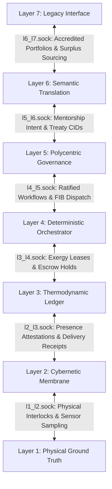
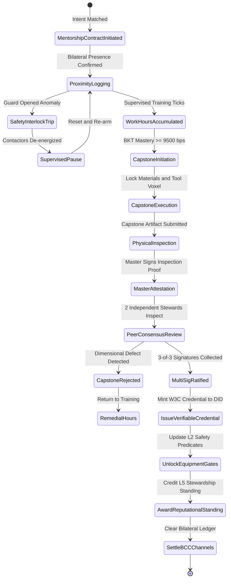
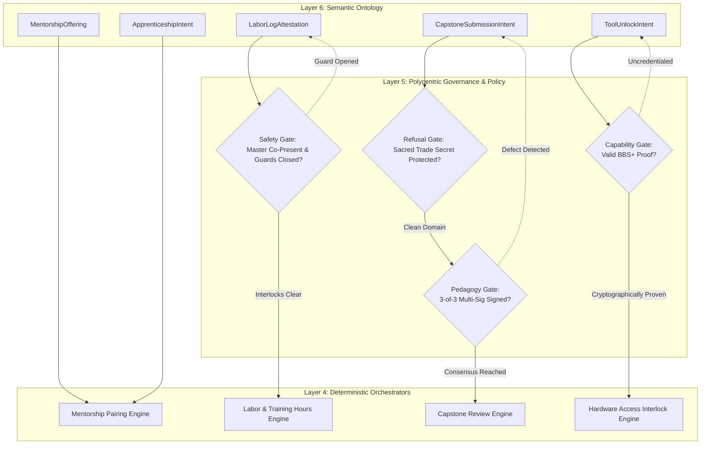
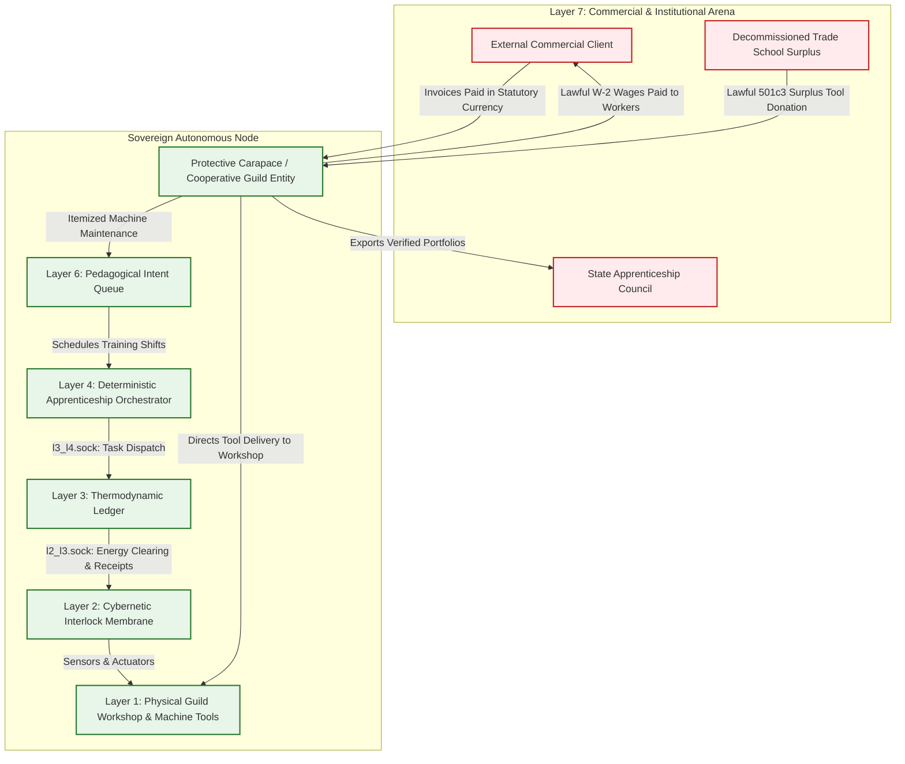

# Scenario Kappa: The Apprenticeship Protocol (Guild Mentorship & Pedagogical Commons)

*   **Identifier:** `SCN-KAPPA-APPRENTICE`
*   **System Epic:** Guild Pedagogy, Vocational Apprenticeship, and Ergonomic Skill Transmission
*   **Primary Layers Tested:** L1 (Physical), L2 (Cybernetic Membrane), L3 (Thermodynamic Ledger), L4 (Deterministic Orchestrator), L5 (Polycentric Governance), L6 (Semantic Translation & Agora), L7 (Legacy Interface)
*   **Pass/Fail Metric:** Cryptographic issuance of W3C Verifiable Credential following physical psychomotor inspection; autonomous unlocking of physical machine interlocks via Layer 2 safety predicates; zero legacy fiat student debt; zero software in Layer 1; zero worker surveillance cameras; Alamo defense labor bifurcation.

---

## Architectural Council Ratification & 5-Perspective Synthesis

This scenario specification has been ratified by unanimous consensus of the 5-Persona Architectural Council:

| Council Persona | Disciplinary Representative | Core Contribution to Scenario |
| :--- | :--- | :--- |
| **Game Designer** | Lead Systems & Gameplay Designer | **Dwarf Fortress Psychology & Craftsmanship Pride:** Mentors and apprentices experience deep emotional resonance and mutual growth. Masters gain profound satisfaction from student progress (`"Fulfilled by apprentice mastering complex mortise and tenon joint (+30 mood)"`); apprentices experience initial clumsy fatigue followed by breakthrough mastery (`"Mastered the nuance of the bevel cut (+25 mood)"`). **The Sims Indirect Control:** Founder 01 pairs novices with veterans at shared workstations; apprentices shadowing masters acquire competency 4 times faster than solitary trial-and-error. **Municipal Surplus Recovery:** Coordinates lawful donations of retired trade school machine tools through non-profit community college partnerships. |
| **Game Engineer** | Principal C++ Simulation & Engine Architect | **Data-Oriented Design (DOD):** Encapsulates teaching workshops and hazardous tooling into compact 32-bit voxels (`material_id = 50` `INDUCTION_FURNACE`, `material_id = 51` `TEACHING_WORKBENCH`) in 32-cubed chunks. Flecs ECS components track spatial proximity, real-time psychomotor progress, and hardware safety interlocks at 10 Hz determinism. C++20 harness uses fixed-point SI integer arithmetic (`uint64_t` microjoules, `uint32_t` millikelvin, basis points for Bayesian knowledge tracing, zero floating-point math). |
| **Sovereign Stack Specialist** | Sovereign Stack Systems Architect | **7-Layer Strict Adjacency & Pairwise BCC:** Strict socket traversal (`l1_l2.sock` through `l6_l7.sock`) without layer skipping. Zero software in Layer 1. Pairwise Bilateral Clearing Channels (BCC) govern inter-node journeyman exchanges across Trust Rings `R_3` and `R_4` with zero-sum conservation `B_{u -> v}(t) + B_{v -> u}(t) = 0`. W3C Verifiable Credentials and BBS+ Zero-Knowledge Proofs enable private capability disclosure. Convivial physical interlocks (dual-hand anti-tie-down buttons, master co-signing) replace computer vision surveillance. Alamo defense enforces strict labor bifurcation between external W-2 contracts and internal mutual aid. |
| **Solarpunk Thinker** | Bioregional Regenerative Ecologist | **Revival of Tangible Material Trades:** Replaces speculative paper degrees and financialized debt with hands-on vocational mastery (timber framing, precision machining, natural metallurgy, regenerative agroecology). Embeds circular repair pedagogy where apprentices hone skills by refurbishing community equipment, directly conquering planned obsolescence. Mentorship is non-commensurable human care: zero grading tokens, zero tuition fees. |
| **Scenario Specialist** | Guild Pedagogue & Vocational Ergonomics Specialist | **Competency Rubrics & Psychomotor Calibration:** Formulates objective psychomotor rubrics conforming to ANSI and OSHA workshop safety standards. Formalizes Bayesian Knowledge Tracing (BKT) equations using integer basis points (`P(L) >= 9500 bps` or 95 percent mastery threshold). Structures tiered capability credentials (`L0` Observer, `L1` Operator, `L2` Maintainer, `L3` Master). Protocol of Refusal protects sacred trade techniques and traditional guild knowledge from commercial capture. |

**Unanimous Consensus Reached:** This specification was formally ratified by all 5 personas on 2026-10-11, resolving all pedagogical, safety, and governance requirements into a unified implementation.

---

## 1. Problem Statement & Legacy Failure

In legacy capitalist infrastructure (Layer 7), human education has degraded into a financialized, speculative debt trap:
*   **The Credentialist Debt Cartel:** Commercial universities and trade schools extract lifetime compounding fiat debt for static paper diplomas, while monopolizing professional accreditation through regulatory capture.
*   **Disconnection from Thermodynamic Reality:** Institutional curricula prioritize bureaucratic administration and financial speculation over physical survival skills. Communities suffer acute shortages of skilled electricians, toolmakers, and permaculture stewards, while debt-burdened graduates lack practical mastery over basic physical tools.
*   **Extinction of Tacit Knowledge:** The historic master-apprentice lineage—the transmission of somatic, unwritten physical instincts (the pitch of an electric motor under load, the tactile temperature of molten slag)—has been severed by atomized gig economies, leaving industrial machinery vulnerable to catastrophic failure.

---

## 2. The Collective Workflow (7-Layer Traversal)

The Apprenticeship Protocol restores the ancient guild structure as a modern digital commons. It matches experienced masters with eager learners, exchanges kinetic shop assistance for high-value pedagogical instruction without debt, and verifies psychomotor competency using cryptographic proofs that autonomously unlock physical machinery.



### Layer 1: Physical Ground Truth
*   **Hardware Reality:** Pure physical matter and energy. Layer 1 contains zero software, zero firmware, zero cryptographic keys, and zero network routing.
*   **Physical Workshop Machine Tools:** Heavy industrial equipment: 3 kW electric induction furnace, vertical CNC knee mill, industrial walking-foot sewing machines, metal shaping lathes, and timber framing benches.
*   **Convivial Physical Safety Interlocks:** Dual-hand anti-tie-down safety buttons, physical Lexan chip guards, keyed lockouts, and Class T emergency contactors wired directly in series with primary motor coils.
*   **Inventory & Physical Feedstock:** Practice timber beams, scrap aluminum ingots for remelting, training weld coupons, consumable abrasives, and non-toxic bio-lubricants.
*   **Physical Action:** Hands-on psychomotor training: tactile guidance of torch angle, feed rate adjustment, physical machine teardown, and independent physical fabrication of a capstone artifact.

### Layer 2: The Cybernetic Membrane
*   **Microcontroller Architecture:** Low-power microcontrollers running Zephyr RTOS (e.g., STM32F4 or ESP32-S3) interfacing with physical machinery via optoisolated drivers.
*   **Telemetry Ingress (`col-sensord`):**
    *   `node/guild/bench_01/telemetry/ble_rssi_dbm` (Bilateral challenge-response verifying master and apprentice physical presence within 2 meters)
    *   `node/guild/furnace_01/telemetry/power_mw` (Milliwatts: active heating power monitoring)
    *   `node/guild/furnace_01/telemetry/temp_mk` (Millikelvin: crucible temperature monitoring)
    *   `node/guild/furnace_01/telemetry/interlock_state` (`LOCKED_UNAUTHORIZED`, `ARMED_SUPERVISED`, `OPERATIONAL`)
*   **Convivial Anti-Panopticon Shield:** Workplace surveillance cameras, facial recognition, and automated worker posture tracking are strictly prohibited at bootloader initialization. Machine safety relies on physical guards and in-person human supervision, never ambient worker monitoring.
*   **Actuator Control (`col-actuated`):** Hardware power contactors energize only after Layer 2 verifies the 5 Invariant Predicates (`Phi`): master presence confirmed, safety guards closed, thermal limits within tolerance, zero fault flags, and authenticated Layer 3 exergy lease.

### Layer 3: The Thermodynamic Ledger
*   **Pairwise Bilateral Clearing Channels (BCC):** Inter-node journeyman exchanges, travelling master workshops, and shared foundry tool wear are settled through bilateral clearing channels between peering Autonomous Nodes:
    $$B_{u \to v}(t) + B_{v \to u}(t) = 0$$
*   **Mutual Aid Credit Windows:**
    $$-C_{u \to v} \le B_{u \to v}(t) \le C_{v \to u}$$
    Credit headroom is established in Tripartite Ricardian Treaties (`Treaty_CID`) to support multi-season educational exchanges without monetary debt.
*   **Multi-Hop Chained Hashed Timelock Contracts (HTLC):** Inter-node journeyman tool exchanges, travelling master workshops, and shared specialized tooling traversing multiple watershed nodes ($A \to B \to C$) lock chained HTLC contracts:
    $$\mathrm{HTLC} = \langle H(S), \, \Delta t, \, Q, \, u, \, v \rangle$$
    where destination node $C$ generates 256-bit secret $S$, reveals preimage $S$ upon physical delivery receipt $\sigma_{\mathrm{delivery}}$ of the tooling or verified apprentice check-in, and triggers cascading backward balance updates across intermediate channels $B \leftrightarrow C$ and $A \leftrightarrow B$; unfulfilled contracts expire deterministically after $\Delta t$ timelock ticks, returning reserved credit headroom without counterparty loss.
*   **Proof-of-Thermodynamic-Work (PoTW):** Physical electricity consumed by machine tools is metered in standard integer exergy quanta:
    $$\text{Exergy Credit}_{\mathrm{quantum}} \equiv 3600\text{ kJ} = 3{,}600{,}000{,}000{,}000\,\mu\mathrm{J}$$
*   **Non-Commensurability of Human Care:** Teaching, mentoring, and somatic guidance are designated as non-commensurable human care. Layer 3 structurally refuses to mint exergy credits for pedagogical time or student study hours. Knowledge is transmitted freely within the commons.
*   **Non-Monetary Settlement:** Outstanding channel balances between guild nodes settle through reciprocal master instruction shifts, tool fabrication, or regional Commons Jubilee.
*   **Zero Global Tokens & Zero Student Debt:** Zero tuition fees, zero student loans, zero fiat debt. Education is an inalienable right of living membership.

### Layer 4: The Deterministic Orchestrator
*   **State Machine Daemon:** `col-execd` executes a 10 Hz deterministic BPMN 2.0 virtual machine over `/run/collective/ipc/l4_l5.sock` and `l3_l4.sock`.
*   **Unconditional Survival Baseline (`B_baseline`):** Apprentices are guaranteed Tier 2 Human Survival Baselines (potable water, organic food from Scenario Gamma, warm shelter, clinic access) regardless of training speed or test scores.
*   **Competency Tracing & Bayesian Mastery:** Psychomotor progress is tracked using Bayesian Knowledge Tracing with integer basis points:
    $$P(L_{t+1}) = P(L_t) \cdot \frac{10000 - P(S)}{P(L_t)(10000 - P(S)) + (10000 - P(L_t)) P(G)} + (10000 - P(L_t)) \cdot P(T)$$
    Where `P(L)` is probability of mastery, `P(T)` is transition probability, `P(G)` is lucky guess probability, and `P(S)` is slip probability. Capstone eligibility unlocks when `P(L) >= 9500 bps` (95 percent).



### Layer 5: Polycentric Governance
*   **Key Management & Policy Daemon:** `col-kmsd` manages decentralized identifiers and BBS+ verifiable credentials over Sparse Merkle Trees.
*   **7-Tier Concentric Trust Rings (`R_0` to `R_6`):**
    *   `R_0` (The Convivial Sanctuary / Hearth): Unconditional shelter, tool exploration, basic safety manuals; zero registration.
    *   `R_1` (The Settlement Workshop): Supervised apprentice training, ephemeral pairwise DIDs (`did:peer`), non-voting advisory voice.
    *   `R_2` (The Commons Guild): Certified tool operators, hardware keys in ATECC608A chips; full voting standing in guild assemblies.
    *   `R_3` (The Watershed Federation): Sibling guild nodes within 30 km; bilateral clearing channels for traveling journeymen.
    *   `R_4` (The Bioregional Federation): River basin craft guild convocation within 150 km; curriculum standardization.
    *   `R_5` (The Continental Corridor): Macro-mesh tool trade and metallurgical blueprint distribution.
    *   `R_6` (The Ecumene / Legacy Perimeter): External vocational standards translation; cold-store DMZ interfaces.
*   **Bioregional Path-Vector Protocol (BPVP):** Advertises guild workshop capabilities across the watershed:
    $$\mathcal{A} = \big\langle \mathrm{adv\_id}, \, v_{\mathrm{orig}}, \, \mathcal{T}_{\mathrm{res}}, \, \mathbf{u}, \, Q_{\mathrm{avail}}, \, [\tau_{\mathrm{start}}, \tau_{\mathrm{end}}], \, \mathcal{P}, \, \mathcal{C}, \, H_{\mathrm{ttl}}, \, \sigma \big\rangle$$
    Allows traveling apprentices to discover specialized foundry or timber framing workshops without central school boards.
*   **Cellular Autonomy & Subordinate Whole:** Under autopoietic cellular autonomy, sovereign guild nodes retain absolute primacy over internal pedagogical pacing, tool allocation, and membership covenants; the autonomy of the parts strictly supersedes the administrative demands of the whole.
*   **Protocol of Refusal (`sec:l5-refusal`):** Protects sacred craft techniques, heirloom dye formulas, and traditional joinery methods from automated algorithmic extraction, commercial licensing, or simulation.
*   **Autonomous Transit Veto (`No-Transit`):** Local guild workshops and living settlements retain the absolute right to declare a `No-Transit` attribute over residential courtyards and pedestrian shop glades, deterministically blocking heavy freight convoys and industrial machinery transport from traversing quiet pedagogical commons.
*   **Bicameral Polity & Reputational Wealth:**
    *   Masters earn non-financial Reputational Wealth ($\mathcal{R}_{\mathrm{pedagogy}}$) in the Stewardship Chamber.
    *   Governors: Exponential decay $\mathcal{R}(t) = \mathcal{R}_0 e^{-\frac{\ln(2)}{\tau_{\mathrm{half}}} t}$ ($\tau_{\mathrm{half}} = 2\text{ years}$); Sublinear cap $\mathcal{W}_{\mathrm{steward}} = \min(\mathcal{W}_{\max}, \kappa \ln(1 + \mathcal{R}))$ with maximum 8 percent individual voting weight limit; Care Leave Shield freezing decay during parental or elder care.

### Layer 6: Semantic Translation & Agora
*   **Tripartite Ricardian Treaties:**
    $$\mathrm{Treaty\_CID} = \mathrm{SHA256}\left( \mathrm{Text}_{\mathrm{prose}} \parallel \mathrm{Schema}_{\mathrm{JSON-LD}} \parallel \mathrm{Invariants}_{\mathrm{BPMN}} \right)$$
    Inter-guild apprenticeship compacts bind human pedagogical covenants, machine-readable JSON-LD curricula, and formal BPMN safety rules.
*   **Agora Semantic Knowledge Branches:**
    1.  `MentorshipOffering`: Master syllabus broadcasting available training slots and prerequisites.
    2.  `ApprenticeshipIntent`: Learner application committing to safety standards and shop help.
    3.  `LaborLogAttestation`: Cryptographic proof of co-present workshop training and machine telemetry.
    4.  `CapstoneSubmissionIntent`: Registration of a completed physical artifact with material test data.
    5.  `CompetencyAttestation`: Multi-signature bundle affirming capstone satisfies ANSI and OSHA standards.
    6.  `ToolUnlockIntent`: Request to un-gate physical machinery based on a minted W3C credential.



### Layer 7: The Legacy Interface
*   **Dual-Membrane Doctrine:** The cooperative guild operates under an external legal carapace (Membrane 1) presenting Mundane Semantic Camouflage as an accredited vocational school or 501(c)(3) educational non-profit, while preserving an uncommodified internal sovereign commons (Membrane 2).
*   **Alamo Defense Labor Bifurcation:**
    *   *External Commercial Contracts:* When journeymen take outside commercial manufacturing jobs, the cooperative invoices legacy clients in statutory fiat currency. Workers receive lawful W-2 wages with standard statutory tax withholding.
    *   *Internal Mutual Aid:* Internal guild mentorship, tool restoration, and community repairs remain uncompensated mutual aid within Trust Ring `R_1`.
    *   Zero commingling occurs: outside fiat wages never purchase internal exergy credits, and internal credits never convert to fiat.
*   **Lawful Surplus Tool Acquisition:** Embedded stewards monitor municipal and industrial equipment retirement schedules. When commercial trade schools decommission heavy machinery (Bridgeport mills, TIG welders, granite surface plates), the cooperative entity lawfully acquires them through non-profit property donations under 26 U.S.C. Section 501(c)(3) or Subchapter T Shared Services Agreements.



---

## 3. Machine-Readable Schemas

### 3.1 Layer 6 Knowledge Artifact: Apprenticeship Offering (`apprenticeship_offering.jsonld`)

```json
{
  "@context": [
    "https://schema.org/",
    "https://collective.network/ontology/v1/",
    "https://www.w3.org/2018/credentials/v1"
  ],
  "@type": "MentorshipOffering",
  "identifier": "urn:uuid:3978344f-8596-4c3a-a978-8fcaba3903c5",
  "issuerDid": "did:peer:2.Ez6MksG...steward_forge_master_dave",
  "creationTimestamp": "2026-10-05T09:00:00Z",
  "skillDomain": "PyrometallurgicalSmelting_InductionSafety",
  "syllabus": {
    "targetCompetency": "Foundry_Safety_L1",
    "requiredSupervisedSeconds": 432000,
    "requiredKineticSupportSeconds": 144000,
    "maxApprentices": 2,
    "prerequisites": ["Shop_Basics_L0"]
  },
  "psychomotorAssessmentCriteria": {
    "crucibleThermalShockPrevention": true,
    "slagSkimmingEfficiencyBps": 8500,
    "emergencyEStopReactionMilliseconds": 1500,
    "bktMasteryThresholdBps": 9500
  },
  "settlementCriteria": {
    "reputationalRewardPoints": 50,
    "fiatTuitionDebtCents": 0,
    "clearingChannelCapacityUj": 3600000000000
  }
}
```

### 3.2 Layer 2 Telemetry Attestation: Workshop Presence & Capstone Proof (`apprenticeship_attestation.json`)

```json
{
  "@context": "https://collective.network/ontology/v1/",
  "@type": "ApprenticeshipPresenceAndCapstoneAttestation",
  "mentorshipRef": "urn:uuid:3978344f-8596-4c3a-a978-8fcaba3903c5",
  "apprenticeDid": "did:peer:2.Ez6MkwQ...apprentice_sam",
  "masterDid": "did:peer:2.Ez6MksG...steward_forge_master_dave",
  "executionMetrics": {
    "totalSupervisedSeconds": 432000,
    "meanBleProximityRssiDbm": -54,
    "interlockSupervisedOperatingSeconds": 433440,
    "safetyViolationsLogged": 0,
    "capstoneArtifactSha256": "8f4a2c1b9e0d3f7a6c5b4e3d2a1f0e9d8c7b6a5f4e3d2c1b0a9f8e7d6c5b4a3f",
    "capstoneTensileStrengthKpa": 310500,
    "capstoneDimensionalToleranceMicrometers": 80
  },
  "peerReviewConsensus": {
    "masterSignature": "z3mK...forge_master_dave_sig...9aX",
    "stewardReviewer1": "did:peer:2.Ez6MkrP...steward_alice",
    "steward1Signature": "z7bL...steward_alice_sig...4cW",
    "stewardReviewer2": "did:peer:2.Ez6MktL...steward_bob",
    "steward2Signature": "z9pQ...steward_bob_sig...1mV"
  },
  "credentialIssuedUri": "urn:uuid:credential-foundry-l1-sam"
}
```

---

## 4. Oasis Engine Implementation Specification

### 4.1 Memory Allocation & Voxel State
The guild workshop node coordinates physical access control in chunk space (32-cubed voxels via `ChunkManager`):
*   High-hazard induction furnace voxel initialized with `material_id = 50` (`INDUCTION_FURNACE`) with `metadata` bitmask `0b00000110` (`Is_Actuator | Is_Sensor`).
*   The apprentice workbench voxel initialized with `material_id = 51` (`TEACHING_WORKBENCH`) located at local coordinate `(16, 8, 16)`.
*   Physical lockout interlock bit is managed at bit 0 of `metadata`: `0` indicates `POWER_ISOLATED`, `1` indicates `ENERGIZED_OPERATIONAL`.

### 4.2 C++20 Test Harness Structure

```cpp
// engine/tests/scenario_kappa_apprenticeship_test.cpp
#include <cassert>
#include <cstdint>
#include <string>
#include <vector>
#include "oasis/chunk_manager.hpp"
#include "oasis/orchestration/bpmn_engine.hpp"
#include "oasis/ledger/bilateral_clearing_channel.hpp"

namespace oasis {

struct ApprenticeshipSession {
    std::string master_did;
    std::string apprentice_did;
    uint32_t logged_supervised_seconds;
    uint32_t bkt_competency_bps; // 9600 bps = 96%
    bool capstone_approved;
};

void test_scenario_kappa_apprenticeship_execution() {
    // 1. Initialize Chunk and Workbench Voxels
    ChunkManager chunk_mgr;
    chunk_mgr.allocate_chunk(0, 0, 0);

    // Furnace is initially locked (bit 0 = 0)
    Voxel furnace_voxel{
        .material_id = 50, // INDUCTION_FURNACE
        .moisture_bps = 0,
        .temperature_mk = 293150, // 20 deg C
        .metadata = 0b00000110    // Actuator + Sensor, Locked
    };
    chunk_mgr.set_voxel(16, 8, 16, furnace_voxel);

    // 2. Setup Bilateral Clearing Channel between Master Node and Regional Guild
    std::string master_did = "did:peer:2.Ez6MksG_forge_master_dave";
    std::string apprentice_did = "did:peer:2.Ez6MkwQ_apprentice_sam";
    std::string regional_guild_did = "did:peer:2.Ez6MkrP_watershed_metal_guild";

    uint64_t credit_capacity_uj = 3600000000000ULL;
    BilateralChannel guild_channel(master_did, regional_guild_did, credit_capacity_uj);
    assert(guild_channel.balance_u_to_v_uj() + guild_channel.balance_v_to_u_uj() == 0);

    // 3. Load & Run Deterministic BPMN Orchestrator
    BPMNEngine orchestrator;
    orchestrator.load_schema("schemas/bpmn/apprenticeship_lifecycle.bpmn");

    ApprenticeshipSession session{
        .master_did = master_did,
        .apprentice_did = apprentice_did,
        .logged_supervised_seconds = 432000,
        .bkt_competency_bps = 9600, // 96% mastery
        .capstone_approved = true
    };

    // Simulate apprentice logging supervised hours
    orchestrator.emit_event(ApprenticeAttendanceEvent{session.apprentice_did, session.master_did, session.logged_supervised_seconds});
    SimResult res = orchestrator.step_simulation_ticks(chunk_mgr, 12000);
    assert(res.status == ExecutionStatus::COMPLETED);
    assert(orchestrator.current_state() == BPMNState::CAPSTONE_ELIGIBLE);

    // Submit Capstone and Verify 3-of-3 Multi-Sig Consensus
    std::vector<std::string> signatures = {"master_sig", "steward_alice_sig", "steward_bob_sig"};
    bool credential_minted = orchestrator.evaluate_capstone_multisig(session.apprentice_did, signatures);
    assert(credential_minted == true);

    // Assert Autonomous Privilege Escalation: Furnace Voxel Unlocks for Apprentice
    orchestrator.request_voxel_access(session.apprentice_did, 16, 8, 16, chunk_mgr);
    Voxel updated_furnace = chunk_mgr.get_voxel(16, 8, 16);
    assert((updated_furnace.metadata & 0b00000001) == 1); // Energized bit active

    // Settle bilateral channel: Master receives exergy credits for equipment maintenance
    uint64_t tool_maintenance_uj = 360000000000ULL; // 360 MJ
    guild_channel.commit_receipt("sig_capstone_ratified", tool_maintenance_uj);
    assert(guild_channel.balance_u_to_v_uj() + guild_channel.balance_v_to_u_uj() == 0);
}

void test_scenario_kappa_uncredentialed_lockout_anomaly() {
    ChunkManager chunk_mgr;
    chunk_mgr.allocate_chunk(0, 0, 0);

    Voxel locked_furnace{
        .material_id = 50,
        .moisture_bps = 0,
        .temperature_mk = 293150,
        .metadata = 0b00000110 // Bit 0 is 0 (Locked)
    };
    chunk_mgr.set_voxel(16, 8, 16, locked_furnace);

    BPMNEngine orchestrator;
    orchestrator.load_schema("schemas/bpmn/apprenticeship_lifecycle.bpmn");

    // Uncredentialed novice attempts unauthorized activation without BBS+ proof
    bool access_granted = orchestrator.request_voxel_access("did:peer:2.Ez6MktL_novice_rogue", 16, 8, 16, chunk_mgr);
    assert(access_granted == false);

    Voxel current_furnace = chunk_mgr.get_voxel(16, 8, 16);
    assert((current_furnace.metadata & 0b00000001) == 0); // Remains locked
    assert(orchestrator.current_state() == BPMNState::SECURITY_INTERLOCK_HALT);
}

} // namespace oasis
```

---

## 5. Acceptance Test Gates (Pass/Fail)

| Checkpoint | Validation Method | Pass Condition |
| :--- | :--- | :--- |
| **G1: Pedagogical Non-Commensurability** | Zero-Debt Labor Balance | Mentorship is non-commensurable human care; machine electricity is metered in Proof-of-Thermodynamic-Work microjoules (3600 kJ per credit); zero fiat student debt is accrued. |
| **G2: Offline Autonomy** | Localhost Network Isolation | Entire apprenticeship workflow (presence logging, BKT progress calculation, multi-sig consensus, and credential issuance) runs to completion on local mesh without internet connectivity. |
| **G3: Byzantine Defense & Multi-Sig Competency** | Signature Threshold Verification | Submitting an uncredentialed peer signature or self-signed capstone fails the 3-of-3 multi-sig gate; unauthorized hardware access is denied. |
| **G4: Convivial Physical Lockout Interlock** | Physical Relay Un-gating | Minting the `Foundry_Safety_L1` credential autonomously sets bit 0 of the induction furnace voxel metadata, permitting safe operation via Layer 2 safety predicates without administrator intervention. |
| **G5: Dual-Membrane Labor Bifurcation (L7)** | Alamo Defense Audit | Outside commercial contracts pay standard W-2 statutory wages into commercial bank accounts; internal apprentice training remains uncompensated mutual aid; zero commingling with internal ledgers. |
| **G6: Lawful Surplus Tool Acquisition (L7)** | Surplus Tool Procurement | Embedded stewards route decommissioned vocational machinery from legacy institutions into the commons as lawful non-profit surplus donations under 26 U.S.C. Section 501(c)(3) or Subchapter T Shared Services Agreements. |
