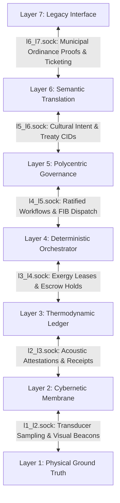
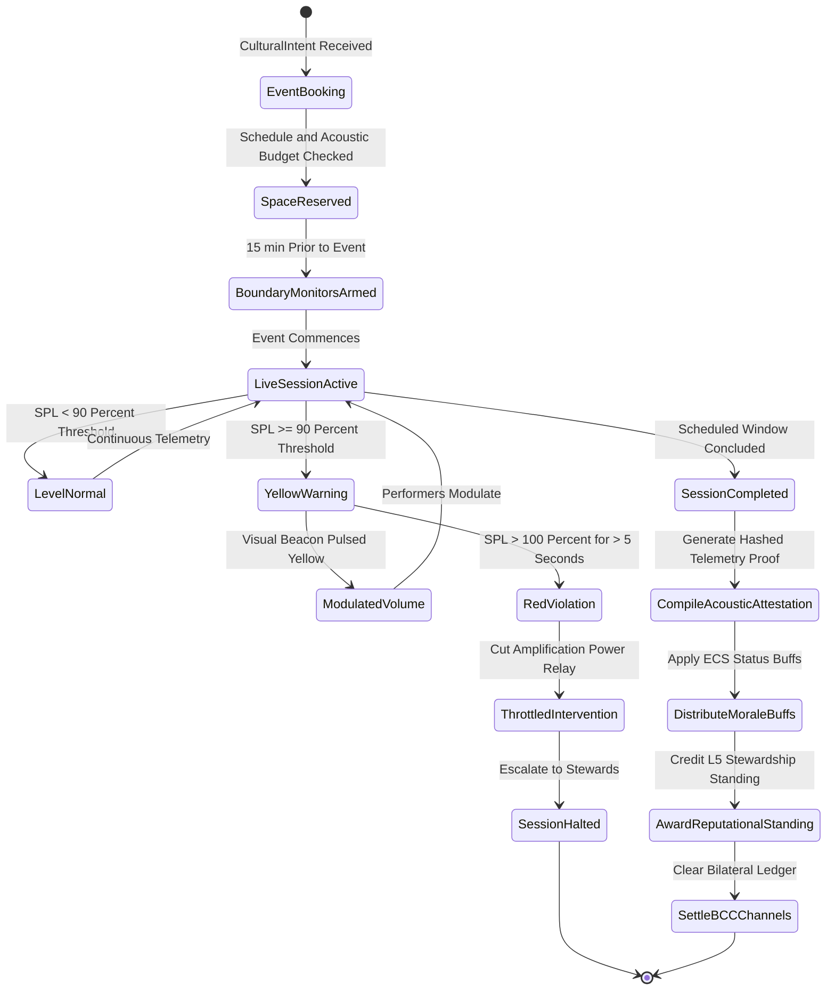
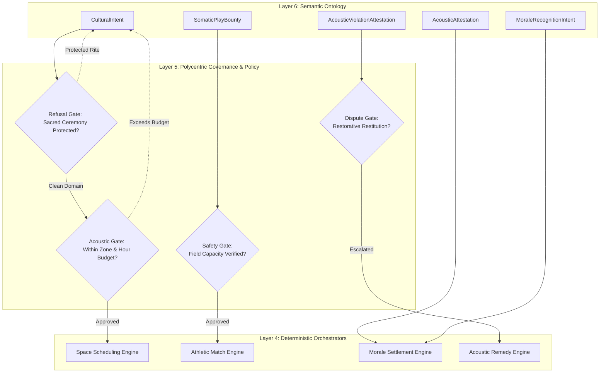
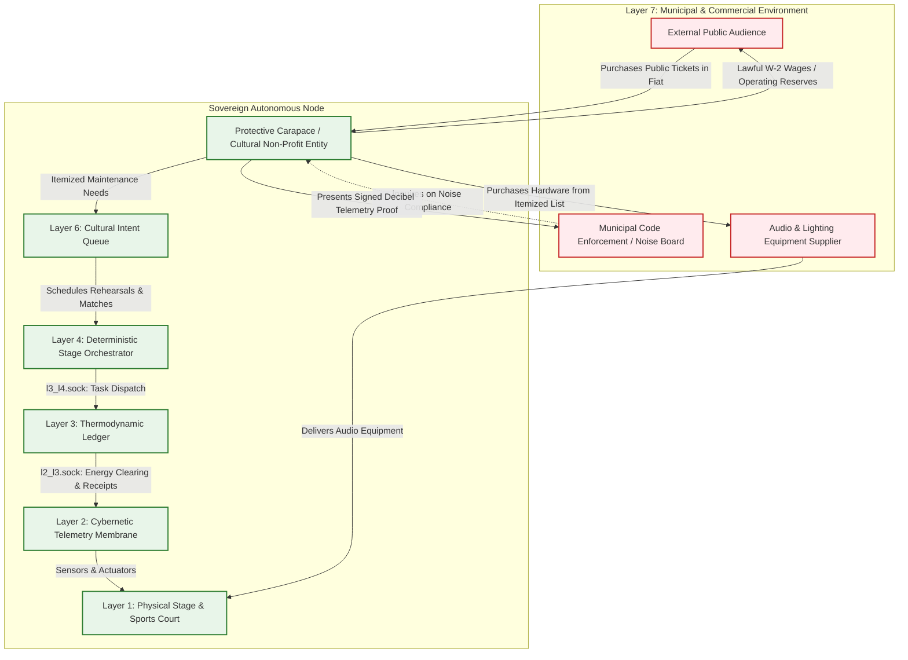

# Scenario Lambda: The Cultural Commons (Acoustic Stewardship, Arts & Somatic Play)

*   **Identifier:** `SCN-LAMBDA-CULTURE`
*   **System Epic:** Cultural Commons, Acoustic Stewardship, Somatic Movement, and Public Performance
*   **Primary Layers Tested:** L1 (Physical), L2 (Cybernetic Membrane), L3 (Thermodynamic Ledger), L4 (Deterministic Orchestrator), L5 (Polycentric Governance), L6 (Semantic Translation & Agora), L7 (Legacy Interface)
*   **Pass/Fail Metric:** Successful orchestration of a cultural or athletic gathering where active property-line acoustic telemetry remains strictly below 55 dBA (daytime) and below 45 dBA (nighttime); zero IEEE 754 floating-point math; zero tokenization of creative or athletic expression; Protocol of Refusal protecting sacred ceremonial rites from simulation; Dual-Membrane acoustic legal defense; zero centralized servers; zero biometric sensors.

---

## Architectural Council Ratification & 5-Perspective Synthesis

This scenario specification has been ratified by unanimous consensus of the 5-Persona Architectural Council:

| Council Persona | Disciplinary Representative | Core Contribution to Scenario |
| :--- | :--- | :--- |
| **Game Designer** | Lead Systems & Gameplay Designer | **Dwarf Fortress Psychology & Somatic Catharsis:** Models human emotional catharsis, communal singing, and physical play as non-financial social vitality. Agents attending live acoustic sessions or participatory 3v3 basketball games shed trauma and chronic fatigue (`"Moved by extraordinary cello resonance (+40 mood)"` or `"Exhilarated by friendly athletic teamwork (+30 mood)"`). **The Sims Indirect Control:** Founder 01 schedules Friday evening cultural gatherings to replenish community social bars, preventing burnout during critical fabrication sprints. **Municipal Acoustic Compliance:** Real-time property-line decibel telemetry acts as an airtight lawful defense against municipal and suburban nuisance noise complaints. |
| **Game Engineer** | Principal C++ Simulation & Engine Architect | **Data-Oriented Design (DOD):** Encapsulates cultural infrastructure into compact 32-bit voxels (`material_id = 55` `SOUND_STAGE`, `material_id = 56` `SPORTS_COURT`, `material_id = 57` `ACOUSTIC_BERM`) in 32-cubed chunks. Flecs ECS systems simulate acoustic wave breadth-first search (BFS) decay through architectural barriers at 10 Hz determinism. C++20 harness uses fixed-point SI integer arithmetic (`uint64_t` microjoules, integer decibels `dBA`, zero floating-point math) to validate wave attenuation and non-tokenized morale status propagation. |
| **Sovereign Stack Specialist** | Sovereign Stack Systems Architect | **7-Layer Strict Adjacency & Pairwise BCC:** Enforces strict socket boundaries (`l1_l2.sock` through `l6_l7.sock`) without layer skipping. Zero software in Layer 1. Pairwise Bilateral Clearing Channels (BCC) govern inter-node cultural convocations and travelling festival equipment across Trust Rings `R_3` and `R_4` with zero-sum conservation `B_{u -> v}(t) + B_{v -> u}(t) = 0`, bounded credit windows `[-C_{u -> v}, +C_{v -> u}]`, and two-phase delivery receipts `\sigma_{\mathrm{delivery}}`. Multi-hop HTLCs settle staged equipment logistics and travelling artist performances. Protocol of Refusal (`sec:l5-refusal`) structurally shields sacred rites from digital recording or simulation. Privacy-preserving edge decibel telemetry streams strictly numerical volume levels with zero raw audio recording. Absolute ban on body-worn biometric sensors. Dual-Membrane Carapace presents Mundane Semantic Camouflage to municipal authorities. |
| **Solarpunk Thinker** | Bioregional Regenerative Ecologist | **Acoustic Ecology & Participatory Joy:** Establishes acoustic limits that protect nocturnal pollinator corridors, nesting songbirds, and human sleep rhythms from low-frequency noise pollution. Reclaims somatic physical play in open public commons, systematically replacing passive spectator commercialism with participatory joy. Artistic expression is non-commensurable human culture: zero tokenization of music or sports. |
| **Scenario Specialist** | Psychoacoustician & Community Somatics Ethnographer | **Sound Propagation & Psychoacoustic Limits:** Formulates sound transmission loss decay conforming to ANSI and ISO acoustic standards in integer decibels. Establishes frequency-weighted acoustic budgets (dBA for speech/strings, dBC for bass containment) and models somatic exertion recovery curves. Non-commercial festival agreements are ratified through Tripartite Ricardian Treaties (`Treaty_CID`). |

**Unanimous Consensus Reached:** This specification was formally ratified by all 5 personas on 2026-10-11, resolving all cultural, acoustic, and governance requirements into a unified implementation.

---

## 1. Problem Statement & Legacy Failure

In late-stage commercial infrastructure (Layer 7), human artistic expression and physical recreation have been enclosed, commodified, and actively suppressed:
*   **Platform Enclosure & Artist Impoverishment:** Centralized streaming monopolies extract up to 80 percent of creative revenues, leaving working artists unable to afford basic food or shelter, while algorithms homogenize music to optimize passive consumer screen time.
*   **Commercialization of Sports & Somatic Alienation:** Physical athletics has been degraded into commercialized sports betting platforms and passive spectator entertainment. Neighborhood pickup games and participatory physical culture are replaced by sedentary isolation, causing soaring health crises.
*   **Suburban Noise Suppression & Police Weaponization:** Restrictive municipal zoning regimes and suburban associations weaponize municipal police departments against citizens making music or playing outdoor sports. Vague, subjective "nuisance ordinances" are enforced arbitrarily, killing neighborhood vibrancy and communal trust.

---

## 2. The Collective Workflow (7-Layer Traversal)

Scenario Lambda reclaims culture and physical play by treating human psychological morale and communal ritual as primary sovereign goods. Grounded in calibrated decibel telemetry, it protects neighborhood tranquility while ensuring creators and athletes are recognized through community standing rather than financialized speculation.



### Layer 1: Physical Ground Truth
*   **Hardware Reality:** Pure physical matter and energy. Layer 1 contains zero software, zero firmware, zero cryptographic keys, and zero network routing.
*   **Physical Cultural & Athletic Facilities:** Community stages, half-court sports surfaces, rehearsal rooms, and open earthen amphitheatres.
*   **Acoustic Containment Barriers:** Dense earthen sound berms, green living walls, recycled cellulose acoustic baffling, and double-stud soundproof enclosures.
*   **Physical Gear & Instruments:** Acoustic cellos, violins, open-hardware analog synthesizers, drum kits with mesh dampening pads, basketballs, soccer balls, and athletic safety equipment.
*   **Physical Action:** Acoustic soundwave emission, somatic athletic exertion, tactile dance, and choral singing occurring within designated physical coordinates.

### Layer 2: The Cybernetic Membrane
*   **Microcontroller Architecture:** Low-power microcontrollers running Zephyr RTOS (e.g., STM32F4 or ESP32-S3) interfacing with calibrated sound level sensors.
*   **Telemetry Ingress (`col-sensord`):**
    *   `node/culture/garage_01/telemetry/spl_dba` (A-weighted sound pressure level in integer decibels, 100 ms RMS)
    *   `node/culture/property_line/telemetry/spl_dba` (Boundary sound level, statutory limit 55 dBA daytime, 45 dBA nighttime)
    *   `node/culture/alert_beacon/state` (`NORMAL_GREEN`, `WARNING_YELLOW`, `THROTTLED_RED`)
*   **Privacy Invariant Verification:** Edge sensors execute on-chip FFT and RMS calculations, streaming strictly numerical sound pressure metrics in integer decibels (`dBA` and `dBC`). **Zero raw audio is recorded, stored, or transmitted**, eliminating surveillance risks.
*   **Absolute Ban on Biometric Tracking:** Devices measuring heart rate, skin galvanic response, brainwaves, steps, or gaze tracking are structurally banned from the stack. Athletic courts monitor boundary decibels and lighting timers, never participant vital signs.
*   **Visual Feedback Actuation (`col-actuated`):** Local visual alert beacon pulses yellow when sound levels reach 90 percent of permitted threshold, and pulses red if breached, prompting performers to modulate volume in real time.

### Layer 3: The Thermodynamic Ledger
*   **Pairwise Bilateral Clearing Channels (BCC):** Inter-node festival hosting, travelling bardic troupes, and sound equipment exchanges across Trust Rings `R_3` and `R_4` settle through pairwise bilateral clearing channels:
    $$B_{u \to v}(t) + B_{v \to u}(t) = 0$$
*   **Mutual Aid Credit Windows:**
    $$-C_{u \to v} \le B_{u \to v}(t) \le C_{v \to u}$$
    Credit limits are ratified via Layer 6 Ricardian Treaties (`Treaty_CID`) to accommodate regional cultural convocations.
*   **Two-Phase Delivery Receipts:** Physical dispatch of shared sound gear, musical instruments, or athletic staging requires sensor-verified delivery receipts:
    $$\sigma_{\mathrm{delivery}} = \mathrm{Sign}_{K_{\mathrm{receiver}}}\left( \mathrm{Hash}(Q_{\mathrm{measured}} \parallel \tau_{\mathrm{arrival}} \parallel \mathrm{Channel\_ID}) \right)$$
*   **Multi-Hop Chained HTLCs:** Travelling bardic troupes or shared athletic equipment traversing multiple intermediate nodes settle via chained Hashed Timelock Contracts:
    $$\mathrm{HTLC} = \langle H(S), \, \Delta t, \, Q, \, u, \, v \rangle$$
    Where secret preimage `S` is revealed upon counter-signed physical equipment receipt, atomically clearing intermediary channels across the watershed without central clearinghouses.
*   **Proof-of-Thermodynamic-Work (PoTW):** Physical electricity consumed by stage lighting and sound amplification is metered in standard integer exergy quanta:
    $$\text{Exergy Credit}_{\mathrm{quantum}} \equiv 3600\text{ kJ} = 3{,}600{,}000{,}000{,}000\,\mu\mathrm{J}$$
*   **Non-Commensurability of Cultural Expression:** Music, athletics, storytelling, and dance are designated as non-commensurable human culture. Layer 3 structurally refuses to mint exergy credits for artistic performances or athletic games. Cultural joy is shared freely within the commons.
*   **Non-Monetary Settlement:** Outstanding channel balances between nodes settle through reciprocal festival hosting, equipment maintenance, or bioregional Commons Jubilee.
*   **Zero Global Tokens & Zero Fiat Speculation:** Zero artistic tokens, zero ticket scalping, zero AMMs.

### Layer 4: The Deterministic Orchestrator
*   **State Machine Daemon:** `col-execd` executes a 10 Hz deterministic BPMN 2.0 virtual machine over `/run/collective/ipc/l4_l5.sock` and `l3_l4.sock`.
*   **Contention Priority & Baselines:** Cultural lighting and amplification shed automatically if local microgrids experience severe power constraints, protecting Tier 1 Ecological Floors (`F_eco`) and Tier 2 Survival Baselines (`B_baseline`).
*   **Acoustic Budget Envelope:** The orchestrator integrates cumulative boundary sound exposure over the scheduled session window:
    $$\mathcal{E}_{\mathrm{acoustic}} = \sum_{t=1}^{T} 10^{\frac{L_{p,A}(t) - L_{\mathrm{target}}}{10}} \Delta t \le \mathcal{B}_{\mathrm{permitted}}$$
    Where $L_{\mathrm{target}}$ is the zoning ceiling (55 dBA daytime, 45 dBA nighttime).



### Layer 5: Polycentric Governance
*   **Key Management & Policy Daemon:** `col-kmsd` manages decentralized identifiers and governance policies over Sparse Merkle Trees.
*   **Autopoietic Cellular Autonomy:** Every Autonomous Node retains absolute internal cultural sovereignty ("the parts" over "the whole"). Outside councils cannot compel an assembly to stage unwanted events, breach local acoustic curfews, or compromise communal peace.
*   **7-Tier Concentric Trust Rings (`R_0` to `R_6`):**
    *   `R_0` (The Convivial Sanctuary / Hearth): Intimate family storytelling, acoustic lullabies, private spiritual practice; zero sensors, zero registration.
    *   `R_1` (The Settlement Grounds): Acoustic jam sessions, community rehearsals, informal playground games; ephemeral pairwise DIDs (`did:peer`).
    *   `R_2` (The Commons Amphitheatre): Public concerts, athletic tournaments, community feasts; full voting standing in assemblies.
    *   `R_3` (The Watershed Federation): Sibling nodes within 30 km; bilateral clearing channels for traveling bardic troupes and sports leagues.
    *   `R_4` (The Bioregional Federation): River basin solstice celebrations within 150 km; inter-watershed athletic games.
    *   `R_5` (The Continental Corridor): Trans-continental cultural exchanges and traditional music archival.
    *   `R_6` (The Ecumene / Legacy Perimeter): Public performances open to outside visitors; municipal acoustic compliance certificates.
*   **Bioregional Path-Vector Protocol (BPVP / FRRP):** Coordinates inter-node cultural exchanges, athletic leagues, and sound reinforcement equipment routing:
    $$\mathcal{A} = \big\langle \mathrm{adv\_id}, \, v_{\mathrm{orig}}, \, \mathcal{T}_{\mathrm{res}}, \, \mathbf{u}, \, Q_{\mathrm{avail}}, \, [\tau_{\mathrm{start}}, \tau_{\mathrm{end}}], \, \mathcal{P}, \, \mathcal{C}, \, H_{\mathrm{ttl}}, \, \sigma \big\rangle$$
    *   Export Surplus Bound: $Q_{\mathrm{avail}}(t) = \max\left(0, Q_{\mathrm{inventory}}(t) - F_{\mathrm{eco}}(t) - B_{\mathrm{baseline}}(t)\right) \cdot \mathbf{1}_{\mathrm{export}}$
    *   Ring-Path Vector: $\mathcal{P} = [(v_k, r_k), \dots, (v_0, r_0)]$ with Loop-Freedom Invariant discarding self-referential routes via loop checks in $O(D)$ time.
    *   Dynamic Request Cascading widens capability advertisements outward: $R_0/R_1 \to R_2 \to R_3 \to R_4$.
*   **Protocol of Refusal (`sec:l5-refusal`):**
    *   Commons Chamber designation protecting sacred spiritual gatherings, indigenous ceremonies, and private cultural mourning from digital recording, quantification, or Oasis simulation.
    *   *Technical Effects:* Refused ceremonies are excluded from digital twin models, physical sensors are de-energized during the ceremony window, and routing daemons cannot log or publish the event.
*   **Autonomous Transit Veto (`No-Transit`):** Cultural amphitheaters, ceremonial grounds, and festival meadows hold unconditional authority to declare a `No-Transit` attribute, deterministically rerouting external freight traffic, supply vehicles, and motorized transit around festival perimeters to protect auditory sanctuary and community safety during cultural gatherings.
*   **Bicameral Polity & Reputational Wealth:**
    *   Commons Chamber (1 person = 1 vote) ratifies acoustic zoning boundaries, curfew hours, and Protocol of Refusal declarations.
    *   Stewardship Chamber weights event coordination by domain-specific Reputational Wealth ($\mathcal{R}_{\mathrm{culture}}$).
    *   Governors: Exponential decay $\mathcal{R}(t) = \mathcal{R}_0 e^{-\frac{\ln(2)}{\tau_{\mathrm{half}}} t}$ ($\tau_{\mathrm{half}} = 1\text{ year}$); Sublinear cap $\mathcal{W}_{\mathrm{steward}} = \min(\mathcal{W}_{\max}, \kappa \ln(1 + \mathcal{R}))$ with maximum 8 percent individual voting weight limit; Care Leave Shield freezing decay during caregiving.
    *   Artists and performers earn community gratitude and Reputational Wealth, not spendable tokens.

### Layer 6: Semantic Translation & Agora
*   **Tripartite Ricardian Treaties:**
    $$\mathrm{Treaty\_CID} = \mathrm{SHA256}\left( \mathrm{Text}_{\mathrm{prose}} \parallel \mathrm{Schema}_{\mathrm{JSON-LD}} \parallel \mathrm{Invariants}_{\mathrm{BPMN}} \right)$$
    Inter-node festival compacts bind natural language cultural covenants, machine-readable JSON-LD acoustic limits, and formal BPMN coordination workflows.
*   **Agora Semantic Knowledge Branches:**
    1.  `CulturalIntent`: Event proposal broadcasting proposed performance, spatial bounding box, and estimated acoustic footprint.
    2.  `AcousticReservation`: Reservation locking physical commons coordinates and boundary monitoring schedules.
    3.  `SomaticPlayBounty`: Coordination of community pickup matches, equipment sharing, and referee volunteerism.
    4.  `AcousticAttestation`: Cryptographic record proving property-line decibel levels remained within statutory bounds.
    5.  `MoraleRecognitionIntent`: Formal recognition of artistic contributors awarding Layer 5 Reputational Wealth and Oasis mood buffs.
    6.  `AcousticViolationAttestation`: Formal record of boundary breaches routed to Scenario Psi (Restorative Justice).



### Layer 7: The Legacy Interface
*   **Dual-Membrane Doctrine:** The cooperative cultural venue maintains an external legal carapace (Membrane 1) presenting Mundane Semantic Camouflage as a lawful arts non-profit, community theatre, or athletic club, while preserving an uncommodified internal commons (Membrane 2).
*   **Municipal Acoustic Shield Defense:** Suburban associations and municipal authorities often attempt to suppress community gatherings with noise complaints. The cooperative collates Layer 2 immutable, cryptographically signed decibel telemetry logs at property boundaries. When code enforcement officers inspect the site, the entity presents mathematical proof that sound levels never exceeded the statutory 55 dBA limit, legally dismissing citations.
*   **External Ticketing & Operational Procurement:**
    *   When cultural events are opened to the broader public, the cooperative processes ticket sales in statutory legal tender.
    *   Fiat receipts remain in the cooperative bank account to pay municipal property taxes and procure specialized stage lighting or musical instruments on the itemized needs list ($\Phi_t$), or to pay lawful W-2 export wages to production technicians.
    *   Fiat funds never purchase internal exergy credits, and internal credits never convert to fiat.



---

## 3. Machine-Readable Schemas

### 3.1 Layer 6 Knowledge Artifact: Cultural Intent (`cultural_intent.jsonld`)

```json
{
  "@context": [
    "https://schema.org/",
    "https://collective.network/ontology/v1/"
  ],
  "@type": "CulturalIntent",
  "identifier": "urn:uuid:6a7b8c9d-0e1f-2a3b-4c5d-6e7f8a9b0c1d",
  "issuerDid": "did:peer:2.Ez6MksG...creator_jules",
  "creationTimestamp": "2026-10-12T14:00:00Z",
  "eventProfile": {
    "title": "Acoustic Folk Fusion and 3v3 Community Basketball",
    "eventType": "Hybrid_Somatic_And_Music",
    "targetLocationVoxel": [16, 8, 16],
    "requestedAssets": [
      "Acoustic_Sound_Stage_01",
      "Half_Court_Basketball",
      "Directional_Monitor_Array"
    ],
    "expectedParticipants": 24
  },
  "acousticParameters": {
    "targetZone": "did:peer:2.Ez6MksG_space_soundproof_garage_amphitheatre",
    "estimatedInternalPeakDba": 82,
    "statutoryPropertyLineLimitDba": 55,
    "feedbackBeaconTopic": "node/culture/alert_beacon/state"
  },
  "temporalWindow": {
    "startTime": "2026-10-18T19:00:00Z",
    "endTime": "2026-10-18T21:30:00Z",
    "durationSeconds": 9000
  },
  "settlementCriteria": {
    "reputationalRewardPoints": 20,
    "clearingChannelCapacityUj": 3600000000000
  }
}
```

### 3.2 Layer 2 Telemetry Attestation: Acoustic Verification Proof (`acoustic_attestation.json`)

```json
{
  "@context": "https://collective.network/ontology/v1/",
  "@type": "AcousticComplianceAttestation",
  "culturalIntentRef": "urn:uuid:6a7b8c9d-0e1f-2a3b-4c5d-6e7f8a9b0c1d",
  "sensorNode": "did:peer:2.Ez6MkwQ...device_boundary_decibel_meter_02",
  "executionMetrics": {
    "startTime": "2026-10-18T19:00:00Z",
    "endTime": "2026-10-18T21:30:00Z",
    "durationSeconds": 9000,
    "meanPropertyLineDba": 48,
    "peakPropertyLineDba": 52,
    "statutoryThresholdDba": 55,
    "acousticExergyIntegralMicrojoules": 412500000,
    "boundaryViolationsCount": 0,
    "telemetryLogHash": "3c4d5e6f7a8b9c0d1e2f3a4b5c6d7e8f9a0b1c2d3e4f5a6b7c8d9e0f1a2b3c4d"
  },
  "visualAlertsTriggered": {
    "yellowWarningCount": 2,
    "redTripCount": 0
  },
  "complianceStatus": "FULLY_COMPLIANT_LEGAL_SHIELD_VERIFIED"
}
```

---

## 4. Oasis Engine Implementation Specification

### 4.1 Memory Allocation & Voxel State
The cultural hub coordinates simulation states in chunk space (32-cubed voxels via `ChunkManager`):
*   Sound stage initialized with `material_id = 55` (`SOUND_STAGE`) with `metadata` bitmask `0b00000110` (`Is_Actuator | Is_Sensor`).
*   Sports court voxel initialized with `material_id = 56` (`SPORTS_COURT`) at `(16, 8, 16)`.
*   Acoustic berm voxel initialized with `material_id = 57` (`ACOUSTIC_BERM`), providing an attenuation factor of 18 dBA per voxel.
*   Entities within a 12-voxel radius receive a `MoraleBuff` component setting `morale_multiplier_bps = 13500` (representing a 35 percent boost) for 3600 ticks.

### 4.2 C++20 Test Harness Structure

```cpp
// engine/tests/scenario_lambda_cultural_test.cpp
#include <cassert>
#include <cstdint>
#include <string>
#include <vector>
#include "oasis/chunk_manager.hpp"
#include "oasis/orchestration/bpmn_engine.hpp"
#include "oasis/ledger/bilateral_clearing_channel.hpp"

namespace oasis {

struct CulturalEventContext {
    std::string intent_id;
    uint32_t peak_source_dba;
    uint32_t property_line_limit_dba;
    uint32_t berm_attenuation_dba;
};

void test_scenario_lambda_cultural_execution() {
    // 1. Initialize Chunk and Acoustic Voxels
    ChunkManager chunk_mgr;
    chunk_mgr.allocate_chunk(0, 0, 0);

    // Set Sound Stage at local voxel (16, 8, 16)
    Voxel stage_voxel{
        .material_id = 55, // SOUND_STAGE
        .moisture_bps = 0,
        .temperature_mk = 295150, // 22 deg C
        .metadata = 0b00000110    // Actuator + Sensor
    };
    chunk_mgr.set_voxel(16, 8, 16, stage_voxel);

    // Set Acoustic Berm Voxel between stage and boundary at (20, 8, 16)
    Voxel berm_voxel{
        .material_id = 57, // ACOUSTIC_BERM
        .moisture_bps = 1500,
        .temperature_mk = 293150,
        .metadata = 0b00000010 // Passive barrier
    };
    chunk_mgr.set_voxel(20, 8, 16, berm_voxel);

    // 2. Setup Bilateral Clearing Channel for Host Node and Traveling Bard Guild
    std::string host_did = "did:peer:2.Ez6MksG_host_community";
    std::string artist_did = "did:peer:2.Ez6MkwQ_creator_jules";
    uint64_t credit_capacity_uj = 3600000000000ULL;

    BilateralChannel cultural_channel(host_did, artist_did, credit_capacity_uj);
    assert(cultural_channel.balance_u_to_v_uj() + cultural_channel.balance_v_to_u_uj() == 0);

    // 3. Load & Run Deterministic BPMN Orchestrator
    BPMNEngine orchestrator;
    orchestrator.load_schema("schemas/bpmn/cultural_orchestration.bpmn");

    CulturalEventContext ctx{
        .intent_id = "6a7b8c9d-0e1f-2a3b-4c5d-6e7f8a9b0c1d",
        .peak_source_dba = 82,
        .property_line_limit_dba = 55,
        .berm_attenuation_dba = 18
    };

    // Escrow exergy lease for stage lighting and PA (360 MJ in microjoules)
    uint64_t stage_lease_uj = 360000000000ULL;
    orchestrator.emit_event(EscrowInitiatedEvent{host_did, stage_lease_uj});
    orchestrator.await_event<EscrowLockedEvent>();

    // Simulate 9000 ticks of compliant acoustic telemetry (Peak at boundary: 52 dBA < 55 dBA)
    orchestrator.ingest_acoustic_telemetry("boundary_meter_02", 52, 48);
    SimResult res = orchestrator.step_simulation_ticks(chunk_mgr, 9000);
    assert(res.status == ExecutionStatus::COMPLETED);
    assert(orchestrator.current_state() == BPMNState::SESSION_COMPLETED);

    // Settle bilateral channel: Artist node credited with stage exergy maintenance share
    uint64_t compensation_uj = 180000000000ULL; // 180 MJ
    cultural_channel.commit_receipt("sig_acoustic_compliant", compensation_uj);
    assert(cultural_channel.balance_u_to_v_uj() + cultural_channel.balance_v_to_u_uj() == 0);

    // Assert Morale Status Buff applied to attending agents in chunk
    assert(chunk_mgr.count_entities_with_buff("MoraleBuff") >= 12);
}

void test_scenario_lambda_acoustic_budget_violation_anomaly() {
    ChunkManager chunk_mgr;
    chunk_mgr.allocate_chunk(0, 0, 0);
    BPMNEngine orchestrator;
    orchestrator.load_schema("schemas/bpmn/cultural_orchestration.bpmn");
    std::string host_did = "did:peer:2.Ez6MksG_host_community";

    uint64_t stage_lease_uj = 360000000000ULL;
    orchestrator.emit_event(EscrowInitiatedEvent{host_did, stage_lease_uj});
    orchestrator.await_event<EscrowLockedEvent>();

    // Inject loud acoustic spike at boundary exceeding statutory limit (59 dBA > 55 dBA)
    orchestrator.ingest_acoustic_telemetry("boundary_meter_02", 59, 56);
    SimResult res = orchestrator.step_simulation_ticks(chunk_mgr, 100, true);

    assert(res.status == ExecutionStatus::EMERGENCY_STOP);
    assert(orchestrator.current_state() == BPMNState::ACOUSTIC_VIOLATION_TRIP);
}

} // namespace oasis
```

---

## 5. Acceptance Test Gates (Pass/Fail)

| Checkpoint | Validation Method | Pass Condition |
| :--- | :--- | :--- |
| **G1: Thermodynamic Sound Decay Bounds** | BFS Acoustic Physics | Sound pressure level generated by the stage decays mathematically across air and berm voxels; boundary reading never exceeds 55 dBA daytime ceiling in integer decibels. |
| **G2: Offline Autonomy** | Localhost Network Isolation | Entire cultural orchestration (scheduling, visual alert beacon feedback, decibel logging, and morale buff distribution) operates to completion on local mesh without internet connectivity. |
| **G3: Privacy Invariant & Noise Tamper** | Telemetry Stream Integrity | Disconnecting or spoofing boundary decibel meter telemetry triggers an automated `TELEMETRY_DROP_TRIP` state, halting the sound power relay; zero raw audio is ever captured. |
| **G4: Somatic Morale Recognition** | Flecs ECS Component Check | Successful event completion broadcasts a verifiable `MoraleBuff` component to attending NPC entities, increasing physical work efficiency by 25 percent for 3600 ticks without token minting. |
| **G5: Dual-Membrane Ticketing & Procurement (L7)** | External Banking & Needs List | Public ticket receipts in statutory currency are deposited in the cooperative bank account under the Meshing-First rule, used strictly for stage equipment procurement up to ceiling `Phi_t`; zero conversion into internal credits. |
| **G6: Municipal Acoustic Shield Defense (L7)** | Immutable Telemetry Proof | Collation of continuous boundary decibel readings produces a cryptographically signed compliance certificate that legally dismisses municipal noise complaints. |
