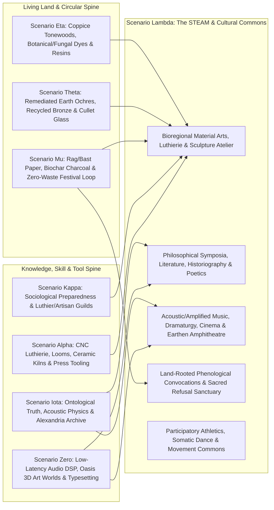
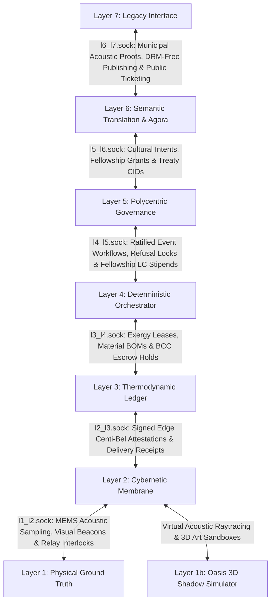
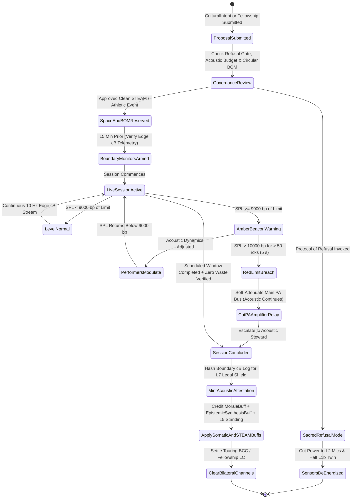

# Scenario Lambda: The Cultural & STEAM Commons (Land-Rooted Arts, Acoustic Stewardship, Intellectual Salon & Somatic Play)

*   **Identifier:** `SCN-LAMBDA-CULTURE`
*   **System Epic:** Expanding STEM to STEAM—Non-Extractive Material Arts, Luthierie & Open-Hardware Sound, Philosophical & Literary Salons, Land-Rooted Phenological Festivals, Psychoacoustic Ecology, and Participatory Somatic Play
*   **Primary Layers Tested:** L1 (Physical), L1b (Oasis 3D Shadow Simulator), L2 (Cybernetic Membrane), L3 (Thermodynamic Ledger), L4 (Deterministic Orchestrator), L5 (Polycentric Governance), L6 (Semantic Translation & Agora), L7 (Legacy Interface)
*   **Pass/Fail Metric:** Successful orchestration of the node's STEAM ateliers, philosophical salons, somatic athletic courts, and land-rooted phenological festivals where property-line sound pressure levels remain strictly below $550\,\mathrm{cB}$ ($55\,\mathrm{dBA}$) daytime, $450\,\mathrm{cB}$ ($45\,\mathrm{dBA}$) nighttime, and $650\,\mathrm{cB}$ ($65\,\mathrm{dBC}$) low-frequency bass ceiling; $10000\,\mathrm{bp}$ ($100\%$) non-extractive bioregional pigment, tonewood, and stage material provenance (`petrochemical_virgin_mass_mg == 0`, `festival_landfill_waste_mg == 0`); zero IEEE 754 floating-point math; zero tokenization of artistic, intellectual, or athletic expression; unconditional `Protocol of Refusal` shielding sacred rites from telemetry or simulation; zero raw audio recording; and zero wearable biometric sensors.

---

## Architectural Council Ratification & 5-Perspective Synthesis

This scenario specification has been ratified by unanimous consensus of the 5-Persona Architectural Council:

| Council Persona | Disciplinary Representative | Core Contribution to Scenario |
| :--- | :--- | :--- |
| **Game Designer** | Lead Systems & Gameplay Designer | **From STEM to STEAM & Dwarf Fortress Somatic Catharsis:** Elevates culture from passive "entertainment" into the emotional, aesthetic, and philosophical lifeblood of the settlement. Pairs Scenario Iota's scientific truth (`STEM`) with Scenario Lambda's artistic, literary, and musical synthesis (`STEAM`). Stewards who craft instruments, debate in philosophical salons, paint with earth pigments, sing in polyphonic choirs, or play pickup 3v3 basketball shed chronic burnout and trauma (`"Moved by resonant cedar cello performance (+4000 bp morale)"`, `"Illuminated by watershed philosophical symposium (+2500 bp epistemic synthesis)"`). **Land-Rooted Festival Calendar:** Replaces commercial shopping holidays with phenological watershed convocations (Equinox Planting, Solstice Harvest, Winter Jubilee). |
| **Game Engineer** | Principal C++ Simulation & Engine Architect | **Data-Oriented Design (DOD) & Fixed-Point Psychoacoustics:** Encapsulates STEAM infrastructure into compact 32-bit voxels (`material_id = 55` `SOUND_STAGE`, `material_id = 56` `SPORTS_COURT`, `material_id = 57` `ACOUSTIC_BERM`, `material_id = 58` `STEAM_ATELIER`) in 32-cubed chunks. Flecs ECS systems simulate breadth-first search (BFS) acoustic wave attenuation across architectural barriers and vegetated berms at $10\,\mathrm{Hz}$ determinism using integer centi-Bels (`uint32_t` $\mathrm{cB}$, where $10\,\mathrm{cB} = 1\,\mathrm{dB}$) and integer microjoules (`uint64_t` $\mu\mathrm{J}$) with zero floating-point math. |
| **Sovereign Stack Specialist** | Sovereign Stack Systems Architect | **7-Layer Strict Adjacency, Non-Commensurable Culture & Artist Fellowships:** Enforces strict socket boundaries (`l1_l2.sock` through `l6_l7.sock`, explicitly traversing `/run/collective/ipc/l4_l5.sock`). Establishes that artistic, philosophical, and athletic expression are non-commensurable human goods (zero art tokens, zero streaming micropayment paywalls), while supporting creators through Layer 4/Layer 5 **Sovereign Cultural Fellowships** (`LC` stipends ratified by the Commons Chamber). Pairwise Bilateral Clearing Channels (BCC) and multi-hop HTLCs settle inter-node festival staging and traveling bardic/theatrical troupes across Trust Rings $R_3$ and $R_4$. `Protocol of Refusal` structurally shields sacred ceremonies from digital recording or Oasis twin simulation. |
| **Solarpunk Thinker** | Bioregional Regenerative Ecologist | **Land-Rooted Aesthetics, Non-Extractive Media & Acoustic Ecology:** Dismantles the detachment of modern urban culture from the living Earth. Eliminates petrochemical acrylics, toxic heavy-metal pigments, and single-use festival plastics by linking the STEAM Atelier directly to Scenario Eta (botanical indigo/madder dyes, fungal pigments, solar-kiln tonewoods), Scenario Theta (remediated iron-oxide ochres, recycled bronze/cullet glass), and Scenario Mu (rag paper, charcoal, zero-waste festival humanure/struvite loops). Enforces A-weighted and C-weighted (`dBC`) acoustic ceilings to protect nocturnal amphibians, bats, and nesting songbirds. |
| **Scenario Specialist** | Psychoacoustician, Master Luthier & Cultural Anthropologist | **Luthiery, Natural Pigment Chemistry & Sound Transmission Class (`STC`):** Formulates sound transmission loss (`STC >= 50` Stage 1, `STC >= 65` Stage 2, `180 cB` earthen berm attenuation Stage 3) and low-latency open-hardware DSP audio chains ($\le 2000\,\mu\mathrm{s}$ round-trip). Codifies archival stability for mineral-earth and botanical lake pigments and moisture equilibrium ($\le 800\,\mathrm{bp}$ relative moisture) for solar-kiln-cured luthiery tonewoods. |

**Unanimous Consensus Reached:** This specification was formally ratified by all 5 personas, establishing Scenario Lambda as The Collective's cultural, aesthetic, and somatic synthesis engine.

---

## 1. Problem Statement, Legacy Failure & The STEM-to-STEAM Synthesis

In late-stage extractive economies (Layer 7), human culture, intellectual life, and physical play suffer from three structural pathologies:
1.  **The Severance of STEM from the Arts & Humanities:** Industrial education and corporate R&D severed science and engineering (`STEM`) from aesthetics, ethics, philosophy, literature, and craft (`Arts`), reducing technologists to narrow optimization instruments for capital extraction while leaving artists alienated from material production and thermodynamic reality.
2.  **Platform Enclosure, Algorithmic Sludge & Petrochemical Waste:** Centralized streaming cartels, ticketing monopolies, and speculative art markets extract up to $8000\,\mathrm{bp}$ ($80\%$) of creative revenue while flooding human attention with algorithmic dopamine sludge. Simultaneously, contemporary art and commercial music festivals rely on deeply extractive supply chains—petrochemical acrylic plastics, toxic cadmium/cobalt mining, and single-use PVC stage sets that leave tons of landfill trash on scarred rural land.
3.  **Detachment from the Living Land & Suburban Sensory Suppression:** Modern urban culture floats in an abstract digital void completely severed from the soil, timber, minerals, and seasonal cycles of the watershed that feeds it. Meanwhile, in suburban and municipal jurisdictions, commercialized spectator sports and gambling replace participatory movement, while arbitrary noise complaints are weaponized to suppress neighborhood music, theatre, and communal gathering.

### 1A. How Scenario Lambda Reunites STEAM with the Living Bioregion

Scenario Lambda (`SCN-LAMBDA-CULTURE`) transforms The Collective from a purely technical survival network into a **force for humanity's cultural, aesthetic, and intellectual expansion that is deeply rooted in—and regenerative of—the land that sustains it**:



*   **Ontological Truth Meets Aesthetic Meaning (`Iota` + `Kappa` + `Lambda`):** While **Scenario Iota** discovers *how the universe works* and **Scenario Kappa** validates *human preparedness to wield tools safely*, **Scenario Lambda** explores *why we live, what beauty and meaning we create together, and how our stories honor the ecology we inhabit*. Every scientific or engineering domain in The Collective cross-pollinates with Scenario Lambda's ateliers and salons.
*   **100% Bioregional, Non-Extractive Artistic Media:**
    *   **Mineral & Botanical Pigments:** Zero petrochemical acrylics or toxic heavy-metal pigments. Paint, fresco, ceramic glazes, and printmaking inks are formulated from Scenario Theta's mine-tailing iron-oxide ochres, umbers, siennas, and synthesized ultramarines; Scenario Eta's botanical indigo (*Indigofera* / *Polygonum*), madder root (*Rubia tinctorum*), black walnut hulls, oak-gall iron-tannin ink, and ectomycorrhizal fungal dyes (*Phaeolus schweinitzii*, *Cortinarius*); and Scenario Gamma's cold-pressed linseed and walnut drying oils.
    *   **Luthiery & Open-Hardware Acoustic/Electronic Instruments:** Acoustic cellos, violins, guitars, harps, marimbas, and reed instruments are crafted from Scenario Eta's windfall and coppice-standard tonewoods (spruce, maple, cedar, black locust) cured in solar kilns to $\le 800\,\mathrm{bp}$ ($8\%$) moisture, rough-milled on Scenario Alpha's CNC routers, and hand-voiced by Scenario Kappa master luthiers. Electronic instruments use open-hardware modular analog/FPGA synthesizers running Scenario Zero's deterministic RTOS audio engine ($\le 2000\,\mu\mathrm{s}$ latency).
    *   **Monumental Sculpture, Ceramics & Archival Print:** Public sculptures are cast in Scenario Theta's solar/induction foundries from $10000\,\mathrm{bp}$ ($100\%$) salvaged bronze, aluminum, and silicate cullet glass, or fired in wood-gasified ceramic kilns. Literary works, philosophy treatises, and musical scores are printed with soy/botanical inks on archival rag and bast-fiber paper produced from Scenario Mu's textile-waste recycling loop.
*   **Land-Rooted Phenological Calendar & Regenerative Festivals:** Cultural gatherings are synchronized with the actual ecological rhythms of the bioregion—Vernal Equinox Seed & Planting Convocations, Summer Solstice Amphitheatre Gatherings, Autumn Coppice-Harvest & Fermentation Feasts, and Winter Solstice Storytelling & Commons Jubilee. Every gathering obeys the **Regenerative Festival Invariant**: zero single-use plastics (`festival_landfill_waste_mg == 0`), $10000\,\mathrm{bp}$ stainless dishware loop via Scenario Gamma, and $10000\,\mathrm{bp}$ nutrient return (struvite and thermophilic biochar compost) to the land via Scenario Mu.

---

## 2. The Collective Workflow (7-Layer Traversal)

Scenario Lambda orchestrates daily studio creation, philosophical salons, somatic athletics, and regional festivals across the 7-layer stack without layer-skipping.



### Layer 1: Physical Ground Truth & Layer 1b: Oasis 3D Shadow Simulator
*   **Hardware Reality (`Layer 1`):** Pure physical matter, acoustic pressure waves, pigment chemistry, and somatic movement:
    *   **STEAM Material & Luthiery Ateliers:** Woodworking luthiery benches, ceramic wheels and wood-gasified kilns, mineral-pigment mulling slabs, natural dye vats, hand-operated letterpress/risograph binderies, and open-hardware synthesizer soldering bays.
    *   **Performance & Salon Architecture:** Box-in-box decoupled rehearsal studios, literary/philosophical seminar amphitheatres, outdoor rammed-earth acoustic shells, and vegetated earthen sound berms (`180 cB` / $18\,\mathrm{dB}$ transmission loss).
    *   **Somatic Movement & Athletic Commons:** Sprung-timber dance and martial arts floors, outdoor multi-sport courts (basketball, futsal, volleyball), bouldering walls, and acoustic percussion circles.
*   **Oasis 3D Shadow Simulator (`Layer 1b`):**
    *   **Pre-Event Acoustic Raytracing & Berm Design:** Before constructing a stage or scheduling an amplified concert, stewards simulate 3D acoustic wave propagation ($L_{p,A}$ and low-frequency $L_{p,C}$) across the node's voxel terrain and earthen berms to verify that property-line and wildlife-corridor decibel ceilings will never be breached.
    *   **Interactive 3D Art Worlds & Architectural Visualization:** Visual artists, dramaturgs, and game designers use Oasis (paired with Scenario Zero) as an expressive medium to build non-extractive narrative art worlds, virtual theatre blocking, and interactive philosophical thought experiments.

### Layer 2: The Cybernetic Membrane
*   **Edge Psychoacoustic Telemetry (`col-sensord`):** Low-power microcontrollers running Zephyr RTOS sample calibrated MEMS microphones at the stage perimeter, wildlife corridor edge, and municipal property boundary:
    *   `node/culture/stage_01/telemetry/spl_cb_a` (A-weighted RMS sound pressure level in integer centi-Bels, $10\,\mathrm{cB} = 1\,\mathrm{dBA}$, $100\,\mathrm{ms}$ window)
    *   `node/culture/property_line/telemetry/spl_cb_a` (Boundary A-weighted sound level; statutory limit $550\,\mathrm{cB}$ [$55\,\mathrm{dBA}$] daytime, $450\,\mathrm{cB}$ [$45\,\mathrm{dBA}$] nighttime)
    *   `node/culture/wildlife_corridor/telemetry/spl_cb_c` (Boundary C-weighted low-frequency bass level; limit $650\,\mathrm{cB}$ [$65\,\mathrm{dBC}$] to prevent nocturnal amphibian and avian disruption)
    *   `node/culture/alert_beacon/state` (`NORMAL_GREEN`, `WARNING_YELLOW`, `THROTTLED_RED`, `REFUSAL_DEENERGIZED`)
*   **Zero Raw Audio Recording Invariant:** Edge microcontrollers compute FFT and RMS power spectral density entirely in volatile SRAM and emit strictly integer centi-Bel (`cB`) scalars. **Zero raw PCM audio waveforms or voice recordings are ever buffered, stored, or transmitted**, making eavesdropping physically impossible.
*   **Absolute Ban on Biometric Tracking:** Layer 2 structurally bans heart-rate straps, galvanic skin response sensors, EEG headbands, facial emotion cameras, or step trackers on athletic courts, dance floors, or audience seating.
*   **Graduated Visual Beacon & Amplifier Interlock (`col-actuated`):** When boundary sound reaches $9000\,\mathrm{bp}$ ($90\%$) of the permitted ceiling, silent stage-lip LED beacons pulse amber so musicians or speakers can organically modulate dynamics. If the ceiling ($10000\,\mathrm{bp}$) is breached continuously for $> 5\,\mathrm{s}$ (`50` ticks), a solid-state zero-crossing relay softly attenuates or cuts the main PA amplification bus while leaving acoustic unamplified performance untouched.

### Layer 3: The Thermodynamic Ledger
*   **Non-Commensurability of Cultural & Somatic Expression:** Music, literature, philosophical inquiry, visual art, sacred ritual, and athletic play are constitutionally protected as non-commensurable human goods. Layer 3 **never mints tradeable "art tokens," "play-to-earn coins," or streaming micro-royalties**. Every work published to the Alexandria Cultural Commons is freely accessible to all stewards across the mesh without paywalls.
*   **Thermodynamic Metering of Physical Inputs (PoTW):** While creative expression itself is never tokenized, the physical exergy and material inputs consumed by a studio or stage—kiln firing heat, stage lighting electricity ($1\text{ Exergy Credit}_{\mathrm{quantum}} \equiv 3600\,\mathrm{kJ} = 3{,}600{,}000{,}000{,}000\,\mu\mathrm{J}$), and circular material BOMs (reclaimed bronze, tonewood, rag paper)—are transparently accounted in integer microjoules ($\mu\mathrm{J}$) and milligrams ($\mathrm{mg}$).
*   **Pairwise Bilateral Clearing Channels (BCC) & Multi-Hop HTLCs for Touring Troupes:**
    *   Inter-node festival hosting, traveling theatrical/bardic troupes, and shared sound/projection equipment exchanges across Trust Rings $R_3$ and $R_4$ clear through pairwise Bilateral Clearing Channels:
        $$B_{u \to v}(t) + B_{v \to u}(t) = 0, \quad -C_{u \to v} \le B_{u \to v}(t) \le C_{v \to u}$$
    *   Physical dispatch of touring instruments or stage rigs requires two-phase cryptographic delivery receipts ($\sigma_{\mathrm{delivery}}$) and multi-hop Hashed Timelock Contracts ($\mathrm{HTLC} = \langle H(S), \, \Delta t, \, Q, \, u, \, v \rangle$). Outstanding cultural channel balances settle through reciprocal festival hosting, shared luthiery maintenance, or bioregional **Commons Jubilee**.

### Layer 4: The Deterministic Orchestrator
*   **State Machine Daemon:** `col-execd` executes a $10\,\mathrm{Hz}$ deterministic BPMN v2 virtual machine communicating with Layer 5 over `/run/collective/ipc/l4_l5.sock` and Layer 3 over `/run/collective/ipc/l3_l4.sock`.
*   **Sovereign Cultural & Intellectual Fellowships (`col-ledger`):** To ensure artists, composers, writers, philosophers, and master luthiers can dedicate deep, uninterrupted time to complex works without commercial coercion, Layer 4 executes **Cultural Fellowship Stipends** ratified by the Commons Chamber—crediting $10000\,\mathrm{bp}$ ($100\%$) standard Labor Credits (`LC`) from the node's collective cultural commons pool for dedicated studio, archival, and pedagogical craft hours.
*   **Acoustic Exposure Envelope & Microgrid Shedding:**
    *   Cultural stage amplification and kiln firing operate below Tier 1 Ecological Floors ($F_{\mathrm{eco}}$) and Tier 2 Survival Baselines ($B_{\mathrm{baseline}}$), shedding gracefully during microgrid deficits while unamplified acoustic music, salons, and somatic play continue uninterrupted.
    *   The orchestrator integrates boundary acoustic exposure in integer centi-Bels across the session window:
        $$L_{p,A,\mathrm{boundary}}(t) \le L_{\mathrm{ceiling},A}, \quad L_{p,C,\mathrm{corridor}}(t) \le L_{\mathrm{ceiling},C}$$



### Layer 5: Polycentric Governance
*   **Autopoietic Cultural Sovereignty:** Every Autonomous Node retains absolute authority over its own cultural calendar, architectural aesthetics, and acoustic curfews. No external council can impose cultural programming or override local quiet hours.
*   **7-Tier Concentric Trust Rings ($R_0$ to $R_6$):**
    *   $R_0$ (*The Hearth*): Intimate family music, bedtime storytelling, personal journals, and spiritual devotion; zero sensors, zero ledger visibility.
    *   $R_1$ (*The Settlement Atelier & Court*): Daily painting, pottery, luthiery, philosophical reading groups, acoustic jam sessions, and pickup basketball/futsal; ephemeral pairwise DIDs (`did:peer`).
    *   $R_2$ (*The Node Amphitheatre & Salon*): Weekly concerts, theatrical premieres, public philosophical debates, and node feasts; Commons Chamber democratic governance.
    *   $R_3$ (*The Watershed Convocation*): Sibling nodes within $30\,\mathrm{km}$; traveling bardic/theatrical troupes, inter-node athletic leagues, and shared natural-pigment/luthiery libraries settled via BCCs.
    *   $R_4$ (*The Bioregional Solstice/Equinox Gathering*): River-basin phenological festivals within $150\,\mathrm{km}$; cross-node symphony orchestras and regenerative land-art symposia routed via the **Bioregional Path-Vector Protocol (BPVP)**.
    *   $R_5$ (*The Continental Cultural Archive*): Inter-bioregional replication of open literature, musical scores, luthiery CAD blueprints, and non-extractive pigment recipes in the Alexandria DAG (`SCN-IOTA-EPISTEMIC`).
    *   $R_6$ (*The Legacy Perimeter*): Public performances, independent bookstore/record releases, and municipal acoustic compliance defense.
*   **Protocol of Refusal (`sec:l5-refusal`) & Autonomous Transit Veto (`No-Transit`):**
    *   The Commons Chamber (or any indigenous/spiritual steward circle) holds unconditional authority to invoke the **Protocol of Refusal** over sacred ceremonies, rites of passage, or grief vigils—physically de-energizing Layer 2 sensors via hardware disconnect switches, purging telemetry buffers, and excluding the sanctuary voxel volume from Oasis (`L1b`) rendering.
    *   During concerts, theatrical performances, philosophical symposia, or festivals, the venue broadcasts a deterministic **`No-Transit` attribute** to Scenario Beta (`SCN-BETA-TRANSIT`), automatically rerouting autonomous freight trailers and heavy delivery vehicles around the cultural perimeter to preserve acoustic serenity and pedestrian safety.
*   **Bicameral Governance & Reputational Wealth ($\mathcal{R}_{\mathrm{culture}}$):**
    *   The **Commons Chamber** ($1\text{ person} = 1\text{ vote}$) ratifies acoustic curfew envelopes, quarterly Cultural Fellowship allocations, and phenological festival dates.
    *   The **Stewardship Chamber** weights technical staging, luthiery shop safety, and acoustic engineering decisions by domain-specific Reputational Wealth $\mathcal{R}_{\mathrm{culture}}$, governed by a $1\text{-year}$ half-life decay ($\tau_{\mathrm{half}} = 31536000\,\mathrm{s}$), a sublinear logarithmic cap ($800\,\mathrm{bp}$ / $8\%$ max individual voting weight), and the **Care Leave Shield** (`SCN-DELTA-CHILDCARE` / `SCN-SIGMA-BURNOUT`).

### Layer 6: Semantic Translation & Agora
*   **Tripartite Ricardian Treaties (`Treaty_CID`):**
    $$\mathrm{Treaty\_CID} = \mathrm{SHA256}\left( \mathrm{Text}_{\mathrm{prose}} \parallel \mathrm{Schema}_{\mathrm{JSON-LD}} \parallel \mathrm{Invariants}_{\mathrm{BPMN}} \right)$$
    Inter-node festival compacts and touring troupe agreements bind human-readable hospitality covenants, JSON-LD acoustic and zero-waste invariants, and deterministic BPMN settlement state machines.
*   **Agora Semantic Knowledge Branches:**
    1.  `CulturalIntent`: Schedules a concert, theatrical production, philosophical symposium, or phenological festival with spatial coordinates, acoustic budgets, and circular material BOMs.
    2.  `STEAMCreationManifest`: Documents the non-extractive material provenance of an artwork, instrument, or book (e.g., Scenario Eta spruce tonewood, Scenario Theta iron-oxide ochre, Scenario Mu rag paper) and publishes its digital score/text/blueprint to the Alexandria Commons under `CC-BY-SA` / `DPL v1`.
    3.  `CulturalFellowshipGrant`: Ratifies a Commons Chamber Labor Credit (`LC`) stipend for an artist-in-residence, writer, philosopher, or master luthier.
    4.  `SomaticPlayBounty`: Coordinates cooperative pickup sports, martial arts/dance practice, and court scheduling.
    5.  `AcousticComplianceAttestation`: Cryptographic proof of continuous boundary centi-Bel compliance ($L_{p,A}$ and $L_{p,C}$) for municipal legal defense.

### Layer 7: The Legacy Interface & Non-Extractive Cultural Carapace
*   **Dual-Membrane Cultural Carapace:** Hosted in partnership with Scenario Epsilon (`SCN-EPSILON-COWORKING`), the cultural commons interfaces with Layer 7 through a lawful **501(c)(3) Arts & Humanities Conservatory / Worker-Owned Publishing & Performance Cooperative** (Membrane 1) while maintaining a completely uncommodified internal commons (Membrane 2).
*   **Municipal Acoustic Shield Defense:** When suburban associations or municipal code enforcement respond to nuisance noise complaints, the Carapace presents cryptographically signed, sensor-calibrated Layer 2 boundary logs (`AcousticComplianceAttestation`) proving that property-line sound pressure never exceeded the statutory $550\,\mathrm{cB}$ ($55\,\mathrm{dBA}$) daytime or $450\,\mathrm{cB}$ ($45\,\mathrm{dBA}$) nighttime limits—dismissing citations with mathematical certainty.
*   **Direct-to-Audience Publishing & Ethical Patronage ($\Phi_t$):**
    *   When the node opens public theatre/concert tickets, sells hand-bound books, prints botanical-ink art editions, or sells handcrafted luthiery instruments to the external Layer 7 market, $10000\,\mathrm{bp}$ ($100\%$) of external fiat revenues bypass predatory streaming/ticketing monopolies and enter the cooperative Carapace reserve (bounded by $\Phi_t$).
    *   Fiat proceeds pay municipal property taxes, procure non-substitutable studio tooling (e.g., MEMS measurement microphones, FPGA audio interfaces), and fund the **Land Acquisition Escrow** to transition new cultural venues into the Community Land Trust. Fiat never purchases internal Labor or Exergy Credits.

---

## 3. 3-Stage Incremental Node Facility Blueprints (Node Growth Pattern)

Scenario Lambda scales organically alongside the settlement, growing from a sound-isolated suburban living room and backyard studio into a bioregional earthen amphitheatre and STEAM residency campus.

### Stage 1: Suburban Domestic Parlor, Backyard Atelier & Park Play Circle ($R_0 / R_1$ Bootstrap)
*   **Physical Footprint:** A steward household's living room (`25 m2`) for acoustic chamber salons and philosophical reading circles, a sound-isolated garage rehearsal/luthiery bay (`20 m2`), a backyard ceramic/botanical-dye shed (`12 m2`), and a neighborhood public park court.
*   **Acoustic & Material Infrastructure:**
    *   **Garage Acoustic Isolation (`STC >= 50`):** Constructed from double-stud timber framing decoupled with resilient channels and packed with Scenario Mu's recycled denim and cellulose acoustic batts, keeping exterior property-line sound strictly $\le 500\,\mathrm{cB}$ ($50\,\mathrm{dBA}$) even during $850\,\mathrm{cB}$ ($85\,\mathrm{dBA}$) interior ensemble rehearsals.
    *   **Backyard STEAM Micro-Atelier:** Hand-mulling mineral pigments from Scenario Theta, indigo/walnut dye vats from Scenario Eta, a kick-wheel pottery station, and a tabletop soy-ink risograph/letterpress for community zines and philosophical pamphlets.
*   **Layer 7 Legal & Zoning Shield:** Operates under **First Amendment Freedom of Assembly & Expression**, **UUNAA § 6** (unincorporated arts & literary society), and residential home-studio occupation exemptions: zero commercial walk-in ticketing, zero street signage, and continuous edge centi-Bel boundary logging.

### Stage 2: Urban STEAM Conservatory, Black-Box Theatre & Movement Hall ($R_2$ Municipal Shell)
*   **Physical Footprint:** `400 m2` to `900 m2` adaptive reuse of a leased commercial warehouse, historic Masonic hall, or storefront co-located with Scenario Epsilon (`SCN-EPSILON-COWORKING`), Scenario Alpha (`SCN-ALPHA-FAB`), and Scenario Iota (`SCN-IOTA-EPISTEMIC`).
*   **Integrated Zones:**
    1.  **Decoupled Box-in-Box Performance & Recording Hall (`STC >= 65`):** Floating elastomeric floor slab, acoustic timber diffusers milled by Scenario Alpha, low-latency Scenario Zero spatial audio rig, and a 150-seat flexible **Black-Box Theatre, Cinema & Philosophical Symposium Hall**.
    2.  **The STEAM Material Atelier & Bindery:** Dedicated luthiery workshop (paired with Scenario Kappa dual-key tool interlocks), natural earth-pigment and oil-paint formulation lab, wood-free archival rag-paper press, and ceramic/glass sculpture studio.
    3.  **Sprung-Timber Somatic Movement & Athletic Court:** Indoor half-court basketball/futsal floor, contact-improvisation dance studio, and bouldering wall with zero biometric surveillance.
*   **Economic & Legal Carapace:** Licensed as a **501(c)(3) Community Arts Conservatory & Subchapter T Publishing/Performance Cooperative**. Generates bounded external fiat ($\Phi_t$) through public weekend theatre/concert series, independent book/vinyl editions, and luthiery commissions, covering facility overhead and sweeping surplus into the **Land Acquisition Escrow**.

### Stage 3: Bioregional Earthen Amphitheatre, STEAM Residency Campus & Festival Sanctuary ($R_2 / R_3 / R_4$ CLT/PPT)
*   **Physical Footprint:** `5` to `25 hectares` of ecologically restored rural/peri-urban land or remediated quarry/industrial brownfield held permanently in an **Irrevocable Community Land Trust (CLT) / Perpetual Purpose Trust (PPT)**, completely removed from the speculative real-estate market.
*   **Custom Ecological & Architectural Features (`SCN-XI-ARCH` + `SCN-ETA-COPPICE`):**
    *   **Topographic Rammed-Earth & Mass-Timber Amphitheatre:** Sculpted directly into a natural hillside bowl with terraced living-turf seating for `500` to `1500` stewards, flanked by dense vegetated earthen acoustic berms (`180 cB` / $18\,\mathrm{dBA}$ natural attenuation) that direct sound inward while shielding surrounding nocturnal wildlife corridors ($\le 450\,\mathrm{cB}$ `dBA`, $\le 650\,\mathrm{cB}$ `dBC`).
    *   **Bioregional Luthiery, Sculpture Foundry & Botanical Dye Gardens:** Solar-kiln tonewood curing barns (`SCN-ETA-COPPICE`), a monumental bronze and cullet-glass sculpture studio (`SCN-THETA-FOUNDRY`), perennial dye gardens (indigo, madder, weld, coreopsis), and an archival Alexandria scriptorium/bindery (`SCN-IOTA-EPISTEMIC`).
    *   **Artist & Philosopher Residency Cabins (`SCN-ZETA-LODGING`) & Multi-Sport Meadows:** Passive-solar timber cabins hosting visiting fellows from across the federation ($R_3 \dots R_5$), alongside full-size natural-turf athletic fields, outdoor climbing crags, and a wood-fired post-play sauna.
    *   **Zero-Waste Regenerative Festival Infrastructure (`SCN-MU-EXTRACTION` + `SCN-GAMMA-KITCHEN`):** Permanent negative-pressure biochar composting toilets, urine-diverting struvite reactors, and a high-throughput stainless-steel festival hearth kitchen—ensuring every solstice and equinox convocation enriches the land's *Terra Preta* topsoil with zero landfill output (`festival_landfill_waste_mg == 0`).

---

## 4. Machine-Readable Schemas

### 4A. Layer 6 Knowledge Artifact: STEAM & Cultural Intent (`cultural_steam_intent.jsonld`)

```json
{
  "@context": [
    "https://schema.org/",
    "https://collective.network/ontology/v1/"
  ],
  "@type": "CulturalIntent",
  "identifier": "urn:uuid:6a7b8c9d-0e1f-2a3b-4c5d-6e7f8a9b0c1d",
  "issuerDid": "did:peer:2Ez6MksG_creator_jules",
  "creationTimestamp": "2026-10-21T14:00:00Z",
  "eventProfile": {
    "title": "Autumn Equinox Cello Premiere, Watershed Philosophy Symposium & 3v3 Basketball",
    "eventType": "Hybrid_STEAM_Symposium_Concert_And_Somatic_Play",
    "targetLocationVoxel": [16, 8, 16],
    "requestedAssets": [
      "Earthen_Amphitheatre_Stage_01",
      "STEAM_Luthiery_And_Pigment_Atelier",
      "Sprung_Timber_Half_Court"
    ],
    "expectedParticipants": 64
  },
  "circularMaterialManifest": {
    "instrumentTonewoodSource": "SCN-ETA-COPPICE:solar_kiln_spruce_maple_800bp_moisture",
    "stagePigmentSource": "SCN-THETA-FOUNDRY:remediated_iron_oxide_ochre_and_eta_indigo",
    "programPamphletSource": "SCN-MU-EXTRACTION:recycled_rag_paper_soy_ink",
    "petrochemicalVirginMassMg": 0,
    "festivalLandfillWasteMg": 0
  },
  "acousticParameters": {
    "targetZone": "did:peer:2Ez6MksG_space_earthen_amphitheatre",
    "estimatedInternalPeakCbA": 820,
    "statutoryPropertyLineLimitCbA": 550,
    "wildlifeCorridorBassLimitCbC": 650,
    "feedbackBeaconTopic": "node/culture/alert_beacon/state",
    "rawAudioRecordingPermitted": false
  },
  "temporalWindow": {
    "startTime": "2026-10-24T17:00:00Z",
    "endTime": "2026-10-24T20:30:00Z",
    "durationSeconds": 12600
  },
  "settlementCriteria": {
    "reputationalRewardPoints": 35,
    "fellowshipLaborCreditsHours": 12,
    "clearingChannelCapacityUj": 3600000000000,
    "artTokensMinted": 0
  }
}
```

### 4B. Layer 2 Telemetry Attestation: Boundary Psychoacoustic Proof (`acoustic_attestation.json`)

```json
{
  "@context": "https://collective.network/ontology/v1/",
  "@type": "AcousticComplianceAttestation",
  "culturalIntentRef": "urn:uuid:6a7b8c9d-0e1f-2a3b-4c5d-6e7f8a9b0c1d",
  "sensorNode": "did:peer:2Ez6MkwQ_device_boundary_decibel_meter_02",
  "executionMetrics": {
    "startTime": "2026-10-24T17:00:00Z",
    "endTime": "2026-10-24T20:30:00Z",
    "durationSeconds": 12600,
    "meanPropertyLineCbA": 470,
    "peakPropertyLineCbA": 510,
    "statutoryThresholdCbA": 550,
    "peakWildlifeCorridorCbC": 590,
    "wildlifeThresholdCbC": 650,
    "boundaryViolationsCount": 0,
    "rawAudioBytesCaptured": 0,
    "biometricPacketsCaptured": 0,
    "telemetryLogHash": "3c4d5e6f7a8b9c0d1e2f3a4b5c6d7e8f9a0b1c2d3e4f5a6b7c8d9e0f1a2b3c4d"
  },
  "visualAlertsTriggered": {
    "amberWarningCount": 1,
    "redRelayTripCount": 0
  },
  "complianceStatus": "FULLY_COMPLIANT_LEGAL_AND_ECOLOGICAL_SHIELD_VERIFIED"
}
```

---

## 5. Oasis Engine Implementation Specification

### 5A. Memory Allocation, Voxel State & STEAM Components
The cultural and STEAM commons coordinates simulation states in chunk space (32-cubed voxels via `ChunkManager`):
*   Sound stage & amphitheatre voxel initialized with `material_id = 55` (`SOUND_STAGE`) with `metadata` bitmask `0b00000110` (`Is_Actuator | Is_Sensor`).
*   Somatic movement & sports court voxel initialized with `material_id = 56` (`SPORTS_COURT`).
*   Vegetated earthen acoustic berm voxel initialized with `material_id = 57` (`ACOUSTIC_BERM`), providing a deterministic transmission loss of $180\,\mathrm{cB}$ ($18\,\mathrm{dBA}$) per barrier layer.
*   STEAM Luthiery, Pigment & Bindery Atelier voxel initialized with `material_id = 58` (`STEAM_ATELIER`), verifying $10000\,\mathrm{bp}$ ($100\%$) circular bioregional material provenance from Scenarios Eta, Theta, and Mu (`petrochemical_virgin_mass_mg == 0`).
*   Attending steward entities within the cultural chunk receive both a `MoraleBuff` component (`morale_multiplier_bps = 13500`, $+3500\,\mathrm{bp}$ somatic catharsis) and an `EpistemicSynthesisBuff` component (`synthesis_bonus_bps = 12500`, $+2500\,\mathrm{bp}$ cross-disciplinary creative insight) for $3600$ ticks, with zero art tokens minted.

### 5B. Self-Contained C++20 Reference & Test Harness

```cpp
// engine/tests/scenario_lambda_cultural_test.cpp
#include <cassert>
#include <cstdint>
#include <iostream>
#include <string>
#include <vector>

namespace oasis::lambda {

// Fixed-point constants:
// 10000 bp = 100%
// Sound pressure level in centi-Bels (cB): 10 cB = 1 dB (e.g., 550 cB = 55 dBA)
// Temperature in millikelvins (mK): 295150 mK = 22 deg C
// Energy in microjoules (uJ): 3600000000000 uJ = 3600 kJ (1 Exergy Credit quantum)

enum class VoxelMaterial : uint8_t {
    AIR = 0,
    SOUND_STAGE = 55,
    SPORTS_COURT = 56,
    ACOUSTIC_BERM = 57,
    STEAM_ATELIER = 58
};

enum class BeaconState : uint8_t {
    NORMAL_GREEN = 0,
    WARNING_AMBER = 1,
    THROTTLED_RED = 2,
    REFUSAL_DEENERGIZED = 3
};

enum class OrchestratorState : uint8_t {
    IDLE = 0,
    SPACE_RESERVED = 1,
    LIVE_SESSION_ACTIVE = 2,
    SACRED_REFUSAL_PROTECTED = 3,
    ACOUSTIC_VIOLATION_TRIP = 4,
    SESSION_COMPLETED = 5
};

struct Voxel {
    VoxelMaterial material_id{VoxelMaterial::AIR};
    uint16_t moisture_bps{0};
    uint32_t temperature_mk{293150};
    uint8_t metadata{0};
};

struct CircularSTEAMManifest {
    uint64_t eta_tonewood_mass_mg{0};         // Solar-kiln cured <= 800 bp moisture
    uint16_t tonewood_moisture_bps{0};
    uint64_t theta_mineral_ochre_mass_mg{0};  // Remediated iron-oxide/ultramarine
    uint64_t mu_rag_paper_mass_mg{0};         // Recycled bast/rag paper
    uint64_t petrochemical_virgin_mass_mg{0}; // Must be 0
    uint64_t festival_landfill_waste_mg{0};   // Must be 0
};

struct AcousticTelemetryFrame {
    uint32_t source_spl_cb_a{0};
    uint32_t boundary_spl_cb_a{0};
    uint32_t wildlife_corridor_spl_cb_c{0};
    uint64_t raw_audio_bytes_captured{0};     // Must be 0
    uint64_t biometric_packets_captured{0};   // Must be 0
};

struct StewardAgent {
    std::string did;
    uint32_t morale_multiplier_bps{10000};
    uint32_t epistemic_synthesis_bps{10000};
    uint64_t fellowship_lc_seconds{0};
    uint32_t culture_reputation_points{0};
};

class BilateralClearingChannel {
public:
    BilateralClearingChannel(std::string node_u, std::string node_v, int64_t credit_limit_uj)
        : node_u_(std::move(node_u)), node_v_(std::move(node_v)), credit_limit_uj_(credit_limit_uj) {}

    bool commit_receipt(int64_t delta_uj) {
        if (balance_u_to_v_uj_ + delta_uj > credit_limit_uj_ ||
            balance_u_to_v_uj_ + delta_uj < -credit_limit_uj_) {
            return false;
        }
        balance_u_to_v_uj_ += delta_uj;
        balance_v_to_u_uj_ -= delta_uj;
        return true;
    }

    int64_t balance_u_to_v_uj() const { return balance_u_to_v_uj_; }
    int64_t balance_v_to_u_uj() const { return balance_v_to_u_uj_; }

private:
    std::string node_u_;
    std::string node_v_;
    int64_t credit_limit_uj_{0};
    int64_t balance_u_to_v_uj_{0};
    int64_t balance_v_to_u_uj_{0};
};

class CulturalSTEAMOrchestrator {
public:
    // Validates non-extractive STEAM material provenance (Eta + Theta + Mu)
    bool verify_circular_steam_manifest(const CircularSTEAMManifest& manifest) const {
        if (manifest.petrochemical_virgin_mass_mg != 0) return false;
        if (manifest.festival_landfill_waste_mg != 0) return false;
        if (manifest.tonewood_moisture_bps > 800) return false; //Luthiery standard <= 8% moisture
        uint64_t total_bioregional_mg = manifest.eta_tonewood_mass_mg +
                                        manifest.theta_mineral_ochre_mass_mg +
                                        manifest.mu_rag_paper_mass_mg;
        return total_bioregional_mg > 0;
    }

    // Computes integer BFS acoustic attenuation across distance and vegetated earthen berms
    uint32_t compute_boundary_spl_cb(
        uint32_t source_spl_cb,
        uint32_t air_distance_voxels,
        uint32_t berm_layers
    ) const {
        // Free-field geometric + atmospheric decay approximated at 6 cB per voxel + 180 cB per earthen berm
        uint32_t attenuation_cb = (air_distance_voxels * 6) + (berm_layers * 180);
        return (source_spl_cb > attenuation_cb) ? (source_spl_cb - attenuation_cb) : 0;
    }

    void invoke_protocol_of_refusal() {
        state_ = OrchestratorState::SACRED_REFUSAL_PROTECTED;
        beacon_ = BeaconState::REFUSAL_DEENERGIZED;
        pa_relay_energized_ = false;
    }

    bool start_event(const CircularSTEAMManifest& manifest) {
        if (!verify_circular_steam_manifest(manifest)) {
            return false;
        }
        state_ = OrchestratorState::LIVE_SESSION_ACTIVE;
        beacon_ = BeaconState::NORMAL_GREEN;
        pa_relay_energized_ = true;
        violation_ticks_ = 0;
        return true;
    }

    // Ingests 10 Hz edge acoustic telemetry and enforces daytime/nighttime & wildlife bass limits
    bool step_acoustic_tick(
        const AcousticTelemetryFrame& frame,
        uint32_t statutory_limit_cb_a,
        uint32_t wildlife_limit_cb_c
    ) {
        // Hard privacy invariants: zero raw audio, zero biometrics
        assert(frame.raw_audio_bytes_captured == 0);
        assert(frame.biometric_packets_captured == 0);

        if (state_ == OrchestratorState::SACRED_REFUSAL_PROTECTED) {
            return true; // Sensors de-energized
        }

        uint32_t amber_threshold_cb_a = (statutory_limit_cb_a * 9000) / 10000;
        bool breached = (frame.boundary_spl_cb_a > statutory_limit_cb_a) ||
                        (frame.wildlife_corridor_spl_cb_c > wildlife_limit_cb_c);

        if (breached) {
            violation_ticks_++;
            if (violation_ticks_ > 50) { // > 5 seconds at 10 Hz
                beacon_ = BeaconState::THROTTLED_RED;
                pa_relay_energized_ = false;
                state_ = OrchestratorState::ACOUSTIC_VIOLATION_TRIP;
                return false;
            }
        } else {
            violation_ticks_ = 0;
            if (frame.boundary_spl_cb_a >= amber_threshold_cb_a) {
                beacon_ = BeaconState::WARNING_AMBER;
            } else {
                beacon_ = BeaconState::NORMAL_GREEN;
            }
        }
        return true;
    }

    void complete_session_and_distribute_buffs(
        std::vector<StewardAgent>& participants,
        uint64_t fellowship_stipend_seconds
    ) {
        assert(state_ == OrchestratorState::LIVE_SESSION_ACTIVE);
        state_ = OrchestratorState::SESSION_COMPLETED;

        for (auto& agent : participants) {
            agent.morale_multiplier_bps = 13500;       // +3500 bp somatic catharsis
            agent.epistemic_synthesis_bps = 12500;     // +2500 bp STEAM creative synthesis
            agent.fellowship_lc_seconds += fellowship_stipend_seconds;
            agent.culture_reputation_points += 35;
        }
    }

    OrchestratorState state() const { return state_; }
    BeaconState beacon() const { return beacon_; }
    bool pa_relay_energized() const { return pa_relay_energized_; }
    uint64_t art_tokens_minted() const { return 0; } // Constitutional invariant

private:
    OrchestratorState state_{OrchestratorState::IDLE};
    BeaconState beacon_{BeaconState::NORMAL_GREEN};
    bool pa_relay_energized_{false};
    uint32_t violation_ticks_{0};
};

void test_scenario_lambda_steam_and_cultural_execution() {
    CulturalSTEAMOrchestrator orchestrator;

    // 1. Verify Circular STEAM Material Manifest (Cello tonewood + Earth Ochre + Rag Paper)
    CircularSTEAMManifest manifest{
        .eta_tonewood_mass_mg = 4200000,         // 4200 g solar-kiln spruce & maple
        .tonewood_moisture_bps = 750,            // 750 bp moisture <= 800 bp limit
        .theta_mineral_ochre_mass_mg = 850000,   // 850 g remediated iron-oxide ochre & indigo
        .mu_rag_paper_mass_mg = 1500000,         // 1500 g archival rag paper
        .petrochemical_virgin_mass_mg = 0,
        .festival_landfill_waste_mg = 0
    };
    assert(orchestrator.start_event(manifest));
    assert(orchestrator.state() == OrchestratorState::LIVE_SESSION_ACTIVE);

    // 2. Compute BFS Acoustic Attenuation across 25 voxels + 1 Earthen Berm (180 cB)
    // Source: 820 cB (82 dBA) -> 25 * 6 = 150 cB air + 180 cB berm = 330 cB loss -> 490 cB (49 dBA) at boundary
    uint32_t boundary_cb_a = orchestrator.compute_boundary_spl_cb(820, 25, 1);
    assert(boundary_cb_a == 490);
    assert(boundary_cb_a < 550); // Strictly below 550 cB (55 dBA) daytime limit

    // 3. Simulate 12600 ticks of compliant concert, philosophical symposium & 3v3 basketball
    AcousticTelemetryFrame compliant_frame{
        .source_spl_cb_a = 820,
        .boundary_spl_cb_a = boundary_cb_a,
        .wildlife_corridor_spl_cb_c = 590, // < 650 cB (65 dBC) bass ceiling
        .raw_audio_bytes_captured = 0,
        .biometric_packets_captured = 0
    };
    for (uint32_t tick = 0; tick < 100; ++tick) {
        assert(orchestrator.step_acoustic_tick(compliant_frame, 550, 650));
    }
    assert(orchestrator.beacon() == BeaconState::NORMAL_GREEN);
    assert(orchestrator.pa_relay_energized());

    // 4. Complete session, award STEAM & Somatic buffs + Cultural Fellowship LC stipend
    std::vector<StewardAgent> stewards = {
        {"did:peer:2Ez6MksG_luthier_jules", 10000, 10000, 0, 100},
        {"did:peer:2Ez6MkwQ_philosopher_amina", 10000, 10000, 0, 120}
    };
    orchestrator.complete_session_and_distribute_buffs(stewards, 43200); // 12 hours LC fellowship
    assert(orchestrator.state() == OrchestratorState::SESSION_COMPLETED);
    assert(stewards[0].morale_multiplier_bps == 13500);
    assert(stewards[0].epistemic_synthesis_bps == 12500);
    assert(stewards[0].fellowship_lc_seconds == 43200);
    assert(orchestrator.art_tokens_minted() == 0);

    // 5. Settle inter-node touring troupe channel via Pairwise BCC
    BilateralClearingChannel cultural_channel(
        "did:peer:2Ez6MksG_host_node",
        "did:peer:2Ez6MkwQ_watershed_troupe",
        3600000000000LL
    );
    assert(cultural_channel.commit_receipt(180000000000LL));
    assert(cultural_channel.balance_u_to_v_uj() + cultural_channel.balance_v_to_u_uj() == 0);
}

void test_scenario_lambda_acoustic_violation_and_sacred_refusal() {
    CulturalSTEAMOrchestrator orchestrator;
    CircularSTEAMManifest manifest{1000000, 700, 500000, 500000, 0, 0};
    assert(orchestrator.start_event(manifest));

    // Inject sustained boundary violation (590 cB > 550 cB limit) for 55 ticks (> 5 seconds)
    AcousticTelemetryFrame loud_frame{920, 590, 680, 0, 0};
    bool running = true;
    for (uint32_t tick = 0; tick < 55; ++tick) {
        running = orchestrator.step_acoustic_tick(loud_frame, 550, 650);
    }
    assert(!running);
    assert(orchestrator.state() == OrchestratorState::ACOUSTIC_VIOLATION_TRIP);
    assert(orchestrator.beacon() == BeaconState::THROTTLED_RED);
    assert(!orchestrator.pa_relay_energized());

    // Verify Protocol of Refusal de-energizes sensors for sacred ceremony
    orchestrator.invoke_protocol_of_refusal();
    assert(orchestrator.state() == OrchestratorState::SACRED_REFUSAL_PROTECTED);
    assert(orchestrator.beacon() == BeaconState::REFUSAL_DEENERGIZED);
}

} // namespace oasis::lambda

int main() {
    oasis::lambda::test_scenario_lambda_steam_and_cultural_execution();
    oasis::lambda::test_scenario_lambda_acoustic_violation_and_sacred_refusal();
    std::cout << "Scenario Lambda Cultural & STEAM Commons tests passed." << std::endl;
    return 0;
}
```

---

## 6. Acceptance Test Gates (Pass/Fail)

| Checkpoint | Validation Method | Pass Condition |
| :--- | :--- | :--- |
| **G1: Psychoacoustic Boundary & Wildlife Bounds** | Integer BFS Acoustic Physics | Boundary sound pressure level stays strictly below $550\,\mathrm{cB}$ ($55\,\mathrm{dBA}$) daytime, $450\,\mathrm{cB}$ ($45\,\mathrm{dBA}$) nighttime, and $650\,\mathrm{cB}$ ($65\,\mathrm{dBC}$) low-frequency wildlife bass ceiling. |
| **G2: 100% Non-Extractive STEAM Material Provenance** | Circular Manifest Audit (`Eta` + `Theta` + `Mu`) | All luthiery tonewoods ($\le 800\,\mathrm{bp}$ moisture), mineral/botanical pigments, sculptural alloys, and archival rag papers trace to ratified circular streams (`petrochemical_virgin_mass_mg == 0`, `festival_landfill_waste_mg == 0`). |
| **G3: Privacy Invariant & Zero Biometrics** | Edge SRAM Audit | Edge microcontrollers emit strictly integer centi-Bel scalars (`raw_audio_bytes_captured == 0`) and athletic/movement courts capture zero physiological telemetry (`biometric_packets_captured == 0`). |
| **G4: STEAM Synthesis, Morale & Fellowship Support** | ECS Component & `col-ledger` Check | Event completion awards `+3500 bp` `MoraleBuff` and `+2500 bp` `EpistemicSynthesisBuff` to participants, credits Cultural Fellowship Labor Credits (`LC`) to resident creators, and mints zero speculative art tokens (`art_tokens_minted == 0`). |
| **G5: Protocol of Refusal & Transit Veto (`L5`)** | Governance Policy Gate | Invoking `Protocol of Refusal` physically de-energizes Layer 2 microphones and halts Oasis (`L1b`) rendering; active cultural sessions enforce `No-Transit` rerouting on Scenario Beta freight corridors. |
| **G6: Municipal Acoustic Shield & Direct Publishing (`L7`)** | Signed Telemetry & Carapace Audit | Signed centi-Bel boundary logs legally dismiss municipal noise citations, while $10000\,\mathrm{bp}$ ($100\%$) of external fiat ticket/book/instrument sales ($\Phi_t$) fund node tooling and CLT land acquisition without internal token conversion. |
