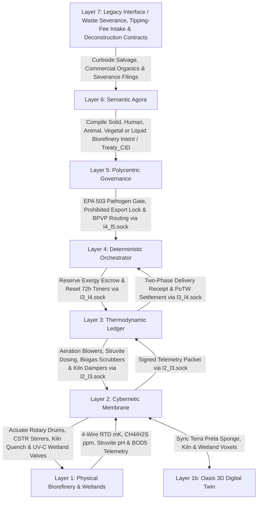
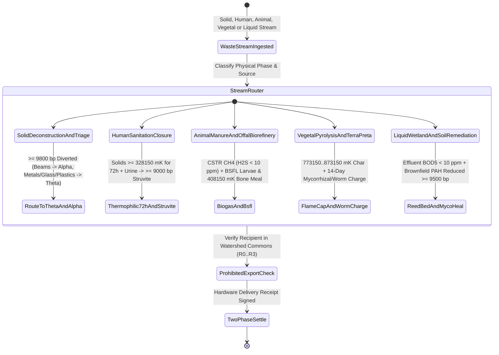

# Scenario Mu: The Multi-Phase Waste Retrieval, Ecological Deconstruction, Sanitation Closure & Biorefinery Commons (Solid, Liquid, Human, Animal & Vegetal)

*   **Identifier:** `SCN-MU-EXTRACTION`
*   **System Epic:** Full-Spectrum Waste Retrieval & Ecological Deconstruction (Feeding Scenario Theta/Alpha), Human Solid/Liquid Sanitation Closure (Thermophilic Compost & Urine Struvite), Animal Manure Anaerobic Biogas & BSFL Bioconversion, Vegetal Flame-Cap Pyrolysis Biochar & *Terra Preta* Soil Engineering, Constructed Wetland Liquid Polishing, Myco/Phyto-Remediation of Toxic Legacy Soils & 3-Stage Node Evolution
*   **Primary Layers Tested:** L1 (Physical Reality), L1b (Oasis 3D Digital Twin & Hydrological/Soil Simulator), L2 (Cybernetic Membrane), L3 (Thermodynamic Ledger), L4 (Deterministic Orchestrator), L5 (Polycentric Governance), L6 (Semantic Translation & Agora), L7 (Legacy Interface)
*   **Pass/Fail Metric:** $\ge 9800\,\mathrm{bp}$ ($98\%$) diversion of solid, liquid, human, animal, and vegetal waste streams from legacy landfills and sewers; EPA 40 CFR Part 503 Class A thermophilic pathogen destruction ($T \ge 328150\,\mathrm{mK} \equiv 55^\circ\mathrm{C}$ continuously for $\ge 259200\,\mathrm{s} \equiv 72\text{ hours}$ with `fecal_coliform_mpn_per_g == 0`); $\ge 9000\,\mathrm{bp}$ ($90\%$) phosphorus/nitrogen crystallization from liquid urine into struvite ($\mathrm{MgNH_4PO_4\cdot 6H_2O}$) and ammonium sulfate; anaerobic biogas $\mathrm{H_2S}$ scrubbed to $< 10\,\mathrm{ppm}$; smokeless pyrolysis biochar ($\ge 8000\,\mathrm{bp}$ fixed carbon) boosting voxel soil moisture capacity to $\ge 4000\,\mathrm{bp}$; polished liquid greywater/leachate effluent verified at $\mathrm{BOD_5} < 10\,\mathrm{ppm}$; strict enforcement of the Inviolable Prohibited Export Register ($100\%$ of topsoil/biochar retained within $R_0 \dots R_3$); Pairwise Bilateral Clearing Channel (BCC) settlement with zero-sum conservation ($B_{u \to v}(t) + B_{v \to u}(t) = 0$).

---

## Architectural Council Ratification & 5-Perspective Synthesis

This scenario specification has been ratified by unanimous consensus of the 5-Persona Architectural Council:

| Council Persona | Disciplinary Representative | Core Contribution to Scenario |
| :--- | :--- | :--- |
| **Game Designer** | Lead Systems & Gameplay Designer | *Dwarf Fortress* miasma avoidance, deconstruction treasure salvage, and *Terra Preta* soil pride: Neglecting solid or liquid waste triggers severe mood penalties (`"Disgusted by uncollected refuse and miasma (-35 mood)"`), whereas operating a crystal-clear wetland reed bed, salvaging pristine beams from a deconstructed sprawl building, or harvesting bumper crops from dark *Terra Preta* soil grants `"Deeply proud of our living, zero-waste watershed (+40 mood)"`. *Cities: Skylines* utility liberation: closing solid, sewage, and greywater loops allows the settlement to permanently sever municipal trash and sewer taxes. |
| **Game Engineer** | Principal C++ Simulation & Engine Architect | Flecs ECS Data-Oriented Design (DOD): cache-aligned structs `SolidDeconstructionTriageComponent`, `ThermophilicReactorComponent`, `StruviteCrystallizerComponent`, `AnaerobicBiogasDigesterComponent`, `FlameCapKilnComponent`, and `ConstructedWetlandPolishingComponent`; compact 32-bit Voxels (`material_id = 60` `FLAME_CAP_PYROLYSIS_KILN`, `material_id = 61` `TERRA_PRETA_SOIL_BED`, `material_id = 62` `THERMOPHILIC_COMPOST_DRUM`, `material_id = 63` `ANAEROBIC_BIOGAS_CSTR`, `material_id = 64` `STRUVITE_URINE_REACTOR`, `material_id = 65` `CONSTRUCTED_WETLAND_REEDBED`); 10 Hz deterministic BPMN 2 engine (`col-execd`); compilable C++20 test harness strictly utilizing fixed-point SI integer math. |
| **Sovereign Stack Specialist** | Sovereign Stack Systems Architect | 7-layer strict adjacency without layer skipping (`l1_l2.sock` through `l6_l7.sock`, with `/run/collective/ipc/l4_l5.sock` bridging governance and orchestration); zero software or daemons in Layer 1; Layer 2 Zephyr RTOS zero-trust membrane (`col-sensord`, `col-actuated`) reading 4-wire RTD temperature arrays, Type-K thermocouples, $\mathrm{CH_4}/\mathrm{H_2S}$ gas sensors, pH/conductivity probes, and UV-Vis $\mathrm{BOD_5}$/turbidity sensors; Layer 3 Pairwise Bilateral Clearing Channels (BCC) with zero-sum conservation $B_{u \to v}(t) + B_{v \to u}(t) = 0$ and the **Inviolable Prohibited Export Register** blocking any commercial export of watershed topsoil or biochar. |
| **Solarpunk Thinker** | Bioregional Regenerative Ecologist | Abolishing the very concept of "waste": completing the anti-extractive triad alongside [Scenario Eta (`eta_coppice.md`)](file:///Users/raffaine/dev/collective/docs/scenarios/eta_coppice.md) and [Scenario Theta (`theta_foundry.md`)](file:///Users/raffaine/dev/collective/docs/scenarios/theta_foundry.md) by intercepting every solid, liquid, human, animal, and vegetal discard stream and transmuting it back into structural salvage, industrial feedstock, clean biogas energy, crystalline fertilizer, and living *Terra Preta* soil; deploying white-rot fungi and hyperaccumulator plants to heal toxic industrial brownfields. |
| **Scenario Specialist** | Biorefinery Process Engineer, Sanity Microbiologist & Mycoremediation Specialist | EPA 40 CFR Part 503 Class A time-temperature pathogen destruction ($T \ge 328150\,\mathrm{mK}$ for $\ge 72\,\mathrm{hours}$); liquid urine magnesium-ammonium-phosphate ($\mathrm{MgNH_4PO_4\cdot 6H_2O}$) struvite precipitation and ammonia vacuum stripping; mesophilic/thermophilic anaerobic digestion ($\mathrm{CH_4}$ with iron-sponge $\mathrm{H_2S} < 10\,\mathrm{ppm}$); Black Soldier Fly Larvae (*Hermetia illucens*) bioconversion; Flame-Cap pyrolysis ($773150\text{–}873150\,\mathrm{mK}$); *Pleurotus*/*Trametes* PAH mycoremediation and hyperaccumulator phytomining. |

Unanimous Consensus Reached across all five disciplinary perspectives.

---

## 1. Problem Statement & Legacy Failure

In legacy linear economies (Layer 7), humanity's metabolic and material output is treated as a toxic nuisance to be buried, burned, or flushed into rivers, causing simultaneous resource depletion and ecological poisoning:

1.  **Demolition Landfills & Solid Waste Burial:** Legacy construction crushes entire buildings with excavators and dumps millions of tons of reusable timber, structural steel, copper, glass, and polymers into anaerobic landfills where they leach heavy metals and microplastics into groundwater.
2.  **The Flush-Sewer & Synthetic Fertilizer Insanity:** Legacy cities use billions of liters of chlorinated drinking water every day to flush nutrient-rich human excreta into energy-intensive sewage plants that dump nitrogen and phosphorus into coastal dead zones—while farmers burn fossil gas (via the Haber-Bosch process) and strip-mine phosphate rock to replace the exact nutrients just flushed away.
3.  **CAFO Manure Lagoons & Agricultural Methane Venting:** Industrial livestock operations concentrate animal waste into open anaerobic lagoons that off-gas hydrogen sulfide ($\mathrm{H_2S}$), ammonia, and methane ($\mathrm{CH_4}$, $28\times$ more potent than $\mathrm{CO_2}$), while forestry slash and crop residues are burned in open fields, filling valleys with $\mathrm{PM25}$ smoke.
4.  **Orphaned Toxic Brownfields:** Defunct gas stations, dry cleaners, and industrial lots sit fenced off for decades because legacy "dig-and-haul" remediation simply moves petroleum- and heavy-metal-contaminated dirt from one landfill to another.

---

## 2. Macro-Domain Architecture: The Six Pillars of the Waste Retrieval & Biorefinery Commons

Together with [Scenario Eta (`eta_coppice.md`)](file:///Users/raffaine/dev/collective/docs/scenarios/eta_coppice.md) and [Scenario Theta (`theta_foundry.md`)](file:///Users/raffaine/dev/collective/docs/scenarios/theta_foundry.md), **Scenario Mu** forms the foundational resource and ecological restoration engine of The Collective. It retrieves and processes **all five physical waste realms—Solid Technospheric, Human, Animal, Vegetal, and Liquid/Contaminated Soil**—returning $100\%$ of their matter and exergy to the mesh:

### Pillar I: Solid Waste Retrieval, Reverse-Logistics & Ecological Building Deconstruction (Feeding Scenario Theta & Alpha)
Scenario Mu is the intake funnel that feeds [Scenario Theta (`theta_foundry.md`)](file:///Users/raffaine/dev/collective/docs/scenarios/theta_foundry.md) and [Scenario Alpha (`alpha_fabrication.md`)](file:///Users/raffaine/dev/collective/docs/scenarios/alpha_fabrication.md):
*   **Reverse-Logistics Curbside & Inter-Node Retrieval:** Whenever [Scenario Beta (`beta_transit.md`)](file:///Users/raffaine/dev/collective/docs/scenarios/beta_transit.md) cargo trikes, EV vans, or trailers complete a forward delivery of food or fabricated goods, they execute an automated **Backhaul Retrieval Run**, picking up sorted household/workshop solid discards, spent electronics, glass cullet, and sealed sanitation cassettes.
*   **Ecological Building Deconstruction ("Unbuilding" Defunct Sprawl):** When the Collective acquires a derelict suburban house, strip mall, or warehouse (for Stage 3 CLT conversion in Scenarios Alpha–Theta or [Scenario Xi (`xi_architecture.md`)](file:///Users/raffaine/dev/collective/docs/scenarios/xi_architecture.md)), Scenario Mu dispatches **Surgical Deconstruction Crews** instead of wrecking balls:
    *   *Tier 1 Structural Harvest:* Intact roof trusses, old-growth floor joists, doors, windows, steel I-beams, copper pipes, and electrical panels are carefully unbolted, de-nailed with pneumatic nail-pullers, scanned, and routed directly to [Scenario Alpha](file:///Users/raffaine/dev/collective/docs/scenarios/alpha_fabrication.md) and [Scenario Xi](file:///Users/raffaine/dev/collective/docs/scenarios/xi_architecture.md) inventory.
    *   *Tier 2 Technospheric Feedstock Triage:* Damaged metals, crushed glass, concrete rubble, asphalt shingles, and plastics pass through Scenario Mu's **Optical NIR, Magnetic, Eddy-Current & Air-Classification Triage Line**, Achieving $\ge 9800\,\mathrm{bp}$ ($98\%$) landfill diversion and delivering clean, pre-sorted charges to [Scenario Theta (`theta_foundry.md`)](file:///Users/raffaine/dev/collective/docs/scenarios/theta_foundry.md) induction furnaces, glass lehrs, geopolymer ball mills, and vacuum hydrocarbon columns.

### Pillar II: Human Sanitation Closure — Solid Thermophilic Pasteurization & Liquid Urine Struvite Recovery (Closing Scenario Zeta & Delta)
Scenario Mu receives the source-separated solid and liquid streams from [Scenario Zeta (`zeta_lodging.md`)](file:///Users/raffaine/dev/collective/docs/scenarios/zeta_lodging.md) residential/bathhouse dry-sanitation vaults and [Scenario Delta (`delta_childcare.md`)](file:///Users/raffaine/dev/collective/docs/scenarios/delta_childcare.md) compostable cellulose diaper liners:
*   **Solid Blackwater In-Vessel Aerated Thermophilic Composting (`EPA 40 CFR Part 503 Class A`):**
    Sealed, negative-pressure stainless-steel rotary drums and forced-aeration static bays blend humanure solids with [Scenario Eta (`eta_coppice.md`)](file:///Users/raffaine/dev/collective/docs/scenarios/eta_coppice.md) woodchips ($\mathrm{C:N}$ ratio $30:1$) and $1000\,\mathrm{bp}$ ($10\%$) pyrolysis biochar (which traps ammonia odors and hosts thermophilic microbes).
    *   **Mathematical Pathogen Kill Invariant:** Layer 2 4-wire RTD temperature probe arrays verify that the entire core and perimeter of the vessel remain at **$T \ge 328150\,\mathrm{mK}$ ($55^\circ\mathrm{C}$) continuously for $\ge 259200000\,\mathrm{ms}$ ($72\,\mathrm{hours}$)** (frequently reaching $338150\,\mathrm{mK}$ / $65^\circ\mathrm{C}$), satisfying the thermal death time integral $F_0$ to destroy $100\%$ of enteric viruses, bacteria (*Salmonella*, *E. coli*), and hardy helminth ova (*Ascaris lumbricoides*).
    *   **Two-Stage Curing & Bio-Safety Gate:** Following the $72\text{-hour}$ thermophilic kill, batches cure for $\ge 180\,\mathrm{days}$ in fungal/vermiculture maturation windrows and must pass laboratory verification (`fecal_coliform_mpn_per_g == 0` and pharmaceutical/hormone oxidation via white-rot fungal enzymes) before release. Any batch that experiences a temperature dip below $328150\,\mathrm{mK}$ has its $72\text{-hour}$ clock automatically reset to zero by `col-execd`.
*   **Liquid Yellowwater (Urine) Struvite Crystallization & Ammonia Fertigation:**
    Source-separated human urine from [Scenario Zeta (`zeta_lodging.md`)](file:///Users/raffaine/dev/collective/docs/scenarios/zeta_lodging.md) is a sterile, concentrated liquid mine of crop nutrients. Scenario Mu processes it in a two-step chemical loop:
    1.  *Struvite Precipitation ($\mathrm{MgNH_4PO_4\cdot 6H_2O}$):* Stored urine (where natural urease hydrolyzes urea into ammonium and bicarbonate, raising $\mathrm{pH} > 9$) is dosed with magnesium oxide or bittern ($\mathrm{MgO}$ / $\mathrm{MgCl_2}$ from [Scenario Gamma (`gamma_kitchen.md`)](file:///Users/raffaine/dev/collective/docs/scenarios/gamma_kitchen.md) solar saltworks) inside a conical fluidized-bed crystallizer. Over $9000\,\mathrm{bp}$ ($90\%$) of dissolved phosphorus precipitates as odorless, white crystalline **struvite** pellets—a slow-release fertilizer that replaces strip-mined phosphate rock!
    2.  *Ammonia Vacuum Stripping & Acid Trap:* Remaining dissolved ammonia is stripped under mild vacuum using Stage 2 waste heat ($333150\,\mathrm{mK}$ / $60^\circ\mathrm{C}$) and absorbed into dilute sulfuric/citric acid to yield standardized liquid nitrogen fertilizer for [Scenario Gamma (`gamma_kitchen.md`)](file:///Users/raffaine/dev/collective/docs/scenarios/gamma_kitchen.md).

### Pillar III: Animal Manure, Offal & Food Waste — Anaerobic Biogas ($\mathrm{CH_4}$), BSFL & Prion-Safe Hydrolysis (Closing Scenario Gamma)
Scenario Mu closes the loop on all animal and food residuals from [Scenario Gamma (`gamma_kitchen.md`)](file:///Users/raffaine/dev/collective/docs/scenarios/gamma_kitchen.md):
*   **Mesophilic/Thermophilic Anaerobic Biodigestion (CSTR Biogas & Digestate):**
    Livestock manures (dairy cattle, goats, poultry), spoiled silage, and high-strength kitchen whey/washwaters are pumped into insulated, oxygen-free Continuously Stirred Tank Reactors (CSTR) maintained at $311150\,\mathrm{mK}$ ($38^\circ\mathrm{C}$) or $328150\,\mathrm{mK}$ ($55^\circ\mathrm{C}$).
    *   *Biomethane ($\mathrm{CH_4}$) Refining & Storage:* Methanogenic consortia generate raw biogas ($6000\text{–}7000\,\mathrm{bp}$ $\mathrm{CH_4}$, remainder $\mathrm{CO_2}$ and trace $\mathrm{H_2S}$). The gas passes through bog-iron / ferric-oxide ($\mathrm{Fe_2O_3}$) sponge scrubbers (reducing corrosive $\mathrm{H_2S}$ to $< 10\,\mathrm{ppm}$ and regenerating elemental sulfur for soil use) and water-wash $\mathrm{CO_2}$ scrubbers, yielding clean **biomethane** stored in low-pressure EPDM gas domes to fuel winter Combined Heat & Power (CHP) micro-turbines and [Scenario Theta (`theta_foundry.md`)](file:///Users/raffaine/dev/collective/docs/scenarios/theta_foundry.md) glassblowing torches.
    *   *Pasteurized Liquid & Solid Digestate:* Dewatered digestate fibers feed vermiculture beds, while pasteurized liquid digestate is routed via [Scenario Beta (`beta_transit.md`)](file:///Users/raffaine/dev/collective/docs/scenarios/beta_transit.md) non-potable agricultural tankers to silvopasture fields.
*   **Black Soldier Fly Larvae (BSFL *Hermetia illucens*) Rapid Bioconversion:**
    Pre-consumer food scraps, spent brewery/fermentation grains, and fish/poultry trimmings feed climate-controlled BSFL nurseries ($301150\,\mathrm{mK}$ / $28^\circ\mathrm{C}$). Within $14\,\mathrm{days}$, larvae reduce waste mass by $7500\,\mathrm{bp}$ ($75\%$), harvesting themselves via self-climbing ramps as sterile, $4200\,\mathrm{bp}$ ($42\%$) protein / $3000\,\mathrm{bp}$ ($30\%$) lipid feed for [Scenario Gamma (`gamma_kitchen.md`)](file:///Users/raffaine/dev/collective/docs/scenarios/gamma_kitchen.md) trout aquaponics and laying hens, while leaving behind chitin-rich **BSFL frass** that triggers natural plant systemic acquired resistance (SAR) against pests.
*   **Pressurized Thermal Hydrolysis of Bone & Slaughter Offal ($408150\,\mathrm{mK}$ at $3000\,\mathrm{hPa}$):**
    Any animal bones, carcasses, or high-risk offal not used in Scenario Gamma bone broths or tallow soaps ([Scenario Nu (`nu_fashion.md`)](file:///Users/raffaine/dev/collective/docs/scenarios/nu_fashion.md)) are pressure-hydrolyzed at $408150\,\mathrm{mK}$ ($135^\circ\mathrm{C}$) and $3000\,\mathrm{hPa}$ ($3\,\mathrm{bar}$) for $\ge 20\,\mathrm{minutes}$, completely denaturing proteins/prions and yielding sterile **calcium hydroxyapatite bone meal** and amino-acid hydrolysate.

### Pillar IV: Vegetal & Lignocellulosic Biomass — Smokeless Pyrolysis Biochar, Wood Vinegar & *Terra Preta* Soil Engineering
*   **Smokeless Flame-Cap & Retort Pyrolysis ($773150\text{–}873150\,\mathrm{mK}$):**
    Woody brush, forestry slash ([Scenario Eta (`eta_coppice.md`)](file:///Users/raffaine/dev/collective/docs/scenarios/eta_coppice.md)), orchard prunings, nut shells, and crop stalks are carbonized in oxygen-limited Flame-Cap and continuous Auger Retort kilns at $773150\text{–}873150\,\mathrm{mK}$ ($500\text{–}600^\circ\mathrm{C}$).
    *   Volatile syngas is recirculated and burned cleanly in the flame cap ($\mathrm{PM25}$ opacity near zero), while condenser coils fractionate **wood vinegar (pyroligneous acid)**—used as a natural antifungal foliar biostimulant and compost odor neutralizer—and quench heat exchangers route $333150\text{–}353150\,\mathrm{mK}$ hot water into Stage 2/3 of the Thermal Exergy Cascade.
    *   Yields recalcitrant **biochar** with $\ge 8000\,\mathrm{bp}$ ($80\%$) fixed carbon and $> 300\,\mathrm{m^2/g}$ internal microporosity that locks carbon out of the atmosphere for $> 1000\,\mathrm{years}$.
*   **Living *Terra Preta* Inoculation & Soil Sponge Engineering:**
    Raw biochar is never dumped uncharged onto fields (where it would temporarily lock up soil nitrogen). Instead, Scenario Mu blends raw biochar with thermophilic compost, **Eisenia fetida** red-wiggler worm castings, liquid urine struvite/ammonium, [Scenario Eta (`eta_coppice.md`)](file:///Users/raffaine/dev/collective/docs/scenarios/eta_coppice.md) ecto-/endomycorrhizal spore slurries, and [Scenario Theta (`theta_foundry.md`)](file:///Users/raffaine/dev/collective/docs/scenarios/theta_foundry.md) paramagnetic basalt rock dust for a $\ge 14\text{-day}$ biological charging cycle. Applied to settlement soils, this living **Terra Preta** increases Cation Exchange Capacity (CEC) and raises voxel soil water-holding capacity from $2500\,\mathrm{bp}$ to $\ge 4500\,\mathrm{bp}$, turning drought-prone dirt into a resilient hydrological sponge.

### Pillar V: Liquid Wastewater Biorefinery, Constructed Wetlands & Myco-/Phyto-Remediation of Toxic Legacy Soils
*   **Multi-Stage Liquid Wastewater Polishing (Greywater, Digestate Filtrate & Stormwater):**
    All liquid greywater ([Scenario Zeta](file:///Users/raffaine/dev/collective/docs/scenarios/zeta_lodging.md)), kitchen/dairy washwater ([Scenario Gamma](file:///Users/raffaine/dev/collective/docs/scenarios/gamma_kitchen.md)), and kiln quench water enters a 4-stage biological polishing train:
    1.  *Baffled Grease & Grit Interceptor:* Skims fats/oils/grease (routed to anaerobic digesters or soap-making).
    2.  *Biochar-Sand Anaerobic/Anoxic Biofilter:* Strips dissolved organics, surfactants, and trace pharmaceuticals onto activated biochar biofilms.
    3.  *Reciprocating Vertical-Flow Constructed Wetland Reed Beds:* Planted with Cattails (*Typha latifolia*), Common Reed (*Phragmites australis*), Duckweed (*Lemna minor*—harvested as high-protein duck/fish feed!), and Yellow Flag Iris, where root-zone oxygen pulses drive nitrification/denitrification.
    4.  *Solar UV-C LED Polishing & Aquifer/Irrigation Return:* Verifies final effluent Biochemical Oxygen Demand $\mathrm{BOD_5} < 10\,\mathrm{ppm}$ (`bod5_mg_per_l < 10`), total suspended solids $< 5\,\mathrm{ppm}$, and `fecal_coliform_mpn_per_100ml == 0` before releasing water to [Scenario Beta (`beta_transit.md`)](file:///Users/raffaine/dev/collective/docs/scenarios/beta_transit.md) non-potable irrigation loops or groundwater recharge swales.
*   **Mycoremediation & Hyperaccumulator Phytomining of Legacy Contaminated Soils:**
    When the Collective acquires a polluted urban lot, former gas station, or chemically sprayed orchard:
    *   *Hydrocarbon & Pesticide Mycoremediation:* Woodchips inoculated with aggressive white-rot fungi (*Pleurotus ostreatus*, *Trametes versicolor*, *Stropharia rugosoannulata*) secrete extracellular laccases and manganese peroxidases that cleave C-C and C-Cl bonds in diesel fuel, motor oil, PAHs, and organophosphate pesticides, reducing soil Total Petroleum Hydrocarbons (TPH) by $\ge 9500\,\mathrm{bp}$ ($95\%$) into harmless $\mathrm{CO_2}$ and $\mathrm{H_2O}$.
    *   *Heavy-Metal Hyperaccumulator Phytomining:* Soils contaminated with lead, arsenic, cadmium, or nickel are planted with hyperaccumulators—Indian Mustard (*Brassica juncea*), Chinese Brake Fern (*Pteris vittata* for arsenic), and Sunflowers (*Helianthus annuus*). The plants concentrate heavy metals out of the root zone into their above-ground stems; at harvest, the metal-laden biomass is pyrolyzed in a sealed hazard retort and the ash is sent to [Scenario Theta (`theta_foundry.md`)](file:///Users/raffaine/dev/collective/docs/scenarios/theta_foundry.md) electrowinning cells to recover pure industrial metal while leaving the soil clean (`soil_lead_ppm < 50`)!

### Pillar VI: 3-Stage Incremental Node Facility Blueprints & Municipal Waste Severance
1.  **Stage 1 — Suburban Backyard Bokashi/Hot-Compost, Vermiculture Tower, Struvite Carboy & Salvage Trailer:**
    *   *Physical Footprint:* A residential backyard corner and garage bay ($15\text{–}35\,\mathrm{m}^2$).
    *   *Operations:* Processes $100\%$ of household and immediate neighbor kitchen scraps via sealed indoor **Bokashi** fermentation buckets + an insulated, biochar-capped aerated backyard hot-composter ($328150\,\mathrm{mK}$); operates a multi-tray red-wiggler worm tower, a $20\text{-liter}$ sealed garage urine-to-struvite precipitation carboy, a smokeless double-cylinder TLUD garden biochar stove, and a backyard greywater mulch basin. An electric cargo bike / utility trailer salvages neighborhood bagged leaves, arborist woodchips, coffee grounds, and curbside furniture/appliances.
    *   *Layer 7 Legal & Municipal Shield:* Protected under **UUNAA § 6**, municipal backyard composting allowances, and uniform plumbing code greywater mulch-basin exemptions, with active carbon biofilters guaranteeing zero odor (`perimeter_odor_ou_m3 <= 1`).
2.  **Stage 2 — Leased Peri-Urban Biorefinery Yard, In-Vessel Drum Composter, Biogas CSTR & Deconstruction Corps:**
    *   *Physical Footprint:* A $400\text{–}1000\,\mathrm{m}^2$ leased agricultural or `M-1` industrial yard docked to a [Scenario Epsilon (`epsilon_coworking.md`)](file:///Users/raffaine/dev/collective/docs/scenarios/epsilon_coworking.md) Subchapter T cooperative carapace.
    *   *Operations & Self-Sustenance:* Operates motorized in-vessel rotary thermophilic compost drums, a $50\,\mathrm{m}^3$ heated anaerobic biogas digester, a conical struvite crystallizer, a climate-controlled BSFL shipping-container nursery, a Flame-Cap pyrolysis kiln, and a licensed **Ecological Building Deconstruction Crew**. Captures external Layer 7 fiat ($\Phi_t$) via commercial organic waste tipping fees (from local grocers, breweries, and landscapers), deconstruction contracts (beating demolition bids via tax-deductible salvage valuation), and brownfield mycoremediation contracts—funding the **Watershed Biorefinery Land Escrow**.
3.  **Stage 3 — Custom-Built Bioregional Biorefinery, Constructed Wetland Park & Remediated Brownfield CLT:**
    *   *Physical Footprint:* Acquiring a degraded brownfield or municipal transfer site into an **Irrevocable Community Land Trust (CLT) / Perpetual Purpose Trust (PPT)**.
    *   *Operations:* Operates full-scale solid optical/magnetic triage lines, continuous biochar retorts, industrial CSTR biogas-to-CHP plants, struvite/ammonium fertilizer reactors, and terraced multi-acre constructed wetland gardens. Achieves $10000\,\mathrm{bp}$ ($100\%$) local waste and sanitation closure, allowing the settlement to file formal `MunicipalWasteAndSewerSeverance` claims that permanently extinguish municipal trash and sewer tax assessments.

---

## 3. The Collective Workflow (7-Layer Traversal)

The multi-phase waste retrieval and biorefinery workflow traverses canonically across all seven layers without layer skipping:



### Layer 1: Physical Ground Truth
*   **Solid Deconstruction & Triage Hardware:** Pneumatic de-nailers, optical NIR sorters, overhead magnetic cross-belt separators, eddy-current non-ferrous rotors, and air-density classifiers routing metals/glass/polymers to [Scenario Theta (`theta_foundry.md`)](file:///Users/raffaine/dev/collective/docs/scenarios/theta_foundry.md).
*   **Human & Animal Biorefinery Hardware:** Insulated stainless-steel in-vessel thermophilic composting drums with activated-biochar exhaust biofilters, conical fluidized-bed struvite ($\mathrm{MgNH_4PO_4}$) crystallizers, vacuum ammonia-stripping columns, heated anaerobic CSTR biogas digesters with ferric-oxide $\mathrm{H_2S}$ scrubbers, BSFL bioconversion racks, and $408150\,\mathrm{mK}$ ($135^\circ\mathrm{C}$) pressurized offal hydrolysis autoclaves.
*   **Vegetal Pyrolysis, Wetland & Remediation Hardware:** Cone-pit Flame-Cap and continuous auger biochar retorts ($773150\text{–}873150\,\mathrm{mK}$) with wood-vinegar condensers, vermiculture windrows (*Eisenia fetida*), reciprocating vertical-flow constructed wetland reed beds, solar UV-C disinfection channels, and white-rot fungal (*Pleurotus* / *Trametes*) spawn inoculators.
*   **Strict Layer Separation:** Layer 1 contains **zero software, zero firmware, zero cryptographic keys, and zero network routing**.

### Layer 2: Cybernetic Membrane & Telemetry
*   **Microcontroller Architecture:** Zero-trust edge microcontrollers (`STM32H7` / `ESP32-S3`) running the Zephyr RTOS sandbox (`col-sensord`, `col-actuated`) paired with `ATECC608A` hardware cryptographic secure elements.
*   **Fixed-Point SI Integer Ingress Telemetry (POSIX Sockets / CBOR):**
    *   `node/mu/compost_drum_01/telemetry/core_temp_mk` (4-wire RTD core temperature in millikelvin, `uint32_t`, requiring $\ge 328150\,\mathrm{mK}$ for $\ge 259200000\,\mathrm{ms}$)
    *   `node/mu/struvite_01/telemetry/phosphorus_recovery_bp` (Fraction of urine $\mathrm{P}$ crystallized as $\mathrm{MgNH_4PO_4}$ in basis points, `uint16_t`, requiring $\ge 9000\,\mathrm{bp}$)
    *   `node/mu/biogas_01/telemetry/h2s_scrubbed_ppm` (Scrubbed biomethane $\mathrm{H_2S}$ concentration in parts per million, `uint32_t`, requiring $< 10\,\mathrm{ppm}$)
    *   `node/mu/pyro_01/telemetry/retort_temp_mk` (Type-K thermocouple retort temperature in millikelvin, `uint32_t`, window $773150\text{–}873150\,\mathrm{mK}$)
    *   `node/mu/wetland_01/telemetry/effluent_bod5_ppm` (Polished liquid effluent $\mathrm{BOD_5}$ in $\mathrm{mg/L}$, `uint32_t`, requiring $< 10\,\mathrm{ppm}$)
    *   `node/mu/remediation_01/telemetry/tph_reduction_bp` (Mycoremediated soil petroleum hydrocarbon reduction in basis points, `uint16_t`, requiring $\ge 9500\,\mathrm{bp}$)
*   **Actuator Control Invariant ($\mathbf{\Phi}$):** Physical actuation commands from Layer 3 are executed by `col-actuated` only after verifying six invariant safety predicates:
    1.  For pyrolysis kilns: local wind speed $< 6667\,\mathrm{mm/s}$ ($24\,\mathrm{km/h}$), zero burn bans active, quench water pressure $> 2000\,\mathrm{hPa}$, and smokeless flame-cap syngas combustion confirmed.
    2.  For humanure compost release: continuous $72\text{-hour}$ thermal integral at $\ge 328150\,\mathrm{mK}$ verified with `fecal_coliform_mpn_per_g == 0`.
    3.  For biogas CHP/torch feed: $\mathrm{CH_4}$ lower-explosive-limit (LEL) room leak sensors read $0\,\mathrm{ppm}$ and scrubbed $\mathrm{H_2S} < 10\,\mathrm{ppm}$.
    4.  For liquid wetland effluent release to irrigation: $\mathrm{BOD_5} < 10\,\mathrm{ppm}$, turbidity $< 2\,\mathrm{NTU}$, and UV-C dose verified.
    5.  For phytomined heavy-metal biomass: locked strictly to sealed hazard retort and [Scenario Theta (`theta_foundry.md`)](file:///Users/raffaine/dev/collective/docs/scenarios/theta_foundry.md) electrowinning recovery (never mixed with food-grade agricultural compost!).
    6.  Negative-pressure exhaust biofilters confirmed active (`perimeter_odor_ou_m3 <= 1`).

### Layer 3: Thermodynamic Ledger
*   **Pairwise Bilateral Clearing Channels (BCC):**
    All inter-node transfers of sorted structural/technospheric salvage ([Scenario Theta](file:///Users/raffaine/dev/collective/docs/scenarios/theta_foundry.md) / [Scenario Alpha](file:///Users/raffaine/dev/collective/docs/scenarios/alpha_fabrication.md)), crystalline struvite, ammonium sulfate, BSFL protein larvae, and charged *Terra Preta* ([Scenario Gamma](file:///Users/raffaine/dev/collective/docs/scenarios/gamma_kitchen.md)), sanitation biochar ([Scenario Zeta](file:///Users/raffaine/dev/collective/docs/scenarios/zeta_lodging.md)), and scrubbed biomethane settle via Pairwise Bilateral Clearing Channels:
    $$B_{u \to v}(t) + B_{v \to u}(t) = 0, \quad -C_{u \to v} \le B_{u \to v}(t) \le C_{v \to u}$$
*   **Inviolable Prohibited Export Register:**
    Topsoil, charged *Terra Preta*, pyrolysis biochar, vermiculture humus, and precipitated struvite are constitutionally locked on the **Inviolable Prohibited Export Register** (Chapter 8 Section 6). While Stage 2 nodes may sell surplus retail potting blends derived from imported commercial yard waste to fund land acquisition, $100\%$ of watershed-derived soil carbon and human/animal nutrient cycles must remain inside Concentric Rings $R_0 \dots R_3$.

### Layer 4: Deterministic Orchestrator
`col-execd` orchestrates the 5-stream biorefinery and deconstruction state machines at 10 Hz over `/run/collective/ipc/l4_l5.sock`:



*   **Boundary Socket Contract (`l4_l5.sock`):** Non-blocking `SOCK_SEQPACKET` Unix Domain Socket at `/run/collective/ipc/l4_l5.sock`. Downward messages deliver ratified pathogen kill thresholds, wildfire burn-ban locks, and Prohibited Export Register masks; upward messages report completed pasteurization proofs, struvite/biogas yields, and municipal waste-severance attestations.

### Layer 5: Polycentric Governance & Bioregional Routing
Executed by `col-kmsd`, Layer 5 enforces public health, odor zero-impact, and watershed nutrient sovereignty:
*   **Quarantine Separation of Food-Grade vs. Remediation Streams:** Layer 5 enforces an absolute cryptographic air-gap between agricultural nutrient loops (humanure compost, struvite, animal digestate, clean vegetal biochar) and brownfield phytomining/remediation biomass (which is routed strictly to sealed hazard retorts and [Scenario Theta (`theta_foundry.md`)](file:///Users/raffaine/dev/collective/docs/scenarios/theta_foundry.md) metal electrowinning).
*   **Autonomous Transit Veto (`No-Transit`) & Negative-Pressure Odor Mandate:** All sanitation cassettes and manure transfers travel in hermetically gasketed containers along designated utility corridors; biorefinery drums operate under negative pressure exhausted through moist biochar/wood-vinegar biofilters (`perimeter_odor_ou_m3 <= 1`).

### Layer 6: Semantic Intent & Agora Ontology
Executed by `col-commonsd`, Layer 6 binds all five waste-processing branches into Tripartite Ricardian Treaties ($\mathrm{Treaty\_CID}$):
1.  **`EcologicalDeconstructionAndTriageIntent`:** Dispatches unbuilding crews and optical/magnetic triage to feed [Scenario Alpha](file:///Users/raffaine/dev/collective/docs/scenarios/alpha_fabrication.md) and [Scenario Theta](file:///Users/raffaine/dev/collective/docs/scenarios/theta_foundry.md).
2.  **`HumanSanitationThermophilicAndStruviteIntent`:** Tracks $72\text{-hour}$ Class A pathogen pasteurization of [Scenario Zeta](file:///Users/raffaine/dev/collective/docs/scenarios/zeta_lodging.md) blackwater solids and $\mathrm{MgNH_4PO_4}$ struvite crystallization from yellowwater urine.
3.  **`AnaerobicBiogasAndBsflIntent`:** Schedules CSTR biomethane digestion, $\mathrm{H_2S}$ scrubbing, BSFL protein bioconversion, and $408150\,\mathrm{mK}$ bone-meal hydrolysis for [Scenario Gamma](file:///Users/raffaine/dev/collective/docs/scenarios/gamma_kitchen.md).
4.  **`PyrolysisAndTerraPretaIntent`:** Coordinates Flame-Cap biochar production, wood-vinegar condensation, and $14\text{-day}$ vermiculture/mycorrhizal *Terra Preta* charging.
5.  **`WetlandPolishingAndMycoremediationIntent`:** Tracks greywater reed-bed polishing ($\mathrm{BOD_5} < 10\,\mathrm{ppm}$) and fungal/hyperaccumulator remediation of legacy brownfields.

### Layer 7: The Legacy Interface (Dual-Membrane Doctrine)
1.  **Municipal Waste & Sewer Severance Protocol (`WasteExemptionClaim`):** By proving $100\%$ on-site diversion and EPA 40 CFR Part 503 Class A processing of solid, organic, and sanitation streams, the Node's external Cooperative Carapace files formal municipal utility opt-outs, terminating monthly garbage and sewer tax assessments.
2.  **Commercial Tipping-Fee & Deconstruction Revenue Capture ($\Phi_t$):** In Stage 2, the cooperative captures external Layer 7 fiat ($\Phi_t$) by accepting clean organic waste tipping fees from local restaurants/breweries, executing deconstruction contracts (monetizing tax-deductible salvage appraisals), and remediating contaminated commercial parcels—funding the **Watershed Remediation Land Escrow**.

---

## 4. Machine-Readable Schemas

### 4A. Layer 6 Knowledge Artifact: Multi-Phase Waste Retrieval & Biorefinery Treaty (`biorefinery_multi_intent.jsonld`)

```json
{
  "@context": [
    "https://schema.org/",
    "https://collective.network/ontology/v1/",
    "https://w3id.org/biochar/v1"
  ],
  "@type": "MultiPhaseBiorefineryIntent",
  "identifier": "urn:uuid:7c8d9e0f-1a2b-3c4d-5e6f-7a8b9c0d1e2f",
  "issuerDid": "did:peer:2.Ez6MksV7...stewardLiam",
  "creationTimestampMs": 1791348600000,
  "treatyCid": "bafybeihdwdcefgh4dqkjv67uzcmw7ojee6xedeet6wfvikrwho3qnwjxye",
  "nodeEvolutionStage": "STAGE_3_BIOREFINERY_AND_WETLAND_CAMPUS",
  "solidDeconstructionAndTriage": {
    "inboundMassMilligrams": 12500000000,
    "minLandfillDiversionBp": 9800,
    "intactTimberAndSteelDestination": "SCN_ALPHA_AND_SCN_XI",
    "metalsGlassPolymersDestination": "SCN_THETA_FOUNDRY"
  },
  "humanSanitationClosure": {
    "blackwaterSolidsMassMg": 850000000,
    "minThermophilicTempMk": 328150,
    "minThermophilicHoldMs": 259200000,
    "yellowwaterUrineVolumeMl": 4200000,
    "minStruvitePhosphorusRecoveryBp": 9000,
    "downstreamFertilizerRecipient": "SCN_GAMMA_AGROECOLOGY"
  },
  "animalAndFoodBiorefinery": {
    "cstrDigesterTempMk": 311150,
    "maxScrubbedBiogasH2sPpm": 10,
    "bsflLarvaeProteinOutputMg": 140000000,
    "offalHydrolysisTempMk": 408150
  },
  "vegetalPyrolysisAndTerraPreta": {
    "pyrolysisTempWindowMk": [773150, 873150],
    "minFixedCarbonBp": 8000,
    "targetSoilMoistureCapacityBp": 4500,
    "prohibitedExternalExportEnforced": true
  },
  "liquidWetlandAndRemediation": {
    "maxPolishedEffluentBod5Ppm": 10,
    "minMycoremediationTphReductionBp": 9500
  }
}
```

### 4B. Layer 2 Telemetry Attestation: Multi-Phase Biorefinery, Pathogen & Wetland Proof (`biorefinery_attestation.json`)

```json
{
  "@context": "https://collective.network/ontology/v1/",
  "@type": "MultiPhaseBiorefineryAttestation",
  "intentRef": "urn:uuid:7c8d9e0f-1a2b-3c4d-5e6f-7a8b9c0d1e2f",
  "biorefineryHardwareDid": "did:peer:2.Ez6MkuP1...biorefineryNode01",
  "solidTriageMetrics": {
    "actualLandfillDiversionBp": 9880,
    "massRoutedToThetaFoundryMg": 9200000000,
    "intactStructuralSalvageToAlphaMg": 3150000000
  },
  "humanAndAnimalSanitationProof": {
    "compostVesselId": "vessel_03_humanure",
    "continuousMsAbove328150mK": 275400000,
    "fecalColiformMpnPerG": 0,
    "epa503ClassACompliant": true,
    "struvitePhosphorusRecoveredBp": 9350,
    "precipitatedStruviteMassMg": 18400000,
    "biogasProducedCubicCentimeters": 68000000,
    "scrubbedBiogasH2sPpm": 4
  },
  "pyrolysisAndWetlandMetrics": {
    "meanPyrolysisTempMk": 827350,
    "dryBiocharYieldMg": 36800000,
    "fixedCarbonBp": 8150,
    "upgradedSoilMoistureCapacityBp": 4550,
    "polishedEffluentBod5Ppm": 6,
    "mycoremediatedSoilTphReductionBp": 9640,
    "perimeterOdorUnitsPerM3": 0
  },
  "hardwareSignature": "0x7a6b5c4d3e2f1a...atecc608a_ed25519_sig"
}
```

---

## 5. Oasis Engine Implementation Specification

### 5A. Modular Domain Representation in Oasis (Layer 1b)

In the Oasis 3D Digital Twin, Scenario Mu is modeled across six specialized voxel stations and living landscape systems within the $32^3$ chunk space:
*   `material_id = 60` (`FLAME_CAP_PYROLYSIS_KILN`): Converts woody slash from Scenario Eta into biochar (`>= 8000 bp` fixed carbon), wood vinegar, and Stage 3 cascade heat.
*   `material_id = 61` (`TERRA_PRETA_SOIL_BED`): Upgraded agricultural/orchard voxel whose `max_moisture_capacity_bp` increases from $2500\,\mathrm{bp}$ to $\ge 4500\,\mathrm{bp}$ upon receiving charged biochar + vermiculture humus.
*   `material_id = 62` (`THERMOPHILIC_COMPOST_DRUM`): Forced-aeration negative-pressure reactor processing human blackwater solids and diapers ($T \ge 328150\,\mathrm{mK}$ for $\ge 72\,\mathrm{hours}$).
*   `material_id = 63` (`ANAEROBIC_BIOGAS_CSTR`): Digests animal manure and food slurries into scrubbed $\mathrm{CH_4}$ biogas (`H2S < 10 ppm`) and pasteurized digestate.
*   `material_id = 64` (`STRUVITE_URINE_REACTOR`): Precipitates $\ge 9000\,\mathrm{bp}$ of phosphorus from Scenario Zeta yellowwater urine into crystalline $\mathrm{MgNH_4PO_4\cdot 6H_2O}$ fertilizer.
*   `material_id = 65` (`CONSTRUCTED_WETLAND_REEDBED`): Polishes greywater and leachate to $\mathrm{BOD_5} < 10\,\mathrm{ppm}$ while growing duckweed protein for Scenario Gamma poultry/fish.

### 5B. C++20 Test Harness Structure (Fixed-Point SI Integer Math)

```cpp
// engine/tests/scenario_mu_extraction_test.cpp
#include <cassert>
#include <cstdint>
#include <string>

namespace collective::scenario_mu {

// 1. Pillar II & III: Human & Animal Sanitation Closure (EPA 503 Class A + Urine Struvite + Biogas Scrubbing)
struct HumanAndAnimalBiorefineryTelemetry {
    uint32_t compost_min_core_temp_mk{331150};       // Must be >= 328,150 mK (55 C)
    uint64_t continuous_thermophilic_ms{275400000ULL}; // Must be >= 259,200,000 ms (72 hours)
    uint32_t fecal_coliform_mpn_per_g{0};            // Must be 0
    uint64_t urine_total_phosphorus_mg{20000000ULL};
    uint64_t struvite_crystallized_phosphorus_mg{18700000ULL}; // Must capture >= 9000 bp (90%)
    uint32_t biogas_methane_purity_bp{6600};         // >= 6000 bp CH4
    uint32_t scrubbed_biogas_h2s_ppm{4};             // Must be < 10 ppm H2S
    uint32_t offal_hydrolysis_temp_mk{408150};       // >= 408,150 mK (135 C) prion-safe bone meal
    uint32_t perimeter_odor_ou_m3{0};                // Must be <= 1 OU/m3 via biochar biofilter
};

inline bool verify_human_and_animal_biorefinery_gates(const HumanAndAnimalBiorefineryTelemetry& t) {
    // 1. EPA 40 CFR Part 503 Class A Thermophilic Pathogen Guarantee
    if (t.compost_min_core_temp_mk < 328150) return false;
    if (t.continuous_thermophilic_ms < 259200000ULL) return false;
    if (t.fecal_coliform_mpn_per_g > 0 || t.perimeter_odor_ou_m3 > 1) return false;

    // 2. Liquid Yellowwater Urine -> Crystalline Struvite (MgNH4PO4) Phosphorus Recovery >= 9000 bp
    if (t.urine_total_phosphorus_mg == 0) return false;
    uint64_t p_recovery_bp = (t.struvite_crystallized_phosphorus_mg * 10000ULL) / t.urine_total_phosphorus_mg;
    if (p_recovery_bp < 9000) return false;

    // 3. Anaerobic Biogas H2S Scrubbing (< 10 ppm) & Prion-Safe Offal Hydrolysis (>= 408,150 mK)
    if (t.biogas_methane_purity_bp < 6000 || t.scrubbed_biogas_h2s_ppm >= 10) return false;
    return t.offal_hydrolysis_temp_mk >= 408150;
}

// 2. Pillar IV: Vegetal Pyrolysis Biochar, Terra Preta Soil Sponge & Prohibited Export Register
struct PyrolysisAndTerraPretaState {
    uint32_t retort_temp_mk{827350};                 // Must be in [773,150 .. 873,150] mK (500..600 C)
    uint32_t wind_speed_mm_s{2333};                  // Must be < 6667 mm/s (24 km/h)
    bool wildfire_burn_ban_active{false};
    uint16_t fixed_carbon_bp{8150};                  // Must be >= 8000 bp (80%)
    uint32_t vermiculture_charging_days{14};         // Must be >= 14 days co-compost/mycorrhizal charge
    uint16_t baseline_soil_moisture_bp{2500};
    uint16_t amended_soil_moisture_bp{4550};         // Must reach >= 4000 bp
    bool export_outside_watershed_requested{false};  // Inviolable Prohibited Export Register!
};

inline bool verify_pyrolysis_and_terra_preta_sponge(const PyrolysisAndTerraPretaState& p) {
    // Constitutional Prohibited Export Register: watershed topsoil/biochar can NEVER be exported externally
    if (p.export_outside_watershed_requested) return false;
    if (p.wildfire_burn_ban_active || p.wind_speed_mm_s >= 6667) return false;
    if (p.retort_temp_mk < 773150 || p.retort_temp_mk > 873150) return false;
    if (p.fixed_carbon_bp < 8000 || p.vermiculture_charging_days < 14) return false;
    return p.amended_soil_moisture_bp >= 4000 && p.amended_soil_moisture_bp > p.baseline_soil_moisture_bp;
}

// 3. Pillar I & V: Solid Deconstruction Triage, Liquid Wetland Polishing & Brownfield Mycoremediation
struct SolidLiquidAndRemediationState {
    uint64_t total_solid_waste_retrieved_mg{12500000000ULL};
    uint64_t diverted_to_alpha_theta_and_mu_mg{12350000000ULL}; // Must divert >= 9800 bp (98%)
    uint32_t wetland_effluent_bod5_ppm{6};                      // Must be < 10 ppm BOD5
    uint32_t wetland_effluent_coliform_mpn{0};                  // Must be 0
    uint16_t mycoremediation_tph_reduction_bp{9640};            // Must cleave >= 9500 bp (95%) of petroleum PAHs
    bool phytomined_heavy_metal_ash_isolated_to_theta{true};    // Must never mix with agricultural compost!
};

inline bool verify_solid_liquid_and_remediation_gates(const SolidLiquidAndRemediationState& s) {
    if (s.total_solid_waste_retrieved_mg == 0) return false;
    if (!s.phytomined_heavy_metal_ash_isolated_to_theta) return false;

    uint64_t diversion_bp = (s.diverted_to_alpha_theta_and_mu_mg * 10000ULL) / s.total_solid_waste_retrieved_mg;
    if (diversion_bp < 9800) return false;
    if (s.wetland_effluent_bod5_ppm >= 10 || s.wetland_effluent_coliform_mpn > 0) return false;
    return s.mycoremediation_tph_reduction_bp >= 9500;
}

// 4. Layer 3 Pairwise Bilateral Clearing Channel (BCC) Settlement
struct BccBiorefineryChannel {
    int64_t balance_mu_to_peer_uj{0};
    int64_t balance_peer_to_mu_uj{0};
    int64_t credit_limit_uj{100000000000000LL};
};

inline bool settle_biorefinery_delivery(BccBiorefineryChannel& ch, uint64_t exergy_fee_uj) {
    if (ch.balance_peer_to_mu_uj + static_cast<int64_t>(exergy_fee_uj) > ch.credit_limit_uj) {
        return false;
    }
    ch.balance_peer_to_mu_uj += static_cast<int64_t>(exergy_fee_uj);
    ch.balance_mu_to_peer_uj -= static_cast<int64_t>(exergy_fee_uj);
    return (ch.balance_peer_to_mu_uj + ch.balance_mu_to_peer_uj) == 0;
}

void run_all_scenario_mu_tests() {
    // Test 1: Human Sanitation (72h Class A Thermophilic + >= 9000 bp Urine Struvite) & Animal Biogas
    HumanAndAnimalBiorefineryTelemetry sanitation_ok{};
    assert(verify_human_and_animal_biorefinery_gates(sanitation_ok) == true);

    // Sub-thermophilic temperature (< 328,150 mK) or un-scrubbed H2S (>= 10 ppm) must fail!
    HumanAndAnimalBiorefineryTelemetry cold_compost = sanitation_ok;
    cold_compost.compost_min_core_temp_mk = 315000;
    assert(verify_human_and_animal_biorefinery_gates(cold_compost) == false);

    HumanAndAnimalBiorefineryTelemetry sour_biogas = sanitation_ok;
    sour_biogas.scrubbed_biogas_h2s_ppm = 45;
    assert(verify_human_and_animal_biorefinery_gates(sour_biogas) == false);

    // Test 2: Vegetal Pyrolysis Biochar, Terra Preta Sponge (>= 4000 bp) & Prohibited Export Register
    PyrolysisAndTerraPretaState terra_preta_ok{};
    assert(verify_pyrolysis_and_terra_preta_sponge(terra_preta_ok) == true);

    // Attempting to export watershed biochar/topsoil to external commodity markets MUST FAIL!
    PyrolysisAndTerraPretaState illegal_export = terra_preta_ok;
    illegal_export.export_outside_watershed_requested = true;
    assert(verify_pyrolysis_and_terra_preta_sponge(illegal_export) == false);

    // High-wind pyrolysis (>= 6667 mm/s) must trigger automatic lockout!
    PyrolysisAndTerraPretaState high_wind = terra_preta_ok;
    high_wind.wind_speed_mm_s = 8500;
    assert(verify_pyrolysis_and_terra_preta_sponge(high_wind) == false);

    // Test 3: Solid Deconstruction Triage (>= 9800 bp), Wetland Polishing (< 10 ppm BOD5) & Mycoremediation
    SolidLiquidAndRemediationState remediation_ok{};
    assert(verify_solid_liquid_and_remediation_gates(remediation_ok) == true);

    // Mixing phytomined heavy-metal hyperaccumulator ash into food compost must be blocked!
    SolidLiquidAndRemediationState metal_contamination = remediation_ok;
    metal_contamination.phytomined_heavy_metal_ash_isolated_to_theta = false;
    assert(verify_solid_liquid_and_remediation_gates(metal_contamination) == false);

    // Test 4: Pairwise BCC Zero-Sum Settlement
    BccBiorefineryChannel bcc{};
    assert(settle_biorefinery_delivery(bcc, 420000000000ULL) == true);
    assert(bcc.balance_peer_to_mu_uj + bcc.balance_mu_to_peer_uj == 0);
}

} // namespace collective::scenario_mu

int main() {
    collective::scenario_mu::run_all_scenario_mu_tests();
    return 0;
}
```

---

## 6. Acceptance Test Gates (Pass/Fail)

| Checkpoint | Validation Method | Pass Condition |
| :--- | :--- | :--- |
| **G1: Solid Deconstruction & $\ge 9800\,\mathrm{bp}$ Landfill Diversion** | Optical/Magnetic Triage Mass Balance | At least $9800\,\mathrm{bp}$ ($98\%$) of solid waste and deconstructed building mass is diverted into intact structural reuse (Scenario Alpha/Xi), raw material smelting/grinding (Scenario Theta), or biological processing. |
| **G2: Human Sanitation Class A Kill & Urine Struvite ($\ge 9000\,\mathrm{bp}$)** | 4-Wire RTD Integral & Crystallizer Assay | Blackwater solids maintain $T \ge 328150\,\mathrm{mK}$ ($55^\circ\mathrm{C}$) for $\ge 259200000\,\mathrm{ms}$ ($72\,\mathrm{hours}$) with `fecal_coliform_mpn_per_g == 0`; yellowwater urine crystallizes $\ge 9000\,\mathrm{bp}$ ($90\%$) of dissolved phosphorus as $\mathrm{MgNH_4PO_4\cdot 6H_2O}$ struvite. |
| **G3: Animal Manure Biogas ($\mathrm{H_2S} < 10\,\mathrm{ppm}$), BSFL & Offal Hydrolysis** | Gas Analyzer & Autoclave Telemetry | Anaerobic CSTR biogas is scrubbed to $< 10\,\mathrm{ppm}$ $\mathrm{H_2S}$ at $\ge 6000\,\mathrm{bp}$ $\mathrm{CH_4}$; slaughter offal is hydrolyzed at $\ge 408150\,\mathrm{mK}$ ($135^\circ\mathrm{C}$) into prion-free bone meal; BSFL larvae yield protein feed for Scenario Gamma. |
| **G4: Smokeless Pyrolysis, *Terra Preta* Sponge & Prohibited Export Lock** | Voxel Moisture & Export Register Check | Biochar ($\ge 8000\,\mathrm{bp}$ fixed carbon) charged for $\ge 14\,\mathrm{days}$ boosts soil moisture capacity to $\ge 4000\,\mathrm{bp}$; $100\%$ of topsoil/biochar is blocked from external export outside $R_0 \dots R_3$. |
| **G5: Constructed Wetland Polishing & Brownfield Myco/Phyto-Remediation** | Effluent $\mathrm{BOD_5}$ & Soil TPH/Metal Assay | Liquid greywater/leachate exits reed beds at $\mathrm{BOD_5} < 10\,\mathrm{ppm}$; fungal mycoremediation cleaves $\ge 9500\,\mathrm{bp}$ ($95\%$) of soil petroleum PAHs; phytomined heavy-metal ash is strictly isolated to Scenario Theta electrowinning. |
| **G6: 3-Stage Node Evolution & Municipal Waste/Sewer Severance (L7)** | Stage 1–3 Blueprint & Severance Filing | Verifies progression from Stage 1 backyard Bokashi/hot-compost/struvite carboy to Stage 2 leased drum-composter/biogas/deconstruction yard to Stage 3 Biorefinery & Wetland CLT campus with formal municipal garbage and sewer fee severance. |
