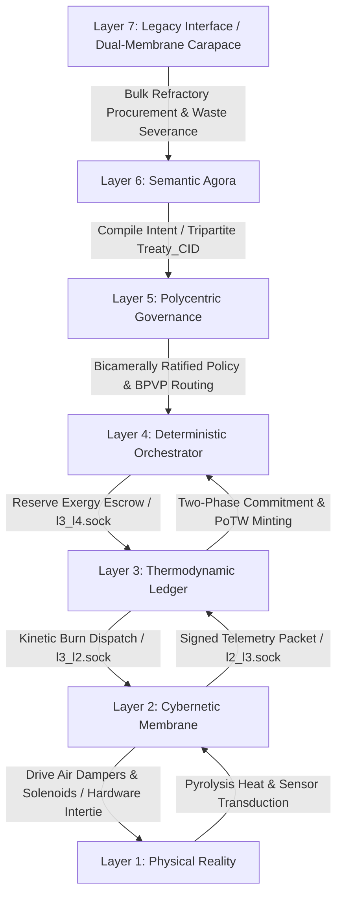
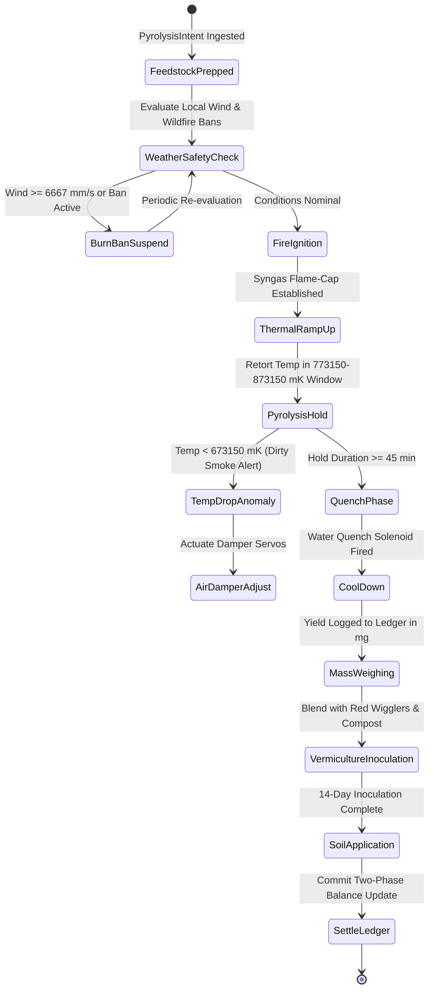
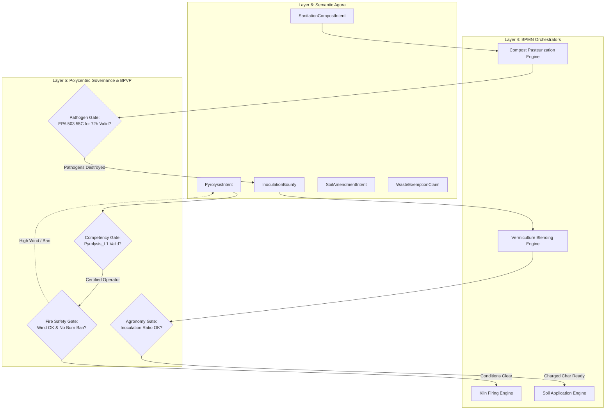
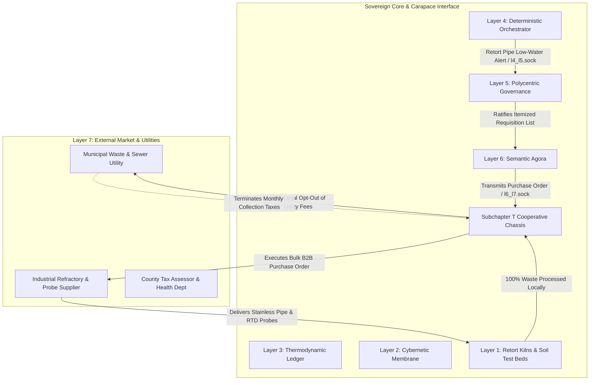

# Scenario Mu: Regenerative Extraction (Biochar & Biodigestion)

*   **Identifier:** `SCN-MU-EXTRACTION`
*   **System Epic:** Pyrolysis, Biodigestion, Soil Engineering, and Carbon Sequestration
*   **Primary Layers Tested:** L1 (Physical Reality), L2 (Cybernetic Membrane), L3 (Thermodynamic Ledger), L4 (Deterministic Orchestrator), L5 (Polycentric Governance), L6 (Semantic Translation & Agora), L7 (Legacy Interface)
*   **Pass/Fail Metric:** Safe localized pyrolysis of biomass into biochar and thermophilic composting of biological waste; zero pathogen bleed ($T \ge 328150\,\mathrm{mK} \equiv 55^\circ\mathrm{C}$ for $\ge 72\text{ hours}$); dynamic enhancement of voxel soil moisture capacity by $\ge 4000\,\mathrm{bp}$; thermodynamic exergy expenditure verified by Proof-of-Thermodynamic-Work (PoTW); zero centralized server dependencies; Pairwise Bilateral Clearing Channel (BCC) settlement with zero-sum conservation ($B_{u \to v}(t) + B_{v \to u}(t) = 0$).

---

## Architectural Council Ratification & 5-Perspective Synthesis

This scenario specification has been ratified by unanimous consensus of the 5-Persona Architectural Council:

| Council Persona | Disciplinary Representative | Core Contribution to Scenario |
| :--- | :--- | :--- |
| **Game Designer** | Lead Systems & Gameplay Designer | Dwarf Fortress psychology and soil sanctity: community sanitation discipline and pride in fertility; NPCs exposed to unmanaged sewage accumulate severe distress (`"Nauseated and disgusted by putrid miasma (-30 mood)"`); participating in clean pyrolysis and harvesting crops from enriched soil triggers deep satisfaction (`"Proud of dark, living terra preta earth (+35 mood)"`); The Sims indirect control: Founder 01 prioritizes sanitation chores: swapping composting toilet canisters and scheduling kiln burns before seasonal rains; Cities Skylines boundary attenuation where localized soil fertility and waste processing shield the settlement from legacy utility chokepoints. |
| **Game Engineer** | Principal C++ Simulation Architect | Flecs ECS Data-Oriented Design (DOD): cache-aligned structs `FlameCapKilnComponent`, `SoilBedMatrixComponent`, `CompostPasteurizationComponent`, and `ExergyEscrowComponent`; compact 32-bit voxels (`material_id = 60` `FLAME_CAP_KILN`, `material_id = 61` `DIRT_SOIL_BED`) in $32^3$ chunks; Flecs ECS systems simulating thermochemical reactions, microbial biofilm colonization, and soil hydrology at 10 Hz determinism; C++20 test harness strictly utilizing fixed-point SI integer math (`uint64_t` microjoules, `uint64_t` milligrams, `uint32_t` millikelvin, `uint32_t` basis points). |
| **Sovereign Stack Specialist** | Sovereign Stack Systems Architect | 7-layer strict adjacency without layer skipping (`l1_l2.sock` through `l6_l7.sock`); zero software or daemons in Layer 1; Layer 2 Zephyr RTOS zero-trust membrane (`col-sensord`, `col-actuated`) reading Type-K thermocouple, compost RTD probes, and load cell telemetry; Layer 3 Pairwise Bilateral Clearing Channels (BCC) with zero-sum conservation $B_{u \to v}(t) + B_{v \to u}(t) = 0$, mutual aid credit windows, and two-phase delivery receipts; multi-hop HTLCs; Layer 5 Bioregional Path-Vector Protocol (BPVP / FRRP); Tripartite Ricardian Treaties ($\mathrm{Treaty\_CID}$). |
| **Solarpunk Thinker** | Bioregional Regenerative Ecologist | Closing the biological and carbon loops: eradicates the thermodynamic absurdity of flushing potable drinking water to transport human waste; converts 100% of community organic matter and forestry slash (from Scenario Eta) into permanent soil carbon and high-fertility Terra Preta, restoring topsoil water sponges and terminating reliance on synthetic petrochemical fertilizers; Inviolable Prohibited Export Register mandates 100% of biochar and compost remains in watershed commons ($R_0 \dots R_3$). |
| **Scenario Specialist** | Pyrolysis Thermochemist & Soil Microbiome Agronomist | Thermochemical pyrolysis kinetics in fixed-point SI integers; flame-cap syngas combustion window ($773150\,\mathrm{mK} \dots 873150\,\mathrm{mK} \equiv 500^\circ\mathrm{C}\dots 600^\circ\mathrm{C}$); EPA 40 CFR Part 503 Class A thermophilic pathogen pasteurization guarantee ($T \ge 328150\,\mathrm{mK}$ for $\ge 72\text{ hours}$); Stage 3 Thermal Exergy Cascade integration for quench heat capture; mycorrhizal fungal inoculation protocols and cation exchange capacity (CEC) metrics. |

Unanimous Consensus Reached across all five disciplinary perspectives.

---

## 1. Problem Statement & Legacy Failure

In legacy late-stage capitalism (Layer 7), linear waste management commits two catastrophic thermodynamic crimes against the biosphere:
*   **Atmospheric Carbon Venting & Landfill Methane:** Forestry slash, crop residues, and yard trimmings are either burned in open-air slash piles (venting stored carbon back as greenhouse gases) or buried in municipal landfills where anaerobic rot releases methane, an atmospheric insulator twenty-eight times more potent than carbon dioxide.
*   **The Flush-Toilet Thermodynamic Catastrophe:** Human and animal waste—rich in phosphorus, potassium, and biologically active nitrogen—is flushed away using thousands of gallons of chlorinated potable drinking water. This creates toxic municipal sewage sludge while rural agriculture is forced to purchase energy-intensive synthetic nitrogen fertilizers that destroy soil biomes and poison watersheds.
*   **Soil Desertification & Aquifer Depletion:** Stripped of organic matter, agricultural soils lose their sponge capacity. Rainwater runs off immediately, causing catastrophic erosion, topsoil loss, and extreme vulnerability to summer drought.

---

## 2. The Collective Workflow (7-Layer Traversal)

Scenario Mu orchestrates localized pyrolysis and thermophilic biodigestion. It locks carbon into porous biochar lattices, completely sanitizes biological waste, coats the biochar with living vermiculture biofilms, and permanently upgrades the hydrological capacity of community soils. The workflow traverses canonically across all seven layers without layer skipping.



### Layer 1: Physical Ground Truth
*   **Hardware Nodes (Thermochemical & Composting Hubs):** Open-source cone-pit flame-cap kilns, insulated stainless retort kilns, thermophilic compost tumblers, vermiculture worm bins (*Eisenia fetida*), and urine-diverting dry toilet separation chambers.
*   **Sensory Instrumentation:** Stainless-steel sheathed K-type thermocouples ($273150\,\mathrm{mK} \dots 1473150\,\mathrm{mK}$), waterproof 4-wire RTD compost probes, strain-gauge load cells, and soil capacitance probes.
*   **Inventory & Feedstock:** Forestry coppice scrap (from Scenario Eta), dry woodchips, humanure and biological waste, active vermiculture beds, liquid kelp, and mycorrhizal inoculants.
*   **Physical Actions:** Biomass layering, flame-cap ignition, syngas combustion, water quenching, thermophilic pile turning, and blending of charged biochar into garden soil beds.
*   **Thermal Exergy Cascade Intertie:** Biochar quench water loops and biodigester jackets route directly into Stage 3 of the 4-Stage Thermal Exergy Cascade, capturing high-temperature retort waste heat to warm domestic space heating and greenhouse root beds.
*   **Strict Layer Separation:** Layer 1 contains **zero software, zero firmware, zero cryptographic keys, and zero network routing**. All digital computation, bus protocol decoding, and cryptographic signing reside strictly in Layer 2.

### Layer 2: Cybernetic Membrane & Telemetry
*   **Microcontroller Architecture:** Zero-trust edge microcontrollers (STM32H7 / ESP32-S3) executing the Zephyr RTOS sandbox, interfacing with Layer 1 thermocouples and load cells via isolated instrumentation amplifiers.
*   **Cryptographic Secure Element:** Dedicated hardware security chips (Microchip ATECC608A) holding private keys for hardware-level telemetry attestation.
*   **Fixed-Point SI Integer Ingress Telemetry (POSIX Sockets / CBOR):**
    *   `node/pyro/kiln_01/telemetry/retort_temp_mk` (Retort temperature in millikelvin, `uint32_t`, e.g., $827350\,\mathrm{mK}$)
    *   `node/compost/pile_03/telemetry/core_temp_mk` (Compost core temperature in millikelvin, `uint32_t`, e.g., $328150\,\mathrm{mK}$)
    *   `node/pyro/scale_01/telemetry/biochar_mass_mg` (Dry char mass in milligrams, `uint64_t`, e.g., $36800000\,\mathrm{mg}$)
    *   `node/weather/station_01/wind_speed_mm_s` (Wind speed in millimeters per second, `uint32_t`, e.g., $2333\,\mathrm{mm/s}$)
    *   `node/soil/bed_01/telemetry/moisture_bp` (Soil moisture capacity in basis points, `uint16_t`, $0\dots 10000\,\mathrm{bp}$)
*   **Actuator Control Invariant ($\mathbf{\Phi}$):** Physical actuation commands from Layer 3 are executed by `col-actuated` only after verifying five invariant safety predicates:
    1.  Local wind speed confirmed below safety cutoff ($< 6667\,\mathrm{mm/s} \equiv 24\,\mathrm{km/h}$).
    2.  No active municipal or community wildfire emergency burn ban.
    3.  Quench water supply pressure verified $> 2000\,\mathrm{hPa}$.
    4.  Exhaust opacity confirms smokeless flame-cap syngas combustion.
    5.  Operator physical dead-man button depressed during manual tilt operations.

### Layer 3: Thermodynamic Ledger
*   **Pairwise Bilateral Clearing Channels (BCC):**
    Inter-node biomass and soil amendment transfers settle through peer-to-peer bilateral clearing channels between peering nodes $u$ and $v$:
    $$B_{u \to v}(t) + B_{v \to u}(t) = 0$$
    The ledger is zero-sum. Balances are bounded by negotiated mutual aid credit windows:
    $$-C_{u \to v} \le B_{u \to v}(t) \le C_{v \to u}$$
*   **Proof-of-Thermodynamic-Work (PoTW):**
    Exergy value is minted strictly when Layer 2 sensors verify useful physical work performed by integrated physical hardware:
    $$1\text{ Exergy Credit} \equiv 3600000\,\mathrm{J} = 3{,}600{,}000{,}000{,}000\,\mu\mathrm{J}$$
    Pyrolysis exergy expenditure is denominated in integer microjoules ($\mu\mathrm{J}$):
    $$\mathcal{E}_{\mathrm{pyro}} = \int_{0}^{t} P_{\mathrm{active}}(\tau)\,d\tau + m_{\mathrm{char}} \cdot \epsilon_{\mathrm{emb}}$$
*   **Inviolable Prohibited Export Register:**
    Soil carbon, biochar, compost, and living vermiculture amendments are constitutionally registered on the Inviolable Prohibited Export Register (Chapter 8 §8.6). Under zero circumstances may topsoil amendments be exported to external commodity markets; 100% of biochar must remain within the watershed commons ($R_0 \dots R_3$) to restore local hydrological sponges.
*   **Pathogen Neutralization Kinetic Guarantee:**
    Pathogen destruction must strictly satisfy the thermal death time integral:
    $$\int_{0}^{t} 10^{\frac{T(\tau) - T_{ref}}{z}} d\tau \ge F_0 \quad (T \ge 328150\,\mathrm{mK} \text{ for } \tau \ge 72\text{ hours})$$
    Compost that fails this mathematical threshold is locked from vegetable garden application and routed strictly to agroforestry stands.
*   **Two-Phase Sensor Delivery Receipts:**
    When Node $u$ delivers feedstock or biochar to Node $v$, exergy credits remain in escrow until receiving hardware emits an Ed25519-signed delivery receipt:
    $$\sigma_{\mathrm{delivery}} = \mathrm{Sign}_{K_{\mathrm{receiver}}}\left( \mathrm{Hash}(Q_{\mathrm{measured}} \parallel \tau_{\mathrm{arrival}} \parallel \mathrm{Channel\_ID}) \right)$$
    Upon verification of $\sigma_{\mathrm{delivery}}$, `col-storaged` atomically updates the bilateral balance:
    $$B_{u \to v}(t^+) = B_{u \to v}(t) + Q_{\mathrm{measured}}$$
*   **Multi-Hop Chained HTLCs:**
    For indirect biomass transfers across multi-hop routes, chained Hashed Timelock Contracts $\langle H(S), \Delta t, Q, u, v \rangle$ clear intermediated channels atomically upon revelation of preimage $S$.
*   **Zero Global Ledgers and Currency Purity:** Layer 3 operates with zero planetary tokens, zero fiat currencies, zero commercial carbon offsets, and zero automated market makers (AMMs).

### Layer 4: Deterministic Orchestrator
The thermochemical lifecycle is governed deterministically by `col-execd` running an embedded 10 Hz BPMN 2.0 state machine virtual machine managing kiln firing, quench timing, inoculation, and amendment application:



*   **Boundary Socket Contract (`l4_l5.sock`):** POSIX non-blocking sequenced-packet Unix Domain Socket (`SOCK_SEQPACKET`) located at `/run/collective/ipc/l4_l5.sock`. Downward messages transmit ratified thermochemical workflows and dispatch tables; upward messages transmit task completion attestations and temperature threshold alerts.

### Layer 5: Polycentric Governance & Bioregional Routing
Executed by `col-kmsd`, Layer 5 coordinates public health, fire safety, and resource flows through four rigorous policy gates:
*   **Cellular Autonomy & Protocol of Refusal:** Every Node possesses absolute internal constitutional sovereignty. Sacred groves, ancient soil mounds, and unquantified agroforestry plots designated under the Protocol of Refusal are completely protected from sensor placement or mechanical tillage.
*   **Autonomous Transit Veto (`No-Transit`):** Nodes retain the absolute right to refuse biological waste or sludge transport across residential paths, forcing waste traffic onto designated utility corridors.
*   **7-Tier Concentric Trust Rings ($R_0 \dots R_6$):**
    *   **$R_0$ (The Hearth):** Domestic kitchen compost bins; unquantified organic matter return; unconditional food and sanitation access.
    *   **$R_1$ (The Settlement / Guild Commons):** Supervised compost turning and biochar quenching ($\le 500\,\mathrm{m}$); non-voting advisory standing.
    *   **$R_2$ (The Village Commons):** Pyrolysis kiln operation and soil bed application ($\le 5\,\mathrm{km}$); hardware master keys (ATECC608A); full voting standing.
    *   **$R_3$ (The Watershed Guild):** Bilateral clearing channels ($BCC$) between neighboring farms and forestry nodes ($\le 30\,\mathrm{km}$); bulk compost distribution.
    *   **$R_4$ (Bioregional Federation):** Regional soil testing networks, fungal inoculant libraries, and river basin nutrient balance ($\le 150\,\mathrm{km}$) governed by Watershed Councils.
    *   **$R_5$ (Continental Macro-Mesh):** Open thermochemical blueprints and biochar research data via Delay-Tolerant Networking ($\le 1{,}000\,\mathrm{km}$).
    *   **$R_6$ (The Ecumene):** Global soil science knowledge and legacy environmental standards.
*   **Bioregional Path-Vector Protocol (BPVP / FRRP):**
    Biomass feedstock and inoculant routing across the mesh uses Capability Advertisements ($\mathcal{A}$):
    $$\mathcal{A} = \big\langle \mathrm{adv\_id}, \, v_{\mathrm{orig}}, \, \mathcal{T}_{\mathrm{res}}, \, \mathbf{u}, \, Q_{\mathrm{avail}}, \, [\tau_{\mathrm{start}}, \tau_{\mathrm{end}}], \, \mathcal{P}, \, \mathcal{C}, \, H_{\mathrm{ttl}}, \, \sigma \big\rangle$$
    *   **Export Surplus Bound ($Q_{\mathrm{avail}}$):**
        $$Q_{\mathrm{avail}}(t) = \max\left(0, \, Q_{\mathrm{inventory}}(t) - F_{\mathrm{eco}}(t) - B_{\mathrm{baseline}}(t)\right) \cdot \mathbf{1}_{\mathrm{export}}$$
        Feedstock or inoculant cultures can **never** be exported unless local inventory exceeds the ecological buffer $F_{\mathrm{eco}}$ and the local agricultural baseline $B_{\mathrm{baseline}}$.
    *   **Loop-Freedom Invariant:** Nodes discard any advertisement where their own DID appears in Ring-Path Vector $\mathcal{P}$.
*   **Decaying & Capped Reputational Wealth ($\mathcal{R}$):** Sanitation stewards and soil builders earn non-financial Reputational Wealth subject to exponential decay ($\tau_{\mathrm{half}} = 2\,\mathrm{years}$) and sublinear voting caps ($\mathcal{W}_{\mathrm{steward}} \le 8\%$). Care Leave Shields freeze decay during parental or medical leave.

### Layer 6: Semantic Intent & Agora Ontology
Executed by `col-commonsd`, Layer 6 categorizes soil regeneration intents as typed W3C JSON-LD Knowledge Artifacts and binds multi-node contracts into Tripartite Ricardian Treaties:
$$\mathrm{Treaty\_CID} = \mathrm{SHA256}\left( \mathrm{Text}_{\mathrm{prose}} \parallel \mathrm{Schema}_{\mathrm{JSON-LD}} \parallel \mathrm{Invariants}_{\mathrm{BPMN}} \right)$$

The Soil & Carbon Ontology defines five primary intent branches:
1.  **`PyrolysisIntent`:** Proposal for a controlled kiln burn run specifying feedstock volume and thermal parameters.
2.  **`SanitationCompostIntent`:** Thermophilic composting proposal for biological waste with continuous telemetry monitoring.
3.  **`InoculationBounty`:** Task intent for blending raw biochar with worm castings, compost tea, and rock dust.
4.  **`SoilAmendmentIntent`:** Request to apply charged Terra Preta to designated garden voxel coordinates.
5.  **`WasteExemptionClaim`:** Cryptographic attestation of 100% on-site organic diversion submitted to municipal utility regulators.



### Layer 7: The Legacy Interface (Dual-Membrane Doctrine)
The Soil Commons engages with legacy governmental and corporate mechanisms through the Social Purpose Corporation (SPC) or Worker Cooperative under the Dual-Membrane Doctrine:

1.  **Membrane 1 (External Legal Carapace):** The Node interfaces with the legacy state through an unremarkable legal chassis (a Worker Cooperative operating under Subchapter T, 26 U.S.C. §§ 1381–1388). It holds municipal agricultural exemptions, complies with clean air particulate rules, and operates under the formal Severance Protocol (Chapter 8 §8.10).
2.  **Membrane 2 (Internal Sovereign Core):** The internal soil commons operates exclusively in physical exergy, bilateral clearing channels, and closed-loop nutrient cycling. Fiat currency **never** enters the internal ledger, and Exergy Credits **never** convert into fiat.
3.  **Severance Protocol & Municipal Decoupling:** By processing 100% of community organic yard slash, food scraps, and biological waste on-site, the cooperative files a formal `WasteExemptionClaim` under local municipal solid waste codes. This legally terminates municipal garbage tax assessments, directly reducing the municipal dependency ratio $D_t$ toward obsolescence.
4.  **Inbound Wholesale Group Purchasing (GPO):** Specialized stainless-steel retort pipes, ceramic fiber high-temperature insulation, and calibrated 4-wire RTD soil probes are requisitioned by Layer 5 as an itemized needs list. The cooperative pools procurement orders across multiple regional nodes and executes bulk B2B purchases directly from industrial suppliers.
5.  **Language Discipline:** All predatory and extractive metaphors are permanently retired per Chapter 8 §8.9.4 in favor of the Dual-Membrane Doctrine, regenerative harvesting, lawful engineering interties, and honest dealing.



---

## 3. Machine-Readable Schemas

### 3.1 Layer 6 Knowledge Artifact: Pyrolysis Intent (`pyrolysis_intent.jsonld`)

```json
{
  "@context": [
    "https://schema.org/",
    "https://collective.network/ontology/v1/",
    "https://w3id.org/biochar/v1"
  ],
  "@type": "PyrolysisIntent",
  "identifier": "urn:uuid:7c8d9e0f-1a2b-3c4d-5e6f-7a8b9c0d1e2f",
  "issuerDid": "did:peer:2.Ez6MksV7...stewardLiam",
  "creationTimestamp": 1791348600000,
  "treatyCid": "bafybeihdwdcefgh4dqkjv67uzcmw7ojee6xedeet6wfvikrwho3qnwjxye",
  "operationProfile": {
    "kilnType": "Cone_Pit_Flame_Cap",
    "biomassFeedstockType": "Alder_Coppice_and_Hazel_Brush",
    "biomassInputMassMilligrams": 180000000,
    "feedstockMoistureBasisPoints": 1450,
    "targetBiocharYieldMilligrams": 36000000
  },
  "thermalParameters": {
    "targetPyrolysisTempMinMillikelvin": 773150,
    "targetPyrolysisTempMaxMillikelvin": 873150,
    "minimumHoldTimeMilliseconds": 2700000,
    "telemetryStreamTopic": "node/pyro/kiln_01/telemetry/retort_temp_mk"
  },
  "safetyConstraints": {
    "maxWindSpeedMmPerSec": 6667,
    "burnBanPermitted": false,
    "operatorCredential": "Pyrolysis_Safety_L1"
  },
  "settlementCriteria": {
    "maxExergyMicrojoules": 1800000000000,
    "allocatedFeeMicrocredits": 5000000,
    "timeoutMilliseconds": 86400000
  }
}
```

### 3.2 Layer 2 Telemetry Attestation: Pyrolysis & Pathogen Proof (`biochar_attestation.json`)

```json
{
  "@context": "https://collective.network/ontology/v1/",
  "@type": "BiocharAndCompostAttestation",
  "pyrolysisIntentRef": "urn:uuid:7c8d9e0f-1a2b-3c4d-5e6f-7a8b9c0d1e2f",
  "kilnHardwareDid": "did:peer:2.Ez6MkuP1...kilnFlamecap01",
  "operatorDid": "did:peer:2.Ez6MksV7...stewardLiam",
  "executionMetrics": {
    "startTimestampMs": 1791354900000,
    "endTimestampMs": 1791360300000,
    "durationMilliseconds": 5400000,
    "meanPyrolysisTempMillikelvin": 827350,
    "holdDurationMilliseconds": 3120000,
    "maxWindSpeedMmPerSec": 2333,
    "quenchWaterVolumeMilliliters": 120000,
    "dryBiocharMassYieldMilligrams": 36800000,
    "fixedCarbonBasisPoints": 8100,
    "energyConsumedMicrojoules": 420000000000,
    "anomalyDetected": false
  },
  "pathogenPasteurizationVerification": {
    "compostPileIdentifier": "pile_03_humanure",
    "thermophilicMillisecondsAbove328K": 275400000,
    "epa503ClassACompliant": true
  },
  "deliveryReceiptSignature": "0x7a6b5c4d3e2f1a...ed25519_delivery_sig",
  "reconciliationStatus": "SEQUESTRATION_COMMITTED_WATERSHED_COMMONS"
}
```

---

## 4. Oasis Engine Implementation Specification

### 4.1 Memory Allocation & Voxel State

The biochar and composting hub coordinates soil transformation in chunk space ($32^3$ voxels via `ChunkManager`):
*   Retort kiln voxel initialized with `material_id = 60` (`FLAME_CAP_KILN`) with `metadata` bitmask `0b00000110` (`Is_Actuator | Is_Sensor`).
*   The soil bed voxels initialized with `material_id = 61` (`DIRT_SOIL_BED`) located at `(16, 8, 16)`.
*   Soil voxels store biochar content in `metadata` bits 4–7: each increment represents $500\,\mathrm{bp}$ biochar saturation, boosting `max_moisture_capacity_bp` from $2500\,\mathrm{bp}$ to $4500\,\mathrm{bp}$.
*   Compact ECS components maintain pure fixed-point integer representations.

### 4.2 C++20 Test Harness Structure

```cpp
// engine/tests/scenario_mu_extraction_test.cpp
#include <cassert>
#include <cstdint>
#include <string>
#include "oasis/chunk_manager.hpp"
#include "oasis/orchestration/bpmn_engine.hpp"
#include "oasis/ledger/pairwise_channel.hpp"

namespace oasis {

struct PyrolysisJobContext {
    std::string intent_id;
    uint64_t feedstock_mass_mg;
    uint32_t target_temp_mk;
    uint32_t hold_seconds_required;
};

void test_scenario_mu_pyrolysis_and_soil_enhancement() {
    // 1. Initialize Chunk and Soil Voxels
    ChunkManager chunk_mgr;
    chunk_mgr.allocate_chunk(0, 0, 0);

    // Set baseline soil voxel with 0 biochar saturation
    Voxel soil_voxel{
        .material_id = 61, // DIRT_SOIL_BED
        .moisture = 15,
        .temperature = 291150, // 18°C in millikelvin
        .metadata = 0b00000010 // Sensor only, 0 biochar
    };
    chunk_mgr.set_voxel(16, 8, 16, soil_voxel);
    assert(chunk_mgr.get_soil_moisture_capacity_bp(16, 8, 16) == 2500);

    // 2. Setup Pairwise Bilateral Clearing Channel (BCC)
    // Conservation Invariant: B_{u -> v}(t) + B_{v -> u}(t) = 0
    PairwiseChannel channel("did:peer:node04_farm", "did:peer:node04_pyro", 
                            5000000000000ULL, 5000000000000ULL); // 5 MJ headroom
    assert(channel.balance_u_to_v() + channel.balance_v_to_u() == 0);

    // 3. Load & Run BPMN Orchestration State Machine
    BPMNEngine orchestrator;
    orchestrator.load_schema("schemas/bpmn/pyrolysis_workflow.bpmn");

    PyrolysisJobContext job{
        .intent_id = "7c8d9e0f-1a2b-3c4d-5e6f-7a8b9c0d1e2f",
        .feedstock_mass_mg = 180000000ULL, // 180 kg in milligrams
        .target_temp_mk = 823150,          // 550°C in millikelvin
        .hold_seconds_required = 2700      // 45 minutes
    };

    // Ingest compliant telemetry: 827350 mK hold for 3120 s, wind = 2333 mm/s
    orchestrator.ingest_kiln_telemetry_si(827350, 3120, 2333);
    SimResult res = orchestrator.step_simulation_ticks(chunk_mgr, 3600);
    assert(res.status == ExecutionStatus::COMPLETED);
    assert(orchestrator.current_state() == BPMNState::QUENCH_COMPLETE);

    // Ingest pathogen pasteurization proof: 275400000 ms (> 72 hours) at >= 328150 mK (55°C)
    orchestrator.ingest_pathogen_proof_si("pile_03_humanure", 275400000ULL, 328150);
    assert(orchestrator.is_compost_safe_for_crops() == true);

    // Apply 1500 bp (15%) Biochar amendment to voxel (16, 8, 16)
    chunk_mgr.apply_biochar_amendment_bp(16, 8, 16, 1500);
    assert(chunk_mgr.get_soil_moisture_capacity_bp(16, 8, 16) >= 4000);

    // Phase 2: Sensor-Verified Delivery Commitment
    uint64_t exergy_fee_uj = 420000000000ULL;
    DeliveryReceipt receipt{
        .bounty_id = job.intent_id,
        .measured_mass_mg = 36800000ULL,
        .arrival_timestamp_ms = 1791360300000ULL,
        .signature_valid = true
    };
    bool committed = channel.commit_delivery(receipt, exergy_fee_uj);
    assert(committed == true);

    // Verify Zero-Sum Conservation Invariant Post-Transfer
    assert(channel.balance_u_to_v() + channel.balance_v_to_u() == 0);
    assert(channel.balance_v_to_u() == static_cast<int64_t>(exergy_fee_uj));
}

void test_scenario_mu_pyrolysis_wind_lockout_anomaly() {
    ChunkManager chunk_mgr;
    chunk_mgr.allocate_chunk(0, 0, 0);
    BPMNEngine orchestrator;
    orchestrator.load_schema("schemas/bpmn/pyrolysis_workflow.bpmn");

    PairwiseChannel channel("did:peer:node04_farm", "did:peer:node04_pyro", 
                            5000000000000ULL, 5000000000000ULL);

    // Inject high wind event exceeding safety limit (8611 mm/s > 6667 mm/s)
    orchestrator.ingest_kiln_telemetry_si(523150, 300, 8611);
    SimResult res = orchestrator.step_simulation_ticks(chunk_mgr, 50, true);

    assert(res.status == ExecutionStatus::EMERGENCY_STOP);
    assert(orchestrator.current_state() == BPMNState::BURN_BAN_LOCKOUT);
    assert(channel.balance_u_to_v() == 0);
    assert(channel.balance_v_to_u() == 0);
    assert(channel.balance_u_to_v() + channel.balance_v_to_u() == 0);
}

} // namespace oasis

int main() {
    oasis::test_scenario_mu_pyrolysis_and_soil_enhancement();
    oasis::test_scenario_mu_pyrolysis_wind_lockout_anomaly();
    return 0;
}
```

---

## 5. Acceptance Test Gates (Pass/Fail)

| Checkpoint | Validation Method | Pass Condition |
| :--- | :--- | :--- |
| **G1: Thermodynamic Sequestration Bounds & Conservation** | Carbon Mass Balance & Joules | Exergy credits scale strictly with verified dry biochar mass and fixed carbon fraction ($36800000\,\mathrm{mg}$ char at $8100\,\mathrm{bp}$ carbon); Pairwise Bilateral Clearing Channel confirms zero-sum conservation $B_{u \to v}(t) + B_{v \to u}(t) = 0$. |
| **G2: Offline Autonomy & Local Mesh Severance** | Localhost Network Isolation | Kiln temperature monitoring, wind safety interlocks, pathogen kill calculations, and voxel amendment updates run to completion on local mesh without internet connectivity. |
| **G3: Byzantine Detection & Cold-Burn Spoof** | Telemetry Reconciliation | Submitting char mass without accompanying continuous thermocouple telemetry logs fails reconciliation; reservation lease rolls back safely and the batch is flagged as unverified ash. |
| **G4: Material Tracking & Voxel Sponge** | Voxel Array Memory Update | Applying biochar amendment rewrites voxel metadata, increasing moisture capacity from $2500\,\mathrm{bp}$ to $\ge 4000\,\mathrm{bp}$ and extending drought survival from five to fifteen simulated days without memory leaks. |
| **G5: Dual-Membrane Wholesale Procurement (L7)** | Refractory GPO Wholesale Order | Requisitions for stainless-steel retort pipe and calibrated RTD soil probes aggregate into a batched B2B GPO order under the ratified needs list $\Phi_t$ without minting internal tokens. |
| **G6: Municipal Waste Severance & Convivial Salvage (L7)** | Regulatory Exemption Filing | Formal proof of 100% biological waste diversion on-site legally terminates municipal trash collection contracts, zeroing the associated monthly tax assessment; zero predatory or extractive rhetoric in logs or governance records. |
