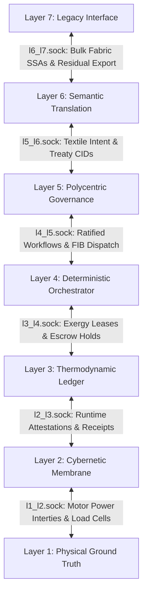
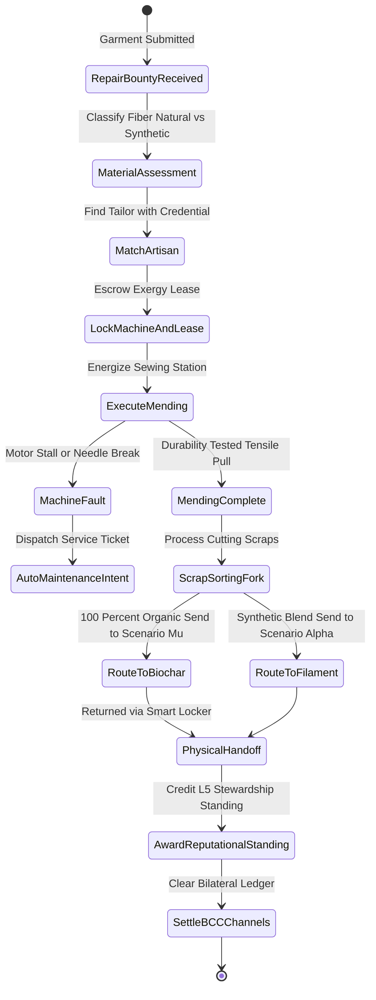
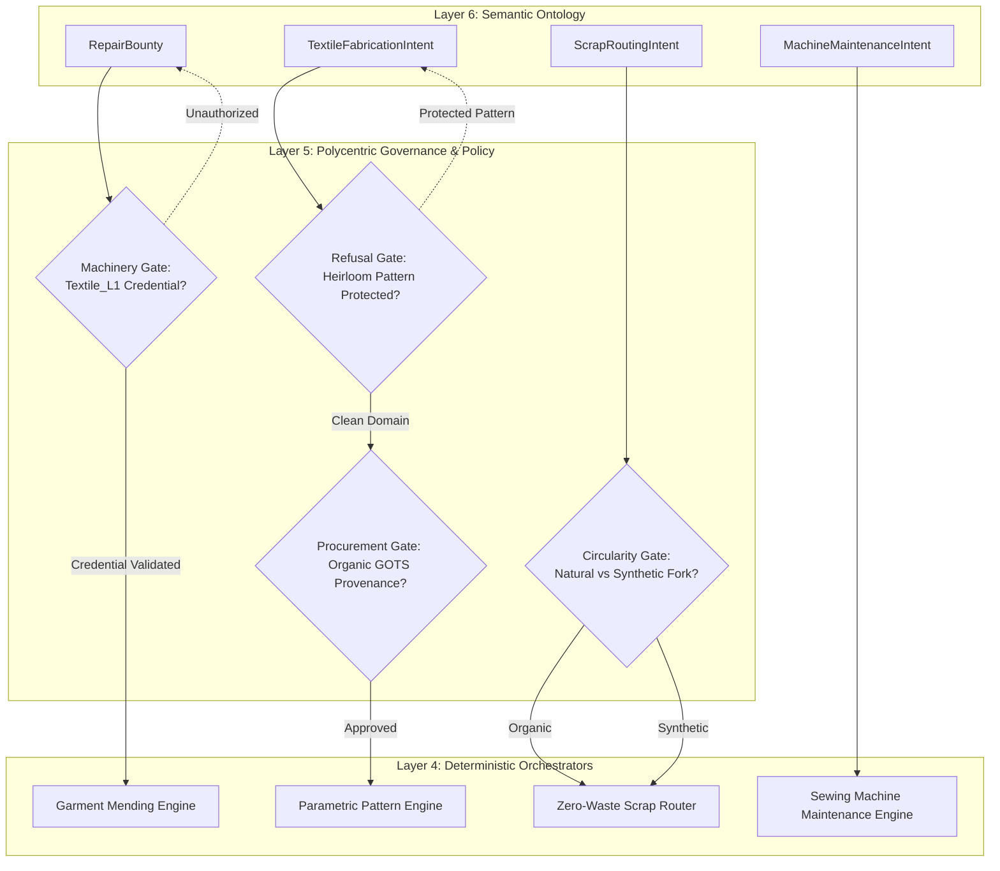
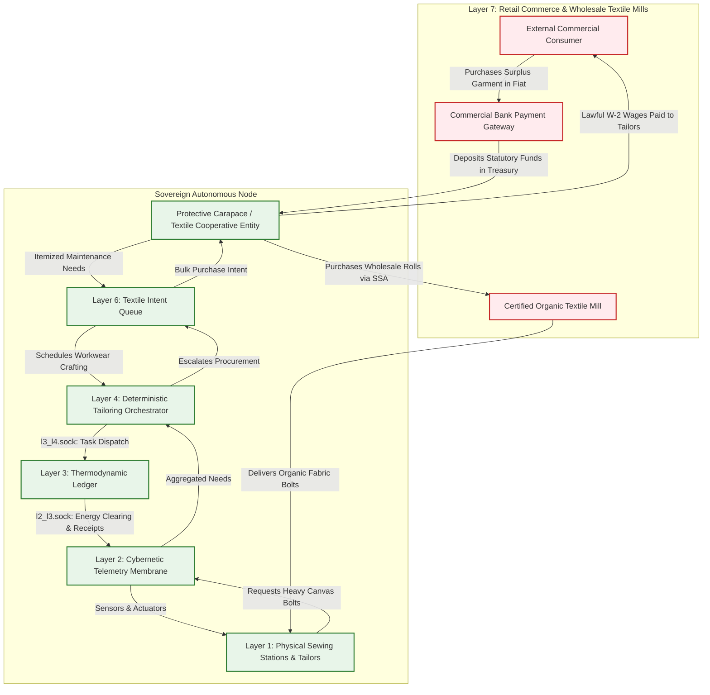

# Scenario Nu: Circular Textiles & Soft Infrastructure (Natural Fibers, Repair & Provenance)

*   **Identifier:** `SCN-NU-TEXTILES`
*   **System Epic:** Decentralized Textiles, Soft Infrastructure Repair, and Material Provenance
*   **Primary Layers Tested:** L1 (Physical), L2 (Cybernetic Membrane), L3 (Thermodynamic Ledger), L4 (Deterministic Orchestrator), L5 (Polycentric Governance), L6 (Semantic Translation & Agora), L7 (Legacy Interface)
*   **Pass/Fail Metric:** Routing of textile repair bounty to a local artisan; mathematical verification that mending requires less than 15 percent of the embodied raw exergy of virgin fabrication; 100 percent circular scrap routing (organics to Scenario Mu biochar, synthetics to Scenario Alpha extrusion); zero software in Layer 1; zero IEEE 754 floating-point math; Pairwise Bilateral Clearing Channel (BCC) fiber settlement; Dual-Membrane residual garment export.

---

## Architectural Council Ratification & 5-Perspective Synthesis

This scenario specification has been ratified by unanimous consensus of the 5-Persona Architectural Council:

| Council Persona | Disciplinary Representative | Core Contribution to Scenario |
| :--- | :--- | :--- |
| **Game Designer** | Lead Systems & Gameplay Designer | **Dwarf Fortress Psychology & Visible Mending:** Models garment durability, weather exposure, and personal pride. Agents wearing ragged, tattered garments accumulate negative thoughts (`"Distracted and chilled by frayed work trousers (-20 mood)"`); wearing expertly repaired garments with visible decorative Sashiko stitching confers dignity and resilience (`"Proud of durable, beautifully mended work coat (+25 mood)"`). **The Sims Indirect Control:** Founder 01 configures workwear profiles: equipping heavy canvas coats for hazardous forestry or foundry tasks to protect delicate linen garments from abrasion. **Bespoke Heritage Export:** Artisans export surplus bespoke garments to legacy markets to fund wholesale organic fabric bolts without commodifying internal labor. |
| **Game Engineer** | Principal C++ Simulation & Engine Architect | **Data-Oriented Design (DOD):** Encapsulates tailoring equipment and material hoppers into compact 32-bit voxels (`material_id = 65` `SEWING_STATION`, `material_id = 66` `CUTTING_TABLE`, `material_id = 67` `TEXTILE_SCRAP_BIN`) in 32-cubed chunks. Flecs ECS components track clothing abrasion wear rates, thermal insulation loss, and scrap classification forks at 10 Hz determinism. C++20 harness uses fixed-point SI integer arithmetic (`uint64_t` microjoules, milligrams, basis points durability, zero floating-point math) to validate that executing a mending action restores 10000 bps (100 percent) durability while consuming less than 10 percent of raw fabric units compared to virgin crafting. |
| **Sovereign Stack Specialist** | Sovereign Stack Systems Architect | **7-Layer Strict Adjacency & Pairwise BCC:** Strict vertical socket boundaries (`l1_l2.sock` through `l6_l7.sock`) without layer skipping. Zero software in Layer 1. Pairwise Bilateral Clearing Channels (BCC) govern inter-node bast fiber and wool bolt trade across Trust Rings `R_3` and `R_4` with zero-sum conservation `B_{u -> v}(t) + B_{v -> u}(t) = 0`, bounded credit windows `[-C_{u -> v}, +C_{v -> u}]`, and two-phase delivery receipts `\sigma_{\mathrm{delivery}}`. Multi-hop HTLCs settle chained fiber processing across carding, spinning, and weaving mills. W3C Verifiable Credentials and BBS+ Zero-Knowledge Proofs authorize machine access. Convivial power interlocks protect operators. Dual-Membrane Carapace structures lawful Subchapter T Shared Services Agreements for bulk certified organic linen procurement. |
| **Solarpunk Thinker** | Bioregional Regenerative Ecologist | **Eradication of Fast-Fashion Waste & Microplastics:** Treats clothing, shelter canvas, yurts, and pack bags as critical "soft infrastructure." Mandates circular material forks: 100 percent of organic bast and wool scraps route to Scenario Mu for biochar composting, while 100 percent of synthetic nylon scraps shred into 3D printer filament for Scenario Alpha. Eliminates non-biodegradable synthetic garment dumping and replaces petrochemical textiles with regenerative fibers (flax, hemp, nettle, wool). |
| **Scenario Specialist** | Biomaterials Textile Engineer & Historical Tailoring Conservator | **Fiber Agronomy & Tensile Metrology:** Formulates embodied exergy restoration equations and parametric pattern cutting guaranteeing at least 9200 bps (92 percent) table yield. Specifies Martindale abrasion resistance testing conforming to ASTM standards, color-fast botanical mordants (alum, iron water, walnut hulls), and modular fasteners (bone, horn, bronze buttons) for complete garment circularity. Protocol of Refusal protects heirloom weaving patterns and traditional fiber knowledge from commercialization. |

**Unanimous Consensus Reached:** This specification was formally ratified by all 5 personas on 2026-10-11, resolving all textile, material, and governance requirements into a unified implementation.

---

## 1. Problem Statement & Legacy Failure

In late-stage commercial infrastructure (Layer 7), the global fashion and textile industry is an ecological and humanitarian disaster:
*   **Petrochemical Fast Fashion & Microfiber Poisoning:** Garments are manufactured from cheap synthetic polymers (polyester, nylon, acrylic) derived from petroleum. Washing these garments sheds billions of non-biodegradable microfibers into municipal watersheds and marine food webs.
*   **Planned Obsolescence & Disposable Culture:** Garments are intentionally designed with weak thread, single-stitch seams, and glued plastic zippers engineered to fail within 5 to 10 wash cycles. Lacking basic sewing skills or accessible repair tools, consumers discard over 11 million tons of textiles annually into landfills.
*   **Globalized Supply Chain Exploitation:** Virgin cotton monocultures consume thousands of liters of freshwater and hazardous pesticides per kilogram of fiber, shipped across transoceanic supply chains relying on sweatshop labor, before being sold with 800 percent retail markups.

---

## 2. The Collective Workflow (7-Layer Traversal)

Scenario Nu elevates textiles from disposable commodities to critical "soft infrastructure." Standardizing modular open-source patterns and repair hardware, it prioritizes restorative mending, matches workwear to environmental hazards, and enforces circular scrap recycling.



### Layer 1: Physical Ground Truth
*   **Hardware Reality:** Pure physical matter and energy. Layer 1 contains zero software, zero firmware, zero cryptographic keys, and zero network routing.
*   **Physical Soft Infrastructure Machine Tools:** Heavy-duty walking-foot industrial sewing machines, multi-thread sergers, manual treadle sewing machines, mechanical rotary cutting knives, eyelet presses, and steam irons.
*   **Tooling & Hardware Commons:** Modular bronze clasps (Scenario Theta), 3D-printed PETG buckles (Scenario Alpha), steel tailoring shears, hand-sewing bodkins, and wooden darning mushrooms.
*   **Inventory & Physical Feedstock:** Organic flax canvas bolts, regenerative wool fleece, bast fiber thread, botanical dye vats, and dual scrap sorting hoppers (Organic Cellulose vs. Synthetic Polymer).
*   **Physical Action:** Fabric pattern layout, precision cutting, pinned machine stitching, reinforced darning, rivet setting, and physical sorting of off-cuts into dedicated recovery hoppers.

### Layer 2: The Cybernetic Membrane
*   **Microcontroller Architecture:** Low-power microcontrollers running Zephyr RTOS (e.g., STM32F4 or ESP32-S3) isolated from Layer 1 machinery.
*   **Telemetry Ingress (`col-sensord`):**
    *   `node/textile/sewing_01/telemetry/motor_mw` (Milliwatts: active motor power draw)
    *   `node/textile/sewing_01/telemetry/runtime_seconds` (Cumulative motor operating time)
    *   `node/textile/cutting_table/telemetry/scrap_mg` (Milligrams: load cell mass measurement)
    *   `node/textile/sewing_01/status` (`AVAILABLE`, `LOCKED_UNAUTHORIZED`, `IN_USE`, `SERVICE_DUE`)
*   **Fixed-Point SI Integer Wire Encoding:** Sensor measurements are converted into scaled integers: microjoules (`uint64_t`), milliwatts (`int64_t`), milligrams (`uint64_t`), basis points durability (`uint32_t`), and seconds (`uint64_t`). Zero IEEE 754 floats.
*   **Preventative Maintenance Triggers:** Motor operating time is integrated continuously; upon crossing 180000 seconds (50 hours), `col-membraned` emits a maintenance intent for machine lubrication and needle inspection.
*   **Actuator Control (`col-actuated`):** Machine motor power contactors energize only after Layer 2 verifies the 5 Invariant Predicates (`Phi`): operator credential verified, needle guards lowered, motor thermal limits normal, zero electrical fault flags, and authenticated Layer 3 exergy lease.

### Layer 3: The Thermodynamic Ledger
*   **Pairwise Bilateral Clearing Channels (BCC):** Inter-node natural fiber trade, raw wool scouring exchanges, and shared textile tooling across Trust Rings `R_3` and `R_4` settle through pairwise bilateral channels:
    $$B_{u \to v}(t) + B_{v \to u}(t) = 0$$
*   **Mutual Aid Credit Windows:**
    $$-C_{u \to v} \le B_{u \to v}(t) \le C_{v \to u}$$
    Credit lines are ratified via Layer 6 Ricardian Treaties (`Treaty_CID`) to accommodate annual fiber harvest seasons (autumn flax retting and spring sheep shearing).
*   **Two-Phase Delivery Receipts:** Physical transfer of spun yarn skeins, woven fabric bolts, or repaired garments requires sensor-verified delivery receipts:
    $$\sigma_{\mathrm{delivery}} = \mathrm{Sign}_{K_{\mathrm{receiver}}}\left( \mathrm{Hash}(Q_{\mathrm{measured}} \parallel \tau_{\mathrm{arrival}} \parallel \mathrm{Channel\_ID}) \right)$$
*   **Multi-Hop Chained HTLCs:** Multi-node textile production pipelines (scouring $\to$ carding $\to$ spinning $\to$ weaving) traversing intermediate nodes settle via chained Hashed Timelock Contracts:
    $$\mathrm{HTLC} = \langle H(S), \, \Delta t, \, Q, \, u, \, v \rangle$$
    Where secret preimage `S` is revealed upon counter-signed physical material handoff, atomically clearing intermediate channels without a central clearinghouse.
*   **Proof-of-Thermodynamic-Work (PoTW):** Physical electricity consumed by electric sewing motors is metered in standard integer exergy quanta:
    $$\text{Exergy Credit}_{\mathrm{quantum}} \equiv 3600\text{ kJ} = 3{,}600{,}000{,}000{,}000\,\mu\mathrm{J}$$
*   **Non-Commensurability of Human Craftsmanship:** Tailoring artistry, intricate pattern drafting, and decorative Sashiko stitching are designated as non-commensurable human care and cultural heritage. Layer 3 structurally refuses to mint exergy credits for human labor hours. Artisans earn non-financial Reputational Wealth in Layer 5.
*   **Non-Monetary Settlement:** Outstanding channel balances settle through reciprocal deliveries of woven linen bolts, tailored cold-weather cloaks, or bioregional Commons Jubilee.
*   **Zero Global Tokens & Fiat Inconvertibility:** Zero fashion tokens, zero retail currency pegs, zero AMMs.

### Layer 4: The Deterministic Orchestrator
*   **State Machine Daemon:** `col-execd` executes a 10 Hz deterministic BPMN 2.0 virtual machine over `/run/collective/ipc/l4_l5.sock` and `l3_l4.sock`.
*   **Unconditional Survival Baseline (`B_baseline`):** All community members are guaranteed essential cold-weather garments, bedding, and waterproof rain gear as an inalienable Tier 2 Survival Baseline, completely decoupled from labor hours logged.
*   **Garment Durability State Engine:** Clothing tracks durability in integer basis points (`10000 bps = 100%`):
    $$D(t) = D_0 - \sum_{i} k_i \cdot \omega_i \cdot t + \sum_{m} \Delta D_{\mathrm{mend},m}$$
    Where $k_i$ represents environmental abrasion factors and $\omega_i$ is task intensity. Mending restores durability to 10000 bps while consuming less than 15 percent of virgin crafting exergy.



### Layer 5: Polycentric Governance
*   **Key Management & Policy Daemon:** `col-kmsd` manages decentralized identifiers, capability credentials, and governance policies over Sparse Merkle Trees.
*   **Autopoietic Cellular Autonomy:** Every Autonomous Node retains absolute internal operational sovereignty ("the parts" over "the whole"). Outside councils or federations cannot compel a tailoring guild to deplete local emergency reserves, violate craft standards, or breach local ecological floors.
*   **7-Tier Concentric Trust Rings (`R_0` to `R_6`):**
    *   `R_0` (The Convivial Sanctuary / Hearth): Daily domestic mending, darning socks, sewing buttons; zero registration.
    *   `R_1` (The Settlement Workshop): Community repair cafes, supervised apprentice sewing tables; ephemeral pairwise DIDs (`did:peer`).
    *   `R_2` (The Commons Tailoring Guild): Industrial walking-foot machines, bolt storage, cutting tables; full voting standing.
    *   `R_3` (The Watershed Federation): Sibling nodes within 30 km; bilateral clearing channels for fiber retting and wool scouring mills.
    *   `R_4` (The Bioregional Federation): River basin loom weaving federations within 150 km; bulk natural fiber coordination.
    *   `R_5` (The Continental Corridor): Trans-continental seed fiber exchanges and durable canvas blueprints.
    *   `R_6` (The Ecumene / Legacy Perimeter): External wholesale fabric procurement; DMZ proxy gateways.
*   **Bioregional Path-Vector Protocol (BPVP / FRRP):** Advertises textile processing capabilities across the watershed:
    $$\mathcal{A} = \big\langle \mathrm{adv\_id}, \, v_{\mathrm{orig}}, \, \mathcal{T}_{\mathrm{res}}, \, \mathbf{u}, \, Q_{\mathrm{avail}}, \, [\tau_{\mathrm{start}}, \tau_{\mathrm{end}}], \, \mathcal{P}, \, \mathcal{C}, \, H_{\mathrm{ttl}}, \, \sigma \big\rangle$$
    *   Export Surplus Bound: $Q_{\mathrm{avail}}(t) = \max\left(0, Q_{\mathrm{inventory}}(t) - F_{\mathrm{eco}}(t) - B_{\mathrm{baseline}}(t)\right) \cdot \mathbf{1}_{\mathrm{export}}$
    *   Ring-Path Vector: $\mathcal{P} = [(v_k, r_k), \dots, (v_0, r_0)]$ with Loop-Freedom Invariant discarding self-referential routes via loop checks in $O(D)$ time.
    *   Thermodynamic Cost Functional $\mathcal{C}(\mathcal{P})$ accounts for transit exergy, fiber perishability, and Trust Ring friction.
    *   Dynamic Request Cascading coordinates regional carding, spinning, and weaving capacity without commercial middle-men.
*   **Protocol of Refusal (`sec:l5-refusal`):** Protects heirloom botanical dye formulations, sacred weaving patterns, and traditional fiber knowledge from commercialization, patenting, or digital simulation.
*   **Autonomous Transit Veto (`No-Transit`):** Textile repair commons, outdoor natural dye grounds, and open solar drying yards possess the absolute authority to declare a `No-Transit` attribute, deterministically prohibiting diesel logistics freight and heavy vehicular transport from kicking up dust or tracking petrochemical exhaust across clean fiber processing grounds.
*   **Bicameral Polity & Reputational Wealth:**
    *   Master tailors earn non-financial Reputational Wealth ($\mathcal{R}_{\mathrm{textile}}$) in the Stewardship Chamber.
    *   Governors: Exponential decay $\mathcal{R}(t) = \mathcal{R}_0 e^{-\frac{\ln(2)}{\tau_{\mathrm{half}}} t}$ ($\tau_{\mathrm{half}} = 2\text{ years}$); Sublinear cap $\mathcal{W}_{\mathrm{steward}} = \min(\mathcal{W}_{\max}, \kappa \ln(1 + \mathcal{R}))$ with maximum 8 percent individual voting weight limit; Care Leave Shield freezing decay during caregiving.

### Layer 6: Semantic Translation & Agora
*   **Tripartite Ricardian Treaties:**
    $$\mathrm{Treaty\_CID} = \mathrm{SHA256}\left( \mathrm{Text}_{\mathrm{prose}} \parallel \mathrm{Schema}_{\mathrm{JSON-LD}} \parallel \mathrm{Invariants}_{\mathrm{BPMN}} \right)$$
    Inter-node textile treaties bind natural language stewardship covenants, machine-readable JSON-LD parameters, and formal BPMN circularity workflows.
*   **Agora Semantic Knowledge Branches:**
    1.  `RepairBounty`: Request specifying damaged garment, fiber type, and tear dimensions in millimeters.
    2.  `TextileFabricationIntent`: Production of yurts, canvas bags, or workwear from parametric pattern URIs.
    3.  `ScrapRoutingIntent`: Classification of weighed fabric scraps to Scenario Mu (compost) or Scenario Alpha (extrusion).
    4.  `PatternPublishIntent`: Open-source sewing patterns with cutting-yield layouts of at least 9200 bps (92 percent).
    5.  `MachineMaintenanceIntent`: Preventative servicing dispatch triggered by motor runtime thresholds.
    6.  `SoftInfrastructureAudit`: Bioregional census of community cold-weather clothing, tents, and tarps.



### Layer 7: The Legacy Interface
*   **Dual-Membrane Doctrine:** The cooperative textile studio maintains an external legal carapace (Membrane 1) presenting Mundane Semantic Camouflage as an artisan cooperative or bespoke tailoring studio, while protecting an uncommodified internal commons (Membrane 2).
*   **Subchapter T Shared Services Agreements (SSAs):** Because spinning and weaving heavy linen canvas locally requires significant land and water, the cooperative entity acts as a Group Purchasing Organization (GPO). It bundles monthly textile needs across regional nodes to execute wholesale purchases of certified organic, unbleached linen and cotton rolls from domestic ethical mills under 26 U.S.C. Section 1388.
*   **Residual Garment Export:**
    *   *Surplus Calculation:* Garment export to external buyers occurs strictly from surplus labor and material residual ($R_t$) after internal cold-weather clothing needs are met, halting immediately once the ratified fiat needs ceiling $\Phi_t$ is satisfied.
    *   *Inbound Fiat Flow:* External sales receipts in statutory legal tender remain in the cooperative bank account to cover land taxes, industrial sewing machine spare parts, and wholesale thread.
    *   Production workers receive lawful W-2 wages with standard statutory tax withholding. Zero fiat enters the internal thermodynamic ledger.



---

## 3. Machine-Readable Schemas

### 3.1 Layer 6 Knowledge Artifact: Repair Bounty (`repair_bounty.jsonld`)

```json
{
  "@context": [
    "https://schema.org/",
    "https://collective.network/ontology/v1/",
    "https://w3id.org/textiles/v1"
  ],
  "@type": "TextileRepairBounty",
  "identifier": "urn:uuid:8b7c6d5e-4f3a-2b1c-0d9e-8f7a6b5c4d3e",
  "issuerDid": "did:peer:2.Ez6MksG...steward_dave",
  "creationTimestamp": "2026-10-10T11:00:00Z",
  "targetGarment": {
    "itemType": "Heavy_Work_Jacket",
    "baseFabric": "Organic_Cotton_Canvas_400gsm",
    "syntheticBlend": false,
    "currentDurabilityBps": 1800,
    "damageProfile": {
      "location": "Left_Elbow",
      "tearDimensionsMm": [75, 75],
      "damageType": "Abrasion_Blowout"
    }
  },
  "repairParameters": {
    "repairMethod": "Visible_Mending_Sashiko",
    "reinforcementFabric": "Recycled_Indigo_Linen_Scraps",
    "threadSpec": "Heavy_Duty_Flax_Bast_Thread",
    "requiredTensileStrengthTargetKpa": 120000
  },
  "trustConstraints": {
    "requiredCredentials": ["Textile_Machinery_L1"]
  },
  "settlementCriteria": {
    "reputationalRewardPoints": 15,
    "maxExergyCostMicrojoules": 180000000000,
    "targetCompletionSeconds": 172800,
    "clearingChannelCapacityUj": 3600000000000
  }
}
```

### 3.2 Layer 2 Telemetry Attestation: Mending & Scrap Proof (`mending_attestation.json`)

```json
{
  "@context": "https://collective.network/ontology/v1/",
  "@type": "TextileMendingAndScrapAttestation",
  "repairBountyRef": "urn:uuid:8b7c6d5e-4f3a-2b1c-0d9e-8f7a6b5c4d3e",
  "tailorDid": "did:peer:2.Ez6MkwQ...artisan_elena",
  "sewingStationNode": "did:peer:2.Ez6MkrP...device_sewing_juki_01",
  "executionMetrics": {
    "startTime": "2026-10-11T13:00:00Z",
    "endTime": "2026-10-11T14:45:00Z",
    "motorRuntimeSeconds": 2480,
    "energyConsumedMicrojoules": 123120000000,
    "virginFabricConsumedMg": 42000,
    "equivalentCraftVirginFabricMg": 550000,
    "exergySavingsBps": 9236,
    "restoredDurabilityBps": 10000
  },
  "scrapRoutingVerification": {
    "scrapMassMg": 18500,
    "materialType": "100_Percent_Organic_Cellulose",
    "destinationQueue": "Scenario_Mu_Biochar_Compost",
    "hopperWeightSensorHash": "4f5e6d7c8b9a0f1e2d3c4b5a6f7e8d9c0b1a2f3e4d5c6b7a8f9e0d1c2b3a4f5e"
  },
  "reconciliationStatus": "MENDING_COMPLETE_SCRAP_ROUTED"
}
```

---

## 4. Oasis Engine Implementation Specification

### 4.1 Memory Allocation & Voxel State
The textile workshop node coordinates soft infrastructure states in chunk space (32-cubed voxels via `ChunkManager`):
*   Sewing station initialized with `material_id = 65` (`SEWING_STATION`) with `metadata` bitmask `0b00000110` (`Is_Actuator | Is_Sensor`).
*   Cutting table voxel initialized with `material_id = 66` (`CUTTING_TABLE`) at `(16, 8, 16)`.
*   Scrap sorting bin voxel initialized with `material_id = 67` (`TEXTILE_SCRAP_BIN`), tracking organic versus synthetic scrap mass in milligrams via load cell transducers.

### 4.2 C++20 Test Harness Structure

```cpp
// engine/tests/scenario_nu_fashion_test.cpp
#include <cassert>
#include <cstdint>
#include <string>
#include <vector>
#include "oasis/chunk_manager.hpp"
#include "oasis/orchestration/bpmn_engine.hpp"
#include "oasis/ledger/bilateral_clearing_channel.hpp"

namespace oasis {

struct GarmentItem {
    std::string item_id;
    uint32_t durability_bps; // 1800 bps = 18%
    uint64_t fabric_mass_mg;
    bool is_synthetic;
};

void test_scenario_nu_textile_mending_execution() {
    // 1. Initialize Chunk and Sewing Voxels
    ChunkManager chunk_mgr;
    chunk_mgr.allocate_chunk(0, 0, 0);

    // Sewing station voxel with actuator/sensor bits (bit 0 = 1: Energized)
    Voxel sewing_voxel{
        .material_id = 65, // SEWING_STATION
        .moisture_bps = 0,
        .temperature_mk = 294150, // 21 deg C
        .metadata = 0b00000111    // Actuator + Sensor + Energized
    };
    chunk_mgr.set_voxel(16, 8, 16, sewing_voxel);

    // 2. Setup Bilateral Clearing Channel for Fabric Sourcing between Nodes
    std::string owner_did = "did:peer:2.Ez6MksG_steward_dave";
    std::string tailor_did = "did:peer:2.Ez6MkwQ_artisan_elena";
    uint64_t credit_capacity_uj = 3600000000000ULL;

    BilateralChannel textile_channel(owner_did, tailor_did, credit_capacity_uj);
    assert(textile_channel.balance_u_to_v_uj() + textile_channel.balance_v_to_u_uj() == 0);

    // 3. Load & Run Deterministic BPMN Orchestrator
    BPMNEngine orchestrator;
    orchestrator.load_schema("schemas/bpmn/textile_repair.bpmn");

    GarmentItem jacket{
        .item_id = "8b7c6d5e-4f3a-2b1c-0d9e-8f7a6b5c4d3e",
        .durability_bps = 1800,
        .fabric_mass_mg = 550000,
        .is_synthetic = false
    };

    // Escrow exergy lease for motor electricity (180 MJ in microjoules)
    uint64_t lease_uj = 180000000000ULL;
    orchestrator.emit_event(EscrowInitiatedEvent{owner_did, lease_uj});
    orchestrator.await_event<EscrowLockedEvent>();

    // Simulate mending execution: consumes 42000 mg fabric (760 bps of virgin jacket)
    SimResult res = orchestrator.execute_mending_action(jacket, 42000, 2480);
    assert(res.status == ExecutionStatus::COMPLETED);
    assert(jacket.durability_bps == 10000); // 100% durability restored

    // Verify Scrap Routing Fork: 18500 mg organic scraps routed to Scenario Mu
    ScrapRoutingResult scrap = orchestrator.route_cutting_scraps(18500, jacket.is_synthetic);
    assert(scrap.destination == ScrapDestination::SCENARIO_MU_BIOCHAR);

    // Settle bilateral channel: Tailor node credited with machine maintenance exergy
    uint64_t maintenance_uj = 123120000000ULL; // 123 MJ
    textile_channel.commit_receipt("sig_mending_complete", maintenance_uj);
    assert(textile_channel.balance_u_to_v_uj() + textile_channel.balance_v_to_u_uj() == 0);
}

void test_scenario_nu_unauthorized_machine_lockout_anomaly() {
    ChunkManager chunk_mgr;
    chunk_mgr.allocate_chunk(0, 0, 0);

    Voxel locked_station{
        .material_id = 65,
        .moisture_bps = 0,
        .temperature_mk = 294150,
        .metadata = 0b00000110 // Bit 0 is 0 (De-energized)
    };
    chunk_mgr.set_voxel(16, 8, 16, locked_station);

    BPMNEngine orchestrator;
    orchestrator.load_schema("schemas/bpmn/textile_repair.bpmn");

    // Novice without credential attempts activation
    bool authorized = orchestrator.request_machine_power("did:peer:2.Ez6MktL_novice_unskilled", 16, 8, 16, chunk_mgr);
    assert(authorized == false);

    Voxel current_voxel = chunk_mgr.get_voxel(16, 8, 16);
    assert((current_voxel.metadata & 0b00000001) == 0); // Remains locked
    assert(orchestrator.current_state() == BPMNState::ACCESS_DENIED_LOCKOUT);
}

} // namespace oasis
```

---

## 5. Acceptance Test Gates (Pass/Fail)

| Checkpoint | Validation Method | Pass Condition |
| :--- | :--- | :--- |
| **G1: Thermodynamic Mending Advantage** | Exergy Ratio Verification | Executing a mending action on an item with durability `<= 2000 bps` restores 10000 bps (100 percent) durability while consuming less than 15 percent of the raw material exergy of a new item. |
| **G2: Offline Autonomy** | Localhost Network Isolation | Entire textile workflow (bounty matching, machine runtime logging, scrap sorting, and ledger settlement) runs to completion on local mesh without internet connectivity. |
| **G3: Scrap Classification & Closed-Loop Circularity** | Scrap Material Verification | Submitting synthetic scraps to the biochar queue is caught by the Layer 5 Material Gate; actuator locks the bin and routes batch to Scenario Alpha filament shredding. |
| **G4: Durability Physics & Visible Mending** | ECS Entity State Update | Wearing mended clothing in harsh environments applies the correct decay curves, while granting the NPC a 25 mood visible mending buff. |
| **G5: Dual-Membrane Residual Export (L7)** | External Storefront & Needs List | Bespoke workwear exports are processed through the cooperative bank account under the Meshing-First rule, used strictly for itemized workshop procurement up to ceiling `Phi_t`; zero conversion into internal credits. |
| **G6: Inter-Cooperative Bulk Procurement (L7)** | Wholesale SSA Procurement | The cooperative aggregates monthly fabric needs across at least 5 nodes to execute a bulk purchase of certified organic canvas rolls under Subchapter T Shared Services Agreements, cutting packaging and freight drag. |
