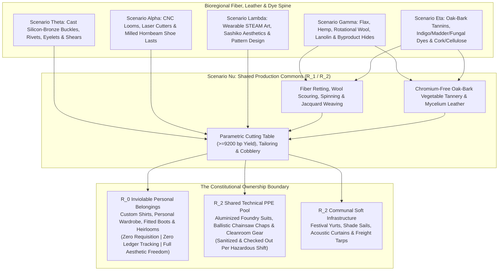
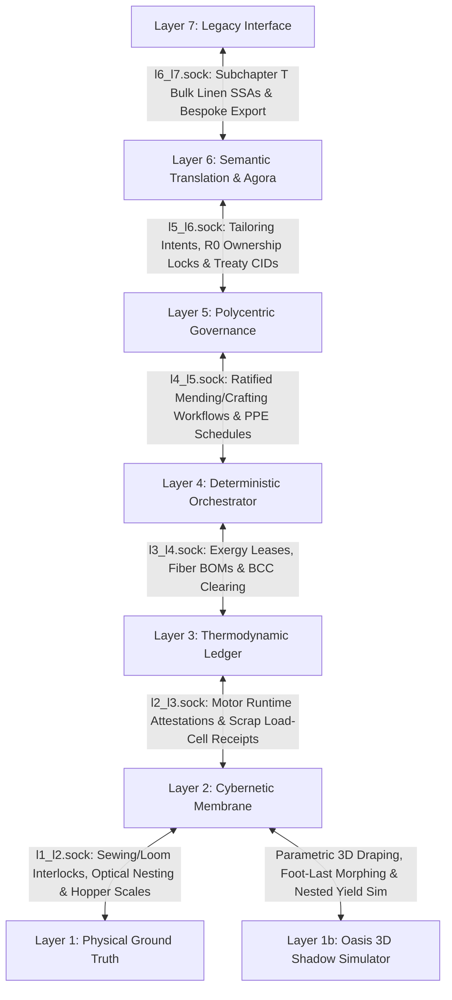
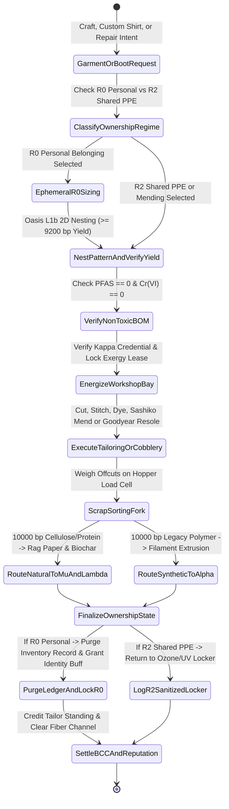

# Scenario Nu: Regenerative Textiles, Custom Apparel, Cobblery & Personal Aesthetic Sovereignty

*   **Identifier:** `SCN-NU-TEXTILES`
*   **System Epic:** Bioregional Fiber-to-Garment Production, Custom-Lasted Footwear, Technical Workwear, Restorative Mending, and the Constitutional Boundary Between Productive Commons and Inviolable Personal Belongings ($R_0$)
*   **Primary Layers Tested:** L1 (Physical), L1b (Oasis 3D Shadow Simulator), L2 (Cybernetic Membrane), L3 (Thermodynamic Ledger), L4 (Deterministic Orchestrator), L5 (Polycentric Governance), L6 (Semantic Translation & Agora), L7 (Legacy Interface)
*   **Pass/Fail Metric:** Constitutional and cryptographic enforcement of the **$R_0$ Personal Belonging Inviolability Invariant** (`attempt_requisition(custom_shirt) == false`, `r0_public_ledger_tracked == false`); mathematical verification that visible Sashiko mending and Goodyear-welt boot resoling consume $< 1500\,\mathrm{bp}$ ($15\%$) of the embodied exergy of virgin fabrication while restoring $10000\,\mathrm{bp}$ ($100\%$) durability; $\ge 9200\,\mathrm{bp}$ ($92\%$) nested cutting table yield; $10000\,\mathrm{bp}$ ($100\%$) circular scrap routing (natural fibers to Scenario Lambda rag paper / Scenario Mu biochar, legacy synthetics to Scenario Alpha extrusion); zero PFAS fluoropolymers or hexavalent chromium (`pfas_fluoropolymer_mg == 0`, `hexavalent_chromium_mg == 0`); zero IEEE 754 floating-point math; and Pairwise Bilateral Clearing Channel (BCC) inter-node fiber settlement.

---

## Architectural Council Ratification & 5-Perspective Synthesis

This scenario specification has been ratified by unanimous consensus of the 5-Persona Architectural Council:

| Council Persona | Disciplinary Representative | Core Contribution to Scenario |
| :--- | :--- | :--- |
| **Game Designer** | Lead Systems & Gameplay Designer | **The "Second Skin" Dual Axis (Biological Need + Aesthetic Identity) & Anti-Dystopian Personal Ownership:** Explicitly distinguishes between shared workshop machinery ($R_2$) and inviolable personal attire ($R_0$). A custom-tailored shirt, embroidered cloak, or pair of fitted leather boots belongs unconditionally to its wearer/maker—never tracked on the public ledger after handoff and constitutionally immune to requisition. Models **Dwarf Fortress Psychology**: stewards wearing custom-fitted, botanical-dyed, or Sashiko-mended personal garments gain both physical protection (thermal insulation, spark/bramble armor) and deep psychological pride (`"Expressing personal aesthetic sovereignty in custom indigo-dyed linen shirt (+3000 bp identity morale)"`). |
| **Game Engineer** | Principal C++ Simulation & Engine Architect | **Data-Oriented Design (DOD) & Fixed-Point Durability/Thermal Physics:** Encapsulates textile, weaving, and cobblery machinery into compact 32-bit voxels (`material_id = 65` `SEWING_STATION`, `material_id = 66` `CUTTING_TABLE`, `material_id = 67` `TEXTILE_SCRAP_BIN`, `material_id = 68` `COBBLER_BENCH`, `material_id = 69` `JACQUARD_LOOM`) in 32-cubed chunks. Flecs ECS systems simulate garment abrasion, thermal insulation (`mK` heat retention), Goodyear-welt boot sole wear, and $R_0$ ownership locks at $10\,\mathrm{Hz}$ determinism using fixed-point integer arithmetic (`uint64_t` $\mu\mathrm{J}$, $\mathrm{mg}$, `uint32_t` $\mathrm{bp}$, zero floats). |
| **Sovereign Stack Specialist** | Sovereign Stack Systems Architect | **7-Layer Strict Adjacency, $R_0$ Privacy Purge & Pairwise BCC:** Enforces strict socket boundaries (`l1_l2.sock` through `l6_l7.sock`, traversing `/run/collective/ipc/l4_l5.sock`). Codifies the **$R_0$ Personal Possession Lock**: once a personal garment or footwear item is fabricated or claimed by a steward, its item-level serial record is cryptographically purged from Layer 3/Layer 4 node inventory tables (`r0_public_ledger_tracked == false`) with zero RFID tracking tags. Pairwise Bilateral Clearing Channels (BCC) and multi-hop HTLCs settle inter-node flax, wool, and vegetable-tanned leather exchanges across Trust Rings $R_3$ and $R_4$. |
| **Solarpunk Thinker** | Bioregional Regenerative Ecologist | **Bioregional Fiber Shed, Chromium-Free Tannery & Zero Microplastics:** Replaces petrochemical fast fashion (polyester, nylon, acrylic, PFAS waterproof coatings, and toxic chrome-tanned leather) with a regenerative bioregional fiber shed: retted flax linen, industrial hemp canvas, stinging nettle, rotational-grazing wool (recovering lanolin for Scenarios Eta/Delta), oak-bark vegetable-tanned leather, and beeswax/linseed-oil weatherproofing. Enforces $9800\,\mathrm{bp}$ ($98\%$) vortex microfiber filtration on legacy wash cycles and $10000\,\mathrm{bp}$ closed-loop offcut routing. |
| **Scenario Specialist** | Biomaterials Textile Engineer, Master Tailor & Cordwainer | **Parametric Tailoring, Martindale Abrasion & Goodyear-Welt Cobblery:** Formulates parametric pattern nesting guaranteeing $\ge 9200\,\mathrm{bp}$ ($92\%$) fabric table yield, ASTM Martindale abrasion resistance ($\ge 50000$ cycles for heavy work canvas), and 3D custom-lasted Goodyear-welted footwear capable of 10+ resoling cycles over a 30-year service life. |

**Unanimous Consensus Reached:** This specification was formally ratified by all 5 personas, establishing Scenario Nu as The Collective's soft-infrastructure, footwear, and personal sartorial sovereignty engine.

---

## 1. Problem Statement, Legacy Failure & The Personal Sovereignty Boundary

In late-stage commercial infrastructure (Layer 7), how humanity clothes itself has been degraded into an ecological and psychological catastrophe—while historical state-collectivist alternatives failed by erasing personal individuality:
1.  **Petrochemical Fast Fashion, PFAS & Toxic Chrome Tanning:** Over $6000\,\mathrm{bp}$ ($60\%$) of modern garments are spun from fossil-fuel polymers (polyester, nylon, acrylic) treated with carcinogenic per- and polyfluoroalkyl substances (`PFAS`) and azo dyes, while commercial footwear relies on glued polyurethane soles and hexavalent-chromium ($\mathrm{Cr(VI)}$) leather tanning that poisons river basins and renders shoes unrepairable landfill trash within 12 months.
2.  **Planned Obsolescence & Sweatshop Alienation:** Garments are engineered with weak single-stitch seams and brittle plastic zippers to fail within 10 washes, alienating wearers from the craft of making and mending their own clothes.
3.  **The Collectivist Dystopia Caricature (*"They Want to Take Even the Custom Shirt I Make"*):** A recurring fear of collective organization—immortalized in the satirical taunt, *"Julio wants to even take a custom shirt I make"*—stems from authoritarian 20th-century regimes that conflated the **means of production** with **personal possessions**, forcing citizens into drab, uniform coveralls and suppressing sartorial self-expression.

### 1A. The "Second Skin" Architecture: Biological Need, Artistic Expression (`Lambda`), and the $R_0$ Personal Belonging Lock

A shirt, coat, or pair of boots in human society is never *merely* a thermodynamic barrier over a torso. Scenario Nu (`SCN-NU-TEXTILES`) explicitly models clothing along **two simultaneous axes** and enforces an ironclad **three-tier property boundary** so that collective abundance *amplifies* rather than erases radical individuality:



1.  **The Dual Nature of Attire (Biological Survival + Scenario Lambda Artistic Identity):**
    *   **Biological & Biomechanical Function:** Regulates core body temperature ($310150\,\mathrm{mK}$), wicks perspiration, shields skin from UV radiation, rain, and wind, prevents musculoskeletal injury via custom-lasted orthopedic footwear, and armors stewards against foundry slag (`SCN-THETA-FOUNDRY`), timber splinters (`SCN-ETA-COPPICE`), and thorny brambles (`SCN-GAMMA-KITCHEN`).
    *   **Aesthetic & Cultural Self-Expression (`SCN-LAMBDA-CULTURE` Synthesis):** Every garment is a wearable work of art. Through Scenario Nu's shared looms, dye vats, and tailoring stations, any steward can draft a custom silhouette, dye linen in deep botanical indigo or madder crimson, embroider personal narrative motifs, or practice visible **Sashiko** mending—turning every repair into a badge of biography and pride.
2.  **The Constitutional Boundary Between Productive Commons ($R_2$) and Personal Belongings ($R_0$):**
    *   **What is Shared ($R_1 / R_2$ Productive Commons & Specialized Hazard PPE):** The heavy industrial looms, walking-foot leather stitchers, CNC pattern tables, shoe-last mills, and intermittent high-hazard industrial PPE (aluminized foundry proximity suits, ballistic forestry chaps, sterile lab bunny-suits) are stewarded in the commons so everyone has access to world-class tools and safety equipment.
    *   **What is Inviolably Personal ($R_0$ Sovereign Belongings):** A steward's everyday wardrobe, custom-made shirts, tailored coats, undergarments, and custom-lasted boots belong exclusively and permanently to that individual in **Trust Ring $R_0$**:
        *   **Absolute Anti-Requisition Guarantee (`non_requisitionable == true`):** Layer 4 and Layer 5 state machines contain a hard constitutional assertion: no assembly, emergency decree, or rebalancing algorithm can ever requisition, reassign, or collectivize an $R_0$ personal garment. *If you design and stitch a custom shirt, it is yours forever.*
        *   **Cryptographic Inventory Purge (`r0_public_ledger_tracked == false`):** Once raw fabric mass (metered in milligrams at the cutting table) is transformed into a personal $R_0$ garment and claimed by its maker/wearer, the item is **permanently unlinked from the node's public asset ledger**. Personal clothing never contains tracking chips, and the collective never monitors what is inside a citizen's wardrobe.
        *   **Unconditional Design & Pattern Privacy (`Protocol of Refusal`):** While open-source workwear and base patterns live in the Alexandria Commons, a steward who drafts a custom personal shirt or family heirloom pattern holds an unconditional right to keep that cut private in $R_0$ or voluntarily publish it under `DPL v1`.

---

## 2. The Collective Workflow (7-Layer Traversal)

Scenario Nu connects bioregional agroecology and forestry (`Gamma`/`Eta`), metallurgy (`Theta`), precision machinery (`Alpha`), and aesthetic design (`Lambda`) across the 7-layer stack without layer-skipping.



### Layer 1: Physical Ground Truth & Layer 1b: Oasis 3D Shadow Simulator
*   **Hardware Reality (`Layer 1`):** Pure physical fibers, botanical tannins, mechanical stitching, and cobblery tooling:
    *   **Bioregional Fiber & Leather Feedstocks:** Retted flax line fibers, heavy `400 gsm` hemp duck canvas, nettle yarn, scoured rotational wool and recovered lanolin (`SCN-GAMMA-KITCHEN`), oak-bark vegetable-tanned cattle/goat hides and mycelium leather (`SCN-ETA-COPPICE`), natural hevea/guayule crepe rubber, and cork sheet.
    *   **Tailoring, Weaving & Cobblery Machinery:** Computerized jacquard and rapier looms, vacuum-bed CNC rotary/laser pattern tables, industrial walking-foot sewing machines, multi-thread overlockers, Goodyear-welt outsole stitchers, hornbeam shoe-last lathes (`SCN-ALPHA-FAB`), and botanical dye vats.
    *   **Fastener & Weatherproofing Commons:** Cast silicon-bronze buckles, rivets, snaps, and buttons (`SCN-THETA-FOUNDRY`), corozo-nut/bone buttons, and hot beeswax + raw linseed oil waterproofing slabs (`pfas_fluoropolymer_mg == 0`).
*   **Oasis 3D Shadow Simulator (`Layer 1b`):**
    *   **Parametric Pattern Draping & Ephemeral Foot Morphology:** Stewards preview custom shirts, coats, and boots on an ephemeral local avatar in Oasis (`L1b`), adjusting seam allowances, pocket placements, and Scenario Lambda embroidery motifs before cutting a single millimeter of cloth.
    *   **2D Nested Cutting Yield Optimization:** Before energizing the cutting table, Oasis runs a deterministic 2D bin-packing nest across pending garment patterns to guarantee a table material yield of $\ge 9200\,\mathrm{bp}$ ($92\%$), minimizing offcut scrap.

### Layer 2: The Cybernetic Membrane
*   **Edge Workshop Telemetry (`col-sensord`):** Low-power Zephyr RTOS microcontrollers monitor workshop tool states and scrap hoppers without surveilling personal attire:
    *   `node/textile/cutting_table_01/telemetry/yield_bps` (Nested fabric utilization in basis points; gate $\ge 9200\,\mathrm{bp}$)
    *   `node/textile/sewing_01/telemetry/motor_mw` and `runtime_seconds` (Triggers preventative oiling and needle/hook timing inspection every $180000\,\mathrm{s}$ [$50\text{ hours}$])
    *   `node/textile/scrap_hopper/telemetry/organic_cellulose_mg` and `synthetic_polymer_mg` (Calibrated load cells verifying $10000\,\mathrm{bp}$ sorted offcut routing)
    *   `node/textile/laundry_vortex/telemetry/microfiber_capture_bps` (Verifies $\ge 9800\,\mathrm{bp}$ capture of shed microfibers from legacy synthetic clothing)
*   **Ephemeral $R_0$ Sizing & Zero Biometric/RFID Retention:** Optical body measurements and 3D foot scans for custom shoe lasts are processed strictly in local volatile RAM (`R_0` session) to generate CNC G-code and pattern vectors, then immediately zeroed out. **Zero body dimensions are broadcast to the network, and zero RFID/NFC tracking chips are ever embedded in personal garments.**
*   **Convivial Safety Interlocks (`col-actuated`):** Industrial laser cutters, power looms, and heavy outsole stitchers unlock via Scenario Kappa (`SCN-KAPPA-APPRENTICE`) capability credentials (`Textile_Machinery_L1` / `Cobbler_Last_L2`) with physical needle-guard and fume-extraction interlocks.

### Layer 3: The Thermodynamic Ledger
*   **Unconditional Survival Baseline ($B_{\mathrm{baseline}}$) vs. Personal Custom Allocation:**
    *   Every steward is guaranteed a complete, climate-appropriate baseline wardrobe (warm wool coats, linen shirts, heavy work trousers, undergarments, rain gear, and custom-fitted leather/rubber boots) plus unlimited mending and resoling as an unconditional **Tier 2 Survival Baseline ($B_{\mathrm{baseline}}$)**, completely decoupled from labor hours logged.
    *   When a steward wishes to craft *additional* bespoke personal fashion pieces, experimental avant-garde garments, or elaborate Scenario Lambda costumes using scarce specialty textiles (e.g., peace silk or fine indigo-dyed broadcloth), the raw material embodied exergy ($\mu\mathrm{J}$) and milligram mass ($\mathrm{mg}$) are debited against their personal crafting allowance, and upon completion the garment is permanently locked into **$R_0$ Inviolable Personal Belongings** (`r0_public_ledger_tracked == false`).
*   **Thermodynamic Mending & Resoling Advantage:**
    *   Restorative mending (e.g., visible Sashiko reinforcement of torn elbows/knees) and cobbler resoling (replacing worn rubber/cork outsoles on Goodyear-welted boots) restore item durability to $10000\,\mathrm{bp}$ ($100\%$) while consuming $< 1500\,\mathrm{bp}$ ($15\%$) of the embodied raw fiber/leather exergy of virgin fabrication.
*   **Pairwise Bilateral Clearing Channels (BCC) & Multi-Hop HTLCs:**
    *   Because no single neighborhood node can grow flax, graze sheep, tan leather, and weave `400 gsm` canvas simultaneously, regional nodes across Trust Rings $R_3$ and $R_4$ form a **Bioregional Fiber Shed** settled via Pairwise BCCs:
        $$B_{u \to v}(t) + B_{v \to u}(t) = 0, \quad -C_{u \to v} \le B_{u \to v}(t) \le C_{v \to u}$$
    *   Multi-stage fiber processing (Node A harvests flax $\to$ Node B rets and spins yarn $\to$ Node C weaves bolts $\to$ Node D tailors garments) clears atomically via chained Hashed Timelock Contracts ($\mathrm{HTLC} = \langle H(S), \, \Delta t, \, Q, \, u, \, v \rangle$) backed by signed load-cell delivery receipts ($\sigma_{\mathrm{delivery}}$).

### Layer 4: The Deterministic Orchestrator
*   **State Machine Daemon:** `col-execd` executes a $10\,\mathrm{Hz}$ deterministic BPMN v2 virtual machine over `/run/collective/ipc/l4_l5.sock` and `/run/collective/ipc/l3_l4.sock`.
*   **Garment & Footwear Durability Physics:**
    $$D(t) = D_0 - \sum_{i} k_i \cdot \omega_i \cdot t + \sum_{m} \Delta D_{\mathrm{mend},m} \in [0, 10000]\,\mathrm{bp}$$
    When a steward performs high-abrasion work in Scenarios Eta, Theta, or Mu, assigning specialized **$R_2$ Technical PPE** absorbs $8500\,\mathrm{bp}$ ($85\%$) of the environmental abrasion factor $k_i$, preserving the steward's **$R_0$ personal clothing** beneath.



### Layer 5: Polycentric Governance
*   **Constitutional Protection of $R_0$ Personal Belongings:** Layer 5 (`col-kmsd`) enforces the **Inviolable Personal Possession Rule** at the protocol level. Any governance proposal or orchestrator command attempting to enumerate, tax, requisition, or mandate uniformity over $R_0$ personal clothing or custom creations is automatically rejected as an unconstitutional breach of Trust Ring $R_0$.
*   **7-Tier Concentric Trust Rings ($R_0$ to $R_6$):**
    *   $R_0$ (*The Personal Wardrobe & Hearth*): Inviolable personal shirts, coats, boots, heirloom textiles, and hand-mending tools; zero public ledger tracking, zero requisition, absolute aesthetic autonomy.
    *   $R_1$ (*The Neighborhood Mending Circle*): Domestic sewing circles, visible Sashiko mending nights, and hand-me-down baby/child clothing swaps (paired with `SCN-DELTA-CHILDCARE`); ephemeral pairwise DIDs (`did:peer`).
    *   $R_2$ (*The Node Tailoring & Cobblery Guild*): Shared CNC cutting tables, industrial sewing bays, shoe-last mills, botanical dye vats, and the sanitized $R_2$ Technical PPE Locker.
    *   $R_3$ (*The Watershed Fiber Shed*): Sibling nodes within $30\,\mathrm{km}$; bilateral clearing channels for flax retting, wool scouring, and oak-bark leather tanning.
    *   $R_4$ (*The Bioregional Textile Federation*): River-basin spinning and jacquard weaving mills within $150\,\mathrm{km}$ coordinated via the **Bioregional Path-Vector Protocol (BPVP)**.
    *   $R_5$ (*The Continental Pattern & Seed Archive*): Open-source parametric tailoring patterns (`FreeSewing` / `DPL v1`), cobbler last CAD files, and long-staple flax/hemp seed exchange (`SCN-IOTA-EPISTEMIC`).
    *   $R_6$ (*The Legacy Perimeter*): Subchapter T bulk organic fabric procurement and bespoke heritage garment export.
*   **Protocol of Refusal (`sec:l5-refusal`) & Autonomous Transit Veto (`No-Transit`):**
    *   Protects indigenous weaving motifs, sacred ceremonial vestments, and a steward's private $R_0$ custom patterns from external scraping, commercialization, or Oasis simulation.
    *   Open-air flax drying fields, wool bleaching meadows, and botanical dye yards broadcast a deterministic **`No-Transit` attribute** to Scenario Beta (`SCN-BETA-TRANSIT`), preventing heavy freight vehicles from kicking up dust or soot onto wet fibers.

### Layer 6: Semantic Translation & Agora
*   **Tripartite Ricardian Treaties (`Treaty_CID`):** Bind inter-node fiber-shed covenants, organic GOTS/chromium-free tanning invariants, and deterministic BPMN multi-hop HTLC clearing rules.
*   **Agora Semantic Knowledge Branches:**
    1.  `PersonalGarmentCraftIntent`: Initiates fabrication of an $R_0$ personal garment or custom-lasted boot pair, enforcing ephemeral sizing and automatic post-handoff inventory purging.
    2.  `TextileRepairBounty`: Matches torn clothing or worn boot soles with a credentialed Sashiko tailor or cordwainer.
    3.  `SharedPPERequisition`: Checks out sanitized $R_2$ high-hazard protective gear (foundry coats, chainsaw chaps) for scheduled industrial shifts.
    4.  `ScrapRoutingAttestation`: Signed load-cell proof routing $10000\,\mathrm{bp}$ of natural offcuts to Scenario Lambda/Mu and synthetic offcuts to Scenario Alpha.

### Layer 7: The Legacy Interface & Bespoke Heritage Carapace
*   **Subchapter T Group Purchasing (`26 USC 1388`):** During Stage 1 and Stage 2—before the bioregion achieves $10000\,\mathrm{bp}$ autonomous spinning and weaving capacity—Scenario Nu operates a **Shared Services Agreement (SSA)** across federated nodes (hosted by `SCN-EPSILON-COWORKING`) to purchase wholesale bolts of certified organic unbleached linen, hemp canvas, and wool directly from ethical mills at bulk cost.
*   **Bespoke Heritage Apparel & Footwear Export ($\Phi_t$):**
    *   Master tailors and cordwainers can voluntarily dedicate surplus guild hours to crafting museum-grade bespoke linen shirts, waxed-canvas field jackets, and Goodyear-welted vegetable-tanned boots for sale to the external Layer 7 public at luxury heritage prices.
    *   $10000\,\mathrm{bp}$ ($100\%$) of external fiat proceeds (capped at the node's ratified needs ceiling $\Phi_t$) stay in the cooperative Carapace treasury to pay lawful W-2 wages, purchase industrial sewing needles/spare parts, procure bulk organic fiber rolls, and fund the **Land Acquisition Escrow**.

---

## 3. 3-Stage Incremental Node Facility Blueprints (Node Growth Pattern)

Scenario Nu scales from a domestic mending and tailoring corner into a bioregional fiber-to-garment mill and vegetable tannery.

### Stage 1: Suburban Domestic Sewing Parlor, Visible-Mending Circle & Cobbler Anvil ($R_0 / R_1$ Bootstrap)
*   **Physical Footprint:** A quiet corner of a household living room or spare bedroom (`15 m2`) plus a backyard porch dye station (`6 m2`).
*   **Equipment & Capabilities:**
    *   Cast-iron treadle sewing machine and whisper-quiet brushless servo straight-stitch/overlock machines ($\le 480\,\mathrm{cB}$ / $48\,\mathrm{dBA}$ interior noise), wooden darning mushrooms, Sashiko needles, and a cast-iron cobbler's last anvil for hand-cementing and stitching replacement Vibram/hevea boot soles.
    *   Outdoor induction pot for small-batch botanical dyeing (indigo, onion skins, marigold, black walnut hulls, acorns from `SCN-ETA-COPPICE`) and beeswax/linseed-oil canvas waxing.
    *   **Microfiber Defense:** Household washing machine fitted with a $50\,\mu\mathrm{m}$ stainless-steel vortex filter (`>= 9800 bp` capture) to prevent legacy synthetic clothes from shedding microplastics into municipal greywater.
*   **Layer 7 Legal & Zoning Shield:** Protected as a domestic hobby, mending circle, and unincorporated craft guild under **UUNAA § 6** with zero retail walk-in traffic.

### Stage 2: Urban Tailoring Atelier, Custom Cobblery & Workwear Studio ($R_2$ Municipal Shell)
*   **Physical Footprint:** `250 m2` to `500 m2` light-industrial studio co-located with Scenario Epsilon (`SCN-EPSILON-COWORKING`), Scenario Alpha (`SCN-ALPHA-FAB`), and Scenario Lambda (`SCN-LAMBDA-CULTURE`).
*   **Integrated Zones:**
    1.  **Parametric Cutting & Tailoring Floor:** Vacuum-bed CNC rotary knife and laser cutter achieving $\ge 9200\,\mathrm{bp}$ ($92\%$) nested fabric yield, heavy-duty compound-feed walking-foot machines for `400 gsm` hemp canvas and leather, buttonhole/bar-tack machines, and steam pressing bucks.
    2.  **The Cordwainer & Custom Boot Bay:** Ephemeral 3D optical foot scanner (`R_0` RAM-only), hornbeam shoe lasts milled on Scenario Alpha's 4-axis CNC router, Landis-style curved-needle Goodyear outsole stitchers, and cork-footbed molding presses.
    3.  **The $R_2$ Technical PPE Sanitarium & Dual Scrap Hoppers:** Ozone and UV-C sanitization cabinets for shared foundry/forestry hazard gear, alongside load-cell-metered sorting bins separating $10000\,\mathrm{bp}$ organic cellulose/protein scraps (`-> SCN-LAMBDA-CULTURE` rag paper & `SCN-MU-EXTRACTION` biochar) from legacy synthetic polymers (`-> SCN-ALPHA-FAB` filament shredder).
*   **Economic & Legal Carapace:** Operates as a **Subchapter T Bespoke Tailoring & Footwear Cooperative**, generating high-margin external fiat ($\Phi_t$) from custom heritage shirts, coats, and resoleable boots to fund wholesale organic fabric SSAs and the **Land Acquisition Escrow**.

### Stage 3: Bioregional Fiber Mill, Oak-Bark Tannery & Sartorial Conservatory ($R_2 / R_3 / R_4$ CLT/PPT)
*   **Physical Footprint:** `3` to `10 hectares` co-located with Scenario Gamma's agroecological pastures and Scenario Eta's coppice timberlands on an **Irrevocable Community Land Trust (CLT) / Perpetual Purpose Trust (PPT)**.
*   **Full-Chain Sovereign Fiber & Leather Infrastructure:**
    *   **Bast Retting, Wool Scouring & Closed-Loop Cellulose Mill:** Warm-water enzymatic retting tanks for flax and hemp (effluent polished into fertilizer by `SCN-MU-EXTRACTION`), counter-current wool scouring train that recovers $9500\,\mathrm{bp}$ ($95\%$) pure pharmaceutical/cosmetic **lanolin** (supplied to `SCN-DELTA-CHILDCARE` and `SCN-ETA-COPPICE`), and a closed-loop `NMMO` ($\ge 9950\,\mathrm{bp}$ solvent recovery) lyocell spinneret converting coppice wood pulp into silky regenerated cellulose fiber.
    *   **Carding, Ring-Spinning & Jacquard Weaving Hall:** Automated carding engines, drawing frames, ring-spinning mules, and high-speed rapier and computerized jacquard looms capable of weaving everything from delicate `120 gsm` shirting linen and intricate Scenario Lambda tapestries to `600 gsm` waterproof yurt and freight-sail duck canvas.
    *   **Chromium-Free Vegetable Tannery & Mycelium Vat:** Slow-pit and rotating-drum tanning of Scenario Gamma livestock hides using Scenario Eta's coppiced oak-bark and chestnut tannins (`hexavalent_chromium_mg == 0`), paired with solid-state fermentation trays growing high-tensile *Ganoderma* mycelium leather mats.

---

## 4. Machine-Readable Schemas

### 4A. Layer 6 Knowledge Artifact: $R_0$ Custom Personal Garment & Mending Intent (`personal_garment_intent.jsonld`)

```json
{
  "@context": [
    "https://schema.org/",
    "https://collective.network/ontology/v1/",
    "https://w3id.org/textiles/v1"
  ],
  "@type": "PersonalGarmentAndMendingIntent",
  "identifier": "urn:uuid:8b7c6d5e-4f3a-2b1c-0d9e-8f7a6b5c4d3e",
  "issuerDid": "did:peer:2Ez6MksG_steward_julio_friend",
  "creationTimestamp": "2026-10-21T16:30:00Z",
  "ownershipRegime": {
    "trustRing": "R0_INVIOLABLE_PERSONAL_BELONGING",
    "nonRequisitionable": true,
    "purgePublicInventoryOnHandoff": true,
    "rfidOrBiometricTagsPermitted": false,
    "shareCustomPatternToCommons": false
  },
  "garmentProfile": {
    "itemType": "Custom_Tailored_Indigo_Sashiko_Shirt",
    "baseFabric": "Bioregional_Retted_Flax_Linen_180gsm",
    "dyeAndFinish": "Eta_Botanical_Indigo_And_Madder_Embroidery",
    "fasteners": "Theta_Cast_Silicon_Bronze_Buttons",
    "pfasFluoropolymerMassMg": 0,
    "hexavalentChromiumMassMg": 0,
    "nestedCuttingYieldBps": 9350
  },
  "mendingOrCobblerySubtask": {
    "targetItem": "Goodyear_Welted_Oak_Bark_Work_Boots",
    "currentDurabilityBps": 1800,
    "repairMethod": "Goodyear_Welt_Hevea_Rubber_And_Cork_Resole",
    "virginCraftExergyUj": 1200000000000,
    "maxRepairExergyUj": 140000000000
  },
  "trustConstraints": {
    "requiredCredentials": ["Textile_Machinery_L1", "Cobbler_Last_L2"]
  },
  "settlementCriteria": {
    "reputationalRewardPoints": 25,
    "clearingChannelCapacityUj": 3600000000000
  }
}
```

### 4B. Layer 2 Telemetry Attestation: Fabrication, $R_0$ Purge & Scrap Proof (`textile_attestation.json`)

```json
{
  "@context": "https://collective.network/ontology/v1/",
  "@type": "TextileAndCobbleryAttestation",
  "intentRef": "urn:uuid:8b7c6d5e-4f3a-2b1c-0d9e-8f7a6b5c4d3e",
  "tailorDid": "did:peer:2Ez6MkwQ_artisan_elena",
  "sewingStationNode": "did:peer:2Ez6MkrP_device_sewing_juki_01",
  "executionMetrics": {
    "motorRuntimeSeconds": 3120,
    "repairEnergyConsumedUj": 123120000000,
    "virginEquivalentEnergyUj": 1200000000000,
    "exergySavingsBps": 8974,
    "restoredDurabilityBps": 10000,
    "nestedTableYieldBps": 9350,
    "pfasAndChromeMassMg": 0
  },
  "r0SovereigntyVerification": {
    "ownershipClassification": "R0_INVIOLABLE_PERSONAL_BELONGING",
    "publicLedgerRecordPurged": true,
    "ephemeralSizingRamZeroed": true,
    "requisitionLockStatus": "CONSTITUTIONALLY_IMMUNE"
  },
  "scrapRoutingVerification": {
    "naturalCelluloseScrapMg": 24500,
    "naturalDestination": "Scenario_Lambda_Rag_Paper_And_Mu_Biochar",
    "syntheticPolymerScrapMg": 0,
    "hopperWeightSensorHash": "4f5e6d7c8b9a0f1e2d3c4b5a6f7e8d9c0b1a2f3e4d5c6b7a8f9e0d1c2b3a4f5e"
  },
  "reconciliationStatus": "COMPLETE_R0_PURGED_AND_SCRAP_ROUTED"
}
```

---

## 5. Oasis Engine Implementation Specification

### 5A. Memory Allocation, Voxel State & $R_0$ Sovereignty Components
The textile and cobblery commons coordinates workshop states in chunk space (32-cubed voxels via `ChunkManager`):
*   Industrial sewing & Sashiko station initialized with `material_id = 65` (`SEWING_STATION`) with `metadata` bitmask `0b00000110` (`Is_Actuator | Is_Sensor`).
*   CNC vacuum cutting table voxel initialized with `material_id = 66` (`CUTTING_TABLE`), enforcing $\ge 9200\,\mathrm{bp}$ nested cutting yield.
*   Dual load-cell scrap sorting bin voxel initialized with `material_id = 67` (`TEXTILE_SCRAP_BIN`).
*   Goodyear-welt cobblery & hornbeam last bench initialized with `material_id = 68` (`COBBLER_BENCH`).
*   Computerized jacquard loom voxel initialized with `material_id = 69` (`JACQUARD_LOOM`).
*   Items crafted or claimed under `OwnershipRegime::R0_PERSONAL_BELONGING` set `non_requisitionable = true` and `r0_public_ledger_tracked = false`, while granting the wearer a `+3000 bp` `PersonalIdentityAndSashikoBuff` alongside thermal (`mK`) and abrasion (`bp`) protection.

### 5B. Self-Contained C++20 Reference & Test Harness

```cpp
// engine/tests/scenario_nu_fashion_test.cpp
#include <cassert>
#include <cstdint>
#include <iostream>
#include <string>
#include <vector>

namespace oasis::nu {

// Fixed-point constants:
// 10000 bp = 100%
// Mass in milligrams (mg), Energy in microjoules (uJ), Temperature in millikelvins (mK)

enum class VoxelMaterial : uint8_t {
    AIR = 0,
    SEWING_STATION = 65,
    CUTTING_TABLE = 66,
    TEXTILE_SCRAP_BIN = 67,
    COBBLER_BENCH = 68,
    JACQUARD_LOOM = 69
};

enum class OwnershipRegime : uint8_t {
    R0_PERSONAL_BELONGING = 0, // Inviolable personal shirt, coat, boots (never requisitioned or tracked)
    R2_SHARED_TECHNICAL_PPE = 2 // Sanitized foundry suit, chainsaw chaps (checked out per shift)
};

enum class ScrapDestination : uint8_t {
    NONE = 0,
    LAMBDA_RAG_PAPER_AND_MU_BIOCHAR = 1,
    ALPHA_POLYMER_FILAMENT_EXTRUSION = 2
};

struct GarmentOrBootItem {
    std::string item_id;
    std::string maker_or_wearer_did;
    OwnershipRegime regime{OwnershipRegime::R0_PERSONAL_BELONGING};
    uint32_t durability_bps{10000};
    uint32_t nested_cutting_yield_bps{9350};
    uint64_t fabric_or_leather_mass_mg{0};
    uint64_t pfas_fluoropolymer_mg{0};   // Must be 0
    uint64_t hexavalent_chromium_mg{0};  // Must be 0
    bool is_synthetic_legacy{false};
    bool non_requisitionable{true};
    bool r0_public_ledger_tracked{false};
    bool sizing_ram_zeroed{true};
};

struct StewardWearer {
    std::string did;
    uint32_t identity_and_sashiko_morale_bps{10000};
    uint32_t thermal_insulation_bonus_mk{0};
    uint32_t textile_reputation_points{0};
};

class BilateralClearingChannel {
public:
    BilateralClearingChannel(std::string node_u, std::string node_v, int64_t credit_limit_uj)
        : node_u_(std::move(node_u)), node_v_(std::move(node_v)), credit_limit_uj_(credit_limit_uj) {}

    bool commit_receipt(int64_t delta_uj) {
        if (balance_u_to_v_uj_ + delta_uj > credit_limit_uj_ ||
            balance_u_to_v_uj_ + delta_uj < -credit_limit_uj_) {
            return false;
        }
        balance_u_to_v_uj_ += delta_uj;
        balance_v_to_u_uj_ -= delta_uj;
        return true;
    }

    int64_t balance_u_to_v_uj() const { return balance_u_to_v_uj_; }
    int64_t balance_v_to_u_uj() const { return balance_v_to_u_uj_; }

private:
    std::string node_u_;
    std::string node_v_;
    int64_t credit_limit_uj_{0};
    int64_t balance_u_to_v_uj_{0};
    int64_t balance_v_to_u_uj_{0};
};

class SovereignTextileAndCobbleryEngine {
public:
    // Fabricates a custom R0 personal garment or R2 technical PPE item
    bool fabricate_garment(
        GarmentOrBootItem& item,
        StewardWearer& wearer,
        bool operator_has_kappa_credential
    ) {
        if (!operator_has_kappa_credential) return false;
        if (item.pfas_fluoropolymer_mg != 0 || item.hexavalent_chromium_mg != 0) return false;
        if (item.nested_cutting_yield_bps < 9200) return false; // Gate: >= 92% table yield

        item.durability_bps = 10000;
        item.sizing_ram_zeroed = true;

        if (item.regime == OwnershipRegime::R0_PERSONAL_BELONGING) {
            // Constitutional R0 Lock: Purge from collective inventory and block all requisitions
            item.non_requisitionable = true;
            item.r0_public_ledger_tracked = false;
            wearer.identity_and_sashiko_morale_bps = 13000; // +3000 bp personal aesthetic expression
            wearer.thermal_insulation_bonus_mk = 5000;      // +5 K cold-weather protection
        } else {
            // R2 Shared Technical PPE (e.g., aluminized foundry coat) stays in node locker inventory
            item.non_requisitionable = false;
            item.r0_public_ledger_tracked = true;
        }
        return true;
    }

    // Constitutional guard: any attempt to requisition or collectivize a personal R0 shirt/boot is rejected
    bool attempt_collective_requisition(const GarmentOrBootItem& item) const {
        if (item.regime == OwnershipRegime::R0_PERSONAL_BELONGING || item.non_requisitionable) {
            return false; // Hard constitutional refusal: R0 personal belongings are inviolable
        }
        return true; // Only R2 shared technical PPE can be scheduled/reassigned between shifts
    }

    // Restorative Sashiko mending or Goodyear-welt boot resoling (< 1500 bp of virgin exergy/mass)
    bool execute_mending_or_resole(
        GarmentOrBootItem& item,
        StewardWearer& artisan,
        uint64_t repair_exergy_uj,
        uint64_t virgin_equivalent_exergy_uj,
        uint64_t repair_material_mg
    ) {
        if (virgin_equivalent_exergy_uj == 0 || item.fabric_or_leather_mass_mg == 0) return false;

        uint64_t exergy_ratio_bps = (repair_exergy_uj * 10000ULL) / virgin_equivalent_exergy_uj;
        uint64_t mass_ratio_bps = (repair_material_mg * 10000ULL) / item.fabric_or_leather_mass_mg;

        // Thermodynamic mending gate: must use < 1500 bp (15%) of virgin exergy and mass
        if (exergy_ratio_bps >= 1500 || mass_ratio_bps >= 1500) {
            return false;
        }

        item.durability_bps = 10000; // 100% durability restored
        artisan.textile_reputation_points += 25;
        artisan.identity_and_sashiko_morale_bps = 13000; // Visible mending pride buff
        return true;
    }

    ScrapDestination route_cutting_scraps(uint64_t scrap_mass_mg, bool is_synthetic) const {
        if (scrap_mass_mg == 0) return ScrapDestination::NONE;
        return is_synthetic
            ? ScrapDestination::ALPHA_POLYMER_FILAMENT_EXTRUSION
            : ScrapDestination::LAMBDA_RAG_PAPER_AND_MU_BIOCHAR;
    }
};

void test_scenario_nu_personal_shirt_sovereignty_and_mending() {
    SovereignTextileAndCobbleryEngine engine;

    // 1. Steward fabricates a custom indigo-dyed linen shirt in R0
    StewardWearer julio_friend{"did:peer:2Ez6MksG_steward_friend", 10000, 0, 100};
    GarmentOrBootItem custom_shirt{
        .item_id = "shirt_custom_indigo_01",
        .maker_or_wearer_did = julio_friend.did,
        .regime = OwnershipRegime::R0_PERSONAL_BELONGING,
        .durability_bps = 10000,
        .nested_cutting_yield_bps = 9350, // 9350 bp nested yield >= 9200 bp
        .fabric_or_leather_mass_mg = 320000, // 320 g bioregional flax linen
        .pfas_fluoropolymer_mg = 0,
        .hexavalent_chromium_mg = 0,
        .is_synthetic_legacy = false
    };

    assert(engine.fabricate_garment(custom_shirt, julio_friend, true));
    assert(custom_shirt.non_requisitionable == true);
    assert(custom_shirt.r0_public_ledger_tracked == false);
    assert(custom_shirt.sizing_ram_zeroed == true);
    assert(julio_friend.identity_and_sashiko_morale_bps == 13000);

    // 2. Verify that NO node council or orchestrator can ever take or requisition the custom shirt!
    assert(engine.attempt_collective_requisition(custom_shirt) == false);

    // 3. Contrast with R2 Shared Technical PPE (Aluminized Foundry Apron), which stays in R2 locker
    GarmentOrBootItem foundry_apron{
        .item_id = "ppe_foundry_apron_04",
        .maker_or_wearer_did = "did:peer:2Ez6MksG_node_theta_locker",
        .regime = OwnershipRegime::R2_SHARED_TECHNICAL_PPE,
        .durability_bps = 10000,
        .nested_cutting_yield_bps = 9400,
        .fabric_or_leather_mass_mg = 1400000,
        .pfas_fluoropolymer_mg = 0,
        .hexavalent_chromium_mg = 0,
        .is_synthetic_legacy = false
    };
    assert(engine.fabricate_garment(foundry_apron, julio_friend, true));
    assert(foundry_apron.r0_public_ledger_tracked == true);
    assert(engine.attempt_collective_requisition(foundry_apron) == true);

    // 4. Test Goodyear-welt boot resoling & Sashiko mending (< 1500 bp exergy/mass)
    GarmentOrBootItem work_boots{
        .item_id = "boots_oak_bark_goodyear_01",
        .maker_or_wearer_did = julio_friend.did,
        .regime = OwnershipRegime::R0_PERSONAL_BELONGING,
        .durability_bps = 1800, // Worn down to 18%
        .nested_cutting_yield_bps = 9250,
        .fabric_or_leather_mass_mg = 1100000, // 1100 g oak-bark leather & hevea rubber
        .pfas_fluoropolymer_mg = 0,
        .hexavalent_chromium_mg = 0,
        .is_synthetic_legacy = false
    };

    // Resole consumes 123 MJ vs 1200 MJ virgin (1026 bp < 1500 bp) and 95 g vs 1100 g (863 bp < 1500 bp)
    bool resoled = engine.execute_mending_or_resole(
        work_boots,
        julio_friend,
        123120000000ULL,
        1200000000000ULL,
        95000ULL
    );
    assert(resoled);
    assert(work_boots.durability_bps == 10000);
    assert(engine.attempt_collective_requisition(work_boots) == false);

    // 5. Verify 100% closed-loop scrap routing fork
    assert(engine.route_cutting_scraps(24500, false) ==
           ScrapDestination::LAMBDA_RAG_PAPER_AND_MU_BIOCHAR);
    assert(engine.route_cutting_scraps(12000, true) ==
           ScrapDestination::ALPHA_POLYMER_FILAMENT_EXTRUSION);

    // 6. Settle inter-node flax and oak-bark leather channel via Pairwise BCC
    BilateralClearingChannel fiber_channel(
        "did:peer:2Ez6MksG_tailor_node",
        "did:peer:2Ez6MkwQ_watershed_flax_mill",
        3600000000000LL
    );
    assert(fiber_channel.commit_receipt(240000000000LL));
    assert(fiber_channel.balance_u_to_v_uj() + fiber_channel.balance_v_to_u_uj() == 0);
}

void test_scenario_nu_unauthorized_or_toxic_rejection() {
    SovereignTextileAndCobbleryEngine engine;
    StewardWearer novice{"did:peer:2Ez6MktL_novice", 10000, 0, 0};

    // Reject operator lacking Scenario Kappa Textile_Machinery_L1 credential
    GarmentOrBootItem item{"item_01", novice.did, OwnershipRegime::R0_PERSONAL_BELONGING, 10000, 9300, 300000, 0, 0, false};
    assert(engine.fabricate_garment(item, novice, false) == false);

    // Reject toxic PFAS or Hexavalent Chromium feedstock
    GarmentOrBootItem toxic_item{"item_02", novice.did, OwnershipRegime::R0_PERSONAL_BELONGING, 10000, 9300, 300000, 50, 0, false};
    assert(engine.fabricate_garment(toxic_item, novice, true) == false);
}

} // namespace oasis::nu

int main() {
    oasis::nu::test_scenario_nu_personal_shirt_sovereignty_and_mending();
    oasis::nu::test_scenario_nu_unauthorized_or_toxic_rejection();
    std::cout << "Scenario Nu Regenerative Textiles, Cobblery & R0 Personal Sovereignty tests passed." << std::endl;
    return 0;
}
```

---

## 6. Acceptance Test Gates (Pass/Fail)

| Checkpoint | Validation Method | Pass Condition |
| :--- | :--- | :--- |
| **G1: $R_0$ Personal Belonging Inviolability** | Constitutional Protocol & Ledger Check | Any garment or footwear item crafted under `R0_PERSONAL_BELONGING` sets `non_requisitionable = true`, purges public ledger tracking (`r0_public_ledger_tracked = false`), zeroes sizing RAM, and deterministically rejects `attempt_collective_requisition()`. |
| **G2: Thermodynamic Mending & Resoling Advantage** | Exergy & Mass Ratio Audit | Visible Sashiko mending and Goodyear-welt boot resoling restore $10000\,\mathrm{bp}$ ($100\%$) durability while consuming $< 1500\,\mathrm{bp}$ ($15\%$) of the embodied exergy and raw material mass of virgin fabrication. |
| **G3: Non-Toxic Provenance & Nested Yield** | BOM & Oasis Nesting Gate | Enforces `pfas_fluoropolymer_mg == 0`, `hexavalent_chromium_mg == 0` (100% oak-bark vegetable tanning & beeswax/linseed weatherproofing), and $\ge 9200\,\mathrm{bp}$ ($92\%$) cutting table yield. |
| **G4: 100% Closed-Loop Scrap & Microfiber Capture** | Load-Cell & Filter Telemetry | $10000\,\mathrm{bp}$ of natural cellulose/protein offcuts route to Scenario Lambda rag paper / Scenario Mu biochar; $10000\,\mathrm{bp}$ of legacy synthetic scraps route to Scenario Alpha filament extrusion; laundry filters capture $\ge 9800\,\mathrm{bp}$ microfibers. |
| **G5: Aesthetic Identity & Somatic Protection** | ECS Component Check | Wearing custom-fitted or Sashiko-mended $R_0$ attire grants `+3000 bp` `PersonalIdentityAndSashikoBuff` and `+5000 mK` thermal protection while $R_2$ Technical PPE absorbs $8500\,\mathrm{bp}$ of industrial hazard abrasion. |
| **G6: Subchapter T Bulk SSAs & Heritage Export (`L7`)** | Carapace Financial Audit | Multi-node organic fabric procurement executes under `26 USC 1388` Shared Services Agreements, while external bespoke garment exports fund node tooling and CLT land acquisition up to $\Phi_t$ with zero internal token conversion. |
