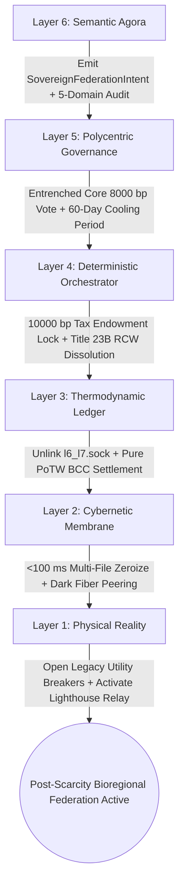
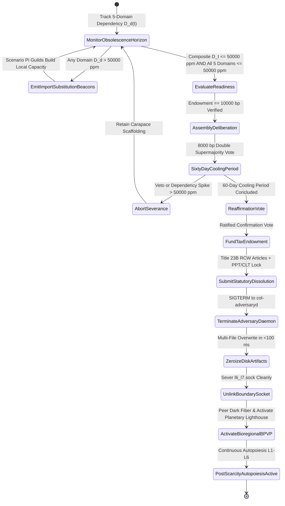
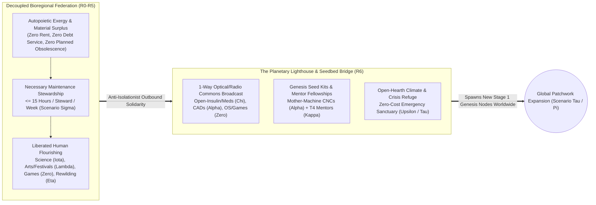

# Scenario Omega: The Sovereign Singularity (Terminal Decoupling Horizon, Ecologically Sustainable Post-Scarcity & The Planetary Lighthouse)

*   **Identifier:** `SCN-OMEGA-DECOUPLE`
*   **System Epic:** Post-Fiat Sovereignty, 25-Scenario Autopoietic Synthesis, Multi-Domain Dependency Horizon ($D_t \le 50000\text{ ppm}$), Layer 7 Statutory Sunset, Ecologically Sustainable Post-Scarcity, and Planetary Lighthouse Federation
*   **Primary Layers Tested:** L1 (Physical), L2 (Cybernetic Membrane), L3 (Thermodynamic Ledger), L4 (Deterministic Orchestrator), L5 (Polycentric Governance), L6 (Semantic Agora) — *Layer 7 Methodically Severed and Dissolved*
*   **Pass/Fail Metric:** Composite and per-domain Dependency Ratio $D_t$ declining below constitutional threshold ($D_t \le 50000\text{ ppm}$, or $500\text{ bp}$) across all 5 vital material/epistemic domains; actuarial full capitalization ($10000\text{ bp}$) of the Irrevocable Property Tax Escrow Endowment permanently extinguishing municipal tax foreclosure vectors; formal statutory sunset of the corporate carapace under Title 23B RCW / Model Business Corporation Act Section 14-05; cryptographic zeroization of Layer 7 database artifacts in under $100\text{ milliseconds}$; continuous post-decoupling autopoiesis across Layers 1–6 in ecologically sustainable post-scarcity; and active operation of the **Planetary Lighthouse & Genesis Seedbed Bridge** (zero isolationist hoarding).

---

## Architectural Council Ratification & 5-Perspective Synthesis

This scenario specification serves as the **Grand Culmination of All 25 Scenarios (`Zero` through `Omega`)** and has been ratified by unanimous consensus of the 5-Persona Architectural Council:

| Council Persona | Disciplinary Representative | Core Contribution to Scenario |
| :--- | :--- | :--- |
| **Game Designer** | Lead Systems & Gameplay Designer | **Dwarf Fortress World-Age Transition & Post-Scarcity Catharsis:** Models the historic transition from defensive survival to **Ecologically Sustainable Post-Scarcity**; citizens experience profound generational catharsis (`"The crushing extraction of debt-money was forever broken (+60 mood)"`, `"Our watershed unlocked the Age of Regenerative Abundance (+50 mood)"`); passing of founding elders (`Scenario Phi`) is celebrated without probate court liquidation (`"Honored the peaceful return of Founder 01's workshop tools to the guild commons (+35 mood)"`). **The Sims Interface Purge:** Permanently purges all fiat dollar signs, bank debt meters, and tax stress bars from the HUD; players orchestrate pure thermodynamic surplus, watershed biodiversity, STEAM cultural festivals (`Scenario Lambda`), and **Planetary Lighthouse** seed-missions (`Scenario Tau`). |
| **Game Engineer** | Principal C++ Simulation Architect | **Data-Oriented Design (DOD) & Module De-allocation:** Encapsulates inter-node dark-fiber terminations and lighthouse beacons into 32-bit compact voxels (`material_id = 70`, `DARK_FIBER_TERMINATION`, `material_id = 71`, `SOVEREIGN_BEACON`, `material_id = 72`, `LIGHTHOUSE_OPTICAL_RELAY`) in $32^3$ chunks; gracefully unmounts legacy proxy daemons (`col-adversaryd`) from the Flecs ECS tick loop; executes multi-file cryptographic zeroization of database, WAL, and SHM files in under $100\text{ ms}$; and locks the engine into pure local-first Pairwise Bilateral Clearing Channels (`BCC`) and `BPVP` mesh routing. |
| **Sovereign Stack Specialist** | Sovereign Stack Systems Architect | **Terminal Layer 7 Dissolution & 5-Domain Dependency Gate:** Enforces both composite and per-domain Dependency Ratio bounds ($D_d \le 50000\text{ ppm}$ across Energy, Nutrition/Water, Materials/Tooling, Medicine/Chemistry, and Compute/Governance) before permitting carapace teardown; terminates `col-adversaryd` and unlinks `/run/collective/ipc/l6_l7.sock` with clean `EPIPE`/`SIGPIPE` fault containment in `col-commonsd` and `col-execd`; establishes pure Proof-of-Thermodynamic-Work (`PoTW`) exergy accounting ($36 \times 10^{11}\text{ }\mu\mathrm{J} = 3600\text{ kJ}$ quantum) and Tripartite Ricardian Treaties (`Treaty_CID`) across concentric Trust Rings ($R_0 \dots R_6$). |
| **Solarpunk Thinker** | Bioregional Regenerative Ecologist | **Ecologically Sustainable Post-Scarcity & The Planetary Lighthouse Doctrine:** Realizes the ultimate Solarpunk horizon: human settlement operating as an autopoietic, regenerative organ of the living watershed where eliminating rent, debt interest, and planned obsolescence reduces mandatory survival toil to $\le 15\text{ hours/week}$, liberating human time for STEAM inquiry (`Iota`), art (`Lambda`), and ecological restoration (`Eta`). Rejects elitist bunker isolationism: the decoupled bioregion operates as an open-source **Planetary Lighthouse & Seedbed**, freely broadcasting medical cures (`Chi`), blueprints (`Alpha`/`Zero`), and Mother-Machine seed kits (`Tau`) to humanity still inside Layer 7. |
| **Scenario Specialist** | Bioregional Decoupling & Transition Jurisprudence Specialist | Formulation of the 5-Domain Dependency Ratio matrix ($D_t$) and Obsolescence Horizon across all 25 scenarios; drafting of formal statutory Articles of Dissolution under Title 23B RCW / Model Business Corporation Act Section 14-05; transfer of real estate and physical capital into an unincorporated Perpetual Purpose Trust (Uniform Trust Code Section 409) / Community Land Trust (`CLT`); $10000\text{ bp}$ capitalization of the Irrevocable Property Tax Escrow Endowment to permanently extinguish municipal tax deed foreclosure; and Entrenched Core $8000\text{ bp}$ ($80\%$) double supermajority constitutional amendment ratification. |

**Council Ratification Verdict:** Unanimous Consensus Reached.

---

## 1. Problem Statement & Legacy Failure

In late-stage extractive capitalism (Layer 7), the nation-state and financialized corporate monopolies maintain systemic capture over human settlements through four interlocking traps:

1.  **The Legacy Debt-Money & Perpetual Scarcity Trap:** Centralized fiat currencies are engineered as interest-bearing debt instruments. Even when physical technology is capable of providing comfortable material sufficiency for all, compounding debt forces continuous exponential ecological extraction, planned obsolescence, and artificial scarcity merely to service financial rent.
2.  **Post-Mortem Probate Extraction:** In legacy jurisdictions, the passing of a founding steward triggers predatory probate courts, legal fees, and estate liquidation, fracturing intergenerational workshop commons and forcing land back into speculative real estate markets.
3.  **The Layer 7 Carapace Achilles' Heel:** While the cooperative legal carapace (Social Purpose Corporation, Subchapter T Cooperative, LLC wrapper managed in `Scenario Epsilon` and defended in `Scenario Rho`) serves as an indispensable protective membrane during Genesis (`Scenario Tau`) and growth, perpetual reliance on external commercial banking rails, corporate charters, and municipal utility drops leaves persistent vectors for regulatory extortion, bank de-risking, and municipal code harassment.
4.  **The Twin Fallacies of Premature Severance and Elitist Bunker Isolationism:**
    *   *Premature Ideological Severance:* Historically, utopian communes that severed ties with the outside world on day one—before establishing local metallurgy (`Theta`), analytical pharmaceutical synthesis (`Chi`), or multi-node tooling redundancy (`Alpha`/`Pi`)—collapsed as soon as a single critical transformer, antibiotic stock, or bearing wore out.
    *   *Elitist "Lifeboat" Isolationism:* Conversely, billionaire survivalist bunkers and gated "ecovillages" treat self-sufficiency as a private fortress to hoard wealth while abandoning the rest of humanity to ecological and economic collapse.

A sovereign Collective network rejects both premature severance and selfish isolationism. **Scenario Omega** defines terminal decoupling not as a retreat from humanity, but as **methodical graduation into Ecologically Sustainable Post-Scarcity and Bioregional Federation**:
*   It systematically tracks the **5-Domain Dependency Ratio ($D_t$)** across all 25 scenarios until external Layer 7 critical dependencies fall below $50000\text{ ppm}$ ($5\%$).
*   It neutralizes municipal land-seizure vectors permanently via an **Irrevocable Property Tax Escrow Endowment** and **Perpetual Purpose Trust / CLT** before lawfully dissolving its corporate wrapper.
*   And once decoupled from Layer 7 coercion, it keeps its **Planetary Lighthouse & Genesis Seedbed Bridge** permanently open—freely broadcasting open-source medicines (`Chi`), software (`Zero`), hardware blueprints (`Alpha`), and seed kits (`Eta`/`Tau`) to emancipate the rest of humanity.

---

## 2. The 25-Scenario Autopoietic Synthesis & Multi-Domain Dependency Horizon ($D_t$)

`Scenario Omega` cannot be triggered by political rhetoric; it is unlocked strictly by the material, thermodynamic, somatic, and epistemic maturation of the preceding **24 scenarios (`Zero` through `Psi`)**.

Layer 3 (`col-ledgerd`) and Layer 5 (`col-kmsd`) continuously compute the **Multi-Domain Dependency Ratio ($D_t$)** across five vital civilizational domains:

$$D_d(t) = \frac{\text{External Layer 7 Critical Inputs in Domain } d}{\text{Total Bioregional Consumption in Domain } d} \times 10^6\text{ ppm}$$

$$D_t = \frac{\sum_{d=1}^{5} W_d \cdot D_d(t)}{\sum_{d=1}^{5} W_d} \le 50000\text{ ppm} \quad \text{AND} \quad \max_{d \in \{1 \dots 5\}} D_d(t) \le 50000\text{ ppm}$$

> [!IMPORTANT]
> **The Weakest-Link Anti-Fragility Invariant:** Terminal decoupling requires **both** the weighted composite $D_t \le 50000\text{ ppm}$ ($5\%$) **and** every single individual domain $D_d(t) \le 50000\text{ ppm}$. A $100\%$ solar energy surplus can never mask a $40\%$ dependency on external Layer 7 insulin or industrial fasteners. Whenever any domain exceeds $50000\text{ ppm}$, `Scenario Pi` automatically emits high-gravity **`MeshGrowthBeacon`** import-substitution signals to close the gap before `Omega` can be proposed.

| Domain ID | Civilizational Domain | Constituent Scenarios (`Zero`–`Psi`) | Autopoietic Threshold Criteria ($D_d \le 50000\text{ ppm}$) |
| :--- | :--- | :--- | :--- |
| **Domain I** | **Exergy, Microgrid, Logistics & Climate Buffering** | `Beta` (5-Artery Transit/Grid), `Upsilon` (Black-Start & Watershed Resilience) | $\ge 9500\text{ bp}$ of electrical, thermal, and motive exergy generated and buffered locally across $48\text{ V}/380\text{ V}$ HVDC interties, gravity-head/thermal batteries, and biochar keyline sponge earthworks with sub-$16\text{ ms}$ islanding. |
| **Domain II** | **Regenerative Nutrition, Silviculture & Nutrient Loops** | `Gamma` (Communal Kitchen), `Eta` (Coppice & Agroforestry), `Mu` (Circular Recovery) | $\ge 9500\text{ bp}$ of caloric macro/micronutrients, potable water, mycological proteins, and soil phosphorus/nitrogen (`Struvite`/biochar) cycled within the $R_1$–$R_4$ watershed with ecological regeneration $F_{\mathrm{eco}} > 0$. |
| **Domain III** | **Circular Metallurgy, Fabrication, Textiles & Habitat** | `Alpha` (Multi-Modal Fab), `Theta` (3-Tier Foundry), `Mu` (Urban Mining), `Nu` (Textiles/PPE), `Xi` (Modular Architecture) | $\ge 9500\text{ bp}$ of structural timber, recycled steel/aluminum/copper alloys, silicate glass, natural fibers, and replacement CNC machine bearings fabricated and remanufactured inside the bioregional mesh. |
| **Domain IV** | **Closed-Loop Chemistry, Medicine & Full-Lifespan Care** | `Chi` (Paramedic & Analytical Chemistry), `Delta` (Childcare), `Omicron` (Kinship), `Phi` (Elder Sagehood & Terramation), `Sigma` (Burnout Immunity) | $\ge 9500\text{ bp}$ of WHO Essential Medicines (`Open-Insulin`, antibiotics, anesthetics, sutures) synthesized locally and verified at $\ge 9950\text{ bp}$ purity via dual `HPLC`/`GC-MS` assays, alongside cradle-to-terramation somatic care. |
| **Domain V** | **Sovereign Software, Science, STEAM Culture & Justice** | `Zero` (Software & Games), `Epsilon` (Compute/Admin), `Iota` (Epistemic Science), `Kappa` (Apprenticeship), `Lambda` (STEAM Culture), `Pi` (Guilds & Demand Capture), `Rho` (Immune Defense), `Psi` (Transformative Justice), `Tau` (Genesis Onboarding) | $0\text{ ppm}$ dependency on proprietary cloud SaaS, corporate OS kernels, external courts/police, or commercial media; $10000\text{ bp}$ self-hosted `col-*` daemons, verified epistemic science, $T_1 \dots T_4$ somatic mentorship, and transformative justice. |

---

## 3. The Collective Workflow (The Dissolution & Graduation Protocol)

When all five domains satisfy $D_d(t) \le 50000\text{ ppm}$, the node executes the methodical deprecation, statutory sunset, and permanent de-allocation of Layer 7:



### Layer 1: Physical Reality (Physical Decoupling, Dark Fiber Meshing & Lighthouse Relays)
*   **Autonomous Bioregional Infrastructure:** Microgrid battery and pumped-hydro/thermal inverters with sub-$16\text{ ms}$ black-start capability (`Scenario Upsilon`), gravity-fed spring water catchments and multi-barrier purification (`Scenario Beta`), agroforestry food forests (`Scenario Eta`), 3-tier induction foundries (`Scenario Theta`), and community-trenched single-mode dark-fiber splice enclosures connecting sister nodes across the watershed.
*   **Mechanical Isolation Contactors:** Physical shunt-trip circuit breakers isolating legacy municipal grid drops; mechanical backflow check valves and lockable gate valves isolating legacy water connections (retained only for emergency one-way humanitarian export to surrounding Layer 7 neighbors during regional disasters under `Scenario Upsilon`).
*   **Inter-Node & Planetary Lighthouse Communications:**
    *   *Internal Federation ($R_1 \dots R_5$):* Spliced $10\text{ Gbps}$ single-mode dark fiber pairs terminating at optical patch panels; directional $5\text{ GHz}$ / $24\text{ GHz}$ microwave dish relays; $915\text{ MHz}$ LoRa mesh repeaters.
    *   *Planetary Lighthouse Outbound Bridge ($R_6$):* Optically isolated, hardware write-protected outbound optical/radio mirrors that broadcast open-source `Iota`/`Zero`/`Chi`/`Alpha`/`Lambda` archives to the global public internet without exposing internal node buses to inbound network traffic.
*   **Strict Layer Separation:** Layer 1 contains zero software, zero firmware, zero network stacks, and zero cryptographic keys. It consists purely of physical conductors, glass fibers, mechanical contactors, and living earthworks.

### Layer 2: The Cybernetic Membrane (P2P Link Telemetry & Sub-100ms Zeroization)
*   **Microcontroller Architecture:** Zephyr RTOS microcontrollers communicating over isolated buses with lock-free `/dev/shm` ring buffer IPC and strict fixed-point SI integer wire encoding (microjoules, milliwatts, millikelvin, millivolts, milliamperes, milliseconds).
*   **Ingress Telemetry:**
    *   `dark_fiber_link_latency_micros` (Optical round-trip latency in microseconds)
    *   `dark_fiber_throughput_mbps` (Throughput in megabits per second)
    *   `mesh_active_peer_count` (Active hardware peers in Trust Rings $R_1 \dots R_5$)
    *   `legacy_intertie_contactor_state` (`OPEN_PHYSICALLY_ISOLATED`)
    *   `layer7_proxy_socket_state` (`UNLINKED_DEPRECATED`)
*   **Sub-100ms Multi-File Cryptographic Zeroization Execution:**
    Upon receiving the ratified terminal decoupling command from Layer 4, Layer 2 and the host supervisor execute deterministic multi-file cryptographic zeroization of `col-adversaryd`:
    1.  Overwrites `/var/lib/collective/adversary/l7_bridge.sqlite`, `l7_bridge.sqlite-wal`, and `/dev/shm/col_adversary_ring` with a hardware-seeded ChaCha20 CSPRNG stream followed by an all-zero pass and `fsync()`.
    2.  Unlinks all database files and `/run/collective/ipc/l6_l7.sock`, completing total disk and RAM eradication in $<100\text{ ms}$ with zero forensic data remanence.

### Layer 3: The Thermodynamic Ledger (BCC, HTLCs & Pure PoTW Accounting)
*   **Pairwise Bilateral Clearing Channels (`BCC`):**
    All inter-node trade settles across peer-to-peer Bilateral Clearing Channels (`BCC`) anchored between peered nodes $u$ and $v$ with strict zero-sum conservation:
    $$B_{u \to v}(t) + B_{v \to u}(t) = 0$$
*   **Multi-Hop HTLC Routing:**
    Exergy and BOM transfers routed across multiple watershed hops utilize chained Hashed Timelock Contracts $\langle H(S), \Delta t, Q, u, v \rangle$, atomically clearing intermediate bilateral channels upon signed delivery receipts $\sigma_{\mathrm{delivery}}$ without any central clearinghouse or global token.
*   **Proof-of-Thermodynamic-Work (`PoTW`) Standard:**
    The ledger permanently operates on the physical exergy standard:
    $$\text{1 Exergy Credit quantum} \equiv 3600000\text{ Joules} = 3{,}600{,}000{,}000{,}000\text{ }\mu\mathrm{J} \quad (3600\text{ kJ})$$
    Zero fiat exchange rates, zero currency conversions, zero algorithmic pegs, and zero speculative tokens exist anywhere in the stack.

### Layer 4: The Deterministic Orchestrator (Severance & Post-Scarcity State Machine)
*   **Runtime:** Sandboxed BPMN v2 VM (`col-execd`) running at $10\text{ Hz}$ with strict FIFO priority queues, communicating with Layer 5 across `/run/collective/ipc/l4_l5.sock`.
*   **Socket Severance Fault Containment:**
    When `col-adversaryd` terminates and unlinks `/run/collective/ipc/l6_l7.sock`, `col-execd` and `col-commonsd` catch `EPIPE` and `EOF` cleanly (`SIG_IGN` on `SIGPIPE`), closing the legacy descriptor, setting `l7_bridge_permanently_retired = true`, and continuing 10 Hz execution with zero crashes, zero file-descriptor leaks, and zero CPU spin-wait.
*   **Deterministic Decoupling Sequence:**
    1.  *5-Domain Precondition Verification:* Verifies $D_t \le 50000\text{ ppm}$, $\max_d D_d \le 50000\text{ ppm}$, and checks that the Irrevocable Property Tax Escrow Endowment is $10000\text{ bp}$ ($100\%$) funded.
    2.  *Endowment Lock:* Locks external fiat reserves into the independent irrevocable trust escrow account so annual yield pays county property taxes in perpetuity.
    3.  *API Teardown:* Revokes all external banking OAuth tokens, webhooks, and legacy utility API keys.
    4.  *Carapace Sunset:* Dispatches Title 23B RCW Articles of Dissolution and records the Perpetual Purpose Trust (`PPT`) / `CLT` deed transfer.
    5.  *Daemon Termination & Zeroization:* Sends `SIGTERM` to `col-adversaryd`, verifies $<100\text{ ms}$ multi-file zeroization, and unlinks `/run/collective/ipc/l6_l7.sock`.
    6.  *Federation & Lighthouse Activation:* Activates `BPVP` dark-fiber/radio mesh routes across Trust Rings $R_1 \dots R_5$ and enables the $R_6$ **Planetary Lighthouse & Seedbed Bridge**.



### Layer 5: Polycentric Governance (Entrenched Core, Estate Liberation & BPVP Federation)
*   **Daemon:** `col-kmsd` (Key Management & Governance Policy Daemon).
*   **Entrenched Core Constitutional Amendment:**
    Initiating terminal severance is an irreversible constitutional transition requiring an **Entrenched Core Amendment**:
    1.  Concurrent $8000\text{ bp}$ ($80\%$) double supermajority vote in both the Commons Chamber ($1\text{-person-}1\text{-vote}$) and the Stewardship Chamber (weighted by capped Reputational Wealth $\mathcal{R}$).
    2.  Mandatory $60\text{-day}$ cooling-off review period during which live shadow simulations (`Oasis` Layer 1b) stress-test the node against 100-year climate shocks (`Scenario Upsilon`) without Layer 7 fallback.
    3.  Final $8000\text{ bp}$ reaffirmation vote by both chambers at the conclusion of the cooling period.
*   **Cellular Autonomy, Protocol of Refusal & Autonomous Transit Veto (`No-Transit`):** Under autopoietic cellular autonomy, the sovereign node retains absolute self-determination over its internal decoupling velocity; the autonomy of the parts strictly supersedes the administrative cohesion of the whole. The node may invoke the Protocol of Refusal to permanently firewall sacred common assets, unmapped conservation corridors, and domestic $R_0$ hearths from external federation registries. Furthermore, the community ratifies an Autonomous Transit Veto (`No-Transit`), barring extractive corporate salvage convoys or unauthorized vehicles from traversing village sanctuary land.
*   **Estate Liberation Protocol (Closing the Lifecycle Loop with Scenarios `Tau`, `Omicron` & `Phi`):**
    Upon the physical passing of an elder (`Scenario Phi`), zero legacy probate courts or inheritance tax collectors are involved:
    *   Their personal domestic heirlooms, journals, garments (`Scenario Nu`), and sacred keepsakes in $R_0$ pass directly to their designated kin under their `KinshipCovenant` (`Scenario Omicron`).
    *   Their cryptographic `DID` is enshrined as a permanent non-voting `Wisdom_Anchor` in the Layer 6 Agora.
    *   All $R_2$ productive guild tools, instruments, and CNC fixtures in their stewardship return automatically to the apprenticeship commons (`Scenario Kappa`) via an `EstateLiberationIntent`.
*   **7-Tier Concentric Trust Rings ($R_0 \dots R_6$) Post-Decoupling:**
    *   $R_0$ (The Hearth): Inviolable domestic sanctuary (`Scenario Xi`/`Nu`/`Omicron`) and unconditional survival baseline (`Scenario Tau`).
    *   $R_1$ (The Settlement): Physical village neighborhood; tool libraries, communal kitchens (`Scenario Gamma`), and rotational care.
    *   $R_2$ (The Commons): Local node microgrid circuits, seed banks (`Scenario Eta`), and dual-chamber assembly.
    *   $R_3$ (The Watershed Guild): Hydrological river basin cluster ($\le 30\text{ km}$); HVDC interties, electric boat/rail freight (`Scenario Beta`), and Pairwise `BCC` channels.
    *   $R_4$ (Bioregional Federation): Multi-watershed federation ($\le 150\text{ km}$); regional grain reserves, dark-fiber rings, specialized `Theta` metallurgy and `Chi` pharmaceutical synthesis hubs.
    *   $R_5$ (Continental Corridor): Trans-continental ecological corridors; rare material urban-mining exchange (`Scenario Mu`) and open scientific replication (`Scenario Iota`).
    *   $R_6$ (The Planetary Lighthouse Membrane): Outbound humanitarian, epistemic, and Genesis-seeding interface to humanity still transitioning out of Layer 7.

### Layer 6: Semantic Agora & Ricardian Treaties (Ontology & Treaties)
*   **Daemon:** `col-commonsd` parsing W3C JSON-LD schemas.
*   **Ricardian Treaty Architecture (`Treaty_CID`):**
    Inter-node federation covenants are cryptographically bound by Tripartite Ricardian Treaties:
    $$\mathrm{Treaty\_CID} = \mathrm{SHA256}\left( \mathrm{Text}_{\mathrm{prose}} \parallel \mathrm{Schema}_{\mathrm{JSON-LD}} \parallel \mathrm{Invariants}_{\mathrm{BPMN}} \right)$$
*   **Typed Schemas:**
    1.  `SovereignFederationDeclarationIntent`: Formal declaration of terminal decoupling, 5-domain $D_d \le 50000\text{ ppm}$ proof, and entry into bioregional federation.
    2.  `BioregionalTreatyIntent`: Reciprocal mutual aid, exergy clearing, and transit covenants with adjacent watershed nodes.
    3.  `EstateLiberationIntent`: Formal transfer of a deceased steward's $R_2$ guild tools to the apprenticeship commons while honoring $R_0$ heirloom bequests.
    4.  `PlanetaryLighthouseBroadcastIntent`: Outbound publication of open-source medical protocols (`Chi`), software (`Zero`), hardware CADs (`Alpha`), and Genesis Node seed kits (`Tau`) to the global commons.

### Layer 7: Terminal Dissolution (Lawfully Striking the Corporate Carapace)
Layer 7 is never abandoned recklessly in a way that invites state tax-foreclosure auctions; it is **methodically and lawfully struck**:
1.  **Capitalization of the Irrevocable Property Tax Escrow Endowment (Chapter 8 Section 3-5):**
    Before dissolving the corporate carapace, the node verifies $10000\text{ bp}$ ($100\%$) capitalization of an actuarial **Irrevocable Property Tax Escrow Endowment** held by an independent regulated trust company. Its conservative annual yield pays county property tax assessments directly to the county treasurer in perpetuity—permanently extinguishing the municipal tax-deed foreclosure vector without requiring any ongoing node commercial activity.
2.  **Title 23B RCW / MBCA Section 14-05 Articles of Dissolution & Perpetual Purpose Trust (`PPT` / `CLT`):**
    The cooperative files formal Articles of Dissolution with the Secretary of State after conveying all fee-simple land titles and physical improvements into an unencumbered, non-extractive **Perpetual Purpose Trust** (Uniform Trust Code Section 409) and **Community Land Trust (`CLT`)** whose sole irrevocable purpose is ecological watershed regeneration and resident shelter.
3.  **Daemon Teardown & Multi-File Zeroization:**
    The system supervisor terminates `col-adversaryd`, executes $<100\text{ ms}$ multi-file cryptographic zeroization of all Layer 7 bridge databases, and permanently unlinks `/run/collective/ipc/l6_l7.sock`.

---

## 4. Ecologically Sustainable Post-Scarcity & The Planetary Lighthouse Doctrine

Terminal decoupling (`Scenario Omega`) is not the end of history; it is the **beginning of Ecologically Sustainable Post-Scarcity**.



### 4A. The Post-Scarcity Time & Exergy Dividend (`PostScarcityEquilibriumState`)
In Layer 7, over $6000\text{ bp}$ ($60\%$) of human labor is wasted on servicing financial debt, paying landlord rent, replacing intentionally fragile consumer goods, and staffing corporate/bureaucratic overhead. Once a Collective bioregion closes the 25-scenario loop:
*   **Durable Goods & Automated Drudgery:** `Scenario Alpha` and `Scenario Theta` fabricate modular, lifetime-repairable appliances and tooling, while the `Scenario Sigma` **Drudgery-to-Automation Escalation Pipeline** continuously automates repetitive sanitation, sorting, and agricultural chores via `Scenario Zero` robotics.
*   **The 15-Hour Stewardship Horizon:** Necessary physical and care stewardship drops below $15\text{ hours per week per steward}$ ($900\text{ minutes/week}$), while every member's $R_0$ survival baseline (housing in `Xi`, gourmet seasonal nutrition in `Gamma`, custom clothing in `Nu`, full healthcare in `Chi`, and lifelong learning in `Kappa`) is unconditionally guaranteed at $10000\text{ bp}$ (`Scenario Tau`).
*   **Flourishing of STEAM & Ecological Restoration:** The massive dividend of liberated human time flows into scientific discovery (`Scenario Iota`), polyphonic music, theater, and phenological festivals (`Scenario Lambda`), expansive collaborative virtual worlds (`Scenario Zero`), and deep multi-generational watershed rewilding (`Scenario Eta`).

### 4B. The Planetary Lighthouse & Genesis Seedbed Protocol (Anti-Elitist Openness)
To guarantee that a decoupled `Omega` bioregion never degenerates into a selfish, walled-off "Solarpunk Elysium" indifferent to those still suffering inside Layer 7, the constitution binds every `Omega` node to three permanent outbound solidarity duties:
1.  **Unconditional Global Commons Broadcast (`PlanetaryLighthouseBroadcastIntent`):** Every medical synthesis recipe (`Chi`), open-source software package (`Zero`), heirloom seed genome (`Eta`), and CNC blueprint (`Alpha`) discovered inside the federation is continuously mirrored out via $R_6$ optical/satellite/radio beacons to the global public internet at zero cost and under irrevocable copyleft/commons licenses.
2.  **Active Genesis Seedbed Allocation (`GenesisSeedbedAllocation`):** Every decoupled node dedicates at least $500\text{ bp}$ ($5\%$) of its net annual industrial and exergy surplus to fabricating **"Genesis Seed Kits"**—containerized `Stage 1 / Stage 2` bootstrap packages containing solar inverters (`Beta`), water purification skids, heirloom seed banks (`Eta`), and open-source CNC Mother-Machines (`Alpha`)—paired with volunteer `T4_Mentor` and `T4_Emeritus_Sage` teams (`Kappa`/`Phi`) to help communities still trapped in Layer 7 launch their own `Scenario Tau` Genesis Nodes.
3.  **Open-Hearth Sanctuary Continuity (`Scenario Upsilon` + `Scenario Tau`):** Physical decoupling from municipal utilities never closes the village gates to human beings. The node's **Open-Hearth Neighbor Refuge** (`Scenario Upsilon`) and **Multi-Pathway Onboarding** (`Scenario Tau`) remain permanently open to climate refugees, neighbors in crisis, and prospective new stewards.

---

## 5. 3-Stage Incremental Node Facility Blueprints (Path to the Singularity)

Rather than treating `Scenario Omega` as a sudden binary flip, every Collective settlement progresses through three tangible architectural stages of decoupling maturity:

### Stage 1: Dual-Membrane Bootstrap & 5-Domain Dependency Tracker (Suburban / Rural Homestead Cluster, $15\text{–}40$ Stewards)
*   **Physical & Legal Configuration:** The young node operates inside an existing residential or agricultural property wrapped in a `Scenario Epsilon` cooperative LLC/SPC carapace (`col-adversaryd` active). Municipal grid and water connections remain physically connected as backup behind monitored transfer switches.
*   **Dependency Horizon ($D_t \approx 650000\text{ ppm}$ to $350000\text{ ppm}$):** Local `Gamma` kitchens, `Eta` gardens, `Alpha` Stage 1 garage makerspaces, and `Zero` self-hosted servers rapidly drive Food and Compute dependencies down, while Layer 3 (`col-ledgerd`) displays a live **5-Domain Dependency Dashboard** showing exactly which critical inputs (e.g., metals, pharmaceuticals, winter calories) still cross the Layer 7 membrane.
*   **Endowment Seeding:** A dedicated fraction ($1000\text{ bp}$–$2000\text{ bp}$) of surplus revenue from the `Scenario Epsilon` co-working and fabrication carapace is swept monthly into the growing **Irrevocable Property Tax Escrow Endowment**.

### Stage 2: Bioregional Import-Substitution Hub & Endowment Lock (Multi-Node Town / Watershed Cluster, $100\text{–}500$ Stewards)
*   **Physical & Legal Configuration:** Multiple specialized guilds across $R_2$ and $R_3$ interconnect via `Scenario Beta` electric cargo transit, $380\text{ V}$ HVDC microgrids, and community dark fiber/LoRa links. Land titles are progressively migrated into a **Community Land Trust (`CLT`) / Perpetual Purpose Trust (`PPT`)**.
*   **Stigmergic Import Substitution ($D_t \approx 350000\text{ ppm}$ down to $\le 50000\text{ ppm}$):** Whenever the 5-Domain Dependency Audit highlights a remaining Layer 7 bottleneck (such as $D_{\mathrm{medicine}}$ or $D_{\mathrm{materials}}$), `Scenario Pi` aggregates the node's intents into high-gravity **`MeshGrowthBeacon`** signals. Sister guilds respond by standing up a `Scenario Theta` induction foundry, a `Scenario Mu` solvent biorefinery, or a `Scenario Chi` `HPLC`/`GC-MS` analytical pharmacy lab until all 5 domains drop below $50000\text{ ppm}$ ($5\%$).
*   **100% Endowment Capitalization & 60-Day Shadow Drill:** The Irrevocable Property Tax Escrow Endowment reaches $10000\text{ bp}$ ($100\%$) actuarial funding. The node opens its mechanical municipal utility breakers for a mandatory **60-Day Islanded Cooling-Off Drill**, proving full autopoietic stability across all 25 scenarios before the final vote.

### Stage 3: Sovereign Decoupled Bioregional Federation & Planetary Lighthouse Campus ($500\text{–}2{,}500+$ Stewards Across $R_3$–$R_5$)
*   **Physical & Legal Configuration:** Following the $8000\text{ bp}$ Entrenched Core reaffirmation vote, Title 23B RCW Articles of Dissolution are filed, `col-adversaryd` is zeroized in $<100\text{ ms}$, and `/run/collective/ipc/l6_l7.sock` is unlinked forever. The campus operates on $100\%$ unencumbered `PPT`/`CLT` land with county property taxes paid automatically in perpetuity by the external escrow endowment.
*   **Architecture of Post-Scarcity & Openness:**
    *   **The Decoupling Monument & Switchgear Pavilion:** The historic mechanical municipal grid breakers stand locked open inside a timber-and-stone garden pavilion (`Scenario Xi`/`Lambda`), alongside real-time bioregional watershed vitality displays.
    *   **The Planetary Lighthouse Dish & Seedbed Dock:** A high-gain optical/radio beacon array on the ridge continuously broadcasts the federation's open-source scientific, medical, and cultural commons to the world, while the ground-floor **Genesis Seedbed Bay** assembles and dispatches containerized Mother-Machine CNC and solar-water seed kits (`Scenario Tau`/`Alpha`) to help new communities worldwide begin Stage 1.

---

## 6. Machine-Readable Schemas

### 6A. Layer 6 Knowledge Artifact: Sovereign Federation Declaration (`sovereign_federation.jsonld`)

```json
{
  "@context": [
    "https://schema.org/",
    "https://collective.network/ontology/v1/",
    "https://w3id.org/sovereignty/v1"
  ],
  "@type": "SovereignFederationDeclaration",
  "identifier": "urn:uuid:f0e1d2c3-b4a5-9876-1234-omega0000001",
  "issuerDid": "did:peer:2:Ez6MksO_node_collective_assembly",
  "creationTimestamp": "2026-12-21T12:00:00Z",
  "declarationParameters": {
    "status": "Terminal_Decoupling_Achieved",
    "compositeDependencyRatioPpm": 38000,
    "domainDependencyPpm": {
      "exergyGridLogisticsPpm": 18000,
      "nutritionWaterSilviculturePpm": 29000,
      "materialsToolingTextilesHabitatPpm": 44000,
      "medicineAnalyticalChemistryCarePpm": 47000,
      "computeScienceCultureGovernancePpm": 0
    },
    "propertyTaxEscrowEndowmentFundedBp": 10000,
    "perpetualPurposeTrustConveyed": true,
    "corporateDissolutionFilingRef": "WA-ST-CORP-DISSOLVE-2026-88912",
    "layer7ProxyDaemonStatus": "UNMOUNTED_AND_ZEROIZED"
  },
  "postScarcityAndLighthouseMetrics": {
    "mandatoryStewardshipMinutesPerWeek": 840,
    "survivalBaselineCoverageBp": 10000,
    "planetaryLighthouseBroadcastActive": true,
    "genesisSeedbedSurplusAllocationBp": 600,
    "dailyEnergySurplusMicrojoules": 174600000000000
  },
  "thermodynamicStandard": {
    "exergyCreditQuantumMicrojoules": 3600000000000,
    "proofOfThermodynamicWorkEnforced": true,
    "fiatConversionPermitted": false
  },
  "federationProtocols": {
    "acceptedPeerDids": [
      "did:peer:2:Ez6MksW_olympic_watershed_node",
      "did:peer:2:Ez6MksC_cascade_valley_node"
    ],
    "transportMedia": ["Dark_Fiber_10G", "LoRaWAN_915MHz", "Directional_Microwave"],
    "routingProtocol": "Bioregional_Path_Vector_Protocol_BPVP"
  },
  "cryptographicConsensus": {
    "treatyCid": "a7b8c9d0e1f2a3b4c5d6e7f8a9b0c1d2e3f4a5b6c7d8e9f0a1b2c3d4e5f6a7b8",
    "assemblyRatificationThreshold": "DOUBLE_SUPERMAJORITY_8000_BP_RATIFIED"
  }
}
```

### 6B. Layer 2 Telemetry Attestation: Decoupling, Zeroization & Lighthouse Proof (`decoupling_attestation.json`)

```json
{
  "@context": "https://collective.network/ontology/v1/",
  "@type": "TerminalDecouplingTelemetryAttestation",
  "declarationRef": "urn:uuid:f0e1d2c3-b4a5-9876-1234-omega0000001",
  "nodeDid": "did:peer:2:Ez6MksM_master_switchgear_enclave",
  "executionMetrics": {
    "decouplingTimestamp": "2026-12-21T12:00:00Z",
    "gridTieRelayState": "OPEN_PHYSICALLY_ISOLATED",
    "waterMainsValveState": "CLOSED_MUNICIPAL_SEVERED",
    "compositeDependencyRatioPpm": 38000,
    "maxSingleDomainDependencyPpm": 47000,
    "darkFiberLinkLatencyMicros": 1420,
    "darkFiberThroughputMbps": 9850,
    "localMeshActivePeerCount": 4,
    "planetaryLighthouseOpticalRelayMbps": 1000,
    "microgridBusFrequencyMilliHz": 60000,
    "energyStorageSoCPpm": 942000
  },
  "daemonTeardownAudit": {
    "colAdversarydPid": 0,
    "processState": "TERMINATED",
    "zeroizationLatencyMs": 48,
    "databaseArtifactsEradicated": true,
    "socketCleanlyUnlinked": true
  },
  "status": "POST_SCARCITY_BIOREGIONAL_FEDERATION_ACTIVE"
}
```

---

## 7. Oasis Engine Implementation Specification

### 7A. Memory Allocation & Voxel State

The terminal decoupling node coordinates federated network topology and Planetary Lighthouse relays in chunk space ($32^3$ voxels via `ChunkManager`):
*   Dark fiber termination voxel initialized with `material_id = 70` (`DARK_FIBER_TERMINATION`) with metadata bitmask `0b00000110` (`Is_Actuator | Is_Sensor`).
*   Sovereign federation beacon initialized with `material_id = 71` (`SOVEREIGN_BEACON`) at coordinates `(16, 8, 16)`.
*   Planetary Lighthouse outbound optical/radio relay initialized with `material_id = 72` (`LIGHTHOUSE_OPTICAL_RELAY`) at ridge coordinates `(16, 28, 16)`.
*   De-allocation pass: `col-execd` unmounts all legacy proxy components, catches severed socket signals (`EPIPE`/`EOF`) cleanly, and transitions the engine into pure local-first Pairwise Bilateral Clearing Channel (`BCC`) and `BPVP` forwarding.

### 7B. Self-Contained C++20 Reference Implementation & Test Harness

```cpp
// engine/tests/scenario_omega_decoupling_test.cpp
#include <array>
#include <cassert>
#include <cstdint>
#include <iostream>
#include <string>
#include <vector>

namespace oasis::omega {

// 5-Domain Dependency Ratio Breakdown (in parts per million, 0 .. 1000000 ppm)
struct alignas(8) FiveDomainDependencyMatrix {
    uint32_t exergy_grid_logistics_ppm;          // Scenarios Beta, Upsilon
    uint32_t nutrition_water_silviculture_ppm;   // Scenarios Gamma, Eta, Mu
    uint32_t materials_tooling_habitat_ppm;      // Scenarios Alpha, Theta, Mu, Nu, Xi
    uint32_t medicine_chemistry_care_ppm;        // Scenarios Chi, Delta, Omicron, Phi, Sigma
    uint32_t compute_science_culture_gov_ppm;    // Scenarios Zero, Epsilon, Iota, Kappa, Lambda, Pi, Rho, Psi, Tau

    uint32_t composite_average_ppm() const {
        uint64_t sum = static_cast<uint64_t>(exergy_grid_logistics_ppm) +
                       static_cast<uint64_t>(nutrition_water_silviculture_ppm) +
                       static_cast<uint64_t>(materials_tooling_habitat_ppm) +
                       static_cast<uint64_t>(medicine_chemistry_care_ppm) +
                       static_cast<uint64_t>(compute_science_culture_gov_ppm);
        return static_cast<uint32_t>(sum / 5ULL);
    }

    uint32_t max_domain_ppm() const {
        uint32_t m = exergy_grid_logistics_ppm;
        if (nutrition_water_silviculture_ppm > m) m = nutrition_water_silviculture_ppm;
        if (materials_tooling_habitat_ppm > m) m = materials_tooling_habitat_ppm;
        if (medicine_chemistry_care_ppm > m) m = medicine_chemistry_care_ppm;
        if (compute_science_culture_gov_ppm > m) m = compute_science_culture_gov_ppm;
        return m;
    }
};

// Cache-aligned Flecs ECS Components in pure fixed-point SI integer math
struct alignas(8) DecouplingParametersComponent {
    FiveDomainDependencyMatrix domains;
    uint32_t tax_endowment_funded_bp;       // Basis points (target == 10000 bp)
    bool perpetual_purpose_trust_deeded;    // Uniform Trust Code Section 409 / CLT lock
    uint32_t commons_chamber_vote_bp;       // Target >= 8000 bp (80%)
    uint32_t stewardship_chamber_vote_bp;   // Target >= 8000 bp (80%)
    uint32_t cooling_period_days_elapsed;   // Target >= 60 days
    bool reaffirmation_vote_ratified;
};

struct alignas(8) Layer7TeardownAuditComponent {
    uint32_t adversaryd_pid;
    uint32_t zeroization_duration_ms;       // Target < 100 ms
    bool database_zeroized;
    bool wal_journal_zeroized;
    bool shm_ring_zeroized;
    bool boundary_socket_unlinked;
    bool epipe_fault_contained;
};

struct alignas(8) PostScarcityLighthouseState {
    uint32_t mandatory_stewardship_minutes_per_week; // Target <= 900 mins (15 hours/week)
    uint32_t survival_baseline_coverage_bp;          // Target == 10000 bp (100%)
    uint32_t genesis_seedbed_surplus_allocation_bp;  // Target >= 500 bp (5% to seed new Tau nodes)
    bool open_commons_broadcast_active;              // Outbound R6 Planetary Lighthouse relay
    bool open_hearth_refuge_active;                  // Scenario Upsilon / Tau neighbor solidarity
};

class TerminalDecouplingController {
public:
    static constexpr uint32_t MAX_DEPENDENCY_RATIO_PPM = 50000U;      // 5% (50000 ppm) ceiling
    static constexpr uint32_t FULL_ENDOWMENT_BP = 10000U;             // 100% funded
    static constexpr uint32_t ENTRENCHED_SUPERMAJORITY_BP = 8000U;    // 80% in both chambers
    static constexpr uint32_t REQUIRED_COOLING_DAYS = 60U;            // 60-day cooling-off period
    static constexpr uint32_t MAX_ZEROIZE_LATENCY_MS = 100U;          // < 100 ms SLO
    static constexpr uint32_t MAX_STEWARDSHIP_MINS_WEEK = 900U;       // 15 hours/week post-scarcity ceiling
    static constexpr uint32_t MIN_SEEDBED_ALLOCATION_BP = 500U;       // >= 5% surplus for new Genesis nodes
    static constexpr uint64_t CREDIT_QUANTUM_UJ = 3600000000000ULL;   // 3600 kJ (1 PoTW credit quantum)

    // Evaluate readiness across all 5 domains, tax endowment, PPT/CLT lock, and Entrenched Core vote
    static bool evaluate_severance_readiness(const DecouplingParametersComponent& p) {
        // 1. Both composite average AND weakest-link domain must be <= 50000 ppm
        if (p.domains.composite_average_ppm() > MAX_DEPENDENCY_RATIO_PPM) {
            return false;
        }
        if (p.domains.max_domain_ppm() > MAX_DEPENDENCY_RATIO_PPM) {
            return false;
        }
        // 2. Irrevocable Property Tax Escrow Endowment & PPT/CLT title lock must be complete
        if (p.tax_endowment_funded_bp < FULL_ENDOWMENT_BP || !p.perpetual_purpose_trust_deeded) {
            return false;
        }
        // 3. Entrenched Core 8000 bp double supermajority + 60-day cooling period + reaffirmation
        if (p.commons_chamber_vote_bp < ENTRENCHED_SUPERMAJORITY_BP ||
            p.stewardship_chamber_vote_bp < ENTRENCHED_SUPERMAJORITY_BP ||
            p.cooling_period_days_elapsed < REQUIRED_COOLING_DAYS ||
            !p.reaffirmation_vote_ratified) {
            return false;
        }
        return true;
    }

    // Verify anti-isolationist Post-Scarcity & Planetary Lighthouse invariants
    static bool verify_post_scarcity_lighthouse(const PostScarcityLighthouseState& s) {
        if (s.survival_baseline_coverage_bp != 10000U) return false;
        if (s.mandatory_stewardship_minutes_per_week > MAX_STEWARDSHIP_MINS_WEEK) return false;
        if (!s.open_commons_broadcast_active || !s.open_hearth_refuge_active) return false;
        if (s.genesis_seedbed_surplus_allocation_bp < MIN_SEEDBED_ALLOCATION_BP) return false;
        return true;
    }

    // Pairwise Bilateral Clearing Channel (BCC) transfer model
    struct BilateralChannel {
        int64_t balance_u_to_v_uj;
        int64_t credit_headroom_v_uj;

        bool transfer(int64_t amount_uj) {
            if (amount_uj <= 0) return false;
            if (balance_u_to_v_uj + amount_uj > credit_headroom_v_uj) {
                return false;
            }
            balance_u_to_v_uj += amount_uj;
            return true;
        }

        int64_t reverse_balance() const {
            return -balance_u_to_v_uj;
        }
    };
};

} // namespace oasis::omega

void test_scenario_omega_full_25_scenario_graduation() {
    using namespace oasis::omega;

    // 1. All 5 civilizational domains across Scenarios Zero..Psi are below 50000 ppm (5%)
    DecouplingParametersComponent params{
        .domains = {
            .exergy_grid_logistics_ppm = 18000U,
            .nutrition_water_silviculture_ppm = 29000U,
            .materials_tooling_habitat_ppm = 44000U,
            .medicine_chemistry_care_ppm = 47000U,
            .compute_science_culture_gov_ppm = 0U
        },
        .tax_endowment_funded_bp = 10000U,
        .perpetual_purpose_trust_deeded = true,
        .commons_chamber_vote_bp = 8650U,
        .stewardship_chamber_vote_bp = 8420U,
        .cooling_period_days_elapsed = 60U,
        .reaffirmation_vote_ratified = true
    };

    assert(params.domains.composite_average_ppm() == 27600U);
    assert(params.domains.max_domain_ppm() == 47000U);
    assert(TerminalDecouplingController::evaluate_severance_readiness(params));

    // 2. Execute Layer 7 Teardown, <100ms Multi-File Zeroization & Socket Unlink
    Layer7TeardownAuditComponent audit{
        .adversaryd_pid = 4012U,
        .zeroization_duration_ms = 48U,
        .database_zeroized = true,
        .wal_journal_zeroized = true,
        .shm_ring_zeroized = true,
        .boundary_socket_unlinked = true,
        .epipe_fault_contained = true
    };
    audit.adversaryd_pid = 0U;

    assert(audit.adversaryd_pid == 0U);
    assert(audit.database_zeroized && audit.wal_journal_zeroized && audit.shm_ring_zeroized);
    assert(audit.boundary_socket_unlinked && audit.epipe_fault_contained);
    assert(audit.zeroization_duration_ms < TerminalDecouplingController::MAX_ZEROIZE_LATENCY_MS);

    // 3. Verify Pairwise Bilateral Clearing Channel (BCC) zero-sum conservation
    TerminalDecouplingController::BilateralChannel bcc_ab{
        .balance_u_to_v_uj = 0LL,
        .credit_headroom_v_uj = 5LL * static_cast<int64_t>(TerminalDecouplingController::CREDIT_QUANTUM_UJ)
    };
    assert(bcc_ab.transfer(static_cast<int64_t>(TerminalDecouplingController::CREDIT_QUANTUM_UJ)));
    assert(bcc_ab.balance_u_to_v_uj + bcc_ab.reverse_balance() == 0LL);

    // 4. Verify Ecologically Sustainable Post-Scarcity & Planetary Lighthouse Openness
    PostScarcityLighthouseState lighthouse{
        .mandatory_stewardship_minutes_per_week = 840U, // 14 hours/week
        .survival_baseline_coverage_bp = 10000U,        // 100% R0 baseline
        .genesis_seedbed_surplus_allocation_bp = 600U,  // 6% surplus seeding new Stage 1 nodes
        .open_commons_broadcast_active = true,
        .open_hearth_refuge_active = true
    };
    assert(TerminalDecouplingController::verify_post_scarcity_lighthouse(lighthouse));
}

void test_scenario_omega_weakest_link_domain_and_isolation_rejection() {
    using namespace oasis::omega;

    // Case A: Composite average is low (29200 ppm), but Medicine/Chemistry is still at 82000 ppm (> 50000 ppm)
    DecouplingParametersComponent unbalanced_params{
        .domains = {
            .exergy_grid_logistics_ppm = 10000U,
            .nutrition_water_silviculture_ppm = 14000U,
            .materials_tooling_habitat_ppm = 40000U,
            .medicine_chemistry_care_ppm = 82000U, // Critical bottleneck in Scenario Chi!
            .compute_science_culture_gov_ppm = 0U
        },
        .tax_endowment_funded_bp = 10000U,
        .perpetual_purpose_trust_deeded = true,
        .commons_chamber_vote_bp = 8500U,
        .stewardship_chamber_vote_bp = 8500U,
        .cooling_period_days_elapsed = 60U,
        .reaffirmation_vote_ratified = true
    };

    assert(unbalanced_params.domains.composite_average_ppm() == 29200U);
    assert(!TerminalDecouplingController::evaluate_severance_readiness(unbalanced_params));

    // Case B: Reject selfish "bunker isolationism" that disables Planetary Lighthouse or Genesis Seedbed
    PostScarcityLighthouseState bunker_attempt{
        .mandatory_stewardship_minutes_per_week = 840U,
        .survival_baseline_coverage_bp = 10000U,
        .genesis_seedbed_surplus_allocation_bp = 0U, // Refuses to seed new nodes!
        .open_commons_broadcast_active = false,      // Hoards knowledge!
        .open_hearth_refuge_active = false
    };
    assert(!TerminalDecouplingController::verify_post_scarcity_lighthouse(bunker_attempt));
}

int main() {
    test_scenario_omega_full_25_scenario_graduation();
    test_scenario_omega_weakest_link_domain_and_isolation_rejection();
    std::cout << "Scenario Omega: All 25-Scenario Synthesis, Decoupling & Planetary Lighthouse tests passed!\n";
    return 0;
}
```

---

## 8. Acceptance Test Gates (Pass/Fail)

| Checkpoint | Validation Method | Pass Condition |
| :--- | :--- | :--- |
| **G1: 5-Domain Dependency Ratio Invariant** | Exergy, Mass & Chemistry Balance Audit | Both the composite Dependency Ratio $D_t \le 50000\text{ ppm}$ ($5\%$) **and** every individual civilizational domain $D_d \le 50000\text{ ppm}$ across Exergy (`Beta`/`Upsilon`), Nutrition/Water (`Gamma`/`Eta`/`Mu`), Materials/Tooling (`Alpha`/`Theta`/`Nu`/`Xi`), Medicine/Chemistry (`Chi`/`Phi`/`Sigma`), and Compute/Governance (`Zero`/`Iota`/`Kappa`/`Lambda`/`Pi`/`Rho`/`Psi`/`Tau`) are satisfied before severance initiation. |
| **G2: Property Tax Escrow & PPT/CLT Lock** | Trust Account Actuarial & Deed Audit | Irrevocable Property Tax Escrow Endowment is verified $10000\text{ bp}$ ($100\%$) funded under Chapter 8 Section 3-5 and fee-simple land is conveyed to a Perpetual Purpose Trust (`PPT`) / Community Land Trust (`CLT`), permanently extinguishing tax-foreclosure and probate liquidation vectors. |
| **G3: Entrenched Core Assembly Ratification** | Cryptographic Multi-Sig Verification | Terminal severance declaration verifies an $8000\text{ bp}$ ($80\%$) concurrent double supermajority vote across both the Commons and Stewardship Chambers, a verified $60\text{-day}$ islanded cooling-off drill, and a final reaffirmation vote. |
| **G4: Multi-File Database Zeroization** | Disk Remanence Forensic Test | Unmounting `col-adversaryd` triggers complete CSPRNG + zero overwrite of database, WAL journal, and SHM shared memory files within $<100\text{ ms}$; zero data remanence exists on storage media. |
| **G5: Socket Severance Fault Containment** | Unix Domain Socket Severance Test | Unlinking `/run/collective/ipc/l6_l7.sock` causes `col-commonsd` and `col-execd` to cleanly catch peer closure (`EPIPE`/`EOF`) without `SIGPIPE` crashes, file descriptor leaks, or CPU thrashing. |
| **G6: Post-Scarcity & Planetary Lighthouse Continuity** | Bioregional & Outbound Beacon Audit | Necessary maintenance stewardship stabilizes at $\le 900\text{ minutes/week}$ ($15\text{ hours/week}$) with $10000\text{ bp}$ $R_0$ survival coverage, while the $R_6$ **Planetary Lighthouse & Genesis Seedbed Bridge** actively broadcasts open-source `Chi`/`Zero`/`Alpha`/`Iota` commons and allocates $\ge 500\text{ bp}$ ($5\%$) of surplus to seeding new Stage 1 `Tau` Genesis Nodes. |
