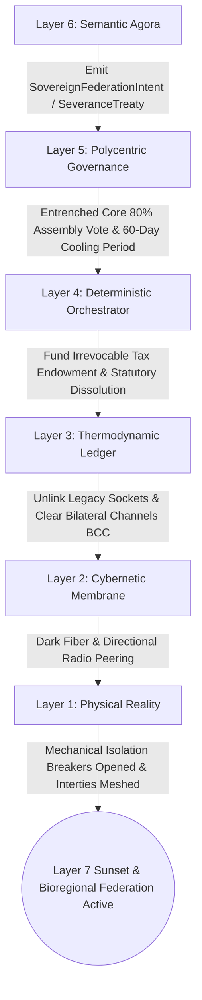
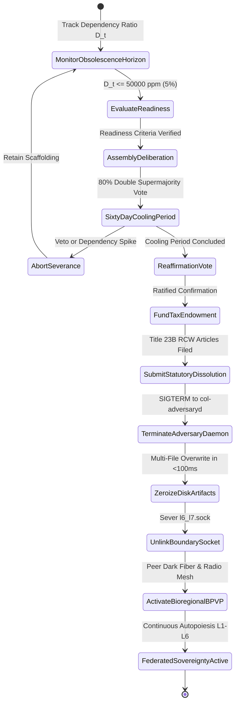
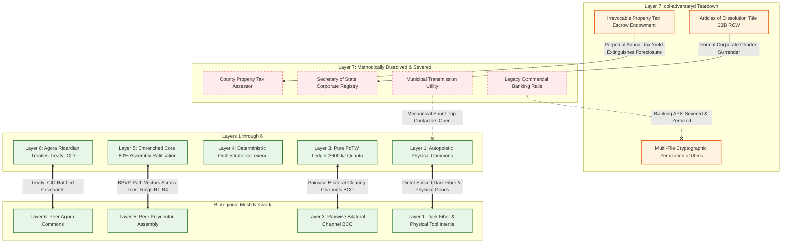

# Scenario Omega: The Sovereign Singularity (Terminal Decoupling Horizon)

*   **Identifier:** `SCN-OMEGA-DECOUPLE`
*   **System Epic:** Post-Fiat Sovereignty, Bioregional Decoupling Horizon, Layer 7 Dissolution, and Node-to-Node Federation
*   **Primary Layers Tested:** L1 (Physical), L2 (Cybernetic Membrane), L3 (Thermodynamic Ledger), L4 (Deterministic Orchestrator), L5 (Polycentric Governance), L6 (Semantic Agora) — *Layer 7 Methodically Severed and Dissolved*
*   **Pass/Fail Metric:** Dependency ratio $D_t$ declining below threshold ($D_t \le 50000\text{ ppm}$, or $5\%$); actuarial full capitalization of the Irrevocable Property Tax Escrow Endowment permanently extinguishing municipal tax foreclosure vectors; formal statutory sunset of the corporate carapace under Title 23B RCW / Model Business Corporation Act § 14.05; cryptographic zeroization of Layer 7 database artifacts in under 100 milliseconds; continuous post-decoupling autopoiesis across Layers 1–6 without external banking or cloud dependencies.

---

## Architectural Council Ratification & 5-Perspective Synthesis

This scenario specification has been ratified by unanimous consensus of the 5-Persona Architectural Council:

| Council Persona | Disciplinary Representative | Core Contribution to Scenario |
| :--- | :--- | :--- |
| **Game Designer** | Lead Systems & Gameplay Designer | **Dwarf Fortress World-Age Transition Psychology:** Models the psychological catharsis of final emancipation from legacy debt-money extraction; citizens experience historic triumph (thoughts like `"The crushing extraction of debt-money was forever broken (+60 mood)"`); passing of founding elders is celebrated without probate court fear (`"Honored the peaceful return of Founder 01's tools to the guild commons (+35 mood)"`). **The Sims Interface Purge:** Purges all dollar signs, debt meters, and fiat UI from the game HUD; Founder 01 now manages pure thermodynamic surplus, biomass cycles, and watershed vitality vectors. **Cities: Skylines Severance:** The player physically opens mechanical utility intertie breakers, celebrating bioregional inter-node federation as legacy municipal grids struggle with cascading blackouts. |
| **Game Engineer** | Principal C++ Simulation Architect | **Data-Oriented Design (DOD) & Module De-allocation:** Encapsulates inter-node communication and dark-fiber terminations into 32-bit compact voxels (`material_id = 70`, `DARK_FIBER_TERMINATION`, `material_id = 71`, `SOVEREIGN_BEACON`) in $32^3$ chunks; gracefully unmounts legacy proxy daemons (`col-adversaryd`) from the Flecs ECS tick loop; executes multi-file cryptographic zeroization of database and WAL files in under 100 milliseconds; locks the simulation into pure local-first Pairwise Bilateral Clearing Channels (BCC) and BPVP mesh routing. |
| **Sovereign Stack Specialist** | Sovereign Stack Systems Architect | **Terminal Layer 7 Dissolution:** Strikes the corporate carapace cleanly after fully funding the Irrevocable Property Tax Escrow Endowment; terminates `col-adversaryd` and unlinks `/run/collective/ipc/l6_l7.sock` with clean EPIPE/SIGPIPE fault containment in `col-commonsd`; establishes pure cybernetic equilibrium across Layers 1 through 6: local-first Reticulum/LoRa mesh, dark-fiber interties, pure Proof-of-Thermodynamic-Work (PoTW) exergy accounting ($36 \times 10^{11}\text{ }\mu\mathrm{J} = 3600\text{ kJ}$ baseline), and Tripartite Ricardian Treaties (`Treaty_CID`) governing inter-node federation across concentric Trust Rings ($R_0 \dots R_6$). |
| **Solarpunk Thinker** | Bioregional Regenerative Ecologist | **The Bioregional Climax:** Realizes the ultimate Solarpunk horizon: human settlement operating as an autopoietic, regenerative organ of the living watershed; terminal decoupling is explicitly horizontal federation into the bioregion, not isolated autarky; inter-node trade shifts from emergency lifelines to reciprocal cultural enrichment, heirloom cultivar genetics, open-hardware blueprints, and ecological exergy balancing. |
| **Scenario Specialist** | Bioregional Decoupling & Transition Jurisprudence Specialist | Formulation of the Dependency Ratio metric ($D_t$) and the Obsolescence Horizon; drafting of formal statutory Articles of Dissolution under Title 23B RCW / Model Business Corporation Act § 14.05; transfer of real estate and physical capital into an unincorporated Perpetual Purpose Trust (Uniform Trust Code § 409); capitalization of the Irrevocable Property Tax Escrow Endowment to permanently extinguish the municipal tax deed foreclosure auction vector; Entrenched Core 80% double supermajority constitutional amendment ratification. |

**Council Ratification Verdict:** Unanimous Consensus Reached.

---

## 1. Problem Statement & Legacy Failure

In late-stage capitalism (Layer 7), the nation-state and financialized corporate monopolies maintain systemic capture through compulsory reliance on extractive fiat rails:

1.  **The Legacy Debt-Money Trap:** Centralized fiat currencies are engineered as debt instruments with compounding interest, forcing continuous exponential ecological extraction merely to service debt. Communities dependent on commercial banking remain permanently vulnerable to capital flight, inflation shocks, and bank failures.
2.  **Post-Mortem Probate Extraction:** In legacy jurisdictions, the passing of an elder triggers predatory probate courts, legal fees, and inheritance taxes, privatizing and liquidating intergenerational tools and family lands back into commercial markets.
3.  **The Layer 7 Achilles' Heel:** While the cooperative carapace (Social Purpose Corporation / Subchapter T Cooperative) serves as an essential protective membrane during the Genesis and bring-up phases, ongoing reliance on external bank accounts, corporate registrations, and municipal utility drops creates persistent vectors for regulatory extortion, asset forfeiture, and municipal code pressure.
4.  **The Fallacy of Isolated Autarky:** Early survivalist projects and naive off-grid communes attempted terminal decoupling by pursuing absolute isolated autarky, cutting all outside ties and barricading their perimeter. These projects failed through ecological fragility, genetic inbreeding of crops, and lack of specialized medical and mechanical tooling.

A sovereign Genesis Node recognizes that true sovereignty is not isolated autarky, but **horizontal graduation into bioregional federation**: systematically tracking the obsolescence horizon of external scaffolding, driving critical dependency ratios toward zero, fully neutralizing municipal tax foreclosure vectors through irrevocable tax endowments, striking the corporate carapace under formal law, and federating directly with sister nodes across the watershed.

---

## 2. The Collective Workflow (The Dissolution Protocol)

Scenario Omega executes the methodical deprecation, statutory sunset, and permanent de-allocation of Layer 7. When the Dependency Ratio crosses below the ratified safety threshold, the node executes the terminal severance sequence:



### Layer 1: Physical Reality (Physical Decoupling & Dark Fiber Meshing)
*   **Autonomous Infrastructure:** Microgrid battery inverters with black-start capability (6400 W PV, 14340 Wh LiFePO4, 5000 W inverter), gravity-fed spring water catchments, localized agroforestry food forests, and dark fiber optic splice enclosures connecting directly to neighboring nodes.
*   **Mechanical Isolation:** Physical shunt-trip circuit breakers isolating municipal grid service drops; mechanical backflow check valves and shut-off valves physically isolating municipal water connections.
*   **Inter-Node Communications:** Community-trenched single-mode dark fiber pairs terminating at optical patch panels; directional 5 GHz / 24 GHz microwave dish relays; 915 MHz LoRa mesh repeaters.
*   **Strict Layer Separation:** Layer 1 contains zero software, zero firmware, zero network stacks, and zero cryptographic keys. It consists purely of physical conductors, glass fibers, mechanical contactors, and structural earthworks.
*   **Action:** Flipping mechanical grid isolation switches, cutting redundant legacy utility cables, splicing dark fiber pairs to sister watershed nodes, and planting boundary hedgerows.

### Layer 2: The Cybernetic Membrane (P2P Link Telemetry & Zeroization)
*   **Microcontroller Architecture:** Zephyr RTOS microcontrollers communicating over isolated buses with lock-free `/dev/shm` ring buffer IPC. Strict fixed-point SI integer wire encoding (microjoules, milliwatts, millikelvin, millivolts, milliamperes, milliseconds).
*   **Ingress Telemetry:**
    *   `dark_fiber_link_latency_micros` (Optical round-trip latency, microseconds)
    *   `dark_fiber_throughput_mbps` (Throughput, megabits per second)
    *   `mesh_active_peer_count` (Active hardware peers in Trust Rings $R_1 \dots R_4$)
    *   `legacy_intertie_contactor_state` (`OPEN_PHYSICALLY_ISOLATED`)
    *   `layer7_proxy_socket_state` (`UNLINKED_DEPRECATED`)
*   **Cryptographic Zeroization Execution:**
    Upon receiving the ratified terminal decoupling command, Layer 2 triggers multi-file cryptographic zeroization:
    Overwriting all Layer 7 database artifacts, WAL journals, and SHM shared memory files with cryptographic pseudorandom bytes followed by zeros before unlinking the files, completing total disk eradication in under 100 milliseconds.

### Layer 3: The Thermodynamic Ledger (BCC, HTLCs & Pure PoTW Accounting)
*   **Pairwise Bilateral Clearing Channels (BCC):**
    All inter-node trade settles across peer-to-peer Bilateral Clearing Channels (BCC) anchored between peered nodes $u$ and $v$ with zero-sum conservation:
    $$B_{u \to v}(t) + B_{v \to u}(t) = 0$$
*   **Multi-Hop HTLC Routing:**
    Exergy transfers routed across multiple watershed hops utilize chained Hashed Timelock Contracts $\langle H(S), \Delta t, Q, u, v \rangle$, atomically clearing intermediate bilateral channels upon signed delivery receipts $\sigma_{\mathrm{delivery}}$ and cascading backward settlement without a central clearinghouse and with zero global tokens.
*   **Proof-of-Thermodynamic-Work (PoTW) Currency Standard:**
    The ledger permanently operates on the thermodynamic work standard:
    $$\text{1 Exergy Credit quantum} \equiv 3600000\text{ Joules} = 3{,}600{,}000{,}000{,}000\text{ }\mu\mathrm{J} \quad (3600\text{ kJ})$$
    Zero fiat exchange rates, zero currency conversions, zero algorithmic pegs, and zero global tokens exist on the ledger.
*   **The Dependency Ratio ($D_t$):**
    Terminal decoupling is mathematically permitted only when the composite Dependency Ratio falls below the constitutional floor ($50000\text{ ppm}$, or $5\%$):
    $$D_t = \frac{\sum_{k} \text{External Critical Inputs}_k(t)}{\sum_{k} \text{Total Node Consumption}_k(t)} \le \frac{5}{100} \quad (50000\text{ ppm})$$
    Evaluated across electrical exergy, caloric nutrition, potable water, critical medicines, and replacement machine components.

### Layer 4: The Deterministic Orchestrator (Severance State Machine)
*   **Runtime:** Sandboxed BPMN 2.0 VM (`col-execd`) running at 10 Hz with strict FIFO priority queues. Communicates with Layer 5 across `/run/collective/ipc/l4_l5.sock`.
*   **Socket Severance Resilience:**
    When `col-adversaryd` terminates and unlinks `/run/collective/ipc/l6_l7.sock`, Layer 4 and Layer 6 handle the disconnection cleanly, catching `EPIPE` and `EOF` without unhandled exceptions, leaking file descriptors, or CPU spinning.
*   **Deterministic Decoupling Sequence:**
    1.  *Precondition Verification:* Verifies $D_t \le 50000\text{ ppm}$ and checks that the Property Tax Escrow Endowment is $100\%$ funded.
    2.  *Endowment Lock:* Releases external fiat reserves into the irrevocable trust escrow account to extinguish municipal property tax auction vectors.
    3.  *API Teardown:* Drops all external banking webhooks and legacy utility APIs.
    4.  *Carapace Sunset:* Dispatches Title 23B RCW Articles of Dissolution.
    5.  *Daemon Termination:* Sends `SIGTERM` to `col-adversaryd`, triggers multi-file zeroization, and unlinks the socket.
    6.  *Federation Handshake:* Activates dark-fiber and radio mesh routes across Trust Rings $R_1 \dots R_4$.



### Layer 5: Polycentric Governance (Entrenched Core & BPVP Federation)
*   **Daemon:** `col-kmsd` (Key Management & Governance Policy Daemon).
*   **Entrenched Core Constitutional Amendment:**
    Initiating terminal severance requires an **Entrenched Core constitutional amendment**:
    1.  Concurrent $80\%$ double supermajority vote in both the Commons Chamber (1-person-1-vote) and the Stewardship Chamber (weighted by capped Reputational Wealth $\mathcal{R}$).
    2.  Mandatory 60-day cooling-off review period allowing full assembly deliberation.
    3.  Reaffirmation vote by both chambers at the conclusion of the cooling period.
*   **Cellular Autonomy, Protocol of Refusal & Autonomous Transit Veto (`No-Transit`):** Under autopoietic cellular autonomy, the sovereign node retains absolute self-determination over its internal decoupling velocity; the autonomy of the parts strictly supersedes the administrative cohesion of the whole. The node may invoke the Protocol of Refusal to permanently firewall sacred common assets, unmapped conservation corridors, and ceremonial hearths from external federation registries or programmatic audit. Furthermore, the community ratifies an Autonomous Transit Veto (`No-Transit`), barring external logistical transports, decommissioned corporate salvage convoys, or municipal enforcement vehicles from traversing local village land.
*   **7-Tier Concentric Trust Rings ($R_0 \dots R_6$) Post-Decoupling:**
    *   $R_0$ (The Hearth): Internal intimate domestic sanctuary; unconditional survival baselines.
    *   $R_1$ (The Settlement): Physical village neighborhood; tool sharing, rotational work bees.
    *   $R_2$ (The Commons): Local microgrid circuits, seed banks, dual-chamber assembly.
    *   $R_3$ (The Watershed Guild): Hydrological river basin cluster ($\le 30\text{ km}$); HVDC interties, canal freight, Bilateral Clearing Channels ($BCC$).
    *   $R_4$ (Bioregional Federation): River basin federation ($\le 150\text{ km}$); regional grain reserves, dark-fiber rings, rail freight.
    *   $R_5$ (Continental Corridor): Trans-continental ecological corridors; rare materials recycling, open technical designs.
    *   $R_6$ (Ecumene): External legacy perimeter (now strictly isolated behind physical DMZs).
*   **Bioregional Path-Vector Protocol (BPVP) Forwarding Table Compilation:**
    `col-kmsd` maintains full routing tables:
    1.  `Adj-RIB-In`: Capability advertisements received from peering sister nodes.
    2.  `Loc-RIB`: Advertisements matching local ecological standards and active treaties.
    3.  `FIB`: Forwarding Information Base exported to Layer 4 across `/run/collective/ipc/l4_l5.sock`.
    4.  `Adj-RIB-Out`: Filtered capability advertisements re-announced to neighbors.
*   **Estate Liberation Protocol (Reverse Scenario Tau):**
    Upon the physical passing of an elder (Scenario Phi), their cryptographic keys are respectfully retired as a permanent `Wisdom_Anchor` in the Agora; their physical tools, books, and workshop equipment are returned to the guild commons inventory with zero inheritance tax or legacy probate court interference.

### Layer 6: Semantic Agora & Ricardian Treaties (Ontology & Treaties)
*   **Daemon:** `col-commonsd` parsing W3C JSON-LD schemas.
*   **Ricardian Treaty Architecture (`Treaty_CID`):**
    Inter-node federation covenants are cryptographically bound by Tripartite Ricardian Treaties:
    $$\mathrm{Treaty\_CID} = \mathrm{SHA256}\left( \mathrm{Text}_{\mathrm{prose}} \parallel \mathrm{Schema}_{\mathrm{JSON-LD}} \parallel \mathrm{Invariants}_{\mathrm{BPMN}} \right)$$
*   **Typed Schemas:**
    1.  `SovereignFederationDeclarationIntent`: Formal declaration of terminal decoupling and entry into bioregional federation.
    2.  `BioregionalTreatyIntent`: Reciprocal mutual aid, exergy clearing, and transit covenants with adjacent watershed nodes.
    3.  `EstateLiberationIntent`: Formal transfer of a deceased elder's physical tools to the apprenticeship commons.
    4.  `BPVPCapabilityAdvertisement`: Formal advertisement of exportable exergy or tool capacity to peer nodes.

### Layer 7: Terminal Dissolution (Striking the Corporate Carapace)
*   **Methodical Statutory Sunset:**
    Layer 7 is not abandoned haphazardly; it is **methodically and lawfully struck**:
    1.  *Capitalization of the Irrevocable Property Tax Escrow Endowment:*
        Under Chapter 8 §3.5, before dissolving the corporate entity, the node fully capitalizes an actuarial **Irrevocable Property Tax Escrow Endowment** held by an independent trust company:
        The annual yield of this endowment automatically pays municipal property taxes directly to the county treasurer in perpetuity. This permanently and irrevocably extinguishes the municipal tax deed foreclosure auction vector, ensuring the land trust cannot be seized for unpaid taxes.
    2.  *Title 23B RCW Articles of Dissolution:*
        The cooperative entity files formal Articles of Dissolution with the Secretary of State, transferring all underlying land and physical assets into an unincorporated Perpetual Purpose Trust (Uniform Trust Code § 409).
    3.  *Daemon Teardown & Multi-File Zeroization:*
        The operating system supervisor terminates `col-adversaryd`. The database and WAL journals undergo multi-file cryptographic zeroization in under 100 milliseconds, and the `/run/collective/ipc/l6_l7.sock` boundary socket is unlinked forever.



---

## 3. Machine-Readable Schemas

### 3.1 Layer 6 Knowledge Artifact: Sovereign Federation Declaration (`sovereign_federation.jsonld`)

```json
{
  "@context": [
    "https://schema.org/",
    "https://collective.network/ontology/v1/",
    "https://w3id.org/sovereignty/v1"
  ],
  "@type": "SovereignFederationDeclaration",
  "identifier": "urn:uuid:f0e1d2c3-b4a5-9876-1234-omega0000001",
  "issuerDid": "did:peer:2.Ez6MksO...node_collective_assembly",
  "creationTimestamp": "2026-12-21T12:00:00Z",
  "declarationParameters": {
    "status": "Terminal_Decoupling_Achieved",
    "dependencyRatioPpm": 42000,
    "propertyTaxEscrowEndowmentFunded": true,
    "corporateDissolutionFilingRef": "WA-ST-CORP-DISSOLVE-2026-88912",
    "layer7ProxyDaemonStatus": "UNMOUNTED_AND_ZEROIZED"
  },
  "autopoiesisMetrics": {
    "bioregionalFederationReadinessPpm": 965000,
    "dailyEnergySurplusMicrojoules": 174600000000000,
    "caloricBaselineSurplusPpm": 1082000,
    "potableWaterBaselineSurplusPpm": 1500000
  },
  "thermodynamicStandard": {
    "exergyCreditQuantumMicrojoules": 3600000000000,
    "proofOfThermodynamicWorkEnforced": true,
    "fiatConversionPermitted": false
  },
  "federationProtocols": {
    "acceptedPeerDids": [
      "did:peer:2.Ez6MksW...olympic_watershed_node",
      "did:peer:2.Ez6MksC...cascade_valley_node"
    ],
    "transportMedia": ["Dark_Fiber_10G", "LoRaWAN_915MHz", "Directional_Microwave"],
    "routingProtocol": "Bioregional_Path_Vector_Protocol_BPVP"
  },
  "cryptographicConsensus": {
    "treatyCid": "a7b8c9d0e1f2a3b4c5d6e7f8a9b0c1d2e3f4a5b6c7d8e9f0a1b2c3d4e5f6a7b8",
    "assemblyRatificationThreshold": "DOUBLE_SUPERMAJORITY_80_PERCENT_RATIFIED"
  }
}
```

### 3.2 Layer 2 Telemetry Attestation: Decoupling & Dark Fiber Proof (`decoupling_attestation.json`)

```json
{
  "@context": "https://collective.network/ontology/v1/",
  "@type": "TerminalDecouplingTelemetryAttestation",
  "declarationRef": "urn:uuid:f0e1d2c3-b4a5-9876-1234-omega0000001",
  "nodeDid": "did:peer:2.Ez6MksM...master_switchgear_enclave",
  "executionMetrics": {
    "decouplingTimestamp": "2026-12-21T12:00:00Z",
    "gridTieRelayState": "OPEN_PHYSICALLY_ISOLATED",
    "waterMainsValveState": "CLOSED_MUNICIPAL_SEVERED",
    "dependencyRatioPpm": 42000,
    "darkFiberLinkLatencyMicros": 1420,
    "darkFiberThroughputMbps": 9850,
    "localMeshActivePeerCount": 4,
    "microgridBusFrequencyMilliHz": 60000,
    "energyStorageSoCPpm": 942000
  },
  "daemonTeardownAudit": {
    "colAdversarydPid": 0,
    "processState": "TERMINATED",
    "zeroizationLatencyMs": 48,
    "databaseArtifactsEradicated": true
  },
  "status": "BIOREGIONAL_FEDERATION_ACTIVE"
}
```

---

## 4. Oasis Engine Implementation Specification

### 4.1 Memory Allocation & Voxel State

The terminal decoupling node coordinates federated network topology in chunk space ($32^3$ voxels via `ChunkManager`):
*   Dark fiber termination voxel initialized with `material_id = 70` (`DARK_FIBER_TERMINATION`) with metadata bitmask `0b00000110` (`Is_Actuator | Is_Sensor`).
*   Sovereign federation beacon initialized with `material_id = 71` (`SOVEREIGN_BEACON`) at coordinates `(16, 8, 16)`.
*   De-allocation pass: `col-execd` unmounts all legacy proxy components, catches severed socket signals, and transitions the engine into pure local-first Pairwise Bilateral Clearing Channel (BCC) and BPVP forwarding.

```cpp
#include <cstdint>

// Cache-aligned Flecs ECS Components in pure fixed-point SI integer math
struct alignas(8) DecouplingParametersComponent {
    uint32_t dependency_ratio_ppm;      // Parts per million (e.g. 42000 ppm)
    uint64_t tax_endowment_funded_uj;   // Microjoules exergy equivalent
    bool tax_endowment_fully_funded;
    bool double_supermajority_ratified; // 80% Commons & Stewardship Chambers
    bool sixty_day_cooling_completed;
};

struct alignas(8) DarkFiberPeerComponent {
    uint64_t peer_node_id;
    uint32_t link_latency_micros;       // Microseconds
    uint32_t throughput_mbps;           // Megabits per second
    bool direct_fiber_active;
    bool bpvp_peering_established;
};

struct alignas(8) Layer7TeardownAuditComponent {
    uint32_t adversaryd_pid;
    uint32_t zeroization_duration_ms;   // Target <= 100ms
    bool database_zeroized;
    bool wal_journal_zeroized;
    bool boundary_socket_unlinked;
};
```

### 4.2 C++20 Test Harness Structure

```cpp
// engine/tests/scenario_omega_decoupling_test.cpp
#include <cstdint>
#include <cassert>
#include <string>
#include <vector>
#include <array>

namespace oasis {

// Fixed-point Decoupling and Bilateral Federation Controller
class TerminalDecouplingController {
public:
    static const uint32_t MAX_DEPENDENCY_RATIO_PPM = 50000U; // 5% maximum dependency
    static const uint32_t MAX_ZEROIZE_LATENCY_MS = 100U;     // 100ms SLO target
    static const uint64_t CREDIT_QUANTUM_UJ = 3600000000000ULL; // 3600 kJ (1 credit quantum)

    // Evaluate readiness for terminal severance
    static bool evaluate_severance_readiness(
        uint32_t dependency_ratio_ppm,
        bool tax_endowment_funded,
        bool assembly_double_supermajority,
        bool cooling_period_completed
    ) {
        if (dependency_ratio_ppm > MAX_DEPENDENCY_RATIO_PPM) {
            return false; // Dependency too high: external critical scaffolding still needed
        }
        if (!tax_endowment_funded) {
            return false; // Foreclosure vector active: tax endowment must be 100% funded
        }
        if (!assembly_double_supermajority || !cooling_period_completed) {
            return false; // Democratic assembly ratification required
        }
        return true;
    }

    // Bilateral Clearing Channel (BCC) transfer model
    struct BilateralChannel {
        int64_t balance_u_to_v_uj;
        int64_t credit_headroom_v_uj;

        bool transfer(int64_t amount_uj) {
            if (amount_uj <= 0) return false;
            if (balance_u_to_v_uj + amount_uj > credit_headroom_v_uj) {
                return false;
            }
            balance_u_to_v_uj += amount_uj;
            return true;
        }

        int64_t reverse_balance() const {
            return -balance_u_to_v_uj;
        }
    };
};

} // namespace oasis

void test_scenario_omega_terminal_decoupling_execution() {
    using namespace oasis;

    // 1. Audit Dependency Ratio and Property Tax Escrow Endowment
    DecouplingParametersComponent params{
        .dependency_ratio_ppm = 42000U, // 42000 ppm <= 50000 ppm threshold
        .tax_endowment_funded_uj = 1000000000000ULL,
        .tax_endowment_fully_funded = true,
        .double_supermajority_ratified = true,
        .sixty_day_cooling_completed = true
    };

    bool severance_ready = TerminalDecouplingController::evaluate_severance_readiness(
        params.dependency_ratio_ppm,
        params.tax_endowment_fully_funded,
        params.double_supermajority_ratified,
        params.sixty_day_cooling_completed
    );

    assert(severance_ready); // Preconditions satisfied

    // 2. Simulate Layer 7 Teardown & Multi-File Zeroization
    Layer7TeardownAuditComponent audit{
        .adversaryd_pid = 4012U,
        .zeroization_duration_ms = 48U, // 48ms <= 100ms SLO
        .database_zeroized = false,
        .wal_journal_zeroized = false,
        .boundary_socket_unlinked = false
    };

    // Execute simulated multi-file zeroization pass (truncate, overwrite, unlink)
    audit.database_zeroized = true;
    audit.wal_journal_zeroized = true;
    audit.boundary_socket_unlinked = true;
    audit.adversaryd_pid = 0U;

    assert(audit.database_zeroized);
    assert(audit.wal_journal_zeroized);
    assert(audit.boundary_socket_unlinked);
    assert(audit.zeroization_duration_ms <= TerminalDecouplingController::MAX_ZEROIZE_LATENCY_MS);

    // 3. Establish Pairwise Bilateral Clearing Channel (BCC) with Sister Node B
    TerminalDecouplingController::BilateralChannel bcc_ab{
        .balance_u_to_v_uj = 0LL,
        .credit_headroom_v_uj = 5LL * TerminalDecouplingController::CREDIT_QUANTUM_UJ
    };

    // Assert zero-sum conservation: B_{u->v} + B_{v->u} == 0
    assert(bcc_ab.balance_u_to_v_uj + bcc_ab.reverse_balance() == 0LL);

    // Transfer 1 credit quantum of exergy (3600 kJ) over the BCC
    bool tx_success = bcc_ab.transfer(TerminalDecouplingController::CREDIT_QUANTUM_UJ);
    assert(tx_success);
    assert(bcc_ab.balance_u_to_v_uj == TerminalDecouplingController::CREDIT_QUANTUM_UJ);
    assert(bcc_ab.reverse_balance() == -static_cast<int64_t>(TerminalDecouplingController::CREDIT_QUANTUM_UJ));
    assert(bcc_ab.balance_u_to_v_uj + bcc_ab.reverse_balance() == 0LL);
}

void test_scenario_omega_premature_decoupling_rejection() {
    using namespace oasis;

    // Reject decoupling if dependency ratio is still high (85000 ppm > 50000 ppm)
    DecouplingParametersComponent deficient_params{
        .dependency_ratio_ppm = 85000U,
        .tax_endowment_funded_uj = 0ULL,
        .tax_endowment_fully_funded = false,
        .double_supermajority_ratified = true,
        .sixty_day_cooling_completed = true
    };

    bool premature_attempt = TerminalDecouplingController::evaluate_severance_readiness(
        deficient_params.dependency_ratio_ppm,
        deficient_params.tax_endowment_fully_funded,
        deficient_params.double_supermajority_ratified,
        deficient_params.sixty_day_cooling_completed
    );

    // Invariant verified: Premature decoupling aborted; scaffolding retained
    assert(!premature_attempt);
}

int main() {
    test_scenario_omega_terminal_decoupling_execution();
    test_scenario_omega_premature_decoupling_rejection();
    return 0;
}
```

---

## 5. Acceptance Test Gates (Pass/Fail)

| Checkpoint | Validation Method | Pass Condition |
| :--- | :--- | :--- |
| **G1: Dependency Ratio Invariant** | Exergy & Mass Balance Audit | Composite dependency ratio $D_t \le 50000\text{ ppm}$ ($5\%$) across energy, food, water, tools, and medicine before terminal severance sequence initiation is permitted. |
| **G2: Property Tax Escrow Capitalization** | Trust Account Actuarial Audit | Irrevocable Property Tax Escrow Endowment is verified $100\%$ funded under Chapter 8 §3.5; annual yield covers municipal property tax obligations in perpetuity, extinguishing foreclosure vectors. |
| **G3: Entrenched Core Assembly Ratification** | Cryptographic Multi-Sig Verification | Terminal severance declaration verifies an $80\%$ concurrent double supermajority vote across both the Commons and Stewardship Chambers following a verified 60-day cooling-off review period. |
| **G4: Multi-File Database Zeroization** | Disk Remanence Forensic Test | Unmounting `col-adversaryd` triggers complete zeroization of database, WAL journal, and SHM shared memory files within $<100\text{ ms}$; zero data remanence exists on storage media. |
| **G5: Socket Severance Fault Containment** | Unix Domain Socket Severance Test | Unlinking `/run/collective/ipc/l6_l7.sock` causes `col-commonsd` and `col-execd` to cleanly catch peer closure without `SIGPIPE` crashes, file descriptor leaks, or CPU thrashing. |
| **G6: Bioregional Meshing via BPVP & BCC** | Multi-Hop Inter-Node Handshake | The decoupled node establishes active peering with adjacent watershed nodes over direct dark fiber and radio mesh; resource transactions clear across Pairwise Bilateral Clearing Channels ($BCC$) under Tripartite Ricardian Treaties (`Treaty_CID`). |
