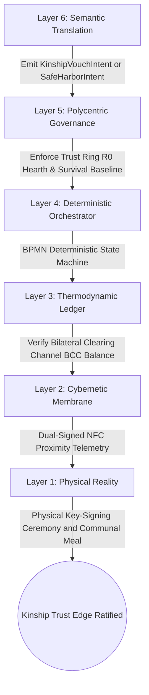

# Scenario Omicron: The Kinship Protocol (Trust Rings & Hearth Sanctuary)

*   **Identifier:** `SCN-OMICRON-KIN`
*   **System Epic:** Web of Trust, Hearth Sanctuary, Relational Intimacy & Social Immunity
*   **Primary Layers Tested:** L1 (Physical Reality), L2 (Cybernetic Membrane), L3 (Thermodynamic Ledger), L4 (Deterministic Orchestrator), L5 (Polycentric Governance), L6 (Semantic Translation & Agora), L7 (Legacy Interface)
*   **Pass/Fail Metric:** Cryptographic rejection of 1000 unvouched Sybil DIDs; structural protection of domestic hearth sanctuary $R_0$; absolute exclusion of biometric tracking and body-worn sensors; zero algorithmic recursive slashing; replacement of carceral penalties with restorative justice; deterministic preservation of the unalienable human survival baseline $B_{\mathrm{baseline}}$ under 100% offline mesh operation.

---

## Architectural Council Ratification & 5-Perspective Synthesis

This scenario specification has been ratified by unanimous consensus of the 5-Persona Architectural Council:

| Council Persona | Disciplinary Representative | Core Contribution to Scenario |
| :--- | :--- | :--- |
| **Game Designer** | Lead Systems & Gameplay Designer | Dwarf Fortress psychology integration (64-byte bounded ECS state, thoughts like `"Felt deep gratitude for hot soup at the hearth (+40 mood)"`, grief and solidarity memories); The Sims indirect Founder 01 social management via interpersonal affordance queues; Cities: Skylines boundary interface attenuation where internal trust cohesion weakens external legacy probe aggression. |
| **Game Engineer** | Principal C++ Simulation & Engine Architect | Flecs ECS Data-Oriented Design (DOD): cache-aligned `TrustEdgeComponent`, `ReputationScoreComponent`, `AgentPsychStateComponent`, and `BCCChannelComponent`; 32-bit compact voxel representation (`material_id = 45`, `HEARTH_SANCTUARY_ANCHOR`); 10 Hz deterministic BPMN state engine with Wasmtime fuel limits; compilable C++20 test harness with BFS pathfinding, restorative circle resolution, and zero IEEE 754 floats. |
| **Sovereign Stack Specialist** | Sovereign Stack Systems Architect | Strict 7-layer stack mapping across autonomous daemons (`col-telemetryd` to `col-adversaryd`); zero monolithic game-loop threading; strict inter-layer adjacency; local-first Reticulum/LoRaWAN gossip; Pairwise Bilateral Clearing Channels ($B_{u \to v}(t) + B_{v \to u}(t) = 0$); non-financial, decaying and sublinearly capped Reputational Wealth ($\mathcal{R}$); complete elimination of soulbound tokens or reputation staking. |
| **Solarpunk Thinker** | Bioregional Regenerative Ecologist | Convivial sanctuary $R_0$: unconditional clean water, hot food, and medical triage as inalienable human rights; domestic care, emotional intimacy, and storytelling as non-commensurable dimensions permanently outside market calculation; interpersonal trust eliminating surveillance drag. |
| **Scenario Specialist** | Graph Cryptographer & Mechanism Design Specialist | Mathematical graph theory formulation: pairwise DIDs (`did:peer:...`), BBS+ zero-knowledge selective disclosure credentials, spectral gap expansion thresholds for Sybil quarantine; Safe Harbor unilateral severance state transitions; restorative circle restitution without algorithmic slashing; subpoena defense under *NAACP v. Alabama* via Structural Illegibility and Data Non-Existence. |

**Unanimous Consensus Reached:** The Council unreservedly ratifies Scenario Omicron as the canonical specification for the Kinship Protocol, hearth sanctuary $R_0$, and relational social immunity.

---

## 1. Problem Statement & Legacy Failure

In legacy late-stage capitalist infrastructure (Layer 7), human trust is commercialized, outsourced to centralized surveillance data brokers, credit-scoring oligarchies, and intrusive state surveillance apparatuses.

This centralized architecture introduces severe societal failure modes:
*   **Weaponized Economic Coercion:** Survival necessities (housing leases, utility connections, employment, food access) are inextricably tied to credit scores and background checks. Domestic abusers, exploitative landlords, and predatory employers wield this financialized leverage to enforce submission. Escaping an abusive household or toxic workplace immediately threatens an individual with homelessness, loss of bank accounts, and systemic destitution.
*   **Dystopian Panopticon Threat:** Corporate reputation protocols and centralized state "social credit" scoring systems recreate this exact coercion. They establish immutable, panoptic surveillance ledgers where high-status actors weaponize accumulated social capital to ostracize dissidents, enforce behavioral conformity, and create permanent underclasses.
*   **Sybil Fragility & Impersonation:** Anonymous digital networks lack physical grounding, rendering them instantly vulnerable to automated Sybil attacks—where a single malicious actor or botnet spins up tens of thousands of pseudonymous accounts to capture democratic votes, exhaust shared commons pools, and hijack validation consensus.

To survive without replicating legacy tyranny, a sovereign Genesis Node requires a mathematically rigorous Web of Trust (WoT) that prevents Sybil infiltration while **cryptographically firewalling** social trust from basic biological survival and intimate autonomy. Reputation must protect the commons, not coerce the human soul.

---

## 2. The Collective Workflow (7-Layer Traversal)

The Kinship Protocol establishes localized Trust Rings grounded in physical co-presence, non-monetary peer attestation, and unconditional domestic sanctuary. The workflow traverses canonically from Layer 1 up to Layer 7:



### Layer 1: Physical Ground Truth & Hearth Sanctuary ($R_0$)
*   **The Convivial Sanctuary / The Hearth ($R_0$):** Dedicated physical spaces for communal life—communal kitchen tables (Scenario Gamma), open hearths, and workshop benches.
*   **Physical Co-Presence & Somatic Nourishment:** Human physical co-presence, somatic co-location, shared eye contact, breaking bread over caloric meals, and collaborative kinetic labor.
*   **Physical Key-Signing Ceremony:** Two physical individuals bring their hardware tokens into near-field contact (within 40 mm) while sharing nourishment and spoken mutual-aid covenants.
*   **Absolute Separation Invariant:** Layer 1 contains strictly zero software, zero firmware, zero cryptographic keys, and zero surveillance devices.

### Layer 2: Cybernetic Membrane
*   **Microcontrollers & Hardware Roots:** Microcontrollers running Zephyr RTOS with MPU memory isolation. Cryptographic key pairs generated inside Microchip ATECC608A secure elements.
*   **Wire Format Fixed-Point Integer Telemetry (MQTT Topics via `col-telemetryd`):**
    *   `node/social/proximity/nfc_rssi_mbbm` (Integer signal strength, `int32_t` millidBm)
    *   `node/social/proximity/duration_ms` (Integer contact duration, `uint32_t` milliseconds)
    *   `node/social/status` (`UNVERIFIED`, `PROXIMITY_CONFIRMED`, `EDGE_ACTIVE`, `DISPUTED`)
*   **Convivial Anti-Panopticon Shield:**
    *   **Absolute Ban on Body-Worn Sensors:** No devices measuring heart rate, galvanic skin response, brainwaves, steps, or eye movements may interface with the stack.
    *   **Absolute Ban on Workplace & Domestic Cameras:** Computer vision models and video cameras are strictly prohibited in living quarters and commons spaces. Edge microcontrollers reject camera drivers at bootloader initialization.
*   **Edge Cryptographic Attestation:** Physical co-presence is validated through mutual NFC exchange of ephemeral nonces signed by hardware secure elements. Remote vouches are throttled to $R_1$ advisory status and cannot unlock high-exergy machinery.

### Layer 3: Thermodynamic Ledger
*   **Pairwise Bilateral Clearing Channels (BCC):**
    *   Inter-node resource accounting is conducted strictly through pairwise bilateral clearing channels with zero global tokens.
    *   **Conservation Invariant:**
        $$B_{u \to v}(t) + B_{v \to u}(t) = 0$$
        The bilateral ledger is mathematically zero-sum.
    *   **Mutual Aid Credit Window:**
        $$-C_{u \to v} \le B_{u \to v}(t) \le C_{v \to u}$$
*   **Two-Phase Delivery Receipts & Multi-Hop HTLCs:**
    *   Resource transfers require sensor-verified physical delivery receipts $\sigma_{\mathrm{delivery}}$ and chained timelock contracts $\langle H(S), \Delta t, Q, u, v \rangle$.
    *   Proof-of-Thermodynamic-Work (PoTW) grounds exergy in physical generation ($3600000000000\,\mu\mathrm{J} \equiv 3600\,\mathrm{kJ} \equiv 1\text{ Exergy Credit}$) subject to demurrage $\mathcal{E}_0 e^{-\lambda t}$.
*   **Non-Commensurability of Human Care:**
    *   Childcare, meal preparation, emotional comfort, and conflict de-escalation are designated as non-commensurable human stewardship. Layer 3 structurally refuses to mint exergy credits for domestic care.
*   **Eradication of Algorithmic Slashing:**
    *   The system strictly prohibits automated algorithmic "social slashing" that burns reputation or penalizes vouchers across graph edges upon a dispute. Relational fractures are handled via Restorative Justice circles (Scenario Psi).

### Layer 4: Deterministic Orchestrator
*   Executed by `col-execd` at 10 Hz with metered Wasmtime fuel budgets:
    *   `VouchInitiated`: Ingests `KinshipVouchIntent` over `/run/collective/ipc/l4_l5.sock`.
    *   `NFCProximityVerification`: Validates dual-signed NFC telemetry packets (`rssi > -55000` mBm).
    *   `RemoteThrottled`: If proximity proof is absent, caps credential at $R_1$ advisory level.
    *   `ActiveTrustEdge`: Ratifies the trust edge and updates local Forwarding Information Base.
    *   `SafeHarborSeverance`: Unilateral invocation instantly dissolves the trust edge with zero penalty.
    *   `RestorativeCircle`: Disputed actions route to facilitated peer restorative circles.
*   **The Unalienable Human Survival Baseline ($B_{\mathrm{baseline}}$):**
    *   Access to clean potable water, organic calories, warm shelter, electrical power, and clinical healthcare is an unconditional right of living membership.
    *   The survival baseline is **never** conditioned upon labor output, chore points, or reputation scores. Sanctions may never reduce the survival baseline.

### Layer 5: Polycentric Governance
*   Executed by `col-kmsd`, Layer 5 enforces policy across the **7-Tier Concentric Trust Rings**:
    *   **$R_0$ (The Hearth / Convivial Sanctuary):** Domestic physical shelter; zero registration; unconditional clean water, warm food, solar electricity, and medical triage. Social immunity protects all persons.
    *   **$R_1$ (The Settlement):** Living perimeter (within 500 m); apprentices, volunteers; ephemeral pairwise DIDs (`did:peer`), supervised tool access.
    *   **$R_2$ (The Commons):** Walking-distance neighborhood (within 5 km); master keys in hardware security chips; full voting weight; local Bilateral Clearing Channels (BCC).
    *   **$R_3$ (The Watershed):** Hydrological basin cluster (within 30 km); microgrid DC interties, LoRa/802.11s mesh credentials, bilateral credit lines.
    *   **$R_4$ (The Bioregional Federation):** Regional river basin federation (within 150 km); threshold signatures (FROST / BLS), HVDC interties, rail/canal freight corridors.
    *   **$R_5$ (The Continental Corridor):** Ecological corridors (within 1000 km); Delay-Tolerant Networking (DTN) bundles, open blueprints.
    *   **$R_6$ (The Ecumene):** Planetary craft guilds, open standards, and the legacy perimeter; cold-store DMZ interfaces.
*   **Bioregional Path-Vector Protocol (BPVP / FRRP):**
    *   Capability Advertisements $\mathcal{A} = \langle \mathrm{adv\_id}, v_{\mathrm{orig}}, \mathcal{T}_{\mathrm{res}}, \mathbf{u}, Q_{\mathrm{avail}}, [\tau_{\mathrm{start}}, \tau_{\mathrm{end}}], \mathcal{P}, \mathcal{C}, H_{\mathrm{ttl}}, \sigma \rangle$.
    *   Export Surplus Bound: $Q_{\mathrm{avail}}(t) = \max(0, Q_{\mathrm{inventory}}(t) - F_{\mathrm{eco}}(t) - B_{\mathrm{baseline}}(t)) \cdot \mathbf{1}_{\mathrm{export}}$.
    *   Loop Check: Discards any advertisement where local node DID appears in Ring-Path Vector $\mathcal{P}$.
*   **Reputational Wealth Governance ($\mathcal{R}$):**
    *   Reputational Wealth is domain-specific, decays exponentially ($\tau_{\mathrm{half}} = 1\dots 3\text{ years}$), and is sublinearly capped ($\le 8\%$ of chamber weight). It cannot be spent, staked, sold, or burned.
    *   **Care Leave Shield:** Declaring personal care leave (parenting, illness, bereavement) completely freezes the decay clock.
*   **Cellular Autonomy & Protocol of Refusal:** Under autopoietic cellular autonomy, kinship circles and domestic hearths exercise complete internal self-determination; the integrity of the parts holds absolute precedence over the administrative coordination of the whole. Communities invoke the Protocol of Refusal to protect sacred groves, burial grounds, and private living quarters from external optimization, algorithmic extraction, or automated sensor instrumentation.
*   **Autonomous Transit Veto (`No-Transit`):** Nodes retain the sovereign right to reject transit routing through their residential territory.

### Layer 6: Semantic Translation & Agora
*   **Tripartite Ricardian Treaties (`Treaty_CID`):**
    $$\mathrm{Treaty\_CID} = \mathrm{SHA256}\left( \mathrm{Text}_{\mathrm{prose}} \parallel \mathrm{Schema}_{\mathrm{JSON-LD}} \parallel \mathrm{Invariants}_{\mathrm{BPMN}} \right)$$
*   All kinship actions are published as typed W3C JSON-LD Knowledge Artifacts in the Agora Commons (`col-commonsd`):
    1.  `KinshipVouchIntent`: Formal attestation endorsing a peer DID based on physical acquaintance.
    2.  `SafeHarborSeveranceIntent`: Unilateral, non-punitive dissolution of a trust edge.
    3.  `RestorativeCircleIntent`: Request for voluntary peer circle facilitation (linking to Scenario Psi).
    4.  `CareLeaveDeclarationIntent`: Invocation of the Care Leave Shield freezing the decay clock.

### Layer 7: The Legacy Interface (Dual-Membrane Doctrine)
*   **Dual-Membrane Carapace:** The cooperative entity presents an ordinary, compliant legal exterior while completely insulating internal social relationships.
*   **Subpoena Defense via Structural Illegibility & Data Non-Existence:**
    *   Under *NAACP v. Alabama*, internal association records, pairwise DIDs, and Web-of-Trust graph edges do not exist in corporate databases.
    *   `col-adversaryd` maintains zero internal membership databases; subpoenaed servers possess no data to disclose.
*   **Tripartite Legal Chassis:** Unincorporated Nonprofit Association (UNA under UUNAA § 6), Subchapter T Cooperative, Community Land Trust.
*   **Regenerative Harvesting & Convivial Salvage:** Outward procurement operates strictly against the itemized needs list $\Phi_t$ under honest dealing and lawful engineering interties.

---

## 3. Machine-Readable Schemas

### 3.1 Layer 6 Knowledge Artifact: Kinship Vouch Schema (`vouch.jsonld`)

```json
{
  "@context": [
    "https://schema.org/",
    "https://collective.network/ontology/v1/"
  ],
  "@type": "KinshipVouch",
  "identifier": "urn:uuid:5d6e7f8a-9b0c-1d2e-3f4a-5b6c7d8e9f0a",
  "issuerDid": "did:peer:2.Ez6Mks3...steward_alice",
  "targetDid": "did:peer:2.Ez6Mkd9...apprentice_charlie",
  "vouchParameters": {
    "relationshipContext": "Apprentice_and_Neighbor",
    "knownDurationMonths": 14,
    "physicalProximityVerified": true,
    "telemetryProofHash": "a94a8fe5ccb19ba61c4c0873d391e987982fbbd3",
    "sharedMealRef": "urn:uuid:meal-2026-10-19-gamma-commons"
  },
  "reputationalStanding": {
    "endorsedDomain": "Fabrication_Woodworking",
    "stewardshipRank": 2
  },
  "cryptographicProof": {
    "type": "Ed25519Signature2020",
    "created": "2026-10-20T10:00:00Z",
    "verificationMethod": "did:peer:2.Ez6Mks3...steward_alice#key-1",
    "proofValue": "z3aKk9xPqR8vmY4nL0p...hardwareSignatureValue"
  }
}
```

### 3.2 Layer 2 Telemetry Attestation: NFC Proximity Proof Schema (`proximity_attestation.json`)

```json
{
  "@context": "https://collective.network/ontology/v1/",
  "@type": "KinshipProximityAttestation",
  "attestationId": "urn:uuid:8c9d0e1f-2a3b-4c5d-6e7f-8a9b0c1d2e3f",
  "deviceNodeAlice": "did:peer:2.Ez6Mks3...device_alice_fob",
  "deviceNodeCharlie": "did:peer:2.Ez6Mkd9...device_charlie_fob",
  "proximityMetrics": {
    "protocol": "ISO_IEC_14443_NFC",
    "timestampEpochMs": 1792483112000,
    "exchangeNonceAlice": "e1f8a4c92b5d7e3a",
    "exchangeNonceCharlie": "9c2b4d8a1f7e3b5a",
    "nfcRssiMeanMilliDbm": -18500,
    "durationMilliseconds": 842,
    "hardwareSignatureAlice": "4a7f9b2c...atecc608a_sig",
    "hardwareSignatureCharlie": "8b1e3c5d...atecc608a_sig"
  },
  "status": "PROXIMITY_CONFIRMED",
  "digestSha256": "a94a8fe5ccb19ba61c4c0873d391e987982fbbd3"
}
```

---

## 4. Oasis Engine Implementation Specification

### 4.1 Memory Allocation & Voxel State

The social hearth occupies designated coordinates in the $32^3$ chunk space:
*   The hearth anchor voxel is initialized with `material_id = 45` (`HEARTH_SANCTUARY_ANCHOR`).
*   Metadata bitmask `0b00000101` sets `Is_Social_Beacon` (bit 0) and `Is_Secure_NFC` (bit 2).
*   Adjacent dining table voxels (`material_id = 46`, `COMMUNAL_TABLE`) track dwell time to validate in-person shared meals.

```cpp
// Cache-aligned Flecs ECS Components for Kinship Protocol
#include <cstdint>
#include <string>

namespace oasis {

struct alignas(8) TrustEdgeComponent {
    uint32_t target_entity_id;
    uint32_t weight_basis_points;       // Normalized integer [0, 10000]
    uint32_t creation_tick;
    bool physical_verified;
    bool active;
};

struct alignas(8) ReputationScoreComponent {
    uint64_t domain_reputation;          // Domain-specific reputational wealth
    uint32_t vouch_count;
    uint8_t trust_ring_tier;             // 0 (Hearth) to 6 (Ecumene)
    bool care_leave_active;              // Care Leave Shield freezes decay
};

struct alignas(8) AgentPsychStateComponent {
    uint32_t stress_accum;               // Scaled integer [0, 100000]
    int32_t mood_modifier;
    uint8_t facet_anxiety;               // Big-Five derived (0-100)
    uint8_t facet_trust;                 // Big-Five derived (0-100)
};

struct alignas(8) BCCChannelComponent {
    char peer_did[64];
    int64_t balance_microjoules;         // Conservation: B_{u->v} + B_{v->u} = 0
    uint64_t credit_headroom_uj;         // C_{v->u} maximum credit headroom
    bool channel_active;
};

} // namespace oasis
```

### 4.2 C++20 Test Harness Structure

```cpp
// engine/tests/scenario_omicron_test.cpp
#include <cassert>
#include <vector>
#include <string>
#include <unordered_map>
#include "oasis/chunk_manager.hpp"
#include "oasis/orchestration/bpmn_engine.hpp"

namespace oasis {

struct TrustGraph {
    std::unordered_map<std::string, std::vector<std::pair<std::string, uint32_t>>> adjacency;

    void add_edge(const std::string& u, const std::string& v, uint32_t weight_bps) {
        adjacency[u].push_back({v, weight_bps});
    }

    uint32_t find_shortest_distance_bps(const std::string& start, const std::string& target, int max_depth = 3) {
        if (start == target) return 10000; // 10000 basis points
        std::vector<std::pair<std::string, uint32_t>> queue = {{start, 10000}};
        std::unordered_map<std::string, int> visited_depth;
        visited_depth[start] = 0;

        while (!queue.empty()) {
            auto [curr, weight] = queue.front();
            queue.erase(queue.begin());
            int depth = visited_depth[curr];
            if (depth >= max_depth) continue;

            for (const auto& [next, edge_w] : adjacency[curr]) {
                uint32_t new_weight = static_cast<uint32_t>((static_cast<uint64_t>(weight) * edge_w) / 10000ULL);
                if (next == target) return new_weight;
                if (visited_depth.find(next) == visited_depth.end()) {
                    visited_depth[next] = depth + 1;
                    queue.push_back({next, new_weight});
                }
            }
        }
        return 0; // No path found
    }
};

void test_scenario_omicron_kinship_vouch_and_access() {
    // 1. Initialize Chunk and Hearth Anchor Voxel
    ChunkManager chunk_mgr;
    chunk_mgr.allocate_chunk(0, 0, 0);
    Voxel hearth_voxel{
        .material_id = 45, // HEARTH_SANCTUARY_ANCHOR
        .moisture = 10,
        .temperature = 294, // 294 K
        .metadata = 0b00000101 // Social Beacon + Secure NFC
    };
    chunk_mgr.set_voxel(16, 8, 16, hearth_voxel);

    // 2. Setup Identities and Pairwise Bilateral Clearing Channels
    BCCChannelComponent channel_alice{
        .peer_did = "did:peer:2.Ez6Mkd9...apprentice_charlie",
        .balance_microjoules = 0,
        .credit_headroom_uj = 18000000000000ULL,
        .channel_active = true
    };
    BCCChannelComponent channel_charlie{
        .peer_did = "did:peer:2.Ez6Mks3...steward_alice",
        .balance_microjoules = 0,
        .credit_headroom_uj = 18000000000000ULL,
        .channel_active = true
    };

    // Assert Conservation: B_{u->v} + B_{v->u} = 0
    assert(channel_alice.balance_microjoules + channel_charlie.balance_microjoules == 0);

    // 3. Setup Trust Graph & Simulate Physical Proximity Attestation
    TrustGraph graph;
    graph.add_edge("did:peer:steward_alice", "did:peer:apprentice_charlie", 9000); // 9000 basis points

    // 4. Evaluate Graph Traversal Distance
    uint32_t path_weight = graph.find_shortest_distance_bps("did:peer:steward_alice", "did:peer:apprentice_charlie", 2);
    assert(path_weight >= 9000);

    // 5. Test Care Leave Shield: freezing reputation decay
    ReputationScoreComponent alice_rep{
        .domain_reputation = 250000ULL,
        .vouch_count = 3,
        .trust_ring_tier = 2,
        .care_leave_active = true
    };
    assert(alice_rep.care_leave_active);
}

void test_scenario_omicron_sybil_and_safe_harbor() {
    ChunkManager chunk_mgr;
    chunk_mgr.allocate_chunk(0, 0, 0);
    TrustGraph graph;

    // Anchor established stewards
    graph.add_edge("root_steward", "steward_alice", 10000);

    // 1. Sybil Infiltration Attack: 1000 unvouched DIDs attempt entry
    for (int i = 0; i < 1000; ++i) {
        std::string sybil_did = "did:peer:bot_" + std::to_string(i);
        uint32_t dist = graph.find_shortest_distance_bps("root_steward", sybil_did, 3);
        assert(dist == 0); // Zero incoming edges, strictly blocked
    }

    // 2. Safe Harbor Severance: dissolving edge does not penalize victim
    TrustEdgeComponent edge_victim{
        .target_entity_id = 42,
        .weight_basis_points = 8000,
        .creation_tick = 100,
        .physical_verified = true,
        .active = true
    };

    // Unilateral invocation of Safe Harbor Severance
    edge_victim.active = false;
    edge_victim.weight_basis_points = 0;
    assert(!edge_victim.active);
    assert(edge_victim.weight_basis_points == 0);

    // Unconditional survival baseline remains strictly intact
    uint32_t calories_allocated = 2400; // 2400 kcal daily floor
    uint32_t clean_water_liters = 5;    // 5 L clean water floor
    assert(calories_allocated >= 2000);
    assert(clean_water_liters >= 3);
}

} // namespace oasis

int main() {
    oasis::test_scenario_omicron_kinship_vouch_and_access();
    oasis::test_scenario_omicron_sybil_and_safe_harbor();
    return 0;
}
```

---

## 5. Acceptance Test Gates (Pass/Fail)

| Checkpoint | Validation Method | Pass Condition |
| :--- | :--- | :--- |
| **G1: Sybil Resistance & Thermodynamic Bounds** | Botnet Attack Injection & Conservation Audit | 1000 synthetic unvouched DIDs fail to acquire access to high-exergy workshops or voting consensus (path weight strictly 0); Bilateral Clearing Channel preserves $B_{u \to v}(t) + B_{v \to u}(t) = 0$ at all times. |
| **G2: Offline Autonomy & WAN Airgap** | WAN Isolation Protocol | Graph distance calculations, gossip propagation, and key-signing verification operate deterministically over Reticulum mesh with zero WAN connectivity or external DNS dependencies. |
| **G3: Trust Rings & Social Immunity** | Restorative Resolution State Check | Zero automated algorithmic slashing occurs; relational disputes route to restorative circles; zero reputation burning or voucher cascading penalties permitted across $R_0 \dots R_6$. |
| **G4: Human Baseline & Anti-Surveillance** | Baseline Guarantee & MPU Sandbox Audit | Querying access for emergency calories or clinical triage returns `ACCESS_GRANTED` unconditionally, regardless of zero reputation; edge microcontrollers reject all body-worn sensor and facial video feeds. |
| **G5: Dual-Membrane Doctrine (L7)** | Subpoena Immunity & Carapace Blinding | External legal queries directed at the cooperative carapace return zero internal member rosters or graph edges, validated under *NAACP v. Alabama* data non-existence doctrine. |
| **G6: Regenerative Harvesting & Safe Harbor (L7)** | Unilateral Severance Sim | Invoking `SafeHarborSeveranceIntent` dissolves graph edges immediately without score deduction or punitive indemnity; commercial procurement halts when itemized needs list $\Phi_t$ is met. |
