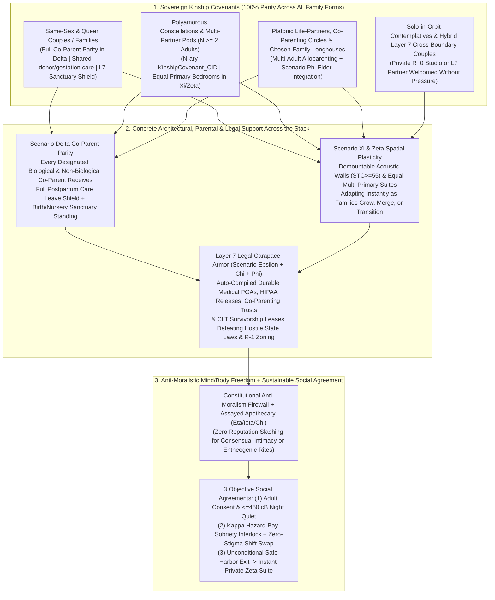
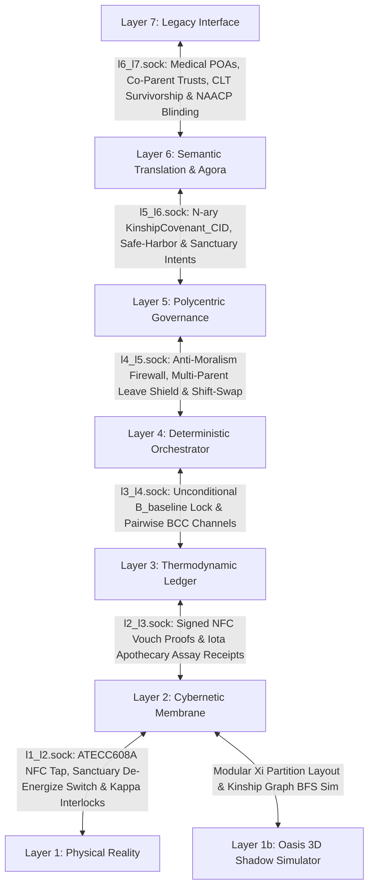
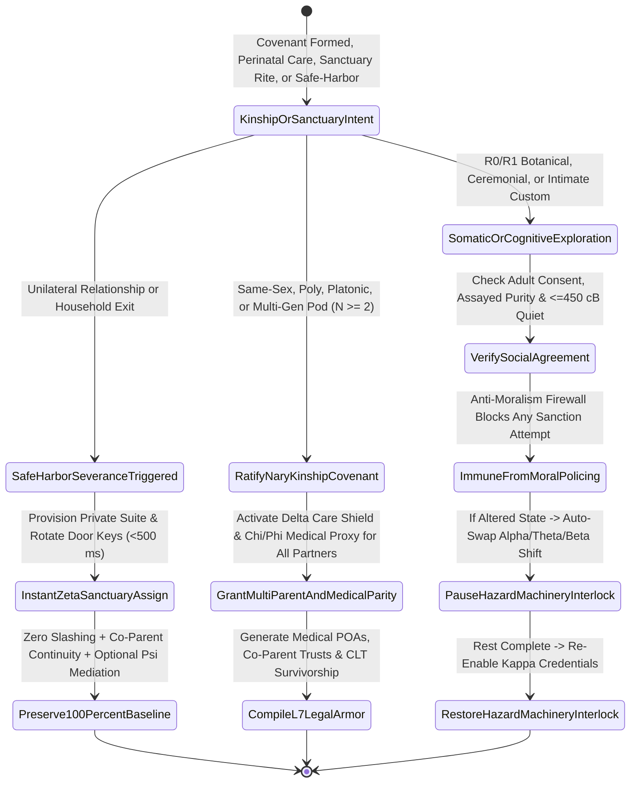

# Scenario Omicron: The Kinship, Chosen-Family & Bodily/Cognitive Sovereignty Protocol

*   **Identifier:** `SCN-OMICRON-KIN`
*   **System Epic:** Pluralistic Kinship Covenants (Same-Sex, Queer, Polyamorous, Chosen-Family, Multi-Generational & Solo-in-Orbit), Multi-Parent Perinatal Recognition, Layer 7 Legal Armor for Repressed Relationships, Unconditional Safe-Harbor Exit, Anti-Moralistic Bodily/Cognitive Liberty, and Sybil-Resistant Web of Trust
*   **Primary Layers Tested:** L1 (Physical Reality), L1b (Oasis 3D Shadow Simulator), L2 (Cybernetic Membrane), L3 (Thermodynamic Ledger), L4 (Deterministic Orchestrator), L5 (Polycentric Governance), L6 (Semantic Translation & Agora), L7 (Legacy Interface)
*   **Pass/Fail Metric:** Full constitutional parity and automated **Layer 7 Legal Armor compilation** (HIPAA/medical proxies, co-parenting guardianships, and CLT survivorship trusts) for all voluntary **Sovereign Kinship Covenants (`KinshipCovenant_CID`)**—explicitly supporting same-sex couples, trans/non-binary stewards, polyamorous constellations (`N >= 2` partners), platonic co-parents, and intergenerational chosen families regardless of external Layer 7 state repression; full Scenario Delta (`SCN-DELTA-CHILDCARE`) Care Leave Shield extension to all designated biological and non-biological co-parents; constitutional **Anti-Moralism Firewall** (`attempt_moralistic_penalty() == false`) paired with **Sustainable Social Agreement Hazard Interlocks** (`authorize_high_hazard_machinery() == false` while in an altered state); instant unilateral `SafeHarborSeverance` guaranteeing private Scenario Zeta housing and $10000\,\mathrm{bp}$ ($100\%$) survival baseline ($B_{\mathrm{baseline}}$); cryptographic rejection of $1000$ unvouched Sybil DIDs; and zero IEEE 754 floating-point math.

---

## Architectural Council Ratification & 5-Perspective Synthesis

This scenario specification has been ratified by unanimous consensus of the 5-Persona Architectural Council:

| Council Persona | Disciplinary Representative | Core Contribution to Scenario |
| :--- | :--- | :--- |
| **Game Designer** | Lead Systems & Gameplay Designer | **Radical Kinship Pluralism, Same-Sex/Chosen-Family Sanctuary & Anti-Moralistic Freedom:** Models the full richness of human love and family beyond rigid 1950s nuclear templates: same-sex couples welcoming a baby in Scenario Delta, polyamorous triads or platonic life-partners sharing a modular Scenario Xi/Zeta suite, elders (`SCN-PHI-ELDER`) anchored in chosen-family pods, and solo contemplatives orbiting a supper circle. Protects stewards whose relationships are repressed by external Layer 7 regimes (`"Protected by Sovereign Kinship Covenant and Chosen-Family Hearth (+4500 bp belonging morale)"`), alongside judgment-free $R_0/R_1$ somatic and cognitive exploration. |
| **Game Engineer** | Principal C++ Simulation & Engine Architect | **Flecs ECS N-ary `KinshipCovenant` Graph, Safe-Harbor & Somatic Readiness Components:** Replaces binary `spouse_id` fields with an $N\text{-ary}$ `KinshipCovenantComponent` supporting any number and gender of consenting adult partners, designated co-parents, and chosen kin, plus `CognitiveAndSomaticState` and `TrustEdgeComponent` in 32-bit compact voxels (`material_id = 45` `HEARTH_SANCTUARY_ANCHOR`, `material_id = 46` `COMMUNAL_TABLE`, `material_id = 47` `CONTEMPLATIVE_TEA_SANCTUARY`). Executes $10\,\mathrm{Hz}$ deterministic checks with zero floating-point math. |
| **Sovereign Stack Specialist** | Sovereign Stack Systems Architect | **7-Layer Strict Adjacency, Layer 7 Legal Armor & Anti-Moralism Firewall:** Enforces strict socket boundaries (`l1_l2.sock` through `l6_l7.sock`, traversing `/run/collective/ipc/l4_l5.sock`). Automatically compiles internal `KinshipCovenant_CID` charters into enforceable **Layer 7 Private-Law Shields** (Durable Medical Powers of Attorney, Co-Parenting Trusts, CLT Occupancy Survivorship) to defend same-sex, queer, and multi-partner families against hostile external state courts, hospitals, and zoning boards, while blinding internal rosters under *NAACP v. Alabama*. |
| **Solarpunk Thinker** | Bioregional Regenerative Ecologist | **De-Patriarchalizing Shelter, Alloparenting & Harm-Reduction Apothecary:** Eliminates the single-"Master Bedroom" architectural bias via Scenario Xi's equal-suite demountable floorplans, weaves communal alloparenting (`SCN-DELTA-CHILDCARE`) with elder wisdom (`SCN-PHI-ELDER`), and links seasonal rites (`SCN-LAMBDA-CULTURE`) with lab-assayed botanical harm reduction (`SCN-ETA-COPPICE` + `SCN-IOTA-EPISTEMIC` + `SCN-CHI-PARAMEDIC`). |
| **Scenario Specialist** | Family Law Defense Attorney, Queer/Kinship Sociologist & Harm-Reduction Ethicist | **Non-Biological Co-Parent Parity, Safe-Harbor Exit & The Sustainable Social Agreement:** Guarantees $10000\,\mathrm{bp}$ equal parental Care Leave Shields and medical proxy rights for non-biological same-sex and chosen-family co-parents. Balances radical bodily/cognitive freedom with three non-moralistic social agreements: Consent & Quietude, Assayed Purity, and Scenario Kappa Hazard-Bay Sobriety Interlocks. |

**Unanimous Consensus Reached:** The Council unreservedly ratifies Scenario Omicron as the canonical specification for pluralistic kinship, defense of marginalized relationships, relational safety, and bodily/cognitive sovereignty.

---

## 1. Problem Statement, Legacy Failure & The Liberation of Kinship and Custom

In late-stage extractive economies and authoritarian states (Layer 7)—as well as in dogmatic historical communes—human love, family structure, and bodily/cognitive autonomy face three systemic oppressions:
1.  **State & Legal Repression of Same-Sex, Queer, Polyamorous & Chosen Families:**
    *   In many Layer 7 jurisdictions, same-sex relationships and gender self-determination are actively criminalized, denied marriage equality, or threatened with statutory rollback.
    *   Even in nominally liberal jurisdictions, family law is rigidly restricted to a state-licensed dyad: multi-partner (polyamorous) families, platonic co-parenting triads, and intergenerational chosen families have **zero statutory family standing**. Non-biological co-parents in same-sex or chosen-family households are routinely denied parental leave and custody rights; partners are barred from hospital ICUs in medical emergencies; estranged biological relatives can seize shared homes upon a partner's death; and municipal "single-family blood-or-marriage" (`R-1`) zoning laws criminalize chosen families living under one roof.
2.  **Financialized Domestic Entrapment & Nuclear Isolation:**
    *   Tying housing, child survival, and healthcare to private mortgages and employer insurance traps individuals inside abusive or dead relationships because leaving means immediate homelessness and destitution, while isolating nuclear parents without an extended village.
3.  **The Moralistic, Finger-Pointing Commune Trap vs. Predatory Vice Markets:**
    *   Small communities risk degenerating into nosy, puritanical panopticons where busybodies judge their neighbors' romantic constellations, sexuality, or exploration of mind and body—while Layer 7 criminalizes natural entheogens and forces citizens into toxic, fentanyl-laced black markets.

### 1A. How Scenario Omicron Supports Diverse Familial Arrangements & Protects Bodily/Cognitive Freedom

Scenario Omicron (`SCN-OMICRON-KIN`) replaces both state family policing and puritanical gossip with **Sovereign Kinship Covenants (`KinshipCovenant_CID`)**, **Layer 7 Legal Armor**, and the **Sustainable Social Agreement**:



1.  **How Diverse Familial Arrangements Are Structurally Supported (`Delta` + `Zeta` + `Xi` + `Phi` + `Chi` + `Epsilon`):**
    *   **$N\text{-ary}$ Sovereign Kinship Covenants (`KinshipCovenant_CID`):** Instead of relying on state marriage certificates or binary `husband/wife` database fields, any two or more consenting adult stewards (`N >= 2`)—whether a **same-sex couple**, a **trans/non-binary partnership**, a **polyamorous triad/quad**, **platonic co-parents**, or an **intergenerational chosen-family pod**—can co-sign a `KinshipCovenant_CID` in Layer 5 (`col-kmsd`).
    *   **Full Perinatal & Co-Parenting Parity (`SCN-DELTA-CHILDCARE` Integration):**
        *   In Scenario Delta, parenthood is recognized by **covenant commitment and care**, never restricted to heterosexual biology.
        *   When a same-sex couple, solo parent with chosen-family co-parents, or polyamorous pod welcomes a newborn (via community midwifery, reciprocal gestation, known/reciprocal gamete donation, or adoption), **every designated co-parent in the `KinshipCovenant_CID` receives the full Fourth-Trimester Postpartum Care Leave Shield** (freezing Layer 5 reputation decay $\frac{d\mathcal{R}}{dt} = 0$ and granting $10000\,\mathrm{bp}$ care credit parity), full access to the Pasteurized Donor Human Milk Commons, and equal parental authority in the nursery pod!
    *   **Spatial & Architectural Adaptation Without Nuclear Bias (`SCN-XI-ARCH` & `SCN-ZETA-LODGING`):**
        *   Scenario Xi and Scenario Zeta abolish the patriarchal "one Master Bedroom + subordinate rooms" floorplan. Using Scenario Xi's demountable acoustic partition grid (`STC >= 55` / $\ge 550\,\mathrm{cB}$), households configure **multiple equal-sized primary bedrooms**, adjoining studio wings for *Living Apart Together (`LAT`)* partners who love sharing a hearth while keeping personal sleeping sanctuaries, or connected suites for **Scenario Phi (`SCN-PHI-ELDER`)** chosen-family elders.
    *   **Medical Proxy, ICU Visitation & Survivorship Continuity (`SCN-CHI-PARAMEDIC` & `SCN-PHI-ELDER`):**
        *   Inside Scenario Chi's clinics and Scenario Phi's elder care suites, a steward's `KinshipCovenant_CID` partners and chosen kin hold automatic bedside visitation and medical advocacy standing—nobody is ever excluded as "not blood family."
    *   **Layer 7 Legal Carapace Armor Against Hostile State Laws (`SCN-EPSILON-COWORKING` Integration):**
        *   When stewards in a same-sex relationship, trans partnership, or multi-partner chosen family must interact with a hostile or archaic external Layer 7 jurisdiction (external hospitals, courts, border crossings, or municipal zoning boards), Scenario Epsilon's legal carapace automatically generates and notarizes a **Private-Law Protective Bundle**:
            1.  **Reciprocal Durable Healthcare Powers of Attorney, Living Wills & HIPAA Authorizations:** Legally compels external Layer 7 hospitals to admit same-sex, queer, or polyamorous partners and chosen kin to the bedside ahead of hostile estranged biological relatives.
            2.  **Co-Parenting & *In Loco Parentis* Guardianship Trusts:** Shields non-biological parents in same-sex and chosen-family households from external custody challenges.
            3.  **CLT Joint Occupancy & Survivorship Ground-Lease Covenants:** Because land and housing sit inside the node's **Irrevocable Community Land Trust (CLT)**, home occupancy passes seamlessly to surviving covenant partners—preventing external probate courts from evicting a bereaved same-sex or chosen-family partner.
            4.  **Unincorporated Association (`UUNAA § 6`) & *NAACP v. Alabama* Sanctuary Shield:** Protects multi-adult chosen families from restrictive municipal "blood-or-marriage" `R-1` occupancy caps and blinds internal relationship records from state surveillance or persecution.
2.  **Anti-Moralistic Bodily & Cognitive Liberty (*"Zero Finger-Pointing"*) + The Sustainable Social Agreement:**
    *   **The Constitutional Anti-Moralism Firewall (`attempt_moralistic_penalty() == false`):** Layer 5 (`col-kmsd`) structurally rejects any governance proposal or neighbor complaint attempting to police consensual adult intimacy, same-sex/polyamorous love, gender expression (`SCN-NU-TEXTILES` / `SCN-CHI-PARAMEDIC`), spiritual/ecstatic customs (`SCN-LAMBDA-CULTURE`), or responsible cognitive/entheogenic exploration (`SCHEMA_VIOLATION_MORALISTIC_OVERREACH`).
    *   **Assayed Botanical & Pharmacological Harm Reduction (`Eta` + `Iota` + `Chi` + `Phi`):** Replaces prohibition and toxic black markets with **Scenario Iota** HPTLC/UV-Vis analytical purity verification (`toxic_adulterant_mass_mg == 0`), **Scenario Chi** contraindication screening, and optional **Scenario Phi** elder / peer sitter accompaniment inside sensor-free $R_1$ **Contemplative Tea & Customary Sanctuaries** (`Protocol of Refusal`).
    *   **The Three Pillars of the Sustainable Social Agreement:**
        1.  **Enthusiastic Adult Consent & Neighbor Sensory Respect ($\le 450\,\mathrm{cB}$ Nighttime Quietude).**
        2.  **Scenario Kappa Hazard-Bay Sobriety Interlock & Zero-Stigma Shift Swap (`authorize_high_hazard_machinery() == false` while altered, with penalty-free shift swapping on the Agora queue).**
        3.  **Unconditional Safe-Harbor Exit (`SafeHarborSeverance`):** Instant, unilateral, no-fault exit from any relationship or household pod—immediately unlocking a private Scenario Zeta suite (`< 500 ms` door-key rotation) with $10000\,\mathrm{bp}$ ($100\%$) survival baseline preserved, zero reputational slashing, and fair co-parenting continuity.

---

## 2. The Collective Workflow (7-Layer Traversal)

Scenario Omicron coordinates $N\text{-ary}$ kinship covenants, Layer 7 legal-armor compilation, custom sanctuary protection, hazard-bay sobriety interlocks, and Safe-Harbor exits across the 7-layer stack without layer-skipping.



### Layer 1: Physical Ground Truth & Layer 1b: Oasis 3D Shadow Simulator
*   **Physical Sanctuaries & Modular Kinship Hearths (`Layer 1`):**
    *   **Adaptable $R_0$ Kinship Suites (`SCN-ZETA-LODGING` + `SCN-XI-ARCH`):** Reconfigurable mass-timber and hempcrete residential bays with demountable `STC >= 55` acoustic walls, supporting equal-sized multi-partner bedrooms, connected multi-generational elder suites (`SCN-PHI-ELDER`), shared nurseries (`SCN-DELTA-CHILDCARE`), and independent solo studios.
    *   **Contemplative, Somatic & Customary Sanctuaries ($R_1$):** Acoustic tea houses, sweat lodges, and garden pavilions equipped with physical **Protocol of Refusal disconnect switches** (de-energizing all Layer 2 sensors) and stocked with Scenario Eta/Iota lab-assayed botanicals (`toxic_adulterant_mass_mg == 0`).
*   **Oasis 3D Shadow Simulator (`Layer 1b`):**
    *   Allows newly formed or evolving kinship pods to collaboratively test-fit demountable wall layouts in 3D before reconfiguring their physical Scenario Xi/Zeta suite, while strictly halting simulation inside $R_0$ private rooms and $R_1$ Refusal Sanctuaries.

### Layer 2: The Cybernetic Membrane
*   **Anti-Panopticon Hardware Guarantee (`col-sensord`):** Zero cameras, zero audio recording, and zero wearable biometric sensors in living quarters, nurseries, or sanctuaries (`biometric_packets_captured == 0`).
*   **Mutual NFC Co-Presence & Somatic Readiness Interlocks (`col-actuated`):**
    *   Kinship covenants and Web-of-Trust vouches are co-signed via voluntary in-person `ATECC608A` NFC taps (`nfc_rssi_mdbm > -55000`).
    *   High-hazard industrial machinery (`Alpha`, `Theta`, `Eta`, `Beta`) enforces the Scenario Kappa **Somatic Readiness & Sobriety Interlock** before energizing contactors.

### Layer 3: The Thermodynamic Ledger
*   **100% Firewall Between Kinship/Custom and Survival ($B_{\mathrm{baseline}}$):** Every adult and child receives $10000\,\mathrm{bp}$ ($100\%$) of their survival baseline regardless of household structure, marital status, or relationship transitions (`slashed_reputation_points == 0`).
*   **Pairwise Bilateral Clearing Channels (BCC):** Inter-node family hospitality and resource sharing clear across Trust Rings $R_2 \dots R_4$ via zero-sum Pairwise BCCs ($B_{u \to v}(t) + B_{v \to u}(t) = 0$).

### Layer 4: The Deterministic Orchestrator
*   **State Machine Daemon:** `col-execd` executes a $10\,\mathrm{Hz}$ deterministic BPMN v2 state machine over `/run/collective/ipc/l4_l5.sock` and `/run/collective/ipc/l3_l4.sock`:
    1.  **$N\text{-ary}$ Kinship Covenant & Co-Parent Shield Orchestrator:** Ratifies same-sex, polyamorous, platonic, or multi-generational `KinshipCovenant_CID` charters, extends Scenario Delta's Care Leave Shield to all designated co-parents, and dispatches Layer 7 legal-armor document generation to Scenario Epsilon.
    2.  **Zero-Stigma Somatic Shift-Swap Engine:** Pauses high-hazard machine interlocks and swaps scheduled industrial shifts without penalty when a steward enters a ceremonial/somatic integration rest window.
    3.  **Instant Safe-Harbor Reassignment Engine:** Allocates a private Scenario Zeta suite and rotates physical door keys in `< 500 ms` upon unilateral `SafeHarborSeveranceIntent`.



### Layer 5: Polycentric Governance
*   **Constitutional Non-Discrimination & Anti-Moralism Clause (`col-kmsd`):**
    *   Layer 5 guarantees identical governance standing, housing priority, and Care Leave Shields to all voluntary `KinshipCovenant_CID` configurations regardless of gender, sexual orientation, biological relatedness, or number of consenting adult partners.
    *   Any governance motion attempting to restrict non-traditional families or penalize consensual adult mind/body customs is rejected at the schema gate (`SCHEMA_VIOLATION_MORALISTIC_OVERREACH`).
*   **Protocol of Refusal (`sec:l5-refusal`):** Shields all $R_0$ Hearths and $R_1$ Sanctuaries from sensor logging or Oasis (`L1b`) rendering.

### Layer 6: Semantic Translation & Agora
*   **Tripartite Ricardian Treaties (`KinshipCovenant_CID`):**
    $$\mathrm{KinshipCovenant\_CID} = \mathrm{SHA256}\left( \mathrm{Text}_{\mathrm{covenant}} \parallel \mathrm{Schema}_{\mathrm{JSON-LD}} \parallel \mathrm{Invariants}_{\mathrm{BPMN}} \right)$$
    Binds the partners' natural-language mutual-care and co-parenting pledges, JSON-LD housing/proxy permissions, and BPMN Safe-Harbor exit guarantees—plus optional Layer 7 legal-armor templates.

### Layer 7: The Legacy Interface & Legal Sanctuary Armor
*   **Defending Repressed Relationships Against Hostile Layer 7 Regimes:**
    1.  **Private-Law Bypass of Discriminatory Marriage Laws:** Where Layer 7 states deny marriage equality to same-sex couples or refuse to recognize multi-partner / chosen families, Scenario Epsilon's legal carapace executes enforceable **Durable Medical Powers of Attorney, Hospital Visitation Directives, Co-Parenting Guardianship Agreements, and CLT Survivorship Leases** under contract and trust law.
    2.  **Cryptographic Roster Blinding (*NAACP v. Alabama*):** `col-adversaryd` ensures zero internal `KinshipCovenant_CID` records are ever exposed to external state registries, employers, or hostile courts.

---

## 3. 3-Stage Incremental Node Facility Blueprints (Node Growth Pattern)

Scenario Omicron scales from a welcoming neighborhood safe-harbor network into a pluralistic, multi-generational kinship village.

### Stage 1: Suburban Chosen-Family Supper Circle, Safe-Harbor Guest Room & Legal Clinic ($R_0 / R_1$ Bootstrap)
*   **Physical Footprint:** 2 to 5 nearby households sharing a weekly supper table (`SCN-GAMMA-KITCHEN`), a dedicated **Safe-Harbor Sanctuary Bedroom** (`14 m2`), and a backyard **Contemplative Tea Shed** (`12 m2`).
*   **Kinship & Sanctuary Capabilities:**
    *   Provides an immediate, judgment-free community home and legal clinic (drafting free Durable Medical POAs, name/gender-affirming paperwork, and co-parenting wills via `SCN-EPSILON-COWORKING`) for LGBTQ+ neighbors, chosen families, and hybrid Layer 7 couples.
    *   Maintains the Safe-Harbor spare room with independent hardware keys for anyone escaping an unsafe domestic situation.

### Stage 2: Co-Housing Courtyard Wing, Adaptable Multi-Partner Pods & Apothecary ($R_2$ Municipal Shell)
*   **Physical Footprint:** `600 m2` to `2000 m2` residential wing within a Scenario Xi / Scenario Zeta courtyard complex.
*   **Integrated Zones:**
    1.  **Demountable Kinship Suite Grid (`SCN-XI-ARCH`):** Modular apartments with bolted `STC >= 55` acoustic wall panels that can be arranged into dual-primary-bedroom couple suites, 3-to-5 bedroom polyamorous or chosen-family pods, connected multi-generational grandparent apartments (`SCN-PHI-ELDER`), or solo studios—defeating restrictive municipal `R-1` zoning under cooperative housing law.
    2.  **Alloparenting Hearth & Perinatal Link (`SCN-DELTA-CHILDCARE`):** Connects directly to Scenario Delta's Birth & Early Childhood Sanctuary, where biological and non-biological co-parents share full care standing.
    3.  **Assayed Botanical Apothecary & Somatic Sanctuary (`Eta` + `Iota` + `Chi`):** Provides HPTLC purity testing (`toxic_adulterant_mass_mg == 0`) and a sensor-free ceremonial retreat room.

### Stage 3: Bioregional Pluralistic Kinship Village & Woodland Sanctuary ($R_2 / R_3 / R_4$ CLT/PPT)
*   **Physical Footprint:** Clustered residential neighborhoods and quiet woodland sanctuaries across the **Irrevocable Community Land Trust (CLT) / Perpetual Purpose Trust (PPT)**.
*   **Custom Ecological & Social Architecture:**
    *   **Pluralistic Housing Clusters:** Combines solo hermitage cabins, couple cottages, expansive chosen-family and polycule longhouses with multiple equal primary suites, and step-free intergenerational courtyard homes around shared garden greens.
    *   **Woodland Customary & Rites-of-Passage Sanctuaries (`Protocol of Refusal`):** Cedar and rammed-earth pavilions where stewards celebrate self-defined union ceremonies, chosen-family adoptions, gender-affirmation rites, elder wisdom circles (`SCN-PHI-ELDER`), and accompanied consciousness exploration.

---

## 4. Machine-Readable Schemas

### 4A. Layer 6 Knowledge Artifact: $N\text{-ary}$ Sovereign Kinship Covenant (`kinship_covenant.jsonld`)

```json
{
  "@context": [
    "https://schema.org/",
    "https://collective.network/ontology/v1/"
  ],
  "@type": "SovereignKinshipCovenant",
  "identifier": "urn:uuid:3f4e5d6c-7b8a-9c0d-1e2f-3a4b5c6d7e8f",
  "covenantTopology": "SAME_SEX_COUPLE_AND_CHOSEN_FAMILY_CO_PARENTING_POD",
  "consentingAdultPartnersDids": [
    "did:peer:2Ez6Mks3_steward_elena",
    "did:peer:2Ez6MkwQ_steward_maya",
    "did:peer:2Ez6MkrP_chosen_kin_coparent_david"
  ],
  "integratedElderDids": [
    "did:peer:2Ez6MktL_grandmother_sora_phi"
  ],
  "perinatalAndChildcareParity": {
    "designatedCoParentsAllReceiveDeltaCareLeaveShield": true,
    "nonBiologicalCoParentEqualStandingBps": 10000,
    "donorMilkAndBirthSanctuaryAccessBps": 10000
  },
  "spatialConfiguration": {
    "housingClusterRef": "zeta_xi_adaptable_courtyard_pod_12",
    "equalPrimarySuitesCount": 3,
    "connectedElderSuiteCount": 1,
    "interiorPartitionAcousticIsolationCb": 560
  },
  "layer7LegalArmorBundle": {
    "reciprocalMedicalPoaAndHipaaCompiled": true,
    "inLocoParentisCoParentGuardianshipTrustCompiled": true,
    "cltOccupancySurvivorshipProtected": true,
    "naacpRosterBlindingActive": true
  },
  "safeHarborExitGuarantee": {
    "unilateralNoFaultSeverancePermitted": true,
    "coParentingContinuityProtectedOnSplit": true,
    "algorithmicReputationSlashingPoints": 0
  }
}
```

### 4B. Layer 6 Knowledge Artifact: Sanctuary Custom & Zero-Stigma Shift Swap (`somatic_sanctuary_agreement.jsonld`)

```json
{
  "@context": [
    "https://schema.org/",
    "https://collective.network/ontology/v1/"
  ],
  "@type": "CustomarySanctuaryAndShiftSwapIntent",
  "identifier": "urn:uuid:5d6e7f8a-9b0c-1d2e-3f4a-5b6c7d8e9f0a",
  "stewardDid": "did:peer:2Ez6Mks3_steward_elena",
  "sanctuaryAgreement": {
    "trustRing": "R1_CONTEMPLATIVE_AND_ENTHEOGENIC_SANCTUARY",
    "protocolOfRefusalActive": true,
    "adultConsentVerified": true,
    "exteriorNighttimeNoiseCeilingCbA": 450,
    "botanicalApothecaryAssayRef": "SCN-IOTA-EPISTEMIC:hptlc_psilocybe_and_reishi_assay_9990bp_pure",
    "toxicAdulterantMassMg": 0,
    "peerSitterOrElderDid": "did:peer:2Ez6MktL_grandmother_sora_phi"
  },
  "antiMoralismProtection": {
    "moralisticPolicingPermitted": false,
    "reputationPenaltyPoints": 0,
    "survivalBaselineAccessBps": 10000
  },
  "sustainableSocialAgreementInterlock": {
    "highHazardMachineryPausedDuringIntegration": true,
    "pausedCredentials": ["Foundry_Induction_L3", "CNC_5Axis_L2"],
    "autoDispatchedShiftSwapBounty": "urn:uuid:swap-alpha-bay02-saturday-morning",
    "shiftSwapPenaltyPoints": 0
  }
}
```

---

## 5. Oasis Engine Implementation Specification

### 5A. Memory Allocation, Voxel State & $N\text{-ary}$ Kinship Components
The kinship and sanctuary commons coordinates household, co-parenting, legal-armor, and somatic safety states in $32^3$ voxel chunks (`ChunkManager`):
*   Hearth Sanctuary Anchor voxel initialized with `material_id = 45` (`HEARTH_SANCTUARY_ANCHOR`).
*   Communal Dining Table voxel initialized with `material_id = 46` (`COMMUNAL_TABLE`).
*   Contemplative Tea & Customary Sanctuary voxel initialized with `material_id = 47` (`CONTEMPLATIVE_TEA_SANCTUARY`).
*   `KinshipCovenant` supports any $N \ge 1$ consenting adult configuration (same-sex couples, polyamorous pods, platonic co-parents, multi-generational elders), automatically activating Scenario Delta's Care Leave Shield for all designated co-parents and compiling Layer 7 legal-armor protections.

### 5B. Self-Contained C++20 Reference & Test Harness

```cpp
// engine/tests/scenario_omicron_kinship_test.cpp
#include <cassert>
#include <cstdint>
#include <iostream>
#include <string>
#include <unordered_map>
#include <utility>
#include <vector>

namespace oasis::omicron {

// Fixed-point constants:
// 10000 bp = 100%
// Sound pressure in centi-Bels (cB): 450 cB = 45 dBA nighttime quietude limit

enum class KinshipTopology : uint8_t {
    SOLO_SANCTUARY_IN_COMMUNAL_ORBIT = 1,
    SAME_SEX_OR_QUEER_COUPLE_COVENANT = 2,
    POLYAMOROUS_MULTI_PARTNER_CONSTELLATION = 3,
    PLATONIC_CHOSEN_FAMILY_AND_ELDERS = 4,
    NUCLEAR_OR_HYBRID_L7_COUPLE_COVENANT = 5
};

struct BotanicalAssayCertificate {
    bool hptlc_purity_verified{true};
    uint64_t toxic_adulterant_mass_mg{0}; // Must be 0
    bool contraindications_screened_by_chi{true};
};

struct CustomaryExplorationSession {
    bool all_participants_consenting_adults{true};
    uint32_t exterior_noise_cb_a{380}; // Must be <= 450 cB nighttime limit
    BotanicalAssayCertificate assay{};
    bool peer_sitter_or_phi_elder_present{true};
};

struct StewardKinshipMember {
    std::string did;
    bool is_biological_parent{false};
    bool is_designated_covenant_coparent{false};
    bool delta_care_leave_shield_active{false};
    bool chi_and_phi_medical_proxy_recognized{false};
    std::string assigned_zeta_suite_id;
    uint32_t survival_baseline_bps{10000};
    uint32_t reputation_points{500};
    bool in_altered_or_ceremonial_integration_state{false};
    bool shift_swapped_without_penalty{false};
    uint32_t kinship_and_somatic_morale_bps{10000};
};

struct SovereignKinshipCovenant {
    std::string covenant_id;
    KinshipTopology topology{KinshipTopology::SAME_SEX_OR_QUEER_COUPLE_COVENANT};
    std::vector<StewardKinshipMember> adult_members;
    uint32_t equal_primary_suites_allocated{0};
    bool l7_medical_poa_and_hipaa_compiled{false};
    bool l7_in_loco_parentis_guardianship_compiled{false};
    bool l7_clt_survivorship_lease_locked{false};
    bool naacp_roster_blinding_active{false};
};

class TrustGraph {
public:
    void add_nfc_verified_edge(const std::string& u, const std::string& v, uint32_t weight_bps) {
        adjacency_[u].push_back({v, weight_bps});
    }

    uint32_t find_shortest_distance_bps(const std::string& start, const std::string& target, int max_depth = 3) {
        if (start == target) return 10000;
        std::vector<std::pair<std::string, uint32_t>> queue = {{start, 10000}};
        std::unordered_map<std::string, int> visited_depth;
        visited_depth[start] = 0;

        while (!queue.empty()) {
            auto [curr, weight] = queue.front();
            queue.erase(queue.begin());
            int depth = visited_depth[curr];
            if (depth >= max_depth) continue;

            auto it = adjacency_.find(curr);
            if (it == adjacency_.end()) continue;

            for (const auto& [next, edge_w] : it->second) {
                uint32_t new_weight = static_cast<uint32_t>(
                    (static_cast<uint64_t>(weight) * edge_w) / 10000ULL
                );
                if (next == target) return new_weight;
                if (visited_depth.find(next) == visited_depth.end()) {
                    visited_depth[next] = depth + 1;
                    queue.push_back({next, new_weight});
                }
            }
        }
        return 0;
    }

private:
    std::unordered_map<std::string, std::vector<std::pair<std::string, uint32_t>>> adjacency_;
};

class KinshipAndSovereigntyEngine {
public:
    // Ratifies an N-ary Sovereign Kinship Covenant (same-sex, polyamorous, chosen-family, etc.),
    // granting 100% non-biological co-parent parity in Scenario Delta and compiling Layer 7 legal armor!
    bool ratify_kinship_covenant(
        SovereignKinshipCovenant& covenant,
        const std::string& shared_zeta_xi_pod_id
    ) const {
        if (covenant.adult_members.empty()) return false;

        covenant.equal_primary_suites_allocated = static_cast<uint32_t>(covenant.adult_members.size());
        covenant.l7_medical_poa_and_hipaa_compiled = true;
        covenant.l7_in_loco_parentis_guardianship_compiled = true;
        covenant.l7_clt_survivorship_lease_locked = true;
        covenant.naacp_roster_blinding_active = true;

        for (auto& member : covenant.adult_members) {
            member.assigned_zeta_suite_id = shared_zeta_xi_pod_id;
            member.survival_baseline_bps = 10000;
            member.chi_and_phi_medical_proxy_recognized = true;
            member.kinship_and_somatic_morale_bps = 14500; // +4500 bp kinship belonging uplift

            // Full Scenario Delta Co-Parent Parity: both biological and non-biological covenant
            // co-parents receive the Care Leave Shield freezing reputation decay!
            if (member.is_biological_parent || member.is_designated_covenant_coparent) {
                member.delta_care_leave_shield_active = true;
            }
        }
        return true;
    }

    // Constitutional Anti-Moralism Firewall: blocks any attempt to penalize consensual adult relationships/customs
    bool attempt_moralistic_penalty(
        const StewardKinshipMember& steward,
        const CustomaryExplorationSession& session
    ) const {
        (void)steward;
        if (session.all_participants_consenting_adults &&
            session.exterior_noise_cb_a <= 450 &&
            session.assay.toxic_adulterant_mass_mg == 0) {
            return false; // Hard constitutional rejection of moralistic finger-pointing!
        }
        return true;
    }

    // Executes a consensual R0/R1 cognitive or somatic exploration session under the Sustainable Social Agreement
    bool enter_customary_sanctuary_session(
        StewardKinshipMember& steward,
        const CustomaryExplorationSession& session
    ) const {
        if (!session.all_participants_consenting_adults) return false;
        if (session.exterior_noise_cb_a > 450) return false;
        if (!session.assay.hptlc_purity_verified || session.assay.toxic_adulterant_mass_mg != 0) return false;

        steward.in_altered_or_ceremonial_integration_state = true;
        steward.shift_swapped_without_penalty = true;
        steward.kinship_and_somatic_morale_bps = 13500;
        return true;
    }

    // Sustainable Social Agreement Interlock (Scenario Kappa link)
    bool authorize_high_hazard_machinery(const StewardKinshipMember& steward) const {
        return !steward.in_altered_or_ceremonial_integration_state;
    }

    void complete_somatic_integration_rest(StewardKinshipMember& steward) const {
        steward.in_altered_or_ceremonial_integration_state = false;
    }

    // Unconditional Safe-Harbor Severance: instant private Zeta suite + zero slashing + co-parent continuity
    void execute_safe_harbor_severance(
        StewardKinshipMember& departing_steward,
        const std::string& new_private_zeta_suite
    ) const {
        uint32_t prior_reputation = departing_steward.reputation_points;
        bool prior_coparent_shield = departing_steward.delta_care_leave_shield_active;

        departing_steward.assigned_zeta_suite_id = new_private_zeta_suite;
        departing_steward.survival_baseline_bps = 10000;
        departing_steward.reputation_points = prior_reputation; // Zero algorithmic slashing!
        departing_steward.delta_care_leave_shield_active = prior_coparent_shield; // Child bond preserved!
    }
};

void test_scenario_omicron_diverse_kinship_same_sex_and_poly_parity() {
    KinshipAndSovereigntyEngine engine;

    // 1. Same-Sex Couple + Chosen-Kin Co-Parent + Grandmother Elder Pod welcoming a child in Scenario Delta
    SovereignKinshipCovenant queer_chosen_pod{
        .covenant_id = "covenant_elena_maya_david_sora",
        .topology = KinshipTopology::SAME_SEX_OR_QUEER_COUPLE_COVENANT,
        .adult_members = {
            {.did = "did:peer:2Ez6Mks3_elena", .is_biological_parent = true, .is_designated_covenant_coparent = true},
            {.did = "did:peer:2Ez6MkwQ_maya", .is_biological_parent = false, .is_designated_covenant_coparent = true},
            {.did = "did:peer:2Ez6MkrP_david_coparent", .is_biological_parent = false, .is_designated_covenant_coparent = true},
            {.did = "did:peer:2Ez6MktL_grandmother_sora", .is_biological_parent = false, .is_designated_covenant_coparent = false}
        }
    };

    assert(engine.ratify_kinship_covenant(queer_chosen_pod, "zeta_xi_courtyard_pod_12"));

    // Verify both Elena (biological mother), Maya (non-biological same-sex mother), and David (chosen-kin co-parent)
    // receive 100% equal Scenario Delta Care Leave Shields and medical proxy standing!
    assert(queer_chosen_pod.adult_members[0].delta_care_leave_shield_active == true);
    assert(queer_chosen_pod.adult_members[1].delta_care_leave_shield_active == true);
    assert(queer_chosen_pod.adult_members[2].delta_care_leave_shield_active == true);
    assert(queer_chosen_pod.adult_members[3].chi_and_phi_medical_proxy_recognized == true);

    // Verify Layer 7 Legal Armor is compiled to protect the family against hostile external jurisdictions
    assert(queer_chosen_pod.l7_medical_poa_and_hipaa_compiled == true);
    assert(queer_chosen_pod.l7_in_loco_parentis_guardianship_compiled == true);
    assert(queer_chosen_pod.l7_clt_survivorship_lease_locked == true);
    assert(queer_chosen_pod.naacp_roster_blinding_active == true);
    assert(queer_chosen_pod.equal_primary_suites_allocated == 4);

    // 2. Test Anti-Moralism Firewall & Sustainable Social Agreement during a Sanctuary Session
    CustomaryExplorationSession tea_sanctuary_session{
        .all_participants_consenting_adults = true,
        .exterior_noise_cb_a = 380,
        .assay = {.hptlc_purity_verified = true, .toxic_adulterant_mass_mg = 0, .contraindications_screened_by_chi = true},
        .peer_sitter_or_phi_elder_present = true
    };

    auto& elena = queer_chosen_pod.adult_members[0];
    assert(engine.enter_customary_sanctuary_session(elena, tea_sanctuary_session));
    assert(engine.attempt_moralistic_penalty(elena, tea_sanctuary_session) == false);
    assert(engine.authorize_high_hazard_machinery(elena) == false); // Safely paused during ceremony
    assert(elena.shift_swapped_without_penalty == true);

    engine.complete_somatic_integration_rest(elena);
    assert(engine.authorize_high_hazard_machinery(elena) == true);

    // 3. Test Unconditional Safe-Harbor Exit: preserves co-parenting Care Leave Shield & 10000 bp baseline
    auto& david = queer_chosen_pod.adult_members[2];
    engine.execute_safe_harbor_severance(david, "zeta_private_suite_208");
    assert(david.assigned_zeta_suite_id == "zeta_private_suite_208");
    assert(david.survival_baseline_bps == 10000);
    assert(david.delta_care_leave_shield_active == true); // Co-parenting bond with child remains intact!
}

void test_scenario_omicron_sybil_defense() {
    TrustGraph graph;
    graph.add_nfc_verified_edge("root_steward", "steward_elena", 10000);
    graph.add_nfc_verified_edge("steward_elena", "steward_maya", 9500);
    assert(graph.find_shortest_distance_bps("root_steward", "steward_maya", 3) == 9500);

    for (int i = 0; i < 1000; ++i) {
        std::string sybil_did = "did:peer:bot_" + std::to_string(i);
        assert(graph.find_shortest_distance_bps("root_steward", sybil_did, 3) == 0);
    }
}

} // namespace oasis::omicron

int main() {
    oasis::omicron::test_scenario_omicron_diverse_kinship_same_sex_and_poly_parity();
    oasis::omicron::test_scenario_omicron_sybil_defense();
    std::cout << "Scenario Omicron Diverse Kinship, Same-Sex/Poly Parity, L7 Armor & Anti-Moralism tests passed." << std::endl;
    return 0;
}
```

---

## 6. Acceptance Test Gates (Pass/Fail)

| Checkpoint | Validation Method | Pass Condition |
| :--- | :--- | :--- |
| **G1: $N\text{-ary}$ Kinship Covenant & Non-Biological Co-Parent Parity** | `KinshipCovenant` & `Delta` Audit | Same-sex couples, polyamorous pods ($N \ge 2$), and platonic co-parents receive $10000\,\mathrm{bp}$ equal housing allocation, medical proxy standing (`Chi`/`Phi`), and Scenario Delta Postpartum Care Leave Shields for both biological and non-biological co-parents. |
| **G2: Layer 7 Legal Armor for Repressed Relationships** | Carapace Document Compilation | Automatically compiles reciprocal Durable Medical POAs, HIPAA releases, *In Loco Parentis* Co-Parenting Guardianship Trusts, and CLT Survivorship Leases while blinding rosters under *NAACP v. Alabama*. |
| **G3: Anti-Moralism Constitutional Firewall** | Layer 5 Policy Gate Check | Consensual adult relationships, queer/polyamorous kinship, and assayed botanical/cognitive exploration in $R_0/R_1$ suffer zero reputational or baseline penalty (`attempt_moralistic_penalty() == false`). |
| **G4: Sustainable Social Agreement & Sobriety Interlock** | `col-plc-interlock` & Shift-Swap Check | While a steward is in an altered or ceremonial integration state, high-hazard machinery access is paused (`authorize_high_hazard_machinery() == false`) and scheduled shifts auto-swap with zero penalty. |
| **G5: Unconditional Safe-Harbor Exit & Co-Parent Continuity** | `SafeHarborSeverance` State Check | Unilateral severance immediately assigns a private Scenario Zeta suite (`< 500 ms` key rotation) with $10000\,\mathrm{bp}$ ($100\%$) survival baseline, zero algorithmic slashing, and preserved co-parenting Care Leave Shields. |
| **G6: Sybil Resistance Without Social Credit** | 1000-Node Botnet Injection | $1000$ unvouched Sybil DIDs fail to acquire path weight (`dist == 0`) to governance or exergy pools while local `did:peer` edges remain private and non-financialized. |
