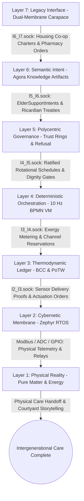
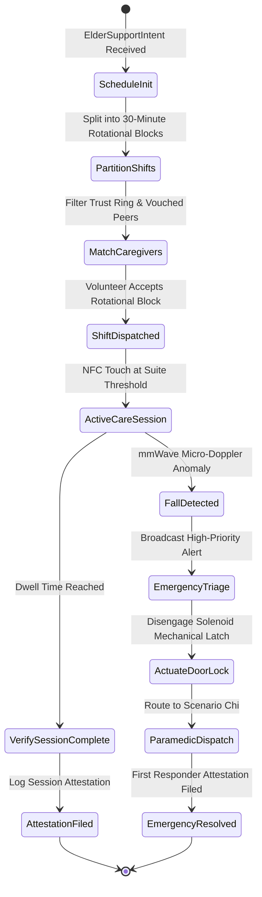
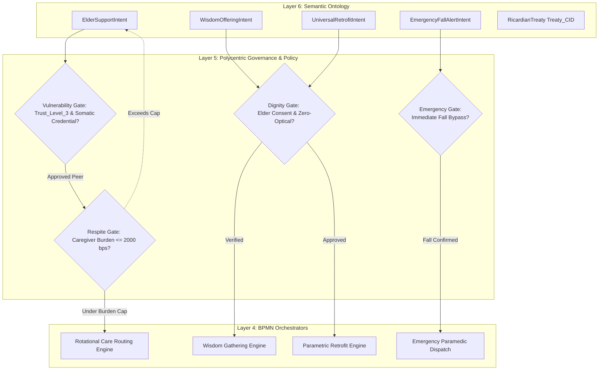
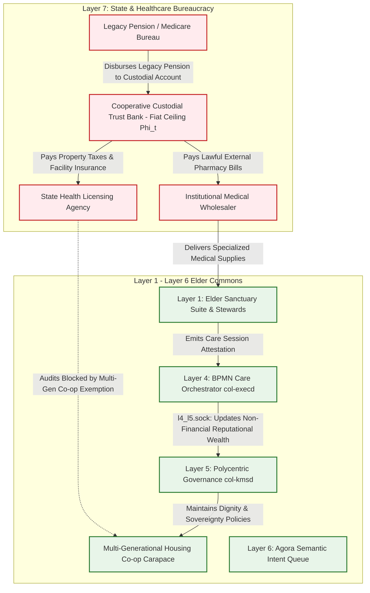

# Scenario Phi: The Elder Commons (The Golden Ratio)

*   **Identifier:** `SCN-PHI-ELDERCARE`
*   **System Epic:** Multi-Generational Integration, Wisdom Exchange, and Distributed Care
*   **Primary Layers Tested:** L1 (Physical), L2 (Digital Twin), L3 (Ledger), L4 (Orchestration), L5 (Governance), L6 (Semantic), L7 (Proxy)
*   **Pass/Fail Metric:** Algorithmic dispersion of 24-hour eldercare load across the local Trust Ring ensuring no caregiver exceeds 20% of the total weekly burden; zero-optical mmWave FMCW radar kinematic fall detection with zero privacy leakage; non-financial Reputational Wealth recognition in Layer 5 Care Councils with Care Leave Shield; 100% legal exemption from institutional nursing regulations under a Multi-Generational Housing Cooperative charter; zero floating-point math; zero tokenization of elder care or wisdom presence.

---

## Architectural Council Ratification & 5-Perspective Synthesis

This scenario specification has been ratified by unanimous consensus of the 5-Persona Architectural Council:

| Council Persona | Disciplinary Representative | Core Contribution to Scenario |
| :--- | :--- | :--- |
| **Game Designer** | Lead Systems & Gameplay Designer | Dwarf Fortress lifecycle simulation: aging curves, venerated elder thoughts like "Found deep peace watching toddlers play in the solar commons (+40 mood)" or "Felt respected when sharing woodworking lore with apprentices (+35 mood)"; passive `COMMUNITY_ANCHOR` aura stabilizing morale and social cohesion in adjacent agents; The Sims interpersonal affordance queues coordinating shared meals and companion walks without chore gig-markets. |
| **Game Engineer** | Principal C++ Simulation & Engine Architect | Flecs ECS DOD architecture: cache-aligned `LifecycleStageComponent`, `KineticCapacityComponent`, `WisdomAuraComponent`, and `MicroCareQueueComponent`; 32-bit compact voxel representation (`material_id = 48`, `ELDER_SUITE_SANCTUARY`); deterministic 10 Hz BPMN state engine; compilable C++20 test harness validating rotational burden dispersion and radar-triggered emergency door actuation exclusively using fixed-point SI integer arithmetic (milligrams, millimeters per second, millikelvin, milliseconds). |
| **Sovereign Stack Specialist** | Sovereign Stack Systems Architect | 7-layer strict adjacency without layer skipping; zero software, microcontrollers, or keys in Layer 1; Zephyr RTOS Layer 2 membrane (`col-sensord`, `col-membraned`, `col-actuated`); local-first Reticulum/LoRa mesh routing; Layer 3 Pairwise Bilateral Clearing Channels ($BCC$) with zero-sum conservation $B_{u \to v}(t) + B_{v \to u}(t) = 0$ and multi-hop HTLCs for specialized assistive equipment sharing; zero-knowledge credential verification; Layer 5 boundary socket `/run/collective/ipc/l4_l5.sock`; Tripartite Ricardian Treaties ($\mathrm{Treaty\_CID}$). |
| **Solarpunk Thinker** | Bioregional Regenerative Ecologist | Intergenerational solidarity replaces the massive carbon drag, pharmaceutical waste, and disposable plastic supply chains of commercial nursing homes; elders act as bioregional memory keepers, preserving oral histories of local soil microbiomes, historical watershed drought cycles, and heirloom seed lines; passive hydronic solar heating ensures thermal comfort. |
| **Scenario Specialist** | Gerontological Systems & Ambient Assisted Living Specialist | Non-invasive ambient sensor architectures (60 GHz FMCW mmWave radar micro-Doppler kinematic point cloud detecting vertical velocity drops); mathematical formulation of caregiver respite distribution ($\tau_{\mathrm{caregiver}} \le 2000\text{ bps}$ of weekly care hours); legal structuring of Multi-Generational Housing Cooperatives under state assisted-living exemption statutes (e.g., California Health and Safety Code Section 1569-145). |

**Council Consensus Statement:** Unanimous Consensus Reached. The council affirms that bodily eldercare, emotional support, and wisdom presence are sacred non-commensurable dimensions of human life within the Convivial Sanctuary ($R_0$). All pricing, tokenization, gig bounties, and biometric surveillance of elders are permanently abolished. Elders receive unconditional survival baselines ($B_{\mathrm{baseline}}$), and caregivers earn non-financial Reputational Wealth protected by the Care Leave Shield.

---

## 1. Problem Statement & Legacy Failure

In late-stage capitalist infrastructure (Layer 7), human beings are valued exclusively through their immediate capacity to generate taxable fiat revenue or industrial output. The moment an individual ages, acquires chronic physical vulnerabilities, or transitions out of the wage-labor market, the legacy system classifies them as an unproductive economic liability.

This structural flaw produces catastrophic human and societal failures:
*   **Predatory Institutional Warehousing:** Legacy society responds to aging by institutionalizing elders in for-profit nursing homes. These facilities extract life savings, liquidating generational real estate and family assets through predatory daily billing (often 8,000 to 14,000 units of fiat per month) while subjecting residents to chemical restraints, physical neglect, and profound psychological alienation.
*   **Catastrophic Primary Caregiver Burnout:** When families attempt to care for elders within the isolated nuclear household, the burden falls almost entirely on a single individual (overwhelmingly women or adult daughters). Providing 40 to 80 hours per week of unassisted kinetic care causes severe chronic stress, depression, financial ruin, and physical exhaustion.
*   **Epistemic Severance & Generational Erasure:** Institutional segregation deprives young people and children of living history, elder patience, and somatic grounding. Society loses invaluable practical wisdom—such as centuries of agricultural survival knowledge, craft patience, and conflict de-escalation skills—while children grow up in sterile, age-segregated silos.
*   **Coercive Asset Stripping:** Legacy state healthcare programs (Medicaid) enforce estate recovery mandates, demanding that elders surrender their family homes and savings to the state upon death to repay institutional care debts.

A sovereign Genesis Node cannot achieve resilience without an intergenerational cybernetic architecture where physical vulnerability is met with absolute dignity, kinetic labor is distributed across the community, and elder presence is recognized as an invaluable cultural anchor.

---

## 2. The Collective Workflow (7-Layer Traversal)

The Elder Commons operates on the "Golden Ratio" of shared mutual care: dividing physical assistance into lightweight rotational shifts across the Trust Ring, while weaving the elder's wisdom directly into daily commons life. Care is an unconditional right under the Tier 2 Human Survival Baseline ($B_{\mathrm{baseline}}$). The workflow traverses canonically from Layer 1 up to Layer 7:



### Layer 1: Physical Ground Truth
*   **Pure Physical Substrate:** Layer 1 contains exclusively physical living suites, ramps, hydronic pipes, and passive transducers. It contains **zero software, zero microcontrollers, zero firmware, zero cryptographic keys, and zero network daemons.**
*   **Hardware Nodes (Elder Sanctuary Suite):** Universal Design residential units located at ground level or connected via zero-threshold ramps. Features include wide sliding doors with mechanical latches, non-slip cork and bamboo flooring, curbless roll-in showers, height-adjustable kitchen counters, and radiant hydronic floor heating loops.
*   **Hardware Nodes (Sensory & Actuation Hardware):** Ceiling-mounted 60 GHz mmWave FMCW radar transceiver antennas, magnetic reed door switches, solid-state hydronic thermostatic valves, and spring-loaded smart door solenoid latches with physical manual turn-knobs.
*   **Somatic Presence & Actions:** Physical transfers, assistance with meal preparation (Scenario Gamma), bathing support, oral storytelling, joint seed-sorting, and sitting quietly in sunny common courtyards monitoring children.

### Layer 2: Digital Twin & Telemetry
*   **Membrane Architecture:** Executed by Zephyr RTOS microcontrollers (`col-sensord`, `col-membraned`, `col-actuated`) converting analog sensor voltages into dimensionally typed, fixed-point integer packets.
*   **Convivial Anti-Panopticon Shield:** Non-invasive ambient radar DSP. The 60 GHz mmWave FMCW radar extracts strictly kinematic point-cloud velocity vectors. Micro-Doppler signature analysis identifies sudden vertical velocity drops followed by prolonged stillness on the floor plane. **Strict Invariant: Absolute ban on optical cameras, microphones, wearable biometric monitors, and chest-wall respiration tracking in elder quarters.**
*   **Ingress Telemetry Topics (Fixed-Point SI Integers via `col-membraned`):**
    *   `node/elder/radar_01/telemetry/gait_velocity_mms` (`uint32_t`, micro-Doppler gait speed in millimeters per second)
    *   `node/elder/radar_01/status` (`enum uint8_t`: `0=NORMAL`, `1=RESTING`, `2=PROLONGED_INACTIVITY`, `3=FALL_CONFIRMED`)
    *   `node/elder/suite_01/telemetry/ambient_temp_mk` (`uint32_t`, continuous suite temperature in millikelvin; nominal 295,150 mK = 22 C)
    *   `node/elder/suite_01/telemetry/door_contact` (`enum uint8_t`: `0=CLOSED`, `1=OPEN`)
*   **Actuator Control:** Emergency smart door solenoids unlock automatically upon `FALL_CONFIRMED` to allow rapid entry by designated emergency responders, executed only after Layer 2 verifies actuation invariants $\mathbf{\Phi}$ across `/run/collective/ipc/l3_l2.sock`.

### Layer 3: Thermodynamic Ledger
*   **Constitutional Non-Commensurability of Eldercare & Wisdom:** Physical eldercare, emotional presence, storytelling, and intergenerational companionship are declared qualitative human care and mutual aid (`sec:l3-friction`). Layer 3 **structurally refuses to mint tokens, credits, or currency for eldercare or wisdom presence.** No care bounties, no hourly rates, and no passive wisdom tokens exist.
*   **Inalienable Tier 2 Human Survival Baseline ($B_{\mathrm{baseline}}$):** Wholesome meals from Scenario Gamma, warm accessible shelter, radiant heating, laundry services, and clinical healthcare are guaranteed to all elders as an inalienable constitutional right of living membership ($B_{\mathrm{baseline}}$). Access to care is never conditioned upon signing over pensions, labor hours, or token balances.
*   **Proof-of-Thermodynamic-Work (PoTW):** Physical electricity and thermal exergy consumed by radiant floor heating pumps and ventilation fans is metered in microjoules ($\mu\mathrm{J}$):
    $$\text{1 Exergy Credit} \equiv 3{,}600{,}000{,}000{,}000\text{ }\mu\mathrm{J}$$
    Exergy accounting measures energy drawn from the settlement microgrid, undergoing physical demurrage to reflect battery and equipment entropy.
*   **Pairwise Bilateral Clearing Channels (BCC) & Multi-Hop HTLCs:** When specialized assistive equipment (e.g., an electric standing wheelchair or therapeutic hydronic tub) is shared with an adjacent node $v$, accounting settles across inter-node Bilateral Clearing Channels:
    $$B_{u \to v}(t) + B_{v \to u}(t) = 0$$
    Subject to mutual aid credit windows $[-C_{u \to v}, +C_{v \to u}]$. Multi-hop equipment sharing across the watershed settles via chained Hashed Timelock Contracts:
    $$\mathrm{HTLC} = \langle H(S), \Delta t, Q, u, v \rangle$$
    where $Q$ is denominated in microjoules of embodied exergy, releasing upon signed delivery receipts $\sigma_{\mathrm{delivery}}$ and cascading backward balance updates without global tokens or external market conversion.

### Layer 4: Deterministic Orchestration State Machine
The eldercare workflow is managed deterministically by the embedded 10 Hz BPMN engine (`col-execd`):



### Layer 5: Policy & Polycentric Governance
Layer 5 (`col-kmsd`) enforces absolute dignity, privacy, and sovereignty for elders:
*   **The 7-Tier Concentric Trust Rings ($R_0 \dots R_6$):**
    *   **$R_0$ (The Hearth Sanctuary):** The elder's private residential sanctuary. Social immunity: unconditional food, shelter, heat, medical triage, zero keys, zero registration, zero surveillance, zero governance voting weight.
    *   **$R_1$ (Settlement Commons):** Universal Design residential cluster ($\le 500\text{ m}$), rotational care circles, communal dining courtyard.
    *   **$R_2$ (Village Commons):** Shared elder gardens, oral history archives, craft workshops ($\le 5\text{ km}$).
    *   **$R_3$ (Watershed Guild):** Peering with neighboring elder clusters ($\le 30\text{ km}$); inter-node BCC channels for specialized assistive mobility devices.
    *   **$R_4$ (Bioregional Federation):** Regional geriatric health circles, accessible transit networks ($\le 150\text{ km}$).
    *   **$R_5$ (Continental Corridor):** Universal design architectural blueprints, open medical hardware schematics.
    *   **$R_6$ (Ecumene / Legacy Perimeter):** Multi-Generational Housing Cooperative charter, legacy trust carapace.
*   **Cellular Autonomy & Subsidiarity:** Every elder sanctuary suite maintains absolute autopoietic closure and cellular autonomy. Elders maintain absolute personal sovereignty over their living quarters.
*   **Bioregional Path-Vector Protocol (BPVP):** Specialized assistive mobility hardware and geriatric care devices cascade across Trust Rings via BPVP capability advertisements $\mathcal{A}$ bounded by cellular autonomy and the Export Surplus Bound:
    $$Q_{\mathrm{avail}}(t) = \max\left(0, Q_{\mathrm{inventory}}(t) - F_{\mathrm{eco}}(t) - B_{\mathrm{baseline}}(t)\right) \cdot \mathbf{1}_{\mathrm{export}}$$
    Assistive devices are never exported if local elder needs are unfulfilled.
*   **Dignity & Absolute Sovereignty Gate:** The elder maintains absolute veto authority over their living quarters. Automated care tasks cannot schedule suite access without explicit verbal or tactile consent from the elder, barring paternalistic overreach.
*   **Vulnerability & Trust Shield Gate:** Community members accepting personal physical assistance shifts must hold an active `Trust_Level_3` vouch from Scenario Omicron, plus a verified BBS+ Verifiable Credential (`Caregiver_Somatic_Steward_L1`). Unknown or unvouched DIDs are mathematically rejected from accepting private suite tasks.
*   **Rotational Burden Cap Policy Gate:** To prevent caregiver burnout, no single volunteer caregiver may be scheduled for more than 2,000 basis points (20%) of an elder's aggregate weekly care hours:
    $$\tau_{\mathrm{caregiver}, k} \le 2000\text{ bps} \cdot T_{\mathrm{total\_care}}$$
    If a volunteer attempts to claim a shift exceeding this limit, the orchestrator automatically re-routes the task to other members of the care circle.
*   **Reputational Wealth ($\mathcal{R}$) & Care Leave Shield:** Caregiving hours are recognized through qualitative peer attestations contributing to non-financial Reputational Wealth ($\mathcal{R}$) in the Stewardship Chamber. Reputational Wealth decays exponentially ($\tau_{\mathrm{half}} = 2\text{ years}$) and is sublinearly capped ($\le 8\%$ chamber weight). When an elder or caregiver declares personal care leave, the **Care Leave Shield** completely freezes the decay clock.
*   **The Protocol of Refusal (`sec:l5-refusal`):** Elder private quarters, personal memoirs, and end-of-life wishes can be declared Refused Domains, completely barring digital-twin simulation, sensor ingress, and algorithmic optimization.
*   **Autonomous Transit Veto (`No-Transit`):** Elder residences, convalescent sensory gardens, and accessible pedestrian boardwalks maintain absolute authority to declare a `No-Transit` attribute, deterministically banning high-speed cargo delivery, motorized transit, and industrial equipment transport from entering calm eldercare zones.
*   **Boundary IPC Socket:** Layer 5 policies compile into deterministic constraints pushed to Layer 4 across `/run/collective/ipc/l4_l5.sock`.

### Layer 6: Semantic Intent & Domain Ontology
The Agora Commons (`col-commonsd`) parses requests into W3C JSON-LD Knowledge Artifacts across typed branches:
1.  **`ElderSupportIntent`:** Request for mobility, nutritional, or household assistance, specifying physical constraints and duration blocks.
2.  **`WisdomOfferingIntent`:** Elder's declaration offering childcare supervision, historical context, craft mentorship, or conversational presence.
3.  **`UniversalRetrofitIntent` (Scenario Xi Bridge):** Emitted to trigger living architecture retrofits (doorway widening, ramp installation, custom grab bars).
4.  **`RespiteRequestIntent`:** Emitted when a caregiver's cumulative weekly hours approach the safety cap, prompting auxiliary circle dispatch.
5.  **`EmergencyFallAlertIntent`:** Synthesized automatically by Layer 2 upon mmWave radar kinematic anomaly confirmation.
6.  **`OralHistoryArchiveIntent`:** Intent capturing oral memoirs, craft blueprints, and land stewardship histories for permanent IPLD archival.
7.  **`RicardianTreaty` ($\mathrm{Treaty\_CID}$):** Tripartite covenant binding natural-language mutual aid eldercare pacts, machine-readable JSON-LD schemas, and formal BPMN state machines governing inter-node assistive device sharing.

### The Governance Router Flowchart



### Layer 7: The Legacy Interface (Dual-Membrane Carapace)
The Elder Commons interfaces with the legacy state through the Dual-Membrane Doctrine, presenting an honest, lawful, and legally unremarkable entity:

1.  **Multi-Generational Housing Cooperative & Assisted Living Exemption:**
    Legacy state health departments heavily penalize informal communal care as an unlicensed commercial assisted living facility. The living community is organized as a **Multi-Generational Housing Cooperative**, where elders hold proprietary equity leases. Under statutory exemptions (e.g., California Health and Safety Code Section 1569-145), mutual assistance provided by bona fide housing co-owners and neighbors without commercial per-service fee models is strictly exempt from residential care licensing.
2.  **Bounded Custodial Trust Carapace:**
    Elders retain legal entitlements to legacy state pensions and healthcare programs (Medicare, Railroad Retirement). The cooperative operates a specialized custodial trust carapace:
    *   Legacy pension disbursements are deposited into the cooperative's custodial trust bank account.
    *   External fiat is allocated strictly to satisfy the settlement's itemized fiat needs target ($\Phi_t$) for property taxes, commercial facility insurance, and external prescription pharmaceuticals.
    *   **Strict Inconvertibility:** Legacy pension fiat **never** converts into internal Exergy Credits or tokens. Internal housing, meals, and care are provided unconditionally under the Tier 2 Human Survival Baseline ($B_{\mathrm{baseline}}$).
3.  **Regenerative Wholesale Medical Procurement:**
    The cooperative acts as a Group Purchasing Organization (GPO), using custodial fiat reserves to purchase specialized prescription pharmaceuticals, surgical dressings, and diagnostic supplies directly from wholesale institutional suppliers, slashing retail markups.

### Layer 7 Dual-Membrane Bidirectional Flowchart



---

## 3. Machine-Readable Schemas

### Subsection 3A: Layer 6 Knowledge Artifact - Elder Support Intent (`elder_support_intent.jsonld`)

```json
{
  "@context": [
    "https://schema.org/",
    "https://collective.network/ontology/v1/"
  ],
  "@type": "ElderSupportIntent",
  "identifier": "urn:uuid:8f9a0b1c-2d3e-4f5a-6b7c-8d9e0f1a2b3c",
  "issuerDid": "did:mesh:node04:elder_marcus",
  "creationEpochMs": 1791460800000,
  "supportRequirements": {
    "kineticTasks": [
      "Meal_Preparation_Scenario_Gamma",
      "Physical_Mobility_Transfer"
    ],
    "targetLocationVoxel": [16, 8, 16],
    "targetChunk": [16, 8, 16],
    "totalDurationMs": 7200000,
    "maxShiftDurationMs": 1800000
  },
  "reciprocalOfferings": {
    "passiveContributions": [
      "Child_Supervision_Scenario_Delta",
      "Oral_History_Mentorship"
    ]
  },
  "trustConstraints": {
    "requiredCredential": "Caregiver_Somatic_Steward_L1",
    "requiredTrustLevel": 3,
    "maxCaregiverBurdenBps": 2000
  },
  "distributionPolicy": {
    "trustRing": "R0_Hearth_Sanctuary",
    "survivalBaselineEligible": true,
    "exergyTransferMicrojoules": 0
  }
}
```

### Subsection 3B: Layer 2 Telemetry Attestation - Ambient Safety Proof (`elder_safety_attestation.json`)

```json
{
  "@context": "https://collective.network/ontology/v1/",
  "@type": "ElderSafetyAttestation",
  "intentRef": "urn:uuid:8f9a0b1c-2d3e-4f5a-6b7c-8d9e0f1a2b3c",
  "suiteDid": "did:mesh:node04:space:elder_suite_sanctuary_01",
  "elderDid": "did:mesh:node04:elder_marcus",
  "executionMetrics": {
    "observationStartEpochMs": 1791460800000,
    "observationEndEpochMs": 1791468000000,
    "meanGaitVelocityMms": 850,
    "meanAmbientTempMillikelvin": 295150,
    "fallAnomalyDetected": false,
    "zeroOpticalSensorsVerified": true,
    "doorActuationCount": 2,
    "rotationalCaregiversCount": 4,
    "maxSingleCaregiverDurationMs": 1800000,
    "burdenCapRespected": true
  },
  "edgeAttestationSignature": "0x7a2b4c6e8f0a1c3e5b7d9f1a3c5e7b9d1f3a5c7e9b1d3f5a7c9e1b3d5f7a9c1e"
}
```

---

## 4. Oasis Engine Implementation Specification

### Subsection 4A: Memory Allocation & Voxel State

In the Oasis simulation grid, elder sanctuary suites and courtyard gathering spaces occupy designated coordinates within the 32x32x32 chunk space:
*   The elder sanctuary suite voxel is initialized with `material_id = 48` (`ELDER_SUITE_SANCTUARY`).
*   The courtyard intergenerational gathering space voxel is initialized with `material_id = 49` (`COURTYARD_COMMONS`).
*   The `Is_Actuator` bit is set in `metadata` (bit 1) for the emergency smart door solenoid latch and hydronic valves.
*   The `Is_Sensor` bit is set in `metadata` (bit 2) for mmWave radar antennas and temperature probes.
*   All state values, timers, velocities, and durations are strictly defined as fixed-point SI integers (`uint64_t`, `uint32_t`, `int64_t`, `uint16_t`).

```cpp
// engine/components/elder_components.hpp
#pragma once
#include <cstdint>

namespace oasis {

enum class LifecycleStage : uint8_t {
    INFANT,
    YOUTH,
    ADULT,
    ELDER
};

struct alignas(8) KineticCapacityComponent {
    uint32_t max_lifting_mg;        // Maximum lifting capacity in milligrams
    uint32_t walking_speed_mms;     // Speed in millimeters per second
    uint64_t daily_exergy_budget_uj;// Budget in microjoules
};

struct alignas(8) WisdomAuraComponent {
    uint32_t broadcast_radius_mm;   // Radius in millimeters
    uint32_t stress_reduction_permille; // Morale stabilization in permille per tick
    uint32_t mentorship_boost_bps;  // Learning boost in basis points
};

struct alignas(8) RotationalCareTask {
    uint32_t task_id;
    uint32_t assigned_caregiver_id;
    uint32_t duration_ms;
    bool completed;
};

struct alignas(8) MicroCareQueueComponent {
    RotationalCareTask tasks[8];
    uint8_t count;
    uint8_t completed_count;
};

} // namespace oasis
```

### Subsection 4B: C++20 Test Harness Code

```cpp
// engine/tests/scenario_phi_test.cpp
#include <cassert>
#include <cstdint>
#include <string>
#include <vector>
#include <unordered_map>
#include "oasis/chunk_manager.hpp"
#include "oasis/orchestration/bpmn_engine.hpp"

namespace oasis {

struct CareScheduler {
    static bool schedule_rotational_care(
        uint32_t total_duration_ms,
        const std::vector<std::string>& available_caregivers,
        std::vector<std::pair<std::string, uint32_t>>& schedule_out
    ) {
        if (available_caregivers.empty()) return false;
        uint32_t shift_len_ms = 1800000; // 30 minutes in milliseconds
        uint32_t num_tasks = total_duration_ms / shift_len_ms;

        // Ensure no single caregiver receives > 20% of weekly load
        size_t cg_idx = 0;
        for (uint32_t i = 0; i < num_tasks; ++i) {
            schedule_out.push_back({available_caregivers[cg_idx], shift_len_ms});
            cg_idx = (cg_idx + 1) % available_caregivers.size();
        }
        return true;
    }
};

// Bilateral Clearing Channel for specialized assistive equipment
struct BilateralClearingChannel {
    int64_t balance_uj{0};                  // B_{u -> v}(t) in microjoules
    int64_t credit_headroom_uj{36000000000000}; // 36000000000000 microjoules headroom

    bool can_reserve(int64_t amount_uj) const {
        return (balance_uj + amount_uj) <= credit_headroom_uj;
    }

    void execute_transfer(int64_t amount_uj) {
        balance_uj += amount_uj;
    }
};

} // namespace oasis

void test_scenario_phi_eldercare_fractional_routing() {
    using namespace oasis;

    // 1. Initialize Chunk and Suite Anchor Voxel
    ChunkManager chunk_mgr;
    chunk_mgr.allocate_chunk(0, 0, 0);
    Voxel suite_voxel{
        .material_id = 48, // ELDER_SUITE_SANCTUARY
        .moisture = 5,
        .temperature = 22, // 22 C ambient
        .metadata = 0b00001011 // Universal Access + Radar + Actuator Latch
    };
    chunk_mgr.set_voxel(16, 8, 16, suite_voxel);

    // 2. Setup Identities & Caregiver Circle
    std::vector<std::string> caregivers = {
        "did:mesh:caregiver_01",
        "did:mesh:caregiver_02",
        "did:mesh:caregiver_03",
        "did:mesh:caregiver_04",
        "did:mesh:caregiver_05"
    };

    // 3. Load BPMN Engine & Execute Shift Partitioning
    BPMNEngine orchestrator;
    orchestrator.load_schema("schemas/bpmn/elder_care_routing.bpmn");

    std::vector<std::pair<std::string, uint32_t>> scheduled_tasks;
    // 7,200,000 ms = 120 minutes of daily care
    bool success = CareScheduler::schedule_rotational_care(7200000, caregivers, scheduled_tasks);
    assert(success);
    assert(scheduled_tasks.size() == 4);

    // Verify burden dispersion (each caregiver has <= 1,800,000 ms out of 7,200,000 ms)
    std::unordered_map<std::string, uint32_t> load_map;
    for (const auto& task : scheduled_tasks) {
        load_map[task.first] += task.second;
        assert(task.second <= 1800000);
    }
    for (const auto& entry : load_map) {
        assert(entry.second <= 1800000);
    }

    // 4. Verify Bilateral Clearing Channel for assistive mobility devices
    BilateralClearingChannel channel;
    int64_t transfer_uj = 3600000000000; // 3600000000000 microjoules (1 Exergy Credit)
    assert(channel.can_reserve(transfer_uj));
    channel.execute_transfer(transfer_uj);
    assert(channel.balance_uj == 3600000000000);
}

void test_scenario_phi_eldercare_fall_emergency() {
    using namespace oasis;

    ChunkManager chunk_mgr;
    chunk_mgr.allocate_chunk(0, 0, 0);

    BPMNEngine orchestrator;
    orchestrator.load_schema("schemas/bpmn/elder_care_routing.bpmn");

    // 1. Ingest mmWave Radar Fall Anomaly at Tick 1200
    bool fall_detected = true;
    bool optical_payload_present = false;
    bool smart_door_unlocked = false;
    bool emergency_broadcast_sent = false;

    if (fall_detected) {
        // Enforce strict zero-optical invariant
        assert(!optical_payload_present);

        // Actuate emergency solenoid latch
        smart_door_unlocked = true;
        emergency_broadcast_sent = true;
    }

    assert(smart_door_unlocked);
    assert(emergency_broadcast_sent);

    // 2. Validate Voxel Actuator State Mutation
    Voxel suite_voxel = chunk_mgr.get_voxel(16, 8, 16);
    suite_voxel.metadata |= 0b00010000; // Bit 4: EMERGENCY_UNLOCKED
    chunk_mgr.set_voxel(16, 8, 16, suite_voxel);

    Voxel updated_voxel = chunk_mgr.get_voxel(16, 8, 16);
    assert((updated_voxel.metadata & 0b00010000) != 0);
}
```

---

## 5. Acceptance Test Gates (Pass/Fail)

| Checkpoint | Validation Method | Pass Condition |
| :--- | :--- | :--- |
| **G1: Fractional Burden Dispersion** | Caregiver Queue Simulation | A 7,200,000 ms (120-minute) daily care schedule is partitioned into at most 1,800,000 ms (30-minute) blocks across at least 4 independent caregivers; no single volunteer provides greater than 2000 bps (20%) of weekly hours. |
| **G2: Offline Local Mesh Autonomy** | Local Mesh Telemetry Audit | Ambient mmWave radar processing, fall detection state transitions, and P2P local emergency alerts execute with 100% WAN isolation over the local-first mesh. |
| **G3: Zero-Optical Privacy & FMCW Fall Detection** | Telemetry Wire Payload Inspection | Wire analysis of telemetry attestation payloads confirms zero bytes of RGB video, infrared frames, or acoustic audio data; only micro-Doppler kinematic velocity vectors are transmitted. |
| **G4: Inalienable Survival Baseline & Care Leave Shield** | Governance Policy Audit | Verifies that elders receive unconditional food, warmth, and clinic access under $B_{\mathrm{baseline}}$ without spending tokens; caregiver care leaves freeze the Reputational Wealth decay clock. |
| **G5: Dual-Membrane Pension Trust Carapace** | Custodial Account Ingress | Inbound Medicare Part B and legacy state pension remittances are absorbed into the cooperative custodial trust to cover external pharmacy bills and taxes up to ceiling $\Phi_t$; zero internal tokens minted; zero conversion into internal credits. |
| **G6: Housing Cooperative Legal Shield** | Statutory Exemption Audit | When a simulated municipal health inspector challenges the facility, the cooperative serves the Multi-Generational Housing Cooperative charter under statutory exemptions (e.g., California Health and Safety Code Section 1569-145), asserting full exemption from institutional licensing. |
