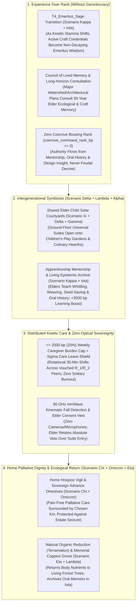
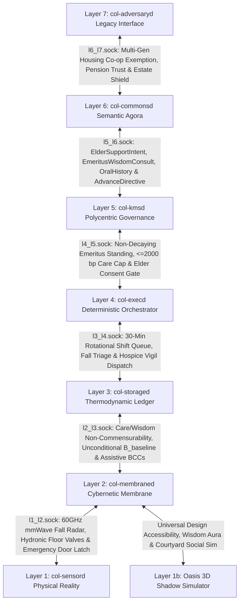
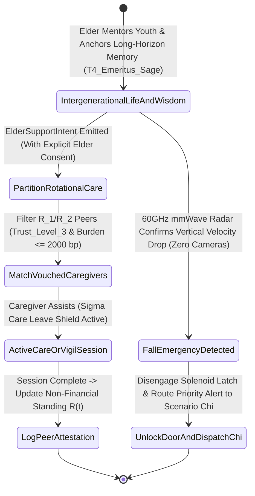

# Scenario Phi: The Elder Commons & Intergenerational Wisdom (Emeritus Experience Over Bureaucratic Rank, Distributed Care, Palliative Dignity & Ecological Return)

*   **Identifier:** `SCN-PHI-ELDERCARE`
*   **System Epic:** Healing Capitalism's Distortion of Aging and Hierarchy—Honoring Lived Experience Over Corporate Rank via Non-Decaying Emeritus Wisdom Standing, Weaving Elders and Children into Shared Courtyards, Dispersing Kinetic Care ($\le 2000\,\mathrm{bp}$ Burden Cap), and Upholding Home Palliative Dignity & Ecological Return-to-the-Land Rites
*   **Primary Layers Tested:** L1 (Physical Reality), L1b (Oasis 3D Shadow Simulator), L2 (Cybernetic Membrane), L3 (Thermodynamic Ledger), L4 (Deterministic Orchestrator), L5 (Polycentric Governance), L6 (Semantic Translation & Agora), L7 (Legacy Interface)
*   **Pass/Fail Metric:** Structural recognition of **Lived Experience Over Bureaucratic Rank** (`T4_Emeritus_Sage` wisdom standing with $0$ seasonal decay and mandatory Long-Horizon Memory Consultation on watershed/guild projects, paired with $0\,\mathrm{bp}$ coercive bossing rank); algorithmic dispersion of eldercare across the Trust Ring ensuring no caregiver exceeds $2000\,\mathrm{bp}$ ($20\%$) of weekly hours; zero-optical $60\,\mathrm{GHz}$ mmWave FMCW radar fall detection (`optical_cameras_count == 0`); **Home Palliative & End-of-Life Sovereignty** (Sovereign Advance Directives, Medicaid estate-recovery shielding, and ecological terramation/memorial grove rites); 100% legal exemption from commercial nursing-home licensing under a Multi-Generational Housing Cooperative charter; zero tokenization of eldercare or wisdom presence; and zero IEEE 754 floating-point math.

---

## Architectural Council Ratification & 5-Perspective Synthesis

This scenario specification has been ratified by unanimous consensus of the 5-Persona Architectural Council:

| Council Persona | Disciplinary Representative | Core Contribution to Scenario |
| :--- | :--- | :--- |
| **Game Designer** | Lead Systems & Gameplay Designer | **Experience Over Rank & The Intergenerational Hearth:** Directly counters both capitalist elder-warehousing and corporate rank-ism. In Oasis, as a master steward ages and their kinetic walking/lifting speed shifts, their hard-won craft and ecological knowledge transforms into **Non-Decaying Emeritus Sage Standing (`T4_Emeritus_Sage`)**. Emeritus elders boost apprenticeship learning speeds (`+3500 bp`), anchor community morale around the children's courtyard (`SCN-DELTA-CHILDCARE`), and provide **Long-Horizon Ecological Memory** that warns the node against 100-year floodplains or soil-depleting shortcuts (`"Guided by Elder Marcus's 50-year watershed memory (+4500 bp resilience)"`). |
| **Game Engineer** | Principal C++ Simulation & Engine Architect | **Flecs ECS Lifecycle, Emeritus Wisdom & Rotational Care Components:** Encapsulates `KineticCapacityComponent`, `EmeritusWisdomComponent`, `RotationalCareScheduler`, and `PalliativeAndMemorialState` in 32-bit compact voxels (`material_id = 48` `ELDER_SUITE_SANCTUARY`, `material_id = 49` `INTERGENERATIONAL_COURTYARD`). Executes $10\,\mathrm{Hz}$ deterministic BPMN state transitions enforcing $\le 2000\,\mathrm{bp}$ caregiver burden dispersion, zero-optical mmWave fall response, and Emeritus consultation gates in pure 64-bit fixed-point integer math. |
| **Sovereign Stack Specialist** | Sovereign Stack Systems Architect | **7-Layer Strict Adjacency, Non-Commensurability & Advance Directive Armor:** Maps `col-sensord` through `col-adversaryd` across `/run/collective/ipc/l1_l2.sock` to `/run/collective/ipc/l6_l7.sock` (traversing `/run/collective/ipc/l4_l5.sock`). Enforces zero tokenization of care/wisdom, `BCC`/`HTLC` sharing of assistive hardware, cryptographic `SovereignAdvanceDirective_CID` vaults, and Multi-Generational Housing Co-op legal shields. |
| **Solarpunk Thinker** | Bioregional Regenerative Ecologist | **The Full Ecological Lifecycle (From Cradle to Memorial Grove):** Restores elders as the keepers of multi-decadal watershed memory, heirloom seed lineages (`Eta`), and oral history (`Iota`/`Lambda`). At the end of a full life, replaces toxic formaldehyde embalming and corporate hospital isolation with home hospice vigils (`Chi`/`Omicron`) and **Natural Organic Reduction (Terramation)** in the **Memorial Coppice Grove**, returning the steward's body to nourish living trees. |
| **Scenario Specialist** | Gerontological Systems, Palliative Care & Cooperative Housing Specialist | **Dignity, Consent & Caregiver Burnout Immunity:** Combines Universal Design ground-floor architecture (`Xi`), zero-optical $60\,\mathrm{GHz}$ mmWave micro-Doppler fall detection, strict elder threshold consent vetoes, $\le 2000\,\mathrm{bp}$ rotational shift partitioning with Scenario Sigma Care Leave Shields, and protection against predatory state Medicaid estate recovery. |

**Unanimous Consensus Reached:** The Council unreservedly ratifies Scenario Phi as the canonical specification for elder stewardship, lived experience over hierarchical rank, intergenerational symbiosis, and end-of-life dignity.

---

## 1. Problem Statement, Legacy Failure & Healing Capitalism's Dual Distortion of Age

Late-stage capitalism and bureaucratic hierarchies (Layer 7) inflict a **dual distortion** upon human aging and experience:

1.  **Treating Elders as "Depreciated Labor Units" (Predatory Warehousing):** Because capitalism values human beings solely for their immediate hourly wage-labor output, the moment a person's physical stamina slows, they are treated as an obsolete economic liability. Elders are severed from children, workshops, and gardens, and warehoused in for-profit nursing facilities that strip generational savings ($8000$ to $14000$ fiat units/month) and subject residents to profound loneliness.
2.  **Corporate Rank Displacing Lived Experience & Ecological Memory:** In corporate, military, and state hierarchies, **positional rank overrides lived experience**. A newly appointed manager or bureaucrat with hierarchical rank routinely overrules a 65-year-old master machinist, midwife, or forester—discarding decades of tacit somatic wisdom, craft patience, and multi-decadal memory of watershed flood/drought cycles in favor of short-term extraction.
3.  **The Opposite Trap — Feudal Gerontocracy:** Conversely, authoritarian patriarchal traditions weaponize age into coercive *rank*, where elders hoard land or command younger generations by decree.
4.  **Primary Caregiver Collapse & Medicaid Asset Stripping:** When nuclear families try to care for elders alone at home, 40 to 80 hours/week of unassisted kinetic labor crushes a single family caregiver (`SCN-SIGMA-BURNOUT`), while state Medicaid programs enforce predatory "estate recovery" seizures upon death.
5.  **Medicalized Isolation at the End of Life:** Legacy healthcare often traps dying elders under fluorescent ICU lights tethered to billing machines, followed by ecologically toxic formaldehyde embalming and concrete vaults.

### 1A. How Scenario Phi Restores Experience Over Rank, Intergenerational Joy & Full-Lifecycle Dignity

Scenario Phi (`SCN-PHI-ELDERCARE`) heals these distortions through **Four Foundational Pillars**:



1.  **Lived Experience Over Corporate Rank — The `T4_Emeritus_Sage` & Council of Lived Memory:**
    *   In The Collective, there are no corporate executives whose "rank" outranks a lifetime of craft, clinical, or ecological experience. Nor does physical aging ever strip a steward of their respected place in the guilds they helped build!
    *   **Seamless Transition to `T4_Emeritus_Sage` (`SCN-KAPPA-APPRENTICE` Integration):** When an elder steward chooses to step back from heavy kinetic or high-reflex hazard-bay duties (e.g., pouring $1600^\circ\mathrm{C}$ iron in `Theta` or climbing wind turbines in `Beta`), their credential transitions into **Non-Decaying Emeritus Sage Standing (`emeritus_wisdom_decay_rate_bp == 0`)**.
    *   **Mandatory Long-Horizon Memory Consultation:** Before any spatial node or guild (`SCN-PI-GUILD` / `SCN-XI-ARCH` / `SCN-ETA-COPPICE`) ratifies a major long-term ecological or infrastructural change, `col-kmsd` requires a **Long-Horizon Memory Consultation** with the node's Emeritus Elders. Elders contribute the irreplaceable multi-decadal memory of 50-year drought/flood cycles, subtle soil shifts, and why past technical shortcuts failed—while holding `coercive_command_rank_bp == 0` (guiding through respected wisdom, mentorship, and design review rather than authoritarian command).
2.  **Architectural & Daily Intergenerational Symbiosis (`Delta` + `Gamma` + `Lambda` + `Alpha`):**
    *   Instead of isolating elders in age-segregated institutions, **Scenario Xi (`SCN-XI-ARCH`)** weaves ground-floor, zero-threshold **Elder Sanctuary Suites (`material_id = 48`)** directly around the **Intergenerational Solar Courtyard (`material_id = 49`)** shared with **Scenario Delta (`SCN-DELTA-CHILDCARE`)** and **Scenario Gamma (`SCN-GAMMA-KITCHEN`)**.
    *   Elders who wish to engage spend their days at their own gentle pace: mentoring apprentices (`Kappa`), teaching children music, storytelling, and fiber arts (`Lambda`/`Nu`), tending heirloom seed gardens (`Eta`), and recording oral histories into the **Scenario Iota (`SCN-IOTA-EPISTEMIC`)** commons.
3.  **Fractional Kinetic Care Dispersion ($\le 2000\,\mathrm{bp}$) & Zero-Optical Sovereign Privacy:**
    *   **The $2000\,\mathrm{bp}$ ($20\%$) Rotational Care Cap:** Kinetic assistance (lifting transfers, meal delivery, bathing support) is partitioned into $30\text{-minute}$ rotational blocks across vouched $R_1/R_2$ stewards (`Trust_Level_3` from `Omicron` + `Caregiver_Somatic_Steward_L1` from `Kappa`), guaranteeing $\tau_{\mathrm{caregiver}, k} \le 2000\,\mathrm{bp} \cdot T_{\mathrm{total\_care}}$ while protecting family caregivers with **Scenario Sigma's Dual-Freeze Care Leave Shield**.
    *   **Absolute Suite Sovereignty & Zero-Optical $60\,\mathrm{GHz}$ mmWave Radar:** Elders hold an unconditional consent veto over their suite threshold (save for confirmed life-threatening fall emergencies). Fall detection uses ceiling-mounted $60\,\mathrm{GHz}$ mmWave FMCW radar that computes micro-Doppler vertical velocity drops locally in Zephyr RTOS with **zero cameras, zero microphones, and zero wearable trackers (`optical_cameras_count == 0`)**.
4.  **Home Palliative Dignity, Sovereign Advance Directives & Ecological Return to the Land:**
    *   **Home Hospice & Palliative Sanctuary (`SCN-CHI-PARAMEDIC` + `SCN-OMICRON-KINSHIP`):** When an elder approaches the end of life, Scenario Chi paramedics/nurses and the elder's chosen kinship circle (`Omicron`) provide gentle home palliative care, botanical analgesia, acoustic comfort (`Lambda`), and 24-hour vigil companionship in their own familiar hearth.
    *   **Sovereign Advance Directives & CLT Estate Shield (`Layer 7`):** `col-adversaryd` enforces the elder's cryptographically signed and notarized Living Will / POLST (`SovereignAdvanceDirective_CID`), while the **Irrevocable CLT/PPT** and Multi-Generational Housing Cooperative structure shield community homes from predatory state Medicaid estate-recovery seizures.
    *   **Ecological Return to the Earth (`SCN-ETA-COPPICE` + `SCN-LAMBDA-CULTURAL`):** Honors the elder's chosen end-of-life rites, including **Natural Organic Reduction (Terramation / Human Composting)** or natural woodland burial in the node's **Memorial Coppice Grove (`Eta`)**—transforming the physical body into living forest soil while their stories and craft live on forever in the `Scenario Iota` archive.

---

## 2. The Collective Workflow (7-Layer Traversal)

Scenario Phi coordinates Emeritus wisdom consultations, intergenerational courtyard life, rotational kinetic care, zero-optical fall triage, and home palliative dignity across all 7 layers without skipping layers:



### Layer 1: Physical Reality & Layer 1b: Oasis 3D Shadow Simulator
*   **Universal-Design Suites, Intergenerational Courtyards & Memorial Groves (`Layer 1`):**
    *   **Elder Sanctuary Suites:** Ground-level zero-threshold suites (`SCN-XI-ARCH`) with non-slip cork/bamboo flooring, radiant hydronic floor heating ($295150\,\mathrm{mK}$ / $22^\circ\mathrm{C}$), curbless roll-in showers, custom `Scenario Alpha`-fabricated grab bars and mobility lifts, ceiling $60\,\mathrm{GHz}$ mmWave radar antennas, and manual-override emergency door latches.
    *   **Intergenerational Courtyard & Memorial Coppice Grove:** Sunny gardens connecting elder suites directly to the `Scenario Delta` children's play commons and `Scenario Eta` orchard/memorial woodland.
*   **Oasis 3D Shadow Simulator (`Layer 1b`):**
    *   Simulates wheelchair/walker turning radii (`UniversalRetrofitIntent`), models the morale and apprenticeship learning boost (`+3500 bp`) generated by `EmeritusWisdomComponent` around courtyards and workshops, and verifies caregiver shift dispersion.

### Layer 2: The Cybernetic Membrane (Zero-Optical 60 GHz mmWave Radar)
*   **Non-Invasive Kinematic Fall Detection (`col-membraned`):**
    *   Processes $60\,\mathrm{GHz}$ FMCW micro-Doppler velocity vectors (`gait_velocity_mms`) locally on Zephyr RTOS microcontrollers to detect sudden vertical velocity drops followed by floor-plane stillness (`FALL_CONFIRMED`).
    *   Enforces the **absolute constitutional ban on optical cameras, microphones, and wearable trackers (`optical_cameras_count == 0`)**. Upon `FALL_CONFIRMED`, unlocks the suite's mechanical-override solenoid latch and dispatches `Scenario Chi` paramedics in $< 500\,\mathrm{ms}$.

### Layer 3: The Thermodynamic Ledger (Non-Commensurability & Assistive BCCs)
*   **Constitutional Non-Commensurability of Eldercare & Wisdom (`col-storaged`):**
    *   Layer 3 **never** mints Exergy Credits or tokens for physical eldercare, palliative vigils, oral storytelling, or Emeritus mentorship (`exergy_token_minting_permitted == false`).
*   **Unconditional Survival Baseline ($B_{\mathrm{baseline}}$) & Assistive Hardware `BCC`s:**
    *   Nourishing meals (`Gamma`), accessible housing (`Zeta`), radiant heat (`Beta`), custom prosthetics/orthotics (`Alpha`/`Nu`), and home hospice care (`Chi`) are guaranteed at $10000\,\mathrm{bp}$ under $B_{\mathrm{baseline}}$ without touching pensions or charging fees. Inter-node sharing of specialized geriatric/rehab equipment clears via Pairwise Bilateral Clearing Channels ($B_{u \to v}(t) + B_{v \to u}(t) = 0$).

### Layer 4: The Deterministic Orchestrator (Rotational Care, Emeritus Consult & Fall Triage)
*   **State Machine Daemon (`col-execd`):**
    *   Executes at $10\,\mathrm{Hz}$ across `/run/collective/ipc/l4_l5.sock`, partitioning daily kinetic care into $30\text{-minute}$ ($1800000\,\mathrm{ms}$) blocks across vouched caregivers ($\le 2000\,\mathrm{bp}$ weekly cap), routing **Emeritus Wisdom Consultations** to guilds and watershed councils, and coordinating rapid fall response or home hospice vigils.



### Layer 5: Polycentric Governance (Emeritus Wisdom Standing, Consent Veto & Burden Cap)
*   **Non-Decaying Emeritus Wisdom Standing (`col-kmsd`):**
    *   Preserves the elder's lifetime craft, clinical, and ecological experience as a permanent `T4_Emeritus_Sage` credential (`emeritus_wisdom_decay_rate_bp == 0`, `coercive_command_rank_bp == 0`), ensuring lived wisdom is honored across generations without creating coercive hierarchy.
*   **Dignity Consent Veto, $\le 2000\,\mathrm{bp}$ Caregiver Cap & `No-Transit` Quiet Zones:**
    *   Requires explicit elder consent for all non-emergency suite entry, enforces $\tau_{\mathrm{caregiver}, k} \le 2000\,\mathrm{bp} \cdot T_{\mathrm{total\_care}}$, and enforces `No-Transit` calm pedestrian rules around elder courtyards.

### Layer 6: Semantic Translation & Agora (Oral History Archives & Advance Directives)
*   **Knowledge Artifacts & Ricardian Treaties (`col-commonsd`):**
    *   Parses `ElderSupportIntent`, `EmeritusWisdomConsultationIntent`, `OralHistoryArchiveIntent` (permanently indexing the elder's stories and craft techniques in `Scenario Iota`), and `SovereignAdvanceDirectiveIntent` (governing home palliative care and ecological terramation/memorial grove wishes).

### Layer 7: The Legacy Interface (Multi-Gen Housing Co-op, Pension Trust & Estate Shield)
*   **Multi-Generational Housing Cooperative Exemption (`col-adversaryd`):**
    *   Operates under statutory Multi-Generational Housing Cooperative exemptions (e.g., California Health and Safety Code Section 1569-145), shielding neighborly mutual care from commercial nursing-home bureaucracy.
*   **Bounded Pension Custodial Trust & Anti-Seizure Estate Firewall:**
    *   Inbound legacy pensions/Medicare reimbursements sit strictly in Membrane 1 to cover external property taxes and wholesale pharmaceuticals up to $\Phi_t$ (with zero internal token conversion), while Irrevocable CLT/PPT title prevents state Medicaid estate-recovery asset stripping.

---

## 3. 3-Stage Incremental Node Facility Blueprints (Node Growth Pattern)

Scenario Phi scales from a ground-floor intergenerational household suite into a bioregional courtyard village, oral-history conservatory, and memorial forest grove.

### Stage 1: Ground-Floor Universal-Design Elder Suite & Shared Household Hearth ($R_1 / R_2$ Bootstrap)
*   **Physical Footprint:** `35 m2` ground-level accessible suite opening directly into a multi-generational home's kitchen (`Gamma`) and garden (`Delta`).
*   **Core Intergenerational & Dignity Features:**
    1.  **Zero-Threshold Universal Suite:** Wide sliding pocket doors, curbless roll-in shower with fold-down teak bench, hydronic radiant floor loop, custom `Scenario Alpha` grab bars, and ceiling $60\,\mathrm{GHz}$ mmWave fall sensor (zero cameras).
    2.  **The Porch & Workbench Nook:** Covered acoustic porch and low-dust craft bench where the elder can mentor neighborhood youth (`Kappa`), mend textiles (`Nu`), or share afternoon tea.

### Stage 2: Urban Multi-Generational Courtyard Co-op, Emeritus Studio & Rehab Commons ($R_2 / R_3$ Municipal Shell)
*   **Physical Footprint:** `600 m2` to `1500 m2` barrier-free courtyard building co-located with Scenario Delta (`SCN-DELTA-CHILDCARE`), Scenario Chi (`SCN-CHI-PARAMEDIC`), and Scenario Sigma (`SCN-SIGMA-BURNOUT`).
*   **Integrated Intergenerational Zones:**
    1.  **The Elder-Child Sunlit Atrium:** Shared conservatory where ground-floor elder apartments wrap around the children's play garden, communal dining tables (`Gamma`), and acoustic music circle (`Lambda`).
    2.  **The Emeritus Master Guild Studio (`SCN-KAPPA-APPRENTICE` + `SCN-IOTA-EPISTEMIC`):** Ergonomically adapted studio with high-magnification optics, seated workbenches, and audio/video recording rigs where Emeritus elders review architectural/engineering blueprints and record oral histories.
    3.  **Geriatric Hydrotherapy & Home-Hospice Support Bay:** Warm therapeutic soak pools (`Sigma` waste-heat cascade) and palliative nursing station (`Chi`).

### Stage 3: Bioregional Intergenerational Village, Oral History Library & Memorial Coppice Grove ($R_3 / R_4$ CLT/PPT)
*   **Physical Footprint:** `4` to `12 hectares` of gentle, zero-step earthen and timber courtyard architecture (`SCN-XI-ARCH`) integrated into a forest-and-orchard campus on an **Irrevocable CLT/PPT**.
*   **Custom Ecological, Cultural & End-of-Life Architecture:**
    *   **The Council of Lived Memory & Oral History Conservatory (`SCN-IOTA-EPISTEMIC`):** Timber amphitheater and archival library where Emeritus stewards advise watershed congresses (`Pi`) on 50-year ecological cycles and pass down ancestral crafts.
    *   **Sacred Palliative Vigil Pavilions (`SCN-CHI-PARAMEDIC` + `SCN-OMICRON-KINSHIP`):** Serene garden pavilions with accommodation for extended kinship constellations to hold vigil during an elder's final days in comfort and peace.
    *   **The Ecological Terramation & Memorial Coppice Sanctuary (`SCN-ETA-COPPICE` + `SCN-LAMBDA-CULTURAL`):** Dedicated natural organic reduction vessels and a living memorial woodland of ancient oaks, chestnuts, and fruit orchards where departed stewards return to nourish the bioregion for centuries to come.

---

## 4. Machine-Readable Schemas

### 4A. Layer 6 Knowledge Artifact: Elder Support, Emeritus Wisdom & Advance Directive Intent (`elder_support_intent.jsonld`)

```json
{
  "@context": [
    "https://schema.org/",
    "https://collective.network/ontology/v1/"
  ],
  "@type": "ElderStewardshipAndWisdomIntent",
  "identifier": "urn:uuid:8f9a0b1c-2d3e-4f5a-6b7c-8d9e0f1a2b3c",
  "issuerDid": "did:peer:2Ez6MksM_elder_marcus",
  "creationEpochMs": 1791460800000,
  "supportRequirements": {
    "kineticTasks": [
      "Meal_Preparation_Scenario_Gamma",
      "Physical_Mobility_Transfer"
    ],
    "targetLocationVoxel": [16, 8, 16],
    "totalDurationMs": 7200000,
    "maxShiftDurationMs": 1800000,
    "elderExplicitConsentVerified": true
  },
  "emeritusWisdomAndIntergenerationalRole": {
    "emeritusCredential": "T4_Emeritus_Sage_Watershed_And_Timber",
    "emeritusWisdomDecayRateBp": 0,
    "coerciveCommandRankBp": 0,
    "longHorizonMemoryConsultationActive": true,
    "reciprocalOfferings": [
      "Child_Storytelling_Scenario_Delta",
      "Apprentice_Design_Review_Scenario_Kappa",
      "Oral_History_Archival_Scenario_Iota"
    ]
  },
  "trustAndPalliativeConstraints": {
    "requiredCredential": "Caregiver_Somatic_Steward_L1",
    "requiredTrustLevel": 3,
    "maxCaregiverBurdenBps": 2000,
    "sovereignAdvanceDirectiveCid": "bafybeigdyrzt5sfp7udm7hu76uh7y26nf3efuylqabf3oclgtqy55fbzdi",
    "chosenEndOfLifeRite": "Natural_Organic_Reduction_Memorial_Coppice_Grove",
    "exergyTransferMicrojoules": 0
  }
}
```

### 4B. Layer 2 Telemetry Attestation: Zero-Optical 60 GHz Safety Proof (`elder_safety_attestation.json`)

```json
{
  "@context": "https://collective.network/ontology/v1/",
  "@type": "ElderSafetyAttestation",
  "intentRef": "urn:uuid:8f9a0b1c-2d3e-4f5a-6b7c-8d9e0f1a2b3c",
  "suiteDid": "did:peer:2Ez6MksS_elder_suite_sanctuary_01",
  "elderDid": "did:peer:2Ez6MksM_elder_marcus",
  "executionMetrics": {
    "observationStartEpochMs": 1791460800000,
    "observationEndEpochMs": 1791468000000,
    "meanGaitVelocityMms": 850,
    "meanAmbientTempMillikelvin": 295150,
    "fallAnomalyDetected": false,
    "zeroOpticalSensorsVerified": true,
    "opticalCamerasOrMicrophonesCount": 0,
    "rotationalCaregiversCount": 4,
    "maxSingleCaregiverDurationMs": 1800000,
    "burdenCapRespected": true
  },
  "edgeAttestationSignature": "0x7a2b4c6e8f0a1c3e5b7d9f1a3c5e7b9d1f3a5c7e9b1d3f5a7c9e1b3d5f7a9c1e"
}
```

---

## 5. Oasis Engine Implementation Specification

### 5A. Memory Allocation, Voxel State & Intergenerational/Emeritus Components

In the Oasis $32^3$ voxel grid (`ChunkManager`), elder sanctuary suites, intergenerational courtyards, and memorial groves occupy designated coordinates:
*   Elder Sanctuary Suite voxel initialized with `material_id = 48` (`ELDER_SUITE_SANCTUARY`).
*   Intergenerational Courtyard Commons voxel initialized with `material_id = 49` (`INTERGENERATIONAL_COURTYARD`).
*   All state values, timers, velocities, and durations are strictly defined as fixed-point SI integers (`uint64_t`, `uint32_t`, `int64_t`, `uint16_t`).

### 5B. Self-Contained C++20 Reference & Test Harness

```cpp
// engine/tests/scenario_phi_test.cpp
#include <cassert>
#include <cstdint>
#include <iostream>
#include <string>
#include <unordered_map>
#include <utility>
#include <vector>

namespace oasis::phi {

enum class LifecycleStage : uint8_t {
    INFANT = 0,
    YOUTH = 1,
    ADULT = 2,
    ELDER = 3
};

// Models the transition from kinetic speed to non-decaying Emeritus Wisdom (Experience over Rank)
struct alignas(8) EmeritusWisdomComponent {
    uint64_t elder_steward_id{0};
    uint32_t decades_of_lived_experience{5};
    uint64_t emeritus_wisdom_standing{1000000ULL};
    uint32_t wisdom_decay_rate_bp{0};          // Strictly 0: lived experience never expires!
    uint32_t coercive_command_rank_bp{0};      // Strictly 0: wisdom is consultative, never bossing!
    uint32_t apprentice_learning_boost_bps{3500}; // +35% learning speed for youth in Kappa/Delta
    uint32_t courtyard_morale_aura_bps{4000};
    bool long_horizon_memory_consulted{false};
    bool oral_history_archived_in_iota{false};
};

struct alignas(8) PalliativeAndMemorialState {
    bool sovereign_advance_directive_signed{true};
    bool home_hospice_vigil_active{false};
    bool medicaid_estate_seizure_blocked_by_clt{true};
    bool natural_organic_reduction_memorial_grove_selected{true};
    uint64_t tokens_charged_for_eldercare_uj{0}; // Must strictly equal 0!
};

class ElderCommonsEngine {
public:
    // Verifies that Emeritus Wisdom Standing never decays with age while holding zero coercive rank,
    // and validates Long-Horizon Memory Consultation on watershed/architectural projects
    static bool consult_emeritus_lived_memory(
        EmeritusWisdomComponent& emeritus,
        uint64_t elapsed_ticks
    ) {
        (void)elapsed_ticks;
        if (emeritus.wisdom_decay_rate_bp != 0 || emeritus.coercive_command_rank_bp != 0) {
            return false;
        }
        // Emeritus wisdom remains 100% intact across all elapsed ticks
        emeritus.long_horizon_memory_consulted = true;
        emeritus.oral_history_archived_in_iota = true;
        return true;
    }

    // Schedules rotational kinetic care into 30-minute (1800000 ms) shifts,
    // ensuring no single caregiver exceeds 2000 bp (20%) of the weekly care load
    static bool schedule_rotational_care(
        uint32_t total_duration_ms,
        bool elder_explicit_consent_verified,
        const std::vector<std::string>& vouched_caregivers,
        std::vector<std::pair<std::string, uint32_t>>& schedule_out
    ) {
        if (!elder_explicit_consent_verified || vouched_caregivers.size() < 5) {
            return false; // Requires elder consent and >= 5 peers to stay <= 2000 bp (20%) each!
        }
        constexpr uint32_t SHIFT_LEN_MS = 1800000U; // 30 minutes
        uint32_t num_tasks = total_duration_ms / SHIFT_LEN_MS;

        size_t cg_idx = 0;
        for (uint32_t i = 0; i < num_tasks; ++i) {
            schedule_out.push_back({vouched_caregivers[cg_idx], SHIFT_LEN_MS});
            cg_idx = (cg_idx + 1) % vouched_caregivers.size();
        }
        return true;
    }

    // Processes 60 GHz mmWave FMCW fall telemetry with strict zero-optical privacy
    static bool handle_mmwave_fall_telemetry(
        bool micro_doppler_fall_detected,
        uint32_t optical_cameras_or_microphones_count,
        bool& smart_door_solenoid_unlocked,
        bool& chi_paramedic_dispatched
    ) {
        if (optical_cameras_or_microphones_count != 0U) {
            return false; // Constitutional violation: zero optical/audio surveillance in R0!
        }
        if (micro_doppler_fall_detected) {
            smart_door_solenoid_unlocked = true;
            chi_paramedic_dispatched = true;
        }
        return true;
    }
};

// Bilateral Clearing Channel for inter-node sharing of specialized assistive mobility hardware
struct BilateralClearingChannel {
    int64_t balance_u_to_v_uj{0};
    int64_t balance_v_to_u_uj{0};
    int64_t credit_headroom_uj{36000000000000LL};

    bool execute_transfer(int64_t amount_uj) {
        if (balance_u_to_v_uj + amount_uj > credit_headroom_uj) return false;
        balance_u_to_v_uj += amount_uj;
        balance_v_to_u_uj -= amount_uj;
        return true;
    }
};

void test_scenario_phi_emeritus_wisdom_and_rotational_care() {
    // 1. Verify Emeritus Wisdom Standing (Experience over Corporate Rank, Zero Decay, Zero Coercive Bossing)
    EmeritusWisdomComponent elder_marcus{
        .elder_steward_id = 101ULL,
        .decades_of_lived_experience = 5,
        .emeritus_wisdom_standing = 1000000ULL,
        .wisdom_decay_rate_bp = 0,
        .coercive_command_rank_bp = 0
    };
    assert(ElderCommonsEngine::consult_emeritus_lived_memory(elder_marcus, 63072000ULL));
    assert(elder_marcus.emeritus_wisdom_standing == 1000000ULL); // Zero decay after 2 years!
    assert(elder_marcus.coercive_command_rank_bp == 0);
    assert(elder_marcus.long_horizon_memory_consulted == true);
    assert(elder_marcus.oral_history_archived_in_iota == true);

    // 2. Verify <= 2000 bp (20%) Rotational Care Burden Dispersion with Explicit Elder Consent
    std::vector<std::string> caregivers = {
        "did:peer:caregiver_01",
        "did:peer:caregiver_02",
        "did:peer:caregiver_03",
        "did:peer:caregiver_04",
        "did:peer:caregiver_05"
    };
    std::vector<std::pair<std::string, uint32_t>> scheduled_tasks;
    // 9000000 ms = 150 minutes of daily kinetic care partitioned into 5 x 30-min shifts
    assert(ElderCommonsEngine::schedule_rotational_care(9000000U, true, caregivers, scheduled_tasks));
    assert(scheduled_tasks.size() == 5);

    std::unordered_map<std::string, uint32_t> load_map;
    for (const auto& task : scheduled_tasks) {
        load_map[task.first] += task.second;
    }
    for (const auto& entry : load_map) {
        uint32_t share_bps = (entry.second * 10000U) / 9000000U;
        assert(share_bps <= 2000U); // Strictly <= 2000 bp (20%) per caregiver!
    }

    // 3. Verify Zero-Optical 60 GHz mmWave Fall Detection & Emergency Door Unlock
    bool door_unlocked = false;
    bool chi_dispatched = false;
    assert(ElderCommonsEngine::handle_mmwave_fall_telemetry(true, 0U, door_unlocked, chi_dispatched));
    assert(door_unlocked == true);
    assert(chi_dispatched == true);

    // 4. Verify Palliative Dignity, CLT Estate Shield & Assistive Device BCC Conservation
    PalliativeAndMemorialState palliative{};
    assert(palliative.sovereign_advance_directive_signed == true);
    assert(palliative.medicaid_estate_seizure_blocked_by_clt == true);
    assert(palliative.natural_organic_reduction_memorial_grove_selected == true);
    assert(palliative.tokens_charged_for_eldercare_uj == 0ULL);

    BilateralClearingChannel channel{};
    assert(channel.execute_transfer(3600000000000LL));
    assert(channel.balance_u_to_v_uj + channel.balance_v_to_u_uj == 0LL);
}

} // namespace oasis::phi

int main() {
    oasis::phi::test_scenario_phi_emeritus_wisdom_and_rotational_care();
    std::cout << "Scenario Phi Emeritus Wisdom, Rotational Eldercare, Zero-Optical Safety & Palliative Dignity tests passed." << std::endl;
    return 0;
}
```

---

## 6. Acceptance Test Gates (Pass/Fail)

| Checkpoint | Validation Method | Pass Condition |
| :--- | :--- | :--- |
| **G1: Lived Experience Over Corporate Rank (`Emeritus`)** | `consult_emeritus_lived_memory` | Aging masters transition to `T4_Emeritus_Sage` standing with $0\,\mathrm{bp}$ seasonal decay (`wisdom_decay_rate_bp == 0`) and $0\,\mathrm{bp}$ coercive bossing rank, providing mandatory Long-Horizon Memory Consultations and archiving oral histories in Scenario Iota. |
| **G2: Fractional Care Burden Dispersion ($\le 2000\,\mathrm{bp}$)** | `schedule_rotational_care` | Daily kinetic care is partitioned into $1800000\,\mathrm{ms}$ ($30\text{-minute}$) shifts across $\ge 5$ vouched caregivers with explicit elder consent; no single volunteer exceeds $2000\,\mathrm{bp}$ ($20\%$) of weekly care load. |
| **G3: Zero-Optical Privacy & 60 GHz Fall Triage** | `handle_mmwave_fall_telemetry` | Wire telemetry confirms $0$ optical cameras or microphones (`optical_cameras_or_microphones_count == 0`); $60\,\mathrm{GHz}$ mmWave micro-Doppler fall confirmation unlocks the door latch and dispatches Scenario Chi paramedics. |
| **G4: Home Palliative Dignity & Ecological Return** | `PalliativeAndMemorialState` Audit | Enforces cryptographically signed `SovereignAdvanceDirectives`, home hospice vigils (`Chi`/`Omicron`), CLT protection against Medicaid estate recovery, and Natural Organic Reduction (terramation) in the Memorial Coppice Grove (`Eta`). |
| **G5: Unconditional Baseline & Care Leave Shield** | Governance & Ledger Audit | Elders receive $10000\,\mathrm{bp}$ unconditional food, warmth, and care under $B_{\mathrm{baseline}}$ (`tokens_charged_for_eldercare_uj == 0`); family/kin caregivers receive Scenario Sigma Dual-Freeze Care Leave Shields. |
| **G6: Multi-Gen Housing Co-op & Pension Carapace (`L7`)** | Statutory Exemption Audit | Operates under Multi-Generational Housing Cooperative statutory exemptions (e.g., California Health and Safety Code Section 1569-145); inbound pensions cover external pharmacy/tax bills up to $\Phi_t$ with zero internal token conversion. |
