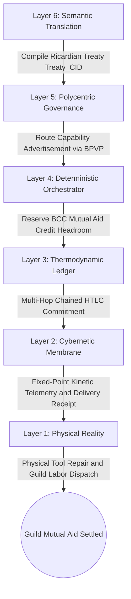

# Scenario Pi: The Bioregional Guild Federation (Inter-Watershed Treaties & Mutual Aid)

*   **Identifier:** `SCN-PI-GUILD`
*   **System Epic:** Bioregional Guild Federation, Ricardian Treaties, Non-Monetary Mutual Aid & Dual-Membrane Carapace
*   **Primary Layers Tested:** L1 (Physical Reality), L2 (Cybernetic Membrane), L3 (Thermodynamic Ledger), L4 (Deterministic Orchestrator), L5 (Polycentric Governance), L6 (Semantic Translation & Agora), L7 (Legacy Interface)
*   **Pass/Fail Metric:** Deterministic dispatch of inter-watershed guild stewards; ratification of non-monetary Ricardian Treaties (`Treaty_CID`) across hydrological boundaries ($R_3 \to R_4$); settlement of mutual-aid labor and capital maintenance via Pairwise Bilateral Clearing Channels (BCC) with zero-sum conservation $B_{u \to v}(t) + B_{v \to u}(t) = 0$ and multi-hop HTLCs; strict labor bifurcation under the Alamo Defense (Membrane 1 W-2 wages in legacy banking rails vs. Membrane 2 non-monetized internal stewardship); zero global tokens, zero fiat conversions, zero deprecated rhetoric, and zero floating-point math.

---

## Architectural Council Ratification & 5-Perspective Synthesis

This scenario specification has been ratified by unanimous consensus of the 5-Persona Architectural Council:

| Council Persona | Disciplinary Representative | Core Contribution to Scenario |
| :--- | :--- | :--- |
| **Game Designer** | Lead Systems & Gameplay Designer | Dwarf Fortress guildhall mechanics and specialization moods (machinists, agroecologists, energy technicians); Cities: Skylines cross-district infrastructure coordination; indirect Founder 01 guild dispatch and apprenticeship scheduling; psychological relief from collective guild solidarity (`"Deep sense of shared craft honor with the watershed guild (+45 mood)"`). |
| **Game Engineer** | Principal C++ Simulation & Engine Architect | Flecs ECS Data-Oriented Design (DOD): cache-aligned component structs `GuildStewardComponent`, `RicardianTreatyComponent`, `LaborDispatchComponent`, and `BCCChannelComponent`; 32-bit compact voxels (`material_id = 52`, `GUILD_FEDERATION_HALL`); 10 Hz deterministic BPMN state engine with Wasmtime fuel limits; compilable C++20 test harness verifying multi-hop HTLC backward settlement and zero IEEE 754 floats. |
| **Sovereign Stack Specialist** | Sovereign Stack Systems Architect | 7 autonomous POSIX daemons (`col-telemetryd` to `col-adversaryd`); strict adjacent IPC via Unix domain sockets; Layer 6 `col-commonsd` compiling Ricardian Treaties `Treaty_CID`; Layer 5 `col-kmsd` routing capability advertisements via BPVP; Layer 4 `col-execd` dispatching labor across `/run/collective/ipc/l4_l5.sock`; Layer 3 `col-storaged` Bilateral Clearing Channels (BCC). |
| **Solarpunk Thinker** | Bioregional Regenerative Ecologist | Cross-watershed guild solidarity: mobile work bees rehabilitating degraded salmon streams, constructing micro-hydro conduits, and upgrading community microgrids; non-monetary treaties based on shared ecological boundaries; regenerative harvesting replacing predatory corporate extraction. |
| **Scenario Specialist** | Bioregional Guild Jurisprudent & Labor Carapace Architect | Non-monetary Ricardian Treaties (`Treaty_CID = SHA256(Text || JSON-LD || BPMN)`); Tripartite Legal Chassis (Subchapter T Shared Services Agreements under IRC §§ 1381–1388, Unincorporated Nonprofit Associations under UUNAA § 6, CLT ground easements); Alamo Defense ensuring strict labor bifurcation between external commercial contracting and internal sovereign mutual aid. |

**Unanimous Consensus Reached:** The Council unreservedly ratifies Scenario Pi as the canonical specification for bioregional guild federation, Ricardian treaties, and non-monetary mutual-aid labor dispatch.

---

## 1. Problem Statement & Legacy Failure

In legacy late-stage capitalist infrastructure (Layer 7), artisanal craft, skilled engineering, and ecological stewardship are crushed between corporate monopsony and atomized contractor precarity.

The legacy labor system imposes devastating systemic failures:
*   **The Precarity Trap:** Independent tradespeople, machinists, and engineers are forced into commercial competition, denied collective bargaining, and penalized by payroll intermediaries. Individual health insurance is prohibitively costly and riddled with arbitrary denials.
*   **Geographical Atomization:** Municipal boundaries fragment regional watersheds. Neighboring settlements along the same river valley cannot coordinate flood prevention, microgrid balancing, or tool sharing without expensive municipal bond issues and state contractor cartels.
*   **Regulatory Weaponization:** State licensing cartels criminalize informal mutual aid. If two neighboring farming communities attempt to share an industrial combine or dispatch apprentices to repair an irrigation canal, authorities threaten fines for unlicensed labor or commercial zoning violations.

A sovereign Genesis Node requires an inter-watershed guild federation: a confederation of autonomous craft guilds operating through non-monetary Ricardian treaties, peer-to-peer clearing channels, and an impenetrable corporate carapace.

---

## 2. The Collective Workflow (7-Layer Traversal)

Scenario Pi establishes the bioregional guild federation workflow: negotiating non-monetary Ricardian treaties, advertising guild capabilities via the Bioregional Path-Vector Protocol (BPVP), dispatching mutual-aid stewards across watersheds, and settling capital maintenance via Pairwise Bilateral Clearing Channels (BCC).



### Layer 1: Physical Ground Truth & Guild Federation Infrastructure
*   **Physical Ground Truth:** The Guild Federation Hall (Scenario Epsilon), regional machining bays (Scenario Alpha), high-capacity metal casting foundries (Scenario Theta), mobile electrical service trucks (Scenario Beta), and watershed canal barges.
*   **Kinetic Stewardship Labor:** Physical machining of replacement bronze bushings, rewinding three-phase induction motors, selective thinning of coppice woodlots (Scenario Eta), and installing solar microgrid interties.
*   **Absolute Separation Invariant:** Layer 1 contains strictly zero software, zero firmware, zero cryptographic keys, and zero network routing daemons. Machine tools and vehicles output raw analog signals across copper cabling.

### Layer 2: Cybernetic Membrane
*   **Microcontrollers & Sandboxed MPUs:** Dedicated microcontrollers running Zephyr RTOS with MPU isolation separating motor telemetry from mesh communication.
*   **Wire Format Fixed-Point Integer Telemetry (MQTT Topics via `col-telemetryd`):**
    *   `guild/dispatch/steward_01/kinetic_work_uj` (Integrated mechanical work, `uint64_t` microjoules)
    *   `guild/dispatch/steward_01/active_power_mw` (Operating power draw, `uint64_t` milliwatts)
    *   `guild/transit/truck_01/odometer_meters` (Distance traveled, `uint32_t` meters)
    *   `guild/tool/lathe_01/spindle_rpm` (Spindle angular speed, `uint32_t` rpm)
*   **Convivial Anti-Panopticon Shield:** Absolute prohibition of body-worn biometric sensors or workplace monitoring cameras. Edge microcontrollers monitor only machine thermodynamics and electrical energy throughput.

### Layer 3: Thermodynamic Ledger
*   **Pairwise Bilateral Clearing Channels (BCC):**
    *   Inter-node guild exchange is governed strictly through pairwise bilateral clearing channels maintained by `col-storaged` with zero global tokens.
    *   **Conservation Invariant:**
        $$B_{u \to v}(t) + B_{v \to u}(t) = 0$$
        The bilateral ledger is mathematically zero-sum.
    *   **Mutual Aid Credit Window:**
        $$-C_{u \to v} \le B_{u \to v}(t) \le C_{v \to u}$$
        Credit headroom is negotiated asymmetrically during Ricardian treaty ratification (Layer 6) based on seasonal watershed production realities.
*   **Multi-Hop Chained Hashed Timelock Contracts (HTLC):**
    *   When guild stewards from Node $A$ are dispatched to Node $C$ through intermediate transit Node $B$, settlement is routed across chained contracts:
        $$\mathrm{HTLC} = \langle H(S), \, \Delta t, \, Q, \, u, \, v \rangle$$
        Where $S$ is a 256-bit secret generated by the receiving guild chapter, revealed upon verified delivery of labor or hardware.
*   **Two-Phase Delivery Receipts:**
    *   Work completions are committed via physical sensor-measured receipts:
        $$\sigma_{\mathrm{delivery}} = \mathrm{Sign}_{K_{\mathrm{receiver}}}\left( \mathrm{Hash}(Q_{\mathrm{measured}} \parallel \tau_{\mathrm{arrival}} \parallel \mathrm{Channel\_ID}) \right)$$
*   **Non-Monetary Settlement Mechanisms:**
    1. *Reciprocal Physical Delivery:* Counter-seasonal material exchange (summer timber and grain balancing winter biochar and machine parts).
    2. *Stewardship Labor Dispatch:* Crediting skilled labor hours directly against bilateral channel headroom.
    3. *Commons Jubilee:* Bioregional Watershed Congress mutual forgiveness of structural channel deficits caused by regional ecological shocks.
*   **Proof-of-Thermodynamic-Work (PoTW):** Value is grounded strictly in metered physical work ($3600000000000\,\mu\mathrm{J} \equiv 3600\,\mathrm{kJ} \equiv 1\text{ Exergy Credit}$) subject to physical demurrage $\mathcal{E}_0 e^{-\lambda t}$.
*   **Non-Tokenization of Care:** Domestic care, mentoring, and administrative deliberation are non-commensurable; Layer 3 structurally refuses to mint credits for caregiving.

### Layer 4: Deterministic Orchestrator
*   Managed deterministically by `col-execd` at 10 Hz with metered Wasmtime execution budgets:
    *   `TreatyRatified`: Ingests ratified Ricardian Treaty (`Treaty_CID`) from Layer 5 over `/run/collective/ipc/l4_l5.sock`.
    *   `DispatchIntentIngress`: Receives signed labor dispatch request for emergency motor rewinding or canal repair.
    *   `BCCReservationLocked`: Locks conditional credit reservation in local channel headroom.
    *   `StewardWorkDispatched`: Coordinates transit and tool availability for dispatched stewards.
    *   `KineticLaborVerified`: Validates Layer 2 telemetry proving physical completion.
    *   `DeliveryReceiptSigned`: Receiver signs hardware delivery receipt $\sigma_{\mathrm{delivery}}$.
    *   `HTLCBackwardSettlement`: Preimage $S$ is broadcast, settling multi-hop channels backward.
    *   `ChannelHeadroomRestored`: Balances atomically update; reservations burn.
*   **Inviolability of Local Floors:** Layer 4 refuses to dispatch labor or tools if local inventory breaches either the ecological floor $F_{\mathrm{eco}}$ or the survival baseline $B_{\mathrm{baseline}}$.
*   **Boundary Socket Contract (`l4_l5.sock`):** POSIX non-blocking sequenced-packet Unix Domain Socket (`SOCK_SEQPACKET`) located at `/run/collective/ipc/l4_l5.sock`.

### Layer 5: Polycentric Governance
*   Executed by `col-kmsd`, Layer 5 governs guild federation across the **7-Tier Concentric Trust Rings**:
    *   **$R_0$ (Hearth):** Intimate domestic shelter; unconditional survival baseline.
    *   **$R_1$ (Settlement):** Apprentice workshops; supervised craft tooling.
    *   **$R_2$ (Commons):** Local guild hall; shared machine tooling, local Bilateral Clearing Channels.
    *   **$R_3$ (Watershed):** Watershed guild chapter federation (within 30 km); DC interties, utility repair trucks, canal barges, bilateral credit lines.
    *   **$R_4$ (Bioregional Federation):** Regional river basin council (within 150 km); rail/canal freight corridors, shared heavy foundries, non-monetary treaties.
    *   **$R_5$ (Continental Corridor):** Trans-continental corridors (within 1000 km); rare metal recycling, DTN blueprints.
    *   **$R_6$ (Ecumene):** Planetary craft guilds, open standards, legacy perimeter.
*   **Bioregional Path-Vector Protocol (BPVP / FRRP):**
    *   Capability Advertisements: $\mathcal{A} = \langle \mathrm{adv\_id}, v_{\mathrm{orig}}, \mathcal{T}_{\mathrm{res}}, \mathbf{u}, Q_{\mathrm{avail}}, [\tau_{\mathrm{start}}, \tau_{\mathrm{end}}], \mathcal{P}, \mathcal{C}, H_{\mathrm{ttl}}, \sigma \rangle$.
    *   **Export Surplus Bound:**
        $$Q_{\mathrm{avail}}(t) = \max\left(0, \, Q_{\mathrm{inventory}}(t) - F_{\mathrm{eco}}(t) - B_{\mathrm{baseline}}(t)\right) \cdot \mathbf{1}_{\mathrm{export}}$$
    *   **Loop-Freedom Invariant:** Ingress filters inspect Ring-Path Vector $\mathcal{P} = [(v_k, r_k), \dots, (v_0, r_0)]$. If local node DID is present, the packet is instantly discarded.
    *   **Thermodynamic Path Attenuation:** $\mathcal{C}(\mathcal{P}) = \sum (E_{\mathrm{transport}} + \alpha \Delta t + \beta \Phi(r) + \lambda \mathcal{E}_{\mathrm{demurrage}})$. Routes with net efficiency $\eta_{\mathrm{route}} < \eta_{\min}$ are invalid.
*   **Autopoietic Cellular Autonomy:** Every node possesses absolute constitutional sovereignty; external federation councils cannot compel labor dispatch or resource transfers.
*   **Protocol of Refusal:** Protects sacred groves, heritage seed varieties, and artisanal archives from export.
*   **Autonomous Transit Veto (`No-Transit`):** Nodes retain the sovereign right to reject transit routing through their residential territory.
*   **Unconditional Right of Exit:** Nodes may unilaterally dissolve peering treaties without punitive indemnity.
*   **Reputational Wealth ($\mathcal{R}$):** Non-financial standing, decays exponentially ($\tau_{\mathrm{half}} = 1\dots 3\text{ years}$), sublinearly capped ($\le 8\%$). Care Leave Shield freezes decay during parenting, illness, or bereavement.

### Layer 6: Semantic Translation & Agora
*   **Tripartite Ricardian Treaties (`Treaty_CID`):**
    $$\mathrm{Treaty\_CID} = \mathrm{SHA256}\left( \mathrm{Text}_{\mathrm{prose}} \parallel \mathrm{Schema}_{\mathrm{JSON-LD}} \parallel \mathrm{Invariants}_{\mathrm{BPMN}} \right)$$
    1. $\mathrm{Text}_{\mathrm{prose}}$: Natural-language treaty articulating mutual-aid commitments, shared watershed boundaries, and dispute-resolution protocols.
    2. $\mathrm{Schema}_{\mathrm{JSON-LD}}$: Machine-verifiable operational parameters: peer identities ($AN_{\mathrm{id}}$), bilateral credit windows $[-C_{u \to v}, +C_{v \to u}]$, and sensor delivery verification predicates.
    3. $\mathrm{Invariants}_{\mathrm{BPMN}}$: Formal process state machines in BPMN 2.0 XML compiled to WebAssembly bytecode for Layer 4 runtime enforcement.
*   All guild actions are published as typed W3C JSON-LD Knowledge Artifacts in the Agora Commons (`col-commonsd`): `GuildTreatyIntent`, `LaborDispatchIntent`, `MutualAidClearanceIntent`.

### Layer 7: The Legacy Interface (Dual-Membrane Doctrine)
*   **Alamo Defense & Strict Labor Bifurcation:**
    *   **Membrane 1 (External Legal Carapace):** Organized as an unremarkable Subchapter T Cooperative (26 U.S.C. §§ 1381–1388) and Unincorporated Nonprofit Association (UNA under UUNAA § 6). Commercial client contracts executed externally receive lawful W-2 wages with full statutory tax withholding. Fiat revenue remains entirely within legacy banking rails to fund capital equipment purchases on the itemized needs list $\Phi_t$, tax reserves, and payroll.
    *   **Membrane 2 (Internal Sovereign Core):** Internal mutual-aid stewardship is uncompensated and non-monetized. Internal accounting relies strictly on physical exergy credits and Bilateral Clearing Channels.
    *   **Total Elimination of Fiat Conversions:** Zero exchange rate, AMM, or conversion mechanism exists between fiat currency and internal exergy credits.
*   **Subpoena Immunity via Data Non-Existence:** Under *NAACP v. Alabama*, internal member rosters, pairwise DIDs, and guild clearing ledgers do not exist in legacy corporate databases. `col-adversaryd` enforces data non-existence.
*   **Regenerative Harvesting & Convivial Salvage:** Outward commercial activity halts as soon as the itemized needs list $\Phi_t$ is satisfied. Convivial engineering interties govern all external interactions.

---

## 3. Machine-Readable Schemas

### 3.1 Layer 6 Knowledge Artifact: Ricardian Guild Treaty (`guild_treaty.jsonld`)

```json
{
  "@context": [
    "https://schema.org/",
    "https://collective.network/ontology/v1/"
  ],
  "@type": "RicardianGuildTreaty",
  "identifier": "urn:uuid:11a2b3c4-d5e6-7f8a-9b0c-1d2e3f4a5b6c",
  "treatyCid": "ba7816bf8f01cfea414140de5dae2223b00361a396177a9cb410ff61f20015ad",
  "contractingPeers": [
    "did:peer:2.Ez6Mks3...watershed_snoqualmie_node04",
    "did:peer:2.Ez6Mkd9...watershed_skykomish_node08"
  ],
  "treatyTerms": {
    "guildDomain": "Bioregional_Mechanical_Machinists",
    "bilateralCreditHeadroomMicroJoules": 36000000000000,
    "sharedEcologicalCorridor": "Snohomish_Basin_Hydrology",
    "deliveryVerificationMethod": "Ed25519_Hardware_Sensor_Receipt",
    "demurrageHalfLifeDays": 365
  },
  "governanceConstraints": {
    "transitVetoEnabled": true,
    "cellularAutonomyPreserved": true,
    "unconditionalRightOfExit": true
  },
  "cryptographicSignatures": {
    "peerNode04Signature": "z3aK8f...node04_hardware_sig...99pL",
    "peerNode08Signature": "z7bM2q...node08_hardware_sig...44xY"
  }
}
```

### 3.2 Layer 2 Telemetry Attestation: Labor Dispatch Delivery Receipt (`dispatch_attestation.json`)

```json
{
  "@context": "https://collective.network/ontology/v1/",
  "@type": "LaborDispatchDeliveryReceipt",
  "attestationId": "urn:uuid:3b4c5d6e-7f8a-9b0c-1d2e-3f4a5b6c7d8e",
  "treatyRef": "ba7816bf8f01cfea414140de5dae2223b00361a396177a9cb410ff61f20015ad",
  "dispatchMission": {
    "originatingNode": "did:peer:2.Ez6Mks3...node04",
    "receivingNode": "did:peer:2.Ez6Mkd9...node08",
    "stewardHandle": "handle:anonymous:steward_mechanic_77",
    "taskCategory": "Three_Phase_Generator_Rewind",
    "kineticWorkPerformedMicroJoules": 36000000000000
  },
  "physicalVerification": {
    "dynamometerActivePowerMilliWatts": 4500000,
    "testDurationMilliseconds": 28800000,
    "measuredEfficiencyBasisPoints": 9400,
    "hardwareSensorSignature": "4a7f9b2c...dynamometer_sensor_sig"
  },
  "settlementStatus": "RECEIPT_VERIFIED_HTLC_RESOLVED",
  "digestSha256": "e3b0c44298fc1c149afbf4c8996fb92427ae41e4649b934ca495991b7852b855"
}
```

---

## 4. Oasis Engine Implementation Specification

### 4.1 Memory Allocation & Voxel State

The Guild Federation Hall occupies dedicated spatial voxels in the $32^3$ chunk space:
*   The federation anchor voxel is initialized with `material_id = 52` (`GUILD_FEDERATION_HALL`).
*   Metadata bitmask `0b00001100` sets `Is_Guild_Commons` (bit 2) and `Is_Treaty_Terminal` (bit 3).
*   Adjacent heavy tool voxels (`material_id = 53`, `HEAVY_INDUSTRIAL_LATHE`) track verified kinetic work.

```cpp
// Cache-aligned Flecs ECS Components for Bioregional Guild Federation
#include <cstdint>
#include <string>

namespace oasis {

struct alignas(8) GuildStewardComponent {
    char steward_did[64];
    uint32_t guild_domain_id;
    uint32_t verified_stewardship_hours;
    uint8_t craft_mastery_rank;         // 1 (Apprentice) to 5 (Master Steward)
    bool on_active_dispatch;
};

struct alignas(8) RicardianTreatyComponent {
    char treaty_cid[64];
    char peer_node_did[64];
    uint64_t credit_ceiling_uj;         // C_{u->v} maximum credit headroom
    uint32_t ratification_tick;
    bool transit_veto_asserted;
    bool treaty_active;
};

struct alignas(8) LaborDispatchComponent {
    uint32_t mission_id;
    uint64_t committed_exergy_uj;       // 3600000000000 uJ multiples (3600 kJ)
    uint32_t timelock_deadline_tick;
    char secret_hash[72]; // 64-char SHA256 hex string + null terminator, padded to 8-byte alignment
    bool preimage_disclosed;
};

struct alignas(8) BCCChannelComponent {
    char peer_did[64];
    int64_t balance_microjoules;         // Conservation: B_{u->v} + B_{v->u} = 0
    uint64_t credit_headroom_uj;         // Headroom window [-C, +C]
    bool channel_active;
};

} // namespace oasis
```

### 4.2 C++20 Test Harness Structure

```cpp
// engine/tests/scenario_pi_test.cpp
#include <cassert>
#include <cstring>
#include "oasis/chunk_manager.hpp"
#include "oasis/orchestration/bpmn_engine.hpp"

namespace oasis {

void test_scenario_pi_guild_dispatch_and_bcc() {
    // 1. Initialize Chunk and Guild Federation Voxel
    ChunkManager chunk_mgr;
    chunk_mgr.allocate_chunk(0, 0, 0);

    Voxel guild_voxel{
        .material_id = 52, // GUILD_FEDERATION_HALL
        .moisture = 5,
        .temperature = 293, // 293 K
        .metadata = 0b00001100 // Guild Commons + Treaty Terminal
    };
    chunk_mgr.set_voxel(16, 8, 16, guild_voxel);

    // 2. Setup Multi-Hop Bilateral Clearing Channels: Node A <-> Node B <-> Node C
    BCCChannelComponent channel_ab{
        .peer_did = "did:peer:node_b",
        .balance_microjoules = 0,
        .credit_headroom_uj = 72000000000000ULL, // 20 Exergy Credits headroom
        .channel_active = true
    };
    BCCChannelComponent channel_ba{
        .peer_did = "did:peer:node_a",
        .balance_microjoules = 0,
        .credit_headroom_uj = 72000000000000ULL,
        .channel_active = true
    };
    BCCChannelComponent channel_bc{
        .peer_did = "did:peer:node_c",
        .balance_microjoules = 0,
        .credit_headroom_uj = 72000000000000ULL,
        .channel_active = true
    };
    BCCChannelComponent channel_cb{
        .peer_did = "did:peer:node_b",
        .balance_microjoules = 0,
        .credit_headroom_uj = 72000000000000ULL,
        .channel_active = true
    };

    // Assert Conservation on both channels: B_{u->v} + B_{v->u} = 0
    assert(channel_ab.balance_microjoules + channel_ba.balance_microjoules == 0);
    assert(channel_bc.balance_microjoules + channel_cb.balance_microjoules == 0);

    // 3. Multi-Hop HTLC Labor Dispatch: Node A dispatches machinist to Node C
    uint64_t labor_exergy_uj = 36000000000000ULL; // 10 Exergy Credits (36000 kJ)
    LaborDispatchComponent htlc_mission{
        .mission_id = 8842,
        .committed_exergy_uj = labor_exergy_uj,
        .timelock_deadline_tick = 5000,
        .secret_hash = "ba7816bf8f01cfea414140de5dae2223b00361a396177a9cb410ff61f20015ad",
        .preimage_disclosed = false
    };

    // 4. Simulate Labor Delivery and Preimage Disclosure (Cascading Backward Settlement)
    htlc_mission.preimage_disclosed = true;

    // Settle Hop B -> C upon secret reveal
    channel_cb.balance_microjoules -= static_cast<int64_t>(labor_exergy_uj);
    channel_bc.balance_microjoules += static_cast<int64_t>(labor_exergy_uj);
    assert(channel_bc.balance_microjoules + channel_cb.balance_microjoules == 0);

    // Settle Hop A -> B cascading backward
    channel_ba.balance_microjoules -= static_cast<int64_t>(labor_exergy_uj);
    channel_ab.balance_microjoules += static_cast<int64_t>(labor_exergy_uj);
    assert(channel_ab.balance_microjoules + channel_ba.balance_microjoules == 0);

    // Verify Balances
    assert(channel_ab.balance_microjoules == 36000000000000LL);
    assert(channel_ba.balance_microjoules == -36000000000000LL);
    assert(channel_bc.balance_microjoules == 36000000000000LL);
    assert(channel_cb.balance_microjoules == -36000000000000LL);
}

void test_scenario_pi_guild_transit_veto_and_loop_check() {
    ChunkManager chunk_mgr;
    chunk_mgr.allocate_chunk(0, 0, 0);

    RicardianTreatyComponent treaty{
        .treaty_cid = "cid:sha256:treaty_snoqualmie_skykomish_01",
        .peer_node_did = "did:peer:node_skykomish",
        .credit_ceiling_uj = 72000000000000ULL,
        .ratification_tick = 100,
        .transit_veto_asserted = true, // Autonomous Transit Veto asserted
        .treaty_active = true
    };

    // Assert Transit Veto is strictly enforced
    bool transit_route_permitted = !treaty.transit_veto_asserted;
    assert(!transit_route_permitted); // Heavy freight blocked from residential territory

    // Assert Loop Check: Self-referential route is dropped immediately
    std::string local_node = "did:peer:local_node";
    std::vector<std::string> path_vector = {"did:peer:node_c", "did:peer:node_b", "did:peer:local_node"};

    bool loop_detected = false;
    for (const auto& peer : path_vector) {
        if (peer == local_node) {
            loop_detected = true;
            break;
        }
    }
    assert(loop_detected); // Route dropped at ingress filter
}

} // namespace oasis

int main() {
    oasis::test_scenario_pi_guild_dispatch_and_bcc();
    oasis::test_scenario_pi_guild_transit_veto_and_loop_check();
    return 0;
}
```

---

## 5. Acceptance Test Gates (Pass/Fail)

| Checkpoint | Validation Method | Pass Condition |
| :--- | :--- | :--- |
| **G1: Thermodynamic Bounds & Conservation** | Multi-Hop HTLC Settlement Audit | Bilateral Clearing Channels preserve zero-sum conservation $B_{u \to v}(t) + B_{v \to u}(t) = 0$ across all intermediate hops; preimage revelation clears channels atomically; zero unbacked tokens or fiat conversions. |
| **G2: Offline Autonomy & WAN Airgap** | Local Mesh Disconnection | Inter-node treaty negotiation, capability advertisements, and HTLC execution function deterministically over Reticulum mesh with 100% WAN isolation. |
| **G3: Trust Rings & BPVP Routing** | Path-Vector Loop Check Injection | Announcing a route containing the local DID is dropped immediately via loop check; Capability Advertisements strictly enforce export surplus floor $Q_{\mathrm{avail}}(t) = \max(0, Q - F_{\mathrm{eco}} - B_{\mathrm{baseline}}) \cdot \mathbf{1}_{\mathrm{export}}$ across $R_0 \dots R_6$. |
| **G4: Human Baseline & Alamo Defense** | Labor Bifurcation & Baseline Check | External commercial contracts executed by the cooperative carapace pay W-2 wages in legacy bank accounts; internal mutual aid stewardship is completely non-monetized; local survival floor $B_{\mathrm{baseline}}$ remains inviolable. |
| **G5: Dual-Membrane Doctrine (L7)** | Corporate Carapace Compliance | External commercial transactions execute under lawful Subchapter T cooperative filings with full statutory tax withholding, maintaining zero disclosure of internal mesh DIDs under *NAACP v. Alabama*. |
| **G6: Regenerative Harvesting & Convivial Treaties (L7)** | Treaty Invariant Verification | Tripartite Ricardian Treaties (`Treaty_CID`) formalize non-monetary mutual-aid commitments; commercial procurement halts as soon as the itemized needs list $\Phi_t$ is met. |
