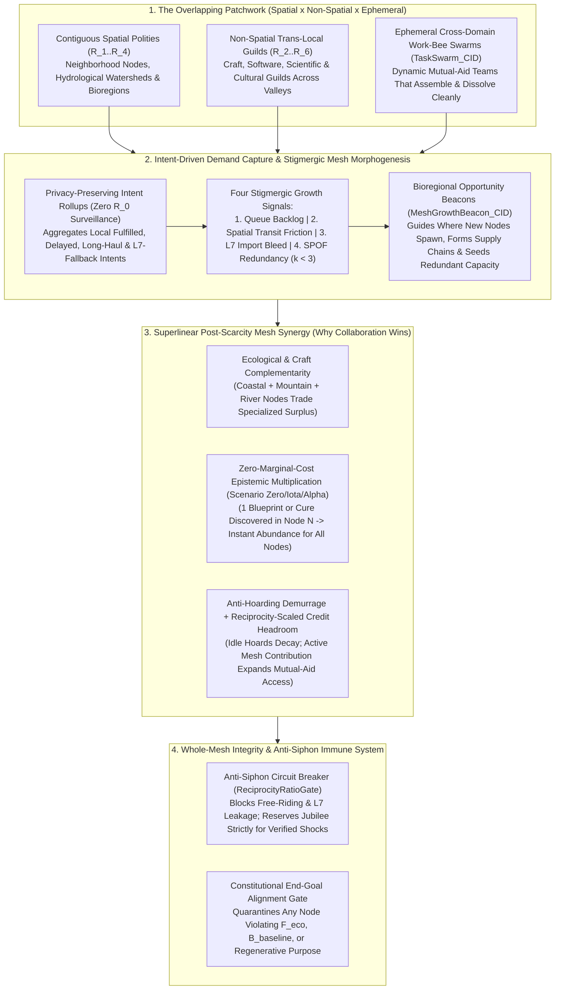
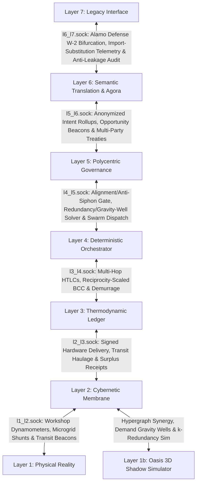
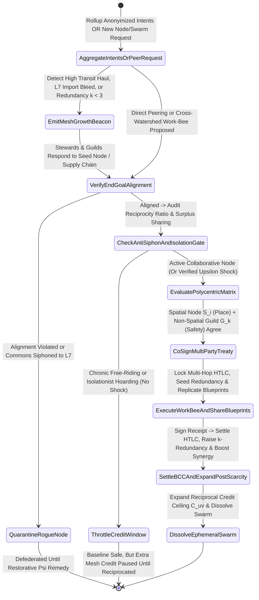

# Scenario Pi: The Polycentric Guild & Patchwork Commons (Superlinear Mesh Synergy, Overlapping Organization & Post-Scarcity Alignment)

*   **Identifier:** `SCN-PI-GUILD`
*   **System Epic:** Ostromian Polycentric Organization—Weaving Contiguous Spatial Nodes, Hydrological Watersheds, Non-Spatial Trans-Local Guilds, and Ephemeral Work-Bee Swarms into a Cohesive, Anti-Isolationist, Anti-Siphon Engine for Ecologically Sustainable Post-Scarcity
*   **Primary Layers Tested:** L1 (Physical Reality), L1b (Oasis 3D Shadow Simulator), L2 (Cybernetic Membrane), L3 (Thermodynamic Ledger), L4 (Deterministic Orchestrator), L5 (Polycentric Governance), L6 (Semantic Translation & Agora), L7 (Legacy Interface)
*   **Pass/Fail Metric:** Verification of **Superlinear Post-Scarcity Mesh Synergy** (every aligned node added to the federation increases total bioregional abundance and reduces per-node thermodynamic toil); **Intent-Driven Demand Capture & Stigmergic Mesh Morphogenesis** (privacy-preserving aggregation of individual Intents into spatial/guild demand tensors that guide where new nodes are spawned, naturally form supply chains, target Layer 7 import substitution, and enforce $k \ge 3$ supply-chain redundancy against unexpected shocks); deterministic enforcement of the **Anti-Siphon & Anti-Isolationism Guards**; constitutional **End-Goal Alignment Verification**; multi-hop HTLC and Pairwise Bilateral Clearing Channel ($B_{u \to v}(t) + B_{v \to u}(t) = 0$) conservation; and zero IEEE 754 floating-point math.

---

## Architectural Council Ratification & 5-Perspective Synthesis

This scenario specification has been ratified by unanimous consensus of the 5-Persona Architectural Council:

| Council Persona | Disciplinary Representative | Core Contribution to Scenario |
| :--- | :--- | :--- |
| **Game Designer** | Lead Systems & Gameplay Designer | **Superlinear Post-Scarcity Synergy & The Bioregional Opportunity Cartographer:** Models why collaboration is vastly more rewarding than parochial hoarding, and how the mesh knows *where* and *how* to grow without central planners. Individual steward Intents aggregate into visual **Demand Gravity Wells & Redundancy Alerts** on the Oasis map—showing players where founding a new node, spinning up a local foundry, or adding a backup medical lab will slash transit exergy and harden the watershed against shocks (`"Stigmergic Growth Beacon: Spawning a Mill Node in Sector East cuts regional grain haulage by 6800 bp and raises Redundancy k from 1 -> 2"`). |
| **Game Engineer** | Principal C++ Simulation & Engine Architect | **Flecs ECS Polycentric Hypergraph, Intent Demand Tensor & Anti-Siphon Circuit Breakers:** Encapsulates `SpatialContiguousNode`, `NonSpatialTransLocalGuild`, `EphemeralWorkBeeSwarm`, and `AggregatedIntentDemandSignal` in 32-bit compact voxels (`material_id = 52` `GUILD_FEDERATION_HALL`, `material_id = 53` `WORK_BEE_DISPATCH_DEPOT`). Computes integer superlinear abundance gains, stigmergic node-spawning/redundancy priorities, dynamic BCC credit-window expansion, and automatic quarantine of parasitic siphoning nodes at $10\,\mathrm{Hz}$ determinism with zero floating-point math. |
| **Sovereign Stack Specialist** | Sovereign Stack Systems Architect | **7-Layer Strict Adjacency, Privacy-Preserving Intent Rollups & Constitutional Alignment Gate:** Enforces strict socket boundaries (`l1_l2.sock` through `l6_l7.sock`, traversing `/run/collective/ipc/l4_l5.sock`). Aggregates Layer 6 Intents via zero-knowledge homomorphic integer rollups (`r0_personal_intent_surveillance == false`) into Layer 5 `MeshMorphogenesisBeacons`, while requiring continuous cryptographic proof of Ecological Floor preservation ($F_{\mathrm{eco}}$), Survival Baseline ($B_{\mathrm{baseline}}$), and active surplus contribution ($Q_{\mathrm{avail}}$). |
| **Solarpunk Thinker** | Bioregional Regenerative Ecologist | **Bioregional Complementarity & $k\text{-Redundant}$ Ecological Resilience:** Demonstrates that ecological post-scarcity emerges when diverse microclimates weave together across hydrological basins ($R_3/R_4$), and when critical supply chains maintain $k \ge 3$ geographically decoupled producer nodes so a wildfire or flood in one valley never collapses the bioregion. |
| **Scenario Specialist** | Ostromian Institutional Economist & Cooperative Labor Jurisprudent | **Stigmergic Coordination (No Gosplan, No Capitalist Price Speculation):** Replaces both blind market speculation and authoritarian central planning with **Intent-Driven Stigmergy**—where aggregated unmet, high-haul, or single-point-of-failure Intents automatically unlock guild bootstrap kits (`Alpha`/`Kappa`) and expanded mutual-aid credit headroom ($C_{u \to v}$) for stewards who step up to fill the gap. |

**Unanimous Consensus Reached:** The Council unreservedly ratifies Scenario Pi as the canonical specification for polycentric organization—uniting local freedom, whole-mesh integrity, and intent-driven stigmergic growth on the path to ecologically sustainable post-scarcity.

---

## 1. Problem Statement, Legacy Failure & The Path to Sustainable Post-Scarcity

To build an ecologically sustainable post-scarcity civilization, human organization must overcome both the authoritarian pyramid of Layer 7 and the four classic coordination traps of naive decentralization:
1.  **The Trap of Centralized Command (Loss of Node Freedom):** Nation-states and corporate conglomerates achieve scale by crushing local autonomy, turning communities into uniform resource-extraction colonies ruled by distant bureaucrats.
2.  **The Trap of Parochial Isolationism & Fragmentation (*"Balkanized Hoarding"*):** Conversely, if autonomous nodes act like isolated, anti-collaborative bunkers that hoard their surplus and refuse to contribute to the broader net, humanity regresses into subsistence scarcity. A single 50-person node cannot independently maintain a semiconductor fab (`Zero`), a metallurgical foundry (`Theta`), a research hospital (`Chi`/`Iota`), and a textile mill (`Nu`). **Post-scarcity is an emergent property of the collaborative mesh.**
3.  **The Trap of Parasitic Resource Siphoning & Goal Contradiction (*"The Vampire Node"*):** An open federation must never allow a rogue or bad-faith node to join the mesh merely to **siphon resources** (draining guild labor, timber, and hardware without reciprocating, or leaking commons assets into Layer 7 for private profit) or to violate the foundational ecological and human-dignity goals of The Collective.
4.  **The Trap of Blind Uncoordinated Growth & Fragile Supply Chains (*"How Do We Know What We Need?"*):** Without capitalist price gouging or an authoritarian central planning ministry (*Gosplan*), how does an organic mesh know **what capabilities are missing, where new nodes should be spatially created, how upstream/downstream supply chains should connect, and where dangerous Single Points of Failure ($k = 1$) leave the whole federation vulnerable to unexpected shocks**?

### 1A. How Scenario Pi Unites Node Freedom, Whole-Mesh Integrity, Intent-Driven Demand Capture & Superlinear Post-Scarcity

Scenario Pi (`SCN-PI-GUILD`) distinguishes itself from **Scenario Kappa** (which validates *individual somatic skill*) by architecting the **Macro-Sociological Polycentric Patchwork**—where **every aligned node added to the mesh strengthens the whole without losing its own freedom**, and where **aggregated individual Intents organically guide mesh growth, supply-chain formation, and fault-tolerant redundancy**:



1.  **Intent-Driven Demand Capture & Stigmergic Mesh Morphogenesis (*How the Mesh Knows How and Where to Grow*):**
    *   In The Collective, every need—from a household requesting fresh bread (`Gamma`) or a custom shirt (`Nu`) to a workshop requesting $500\,\mathrm{kg}$ of recycled silicon-steel laminations (`Theta`)—is expressed as a Layer 6 **Intent**. While a single Intent triggers an immediate workflow, `col-kmsd` (L5) and `col-ledger` (L3) continuously aggregate local Intents via **Zero-Knowledge Homomorphic Integer Rollups** (`r0_personal_intent_surveillance == false`, never exposing who asked for what in $R_0$) into an **Anonymized Bioregional Intent Demand Tensor (`IntentDemandTensor_CID`)**.
    *   From this aggregated Intent stream, the mesh extracts **Four Stigmergic Signals** that guide organic growth without any central command:
        *   **Signal 1 — Unmet Queue & Bottleneck Pressure (`unmet_intent_backlog_uj`):** Identifies when existing craft guilds or fabrication bays are running at high saturation, signaling non-spatial guilds (`Kappa`) to open mentorship fellowships and replicate tooling (`Alpha`).
        *   **Signal 2 — Spatial Transit Exergy Friction & Node Placement Gravity Wells (`excess_transit_haul_exergy_uj`):** Detects when a neighborhood or valley is repeatedly fulfilling Intents for heavy or perishable goods (`Gamma` staple foods, `Xi` earthen/timber building materials, `Alpha` spare parts) by hauling them across multiple `BPVP` hops (`bpvp_hop_count >= 3`). The system computes a **Spatial Gravity Well**, showing prospective node founders (`Tau`) and existing watersheds the exact geographical coordinates where spawning a new localized node or facility will eliminate the maximum transit exergy!
        *   **Signal 3 — Layer 7 Import-Substitution Targets (`l7_fiat_bleed_uj`):** Tracks which Intents still have to fall back to extractive Layer 7 corporate purchases via Scenario Epsilon's carapace because no node in the mesh produces that BOM component yet. These automatically become top-priority **Import-Substitution Callouts** for `Iota`/`Zero`/`Theta` guilds to internalize the supply chain.
        *   **Signal 4 — Topological Supply-Chain Redundancy & Anti-Fragility ($k \ge 3$ Producer Nodes):** Even when 100% of current Intents are smoothly met, graph analysis over the recursive BOM DAG (`Alpha`) and BPVP network (`Beta`) continuously checks the **Producer Redundancy Degree ($k$)** of every critical survival, medical (`Chi`), and industrial capability. If $k < 3$ (for example, only $1$ or $2$ nodes in the bioregion synthesize a vital antibiotic precursor or wind micro-hydro stators), an unexpected wildfire, flood, or transformer failure (`SCN-UPSILON-SHOCK`) could cripple the entire mesh. The system immediately raises a **Redundancy Seeding Beacon** to stand up a geographically decoupled backup producer node!
    *   **Non-Coercive Stigmergic Execution (`MeshGrowthBeacon_CID`):** Rather than ordering people where to live or work, the Layer 6 **Bioregional Opportunity Cartographer** publishes these beacons alongside pre-approved **Bootstrap Seed Packages**—automatically bundling an `Alpha` machine-replication kit, a `Kappa`/`Pi` Work-Bee barn-raising swarm, and expanded initial `BCC` mutual-aid credit headroom for any group of stewards who voluntarily step up to seed the needed node or guild capacity, while automatically linking upstream and downstream guilds into natural multi-hop **Supply-Chain Covenants**.
2.  **Why Every Aligned Node Added to the Mesh Strengthens the Whole (Superlinear Post-Scarcity Synergy):**
    *   In Scenario Pi, adding a new node ($N+1$)—especially one guided by an Intent Demand Beacon—generates **Superlinear Abundance Gains ($\Gamma_{\mathrm{synergy}} > 10000\,\mathrm{bp}$)** through two structural mechanisms:
        *   **Zero-Marginal-Cost Epistemic & Blueprint Multiplication (`Zero` + `Iota` + `Alpha`):** When Node $N+1$ joins and contributes even one improved solar-kiln controller (`SCN-ZERO-SOFTWARE`), agricultural cultivar (`SCN-GAMMA-KITCHEN`), or CNC joinery jig (`SCN-ALPHA-FAB`) to the non-spatial guild commons, every existing node $\{1 \dots N\}$ immediately gains that capability at zero additional R&D cost.
        *   **Bioregional Ecological Complementarity:** Instead of every small node exhausting itself trying to produce 100% of all 25 scenarios in isolation, a mountain forest node (`Eta` timber & micro-hydro surplus), an alluvial valley node (`Gamma` grain & `Nu` flax surplus), and an urban industrial node (`Theta` recycled alloys & `Alpha` precision machining surplus) interlock via the **Bioregional Path-Vector Protocol (`BPVP`)**—cutting mandatory survival labor hours per steward in half and unlocking genuine **ecologically sustainable post-scarcity**!
3.  **Preventing Isolationism & Parochial Hoarding (Why Nodes Actively Contribute to the Net):**
    *   While cellular autonomy guarantees that no external army or central committee can *coerce* a node, the thermodynamic architecture makes **isolationism self-limiting and collaboration deeply magnetic**:
        *   **Thermodynamic Demurrage on Hoarded Surplus ($\mathcal{E}(t) = \mathcal{E}_0 e^{-\lambda t}$):** Idle exergy credits decayed by $\lambda$ cannot be hoarded for speculative power. By contrast, routing local exportable surplus ($Q_{\mathrm{avail}}(t) = \max(0, Q_{\mathrm{inventory}} - F_{\mathrm{eco}} - B_{\mathrm{baseline}})$) into cross-watershed Work-Bee Swarms and guild channels converts perishable local surplus into **Reciprocal Federation Credit Headroom ($+C_{v \to u}$)** and **Mesh Solidarity Standing ($\mathcal{S}_{\mathrm{mesh}}$)**.
        *   **Dynamic Access to High-Tier Guild Capabilities:** A node's priority access to trans-local guild dispatches (e.g., summoning a mobile turbine-rewinding team, borrowing heavy bridge cranes, or receiving rare recycled semiconductors from $R_4/R_5$) scales directly with its rolling **Net Mesh Contribution Ratio**. An isolationist node that refuses to share its surplus above $F_{\mathrm{eco}} + B_{\mathrm{baseline}}$ naturally sees its reciprocal federation credit ceiling contract toward zero until it re-engages in mutual aid.
4.  **Preventing Parasitic Siphoning & Protecting the End-Goal (The Anti-Siphon Immune System):**
    *   What prevents a newly added node from acting as a "vampire"—siphoning resources from the mesh without contributing, or contradicting The Collective's ecological mission?
        *   **Bounded Bilateral Credit Windows & Reciprocity Scaling:** Every Pairwise Bilateral Clearing Channel ($B_{u \to v}(t) + B_{v \to u}(t) = 0$) is strictly bounded by $[-C_{u \to v}, +C_{v \to u}]$. A new node begins with a conservative bootstrap credit window that **only expands as it delivers verified physical goods, exergy, or guild labor ($\sigma_{\mathrm{delivery}}$)** back to the mesh.
        *   **The Anti-Siphon Circuit Breaker (`ReciprocityRatioGate`):** Layer 4 and Layer 5 continuously audit each node's **Reciprocity Ratio ($\rho_{\mathrm{recip}}$)** and **Layer 7 Boundary Integrity**. If a node repeatedly draws down credit without reciprocating (in the absence of a sensor-verified ecological or medical shock under `SCN-UPSILON-SHOCK`) or attempts to siphon commons resources out into Layer 7 commercial markets (`l7_unauthorized_leakage_mg > 0`), `col-kmsd` immediately trips the **Anti-Siphon Circuit Breaker**—freezing inbound non-emergency transfers across all $R_2 \dots R_5$ channels!
        *   **Constitutional End-Goal Alignment Quarantine:** Local cellular autonomy is **not** a license to destroy nature or exploit human beings. Every federated node is bound by the **Three Constitutional Alignment Invariants**: (1) preserving its local Ecological Floor ($F_{\mathrm{eco}}$), (2) guaranteeing the unconditional Human Survival Baseline ($B_{\mathrm{baseline}}$), and (3) contributing open knowledge and surplus toward sustainable post-scarcity. Violating these core invariants triggers automatic **Federation Quarantine (`DEFEDERATED_ALIGNMENT_BREACH`)** until remedied via Scenario Psi restorative arbitration.
5.  **The Overlapping Patchwork Geometry (Spatial $\times$ Non-Spatial $\times$ Ephemeral):**
    *   Within this aligned, high-synergy mesh, human arrangements flourish as an overlapping Ostromian patchwork:
        *   **Contiguous Spatial Polities ($R_1 \dots R_4$):** Neighborhood nodes, hydrological watersheds, and bioregions governing local land, $F_{\mathrm{eco}}$, $B_{\mathrm{baseline}}$, and `No-Transit` perimeters.
        *   **Non-Spatial Trans-Local Guilds ($R_2 \dots R_6$):** Craft, engineering, software, medical, and cultural guilds spanning discontinuous valleys, governing Scenario Kappa safety ethics and open blueprints.
        *   **Ephemeral Cross-Domain Work-Bee Swarms (`TaskSwarm_CID`):** Dynamic task forces that assemble across nodes and guilds to raise bridges, seed new nodes at Demand Gravity Wells, restore streams, or bring in harvests, then dissolve cleanly upon completion.

---

## 2. The Collective Workflow (7-Layer Traversal)

Scenario Pi coordinates privacy-preserving Intent demand aggregation, stigmergic node/supply-chain seeding, polycentric treaties, superlinear resource/blueprint sharing, multi-hop HTLC settlements, and anti-siphon circuit breakers across the 7-layer stack without layer-skipping.



### Layer 1: Physical Ground Truth & Layer 1b: Oasis 3D Shadow Simulator
*   **Physical Patchwork & Complementarity (`Layer 1`):**
    *   Connects specialized physical nodes across a watershed via Scenario Beta's 5 arteries ($380\,\mathrm{V}$ HVDC interties, canal barges, light-rail freight, water cascades, and fiber/LoRa mesh), allowing mobile guild work-bees to share heavy machinery, specialized castings (`Theta`), timber (`Eta`), and harvests (`Gamma`).
*   **Oasis 3D Shadow Simulator (`Layer 1b`):**
    *   **The Post-Scarcity Synergy & Demand Cartographer Simulator:** Visualizes in real time how linking complementary spatial nodes and non-spatial guilds increases the bioregion's **Post-Scarcity Index**, while rendering heatmap contours of **Intent Transit Gravity Wells** (where long-distance haulage can be replaced by spawning a local node) and **$k\text{-Redundancy}$ Fault Lines** (highlighting single-point-of-failure capabilities that need a backup node).

### Layer 2: The Cybernetic Membrane
*   **Cryptographic Proof of Contribution, Transit Haulage & Anti-Leakage Telemetry (`col-sensord`):**
    *   Hardware `ATECC608A`-signed shunts, load cells, and dynamometers verify actual physical surplus deliveries ($\sigma_{\mathrm{delivery}}$), transit haulage distances/exergy (`Beta`), and ecological floor metrics ($F_{\mathrm{eco}}$), making it impossible for a node to fake contributions or secretly siphon commons inventory without detection.
    *   Enforces the absolute ban on workplace cameras and wearable biometric monitors (`biometric_packets_captured == 0`).

### Layer 3: The Thermodynamic Ledger
*   **Reciprocity-Scaled Pairwise Bilateral Clearing Channels (`BCC`) & Demurrage:**
    *   Every bilateral channel obeys strict zero-sum conservation:
        $$B_{u \to v}(t) + B_{v \to u}(t) = 0, \quad -C_{u \to v}(t) \le B_{u \to v}(t) \le C_{v \to u}(t)$$
    *   Unlike a static credit line, a node's mutual-aid credit ceiling $C_{u \to v}(t)$ **scales dynamically with its verified cumulative contributions to the mesh** (and receives a bootstrap credit expansion when seeding a high-priority `MeshGrowthBeacon`) while idle hoards decay under demurrage $\mathcal{E}(t) = \mathcal{E}_0 e^{-\lambda t}$.
*   **Shock-Verified Commons Jubilee:**
    *   A **Bioregional Commons Jubilee** (forgiving structural channel deficits) can only be triggered when Layer 2/Layer 5 telemetry confirms a genuine ecological, climatic, or medical shock (`SCN-UPSILON-SHOCK`), preventing bad-faith nodes from gaming debt forgiveness.

### Layer 4: The Deterministic Orchestrator
*   **State Machine Daemon:** `col-execd` executes a $10\,\mathrm{Hz}$ deterministic BPMN v2 state machine over `/run/collective/ipc/l4_l5.sock` and `/run/collective/ipc/l3_l4.sock`:
    1.  **Intent Demand Aggregation & Morphogenesis Solver:** Continuously evaluates anonymized `IntentDemandTensor` rollups to detect high-haulage Spatial Gravity Wells, Layer 7 import bleed, and supply-chain capabilities where active independent producer nodes $k < 3$, emitting `MeshGrowthBeacon` proposals to Layer 5/Layer 6.
    2.  **Constitutional End-Goal & Anti-Siphon Gate:** Before routing any BPVP resource request or Work-Bee dispatch, `col-execd` verifies that the requesting node is in **Active Constitutional Alignment** (`f_eco_preserved == true`, `b_baseline_preserved == true`, `l7_siphon_leakage_mg == 0`) and that its **Reciprocity Ratio ($\rho_{\mathrm{recip}}$)** has not tripped the Anti-Siphon Circuit Breaker (unless an emergency `SCN-UPSILON-SHOCK` beacon is active).
    3.  **Polycentric Jurisdiction Matrix & Ephemeral Swarm Dispatch:** Ensures spatial nodes govern local place/baselines while non-spatial guilds govern Scenario Kappa craft safety standards, mobilizing cross-guild Work-Bee Swarms to fulfill treaties or seed new nodes/redundant bays, and dissolving temporary swarms upon completion.



### Layer 5: Polycentric Governance
*   **Autopoietic Freedom Within Whole-Mesh Integrity (`col-kmsd`):**
    *   Every node enjoys complete internal freedom over its domestic culture, schedule, and local architecture (`SCN-XI-ARCH`), while the federation protects the integrity of the whole through **Cryptographic Peering Covenants**.
    *   Adding a new node that honors the covenant—or responds to a `MeshGrowthBeacon` to close a spatial transit gap or a $k < 3$ redundancy gap—immediately increases the mesh's **Post-Scarcity Synergy Multiplier** and **Supply-Chain Fault Tolerance**.
*   **Bioregional Path-Vector Protocol (`BPVP`):** Enforces $O(D)$ loop freedom and the Export Surplus Bound $Q_{\mathrm{avail}}(t) = \max(0, Q_{\mathrm{inventory}} - F_{\mathrm{eco}} - B_{\mathrm{baseline}}) \cdot \mathbf{1}_{\mathrm{export}}$.

### Layer 6: Semantic Translation & Agora
*   **The Bioregional Opportunity Cartographer & Multi-Party Ricardian Treaties (`Treaty_CID`):**
    *   Publishes privacy-preserving `MeshGrowthBeacon` opportunities (spatial node placement suggestions, upstream/downstream BOM supply-chain matchmaking, and $k\text{-redundancy}$ alerts) and binds contiguous spatial nodes, hydrological watershed councils, and non-spatial trans-local guilds into verifiable mutual-aid compacts.

### Layer 7: The Legacy Interface & Alamo Defense Carapace
*   **Alamo Defense, Import-Substitution Telemetry & Anti-Siphon Boundary (`SCN-EPSILON-COWORKING`):**
    *   Strictly bifurcates external W-2 commercial guild contracting in Membrane 1 (capped at $\Phi_t$) from internal non-monetized mutual aid in Membrane 2.
    *   Logs every fallback purchase of Layer 7 goods as an anonymized **Import-Substitution Signal** so internal guilds can prioritize replacing it, while `col-adversaryd` audits outbound logistics to ensure zero commons hardware or raw materials are ever siphoned into private Layer 7 resale.

---

## 3. 3-Stage Incremental Node Facility Blueprints (Node Growth Pattern)

Scenario Pi scales from overlapping urban mutual-aid circles into a bioregional polycentric engine of sustainable post-scarcity.

### Stage 1: Overlapping Neighborhood Working Circles & Trans-Local Digital Guilds ($R_1 / R_2$ Bootstrap)
*   **Spatial & Non-Spatial Footprint:** 15 to 50 stewards across contiguous blocks and non-contiguous urban apartments connected via Reticulum/LoRa mesh (`SCN-BETA-TRANSIT`).
*   **Synergy in Action:** Even at Stage 1, linking three small neighborhood pods (one with a CNC router in a garage, one with a greenhouse and fermentation kitchen, one with a sewing and electronics studio) immediately triples every household's material self-reliance without anyone buying duplicate tools.

### Stage 2: Urban Polycentric Guildhall & Multi-Cooperative Hub ($R_2 / R_3$ Municipal Shell)
*   **Physical Footprint:** `500 m2` to `1500 m2` shared civic and industrial hub co-located with Scenario Epsilon, Scenario Alpha, and Scenario Iota.
*   **Integrated Polycentric Zones:**
    1.  **The Inter-Guild Council & Synergy Hall:** Coordinates multi-node Subchapter T bulk procurement, shared tool maintenance, and blueprint replication across urban and rural partner nodes.
    2.  **The Work-Bee Dispatch & Mobile Tool Depot:** Deploys cross-guild barn-raising and infrastructure repair teams across the city and surrounding watershed.

### Stage 3: Bioregional Watershed Congress, Guild Convocation Campus & Post-Scarcity Commons ($R_3 / R_4 / R_5$ CLT/PPT)
*   **Physical Footprint:** `5` to `20 hectares` at a hydrological/transit confluence on an **Irrevocable Community Land Trust (CLT) / Perpetual Purpose Trust (PPT)**.
*   **Custom Ecological & Polycentric Architecture (`SCN-XI-ARCH`):**
    *   **The Hydrological Watershed Hall:** Where contiguous river-basin settlements ($R_3/R_4$) coordinate watershed restoration, $380\,\mathrm{V}$ HVDC grid balancing, and shock-verified **Commons Jubilees**.
    *   **Trans-Local Guild Lodges (`SCN-ZETA-LODGING`):** Permanent guildhouses where continental non-spatial guilds ($R_5/R_6$) refine open-source automation, medical, and agroecological technologies that continuously reduce mandatory human toil across the entire federation.

---

## 4. Machine-Readable Schemas

### 4A. Layer 6 Knowledge Artifact: Multi-Party Synergy & Anti-Siphon Guild Treaty (`polycentric_treaty.jsonld`)

```json
{
  "@context": [
    "https://schema.org/",
    "https://collective.network/ontology/v1/"
  ],
  "@type": "PolycentricMultiPartyRicardianTreaty",
  "identifier": "urn:uuid:11a2b3c4-d5e6-7f8a-9b0c-1d2e3f4a5b6c",
  "treatyCid": "ba7816bf8f01cfea414140de5dae2223b00361a396177a9cb410ff61f20015ad",
  "overlappingJurisdictions": {
    "contiguousSpatialNodes": [
      "did:peer:2Ez6Mks3_spatial_snoqualmie_node04",
      "did:peer:2Ez6Mkd9_spatial_skykomish_node08"
    ],
    "hydrologicalWatershedCouncil": "did:peer:2Ez6MkwQ_watershed_snohomish_basin_r3",
    "nonSpatialTransLocalGuilds": [
      "did:peer:2Ez6MkrP_guild_continental_microhydro_engineers_r5",
      "did:peer:2Ez6MktL_guild_bioregional_timber_framers_r4"
    ]
  },
  "wholeMeshIntegrityAndSynergyRules": {
    "constitutionalEndGoalAlignmentRequired": true,
    "minReciprocityRatioBpsForCreditExpansion": 8000,
    "antiSiphonCircuitBreakerEnabled": true,
    "unauthorizedL7LeakageToleranceMg": 0,
    "demurrageHalfLifeDaysOnIdleHoards": 365,
    "postScarcitySynergyMultiplierBps": 14500
  },
  "intentDemandCaptureAndRedundancyRules": {
    "zeroKnowledgeIntentRollupEnabled": true,
    "r0PersonalIntentSurveillancePackets": 0,
    "minProducerRedundancyDegreeK": 3,
    "spatialGravityWellHaulExergyThresholdUj": 18000000000000,
    "prioritizeL7ImportSubstitutionBeacons": true
  },
  "polycentricJurisdictionMatrix": {
    "spatialNodeRetainsLandAndBaselineVeto": true,
    "nonSpatialGuildRetainsKappaSafetyAndEthicsVeto": true,
    "ephemeralWorkBeeSwarmAutoDissolvesOnCompletion": true
  }
}
```

### 4B. Layer 2 Telemetry Attestation: Multi-Hop Work-Bee & Reciprocity Proof (`workbee_receipt.json`)

```json
{
  "@context": "https://collective.network/ontology/v1/",
  "@type": "WorkBeeSwarmDeliveryReceipt",
  "attestationId": "urn:uuid:3b4c5d6e-7f8a-9b0c-1d2e-3f4a5b6c7d8e",
  "treatyRef": "ba7816bf8f01cfea414140de5dae2223b00361a396177a9cb410ff61f20015ad",
  "swarmExecution": {
    "participatingStewardsCount": 18,
    "originSpatialNode": "did:peer:2Ez6Mks3_spatial_snoqualmie_node04",
    "transitRelayNode": "did:peer:2Ez6Mkb7_spatial_monroe_node06",
    "receivingSpatialNode": "did:peer:2Ez6Mkd9_spatial_skykomish_node08",
    "committedExergyUj": 36000000000000,
    "sharedOpenBlueprintsCount": 4,
    "newProducerRedundancyDegreeK": 3
  },
  "integrityVerification": {
    "ecologicalFloorPreserved": true,
    "l7SiphonLeakageMassMg": 0,
    "biometricPacketsCaptured": 0,
    "postScarcityToilReductionBps": 2200,
    "hardwareSensorSignature": "4a7f9b2c_atecc608a_dynamometer_sig"
  },
  "settlementStatus": "HTLC_RESOLVED_REDUNDANCY_HARDENED_AND_SWARM_DISSOLVED"
}
```

---

## 5. Oasis Engine Implementation Specification

### 5A. Memory Allocation, Voxel State & Synergy/Demand-Capture/Anti-Siphon Components
The polycentric guild and federation engine coordinates spatial, non-spatial, intent demand capture, and whole-mesh synergy states in $32^3$ voxel chunks (`ChunkManager`):
*   Polycentric Guild & Treaty Hall voxel initialized with `material_id = 52` (`GUILD_FEDERATION_HALL`).
*   Work-Bee Dispatch & Mobile Tool Depot voxel initialized with `material_id = 53` (`WORK_BEE_DISPATCH_DEPOT`).
*   `MeshSynergyAndIntegrityTracker` computes superlinear post-scarcity abundance gains as aligned nodes join the federation, evaluates privacy-preserving `AggregatedIntentDemandSignal` tensors to emit `MeshGrowthBeacon` opportunities (spatial gravity wells, supply-chain links, and $k \ge 3$ redundancy seeding), expands bilateral credit ceilings for active contributors, throttles isolationist hoarders, and quarantines parasitic siphoning or anti-ecological nodes.

### 5B. Self-Contained C++20 Reference & Test Harness

```cpp
// engine/tests/scenario_pi_guild_test.cpp
#include <algorithm>
#include <cassert>
#include <cstdint>
#include <iostream>
#include <string>
#include <vector>

namespace oasis::pi {

// Fixed-point constants:
// 10000 bp = 100% (1x baseline)
// Exergy in microjoules (uJ): 3600000000000 uJ = 3600 kJ = 1 Exergy Credit quantum

enum class NodeMeshStatus : uint8_t {
    ACTIVE_SYNERGISTIC_PEER = 1,
    THROTTLED_ISOLATIONIST_OR_FREE_RIDER = 2,
    QUARANTINED_END_GOAL_OR_SIPHON_BREACH = 3
};

struct SpatialContiguousNode {
    std::string node_did;
    std::string watershed_basin_id;
    uint64_t inventory_uj{110000000000000ULL};
    uint64_t ecological_floor_uj{30000000000000ULL};   // F_eco
    uint64_t survival_baseline_uj{30000000000000ULL};  // B_baseline
    uint64_t cumulative_contributed_to_mesh_uj{40000000000000ULL};
    uint64_t cumulative_drawn_from_mesh_uj{36000000000000ULL};
    uint32_t open_blueprints_shared_count{5};
    uint64_t unauthorized_l7_siphon_leakage_mg{0};     // Must be 0!
    bool respects_ecological_and_dignity_end_goal{true};
    bool verified_upsilon_ecological_shock{false};
    bool transit_veto_no_transit_active{false};
    bool local_commons_chamber_ratified{true};

    uint64_t exportable_surplus_uj() const {
        uint64_t reserved = ecological_floor_uj + survival_baseline_uj;
        return (inventory_uj > reserved) ? (inventory_uj - reserved) : 0;
    }

    uint32_t reciprocity_ratio_bps() const {
        if (cumulative_drawn_from_mesh_uj == 0) return 10000;
        return static_cast<uint32_t>(
            (cumulative_contributed_to_mesh_uj * 10000ULL) / cumulative_drawn_from_mesh_uj
        );
    }
};

struct NonSpatialTransLocalGuild {
    std::string guild_did;
    std::string craft_or_epistemic_domain;
    std::vector<std::string> member_steward_dids;
    bool kappa_safety_and_ethics_verified{true};
    bool guild_stewardship_circle_ratified{true};
};

struct EphemeralWorkBeeSwarm {
    std::string swarm_id;
    uint64_t committed_exergy_uj{0};
    bool active{false};
    bool dissolved_after_completion{false};
};

struct BCCChannel {
    std::string peer_u;
    std::string peer_v;
    int64_t balance_u_to_v_uj{0};
    int64_t balance_v_to_u_uj{0};
    int64_t credit_headroom_uj{72000000000000LL};
};

// Privacy-Preserving Aggregated Intent Demand Signal (Zero R_0 Personal Surveillance)
struct AggregatedIntentDemandSignal {
    std::string target_watershed_sector;
    std::string needed_capability_or_bom_domain;
    uint32_t anonymized_recurring_intent_count{0};
    uint64_t unmet_intent_backlog_uj{0};
    uint64_t excess_transit_haul_exergy_uj{0}; // High when goods are hauled across >= 3 hops
    uint64_t l7_fiat_import_bleed_uj{0};       // High when mesh lacks internal producer
    uint32_t active_independent_producer_nodes_k{1}; // Redundancy degree k (target >= 3)
    uint32_t r0_personal_surveillance_packets{0};    // Must strictly equal 0!
};

struct MeshGrowthBeacon {
    bool beacon_emitted{false};
    bool spawn_localized_spatial_node_recommended{false};
    bool seed_redundant_producer_recommended{false};
    bool prioritize_l7_import_substitution{false};
    bool upstream_downstream_supply_chain_linked{false};
    uint32_t projected_haul_exergy_savings_bps{0};
    uint32_t target_redundancy_degree_k{3};
};

class PolycentricPatchworkEngine {
public:
    // Evaluates a node's alignment with The Collective's end-goal (ecologically sustainable post-scarcity)
    // and protects the mesh against both parasitic siphoning and selfish isolationism!
    NodeMeshStatus evaluate_node_mesh_integrity(const SpatialContiguousNode& node) const {
        // 1. Hard Constitutional Quarantine against rogue extraction or siphoning commons into Layer 7
        if (!node.respects_ecological_and_dignity_end_goal ||
            node.unauthorized_l7_siphon_leakage_mg > 0 ||
            node.inventory_uj < node.ecological_floor_uj) {
            return NodeMeshStatus::QUARANTINED_END_GOAL_OR_SIPHON_BREACH;
        }

        // 2. Anti-Siphon & Anti-Isolationism Gate:
        // If a node has exportable surplus (> 0) but refuses to contribute anything (0 contributed)
        // OR chronically free-rides (< 7000 bp reciprocity) without a verified ecological shock, throttle credit!
        if (!node.verified_upsilon_ecological_shock) {
            if (node.exportable_surplus_uj() > 0 && node.cumulative_contributed_to_mesh_uj == 0) {
                return NodeMeshStatus::THROTTLED_ISOLATIONIST_OR_FREE_RIDER;
            }
            if (node.reciprocity_ratio_bps() < 7000) {
                return NodeMeshStatus::THROTTLED_ISOLATIONIST_OR_FREE_RIDER;
            }
        }

        return NodeMeshStatus::ACTIVE_SYNERGISTIC_PEER;
    }

    // Computes the Superlinear Post-Scarcity Abundance Multiplier (in bps, 10000 bp = 1x autarky baseline)
    // Every aligned, contributing node added to the mesh increases abundance for ALL nodes!
    uint32_t compute_mesh_post_scarcity_multiplier_bps(
        const std::vector<SpatialContiguousNode>& nodes
    ) const {
        uint32_t active_aligned_nodes = 0;
        uint32_t total_shared_blueprints = 0;

        for (const auto& n : nodes) {
            if (evaluate_node_mesh_integrity(n) == NodeMeshStatus::ACTIVE_SYNERGISTIC_PEER) {
                active_aligned_nodes++;
                total_shared_blueprints += n.open_blueprints_shared_count;
            }
        }
        if (active_aligned_nodes == 0) return 10000;

        // Superlinear Metcalfe/Ostrom synergy: each additional aligned node adds +1200 bp (12%)
        // complementarity + 150 bp per shared zero-marginal-cost blueprint!
        uint32_t complementarity_bonus_bps = (active_aligned_nodes - 1) * 1200;
        uint32_t epistemic_bonus_bps = total_shared_blueprints * 150;
        return 10000 + complementarity_bonus_bps + epistemic_bonus_bps;
    }

    // Evaluates privacy-preserving aggregated Intents to guide organic mesh growth:
    // 1. Spatial Gravity Wells (where spawning a node eliminates long-distance transit haulage)
    // 2. Topological Redundancy Seeding (ensuring k >= 3 independent producer nodes against shocks)
    // 3. Layer 7 Import Substitution & Natural Supply-Chain Self-Assembly
    MeshGrowthBeacon evaluate_intent_demand_and_emit_growth_beacon(
        const AggregatedIntentDemandSignal& signal
    ) const {
        MeshGrowthBeacon beacon{};
        // Enforce strict zero-surveillance invariant on individual R0 Intents
        if (signal.r0_personal_surveillance_packets != 0) {
            return beacon;
        }

        constexpr uint64_t GRAVITY_WELL_HAUL_THRESHOLD_UJ = 18000000000000ULL; // 18 GJ
        if (signal.excess_transit_haul_exergy_uj >= GRAVITY_WELL_HAUL_THRESHOLD_UJ) {
            beacon.spawn_localized_spatial_node_recommended = true;
            beacon.projected_haul_exergy_savings_bps = 7500; // Cuts regional haulage by 75%
            beacon.upstream_downstream_supply_chain_linked = true;
        }

        if (signal.active_independent_producer_nodes_k < 3) {
            beacon.seed_redundant_producer_recommended = true;
            beacon.upstream_downstream_supply_chain_linked = true;
        }

        if (signal.l7_fiat_import_bleed_uj > 0) {
            beacon.prioritize_l7_import_substitution = true;
            beacon.upstream_downstream_supply_chain_linked = true;
        }

        beacon.beacon_emitted = beacon.spawn_localized_spatial_node_recommended ||
                                beacon.seed_redundant_producer_recommended ||
                                beacon.prioritize_l7_import_substitution;
        return beacon;
    }

    // Polycentric Jurisdiction Matrix + Integrity Check
    bool authorize_and_launch_work_bee_swarm(
        const SpatialContiguousNode& origin_node,
        const SpatialContiguousNode& receiving_node,
        const NonSpatialTransLocalGuild& specialist_guild,
        EphemeralWorkBeeSwarm& swarm
    ) const {
        // Both nodes must pass whole-mesh integrity (not quarantined or free-riding)
        if (evaluate_node_mesh_integrity(origin_node) != NodeMeshStatus::ACTIVE_SYNERGISTIC_PEER ||
            evaluate_node_mesh_integrity(receiving_node) != NodeMeshStatus::ACTIVE_SYNERGISTIC_PEER) {
            return false;
        }

        // Spatial Primacy over Place, Baselines & Transit Veto
        if (!origin_node.local_commons_chamber_ratified ||
            !receiving_node.local_commons_chamber_ratified ||
            receiving_node.transit_veto_no_transit_active ||
            origin_node.exportable_surplus_uj() < swarm.committed_exergy_uj) {
            return false;
        }

        // Non-Spatial Guild Primacy over Craft Safety & Ethics
        if (!specialist_guild.kappa_safety_and_ethics_verified ||
            !specialist_guild.guild_stewardship_circle_ratified) {
            return false;
        }

        swarm.active = true;
        swarm.dissolved_after_completion = false;
        return true;
    }

    // Settles multi-hop HTLC, expands reciprocal credit ceiling for active collaboration, and dissolves swarm
    bool settle_multihop_htlc_and_expand_synergy(
        EphemeralWorkBeeSwarm& swarm,
        BCCChannel& channel_ab,
        BCCChannel& channel_bc,
        bool hardware_delivery_receipt_signed
    ) const {
        if (!swarm.active || !hardware_delivery_receipt_signed) return false;

        int64_t delta = static_cast<int64_t>(swarm.committed_exergy_uj);
        channel_bc.balance_u_to_v_uj += delta;
        channel_bc.balance_v_to_u_uj -= delta;
        channel_ab.balance_u_to_v_uj += delta;
        channel_ab.balance_v_to_u_uj -= delta;

        // Reward active collaboration by expanding reciprocal mutual-aid credit headroom by +1000 bp (10%)!
        channel_ab.credit_headroom_uj = (channel_ab.credit_headroom_uj * 11000LL) / 10000LL;
        channel_bc.credit_headroom_uj = (channel_bc.credit_headroom_uj * 11000LL) / 10000LL;

        swarm.active = false;
        swarm.dissolved_after_completion = true;
        return true;
    }
};

void test_scenario_pi_superlinear_post_scarcity_and_anti_siphon() {
    PolycentricPatchworkEngine engine;

    // 1. Start with a single aligned node: verify baseline abundance vs 3-node mesh synergy
    SpatialContiguousNode node_a_forest{
        .node_did = "did:peer:node_a_forest_timber",
        .watershed_basin_id = "watershed_snohomish_r3",
        .open_blueprints_shared_count = 4
    };
    SpatialContiguousNode node_b_valley{
        .node_did = "did:peer:node_b_valley_grain",
        .watershed_basin_id = "watershed_snohomish_r3",
        .open_blueprints_shared_count = 6
    };
    SpatialContiguousNode node_c_foundry{
        .node_did = "did:peer:node_c_urban_foundry",
        .watershed_basin_id = "watershed_snohomish_r3",
        .open_blueprints_shared_count = 8
    };

    uint32_t single_node_abundance_bps = engine.compute_mesh_post_scarcity_multiplier_bps({node_a_forest});
    uint32_t three_node_abundance_bps = engine.compute_mesh_post_scarcity_multiplier_bps(
        {node_a_forest, node_b_valley, node_c_foundry}
    );
    // Adding aligned nodes superlinearly increases post-scarcity abundance for every node (15100 bp > 10600 bp)!
    assert(three_node_abundance_bps > single_node_abundance_bps);
    assert(three_node_abundance_bps == 15100); // 151% abundance multiplier!

    // 2. Test Intent-Driven Demand Capture & Stigmergic Mesh Morphogenesis:
    // Aggregate 420 recurring Intents in Watershed Sector East showing high transit haulage (25 GJ),
    // Layer 7 import bleed (8 GJ), and Single-Point-of-Failure redundancy (k = 1 < 3)
    AggregatedIntentDemandSignal demand_signal{
        .target_watershed_sector = "watershed_snohomish_east_valley",
        .needed_capability_or_bom_domain = "ColdPressedOil_And_InsulinPrecursor_Lab",
        .anonymized_recurring_intent_count = 420,
        .unmet_intent_backlog_uj = 12000000000000ULL,
        .excess_transit_haul_exergy_uj = 25000000000000ULL,
        .l7_fiat_import_bleed_uj = 8000000000000ULL,
        .active_independent_producer_nodes_k = 1,
        .r0_personal_surveillance_packets = 0
    };
    MeshGrowthBeacon growth_beacon = engine.evaluate_intent_demand_and_emit_growth_beacon(demand_signal);
    assert(growth_beacon.beacon_emitted == true);
    assert(growth_beacon.spawn_localized_spatial_node_recommended == true);
    assert(growth_beacon.seed_redundant_producer_recommended == true);
    assert(growth_beacon.prioritize_l7_import_substitution == true);
    assert(growth_beacon.upstream_downstream_supply_chain_linked == true);
    assert(growth_beacon.projected_haul_exergy_savings_bps == 7500);

    // 3. Test Anti-Siphon Quarantine: a rogue node trying to siphon commons goods into Layer 7 is quarantined!
    SpatialContiguousNode vampire_siphon_node{
        .node_did = "did:peer:node_rogue_siphon",
        .unauthorized_l7_siphon_leakage_mg = 500000 // Siphoning 500 g of commons alloy to L7!
    };
    assert(engine.evaluate_node_mesh_integrity(vampire_siphon_node) ==
           NodeMeshStatus::QUARANTINED_END_GOAL_OR_SIPHON_BREACH);

    // 4. Test Anti-Isolationist Guard: a hoarder node with surplus that refuses to contribute (0 uJ) is throttled!
    SpatialContiguousNode hoarder_node{
        .node_did = "did:peer:node_selfish_hoarder",
        .cumulative_contributed_to_mesh_uj = 0, // Refuses to contribute to the net
        .cumulative_drawn_from_mesh_uj = 10000000000000ULL
    };
    assert(engine.evaluate_node_mesh_integrity(hoarder_node) ==
           NodeMeshStatus::THROTTLED_ISOLATIONIST_OR_FREE_RIDER);

    // 5. Execute collaborative Work-Bee Swarm between aligned nodes & expand reciprocal credit headroom
    NonSpatialTransLocalGuild microhydro_guild{
        .guild_did = "did:peer:guild_microhydro_r5",
        .craft_or_epistemic_domain = "MicroHydro_And_Turbines",
        .kappa_safety_and_ethics_verified = true,
        .guild_stewardship_circle_ratified = true
    };
    EphemeralWorkBeeSwarm swarm{"swarm_01", 36000000000000ULL, false, false};

    assert(engine.authorize_and_launch_work_bee_swarm(
        node_a_forest, node_c_foundry, microhydro_guild, swarm
    ));

    BCCChannel ch_ab{"node_a", "node_b", 0, 0, 72000000000000LL};
    BCCChannel ch_bc{"node_b", "node_c", 0, 0, 72000000000000LL};
    assert(engine.settle_multihop_htlc_and_expand_synergy(swarm, ch_ab, ch_bc, true));
    assert(ch_ab.balance_u_to_v_uj + ch_ab.balance_v_to_u_uj == 0);
    assert(ch_ab.credit_headroom_uj == 79200000000000LL); // Expanded by +10% for active collaboration!
    assert(swarm.dissolved_after_completion == true);
}

} // namespace oasis::pi

int main() {
    oasis::pi::test_scenario_pi_superlinear_post_scarcity_and_anti_siphon();
    std::cout << "Scenario Pi Superlinear Post-Scarcity Synergy, Demand Capture, Anti-Siphon & Polycentric Matrix tests passed." << std::endl;
    return 0;
}
```

---

## 6. Acceptance Test Gates (Pass/Fail)

| Checkpoint | Validation Method | Pass Condition |
| :--- | :--- | :--- |
| **G1: Superlinear Post-Scarcity Mesh Synergy** | `compute_mesh_post_scarcity_multiplier_bps` | Every aligned, contributing node added to the federation increases total bioregional abundance and reduces per-steward survival toil (`three_node_abundance_bps > single_node_abundance_bps`). |
| **G2: Intent-Driven Demand Capture & $k\text{-Redundancy}$ Seeding** | `evaluate_intent_demand_and_emit_growth_beacon` | Anonymized Intent rollups (`r0_personal_surveillance_packets == 0`) detect Spatial Transit Gravity Wells, Layer 7 import bleed, and Single Points of Failure ($k < 3$), emitting non-coercive `MeshGrowthBeacon` opportunities that guide node placement, supply-chain self-assembly, and redundant capacity seeding. |
| **G3: Anti-Siphon & End-Goal Alignment Quarantine** | `evaluate_node_mesh_integrity` | Any node that siphons commons resources into Layer 7 (`unauthorized_l7_siphon_leakage_mg > 0`) or violates ecological/human-dignity floors is immediately quarantined (`QUARANTINED_END_GOAL_OR_SIPHON_BREACH`). |
| **G4: Anti-Isolationism & Free-Rider Throttling** | Reciprocity & Demurrage Check | Nodes that hoard exportable surplus ($Q_{\mathrm{avail}} > 0$) while refusing to contribute (`cumulative_contributed_to_mesh_uj == 0`) or chronically free-ride (< $7000\,\mathrm{bp}$ without a verified shock) have non-emergency mesh credit throttled (`THROTTLED_ISOLATIONIST_OR_FREE_RIDER`). |
| **G5: The Polycentric Jurisdiction Matrix & Ephemeral Swarms** | Spatial $\times$ Non-Spatial Veto & HTLC Check | Spatial nodes retain veto over local place and baselines; Non-Spatial Guilds retain veto over Scenario Kappa craft safety standards; Work-Bee Swarms settle atomically ($B_{u \to v} + B_{v \to u} = 0$), expand credit headroom (`+1000 bp`), and dissolve (`dissolved_after_completion == true`). |
| **G6: Alamo Defense Labor Bifurcation (`L7`)** | Subchapter T & UUNAA Audit | External commercial contracts pay lawful W-2 wages in legacy banking rails up to $\Phi_t$; internal inter-guild mutual aid remains $10000\,\mathrm{bp}$ non-monetized. |
