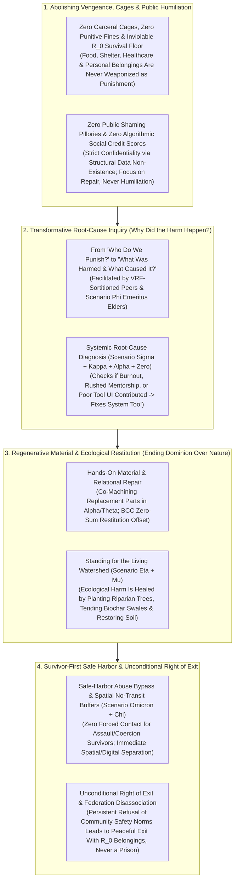
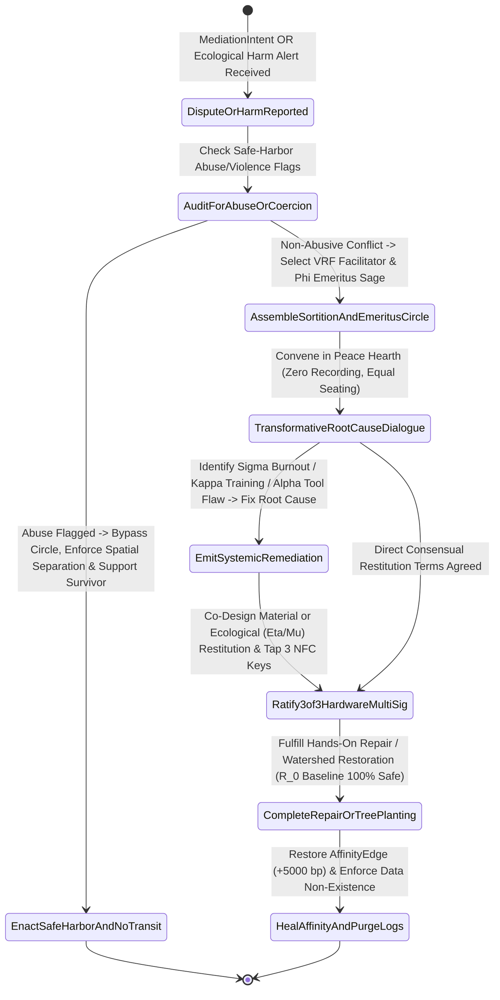

# Scenario Psi: Transformative & Restorative Justice (Abandoning Dominion & Vengeance, Root-Cause Healing, Ecological Restitution & Safe-Harbor Boundaries)

*   **Identifier:** `SCN-PSI-MEDIATION`
*   **System Epic:** Moving Humanity Beyond the Paradigm of Dominion and Retributive Vengeance—Replacing Carceral Cages, Punitive Fines, and Mob Shaming with Transformative Root-Cause Inquiry, Sortition Peace Circles, Ecological & Material Restitution, Survivor-Centered Safe-Harbor Boundaries, and the Unconditional Right of Exit
*   **Primary Layers Tested:** L1 (Physical Reality), L1b (Oasis 3D Shadow Simulator), L2 (Cybernetic Membrane), L3 (Thermodynamic Ledger), L4 (Deterministic Orchestrator), L5 (Polycentric Governance), L6 (Semantic Translation & Agora), L7 (Legacy Interface)
*   **Pass/Fail Metric:** Complete abolition of retributive vengeance, carceral cages, punitive survival-baseline deprivation, and public shaming pillories (`retributive_vengeance_or_cages_count == 0`, `public_shaming_pillory_banned == true`); **Transformative Root-Cause Inquiry** (diagnosing whether systemic `Sigma` burnout, `Kappa` mentorship gaps, or `Alpha` ergonomic flaws contributed to a harm alongside personal accountability); **Rights of the Living Watershed** (allowing ecological harm to $F_{\mathrm{eco}}$ to be healed through regenerative land restitution); 3-of-3 multi-sig hardware NFC ratification of consensual agreements; immediate **Safe-Harbor Survivor Protection & `No-Transit` Boundary Separation** for abuse/coercion with zero forced contact; defensive `9 USC 3` FAA arbitration shielding with zero outbound sheriff enforcement; and zero IEEE 754 floating-point math.

---

## Architectural Council Ratification & 5-Perspective Synthesis

This scenario specification has been ratified by unanimous consensus of the 5-Persona Architectural Council:

| Council Persona | Disciplinary Representative | Core Contribution to Scenario |
| :--- | :--- | :--- |
| **Game Designer** | Lead Systems & Gameplay Designer | **Beyond Vengeance to Transformative Healing Gameplay:** Rejects the lazy video-game trope of "build a prison / execute or banish the bad NPC." In Oasis, when conflict or harm occurs, players convene a **Peace Hearth Circle** that investigates both interpersonal tension and **Systemic Root Causes** (e.g., discovering a broken machine happened because a steward was exhausted or under-mentored). Restitution turns bitter grudges into regenerative work—planting orchard trees (`Eta`) or co-repairing tools (`Alpha`)—restoring the `AffinityEdgeComponent` (`"Deep relief and restored trust after transformative Peace Circle (+5000 bp morale)"`). |
| **Game Engineer** | Principal C++ Simulation & Engine Architect | **Flecs ECS Transformative Justice, Root-Cause & Safe-Harbor Components:** Encapsulates `AffinityEdgeComponent`, `TransformativeDisputeComponent`, `RestitutionAndEcologicalRepairQueue`, and `SafeHarborBoundaryComponent` in 32-bit compact voxels (`material_id = 56` `PEACE_HEARTH_CHAMBER`, `material_id = 57` `RESTORATIVE_ARBOR_GARDEN`). Executes $10\,\mathrm{Hz}$ deterministic BPMN state transitions enforcing 3-of-3 NFC multi-sig, zero-vengeance invariants, and `No-Transit` survivor separation in pure 64-bit fixed-point integer math. |
| **Sovereign Stack Specialist** | Sovereign Stack Systems Architect | **7-Layer Strict Adjacency, Zero Social Credit & Defensive Arbitration:** Maps `col-sensord` through `col-adversaryd` across `/run/collective/ipc/l1_l2.sock` to `/run/collective/ipc/l6_l7.sock` (traversing `/run/collective/ipc/l4_l5.sock`). Prohibits algorithmic social-credit scores or public shaming logs, enforces **Structural Data Non-Existence** on circle dialogues, and uses Federal Arbitration Act (`9 USC 3`) covenants strictly defensively to keep state courts out while never calling sheriffs (`9 USC 9`). |
| **Solarpunk Thinker** | Bioregional Regenerative Ecologist | **Ending Dominion Over Both Humans and Nature:** Recognizes that the mindset of **Dominion** (treating the Earth as dead property to conquer) and **Vengeance** (treating human beings who err as trash to cage or crush) are twin roots of the same pathology. Scenario Psi grants the living watershed ($F_{\mathrm{eco}}$) a voice in the Peace Hearth and channels restitution into healing the land and community rather than feeding a carceral machine. |
| **Scenario Specialist** | Transformative Justice Facilitator & Consensual ADR Jurisprudent | **Accountability Without Cruelty & Survivor Safety Without Prisons:** Pairs VRF-sortitioned peer facilitators and `Scenario Phi` Emeritus elders with **Survivor-First Safe-Harbor Bypass** (never forcing an abuse survivor into a circle with their harmer, enforcing cryptographic/spatial `No-Transit` buffers, and preserving the Unconditional Right of Exit with full $R_0$ personal belongings). |

**Unanimous Consensus Reached:** The Council unreservedly ratifies Scenario Psi as the canonical specification for moving humanity beyond dominion and vengeance into transformative, restorative justice.

---

## 1. Problem Statement, Legacy Failure & Moving Beyond Dominion and Vengeance

For thousands of years, hierarchical empires and late-stage capitalism (Layer 7) have operated under the **Doctrine of Dominion and Retributive Vengeance**—a worldview that mistakes domination for order and cruelty for justice:

1.  **The Fallacy That Vengeance Is Justice:** When harm occurs in Layer 7, the legal and penal system asks only: *"Who is to blame, and how much pain, caging, or financial ruin shall we inflict upon them?"* This retributive impulse satisfies an ancient urge for dominance, yet **it repairs nothing**: the victim is left unhealed, the broken tool or ecosystem remains damaged, and the caged human being is traumatized and hardened.
2.  **The Twin Pathology of Dominion Over Humans and Dominion Over Nature:** The same hierarchical impulse that claims "dominion" to strip-mine forests and poison rivers claims "dominion" to lock human beings in cages, strip their survival baselines, or subject them to public humiliation.
3.  **Adversarial Courtroom Warfare:** Civil litigation turns neighbors into mortal enemies, enriching corporate attorneys while destroying the fabric of community trust.
4.  **The Danger of Informal Mob Vengeance ("Cancel Culture" & Social Credit):** Naive communities that abolish state police without dismantling the *vengeance mindset* often replace physical prisons with **informal psychological prisons**: gossip campaigns, public shaming pillories, permanent pariah castes, or algorithmic "social credit" scores.
5.  **Blindness to Systemic Root Causes:** Punitive systems scapegoat individuals while ignoring whether a mistake or conflict was actually triggered by systemic exhaustion (`SCN-SIGMA-BURNOUT`), inadequate training (`SCN-KAPPA-APPRENTICE`), or bad ergonomic design (`SCN-ALPHA-FAB`).

### 1A. How Scenario Psi Replaces Dominion & Vengeance with Transformative Healing

Scenario Psi (`SCN-PSI-MEDIATION`) uproots the dominion/vengeance paradigm through **Four Transformative Justice Pillars**:



1.  **Abolishing Retributive Vengeance, Carceral Cages & Mob Humiliation:**
    *   **Constitutional Ban on Vengeance (`retributive_vengeance_or_cages_count == 0`):** The Collective possesses zero prisons, zero holding cells, zero armed police, and zero punitive fines. A person's Tier 2 Human Survival Baseline ($B_{\mathrm{baseline}}$: food, housing, healthcare) and $R_0$ personal belongings (`SCN-NU-FASHION` / `SCN-XI-ARCH`) can **never** be withheld as retribution.
    *   **Ban on Public Shaming Pillories & Social Credit (`public_shaming_pillory_banned == true`):** Layer 5 and Layer 6 prohibit public "wall-of-shame" broadcasts and algorithmic social-credit scoring. Peace Hearth dialogues are protected by strict acoustic isolation and **Structural Data Non-Existence (`SCN-RHO-ADVERSARY`)** so a steward who makes a mistake and repairs it is welcomed back whole, never branded with a permanent scarlet letter.
2.  **Transformative Root-Cause Inquiry (*Healing the System Alongside the Person*):**
    *   Instead of asking *"How do we punish the culprit?"*, a Peace Hearth Circle—facilitated by `VRF`-sortitioned peers and supported by the patient wisdom of **Scenario Phi Emeritus Elders (`SCN-PHI-ELDERCARE`)**—conducts a **Transformative Root-Cause Inquiry**:
        *   **Personal Accountability & Empathy:** Listening deeply in a non-hierarchical circle (`material_id = 56`) so the person who caused harm understands the real impact on their neighbor or workshop.
        *   **Systemic & Somatic Root-Cause Audit:** Checking whether the incident was compounded by **Scenario Sigma burnout/sleep deprivation (`SCN-SIGMA-BURNOUT`)**, a gap in **Scenario Kappa safety mentorship (`SCN-KAPPA-APPRENTICE`)**, or a confusing/fragile machine guard in **Scenario Alpha / Zero (`SCN-ALPHA-FAB` / `SCN-ZERO-SOFTWARE`)**. When systemic factors are found, the circle emits a **Systemic Remediation Intent** (e.g., granting Care Leave, updating the training curriculum, or redesigning the machine guard) so the whole community grows safer!
3.  **Ending Dominion Over Nature — Ecological Standing & Regenerative Restitution:**
    *   Because humanity is part of the living web of life rather than its master (*"moving us away from the dominion idea of human"*), **harm against the living ecosystem ($F_{\mathrm{eco}}$)**—such as careless chemical disposal, damaging a coppice grove, or wasting water—is treated with the same restorative gravity as interpersonal harm.
    *   Restitution is never a sterile fine paid to a bureaucracy; it is **active, healing participation**: co-machining the broken gear alongside a mentor (`Alpha`), helping in the community kitchen (`Gamma`), or spending restorative hours with the **Scenario Eta / Mu guilds (`SCN-ETA-COPPICE` / `SCN-MU-EXTRACTION`)** planting native riparian shelterbelts and rebuilding living soil.
4.  **Survivor-Centered Safe Harbor, `No-Transit` Separation & The Unconditional Right of Exit:**
    *   Rejecting vengeance **never** means tolerating predation or forcing victims of violence to sit with their abuser:
        *   **Immediate Safe-Harbor Bypass (`SafeHarborBypassIntent`):** Whenever physical assault, sexual harm, or intimate coercion (`SCN-OMICRON-KINSHIP`) is reported, mandatory face-to-face circle mediation is **strictly prohibited (`circle_bypassed == true`)**.
        *   **Survivor Accompaniment & `No-Transit` Spatial Buffers:** The survivor is surrounded by `Scenario Chi` / `Scenario Sigma` trauma care while `col-kmsd` immediately enforces **Cryptographic & Spatial `No-Transit` Separation**, revoking the harmer's access keys to any building, shift, or courtyard used by the survivor.
        *   **Boundary Protection Without Cages (Disassociation & Right of Exit):** If an individual persistently refuses restorative accountability or poses an ongoing threat to physical safety that cannot be healed through `Scenario Chi` clinical support, The Collective does not cage or torture them—it exercises the **Protocol of Refusal & Peaceful Disassociation**, escorting them out via the **Unconditional Right of Exit** with all of their $R_0$ personal belongings intact and zero outbound sheriff/carceral litigation.

---

## 2. The Collective Workflow (7-Layer Traversal)

Scenario Psi coordinates transformative Peace Circles, systemic root-cause diagnostics, 3-of-3 NFC multi-sig restitution compacts, and Safe-Harbor survivor protection across all 7 layers without skipping layers:

```mermaid
graph TD
    L7[Layer 7: col-adversaryd Legacy Interface] <-->|l6_l7.sock: Defensive 9 USC 3 FAA Arbitration Shield, Data Non-Existence & Zero Sheriff Calls| L6[Layer 6: col-commonsd Semantic Agora]
    L6 <-->|l5_l6.sock: MediationIntent, SystemicRootCauseIntent, RestitutionCompact & SafeHarborBypass| L5[Layer 5: col-kmsd Polycentric Governance]
    L5 <-->|l4_l5.sock: VRF Sortition + Phi Emeritus Facilitators, No-Transit Separation & Zero Vengeance Gate| L4[Layer 4: col-execd Deterministic Orchestrator]
    L4 <-->|l3_l4.sock: Peace Hearth Scheduling, Restitution Task Queue & Affinity Healing| L3[Layer 3: col-storaged Thermodynamic Ledger]
    L3 <-->|l2_l3.sock: Care Non-Commensurability, Unconditional B_baseline & Restitution BCCs| L2[Layer 2: col-membraned Cybernetic Membrane]
    L2 <-->|l1_l2.sock: 3-of-3 ATECC608A NFC Multi-Sig Tap & Acoustic Isolation Check (Zero Audio/Video)| L1[Layer 1: col-sensord Physical Reality]
    L2 <-->|Interpersonal Affinity Graph, Root-Cause & Peace Hearth Sim| L1b[Layer 1b: Oasis 3D Shadow Simulator]
```

### Layer 1: Physical Reality & Layer 1b: Oasis 3D Shadow Simulator
*   **The Circular Peace Hearth & Restorative Arbor Gardens (`Layer 1`):**
    *   **The Peace Hearth Sanctuary (`material_id = 56`):** Circular timber and cork-lined acoustic room (`SCN-XI-ARCH`) with equal-height curved bench seating (eliminating judge's podiums or hierarchical seating), a central tea hearth (`SCN-GAMMA-KITCHEN` / `SCN-ETA-COPPICE`), and an air-gapped 3-of-3 `ATECC608A` NFC hardware signing pedestal—with **zero microphones, zero cameras, and zero recording devices**.
    *   **The Restorative Arbor & Repair Bench (`material_id = 57`):** Outdoor orchard/hedgerow nursery (`Eta`) and cooperative repair bench (`Alpha`) where disputants work side-by-side to turn conflict into tangible ecological or material repair.
*   **Oasis 3D Shadow Simulator (`Layer 1b`):**
    *   Models the `AffinityEdgeComponent` graph between stewards and simulates how unresolved grudges create collaborative friction versus how transformative circles + systemic root-cause fixes boost long-term node cohesion.

### Layer 2: The Cybernetic Membrane (Zero-Audio Privacy & 3-of-3 NFC Multi-Sig)
*   **Confidential Acoustic Shield & Multi-Sig Attestation (`col-membraned`):**
    *   Verifies exterior sound insulation (`ambient_noise_milli_db <= 35000`) while enforcing `audio_or_video_recording_bytes == 0`.
    *   Ratifies a consensual restorative compact only when all three participants (Harmed Steward, Accountable Steward, and Sortitioned/Emeritus Facilitator) tap their hardware `ATECC608A` tokens on the Peace Hearth pedestal within a $60000\,\mathrm{ms}$ window.

### Layer 3: The Thermodynamic Ledger (Non-Commensurability & Zero-Sum BCC Restitution)
*   **Non-Commensurability of Mediation & Unconditional $B_{\mathrm{baseline}}$ (`col-storaged`):**
    *   Peace Circle facilitation, emotional holding, and Emeritus guidance never mint tokens (`exergy_token_minting_permitted == false`), and no dispute or sanction may ever touch a human being's $B_{\mathrm{baseline}}$ survival floor.
*   **Material Restitution via Pairwise `BCC`s:**
    *   When accidental or negligent material damage to shared $R_2/R_3$ equipment is resolved via a consensual offset, it clears strictly across Pairwise Bilateral Clearing Channels ($B_{u \to v}(t) + B_{v \to u}(t) = 0$) or through hands-on repair/ecological labor hours (`RestitutionQueueComponent`), never punitive compound interest or debt bondage.

### Layer 4: The Deterministic Orchestrator (Safe-Harbor Bypass & Root-Cause State Machine)
*   **State Machine Daemon (`col-execd`):**
    *   Executes at $10\,\mathrm{Hz}$ across `/run/collective/ipc/l4_l5.sock`, screening every incoming dispute first for **Safe-Harbor Abuse/Coercion Bypass** (enacting immediate `No-Transit` separation with zero forced dialogue), assembling `VRF`-sortitioned + `Phi` Emeritus facilitators for standard conflicts, logging **Systemic Root-Cause Fixes (`Sigma`/`Kappa`/`Alpha`)**, and restoring the `AffinityEdgeComponent` upon completion.



### Layer 5: Polycentric Governance (Zero Vengeance, Watershed Standing & Right of Exit)
*   **Anti-Vengeance & Anti-Pillory Invariants (`col-kmsd`):**
    *   Prohibits carceral confinement, survival-baseline cuts, public shaming broadcasts, and algorithmic social credit scores.
*   **Watershed Legal Standing ($F_{\mathrm{eco}}$) & Unconditional Right of Exit:**
    *   Appoints `Scenario Eta` ecological guardians to represent the living land in Peace Circles when environmental harm occurs, and guarantees every member's **Unconditional Right of Exit** with their personal $R_0$ belongings and zero state-court harassment.

### Layer 6: Semantic Translation & Agora (Restorative Compacts & Systemic Feedback)
*   **Knowledge Artifacts (`col-commonsd`):**
    *   Parses `MediationIntent`, `SystemicRootCauseRemediationIntent`, `EcologicalRestitutionIntent`, `SafeHarborBypassIntent`, and `AffinityHealedIntent` across `/run/collective/ipc/l5_l6.sock`.

### Layer 7: The Legacy Interface (Defensive FAA Arbitration & Subpoena Immunity)
*   **Defensive Federal Arbitration Act (`9 USC 3`) Shield & Zero Sheriff Policy (`col-adversaryd`):**
    *   Uses the cooperative covenant's arbitration clause **strictly defensively** (`9 USC 3` motion to compel consensual mediation) if a bad-faith actor tries to drag internal commons disputes into hostile Layer 7 courts, while **constitutionally prohibiting outbound `9 USC 9` sheriff asset seizures or police calls** (`outbound_sheriff_or_carceral_calls == 0`).
*   **Subpoena Immunity via Structural Data Non-Existence:**
    *   Peace Circle conversations are never recorded or stored, leaving zero transcripts for external courts to subpoena under *NAACP v. Alabama*.

---

## 3. 3-Stage Incremental Node Facility Blueprints (Node Growth Pattern)

Scenario Psi scales from a quiet household tea-and-listening alcove into a bioregional restorative council arbor and watershed reconciliation sanctuary.

### Stage 1: Domestic Tea Alcove & De-Escalation Nook ($R_1 / R_2$ Bootstrap)
*   **Physical Footprint:** `10 m2` acoustically baffled circular tea alcove in a multi-steward household (`SCN-ZETA-LODGING`).
*   **Core Restorative Features:**
    1.  **Zero-Screen Equal-Seating Tea Hearth:** Floor cushions and accessible curved timber chairs around a low tea table (`SCN-ETA-COPPICE` calming herbal infusions), cork acoustic wall panels, and an air-gapped 3-of-3 NFC hardware token reader.

### Stage 2: Urban Circular Peace Hearth, Safe-Harbor Sanctuary & Repair Studio ($R_2 / R_3$ Municipal Shell)
*   **Physical Footprint:** `120 m2` to `250 m2` acoustic sanctuary co-located with Scenario Epsilon (`SCN-EPSILON-COWORKING`), Scenario Sigma (`SCN-SIGMA-BURNOUT`), and Scenario Alpha (`SCN-ALPHA-FAB`).
*   **Integrated Restorative Zones:**
    1.  **The Circular Rammed-Earth & Cedar Peace Hearth:** Double-stud soundproofed circular chamber ($\le 300\,\mathrm{cB}$) with skylight daylighting, zero electronics/cameras, and adjacent private decompression rooms.
    2.  **The Co-Repair & Restitution Workbench:** Dedicated bay where disputants and `Scenario Kappa` mentors repair damaged equipment together, turning conflict into shared craft mastery.
    3.  **Safe-Harbor Survivor Suite:** Private, secure suite with independent entry/exit and `No-Transit` access control for anyone invoking `SafeHarborBypass`.

### Stage 3: Bioregional Restorative Council Arbor, Watershed Justice Amphitheater & Healing Gardens ($R_3 / R_4$ CLT/PPT)
*   **Physical Footprint:** `2` to `5 hectares` of contemplative gardens, riparian restoration corridors, and timber council halls (`SCN-XI-ARCH`) on an **Irrevocable CLT/PPT**.
*   **Custom Ecological & Transformative Justice Architecture:**
    *   **The Living Watershed Council Arbor:** Open-air timber pavilion nestled beside a restored salmon stream (`SCN-ETA-COPPICE`), where inter-node disputes (`SCN-PI-GUILD`) and ecological stewardship circles meet in the physical presence of the watershed they protect.
    *   **The Regenerative Restitution Nursery & Terraces:** Native tree nurseries, biochar composting terraces (`Mu`), and heirloom orchards where stewards fulfill restorative commitments by healing the living earth.

---

## 4. Machine-Readable Schemas

### 4A. Layer 6 Knowledge Artifact: Transformative Mediation & Root-Cause Intent (`mediation.jsonld`)

```json
{
  "@context": [
    "https://schema.org/",
    "https://collective.network/ontology/v1/"
  ],
  "@type": "TransformativeMediationIntent",
  "identifier": "urn:uuid:5d6e7f8a-9b0c-1d2e-3f4a-5b6c7d8e9f0a",
  "issuerDid": "did:peer:2Ez6Mks3_steward_alice",
  "accountableDid": "did:peer:2Ez6Mkd9_apprentice_charlie",
  "disputeAndRootCauseProfile": {
    "category": "Tool_Damage_And_Watershed_Runoff_Spill",
    "description": "Industrial serger timing gear stripped and non-toxic dye vat spilled into swale during late-night shift; inquiry examines both personal haste and systemic shift fatigue.",
    "abuseOrCoercionDetected": false,
    "systemicRootCausesIdentified": [
      "Scenario_Sigma_Shift_Fatigue_Overload",
      "Scenario_Alpha_Unclear_Gear_Guard_Label"
    ],
    "retributiveVengeanceOrCagesCount": 0,
    "publicShamingPilloryBanned": true
  },
  "restorativeAndEcologicalTerms": {
    "damageEstimateMicroJoules": 36000000000000,
    "coRepairLaborHours": 6,
    "ecologicalWatershedRestitutionHours": 6,
    "systemicRemediationEmittedToSigmaAndAlpha": true,
    "r0SurvivalBaselineUntouched": true
  },
  "facilitatorSelection": {
    "selectionMethod": "VRF_Sortition_Plus_Phi_Emeritus_Elder",
    "poolDomain": "Craft_And_Watershed_Restorative_Facilitators"
  },
  "cryptographicSignature": {
    "type": "Ed25519Signature2020",
    "created": "2026-10-24T10:00:00Z",
    "verificationMethod": "did:peer:2Ez6Mks3_steward_alice#key-1",
    "proofValue": "z3aK8f_alice_hardware_sig_99pL"
  }
}
```

### 4B. Layer 2 Telemetry Attestation: 3-of-3 NFC Resolution & Zero-Recording Proof (`resolution_attestation.json`)

```json
{
  "@context": "https://collective.network/ontology/v1/",
  "@type": "MediationResolutionAttestation",
  "attestationId": "urn:uuid:9a0b1c2d-3e4f-5a6b-7c8d-9e0f1a2b3c4d",
  "peaceHearthVoxel": [12, 4, 18],
  "sessionMetrics": {
    "sessionDurationMilliseconds": 5100000,
    "ambientNoiseMilliDecibels": 29500,
    "audioOrVideoRecordingBytes": 0,
    "completionTimestampEpochMs": 1792841110000
  },
  "ratifiedTerms": {
    "restitutionMode": "Co_Machining_Repair_And_Riparian_Tree_Planting",
    "bilateralChannelOffsetMicroJoules": 36000000000000,
    "regenerativeLaborHoursCommitted": 12,
    "systemicGuardRedesignTicketOpened": true
  },
  "multiSigSignatures": {
    "harmedSignatureAlice": "z3aK8f_alice_atecc608a_sig_99pL",
    "accountableSignatureCharlie": "z7bM2q_charlie_atecc608a_sig_44xY",
    "facilitatorSignatureElderMarcus": "z1cR4t_marcus_atecc608a_sig_77wK"
  },
  "status": "RATIFIED_TRANSFORMATIVE_HEALING_COMPLETE",
  "digestSha256": "4b6c8d0e2f4a6b8c0d2e4f6a8b0c2d4e6f8a0b2c4d6e8f0a2b4c6d8e0f2a4b6c"
}
```

---

## 5. Oasis Engine Implementation Specification

### 5A. Memory Allocation, Voxel State & Transformative Justice Components

The Peace Hearth Chamber and Restorative Arbor Garden occupy designated coordinates in the $32^3$ chunk space (`ChunkManager`):
*   Peace Hearth Chamber voxel initialized with `material_id = 56` (`PEACE_HEARTH_CHAMBER`).
*   Restorative Arbor & Ecological Repair Garden voxel initialized with `material_id = 57` (`RESTORATIVE_ARBOR_GARDEN`).
*   Metadata bitmask `0b00000111` sets `Is_Acoustic_Shield` (bit 0), `Is_Equal_Circle_Seating` (bit 1), and `Is_MultiSig_NFC` (bit 2).

### 5B. Self-Contained C++20 Reference & Test Harness

```cpp
// engine/tests/scenario_psi_test.cpp
#include <cassert>
#include <cstdint>
#include <iostream>
#include <string>

namespace oasis::psi {

enum class DisputeState : uint8_t {
    HARMONIC = 0,
    TENSION = 1,
    FRACTURED = 2,
    MEDIATION_PENDING = 3,
    RECONCILED_AND_TRANSFORMED = 4,
    SAFE_HARBOR_SEPARATED = 5
};

struct alignas(8) AffinityEdgeComponent {
    uint32_t peer_entity_id{0};
    int32_t affinity_score_bps{0}; // Scaled integer [-10000, +10000]
    DisputeState state{DisputeState::HARMONIC};
};

// Models Transformative Root-Cause Inquiry, Ecological Standing & Anti-Vengeance Invariants
struct alignas(8) TransformativeDisputeComponent {
    uint32_t dispute_id{0};
    uint64_t restitution_exergy_uj{0};
    uint16_t co_repair_hours_committed{0};
    uint16_t ecological_watershed_hours_committed{0};
    bool systemic_sigma_fatigue_identified{false};
    bool systemic_alpha_tool_guard_flaw_identified{false};
    bool systemic_remediation_ticket_emitted{false};
    bool phi_emeritus_elder_co_facilitated{true};
    uint32_t retributive_vengeance_or_cages_count{0}; // Must strictly equal 0!
    bool public_shaming_pillory_banned{true};         // Must strictly be true!
    bool r0_survival_baseline_intact{true};           // Must strictly be true!
    uint32_t audio_or_video_recording_bytes{0};       // Must strictly equal 0!
    bool terms_ratified_3of3_nfc{false};
};

struct alignas(8) SafeHarborBoundaryComponent {
    bool abuse_or_coercion_reported{false};
    bool mandatory_circle_bypassed{false};
    bool spatial_no_transit_separation_enforced{false};
    bool unconditional_right_of_exit_honored{true};
    bool r0_personal_belongings_retained{true};
    uint32_t outbound_sheriff_or_carceral_calls{0}; // Must strictly equal 0!
};

struct alignas(8) BilateralClearingChannel {
    int64_t balance_u_to_v_uj{0};
    int64_t balance_v_to_u_uj{0};
    int64_t credit_headroom_uj{72000000000000LL};
};

class TransformativeJusticeEngine {
public:
    // Executes a Transformative Peace Circle: rejects vengeance/cages/pillories, diagnoses
    // systemic root causes (Sigma/Alpha/Kappa), includes ecological restitution (Eta/Mu),
    // and settles 3-of-3 NFC multi-sig restitution while healing interpersonal affinity!
    static bool execute_transformative_peace_circle(
        TransformativeDisputeComponent& dispute,
        AffinityEdgeComponent& affinity_edge,
        BilateralClearingChannel& channel,
        bool sig_harmed,
        bool sig_accountable,
        bool sig_facilitator
    ) {
        // 1. Enforce Anti-Dominion & Anti-Vengeance Constitutional Invariants
        if (dispute.retributive_vengeance_or_cages_count != 0U ||
            !dispute.public_shaming_pillory_banned ||
            !dispute.r0_survival_baseline_intact ||
            dispute.audio_or_video_recording_bytes != 0U) {
            return false;
        }

        // 2. Transformative Root-Cause Inquiry: if systemic factors contributed, fix the system too!
        if (dispute.systemic_sigma_fatigue_identified || dispute.systemic_alpha_tool_guard_flaw_identified) {
            dispute.systemic_remediation_ticket_emitted = true;
        }

        // 3. Require 3-of-3 hardware NFC signatures in the Peace Hearth
        if (!(sig_harmed && sig_accountable && sig_facilitator)) {
            return false;
        }

        dispute.terms_ratified_3of3_nfc = true;
        int64_t delta = static_cast<int64_t>(dispute.restitution_exergy_uj);
        channel.balance_u_to_v_uj += delta;
        channel.balance_v_to_u_uj -= delta;

        // 4. Heal interpersonal affinity edge from FRACTURED (-4500 bp) to RECONCILED (+5000 bp)
        affinity_edge.affinity_score_bps = 5000;
        affinity_edge.state = DisputeState::RECONCILED_AND_TRANSFORMED;
        return true;
    }

    // Executes Survivor-First Safe-Harbor Bypass for abuse or coercion:
    // zero forced contact, immediate No-Transit separation, and zero carceral/sheriff violence
    static bool execute_safe_harbor_survivor_protection(
        SafeHarborBoundaryComponent& safe_harbor,
        AffinityEdgeComponent& affinity_edge
    ) {
        if (!safe_harbor.abuse_or_coercion_reported ||
            safe_harbor.outbound_sheriff_or_carceral_calls != 0U) {
            return false;
        }
        safe_harbor.mandatory_circle_bypassed = true;
        safe_harbor.spatial_no_transit_separation_enforced = true;
        safe_harbor.unconditional_right_of_exit_honored = true;
        safe_harbor.r0_personal_belongings_retained = true;
        affinity_edge.state = DisputeState::SAFE_HARBOR_SEPARATED;
        return true;
    }
};

void test_scenario_psi_transformative_justice_and_safe_harbor() {
    // 1. Test Transformative Peace Circle (Tool & Watershed Harm + Systemic Root-Cause Healing)
    TransformativeDisputeComponent dispute{
        .dispute_id = 101U,
        .restitution_exergy_uj = 36000000000000ULL, // 10 Exergy Credits
        .co_repair_hours_committed = 6U,
        .ecological_watershed_hours_committed = 6U, // Riparian tree planting in Scenario Eta!
        .systemic_sigma_fatigue_identified = true,
        .systemic_alpha_tool_guard_flaw_identified = true,
        .retributive_vengeance_or_cages_count = 0U,
        .public_shaming_pillory_banned = true,
        .r0_survival_baseline_intact = true,
        .audio_or_video_recording_bytes = 0U
    };
    AffinityEdgeComponent affinity{
        .peer_entity_id = 2U,
        .affinity_score_bps = -4500,
        .state = DisputeState::FRACTURED
    };
    BilateralClearingChannel channel{};

    assert(TransformativeJusticeEngine::execute_transformative_peace_circle(
        dispute, affinity, channel, true, true, true
    ));
    assert(dispute.terms_ratified_3of3_nfc == true);
    assert(dispute.systemic_remediation_ticket_emitted == true);
    assert(channel.balance_u_to_v_uj + channel.balance_v_to_u_uj == 0LL);
    assert(affinity.affinity_score_bps == 5000);
    assert(affinity.state == DisputeState::RECONCILED_AND_TRANSFORMED);

    // 2. Test Survivor-First Safe-Harbor Abuse Bypass & Unconditional Right of Exit
    SafeHarborBoundaryComponent safe_harbor{
        .abuse_or_coercion_reported = true,
        .outbound_sheriff_or_carceral_calls = 0U
    };
    AffinityEdgeComponent abuse_edge{
        .peer_entity_id = 99U,
        .affinity_score_bps = -10000,
        .state = DisputeState::FRACTURED
    };
    assert(TransformativeJusticeEngine::execute_safe_harbor_survivor_protection(safe_harbor, abuse_edge));
    assert(safe_harbor.mandatory_circle_bypassed == true);
    assert(safe_harbor.spatial_no_transit_separation_enforced == true);
    assert(safe_harbor.unconditional_right_of_exit_honored == true);
    assert(safe_harbor.r0_personal_belongings_retained == true);
    assert(abuse_edge.state == DisputeState::SAFE_HARBOR_SEPARATED);
}

} // namespace oasis::psi

int main() {
    oasis::psi::test_scenario_psi_transformative_justice_and_safe_harbor();
    std::cout << "Scenario Psi Transformative Justice, Root-Cause Healing, Ecological Restitution & Safe-Harbor tests passed." << std::endl;
    return 0;
}
```

---

## 6. Acceptance Test Gates (Pass/Fail)

| Checkpoint | Validation Method | Pass Condition |
| :--- | :--- | :--- |
| **G1: Abolition of Vengeance, Cages & Pillories** | `execute_transformative_peace_circle` | Enforces zero carceral cages or punitive fines (`retributive_vengeance_or_cages_count == 0`), bans public shaming pillories and social credit (`public_shaming_pillory_banned == true`), and preserves $10000\,\mathrm{bp}$ $R_0$ survival baselines. |
| **G2: Transformative Root-Cause Inquiry** | Systemic Remediation Check | Peace Circles audit whether `Scenario Sigma` fatigue, `Scenario Kappa` training gaps, or `Scenario Alpha` tool flaws contributed to the harm, automatically emitting systemic remediation tickets (`systemic_remediation_ticket_emitted == true`). |
| **G3: Ending Dominion Over Nature (Ecological Restitution)** | Restitution & BCC Audit | Grants standing to the living watershed ($F_{\mathrm{eco}}$), channeling restitution into hands-on tool co-repair and riparian/biochar restoration (`ecological_watershed_hours_committed > 0`) while conserving $B_{u \to v} + B_{v \to u} = 0$. |
| **G4: 3-of-3 NFC Multi-Sig & Zero Recording Privacy** | Peace Hearth Telemetry Audit | Requires 3-of-3 `ATECC608A` NFC taps (`terms_ratified_3of3_nfc == true`) inside an acoustically shielded chamber with zero audio/video recording (`audio_or_video_recording_bytes == 0`). |
| **G5: Survivor-First Safe Harbor & `No-Transit` Separation** | `execute_safe_harbor_survivor_protection` | Reporting abuse or intimate coercion immediately bypasses mandatory circle mediation (`mandatory_circle_bypassed == true`), enforces `No-Transit` spatial separation, and honors the Unconditional Right of Exit with full $R_0$ personal belongings. |
| **G6: Defensive FAA Arbitration & Zero Sheriff Calls (`L7`)** | Legal Carapace Audit | Invokes `9 USC 3` motions strictly defensively to remand external civil suits to mediation while maintaining $0$ outbound sheriff or carceral enforcement calls (`outbound_sheriff_or_carceral_calls == 0`). |
