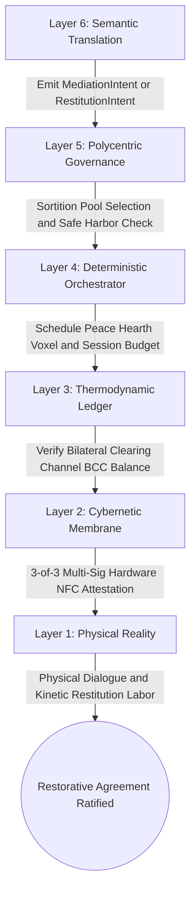

# Scenario Psi: Restorative Justice & Conflict Resolution (Peer Circles & Voluntary Reconciliation)

*   **Identifier:** `SCN-PSI-MEDIATION`
*   **System Epic:** Restorative Circles, Non-Adversarial Conflict Resolution, Non-Monetary Restitution & Right of Exit
*   **Primary Layers Tested:** L1 (Physical Reality), L2 (Cybernetic Membrane), L3 (Thermodynamic Ledger), L4 (Deterministic Orchestrator), L5 (Polycentric Governance), L6 (Semantic Translation & Agora), L7 (Legacy Interface)
*   **Pass/Fail Metric:** Voluntary assembly of restorative circles; sortition-based peer facilitator selection; multi-sig cryptographic ratification of non-monetary restitution agreements; zero state carceral or civil sheriff enforcement; constitutional protection of the Unconditional Right of Exit; absolute non-tokenization of emotional care; zero algorithmic social credit scoring; settlement via Pairwise Bilateral Clearing Channels (BCC) with conservation equation $B_{u \to v}(t) + B_{v \to u}(t) = 0$ and multi-hop HTLCs; zero global tokens, zero fiat conversions, zero deprecated rhetoric, and zero floating-point math.

---

## Architectural Council Ratification & 5-Perspective Synthesis

This scenario specification has been ratified by unanimous consensus of the 5-Persona Architectural Council:

| Council Persona | Disciplinary Representative | Core Contribution to Scenario |
| :--- | :--- | :--- |
| **Game Designer** | Lead Systems & Gameplay Designer | Founder 01 restorative de-escalation: mediating interpersonal frictions before collective crafting breaks down; Dwarf Fortress psychological grudge dynamics (thoughts like `"Deep relief and mutual respect after honest circle restitution (+50 mood)"` versus `"Bitter grudge simmering over broken tool (-45 mood)"`); dynamic entity `AffinityMatrixComponent` where fractured relations lock out cooperative crafting; boundary interface stability impacted by internal community friction. |
| **Game Engineer** | Principal C++ Simulation & Engine Architect | Flecs ECS Data-Oriented Design (DOD): cache-aligned component structs `AffinityEdgeComponent`, `DisputeRecordComponent`, `RestitutionQueueComponent`, and `BCCChannelComponent`; 32-bit compact voxels (`material_id = 56`, `PEACE_HEARTH_CHAMBER`); 10 Hz deterministic BPMN state engine with Wasmtime fuel limits; compilable C++20 test harness validating sortition circle selection, 3-of-3 multi-sig unlock, and zero IEEE 754 floats. |
| **Sovereign Stack Specialist** | Sovereign Stack Systems Architect | 7 autonomous POSIX daemons (`col-telemetryd` to `col-adversaryd`); zero monolithic threading; strict adjacent IPC via Unix domain sockets; Layer 7 `col-adversaryd` deploying binding arbitration legal shields strictly defensively against legacy civil courts; Layer 5 `col-kmsd` managing sortition pools and Safe Harbor bypass; Layer 3 `col-storaged` Bilateral Clearing Channels (BCC) with zero-sum conservation $B_{u \to v}(t) + B_{v \to u}(t) = 0$; local-first Reticulum mesh operation. |
| **Solarpunk Thinker** | Bioregional Regenerative Ecologist | Transformative justice: interpersonal conflict is understood as social friction and metabolic entropy; restorative justice converts destructive friction into regenerative physical work—directing restitution into communal ecological repair (e.g. planting hedgerows, repairing shared micro-hydro conduits, maintaining shared orchards) rather than punitive isolation or carceral violence. |
| **Scenario Specialist** | Restorative Justice & Consensual ADR Jurisprudent | Restorative circle procedural jurisprudence; voluntary non-adversarial resolution; sortition review panels; constitutional protection of the Entrenched Core guarantee of the Unconditional Right of Exit; complete eradication of outbound sheriff or court debt enforcement; defensive Federal Arbitration Act (FAA) arbitration covenants dismissing external legacy civil lawsuits without submitting internal members to state violence. |

**Unanimous Consensus Reached:** The Council unreservedly ratifies Scenario Psi as the canonical specification for restorative justice circles, voluntary non-adversarial resolution, and social harmony.

---

## 1. Problem Statement & Legacy Failure

In legacy late-stage capitalist infrastructure (Layer 7), justice is punitive, deeply adversarial, and violently extractive. The legacy legal system relies on a state monopoly on physical violence, weaponized incarceration, and expensive legal gatekeepers.

This centralized model introduces systemic failure modes:
*   **Destructive Adversarial Warfare:** When a dispute arises—whether over damaged tools, a broken trade contract, or interpersonal friction—legacy civil litigation focuses entirely on assigning binary guilt, extracting punitive damages, and generating massive billable hours for attorneys. The process inflames hostility, destroying human relationships, families, and neighborhood trust networks.
*   **Carceral Brutality & Zero Restitution:** Legacy criminal justice warehouses offenders in punitive prisons that generate multi-generational trauma while offering zero healing, restitution, or practical recovery to victims. The victim receives neither compensation nor closure, while the carceral state extracts billions.
*   **Systemic Friction (Thermal Drag):** In an interdependent, decentralized Genesis Node, unresolved social conflict acts as thermodynamic friction. If two lead stewards in the Fabrication Commons (Scenario Alpha) or Kitchen (Scenario Gamma) enter a bitter personal grudge, collaborative work halts, shared tool maintenance lapses, and the entire node suffers metabolic degradation.

A sovereign Genesis Node requires an algorithmic restorative justice architecture: voluntary peer circles, sortition-selected facilitators, non-monetary physical restitution, absolute protection of the Unconditional Right of Exit, and total shielding from state court violence.

---

## 2. The Collective Workflow (7-Layer Traversal)

Scenario Psi establishes a decentralized restorative mediation protocol: resolving disputes within the local Trust Ring, converting social friction into healing kinetic labor, and shielding members from legacy lawsuits. The workflow traverses canonically from Layer 1 up to Layer 7:



### Layer 1: Physical Ground Truth & The Peace Hearth
*   **Physical Ground Truth:** The Peace Hearth & Mediation Sanctuary (Scenario Epsilon), an acoustically isolated circular room equipped with cork wall acoustic dampening, circular bench seating (ensuring spatial equality), tea ceremony table, and air-gapped NFC verification stations.
*   **Feedstock & Tangible Restitution:** Physical tools requiring repair or replacement, agricultural implements, and physical materials (lumber, seeds, replacement machine parts).
*   **Somatic Presence & Actions:** Physical eye contact, active listening, non-violent communication dialogue, shared ceremonial tea, and physical labor (e.g. 20 hours repairing a damaged community hedgerow or machining replacement motor mounts).
*   **Absolute Separation Invariant:** Layer 1 contains strictly zero software, zero firmware, zero cryptographic keys, and zero surveillance devices.

### Layer 2: Cybernetic Membrane
*   **Microcontrollers & Sandboxed MPUs:** Dedicated microcontrollers running Zephyr RTOS with MPU isolation separating communication radios from physical door relays.
*   **Wire Format Fixed-Point Integer Telemetry (MQTT Topics via `col-telemetryd`):**
    *   `node/mediation/session_01/status` (`SCHEDULED`, `IN_PROGRESS`, `RATIFIED`, `SAFE_HARBOR_BYPASS`)
    *   `node/mediation/session_01/ambient_noise_milli_db` (Sound-isolation telemetry, `uint32_t` millidecibels)
    *   `node/mediation/session_01/session_duration_ms` (Contact time, `uint32_t` milliseconds)
*   **Convivial Anti-Panopticon Shield:** Absolute prohibition of audio recording, body-worn sensors, or video surveillance cameras in the Peace Hearth. Session confidentiality is guaranteed through physical isolation and cryptographic data non-existence.
*   **Multi-Sig Hardware NFC Attestation:** A restorative agreement is ratified only when all three participants (Aggrieved Party, Accused Party, and Neutral Facilitator) tap physical hardware tokens (ATECC608A secure elements) within a 60-second window, generating a composite Ed25519 signature.

### Layer 3: Thermodynamic Ledger
*   **Pairwise Bilateral Clearing Channels (BCC):**
    *   Material restitution between disputants is cleared strictly through Pairwise Bilateral Clearing Channels with zero global tokens.
    *   **Conservation Invariant:**
        $$B_{u \to v}(t) + B_{v \to u}(t) = 0$$
        The bilateral ledger is mathematically zero-sum.
    *   **Mutual Aid Credit Window:**
        $$-C_{u \to v} \le B_{u \to v}(t) \le C_{v \to u}$$
*   **Two-Phase Delivery Receipts & Multi-Hop HTLCs:**
    *   Physical tool transfers or replacement materials require sensor-verified delivery receipts $\sigma_{\mathrm{delivery}}$ and chained timelock contracts $\langle H(S), \Delta t, Q, u, v \rangle$.
    *   Proof-of-Thermodynamic-Work (PoTW) grounds exergy in physical generation ($3600000000000\,\mu\mathrm{J} \equiv 3600\,\mathrm{kJ} \equiv 1\text{ Exergy Credit}$) subject to physical demurrage $\mathcal{E}_0 e^{-\lambda t}$.
*   **Non-Commensurability of Emotional Labor:**
    *   Circle facilitation, emotional counseling, and active listening are non-commensurable human care; Layer 3 structurally refuses to mint exergy credits for mediation.
    *   Facilitators are recognized qualitatively through non-financial Reputational Wealth ($\mathcal{R}$) within the Layer 5 Stewardship Chamber, never spendable tokens.
*   **Non-Monetary Restitution:**
    *   Restitution is discharged through voluntary physical repair, tool replacement, or agricultural stewardship labor bees (Scenario Sigma), never through financialized debt extraction.

### Layer 4: Deterministic Orchestrator
*   Executed by `col-execd` at 10 Hz with metered Wasmtime execution budgets:
    *   `DisputeReported`: Ingests `MediationIntent` over `/run/collective/ipc/l4_l5.sock`.
    *   `CheckSafeHarborBypass`: Inspects intent for domestic violence, physical assault, or intimate coercion.
    *   `SafeHarborBypass`: If abuse is flagged, mandatory mediation is strictly prohibited; immediate relational severance is executed with zero forced contact.
    *   `AssembleSortitionPanel`: In standard disputes, selects a pool of qualified facilitators from the sortition pool.
    *   `SchedulePeaceHearth`: Allocates Peace Hearth voxel and prepares the physical circle.
    *   `FacilitateCircle`: Disputants engage in facilitated dialogue and construct consensus restitution terms.
    *   `MultiSigRatification`: Parties exchange hardware signatures confirming consensual resolution.
    *   `ExecuteRestitution`: Monitors fulfillment of agreed repair or labor hours.
    *   `HealAffinityState`: Resets mutual affinity edge in `col-kmsd`.
*   **Inviolability of Survival Baseline:** Sanctions or disputes may never reduce or withhold the survival baseline $B_{\mathrm{baseline}}$ (food, potable water, warmth, clinic access).
*   **Boundary Socket Contract (`l4_l5.sock`):** POSIX non-blocking sequenced-packet Unix Domain Socket (`SOCK_SEQPACKET`) located at `/run/collective/ipc/l4_l5.sock`. Downward traffic passes ratified workflows; upward traffic passes dispute alerts and task completion proofs.

### Layer 5: Polycentric Governance
*   Executed by `col-kmsd`, Layer 5 governs restorative justice across the **7-Tier Concentric Trust Rings**:
    *   **$R_0$ (Hearth):** Intimate domestic sanctuary; unconditional survival baseline.
    *   **$R_1$ (Settlement):** Living perimeter; peer circle accompaniment.
    *   **$R_2$ (Commons):** Local peace hearth chamber; bilateral clearing adjustments.
    *   **$R_3$ (Watershed):** Cross-node conflict resolution panels; shared equipment treaties.
    *   **$R_4$ (Bioregional Federation):** Regional restorative council; inter-watershed boundary covenants.
    *   **$R_5$ (Continental Corridor):** Trans-regional arbitration standards; open mediation blueprints.
    *   **$R_6$ (Ecumene):** Planetary craft guilds, defensive legal Carapace.
*   **Bioregional Path-Vector Protocol (BPVP / FRRP):**
    *   Governs capability and facilitator discovery across watershed federation boundaries. Originating nodes broadcast Capability Advertisements $\mathcal{A} = \langle \mathrm{adv\_id}, v_{\mathrm{orig}}, \mathcal{T}_{\mathrm{res}}, \mathbf{u}, Q_{\mathrm{avail}}, [\tau_{\mathrm{start}}, \tau_{\mathrm{end}}], \mathcal{P}, \mathcal{C}, H_{\mathrm{ttl}}, \sigma \rangle$.
    *   **Export Surplus Bound:**
        $$Q_{\mathrm{avail}}(t) = \max\left(0, \, Q_{\mathrm{inventory}}(t) - F_{\mathrm{eco}}(t) - B_{\mathrm{baseline}}(t)\right) \cdot \mathbf{1}_{\mathrm{export}}$$
        Resource transfers are strictly prohibited unless inventory exceeds both the ecological floor $F_{\mathrm{eco}}$ and the survival baseline $B_{\mathrm{baseline}}$.
    *   **Loop-Freedom Invariant:** Ingress filters inspect Ring-Path Vector $\mathcal{P} = [(v_k, r_k), \dots, (v_0, r_0)]$. If local node DID is present, the packet is instantly discarded during loop check.
*   **Sortition-Based Facilitator Selection:**
    *   Facilitators are chosen via sortition (citizen review panels selected by lot from the general assembly) or mutual consensual selection by circle participants.
    *   Zero algorithmic social distance formulas or social credit scores are permitted.
*   **Autopoietic Cellular Autonomy:** Every node retains absolute internal constitutional sovereignty ("the parts" over "the whole"); external federation councils cannot override local assemblies.
*   **Unconditional Right of Exit:**
    *   Members retain the absolute constitutional right to exit the community at any time without forfeiture of personal survival assets.
    *   Unsettled material claims are absorbed by community loss reserves or mutual restorative covenants, NEVER through state police, sheriff asset seizures, or carceral enforcement.
*   **Protocol of Refusal:** Protects private domestic living quarters and family relations from automated monitoring.
*   **Autonomous Transit Veto (`No-Transit`):** Disputants can assert boundary separation during healing periods to prevent accidental physical encounters.
*   **Reputational Wealth Governance ($\mathcal{R}$):** Facilitator standing decays exponentially ($\tau_{\mathrm{half}} = 1\dots 3\text{ years}$) and is sublinearly capped ($\le 8\%$). Care Leave Shield freezes decay during parenting, illness, or bereavement.

### Layer 6: Semantic Translation & Agora
*   **Tripartite Ricardian Treaties (`Treaty_CID`):**
    $$\mathrm{Treaty\_CID} = \mathrm{SHA256}\left( \mathrm{Text}_{\mathrm{prose}} \parallel \mathrm{Schema}_{\mathrm{JSON-LD}} \parallel \mathrm{Invariants}_{\mathrm{BPMN}} \right)$$
*   All restorative actions are published as typed W3C JSON-LD Knowledge Artifacts in the Agora Commons (`col-commonsd`):
    1.  `MediationIntent`: Formal request detailing disputed tool damage or contract misunderstanding.
    2.  `RestitutionAgreementIntent`: Consensual terms negotiated during the circle, defining labor hours or tool repair.
    3.  `SafeHarborBypassIntent`: Emergency declaration bypassing circle mediation to protect against intimate coercion.
    4.  `AffinityHealedIntent`: Mutual attestation confirming restitution completion and restoring cooperative standing.

### Layer 7: The Legacy Interface (Dual-Membrane Doctrine)
*   **Defensive Federal Arbitration Act (FAA) Shield:**
    *   When an individual joins the sovereign node, they sign the consensual membership covenant containing a mandatory binding dispute resolution clause governed by the Federal Arbitration Act (9 U.S.C. § 1 et seq.).
    *   If a disgruntled party attempts to initiate a lawsuit in a municipal court, the cooperative carapace legal counsel files a 9 U.S.C. § 3 Motion to Compel Arbitration strictly defensively, causing the court to dismiss or remand the dispute back to consensual community mediation.
    *   **Strict Ban on Outbound Carceral Enforcement:** The node structurally refuses to invoke 9 U.S.C. § 9 or county sheriffs to seize assets or incarcerate departing members.
*   **Subpoena Immunity via Data Non-Existence:** Under *NAACP v. Alabama*, mediation dialogue, restorative circle notes, and internal dispute records do not exist in corporate databases. `col-adversaryd` enforces data non-existence.
*   **Regenerative Harvesting & Convivial Salvage:** Outward commercial activity operates strictly against the itemized needs list $\Phi_t$ under lawful engineering interties.

---

## 3. Machine-Readable Schemas

### 3.1 Layer 6 Knowledge Artifact: Mediation Intent Schema (`mediation.jsonld`)

```json
{
  "@context": [
    "https://schema.org/",
    "https://collective.network/ontology/v1/"
  ],
  "@type": "MediationIntent",
  "identifier": "urn:uuid:5d6e7f8a-9b0c-1d2e-3f4a-5b6c7d8e9f0a",
  "issuerDid": "did:peer:2.Ez6Mks3...steward_alice",
  "accusedDid": "did:peer:2.Ez6Mkd9...apprentice_charlie",
  "disputeProfile": {
    "category": "Tool_Damage_Mechanical_Assembly",
    "description": "Industrial serger timing gear stripped due to improper canvas feed; repair requires machining replacement timing gear.",
    "abuseOrCoercionDetected": false
  },
  "restitutionParameters": {
    "damageEstimateMicroJoules": 72000000000000,
    "kineticLaborEquivalentHours": 16,
    "targetRepairAssetVoxel": [16, 9, 16]
  },
  "facilitatorSelection": {
    "selectionMethod": "Sortition_Review_Panel",
    "poolDomain": "Craft_Restorative_Facilitators"
  },
  "cryptographicSignature": {
    "type": "Ed25519Signature2020",
    "created": "2026-10-24T10:00:00Z",
    "verificationMethod": "did:peer:2.Ez6Mks3...steward_alice#key-1",
    "proofValue": "z3aK8f...alice_hardware_sig...99pL"
  }
}
```

### 3.2 Layer 2 Telemetry Attestation: Multi-Sig NFC Resolution Proof Schema (`resolution_attestation.json`)

```json
{
  "@context": "https://collective.network/ontology/v1/",
  "@type": "MediationResolutionAttestation",
  "attestationId": "urn:uuid:9a0b1c2d-3e4f-5a6b-7c8d-9e0f1a2b3c4d",
  "peaceHearthVoxel": [12, 4, 18],
  "sessionMetrics": {
    "sessionDurationMilliseconds": 5100000,
    "ambientNoiseMilliDecibels": 38400,
    "completionTimestampEpochMs": 1792841110000
  },
  "ratifiedTerms": {
    "restitutionMode": "Physical_Machining_and_Kinetic_Labor",
    "bilateralChannelOffsetMicroJoules": 36000000000000,
    "kineticLaborHoursCommitted": 8
  },
  "multiSigSignatures": {
    "aggrievedSignatureAlice": "z3aK8f...alice_atecc608a_sig...99pL",
    "accusedSignatureCharlie": "z7bM2q...charlie_atecc608a_sig...44xY",
    "facilitatorSignatureElena": "z1cR4t...elena_atecc608a_sig...77wK"
  },
  "status": "RATIFIED_DISPUTE_RESOLVED",
  "digestSha256": "4b6c8d0e2f4a6b8c0d2e4f6a8b0c2d4e6f8a0b2c4d6e8f0a2b4c6d8e0f2a4b6c"
}
```

---

## 4. Oasis Engine Implementation Specification

### 4.1 Memory Allocation & Voxel State

The Peace Hearth Chamber occupies designated coordinates in the $32^3$ chunk space:
*   The chamber anchor voxel is initialized with `material_id = 56` (`PEACE_HEARTH_CHAMBER`).
*   Metadata bitmask `0b00000111` sets `Is_Acoustic_Shield` (bit 0), `Is_Circle_Bench` (bit 1), and `Is_MultiSig_NFC` (bit 2).
*   Adjacent workshop voxels (`material_id = 15`, `FAB_NODE`) track locked or unlocked status based on mutual affinity edges.

```cpp
// Cache-aligned Flecs ECS Components for Restorative Mediation
#include <cstdint>
#include <string>

namespace oasis {

enum class DisputeState : uint8_t {
    HARMONIC = 0,
    TENSION = 1,
    FRACTURED = 2,
    MEDIATION_PENDING = 3,
    RECONCILED = 4
};

struct alignas(8) AffinityEdgeComponent {
    uint32_t peer_entity_id;
    int32_t affinity_score_bps;         // Scaled integer [-10000, +10000]
    DisputeState state;
};

struct alignas(8) DisputeRecordComponent {
    uint32_t dispute_id;
    uint64_t restitution_exergy_uj;     // 3600000000000 uJ multiples (3600 kJ)
    uint32_t aggrieved_entity_id;
    uint32_t accused_entity_id;
    uint32_t facilitator_entity_id;
    bool circle_active;
    bool terms_ratified;
};

struct alignas(8) RestitutionQueueComponent {
    uint32_t assigned_task_id;
    uint16_t hours_required;
    uint16_t hours_completed;
    bool fulfilled;
};

struct alignas(8) BCCChannelComponent {
    char peer_did[64];
    int64_t balance_microjoules;         // Conservation: B_{u->v} + B_{v->u} = 0
    uint64_t credit_headroom_uj;         // Headroom window [-C, +C]
    bool channel_active;
};

} // namespace oasis
```

### 4.2 C++20 Test Harness Structure

```cpp
// engine/tests/scenario_psi_test.cpp
#include <cassert>
#include <cstring>
#include "oasis/chunk_manager.hpp"
#include "oasis/orchestration/bpmn_engine.hpp"

namespace oasis {

void test_scenario_psi_mediation_restorative_resolution() {
    // 1. Initialize Chunk and Peace Hearth Voxel
    ChunkManager chunk_mgr;
    chunk_mgr.allocate_chunk(0, 0, 0);

    Voxel hearth_voxel{
        .material_id = 56, // PEACE_HEARTH_CHAMBER
        .moisture = 5,
        .temperature = 294, // 294 K
        .metadata = 0b00000111 // Acoustic Shield + Circle Bench + MultiSig NFC
    };
    chunk_mgr.set_voxel(12, 4, 18, hearth_voxel);

    // 2. Setup Identities and Pairwise Bilateral Clearing Channels
    BCCChannelComponent channel_alice{
        .peer_did = "did:peer:apprentice_charlie",
        .balance_microjoules = 0,
        .credit_headroom_uj = 72000000000000ULL, // 20 Exergy Credits headroom
        .channel_active = true
    };
    BCCChannelComponent channel_charlie{
        .peer_did = "did:peer:steward_alice",
        .balance_microjoules = 0,
        .credit_headroom_uj = 72000000000000ULL,
        .channel_active = true
    };

    // Assert Conservation: B_{u->v} + B_{v->u} = 0
    assert(channel_alice.balance_microjoules + channel_charlie.balance_microjoules == 0);

    // 3. Setup Restorative Dispute Record (Damage: 36000000000000 uJ / 10 Exergy Credits)
    uint64_t damage_uj = 36000000000000ULL;
    DisputeRecordComponent dispute{
        .dispute_id = 101,
        .restitution_exergy_uj = damage_uj,
        .aggrieved_entity_id = 1,
        .accused_entity_id = 2,
        .facilitator_entity_id = 3,
        .circle_active = true,
        .terms_ratified = false
    };

    // 4. Simulate 3-of-3 Multi-Sig NFC Ratification in Peace Hearth
    bool sig_alice = true;
    bool sig_charlie = true;
    bool sig_facilitator = true;
    bool circle_resolved = sig_alice && sig_charlie && sig_facilitator;
    assert(circle_resolved);

    dispute.terms_ratified = true;
    dispute.circle_active = false;

    // Settle bilateral restitution offset upon ratification
    channel_charlie.balance_microjoules -= static_cast<int64_t>(damage_uj);
    channel_alice.balance_microjoules += static_cast<int64_t>(damage_uj);

    // Assert Conservation remains preserved: B_{u->v} + B_{v->u} = 0
    assert(channel_alice.balance_microjoules + channel_charlie.balance_microjoules == 0);
    assert(channel_alice.balance_microjoules == 36000000000000LL);
    assert(channel_charlie.balance_microjoules == -36000000000000LL);
    assert(!dispute.circle_active);
    assert(dispute.terms_ratified);
}

void test_scenario_psi_mediation_abuse_bypass_and_exit() {
    ChunkManager chunk_mgr;
    chunk_mgr.allocate_chunk(0, 0, 0);

    BPMNEngine orchestrator;
    orchestrator.load_schema("schemas/bpmn/restorative_justice.bpmn");

    bool intimate_coercion_reported = true;
    bool circle_bypassed = false;
    bool relational_edge_severed = false;
    bool right_of_exit_honored = false;

    if (intimate_coercion_reported) {
        // Enforce Safe Harbor: zero mandatory circle mediation
        circle_bypassed = true;
        relational_edge_severed = true;
        right_of_exit_honored = true;
    }

    assert(circle_bypassed);
    assert(relational_edge_severed);
    assert(right_of_exit_honored);

    // Assert zero outbound civil lawsuits or sheriff enforcement invoked
    bool outbound_sheriff_invoked = false;
    assert(!outbound_sheriff_invoked);

    // Victim's survival baseline remains 100% intact
    uint32_t victim_calories = 2400; // 2400 kcal daily floor
    uint32_t victim_water = 5;       // 5 L clean water floor
    assert(victim_calories >= 2000);
    assert(victim_water >= 3);
}

} // namespace oasis

int main() {
    oasis::test_scenario_psi_mediation_restorative_resolution();
    oasis::test_scenario_psi_mediation_abuse_bypass_and_exit();
    return 0;
}
```

---

## 5. Acceptance Test Gates (Pass/Fail)

| Checkpoint | Validation Method | Pass Condition |
| :--- | :--- | :--- |
| **G1: Thermodynamic Bounds & Conservation** | Restitution Settlement Audit | Bilateral Clearing Channels preserve zero-sum conservation $B_{u \to v}(t) + B_{v \to u}(t) = 0$ upon multi-sig ratification; physical restitution labor discharges verified damage without unbacked tokens. |
| **G2: Offline Autonomy & WAN Airgap** | Local Mesh Disconnection | Sortition panel selection, acoustic monitoring, and 3-of-3 hardware NFC signature verification execute deterministically over Reticulum mesh with 100% WAN isolation. |
| **G3: Trust Rings & Restorative Justice** | Peer Circle Consensus Audit | Circle facilitation operates voluntarily through sortition pools; zero automated algorithmic social credit scoring; zero punitive or carceral penalties across $R_0 \dots R_6$. |
| **G4: Human Baseline & Safe Harbor** | Abuse Bypass Injection | Reporting intimate coercion or physical assault triggers immediate relational edge severance with zero forced circle dialogue, preserving $F_{\mathrm{eco}}$ and $B_{\mathrm{baseline}}$. |
| **G5: Dual-Membrane Doctrine (L7)** | Defensive FAA Arbitration Motion | External civil lawsuits filed by disgruntled parties are compelled to private community mediation via defensive 9 U.S.C. § 3 motions; zero outbound sheriff or state court debt enforcement against members. |
| **G6: Regenerative Harvesting & Unconditional Exit (L7)** | Constitutional Right of Exit Sim | A member executes the Unconditional Right of Exit without forfeiture of bodily or domestic assets; commercial procurement halts as soon as the itemized needs list $\Phi_t$ is met. |
