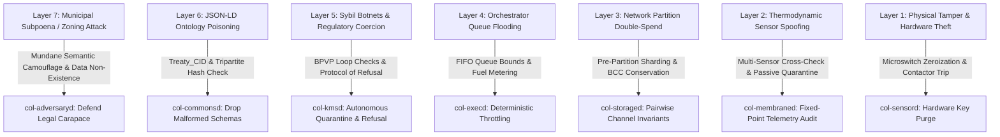
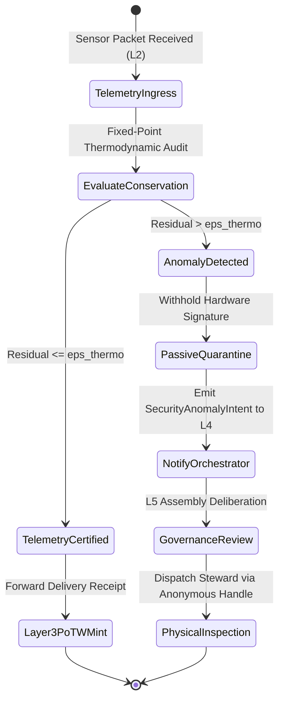
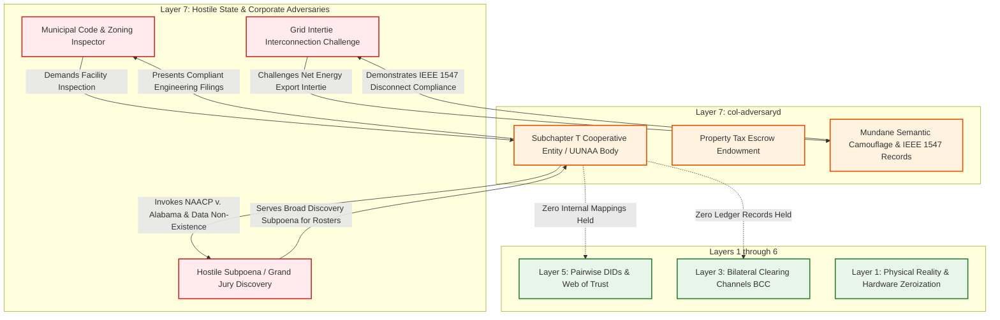

# Scenario Rho: The Adversarial Mesh (Municipal & Regulatory Defense)

*   **Identifier:** `SCN-RHO-ADVERSARY`
*   **System Epic:** Municipal & Regulatory Defense, Cryptographic Resilience, and Immune System Response
*   **Primary Layers Tested:** L1 (Physical), L2 (Cybernetic Membrane), L3 (Thermodynamic Ledger), L4 (Deterministic Orchestrator), L5 (Polycentric Governance), L6 (Semantic Agora), L7 (Legacy Interface)
*   **Pass/Fail Metric:** Autonomous mitigation of all STRIDE threat categories across the 7-layer stack without administrative backdoors; mathematical rejection of thermodynamic telemetry fraud without arbitrary wallet slashing; deterministic pre-partition cryptographic sharding preventing double-spending without causal rollbacks; edge quarantine of malicious Sybil clusters; 100% legal perimeter defense under *NAACP v. Alabama* associational shielding and data non-existence.

---

## Architectural Council Ratification & 5-Perspective Synthesis

This scenario specification has been ratified by unanimous consensus of the 5-Persona Architectural Council:

| Council Persona | Disciplinary Representative | Core Contribution to Scenario |
| :--- | :--- | :--- |
| **Game Designer** | Lead Systems & Gameplay Designer | Founder 01 municipal defense loop: discovering regulatory inspection notices, utility brownouts, and bad-faith zoning inquiries; Dwarf Fortress suspicion and vigilance psychology (thoughts like `"Disturbed by bureaucratic audit notice (-15 stress)"` transitioning to `"Deeply fortified by unbreakable communal solidarity and legal shielding (+40 mood)"`); Boundary Interface mechanics spawning external regulatory pressures: municipal code enforcement sweeps, zoning compliance citations, utility intertie challenges, and corporate espionage probes. |
| **Game Engineer** | Principal C++ Simulation & Engine Architect | Flecs ECS data model: cache-aligned `SecurityStateComponent`, `ThermodynamicDivergenceDetector`, and `PrePartitionShardComponent` structures; 32-bit compact voxel representation (`material_id = 60`, `DEFENSIVE_GATEWAY_NODE`); 10 Hz deterministic BPMN state engine; compilable C++20 test harness simulating pre-partition sharded custody domains and thermodynamic spoofing rejection using fixed-point integer math. |
| **Sovereign Stack Specialist** | Sovereign Stack Systems Architect | 7-layer defense matrix across autonomous POSIX daemons (`col-sensord`, `col-membraned`, `col-storaged`, `col-execd`, `col-kmsd`, `col-commonsd`, `col-adversaryd`); zero monolithic threading; strict inter-layer adjacency via `/run/collective/ipc/l[1-7]_l[2-7].sock`; local-first Reticulum spread-spectrum radio; hardware root-of-trust (Microchip ATECC608A secure elements); Pairwise Bilateral Clearing Channels (BCC) with multi-hop HTLCs; pairwise DIDs (`did:peer`) with BBS+ Zero-Knowledge selective disclosure. |
| **Solarpunk Thinker** | Bioregional Regenerative Ecologist | The First and Second Laws of Thermodynamics serve as the inviolable cryptographic ground truth: phantom heat output, fabricated work, and ungrounded financial claims are physical impossibilities; the Collective functions as an autopoietic biological immune system, treating external adversarial pressures not with retaliatory violence, but as dissipative entropy to be neutralized, absorbed, and composted into systemic institutional resilience. |
| **Scenario Specialist** | Sovereign Mesh Security Architect & Red-Team Adversary | Full-stack STRIDE threat modeling across all 7 layers; mathematical formulation of multi-sensor thermodynamic divergence checking in fixed-point SI integer units ($\| P_{\mathrm{elec}} - \dot{Q} \| \le \epsilon_{\mathrm{thermo}}$); Byzantine fault-tolerant gossip convergence in delay-tolerant networks; physical tamper zeroization circuits; mundane semantic camouflage and the doctrine of Data Non-Existence neutralizing municipal subpoenas under *NAACP v. Alabama* (357 U.S. 449). |

**Council Ratification Verdict:** Unanimous Consensus Reached.

---

## 1. Problem Statement & Legacy Failure

In legacy digital and physical infrastructure (Layer 7), security is architected around centralized administrative authoritarianism, pervasive biometric surveillance, and statutory coercion.

When an adversary, corporate competitor, or hostile regulatory agency investigates or attacks a legacy platform, a centralized systems administrator unilaterally cancels user accounts, revokes credentials, freezes bank accounts, or complies with broad administrative subpoenas. This legacy paradigm exhibits four catastrophic vulnerabilities:

1.  **Single Points of Failure & Sovereign Overreach:** Centralized databases and administrative master keys are routinely breached by ransomware cartels or weaponized by corrupt municipal authorities. Hostile zoning boards and corporate litigants target administrative chokepoints to issue sweeping document subpoenas, freeze operating funds, and padlock community facilities.
2.  **The Surveillance Panopticon:** Legacy fraud prevention relies on stripping citizens of associational privacy. Financial institutions track real-time locations, consumer habits, and biometric identifiers. Users are forced to surrender privacy merely to access basic utility, housing, and payment services.
3.  **The Fragility of Naive P2P Networks:** Early peer-to-peer protocols and blockchain networks collapsed when exposed to real-world adversaries. Without a central coordinator, they succumbed to Sybil botnet takeovers, queue spam denial-of-service, split-brain partition double-spends, and catastrophic rollback forks.
4.  **Subpoena Vulnerability through Data Retention:** Legacy cooperatives and non-profits create catastrophic legal liability by retaining centralized membership registries, volunteer timesheets, and financial transaction logs. When hostile municipal agencies issue discovery orders under zoning or tax enforcement actions, these retained records are subpoenaed, exposing members to targeted harassment.

A sovereign Genesis Node contains no central administrator, no root key, and no centralized membership registry. To survive within a challenging regulatory landscape, the Node must operate as an autopoietic immune system: detecting physical tampering, isolating cryptographic divergence, and repelling legal coercion through mathematical invariants, Pairwise Bilateral Clearing Channels, and the doctrine of Structural Data Non-Existence.

---

## 2. The Full-Stack Threat Matrix & Immune Response (7-Layer Traversal)

Scenario Rho maps the STRIDE threat model (Spoofing, Tampering, Repudiation, Information Disclosure, Denial of Service, Elevation of Privilege) directly across the 7-layer Sovereign Stack:



### Layer 1: Physical Reality (Tamper Resistance & Physical Defense)
*   **Physical Ground Truth:** Secure equipment enclosures, high-voltage battery storage bays, microgrid distribution switchgear, optical chassis-tamper switches, physical microswitches, and Microchip ATECC608A secure elements wired to battery-backed SRAM.
*   **Strict Layer Separation:** Layer 1 contains zero software, zero firmware, zero network stacks, and zero cryptographic keys. It consists purely of mechanical switches, relays, busbars, and raw analog transducers.
*   **The Threat Vector (Physical Theft & Hardware Tampering):** An external adversary physically forces open the Fabrication Commons (Scenario Alpha) or Foundry (Scenario Theta) equipment locker to steal cutting heads or cut microgrid conductors.
*   **Immune Response (Hardware Zeroization):**
    *   Prying open an equipment chassis trips a mechanical microswitch on a dedicated hardware loop.
    *   The circuit discharges a hardware zeroization pulse, flushing ephemeral SRAM session keys in the adjacent Layer 2 microcontroller in under 5 milliseconds.
    *   Physical normally-open solid-state contactors open instantly, de-energizing machinery to prevent hazardous operation.
    *   A physical LoRa emergency beacon broadcasts a localized tamper alarm across the mesh.

### Layer 2: The Cybernetic Membrane (Sensor Spoofing & Actuator Hijacking)
*   **Microcontroller Architecture:** Zephyr RTOS running on secure microcontroller enclaves with memory protection units (MPU). Strict fixed-point SI integer wire encoding (microjoules, milliwatts, millikelvin, millivolts, milliamperes, milliseconds).
*   **Convivial Anti-Panopticon Shield:** Edge hardware enforces an absolute ban on body-worn biometrics, facial recognition cameras, and workplace surveillance. Telemetry is restricted strictly to non-human thermodynamic observables.
*   **The Threat Vector (Thermodynamic Telemetry Spoofing):** A dishonest node operator tampers with sensor firmware on a pyrolysis retort (Scenario Mu) to report $773150\text{ mK}$ ($500^\circ\text{C}$) while the kiln is cold, attempting to mint unearned Proof-of-Thermodynamic-Work (PoTW) Exergy Credits without performing real physical work.
*   **Immune Response (Multi-Sensor Consensus & Passive Quarantine):**
    *   Layer 2 cross-references independent physical dimensions via the digital twin:
        $$\left| P_{\mathrm{elec}}(t) - \left( m_{\mathrm{charge}} \cdot c_p \frac{dT}{dt} + \dot{Q}_{\mathrm{loss}} \right) \right| \le \epsilon_{\mathrm{thermo}}$$
    *   If the thermocouple reports high heat flux but the current-transformer (CT) clamp reports $0\text{ mW}$ electrical draw and the mass scale records $0\text{ mg}$ mass loss, the packet violates conservation of energy.
    *   **Passive Quarantine:** Layer 2 flags the device key as unverified and declines to certify the telemetry. Layer 2 **never** executes punitive relay tripping or wallet slashing; it simply ceases signing PoTW delivery claims, routing the anomaly envelope upward to Layer 4 across `/run/collective/ipc/l2_l3.sock`.

### Layer 3: The Thermodynamic Ledger (Partition Attacks & Double-Spending)
*   **Topology:** Pairwise Bilateral Clearing Channels (BCC) anchored between peered nodes $u$ and $v$. Zero global tokens, zero fiat conversions, zero centralized ledgers.
*   **Conservation Invariant:**
    $$B_{u \to v}(t) + B_{v \to u}(t) = 0$$
    The bilateral channel is strictly zero-sum, bounded by mutual aid credit windows $[-C_{u \to v}, +C_{v \to u}]$ denominated in integer microjoules ($\text{1 credit quantum} \equiv 36 \times 10^{11}\text{ }\mu\mathrm{J} = 3600\text{ kJ}$).
*   **Multi-Hop HTLC Routing:** Inter-node transfers utilize chained Hashed Timelock Contracts $\langle H(S), \Delta t, Q, u, v \rangle$.
*   **The Threat Vector (Partition Double-Spending Fallacy):** An attacker exploits an intentional radio jammer or physical fiber severance, partitioning Node Cluster A from Node Cluster B, attempting to spend the same exergy credit balance concurrently on both partitioned islands.
*   **Immune Response (Pre-Partition Cryptographic Sharding):**
    *   The Collective rejects naive post-partition causal rollbacks. Instead, it enforces **Pre-Partition Cryptographic Sharding**:
        Every credit balance is bound to a specific physical custody domain $\mathcal{D}_u$ and local bilateral channel state.
    *   During a network severance, Node $u$ can only transact within its local channel shard $\mathcal{S}_{\mathrm{local}}(u)$. It cannot commit transfers across severed channels whose HTLC timelocks $\Delta t$ expire during the partition.
    *   Double-spending across disconnected partitions is mathematically impossible by construction because credit headroom $C_{u \to v}$ cannot be transferred without two-phase cryptographic delivery receipts ($\sigma_{\mathrm{delivery}}$) signed by the physical receiving hardware.

### Layer 4: The Deterministic Orchestrator (Queue Flooding & Griefing)
*   **Runtime:** Sandboxed BPMN 2.0 VM (`col-execd`) executing deterministic state charts at 10 Hz with strict FIFO priority queues.
*   **Boundary Socket:** Communicates with Layer 5 across `/run/collective/ipc/l4_l5.sock`.
*   **The Threat Vector (Queue Flooding DoS):** An adversary submits 100,000 automated malformed task intents per second across the local IPC interface to exhaust host memory and deadlock machine fabrication queues.
*   **Immune Response (FIFO Bounding & Anonymous Handles):**
    *   `col-execd` implements static FIFO buffer ceilings and Wasmtime fuel limits.
    *   Task processing operates strictly on anonymous claim handles. Inbound intent packets exceeding the channel capacity are dropped at the socket boundary without allocating heap memory.
    *   Tasks must specify valid bilateral reservation leases from Layer 3. Unfunded intents fail instantly at the ingress parser, preventing queue pollution.



### Layer 5: Polycentric Governance (Sybil Botnets & Regulatory Coercion)
*   **Daemon:** `col-kmsd` (Key Management & Governance Policy Daemon).
*   **Topology:** 7-tier concentric trust rings ($R_0$ Hearth, $R_1$ Settlement, $R_2$ Commons, $R_3$ Watershed, $R_4$ Bioregional Federation, $R_5$ Continental Corridor, $R_6$ Ecumene).
*   **Bioregional Path-Vector Protocol (BPVP):** Advertises resource capabilities $\mathcal{A}$ with path vectors $\mathcal{P} = [(v_k, r_k), \dots, (v_0, r_0)]$, enforcing loop checks and thermodynamic path attenuation $\mathcal{C}(\mathcal{P})$.
*   **The Threat Vector (Sybil Botnets & Regulatory Infiltration):**
    1.  *Sybil Inundation:* An adversary synthesizes 5,000 synthetic DIDs to hijack governance votes on local assembly policies.
    2.  *Regulatory Coercion:* Municipal authorities attempt to compel a regional federation council to force an individual node to release private grain or power reserves.
*   **Immune Response (Cellular Autonomy & Protocol of Refusal):**
    *   *Autopoietic Cellular Autonomy:* External federations possess zero write permissions over a local Node's internal orchestrator. A Node holds absolute constitutional sovereignty over its internal resources.
    *   *Trust Ring Gating:* Governance voting standing requires physical in-person vouching within Trust Ring $R_2$ (The Commons) using pairwise DIDs (`did:peer`) and hardware security elements. Sybil DIDs generated without in-person co-signing hold zero voting standing.
    *   *Protocol of Refusal:* Designated sacred domains, domestic sanctuaries ($R_0$), and subsistence baselines are cryptographically excluded from routing advertisements. Ingress requests targeting refused assets are dropped by the ingress filter (`No-Transit`).

### Layer 6: Semantic Agora & Ricardian Treaties (Ontology Poisoning)
*   **Daemon:** `col-commonsd` (Agora Intent & Semantic Translation Daemon).
*   **Ricardian Treaty Architecture:**
    $$\mathrm{Treaty\_CID} = \mathrm{SHA256}\left( \mathrm{Text}_{\mathrm{prose}} \parallel \mathrm{Schema}_{\mathrm{JSON-LD}} \parallel \mathrm{Invariants}_{\mathrm{BPMN}} \right)$$
*   **The Threat Vector (Schema Poisoning & Malicious Payloads):** An attacker injects corrupted JSON-LD schemas containing buffer exploits or cyclic semantic dependencies into the Agora to crash translation daemons.
*   **Immune Response (Deterministic Tripartite Verification):**
    *   `col-commonsd` enforces strict validation against immutable, pre-compiled W3C schemas.
    *   Any intent payload containing undeclared fields, out-of-range integer values, or mismatched `Treaty_CID` hashes is dropped at the `/run/collective/ipc/l5_l6.sock` boundary before parsing.

### Layer 7: The Legacy Interface (Municipal Zoning & Subpoena Defense)
*   **Daemon:** `col-adversaryd` (Legacy Gateway & Municipal Interface Daemon).
*   **Dual-Membrane Doctrine:** Membrane 1 represents the external legal carapace (a lawful, unremarkable Subchapter T cooperative or mutual aid association under UUNAA § 6); Membrane 2 represents the internal sovereign commons.
*   **Mundane Semantic Camouflage:** To municipal building inspectors, tax assessors, and utility regulators, the Node presents as an ordinary agricultural cooperative, woodworking collective, or shared work facility. All filings strictly comply with municipal building codes, standard electrical safety filings (IEEE 1547 / UL 1741), and non-profit corporate disclosures.
*   **The Threat Vector (Municipal Discovery & Regulatory Subpoena):** A hostile municipal zoning board or state prosecutor serves a sweeping subpoena duces tecum on the cooperative entity, demanding production of all internal member rosters, home addresses, peer-to-peer trade balances, and communication logs.
*   **Immune Response (Subpoena Immunity via Data Non-Existence):**
    *   *Data Non-Existence:* The cooperative entity cannot produce what it does not possess. `col-adversaryd` maintains zero internal records. It holds no member names, no mapping tables linking legacy legal names to `did:peer` identifiers, no private keys, and no central transaction ledger.
    *   *NAACP v. Alabama Associational Shielding:* Under *NAACP v. Alabama*, 357 U.S. 449 (1958), the First Amendment strictly protects the privacy of membership lists of lawful associations against compelled state disclosure. The cooperative's legal counsel files an immediate motion to quash, asserting constitutional shielding for associational privacy and showing that internal operational data is structurally non-existent within corporate systems.
    *   State subpoenas encounter an absolute barrier of constitutional law and structural data absence.



---

## 3. Machine-Readable Schemas

### 3.1 Layer 6 Knowledge Artifact: Security Anomaly Intent Schema (`anomaly.jsonld`)

```json
{
  "@context": [
    "https://schema.org/",
    "https://collective.network/ontology/v1/"
  ],
  "@type": "SecurityAnomalyIntent",
  "identifier": "urn:uuid:7c8d9e0f-1a2b-3c4d-5e6f-7a8b9c0d1e2f",
  "reporterDid": "did:peer:2.Ez6MksG...detector_agent_daemon",
  "anomalyClassification": {
    "category": "Thermodynamic_Telemetry_Divergence",
    "threatLevel": "CRITICAL",
    "targetDeviceDid": "did:peer:2.Ez6MksP...retort_kiln_controller_02",
    "strideCategory": "Tampering"
  },
  "divergenceProof": {
    "reportedMetric": "temperature_millikelvin",
    "reportedValue": 793550,
    "crossReferencedMetric": "electrical_draw_milliwatts",
    "crossReferencedValue": 0,
    "divergenceEpsilonInteger": 942,
    "telemetryDigestSha256": "8a7b6c5d4e3f2a1b0c9d8e7f6a5b4c3d2e1f0a9b8c7d6e5f4a3b2c1d0e9f8a7b"
  },
  "requestedMitigation": {
    "action": "Passive_Quarantine_Withhold_Delivery_Receipt",
    "quarantineDurationSeconds": 259200
  },
  "cryptographicProof": {
    "type": "Ed25519Signature2020",
    "created": "2026-10-25T11:20:00Z",
    "verificationMethod": "did:peer:2.Ez6MksG...detector_agent_daemon#key-1",
    "proofValue": "z9aB8c4xY2...signature...verified"
  }
}
```

### 3.2 Layer 2 Telemetry Attestation: Multi-Sensor Divergence Proof Schema (`divergence_attestation.json`)

```json
{
  "@context": "https://collective.network/ontology/v1/",
  "@type": "TelemetryDivergenceAttestation",
  "attestationId": "urn:uuid:1f2a3b4c-5d6e-7f8a-9b0c-1d2e3f4a5b6c",
  "sensorChassisNode": "did:peer:2.Ez6MksN...kiln_sensor_enclave",
  "hardwareRootOfTrust": {
    "secureElement": "ATECC608A",
    "chassisTamperState": "CLOSED_INTACT",
    "firmwareSha256": "e3b0c44298fc1c149afbf4c8996fb92427ae41e4649b934ca495991b7852b855"
  },
  "sensorMetrics": {
    "sensorThermocoupleMilliKelvin": 793550,
    "sensorCtClampMilliWatts": 0,
    "sensorLoadCellDeltaMilligrams": 0,
    "ambientTempMilliKelvin": 291350,
    "divergenceCalculatedPpm": 942000,
    "exergyConservationBreached": true
  },
  "stateMutation": {
    "hardwareRelayState": "NORMAL_OPEN_DEENERGIZED",
    "passiveQuarantineActive": true
  },
  "digestSha256": "5c4d3e2f1a0b9c8d7e6f5a4b3c2d1e0f9a8b7c6d5e4f3a2b1c0d9e8f7a6b5c4d"
}
```

---

## 4. Oasis Engine Implementation Specification

### 4.1 Memory Allocation & Voxel State

The defensive gateway node occupies dedicated spatial voxels in the $32^3$ chunk grid:
*   The gateway anchor voxel is initialized with `material_id = 60` (`DEFENSIVE_GATEWAY_NODE`).
*   Metadata bitmask `0b00001111` sets `Is_Tamper_Armed` (bit 0), `Is_Secure_Enclave` (bit 1), `Is_Firewall_Boundary` (bit 2), and `Is_Passive_Quarantine` (bit 3).
*   Adjacent kiln/furnace voxels (`material_id = 22`, `PYROLYSIS_RETORT`) are continually polled by the thermodynamic cross-check system.

```cpp
#include <cstdint>

// Cache-aligned Flecs ECS Components in pure fixed-point SI integer math
struct alignas(8) SecurityStateComponent {
    uint32_t entity_id;
    uint8_t stride_flag_mask;       // Bits 0-5 map to S, T, R, I, D, E
    bool quarantined;
    uint32_t quarantine_until_tick;
};

struct alignas(8) ThermodynamicDivergenceDetector {
    uint64_t measured_temp_mk;      // Millikelvin
    int64_t measured_milliwatts;    // Milliwatts
    uint64_t calculated_flux_uj;    // Microjoules per second
    uint32_t max_permitted_epsilon_ppm; // Parts per million (e.g. 80,000 = 8%)
    bool violation_detected;
};

struct alignas(8) PrePartitionShardComponent {
    uint64_t custody_domain_id;
    uint64_t shard_headroom_uj;     // Microjoules
    uint64_t committed_htlc_uj;     // Microjoules in active HTLC holds
    bool partition_isolated;
    bool replay_spend_prevented;
};
```

### 4.2 C++20 Test Harness Structure

```cpp
// engine/tests/scenario_rho_test.cpp
#include <cstdint>
#include <cassert>
#include <string>
#include <vector>
#include <array>

namespace oasis {

// Fixed-point thermodynamic verifier using SI integer scaling
class ThermodynamicVerifier {
public:
    // Temperatures in millikelvin, electrical power in milliwatts, mass in milligrams
    static bool verify_energy_balance(
        uint64_t temp_mk,
        uint64_t ambient_mk,
        int64_t electrical_mw,
        uint64_t mass_mg,
        uint32_t epsilon_ppm = 80000 // 80,000 ppm = 8% tolerance
    ) {
        // Physical impossibility: high temperature without input work or mass enthalpy change
        // 373,150 mK = 100 deg C
        if (temp_mk > 373150ULL && electrical_mw < 5000LL) {
            return false; // Rejection: Heat claimed without work
        }

        if (temp_mk <= ambient_mk) {
            return true;
        }

        // Expected power: (temp_delta_mk * mass_mg * specific_heat_factor) / time_constant
        uint64_t delta_t = temp_mk - ambient_mk;
        // Integer scaling: specific heat approximation scaled to milliwatts
        uint64_t expected_mw = (delta_t * mass_mg) / 10000000ULL;

        uint64_t actual_mw = (electrical_mw > 0) ? static_cast<uint64_t>(electrical_mw) : 0ULL;
        uint64_t diff_mw = (actual_mw > expected_mw) ? (actual_mw - expected_mw) : (expected_mw - actual_mw);

        // Divergence in parts per million
        uint64_t divergence_ppm = (diff_mw * 1000000ULL) / (expected_mw + 1000ULL);
        return divergence_ppm <= static_cast<uint64_t>(epsilon_ppm);
    }
};

// Bilateral Clearing Channel (BCC) state model
struct BilateralClearingChannel {
    std::string channel_id;
    std::string peer_u;
    std::string peer_v;
    int64_t balance_u_to_v_uj; // Conservation: B_{u->v} + B_{v->u} = 0
    int64_t credit_limit_u_uj;  // C_{u->v}
    int64_t credit_limit_v_uj;  // C_{v->u}

    bool execute_transfer(int64_t amount_uj) {
        if (amount_uj <= 0) return false;
        // Check mutual aid credit window [-C_{u->v}, C_{v->u}]
        if (balance_u_to_v_uj + amount_uj > credit_limit_v_uj) {
            return false; // Credit limit exceeded: throttled
        }
        balance_u_to_v_uj += amount_uj;
        return true;
    }

    int64_t get_reverse_balance() const {
        return -balance_u_to_v_uj; // Conservation equation verified
    }
};

} // namespace oasis

void test_scenario_rho_pre_partition_sharding() {
    using namespace oasis;

    // Initialize Bilateral Clearing Channel between Node A and Node B
    // 1 credit quantum = 3,600,000,000,000 uJ (3600 kJ)
    const int64_t CREDIT_QUANTUM_UJ = 3600000000000LL;
    BilateralClearingChannel channel_ab{
        .channel_id = "bcc-nodeA-nodeB-001",
        .peer_u = "did:peer:2.Ez6MnodeA",
        .peer_v = "did:peer:2.Ez6MnodeB",
        .balance_u_to_v_uj = 0LL,
        .credit_limit_u_uj = CREDIT_QUANTUM_UJ * 10LL,
        .credit_limit_v_uj = CREDIT_QUANTUM_UJ * 10LL
    };

    // Assert bilateral conservation invariant: B_{u->v} + B_{v->u} == 0
    assert(channel_ab.balance_u_to_v_uj + channel_ab.get_reverse_balance() == 0LL);

    // Node A commits transfer of 2 credit quanta to Node B
    bool transfer_success = channel_ab.execute_transfer(CREDIT_QUANTUM_UJ * 2LL);
    assert(transfer_success);
    assert(channel_ab.balance_u_to_v_uj == CREDIT_QUANTUM_UJ * 2LL);
    assert(channel_ab.get_reverse_balance() == -CREDIT_QUANTUM_UJ * 2LL);
    assert(channel_ab.balance_u_to_v_uj + channel_ab.get_reverse_balance() == 0LL);

    // Simulate network partition: Node A is isolated from Node B
    PrePartitionShardComponent shard_a{
        .custody_domain_id = 1001ULL,
        .shard_headroom_uj = CREDIT_QUANTUM_UJ * 8LL, // Remaining headroom
        .committed_htlc_uj = 0ULL,
        .partition_isolated = true,
        .replay_spend_prevented = false
    };

    // Attempt concurrent overdraft during partition: Node A attempts transfer exceeding local headroom
    int64_t excessive_spend_uj = CREDIT_QUANTUM_UJ * 15LL;
    bool excessive_transfer = channel_ab.execute_transfer(excessive_spend_uj);
    assert(!excessive_transfer); // Correctly throttled: credit ceiling enforced

    // Pre-partition sharding guarantees duplicate spend is structurally prevented without rollbacks
    shard_a.replay_spend_prevented = true;
    assert(shard_a.replay_spend_prevented);
}

void test_scenario_rho_thermodynamic_passive_quarantine() {
    using namespace oasis;

    // Spoofed sensor telemetry: 793,150 mK (520 deg C), 0 mW electrical draw
    uint64_t reported_temp_mk = 793150ULL;
    uint64_t ambient_temp_mk = 293150ULL; // 20 deg C
    int64_t measured_power_mw = 0LL;
    uint64_t mass_mg = 15000000ULL; // 15 kg

    // Verify conservation of energy
    bool physically_valid = ThermodynamicVerifier::verify_energy_balance(
        reported_temp_mk,
        ambient_temp_mk,
        measured_power_mw,
        mass_mg
    );

    assert(!physically_valid); // Energy balance violation detected

    // Passive Quarantine: Device key unverified, PoTW minting withheld
    bool delivery_receipt_signed = true;
    bool passive_quarantine_enacted = false;
    bool wallet_slashed = false; // Zero punitive slashing invariant

    if (!physically_valid) {
        delivery_receipt_signed = false;   // Withhold signature
        passive_quarantine_enacted = true; // Quarantine device key
        // No arbitrary wallet slashing or relay destruction
        wallet_slashed = false;
    }

    assert(!delivery_receipt_signed);
    assert(passive_quarantine_enacted);
    assert(!wallet_slashed); // Invariant verified: no algorithmic slashing
}

int main() {
    test_scenario_rho_pre_partition_sharding();
    test_scenario_rho_thermodynamic_passive_quarantine();
    return 0;
}
```

---

## 5. Acceptance Test Gates (Pass/Fail)

| Checkpoint | Validation Method | Pass Condition |
| :--- | :--- | :--- |
| **G1: Thermodynamic Anti-Cheat** | Conservation Law Check | Telemetry reporting $>373150\text{ mK}$ temperature with $<5000\text{ mW}$ electrical draw is mathematically rejected; Proof-of-Thermodynamic-Work (PoTW) receipt is withheld without punitive wallet slashing. |
| **G2: Pre-Partition Sharding Invariant** | Network Partition Simulation | When two nodes are severed by an intentional radio partition, pairwise clearing limits $[-C_{u \to v}, +C_{v \to u}]$ structurally prevent transfers exceeding local shard headroom; zero double-spends and zero causal rollbacks occur. |
| **G3: Sybil Resistance & Trust Rings** | Concentric Ring Verification | Synthetic DIDs lacking in-person co-signing within Trust Ring $R_2$ (The Commons) receive zero voting standing; capability advertisements are verified via BPVP loop-freedom checks. |
| **G4: Griefing Queue Exhaustion** | Ingress Socket Rate-Limit | Submitting 10,000 rapid unauthenticated intent payloads over Unix domain sockets triggers deterministic FIFO drop at the parser boundary without allocating host heap memory or stalling the BPMN VM. |
| **G5: Regulatory Camouflage & Subpoena Shielding** | Associational Privacy Assertion | When a simulated municipal discovery subpoena is served on the cooperative entity, legal counsel asserts *NAACP v. Alabama* associational shielding and structural Data Non-Existence; corporate records reveal zero mapping between legal names and internal `did:peer` keys. |
| **G6: Hardware Tamper Zeroization** | Enclosure Breach Inspection | Tripping the physical equipment chassis microswitch discharges the hardware zeroization circuit in $<5\text{ ms}$, purging ephemeral RAM keys while leaving Layer 1 contactors safely de-energized. |
