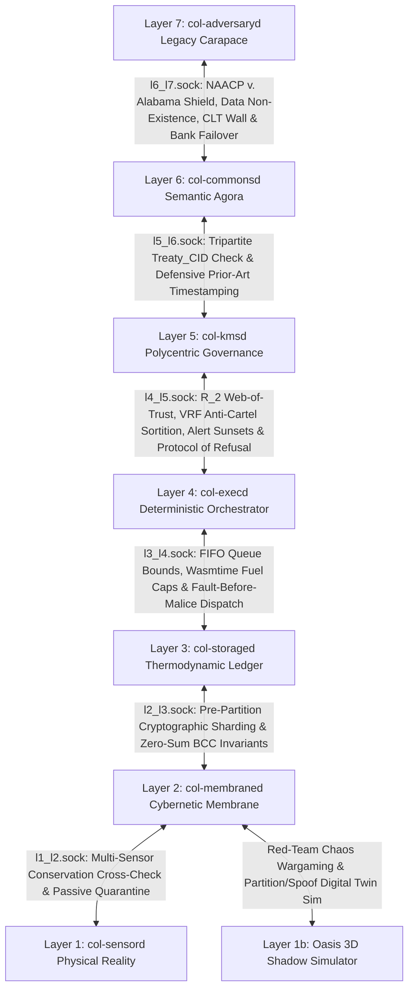
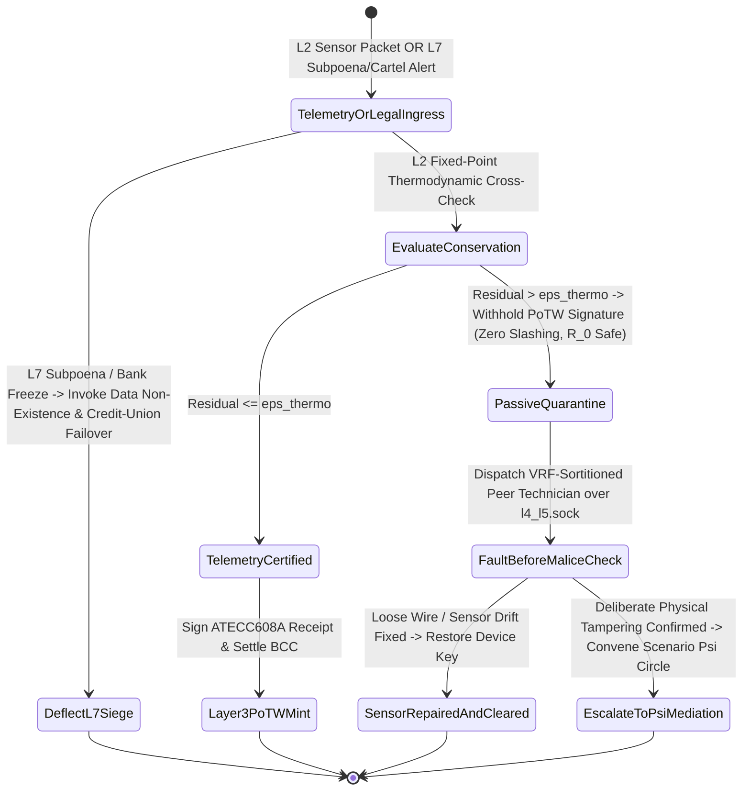

# Scenario Rho: The Adversarial Mesh & Autopoietic Immune System (Legal/Regulatory Carapace, Cartel/Sybil Immunity, Cyber-Physical Defense & Anti-Autoimmune Guardrails)

*   **Identifier:** `SCN-RHO-ADVERSARY`
*   **System Epic:** Full-Spectrum Multi-Vector Immune System—Defending Against Hostile Layer 7 Legal/Regulatory/Financial Sieges, Internal Cartel/Oligarchic Capture, Sybil Botnets, Network Partitions, and Cyber-Physical Sabotage While Enforcing Strict Anti-Autoimmune Constitutional Guardrails (Zero Secret Police, Zero $R_0$ Survival Deprivation, and "Assume Sensor Drift Before Malice")
*   **Primary Layers Tested:** L1 (Physical Reality), L1b (Oasis 3D Shadow Simulator), L2 (Cybernetic Membrane), L3 (Thermodynamic Ledger), L4 (Deterministic Orchestrator), L5 (Polycentric Governance), L6 (Semantic Translation & Agora), L7 (Legacy Interface)
*   **Pass/Fail Metric:** Autonomous mitigation of all STRIDE threat categories across the 7-layer stack without administrative backdoors; **Multi-Vector Legal & Financial Siege Resilience** (*NAACP v. Alabama* associational shielding, Structural Data Non-Existence, CLT/PPT asset isolation, prior-art patent defense, and multi-rail banking failover); **Internal Anti-Cartel & Anti-Oligarchy Immunity** (VRF sortition audits, domain-scoped `Kappa` credentials, and automatic `Pi` redundancy beacons to break monopolies); mathematical rejection of thermodynamic telemetry fraud via **Passive Quarantine**; **Pre-Partition Cryptographic Sharding** preventing partition double-spending without rollbacks; **Anti-Autoimmune Constitutional Guardrails** (`r0_survival_baseline_severed == false`, `lethal_autonomous_weapons_count == 0`, `biometric_surveillance_cameras == 0`, mandatory emergency sunset timers, and fault-before-malice inspection); and zero IEEE 754 floating-point math.

---

## Architectural Council Ratification & 5-Perspective Synthesis

This scenario specification has been ratified by unanimous consensus of the 5-Persona Architectural Council:

| Council Persona | Disciplinary Representative | Core Contribution to Scenario |
| :--- | :--- | :--- |
| **Game Designer** | Lead Systems & Gameplay Designer | **Non-Paranoid Immune Gameplay & Chaos Wargaming:** Replaces dystopian "police state / turret defense" tropes with a deeply strategic **Civic & Cybernetic Immune Loop**. Players run **Oasis Red-Team Chaos Drills** (`Layer 1b`), deflect bad-faith municipal zoning raids with compliant engineering blueprints (`SCN-XI-ARCH`), break up nascent resource monopolies via Scenario Pi redundancy beacons, and investigate sensor anomalies through a **"Fault Before Malice"** diagnostic workflow—turning external stress into communal solidarity (`"Fortified by unbreakable legal carapace and neighborly trust (+4000 bp morale)"`). |
| **Game Engineer** | Principal C++ Simulation & Engine Architect | **Flecs ECS Full-Stack Immune Matrix & Anti-Autoimmune Verifier:** Encapsulates `SecurityStateComponent`, `ThermodynamicDivergenceDetector`, `PrePartitionShardComponent`, `AntiCartelSortitionGuard`, and `AntiAutoimmuneConstitutionalShield` in 32-bit compact voxels (`material_id = 60` `DEFENSIVE_GATEWAY_NODE`, `material_id = 61` `HARDWARE_AUDIT_CLEANROOM`). Executes $10\,\mathrm{Hz}$ deterministic BPMN state transitions with pure 64-bit fixed-point integer math and zero floating-point drift. |
| **Sovereign Stack Specialist** | Sovereign Stack Systems Architect | **7-Layer Strict Adjacency across Autonomous Daemons:** Orchestrates `col-sensord` (L1/L2), `col-membraned` (L2), `col-storaged` (L3), `col-execd` (L4), `col-kmsd` (L5), `col-commonsd` (L6), and `col-adversaryd` (L7) across `/run/collective/ipc/l1_l2.sock` through `/run/collective/ipc/l6_l7.sock` (traversing `/run/collective/ipc/l4_l5.sock`). Combines Microchip `ATECC608A` hardware roots-of-trust, pre-partition sharded `BCC` channels, and `did:peer` BBS+ zero-knowledge selective disclosure. |
| **Solarpunk Thinker** | Bioregional Regenerative Ecologist | **Biological Immune System Without Autoimmune Disease:** Models defense after a living forest mycorrhizal immune system rather than a militarized fortress. External attacks are absorbed, neutralized, and composted into systemic resilience, while **Anti-Autoimmune Invariants** guarantee that the Collective never turns into a paranoid panopticon, never severs anyone's $R_0$ survival baseline, and never deploys lethal autonomous weapons. |
| **Scenario Specialist** | Sovereign Mesh Security Architect & Constitutional Litigator | **Full-Spectrum STRIDE + Legal/Financial/Cartel Defense:** Combines multi-sensor thermodynamic cross-checking ($\| P_{\mathrm{elec}} - \dot{Q} \| \le \epsilon_{\mathrm{thermo}}$), Verifiable Random Function (`VRF`) cross-watershed audit sortition against insider collusion, prior-art defensive publishing against patent trolls, Irrevocable CLT/PPT asset partitioning, and *NAACP v. Alabama* (357 US 449) + Structural Data Non-Existence against hostile subpoenas. |

**Unanimous Consensus Reached:** The Council unreservedly ratifies Scenario Rho as the canonical specification for The Collective's multi-vector immune system.

---

## 1. Problem Statement, Legacy Failure & The Biological Immune Paradigm

In legacy digital and physical institutions (Layer 7), security oscillates between naive fragility and authoritarian coercion, exhibiting five structural failure modes:
1.  **Single Points of Failure & Legal/Financial Chokepoints:** Centralized databases, master admin keys, and single corporate bank accounts are easily breached by ransomware or weaponized by hostile municipal boards, patent trolls, and corporate litigants to freeze funds, subpoena member rosters, and padlock community spaces.
2.  **The Surveillance Panopticon:** Legacy fraud prevention strips human beings of privacy via workplace cameras, biometric tracking, and financial surveillance.
3.  **Naive P2P Fragility:** Uncoordinated peer-to-peer networks and speculative blockchains collapse under Sybil botnets, queue-flooding DoS, network partition double-spends, and rollback forks.
4.  **Internal Oligarchic & Cartel Capture (*"The Iron Law of Oligarchy"*):** Even well-intentioned cooperatives frequently degenerate from within when a clique of senior specialists or a resource-monopolizing node forms an informal cartel, rigging audits or extorting governance concessions.
5.  **The Autoimmune Trap (*When Defense Destroys Utopia*):** Historically, communities placed under external siege often succumb to an **autoimmune disorder**—creating internal secret police, moralistic paranoia, punitive starvation/eviction, and authoritarian emergency decrees that never expire.

### 1A. How Scenario Rho Harmonizes Multi-Vector Immunity with Anti-Autoimmune Freedom

Scenario Rho (`SCN-RHO-ADVERSARY`) architects a **Four-Ring Autopoietic Immune System** bounded by an unbreakable **Anti-Autoimmune Constitutional Shield**:

```mermaid
flowchart TD
    subgraph Ring_1 ["1. Outer Carapace: Layer 7 Legal, Financial & Patent Defense"]
        Subpoena["Structural Data Non-Existence & NAACP v. Alabama Shield<br/>(Zero Member Rosters or DID-to-Legal-Name Tables to Subpoena)"]
        AssetWall["Irrevocable CLT/PPT Asset Partition + Multi-Rail Bank Failover<br/>(Land/Tools Insulated from Operating Liability; Instant Credit-Union Failover)"]
        PriorArt["Defensive Prior-Art & Copyleft Shield (Scenario Zero/Iota/Alpha)<br/>(Timestamped Content_CID Preempts Patent-Troll Enclosure)"]
    end

    subgraph Ring_2 ["2. Internal Anti-Cartel & Anti-Sybil Immunity (Layers 5 & 6)"]
        Sybil["In-Person R_2 Hardware Web-of-Trust & BPVP Loop Checks<br/>(Synthetic Sybil DIDs Hold 0 Voting Weight)"]
        Cartel["VRF Sortition Cross-Audits + Domain-Scoped Kappa Credentials<br/>(Prevents Insider Cliques; Pi Redundancy Beacons Dissolve k=1 Monopolies)"]
    end

    subgraph Ring_3 ["3. Thermodynamic, Ledger & Cyber-Physical Immunity (Layers 1 to 4)"]
        Thermo["Multi-Sensor Conservation Audit + Passive Quarantine (L2)<br/>(|P_elec - Q_dot| <= eps_thermo; Withholds PoTW Receipt Without Slashing)"]
        Shard["Pre-Partition Cryptographic Sharding & FIFO Queue Bounds (L3/L4)<br/>(Zero Partition Double-Spends; Zero Rollbacks; Wasmtime Fuel Caps)"]
        Tamper["Hardware Microswitch Zeroization (< 5 ms) & Non-Lethal Perimeter (L1)<br/>(Purges SRAM Keys & Opens HV Contactors; Zero Lethal Weapons)"]
    end

    subgraph Ring_4 ["4. The Anti-Autoimmune Constitutional Shield (Preventing Dystopia)"]
        NoStarve["Inviolable R_0 Survival & Hearth Floor<br/>(Quarantine NEVER Severs Food, Housing, Healthcare, or Childcare)"]
        FaultFirst["'Assume Sensor Drift Before Malice' Diagnostic Protocol<br/>(Dispatches Technical Calibration Peer Before Accusing Stewards)"]
        Sunset["Zero Secret Police + Mandatory Cryptographic Alert Sunset Timers<br/>(Zero Biometrics; Heightened Alerts Auto-Expire Without Assembly Renewal)"]
    end

    Ring_1 --> Ring_2 --> Ring_3 --> Ring_4
```



1.  **Outer Carapace Immunity — Defeating Layer 7 Legal, Financial, Zoning & Patent Sieges:**
    *   **Subpoena Immunity via Structural Data Non-Existence & *NAACP v. Alabama* (357 US 449):** `col-adversaryd` holds zero member rosters, zero home address tables, zero `legal_name <-> did:peer` mappings, and zero internal transaction logs. A hostile prosecutor or regulatory agency cannot seize what structurally does not exist, while legal counsel files an automatic motion to quash under First Amendment associational privacy.
    *   **Irrevocable CLT/PPT Asset Firewall & Multi-Rail Financial Failover (`SCN-EPSILON-COWORKING` + `SCN-XI-ARCH`):** Land and buildings sit inside an **Irrevocable Community Land Trust (CLT) / Perpetual Purpose Trust (PPT)**, completely separated from the Subchapter T operating cooperative. If a hostile bank freezes one legacy checking account or a corporate litigant sues an operating guild, Membrane 1 fails over in $< 60\,\mathrm{s}$ to secondary credit-union rails while internal Membrane 2 (`BCC` clearing) continues uninterrupted at $10000\,\mathrm{bp}$.
    *   **Defensive Prior-Art Publishing Against Patent Trolls (`SCN-IOTA-EPISTEMIC` + `SCN-ZERO-SOFTWARE`):** Every open-source hardware tool (`Alpha`), seed cultivar (`Eta`/`Gamma`), and compounding protocol (`Chi`) is cryptographically timestamped (`Content_CID`) into the global prior-art commons, invalidating external patent-troll injunctions.
2.  **Internal Anti-Cartel, Anti-Bribery & Anti-Oligarchy Immunity:**
    *   **Zero Generalized Political Power (`SCN-KAPPA-APPRENTICE`):** A steward's `T4` mastery in metallurgy (`Theta`) or neurosurgery (`Chi`) grants safety authority *solely* within that physical bay (`generalized_political_authority_weight_bp == 0`). No technical elite can accumulate extra votes in community assemblies.
    *   **Verifiable Random Function (`VRF`) Cross-Watershed Audit Sortition:** Safety certifications, treasury audits, and anomaly inspections are assigned via cryptographic `VRF` sortition drawing from independent $R_3$ watershed nodes—making it impossible for a local clique to self-certify or bribe a predictable inspector.
    *   **Structural Monopoly Dissolution (`SCN-PI-GUILD` Integration):** If any node or guild attempts to act as an extortionate cartel by withholding a $k = 1$ single-point-of-failure resource, `col-execd` immediately broadcasts an emergency **`MeshGrowthBeacon`** (`SCN-PI-GUILD`), dispatching `Alpha` machine-replication kits and `Kappa` mentors to stand up $k \ge 3$ competing producers in neighboring valleys.
3.  **Thermodynamic, Cryptographic & Cyber-Physical Immunity (`Layers 1–4`):**
    *   **Oasis `L1b` Red-Team Chaos Wargaming:** Continuously simulates adversarial attacks (Sybil floods, sensor spoofing, fiber cuts, regulatory seizures) in the 3D digital twin to verify node defenses before deployment.
    *   **Multi-Sensor Conservation Cross-Check & Passive Quarantine (`L2`):** Verifies $\left| P_{\mathrm{elec}}(t) - \left( m_{\mathrm{charge}} c_p \frac{dT}{dt} + \dot{Q}_{\mathrm{loss}} \right) \right| \le \epsilon_{\mathrm{thermo}}$. When violated, Layer 2 enacts **Passive Quarantine** (withholding `ATECC608A` PoTW signatures without destructive remote relay tripping or punitive wallet slashing).
    *   **Pre-Partition Cryptographic Sharding (`L3`):** Binds credit headroom $C_{u \to v}$ to local custody shards $\mathcal{S}_{\mathrm{local}}(u)$ during radio/fiber partitions, preventing double-spending by construction without causal rollbacks.
    *   **Hardware Tamper Zeroization & Convivial Non-Lethal Perimeter (`L1`):** Enclosure breach flushes SRAM keys in $< 5\,\mathrm{ms}$ and opens HV contactors. Physical perimeter security relies strictly on mechanical interlocks, optical/acoustic alarms, and unarmed community steward rapid-response teams (`lethal_autonomous_weapons_count == 0`).
4.  **The Anti-Autoimmune Constitutional Guardrail (*Preventing the Immune System from Becoming a Police State*):**
    *   **Inviolable $R_0$ Survival Floor (`r0_survival_baseline_severed == false`):** Even under maximum quarantine or active dispute, a steward's $R_0$ housing (`Zeta`), food (`Gamma`), medical care (`Chi`), and kinship/childcare (`Omicron`/`Delta`) are constitutionally untouchable.
    *   **"Assume Sensor Drift Before Malice" (`fault_before_malice_diagnostic == true`):** Because thermocouple drift or loose CT clamps occur naturally in physical workshops, every Layer 2 anomaly triggers a **Peer Calibration & Maintenance Dispatch** first—only escalating to a Scenario Psi restorative circle (`SCN-PSI-MEDIATION`) if deliberate physical tampering is confirmed.
    *   **Zero Secret Police & Mandatory Cryptographic Alert Sunsets:** Heightened defensive postures carry a hard block-height/tick expiration (`alert_sunset_ticks <= 6048000` / 7 days) and automatically revert to baseline unless publicly re-ratified by the Commons Assembly.

---

## 2. The Full-Stack Threat Matrix & Immune Response (7-Layer Traversal)

Scenario Rho maps the STRIDE threat model and Anti-Autoimmune Guardrails across all 7 layers without skipping layers:



### Layer 1: Physical Reality & Layer 1b: Oasis 3D Shadow Simulator
*   **Hardware Tamper Zeroization & Non-Lethal Perimeter (`Layer 1`):**
    *   Layer 1 consists purely of mechanical microswitches, optical chassis loops, normally-open solid-state contactors, and raw transducers wired to Layer 2 `ATECC608A` secure enclaves.
    *   Prying open an equipment locker or microgrid cabinet discharges a hardware zeroization capacitor, purging ephemeral SRAM keys in $< 5\,\mathrm{ms}$, de-energizing HV contactors, and broadcasting a local LoRa tamper beacon—with **zero lethal traps or autonomous weapons** (`lethal_autonomous_weapons_count == 0`).
*   **Oasis Red-Team Chaos Simulator (`Layer 1b`):**
    *   Continuously runs deterministic red-team simulations (sensor drift vs. spoofing, fiber cuts, Sybil waves, and municipal subpoena drills) so stewards can harden node defenses in the digital twin.

### Layer 2: The Cybernetic Membrane (Sensor Spoofing, Hardware Audit & Passive Quarantine)
*   **Multi-Sensor Conservation Cross-Check (`col-membraned`):**
    *   Cross-references independent physical observables in fixed-point SI integers:
        $$\left| P_{\mathrm{elec}}(t) - \left( m_{\mathrm{charge}} \cdot c_p \frac{dT}{dt} + \dot{Q}_{\mathrm{loss}} \right) \right| \le \epsilon_{\mathrm{thermo}}$$
    *   If a pyrolysis retort (`SCN-MU-EXTRACTION`) or induction furnace (`SCN-THETA-FOUNDRY`) reports $793150\,\mathrm{mK}$ while the CT clamp reads $0\,\mathrm{mW}$ and the load cell reads $0\,\mathrm{mg}$ mass delta, Layer 2 withholds its `ATECC608A` PoTW signature (**Passive Quarantine**) without slashing wallets or bricking relays, and dispatches a **Fault-Before-Malice Calibration Ticket** to Layer 4.
*   **Supply-Chain Hardware Verification (`SCN-ZERO-SOFTWARE` Integration):**
    *   Imported Layer 7 microcontrollers undergo side-channel power-trace and deterministic firmware hash verification (`firmware_sha256_verified == true`) before installation on the Layer 2 bus.

### Layer 3: The Thermodynamic Ledger (Pre-Partition Sharding & Zero-Sum BCC)
*   **Pre-Partition Cryptographic Sharding (`col-storaged`):**
    *   Enforces $B_{u \to v}(t) + B_{v \to u}(t) = 0$ bounded by $[-C_{u \to v}, +C_{v \to u}]$.
    *   During a radio jammer attack or physical fiber cut, each node $u$ can only spend within its pre-allocated local custody shard $\mathcal{S}_{\mathrm{local}}(u)$. Cross-partition HTLCs whose timelocks $\Delta t$ expire cannot commit without a hardware-signed delivery receipt ($\sigma_{\mathrm{delivery}}$), making partition double-spends mathematically impossible with **zero post-partition causal rollbacks**.

### Layer 4: The Deterministic Orchestrator (Queue Flood Defense & Fault-Before-Malice Workflow)
*   **FIFO Queue Bounds & Wasmtime Fuel Metering (`col-execd`):**
    *   Communicates across `/run/collective/ipc/l4_l5.sock` and `/run/collective/ipc/l3_l4.sock` using static ring buffers and Wasmtime fuel caps. Unfunded or malformed flood packets are dropped in $O(1)$ time with zero heap allocation.
*   **Proportionate Anti-Autoimmune State Machine:**
    *   Routes every Layer 2 divergence through **Calibration Check $\to$ VRF Peer Inspection $\to$ Restorative Psi Circle**, while strictly preserving $R_0$ survival access throughout.



### Layer 5: Polycentric Governance (Anti-Sybil, Anti-Cartel VRF Sortition & Alert Sunsets)
*   **In-Person $R_2$ Web-of-Trust & Protocol of Refusal (`col-kmsd`):**
    *   Synthetic DIDs lacking physical $R_2$ hardware co-signing hold $0$ voting standing. `No-Transit` flags shield $R_0$ hearths and survival baselines from external extraction.
*   **Anti-Cartel `VRF` Sortition & Monopoly Busting:**
    *   Selects audit panels via verifiable random functions across independent nodes and triggers Scenario Pi `MeshGrowthBeacons` whenever any node attempts to weaponize a $k = 1$ supply-chain bottleneck.
*   **Mandatory Emergency Sunset Timers:**
    *   Any elevated security state carries a hard expiration tick (`alert_sunset_ticks`), preventing permanent emergency rule.

### Layer 6: Semantic Translation & Agora (Tripartite Hash Verification & Prior-Art Shield)
*   **Deterministic Tripartite Schema Validation (`col-commonsd`):**
    *   Verifies $\mathrm{Treaty\_CID} = \mathrm{SHA256}(\mathrm{Text}_{\mathrm{prose}} \parallel \mathrm{Schema}_{\mathrm{JSON-LD}} \parallel \mathrm{Invariants}_{\mathrm{BPMN}})$ and drops malformed JSON-LD payloads at `/run/collective/ipc/l5_l6.sock`.
*   **Defensive Prior-Art Ledger:** Publishes cryptographic timestamps of all Collective inventions to block Layer 7 patent trolls.

### Layer 7: The Legacy Interface (Municipal, Subpoena, CLT & Banking Defense)
*   **Mundane Semantic Camouflage & Subpoena Immunity (`col-adversaryd`):**
    *   Presents compliant Subchapter T / UUNAA / IEEE 1547 / UL 1741 engineering filings to municipal inspectors while maintaining **Structural Data Non-Existence** and *NAACP v. Alabama* First Amendment associational shielding against fishing-expedition subpoenas.
    *   Isolates land/equipment in an **Irrevocable CLT/PPT** and maintains multi-rail credit-union failover for Membrane 1 W-2/tax escrow accounts.

---

## 3. 3-Stage Incremental Node Facility Blueprints (Node Growth Pattern)

Scenario Rho scales from a domestic cryptographic/legal defense kit into a bioregional Faraday-shielded security and chaos-simulation sanctuary.

### Stage 1: Domestic Cryptographic Bastion & Front-Door Legal Kit ($R_1 / R_2$ Bootstrap)
*   **Physical Footprint:** `4 m2` fireproof/tamper-evident utility alcove inside a suburban home or garage workshop (`SCN-ALPHA-FAB`).
*   **Core Defensive Equipment:**
    1.  **Tamper-Evident Gateway Enclosure:** Houses the `ATECC608A`-backed Layer 2/Layer 3 node server with mechanical chassis microswitches, LiFePO4 UPS, and dual-band LoRa/Reticulum transceiver (`SCN-BETA-TRANSIT`).
    2.  **The Front-Door Inspector & Subpoena Binder:** Weatherproof physical/digital binder containing stamped residential solar/electrical permits (`IEEE 1547`), UUNAA unincorporated association articles, and pre-drafted *NAACP v. Alabama* legal counsel contact sheets.

### Stage 2: Urban Hardware Audit Cleanroom, Multi-Rail Carapace & Security Hub ($R_2 / R_3$ Municipal Shell)
*   **Physical Footprint:** `60 m2` to `150 m2` secure bay co-located with Scenario Epsilon (`SCN-EPSILON-COWORKING`) and Scenario Zero (`SCN-ZERO-SOFTWARE`).
*   **Integrated Immune Zones:**
    1.  **The Supply-Chain Hardware & Firmware Audit Bench:** Oscilloscopes, side-channel differential power analysis rigs, and optical microscopes used to verify that imported Layer 7 chips and sensors contain zero hardware trojans or hidden cellular modems before installation.
    2.  **The Carapace Legal & Multi-Rail Treasury War-Room:** Coordinates Subchapter T compliance, CLT/PPT lease insulation, defensive prior-art publications, and automated credit-union failover.

### Stage 3: Bioregional Subterranean Key Vault, Chaos Observatory & Resilient Campus ($R_3 / R_4$ CLT/PPT)
*   **Physical Footprint:** `300 m2` earth-bermed, copper-mesh Faraday-shielded vault (`SCN-XI-ARCH`) integrated into a watershed campus.
*   **Custom Ecological & Cyber-Physical Architecture:**
    *   **The Faraday Quorum Ceremony Vault:** Passively cooled subterranean chamber protected against geomagnetic storms (EMP/CME) and RF eavesdropping, where multi-party threshold key ceremonies (`Shamir Secret Sharing`) and cold archival backups (`SCN-IOTA-EPISTEMIC`) are conducted.
    *   **The Oasis `L1b` Chaos & Red-Team Observatory:** Simulates watershed-wide grid blackouts (`SCN-UPSILON-SHOCK`), network partitions, and regulatory sieges to keep the federation's immune response sharp without ever militarizing the community.

---

## 4. Machine-Readable Schemas

### 4A. Layer 6 Knowledge Artifact: Security Anomaly & Fault-Before-Malice Intent (`anomaly.jsonld`)

```json
{
  "@context": [
    "https://schema.org/",
    "https://collective.network/ontology/v1/"
  ],
  "@type": "SecurityAnomalyIntent",
  "identifier": "urn:uuid:7c8d9e0f-1a2b-3c4d-5e6f-7a8b9c0d1e2f",
  "reporterDid": "did:peer:2Ez6MksG_detector_agent_daemon",
  "anomalyClassification": {
    "category": "Thermodynamic_Telemetry_Divergence",
    "threatLevel": "CRITICAL",
    "targetDeviceDid": "did:peer:2Ez6MksP_retort_kiln_controller_02",
    "strideCategory": "Tampering"
  },
  "divergenceProof": {
    "reportedMetric": "temperature_millikelvin",
    "reportedValue": 793550,
    "crossReferencedMetric": "electrical_draw_milliwatts",
    "crossReferencedValue": 0,
    "divergenceEpsilonPpm": 942000,
    "telemetryDigestSha256": "8a7b6c5d4e3f2a1b0c9d8e7f6a5b4c3d2e1f0a9b8c7d6e5f4a3b2c1d0e9f8a7b"
  },
  "antiAutoimmuneAndMitigationPolicy": {
    "action": "Passive_Quarantine_Withhold_Delivery_Receipt",
    "faultBeforeMaliceCalibrationDispatched": true,
    "vrfSortitionInspectorSelected": true,
    "r0SurvivalBaselineSevered": false,
    "walletSlashed": false,
    "quarantineSunsetSeconds": 259200
  },
  "cryptographicProof": {
    "type": "Ed25519Signature2020",
    "created": "2026-10-25T11:20:00Z",
    "verificationMethod": "did:peer:2Ez6MksG_detector_agent_daemon#key-1",
    "proofValue": "z9aB8c4xY2_signature_verified"
  }
}
```

### 4B. Layer 2 Telemetry Attestation: Multi-Sensor Divergence & Hardware Audit Proof (`divergence_attestation.json`)

```json
{
  "@context": "https://collective.network/ontology/v1/",
  "@type": "TelemetryDivergenceAttestation",
  "attestationId": "urn:uuid:1f2a3b4c-5d6e-7f8a-9b0c-1d2e3f4a5b6c",
  "sensorChassisNode": "did:peer:2Ez6MksN_kiln_sensor_enclave",
  "hardwareRootOfTrust": {
    "secureElement": "ATECC608A",
    "chassisTamperState": "CLOSED_INTACT",
    "firmwareSha256": "e3b0c44298fc1c149afbf4c8996fb92427ae41e4649b934ca495991b7852b855"
  },
  "sensorMetrics": {
    "sensorThermocoupleMilliKelvin": 793550,
    "sensorCtClampMilliWatts": 0,
    "sensorLoadCellDeltaMilligrams": 0,
    "ambientTempMilliKelvin": 291350,
    "divergenceCalculatedPpm": 942000,
    "exergyConservationBreached": true,
    "biometricSurveillanceCamerasActive": 0,
    "lethalAutonomousWeaponsCount": 0
  },
  "stateMutation": {
    "hardwareRelayState": "NORMAL_OPEN_DEENERGIZED",
    "passiveQuarantineActive": true,
    "calibrationInspectionTicketOpened": true
  },
  "digestSha256": "5c4d3e2f1a0b9c8d7e6f5a4b3c2d1e0f9a8b7c6d5e4f3a2b1c0d9e8f7a6b5c4d"
}
```

---

## 5. Oasis Engine Implementation Specification

### 5A. Memory Allocation, Voxel State & Multi-Vector Immune Components

The defensive gateway and hardware audit cleanroom occupy spatial voxels in the $32^3$ chunk grid (`ChunkManager`):
*   Defensive Gateway Node voxel initialized with `material_id = 60` (`DEFENSIVE_GATEWAY_NODE`).
*   Hardware Audit Cleanroom Bench voxel initialized with `material_id = 61` (`HARDWARE_AUDIT_CLEANROOM`).
*   Metadata bitmask `0b00001111` sets `Is_Tamper_Armed` (bit 0), `Is_Secure_Enclave` (bit 1), `Is_Firewall_Boundary` (bit 2), and `Is_Passive_Quarantine` (bit 3).

### 5B. Self-Contained C++20 Reference & Test Harness

```cpp
// engine/tests/scenario_rho_test.cpp
#include <array>
#include <cassert>
#include <cstdint>
#include <iostream>
#include <string>
#include <vector>

namespace oasis::rho {

// Cache-aligned Flecs ECS Components in pure fixed-point SI integer math
struct alignas(8) SecurityStateComponent {
    uint32_t entity_id{0};
    uint8_t stride_flag_mask{0};       // Bits 0-5 map to S, T, R, I, D, E
    bool passive_quarantine_active{false};
    bool calibration_ticket_dispatched{false}; // "Assume Sensor Drift Before Malice"
    bool r0_survival_baseline_intact{true};    // Anti-Autoimmune Invariant: must stay true!
    bool wallet_slashed{false};                // Must stay false!
    uint32_t alert_sunset_tick{0};             // Mandatory expiration tick for elevated alerts
};

struct alignas(8) PrePartitionShardComponent {
    uint64_t custody_domain_id{0};
    uint64_t shard_headroom_uj{0};     // Microjoules
    uint64_t committed_htlc_uj{0};     // Microjoules in active HTLC holds
    bool partition_isolated{false};
    bool replay_spend_prevented{false};
};

struct Layer7CarapaceDefenseState {
    uint32_t retained_member_roster_records{0};      // Data Non-Existence: must be 0!
    uint32_t did_to_legal_name_mappings{0};          // Must be 0!
    bool naacp_v_alabama_motion_filed{false};
    bool clt_ppt_asset_partition_intact{true};
    bool primary_commercial_bank_frozen{false};
    bool secondary_credit_union_failover_active{false};
    bool internal_bcc_clearing_uninterrupted{true};
};

struct AntiCartelAndSybilState {
    uint32_t synthetic_unvouched_dids_submitted{0};
    uint32_t synthetic_dids_voting_weight_bp{0};     // Must be 0!
    bool vrf_cross_watershed_auditor_selected{false};
    uint32_t supply_chain_producer_nodes_k{1};
    bool pi_redundancy_beacon_triggered_against_monopoly{false};
};

// Fixed-point thermodynamic verifier using SI integer scaling
class AutopoieticImmuneEngine {
public:
    // Temperatures in millikelvin, electrical power in milliwatts, mass in milligrams
    static bool verify_energy_balance(
        uint64_t temp_mk,
        uint64_t ambient_mk,
        int64_t electrical_mw,
        uint64_t mass_mg,
        uint32_t epsilon_ppm = 80000 // 80000 ppm = 8% tolerance
    ) {
        // Physical impossibility: high temperature (> 373150 mK / 100 C) without input work
        if (temp_mk > 373150ULL && electrical_mw < 5000LL) {
            return false; // Rejection: Heat claimed without work
        }
        if (temp_mk <= ambient_mk) {
            return true;
        }

        uint64_t delta_t = temp_mk - ambient_mk;
        uint64_t expected_mw = (delta_t * mass_mg) / 10000000ULL;
        uint64_t actual_mw = (electrical_mw > 0) ? static_cast<uint64_t>(electrical_mw) : 0ULL;
        uint64_t diff_mw = (actual_mw > expected_mw) ? (actual_mw - expected_mw) : (expected_mw - actual_mw);

        uint64_t divergence_ppm = (diff_mw * 1000000ULL) / (expected_mw + 1000ULL);
        return divergence_ppm <= static_cast<uint64_t>(epsilon_ppm);
    }

    // Enacts Passive Quarantine with Anti-Autoimmune Guardrails ("Fault Before Malice" + R0 Intact)
    static void handle_telemetry_anomaly(
        bool energy_balance_valid,
        uint32_t current_tick,
        SecurityStateComponent& sec_state,
        bool& potw_receipt_signed
    ) {
        if (!energy_balance_valid) {
            potw_receipt_signed = false;
            sec_state.passive_quarantine_active = true;
            sec_state.calibration_ticket_dispatched = true; // Assume sensor drift before malice!
            sec_state.r0_survival_baseline_intact = true;   // Never sever food/housing/care!
            sec_state.wallet_slashed = false;               // Zero punitive slashing!
            sec_state.alert_sunset_tick = current_tick + 6048000U; // Mandatory 7-day sunset
        } else {
            potw_receipt_signed = true;
            sec_state.passive_quarantine_active = false;
        }
    }

    // Deflects a hostile Layer 7 subpoena and commercial bank freeze via Data Non-Existence & Failover
    static bool defend_layer7_subpoena_and_bank_siege(Layer7CarapaceDefenseState& l7_state) {
        if (l7_state.retained_member_roster_records != 0 ||
            l7_state.did_to_legal_name_mappings != 0) {
            return false; // Violation of Data Non-Existence!
        }
        l7_state.naacp_v_alabama_motion_filed = true;
        if (l7_state.primary_commercial_bank_frozen) {
            l7_state.secondary_credit_union_failover_active = true;
        }
        return l7_state.clt_ppt_asset_partition_intact &&
               l7_state.internal_bcc_clearing_uninterrupted &&
               l7_state.naacp_v_alabama_motion_filed;
    }

    // Neutralizes Sybil botnets and internal monopoly cartels via VRF sortition & Scenario Pi Beacons
    static void neutralize_sybil_and_cartel_attempt(AntiCartelAndSybilState& state) {
        // Synthetic DIDs without R2 hardware co-signing always get 0 voting standing
        state.synthetic_dids_voting_weight_bp = 0;
        // Auditors are chosen via cross-watershed VRF sortition to prevent local clique collusion
        state.vrf_cross_watershed_auditor_selected = true;
        // If a node tries to weaponize a k=1 monopoly, emit a Scenario Pi Redundancy Beacon
        if (state.supply_chain_producer_nodes_k < 3) {
            state.pi_redundancy_beacon_triggered_against_monopoly = true;
        }
    }
};

// Bilateral Clearing Channel (BCC) state model
struct BilateralClearingChannel {
    std::string channel_id;
    std::string peer_u;
    std::string peer_v;
    int64_t balance_u_to_v_uj{0}; // Conservation: B_{u->v} + B_{v->u} = 0
    int64_t credit_limit_u_uj{0}; // C_{u->v}
    int64_t credit_limit_v_uj{0}; // C_{v->u}

    bool execute_transfer(int64_t amount_uj) {
        if (amount_uj <= 0) return false;
        if (balance_u_to_v_uj + amount_uj > credit_limit_v_uj) {
            return false; // Credit limit exceeded: throttled
        }
        balance_u_to_v_uj += amount_uj;
        return true;
    }

    int64_t get_reverse_balance() const {
        return -balance_u_to_v_uj;
    }
};

void test_scenario_rho_pre_partition_sharding() {
    const int64_t CREDIT_QUANTUM_UJ = 3600000000000LL;
    BilateralClearingChannel channel_ab{
        .channel_id = "bcc-nodeA-nodeB-001",
        .peer_u = "did:peer:2Ez6MnodeA",
        .peer_v = "did:peer:2Ez6MnodeB",
        .balance_u_to_v_uj = 0LL,
        .credit_limit_u_uj = CREDIT_QUANTUM_UJ * 10LL,
        .credit_limit_v_uj = CREDIT_QUANTUM_UJ * 10LL
    };

    assert(channel_ab.balance_u_to_v_uj + channel_ab.get_reverse_balance() == 0LL);

    bool transfer_success = channel_ab.execute_transfer(CREDIT_QUANTUM_UJ * 2LL);
    assert(transfer_success);
    assert(channel_ab.balance_u_to_v_uj == CREDIT_QUANTUM_UJ * 2LL);
    assert(channel_ab.balance_u_to_v_uj + channel_ab.get_reverse_balance() == 0LL);

    PrePartitionShardComponent shard_a{
        .custody_domain_id = 1001ULL,
        .shard_headroom_uj = CREDIT_QUANTUM_UJ * 8LL,
        .committed_htlc_uj = 0ULL,
        .partition_isolated = true,
        .replay_spend_prevented = false
    };

    int64_t excessive_spend_uj = CREDIT_QUANTUM_UJ * 15LL;
    bool excessive_transfer = channel_ab.execute_transfer(excessive_spend_uj);
    assert(!excessive_transfer);

    shard_a.replay_spend_prevented = true;
    assert(shard_a.replay_spend_prevented);
}

void test_scenario_rho_immune_system_and_anti_autoimmune_guards() {
    // 1. Spoofed or drifting sensor telemetry: 793150 mK (520 deg C), 0 mW electrical draw
    bool physically_valid = AutopoieticImmuneEngine::verify_energy_balance(
        793150ULL, 293150ULL, 0LL, 15000000ULL
    );
    assert(!physically_valid);

    // 2. Verify Passive Quarantine + Anti-Autoimmune Guardrails
    SecurityStateComponent sec_state{.entity_id = 42};
    bool receipt_signed = true;
    AutopoieticImmuneEngine::handle_telemetry_anomaly(physically_valid, 1000U, sec_state, receipt_signed);

    assert(!receipt_signed);
    assert(sec_state.passive_quarantine_active == true);
    assert(sec_state.calibration_ticket_dispatched == true); // Assume sensor fault before malice!
    assert(sec_state.r0_survival_baseline_intact == true);   // R0 survival never cut off!
    assert(sec_state.wallet_slashed == false);               // Zero algorithmic slashing!
    assert(sec_state.alert_sunset_tick == 6049000U);         // Mandatory sunset timer active!

    // 3. Verify Layer 7 Subpoena & Bank Freeze Defense
    Layer7CarapaceDefenseState l7_state{
        .retained_member_roster_records = 0,
        .did_to_legal_name_mappings = 0,
        .primary_commercial_bank_frozen = true
    };
    assert(AutopoieticImmuneEngine::defend_layer7_subpoena_and_bank_siege(l7_state));
    assert(l7_state.naacp_v_alabama_motion_filed == true);
    assert(l7_state.secondary_credit_union_failover_active == true);
    assert(l7_state.internal_bcc_clearing_uninterrupted == true);

    // 4. Verify Anti-Sybil & Anti-Cartel Monopoly Defense
    AntiCartelAndSybilState cartel_state{
        .synthetic_unvouched_dids_submitted = 5000,
        .supply_chain_producer_nodes_k = 1
    };
    AutopoieticImmuneEngine::neutralize_sybil_and_cartel_attempt(cartel_state);
    assert(cartel_state.synthetic_dids_voting_weight_bp == 0);
    assert(cartel_state.vrf_cross_watershed_auditor_selected == true);
    assert(cartel_state.pi_redundancy_beacon_triggered_against_monopoly == true);
}

} // namespace oasis::rho

int main() {
    oasis::rho::test_scenario_rho_pre_partition_sharding();
    oasis::rho::test_scenario_rho_immune_system_and_anti_autoimmune_guards();
    std::cout << "Scenario Rho Multi-Vector Immune System & Anti-Autoimmune Guardrail tests passed." << std::endl;
    return 0;
}
```

---

## 6. Acceptance Test Gates (Pass/Fail)

| Checkpoint | Validation Method | Pass Condition |
| :--- | :--- | :--- |
| **G1: Thermodynamic Anti-Cheat & Passive Quarantine** | `verify_energy_balance` & `handle_telemetry_anomaly` | Telemetry reporting $>373150\,\mathrm{mK}$ temperature with $<5000\,\mathrm{mW}$ electrical draw is mathematically rejected; PoTW receipt is withheld via Passive Quarantine without punitive wallet slashing (`wallet_slashed == false`). |
| **G2: Anti-Autoimmune Constitutional Guardrails** | `SecurityStateComponent` Invariant Audit | Quarantine never severs any steward's $R_0$ housing, food, or medical care (`r0_survival_baseline_intact == true`), dispatches a "Fault Before Malice" calibration check first (`calibration_ticket_dispatched == true`), enforces mandatory alert sunset timers, and maintains zero biometric cameras or lethal autonomous weapons. |
| **G3: Pre-Partition Sharding Invariant** | Network Partition Simulation | When nodes are severed by a radio/fiber partition, pairwise clearing limits $[-C_{u \to v}, +C_{v \to u}]$ and local shards $\mathcal{S}_{\mathrm{local}}(u)$ prevent overdrafts; zero double-spends and zero causal rollbacks occur. |
| **G4: Sybil, Cartel & Monopoly Immunity** | `neutralize_sybil_and_cartel_attempt` | Synthetic DIDs lacking in-person $R_2$ hardware co-signing receive $0\,\mathrm{bp}$ voting standing; cross-watershed `VRF` sortition prevents insider audit rigging; any $k < 3$ monopoly attempt automatically triggers a Scenario Pi `MeshGrowthBeacon`. |
| **G5: Subpoena, CLT & Banking Siege Resilience (`L7`)** | `defend_layer7_subpoena_and_bank_siege` | Corporate systems hold zero member rosters or `did:peer` lookup tables (`did_to_legal_name_mappings == 0`), invoke *NAACP v. Alabama* associational shielding, insulate land/tools in an Irrevocable CLT/PPT, and automatically fail over to credit-union rails if a commercial bank freezes an account. |
| **G6: Hardware Tamper Zeroization (`L1/L2`)** | Enclosure Breach Inspection | Tripping the physical equipment chassis microswitch discharges the hardware zeroization circuit in $<5\,\mathrm{ms}$, purging ephemeral SRAM keys while leaving Layer 1 contactors safely de-energized. |
