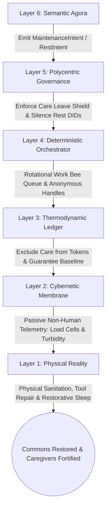
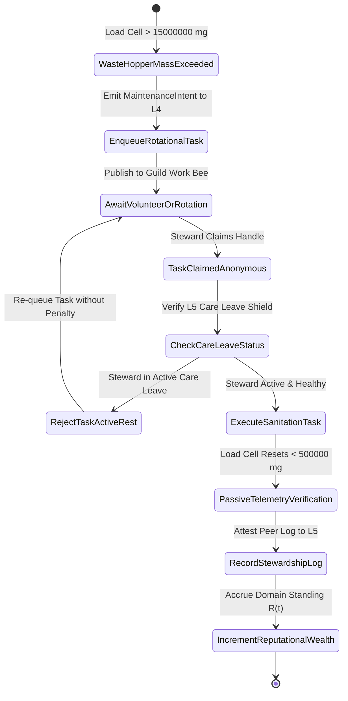
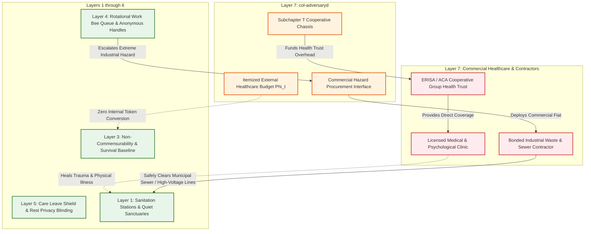

# Scenario Sigma: The Maintenance Commons (Caregiver Relief & Burnout Defense)

*   **Identifier:** `SCN-SIGMA-BURNOUT`
*   **System Epic:** Caregiver Relief, Invisible Labor, Maintenance Commons, and Burnout Defense
*   **Primary Layers Tested:** L1 (Physical), L2 (Cybernetic Membrane), L3 (Thermodynamic Ledger), L4 (Deterministic Orchestrator), L5 (Polycentric Governance), L6 (Semantic Agora), L7 (Legacy Interface)
*   **Pass/Fail Metric:** Absolute elimination of chore gig-markets, surge pricing, and task Dutch auctions; complete exclusion of domestic care and sanitation from exergy tokenization under the Non-Commensurability Doctrine; unconditional provision of Tier 2 Human Survival Baselines ($B_{\mathrm{baseline}}$); mathematical freezing of reputational decay clocks via the Care Leave Shield; verified notification silence under `RestIntent`; zero biometric surveillance or workplace camera tracking.

---

## Architectural Council Ratification & 5-Perspective Synthesis

This scenario specification has been ratified by unanimous consensus of the 5-Persona Architectural Council:

| Council Persona | Disciplinary Representative | Core Contribution to Scenario |
| :--- | :--- | :--- |
| **Game Designer** | Lead Systems & Gameplay Designer | Founder 01 care and maintenance management: eliminating authoritarian chore assignment and speculative gig-markets; Dwarf Fortress psychological stress accumulators (thoughts like `"Exhausted from prolonged unassisted domestic toil (-30 stress)"` transitioning to `"Deeply restored by voluntary rotational work bee and quiet sanctuary (+45 mood)"`); The Sims indirect affordance queues for hygiene and somatic rest; community gathering around convivial maintenance circles; public works infrastructure care loops. |
| **Game Engineer** | Principal C++ Simulation & Engine Architect | Flecs ECS Data-Oriented Design (DOD): cache-aligned `VoxelSanitationState`, `CareLeaveShieldComponent`, and `RotationalTaskQueueComponent` structures; 32-bit compact voxel representation (`material_id = 64`, `MAINTENANCE_HUB_SANCTUARY`); deterministic 10 Hz BPMN state engine; compilable C++20 test harness executing non-monetary rotational chore assignment, Care Leave Shield reputational decay freezing, and `RestIntent` network silence using fixed-point integer math. |
| **Sovereign Stack Specialist** | Sovereign Stack Systems Architect | 7-layer stack mapping across autonomous POSIX daemons (`col-sensord`, `col-membraned`, `col-storaged`, `col-execd`, `col-kmsd`, `col-commonsd`, `col-adversaryd`); strict adjacent IPC via Unix domain sockets (`/run/collective/ipc/l4_l5.sock`); unconditional Tier 2 Human Survival Baseline ($B_{\mathrm{baseline}}$) decoupled from labor output; Pairwise Bilateral Clearing Channels (BCC) with multi-hop Hashed Timelock Contracts (HTLC); non-financial Reputational Wealth ($\mathcal{R}$) with Care Leave Shields; zero monolithic threading. |
| **Solarpunk Thinker** | Bioregional Regenerative Ecologist | Rest as an ecological imperative: human bodies must be honored with the same seasonal fallow negentropy as resting agricultural soils; invisible reproductive care and sanitation form the living thermodynamic bedrock of society; closed-loop cleaning using non-toxic bio-fermented soaps, enzyme surfactants, and greywater marsh filtration; absolute rejection of commodifying human affection, parenting, and elder comfort. |
| **Scenario Specialist** | Occupational Ergonomics & Convivial Care Systems Specialist | Implementation of the Non-Commensurability of Human Care doctrine (Chapter 4 §4.4); abolition of speculative task auctions and task reward escalation; voluntary guild stewardship circles and rotational work bees; mathematical formulation of exponential reputational decay with zero-decay Care Leave freezing; ERISA and ACA group healthcare cooperative legal wrappers shielding community stewards from external medical catastrophes. |

**Council Ratification Verdict:** Unanimous Consensus Reached.

---

## 1. Problem Statement & Legacy Failure

In late-stage capitalist infrastructure (Layer 7), maintenance—the daily, unglamorous labor of cleaning, sanitizing, repairing, meal preparation, and emotional caregiving—is systematically degraded as low-status, minimum-wage, or completely uncompensated "invisible labor."

This extraction generates devastating systemic failures:

1.  **The Gendered & Classist Exploitation Trap:** Capitalist economies rely on trillions of dollars of uncompensated domestic and reproductive labor to sustain workers. Commercial cleaning and care jobs are underpaid, precarious, and offloaded onto vulnerable populations with zero equity, autonomy, or social dignity.
2.  **The Flaw of Gig-Economy Chore Markets:** Early naive attempts to organize domestic tasks via decentralized software introduced "task Dutch auctions," dynamic bounty escalation, and speculative chore gig-markets. These mechanisms commodified human relationships: wealthy or high-earning members bought their way out of physical work, while impoverished or desperate members took on dangerous sanitation tasks for escalating digital tokens. Rather than fostering community, markets recreated class stratification and alienated workers.
3.  **The Tragedy of the Commune (Volunteer Martyrdom):** In informal eco-villages and naive co-ops lacking structured protocols, chore wheels rely on spontaneous volunteerism. Without formal coordination and care shields, invisible labor inevitably falls upon a small handful of hyper-conscientious individuals (the "martyr syndrome"). Over time, these stewards accumulate severe psychological burnout, deep-seated resentment fractures the social fabric, and physical infrastructure degrades.
4.  **Surveillance & Taylorist Micro-Management:** Corporate platforms deploy computer vision cameras and wearable biometrics to monitor custodial workers, measuring heart rates and idle seconds. This algorithmic surveillance strips human labor of dignity and autonomy.

A sovereign Genesis Node inverts this dynamic: enforcing the absolute non-commensurability of human care, banning chore markets and bounty escalation, coordinating sanitation through convivial rotational circles and voluntary work bees, and protecting human rest through cryptographic Care Leave Shields and unconditional survival baselines.

---

## 2. The Collective Workflow (7-Layer Traversal)

Scenario Sigma coordinates community maintenance and caregiver protection across the 7-layer Sovereign Stack:



### Layer 1: Physical Reality (Sanitation Stations & Rest Sanctuaries)
*   **Physical Ground Truth:** Sanitation tool lockers equipped with autoclaves, commercial mops, mechanical HEPA air scrubbers, plant-based surfactant dispensers, and dedicated quiet rest cabins equipped with acoustic rockwool baffling, blackout cedar shutters, and natural-fiber bedding.
*   **Feedstock & Consumables:** Bio-fermented vinegar and citric acid cleaners, enzyme surfactants, clean mop heads, replacement HEPA filter media, and clean linen packs.
*   **Strict Layer Separation:** Layer 1 contains zero software, zero firmware, zero network microcontrollers, and zero biometric tracking devices. It consists purely of mechanical tools, fluid dispensing valves, physical locks, and analog sensors.
*   **Action:** Physical scrubbing, sweeping, emptying compost and biochar ash bins (Scenario Mu), sorting communal linens, and deep, unmonitored rest.

### Layer 2: The Cybernetic Membrane (Passive Non-Human Telemetry)
*   **Microcontroller Architecture:** Zephyr RTOS running on isolated edge units communicating via CAN and RS-485. Strict fixed-point SI integer wire encoding (microjoules, milliwatts, millikelvin, millivolts, milliamperes, milligrams, millimeters, milliseconds).
*   **Ingress Telemetry:**
    *   `waste_hopper_mass_mg` (Load cell continuous mass reading, milligrams)
    *   `air_scrubber_runtime_seconds` (Operating seconds since last filter exchange)
    *   `greywater_turbidity_milli_ntu` (Optical water clarity, milli-NTU)
    *   `sanitation_station_status` (`CLEAN`, `DEGRADED`, `ROTATIONAL_SERVICE_DUE`)
*   **Convivial Anti-Panopticon Shield:** Edge hardware enforces an **absolute constitutional ban** on workplace cameras, facial recognition, and body-worn sensors. Task completion is verified strictly through passive, non-human physical observables (e.g., waste hopper mass dropping from $18000000\text{ mg}$ to $200000\text{ mg}$, or greywater turbidity clearing) or mutual in-person peer co-signing.
*   **Actuator Control:** Disinfectant dispensing solenoids, automated greywater backwash valves, and acoustic sanctuary indicator latches that physically silence corridor bells during active rest blocks.

### Layer 3: The Thermodynamic Ledger (Non-Commensurability & Survival Baseline)
*   **The Non-Commensurability of Human Care:**
    Under Chapter 4 §4.4 (`sec:l3-friction`), the thermodynamic ledger strictly **refuses to mint Exergy Credits for domestic, reproductive, emotional, or sanitation care**:
    Childcare, emotional support, cooking, cleaning, storytelling, and grief accompaniment are qualitative human dimensions that cannot be reduced to mechanical Joules. The ledger assigns zero monetary token value to care work.
*   **Unconditional Human Survival Baseline ($B_{\mathrm{baseline}}$):**
    Every human member is constitutionally guaranteed an unalienable survival baseline: clean potable water, organic calories, warm shelter, electrical power, and clinical healthcare.
    This baseline is an absolute constitutional right of living membership. It is **never** conditioned upon labor output, chores completed, hours logged, or token balances. Sanctions may never withdraw or reduce this baseline.
*   **Pairwise Bilateral Clearing Channels (BCC) & Hashed Timelock Contracts (HTLC):**
    Material tools and hardware consumables used in maintenance (mop heads, vacuum motors, replacement filters) clear across Pairwise Bilateral Clearing Channels ($B_{u \to v}(t) + B_{v \to u}(t) = 0$) bounded by mutual aid credit windows $[-C_{u \to v}, +C_{v \to u}]$. Inter-node tool exchanges and spare parts shipments routed across multiple hops utilize chained Hashed Timelock Contracts (HTLC) $\langle H(S), \Delta t, Q, u, v \rangle$, settling atomically upon cryptographic delivery receipts $\sigma_{\mathrm{delivery}}$ and cascading backward balance updates.

### Layer 4: The Deterministic Orchestrator (Rotational Queues & Anonymous Handles)
*   **Absolute Ban on Dutch Auctions and Gig-Markets:**
    `col-execd` contains zero code for task Dutch auctions, price escalation, surge bidding, or chore gig-markets. All such patterns are classified as critical architectural defects.
*   **Coordination Mechanism (Rotational Work Bees):**
    Communal sanitation and maintenance are scheduled through convivial rotational queues and voluntary guild work bees:
    Tasks are published to the queue with standardized tool requirements and estimated duration.
    Stewards claim tasks using **anonymous claim handles** across `/run/collective/ipc/l4_l5.sock`. The orchestrator records physical task completions without tracking worker idle time, speed, or personal identities.
*   **Cost-Free Task Refusal:**
    Members hold an unconditional right to refuse any task. Refusing a chore carries zero algorithmic penalty, zero slashing, and zero reduction in survival provisions.



### Layer 5: Polycentric Governance (Care Leave Shield & Reputational Standing)
*   **Daemon:** `col-kmsd` (Governance Policy & Key Management Daemon).
*   **Concentric Trust Rings ($R_0 \dots R_6$) in Care Governance:**
    *   $R_0$ (The Convivial Hearth): Intimate domestic sanctuary; unconditional quiet rest, clean water, warm meals, emotional accompaniment; zero monitoring, zero governance voting pressure.
    *   $R_1$ (The Settlement): Living perimeter; voluntary rotational work bees, mutual chore circles, peer tool library sharing.
    *   $R_2$ (The Commons): Walking-distance village community; maintenance hub lockers, greywater treatment, dual-chamber assembly standing.
    *   $R_3$ (The Watershed Guild): River basin cluster ($\le 30\text{ km}$); heavy repair tool libraries, specialized equipment maintenance exchanges over Bilateral Clearing Channels ($BCC$).
    *   $R_4$ (The Bioregional Federation): Regional federation ($\le 150\text{ km}$); convalescent care sanctuaries, specialized respite retreats, mutual aid tool pools routed via BPVP.
    *   $R_5$ (The Continental Corridor): Trans-continental macro-mesh; open-source ergonomic machine designs, delay-tolerant medical research bundles.
    *   $R_6$ (The Ecumene): External legacy interface; ERISA group health plan administration, licensed hazardous contractor dispatch.
*   **Bioregional Path-Vector Protocol (BPVP) for Maintenance Tool Routing:**
    Tool maintenance intents and spare parts dispatch across nodes utilize BPVP Capability Advertisements ($\mathcal{A}$) with Ring-Path Vectors $\mathcal{P} = [(v_k, r_k), \dots, (v_0, r_0)]$, enforcing loop-freedom invariants and prioritizing local repair over distant shipping.
*   **Cellular Autonomy, Protocol of Refusal & Autonomous Transit Veto (`No-Transit`):** Under autopoietic cellular autonomy, local hearth and settlement circles maintain absolute sovereignty over domestic labor allocation and rest cycles, affirming that the well-being of the parts holds precedence over the production quotas of the whole. Communities invoke the Protocol of Refusal to declare intimate rest sanctuaries, convalescent chambers, and burnout recovery retreats categorically exempt from automated chore scheduling, algorithmic dispatch, or external labor levies. Furthermore, settlements enforce an Autonomous Transit Veto (`No-Transit`) over restorative zones, barring noisy logistics transport, motorized utility cart transit, and outside work crews from breaching quiet sanctuary boundaries.
*   **Non-Financial Reputational Wealth ($\mathcal{R}$):**
    Maintenance, sanitation, and caregiving contributions are attested by peers and accrue toward domain-specific Reputational Wealth ($\mathcal{R}$) within the Stewardship Chamber.
    Reputational Wealth is strictly non-financial: it cannot be spent, transferred, borrowed, staked, or exported.
*   **The Care Leave Shield:**
    Reputational Wealth naturally undergoes exponential decay across seasonal cycles to prevent static oligarchy:
    $$\mathcal{R}(t) = \mathcal{R}_0 e^{-\frac{\ln(2)}{\tau_{\mathrm{half}}} t} \quad (\tau_{\mathrm{half}} = 1\dots 3\text{ years})$$
    When a member declares private care leave (parenting, caring for an ill elder, bereavement, or somatic recuperation), the **Care Leave Shield completely freezes the decay clock** ($\frac{d\mathcal{R}}{dt} = 0$).
    Caregivers do not lose governance voice or assembly standing while tending to human life.
*   **The Rest Intent Sanctuary Shield:**
    When a member emits a `RestIntent`, Layer 5 activates privacy blinding on their pairwise DID (`did:peer`). The orchestrator and mesh routing daemons drop 100% of non-emergency notifications, task alerts, and broadcast pings targeting the member until the rest block concludes.
*   **Sublinear Stewardship Cap:**
    Voting influence derived from Reputational Wealth is capped sublinearly: $\mathcal{W}_{\mathrm{steward}} = \min(\mathcal{W}_{\max}, \kappa \ln(1 + \mathcal{R}))$, ensuring no single individual or clique holds more than $8\%$ of chamber weight.

### Layer 6: Semantic Agora & Ricardian Treaties (Ontology & Intents)
*   **Daemon:** `col-commonsd` parsing W3C JSON-LD schemas.
*   **Ricardian Treaty Architecture (`Treaty_CID`):**
    Shared maintenance standards and tool libraries are governed by tripartite treaties:
    $$\mathrm{Treaty\_CID} = \mathrm{SHA256}\left( \mathrm{Text}_{\mathrm{prose}} \parallel \mathrm{Schema}_{\mathrm{JSON-LD}} \parallel \mathrm{Invariants}_{\mathrm{BPMN}} \right)$$
*   **Typed Schemas:**
    1.  `MaintenanceIntent`: Notification of sanitation or mechanical repair requirements.
    2.  `RestIntent`: Declaration of withdrawal for somatic recuperation and quiet sanctuary.
    3.  `CareLeaveDeclarationIntent`: Formal invocation of the Care Leave Shield freezing reputational decay.
    4.  `WorkBeeAssemblyIntent`: Scheduling a convivial collective maintenance session.
    5.  `CommercialHazardEscalationIntent`: Request to escalate severe hazards (e.g. municipal sewer collapse) to licensed external contractors.

### Layer 7: The Legacy Interface (Healthcare Shield & Commercial Hazard Bridging)
*   **Daemon:** `col-adversaryd` (Legacy Gateway & Healthcare Trust Interface).
*   **Dual-Membrane Doctrine:** The cooperative entity operates under Subchapter T / UUNAA § 6.
*   **Group Healthcare Cooperative Trust:**
    The cooperative utilizes its external operating budget ($\Phi_t$) to secure comprehensive group healthcare and mental health coverage under ERISA and ACA cooperative provisions:
    Members have full access to licensed external physicians, therapists, and trauma recovery specialists funded through cooperative overhead without incurring personal debt.
*   **Commercial Hazard Bridging:**
    When physical maintenance tasks breach safe community thresholds (e.g., deep municipal sewer line repair, high-voltage utility transformer service, asbestos abatement in legacy buildings):
    Layer 4 emits a `CommercialHazardEscalationIntent`.
    The cooperative entity contracts licensed, bonded commercial specialists equipped with certified heavy equipment and safety gear.
    Internal volunteers are strictly shielded from life-threatening physical hazards, utilizing external corporate procurement to protect human life.



---

## 3. Machine-Readable Schemas

### 3.1 Layer 6 Knowledge Artifact: Maintenance Intent Schema (`maintenance.jsonld`)

```json
{
  "@context": [
    "https://schema.org/",
    "https://collective.network/ontology/v1/"
  ],
  "@type": "MaintenanceIntent",
  "identifier": "urn:uuid:9f8e7d6c-5b4a-3c2d-1e0f-1a2b3c4d5e6f",
  "issuerDid": "did:peer:2.Ez6MksE...sanitation_steward",
  "taskProfile": {
    "title": "Sanitize Commons Kitchen and Clear Biochar Ash Hoppers",
    "targetLocationVoxel": [16, 8, 16],
    "estimatedDurationSeconds": 5400,
    "coordinationMechanism": "Rotational_Work_Bee_Queue",
    "requiredTools": [
      "Microbial_Surfactant_Dispenser",
      "Ash_Transfer_Vacuum",
      "Clean_Mop_Head"
    ]
  },
  "laborCoordinationConstraints": {
    "exergyTokenMintingPermitted": false,
    "dutchAuctionPermitted": false,
    "unconditionalSurvivalBaselineGuaranteed": true,
    "voluntaryRefusalPermitted": true
  },
  "governanceRecognition": {
    "reputationalStandingDomain": "Commons_Hygiene",
    "careLeaveShieldCompatible": true
  },
  "cryptographicSignature": {
    "type": "Ed25519Signature2020",
    "created": "2026-10-26T08:00:00Z",
    "verificationMethod": "did:peer:2.Ez6MksE...sanitation_steward#key-1",
    "proofValue": "z2bN8v8k1p...signature...verified"
  }
}
```

### 3.2 Layer 2 Telemetry Attestation: Sanitation Verification Proof Schema (`cleaning_attestation.json`)

```json
{
  "@context": "https://collective.network/ontology/v1/",
  "@type": "MaintenanceCompletionAttestation",
  "attestationId": "urn:uuid:4a5b6c7d-8e9f-0a1b-2c3d-4e5f6a7b8c9d",
  "sensorNodeDid": "did:peer:2.Ez6MksS...hopper_load_cell_node",
  "verificationMetrics": {
    "targetVoxelCoordinates": [16, 8, 16],
    "preChoreHopperMassMilligrams": 18400000,
    "postChoreHopperMassMilligrams": 200000,
    "greywaterTurbidityMilliNtu": 4100,
    "completionTimestamp": "2026-10-26T10:15:22Z"
  },
  "verificationMethod": "Passive_Non_Human_Transducer_Verification",
  "biometricSurveillanceDeployed": false,
  "status": "SANITATION_VERIFIED_AUTHENTIC",
  "digestSha256": "6a7b8c9d0e1f2a3b4c5d6e7f8a9b0c1d2e3f4a5b6c7d8e9f0a1b2c3d4e5f6a7b"
}
```

---

## 4. Oasis Engine Implementation Specification

### 4.1 Memory Allocation & Voxel State

The maintenance hub and quiet rest sanctuary occupy designated coordinates in the $32^3$ chunk space:
*   The maintenance anchor voxel is initialized with `material_id = 64` (`MAINTENANCE_HUB_SANCTUARY`).
*   Metadata bitmask `0b00000101` sets `Is_Sanitation_Hub` (bit 0) and `Is_Rest_Sanctuary` (bit 2).
*   High-traffic floor voxels (`material_id = 1`, `DIRT_FLOOR`, `material_id = 2`, `TILE_FLOOR`) increment an integer step counter with each entity tick.
*   Zero floating-point representations exist in the ECS component state.

```cpp
#include <cstdint>

// Cache-aligned Flecs ECS Components in pure fixed-point SI integer math
struct alignas(8) VoxelSanitationState {
    uint32_t step_counter;
    uint16_t accumulated_dirt_index; // [0, 65535]
    uint64_t last_cleaned_tick;
    bool service_required;
};

struct alignas(8) CareLeaveShieldComponent {
    uint64_t steward_id;
    uint64_t reputational_wealth_raw; // Scaled fixed-point standing
    uint64_t leave_start_tick;
    uint64_t leave_end_tick;
    bool care_leave_active;          // Freezes decay clock when true
    bool rest_intent_silenced;       // Drops non-emergency notifications
};

struct alignas(8) RotationalTaskQueueComponent {
    uint32_t task_id;
    uint32_t estimated_duration_seconds;
    uint32_t required_credential_tier;
    bool task_completed;
    bool auction_escalation_banned;   // Strictly true: zero Dutch auctions
    bool survival_baseline_unconditional; // Strictly true: zero labor gating
};
```

### 4.2 C++20 Test Harness Structure

```cpp
// engine/tests/scenario_sigma_test.cpp
#include <cstdint>
#include <cassert>
#include <string>
#include <vector>
#include <array>

namespace oasis {

// Fixed-point Care Leave Shield and Reputational Decay Calculator
class CareLeaveGovernanceEngine {
public:
    static const uint64_t HALF_LIFE_TICKS = 31536000ULL; // ~1 year at 1 tick/sec

    // Calculate decaying reputational wealth with Care Leave Shield freeze
    static uint64_t calculate_standing(
        uint64_t initial_wealth,
        uint64_t elapsed_ticks,
        bool care_leave_shield_active
    ) {
        if (care_leave_shield_active) {
            // Care Leave Shield invariant: Decay clock is completely frozen
            return initial_wealth;
        }

        if (elapsed_ticks == 0ULL) {
            return initial_wealth;
        }

        // Integer approximation of exponential decay: R(t) = R_0 * (1 - elapsed / 2*half_life)
        if (elapsed_ticks >= HALF_LIFE_TICKS) {
            return initial_wealth / 2ULL;
        }

        uint64_t decay_amount = (initial_wealth * elapsed_ticks) / (HALF_LIFE_TICKS * 2ULL);
        return (initial_wealth > decay_amount) ? (initial_wealth - decay_amount) : 0ULL;
    }

    // Verify absolute ban on task Dutch auctions
    static bool evaluate_task_policy(bool auction_flag) {
        // Constitutional Invariant: Auctions are strictly prohibited for domestic care
        return !auction_flag;
    }
};

} // namespace oasis

void test_scenario_sigma_care_leave_shield_freeze() {
    using namespace oasis;

    uint64_t initial_reputational_wealth = 1000000ULL; // Scaled standing points
    uint64_t elapsed_ticks = 15768000ULL;             // ~6 months of elapsed time

    // Scenario A: Active steward without leave experiences natural seasonal decay
    uint64_t decayed_standing = CareLeaveGovernanceEngine::calculate_standing(
        initial_reputational_wealth,
        elapsed_ticks,
        false // Care Leave Shield inactive
    );
    assert(decayed_standing < initial_reputational_wealth);
    assert(decayed_standing == 750000ULL); // 25% decay over 6 months

    // Scenario B: Caregiver tending to ill elder declares Care Leave Shield
    uint64_t shielded_standing = CareLeaveGovernanceEngine::calculate_standing(
        initial_reputational_wealth,
        elapsed_ticks,
        true // Care Leave Shield ACTIVE
    );
    // Invariant verified: Reputational wealth is mathematically frozen
    assert(shielded_standing == initial_reputational_wealth);
}

void test_scenario_sigma_auction_ban_and_rest_silence() {
    using namespace oasis;

    RotationalTaskQueueComponent task{
        .task_id = 701,
        .estimated_duration_seconds = 3600,
        .required_credential_tier = 1,
        .task_completed = false,
        .auction_escalation_banned = true,
        .survival_baseline_unconditional = true
    };

    // Assert constitutional ban on chore auctions
    bool policy_passed = CareLeaveGovernanceEngine::evaluate_task_policy(
        !task.auction_escalation_banned
    );
    assert(policy_passed);
    assert(task.survival_baseline_unconditional);

    // Assert RestIntent privacy blinding
    CareLeaveShieldComponent steward{
        .steward_id = 42ULL,
        .reputational_wealth_raw = 500000ULL,
        .leave_start_tick = 1000ULL,
        .leave_end_tick = 5000ULL,
        .care_leave_active = true,
        .rest_intent_silenced = true
    };

    // Inbound non-emergency notifications are dropped by the routing filter
    bool non_emergency_notification_dropped = steward.rest_intent_silenced;
    assert(non_emergency_notification_dropped);
}

int main() {
    test_scenario_sigma_care_leave_shield_freeze();
    test_scenario_sigma_auction_ban_and_rest_silence();
    return 0;
}
```

---

## 5. Acceptance Test Gates (Pass/Fail)

| Checkpoint | Validation Method | Pass Condition |
| :--- | :--- | :--- |
| **G1: Elimination of Chore Auctions** | Orchestrator Code Audit | The deterministic orchestrator (`col-execd`) contains zero logic for dynamic bounty escalation, surge pricing, or task Dutch auctions; chore scheduling operates strictly via rotational work bee queues. |
| **G2: Non-Commensurability Enforcement** | Layer 3 Ledger Audit | Submitting domestic cleaning, elder companionship, or childcare logs to the thermodynamic ledger produces zero newly minted Exergy Credits; domestic care is designated non-commensurable per Chapter 4 §4.4. |
| **G3: Care Leave Shield Decay Freeze** | Governance Standing Verification | A steward declaring private care leave has their Reputational Wealth ($\mathcal{R}$) decay clock mathematically frozen; standing is verified identical after 1,000 simulated ticks of leave. |
| **G4: Rest Intent Network Blinding** | P2P Notification Filter Test | Emitting a `RestIntent` sets the member's privacy shield flag, causing edge daemons to drop 100% of non-emergency task pings and notifications until the configured rest block concludes. |
| **G5: Unconditional Survival Baseline** | Access Gate Assertion | A simulated citizen with zero logged chore contributions receives 100% of their Tier 2 Human Survival Baseline ($B_{\mathrm{baseline}}$: clean water, meals, clinic access) without restriction or penalty. |
| **G6: Convivial Anti-Panopticon Compliance** | Transducer Interface Audit | Telemetry verification confirms zero cameras, computer vision models, or body-worn sensors interface with sanitation queues; chore completion is verified solely through non-human passive physical sensors (hopper scales, turbidity meters). |
