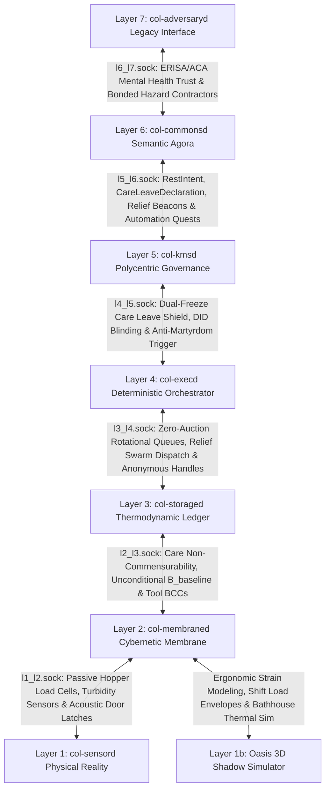
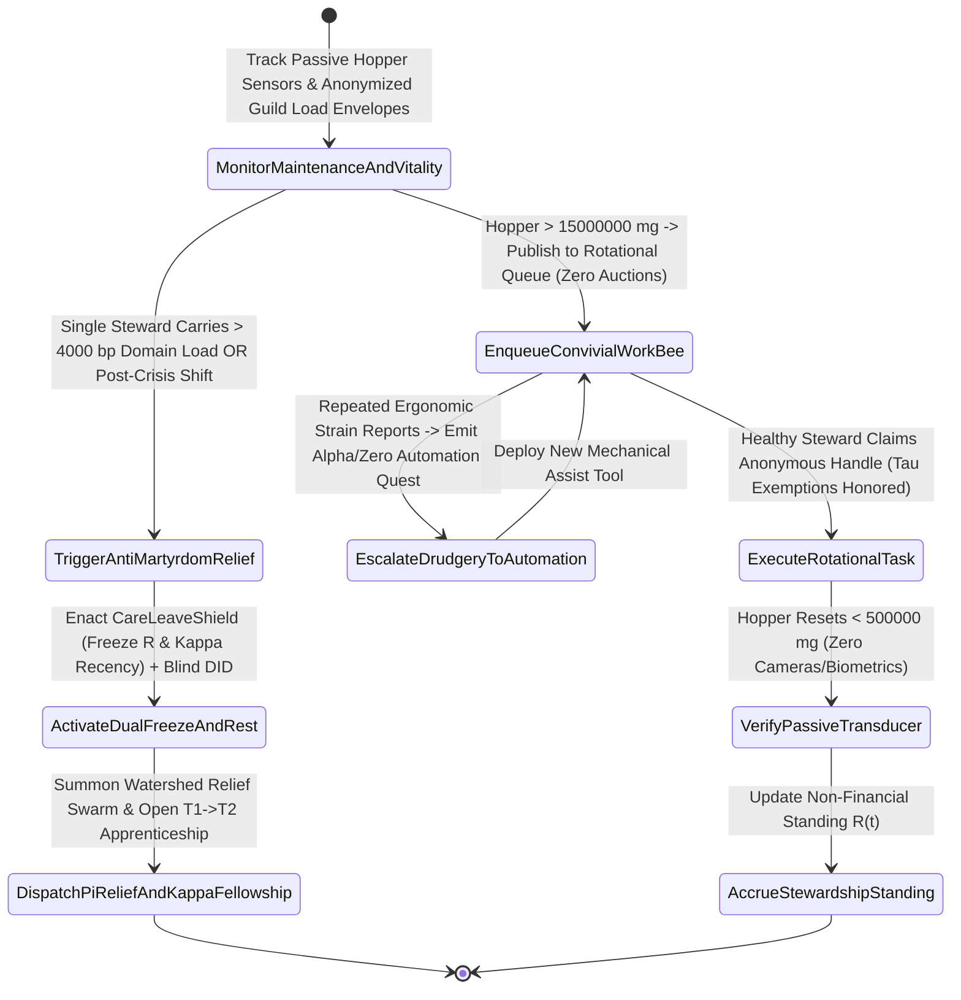

# Scenario Sigma: The Human & Somatic Immune System (Burnout Prevention, Anti-Martyrdom Load-Shedding, Maintenance Commons & Restorative Respite)

*   **Identifier:** `SCN-SIGMA-BURNOUT`
*   **System Epic:** Extending the Autopoietic Immune System to Humanity—Preventing Heroic Martyrdom, Caregiver Exhaustion, Chore Stratification, and Cognitive Fragmentation via Structural Load-Shedding, Dual-Freeze Care Leave Shields, Convivial Maintenance Work Bees, Drudgery-to-Automation Escalation, and Bioregional Respite Sanctuaries
*   **Primary Layers Tested:** L1 (Physical Reality), L1b (Oasis 3D Shadow Simulator), L2 (Cybernetic Membrane), L3 (Thermodynamic Ledger), L4 (Deterministic Orchestrator), L5 (Polycentric Governance), L6 (Semantic Translation & Agora), L7 (Legacy Interface)
*   **Pass/Fail Metric:** Absolute elimination of chore gig-markets, surge pricing, and task Dutch auctions; complete exclusion of domestic care, sanitation, and emotional support from exergy tokenization under the Non-Commensurability Doctrine; deterministic **Anti-Martyrdom Circuit Breaker** (detecting single-steward task concentration or shift overload without biometric surveillance and automatically dispatching Scenario Pi relief swarms and Scenario Kappa apprentices); **Dual-Freeze Care Leave Shield** (simultaneously freezing Layer 5 Reputational Wealth decay and Scenario Kappa credential recency decay during burnout, caregiving, bereavement, or post-crisis decompression); verified $10000\,\mathrm{bp}$ notification blinding under `RestIntent`; automatic **Drudgery-to-Automation R&D Escalation** (`Zero`/`Alpha`); unconditional provision of the Human Survival Baseline ($B_{\mathrm{baseline}}$); and zero IEEE 754 floating-point math.

---

## Architectural Council Ratification & 5-Perspective Synthesis

This scenario specification has been ratified by unanimous consensus of the 5-Persona Architectural Council:

| Council Persona | Disciplinary Representative | Core Contribution to Scenario |
| :--- | :--- | :--- |
| **Game Designer** | Lead Systems & Gameplay Designer | **The Human Immune Loop & Anti-Martyrdom Gameplay:** Extends Scenario Rho's technical immune system to the human soul and nervous system. Prevents the classic commune failure where a few conscientious "heroes" work themselves into collapse. In Oasis, when a specialist carries too much of a node's load or finishes a high-trauma medical/disaster shift (`Chi`/`Upsilon`), the node automatically triggers a **Relief Swarm & Bathhouse Decompression Loop**, turning exhausting drudgery into convivial musical work-bees or `Scenario Alpha` automation quests (`"Restored by cedar sauna, relief work-bee, and deep unmonitored rest (+4500 bp morale)"`). |
| **Game Engineer** | Principal C++ Simulation & Engine Architect | **Flecs ECS Somatic Immune & Load-Shedding Components:** Encapsulates `VoxelSanitationState`, `CareLeaveShieldComponent`, `AntiMartyrdomLoadTracker`, and `RotationalTaskQueueComponent` in 32-bit compact voxels (`material_id = 64` `MAINTENANCE_HUB_SANCTUARY`, `material_id = 65` `THERMAL_HYDROTHERAPY_BATHHOUSE`). Executes $10\,\mathrm{Hz}$ deterministic BPMN state transitions enforcing non-monetary rotational queues, dual decay freezes, and drudgery-to-automation triggers in pure 64-bit fixed-point integer math. |
| **Sovereign Stack Specialist** | Sovereign Stack Systems Architect | **7-Layer Strict Adjacency, Non-Commensurability & Cryptographic Blinding:** Maps `col-sensord` through `col-adversaryd` across `/run/collective/ipc/l1_l2.sock` to `/run/collective/ipc/l6_l7.sock` (traversing `/run/collective/ipc/l4_l5.sock`). Enforces the Non-Commensurability of Human Care, unconditional $B_{\mathrm{baseline}}$ decoupled from chore output, `RestIntent` P2P packet blinding, and zero-biometric passive transducer verification. |
| **Solarpunk Thinker** | Bioregional Regenerative Ecologist | **Human Fallow Cycles as an Ecological Imperative:** Just as living soil requires fallow seasons and cover crops to regenerate negentropy, human bodies and minds require unhurried rest, grieving space, thermal water therapy, and play (`SCN-LAMBDA-CULTURAL`). Rejects both capitalist Taylorist speed-ups and activist "martyr culture" in favor of seasonal, land-paced rhythms. |
| **Scenario Specialist** | Occupational Ergonomics, Trauma Recovery & Cooperative Care Specialist | **Structural Burnout Immunity & Drudgery Elimination:** Pairs universal guild-agnostic rotational maintenance circles (with unconditional Scenario Tau disability accommodations) with the **Anti-Martyrdom Circuit Breaker**, post-crisis nervous-system decompression windows, bioregional respite sabbaticals (`Zeta`/`Pi`), and ERISA/ACA group healthcare trusts. |

**Unanimous Consensus Reached:** The Council unreservedly ratifies Scenario Sigma as the canonical specification for The Collective's human and somatic immune system.

---

## 1. Problem Statement, Legacy Failure & Extending the Immune System to Humanity

While **Scenario Rho (`SCN-RHO-ADVERSARY`)** defends The Collective against technical, legal, and topological attacks, history proves that cooperative societies rarely die only from external sieges—they most often fracture from **internal human exhaustion, invisible caregiver burnout, and social resentment**. Legacy infrastructure (Layer 7) and naive communes fail across five human dimensions:

1.  **The "Hero / Martyr" Syndrome (The $k = 1$ Human Bottleneck):** In high-purpose communities, open-source projects (`Zero`), clinics (`Chi`), and workshops (`Alpha`), a small handful of hyper-conscientious stewards inevitably shoulder the hardest, most urgent tasks. Without a structural immune response, the community unconsciously relies on these "martyrs" until they suffer catastrophic burnout, chronic illness, or bitter departure—collapsing both the person and the node capability they held together.
2.  **The Gendered & Classist Exploitation of Invisible Labor:** Capitalist economies extract trillions of hours of unpaid domestic/reproductive care and underpaid custodial toil, treating the maintenance of life as low-status servitude.
3.  **The Dystopia of Gig-Economy Chore Auctions:** Naive decentralized platforms that introduce "task Dutch auctions" or dynamic token bounties for cleaning and care rapidly recreate class stratification: high-credentialed specialists buy their way out of scrubbing toilets while desperate newcomers take on hazardous or exhausting chores for tokens.
4.  **Compassion Fatigue & Unprocessed Secondary Trauma:** Emergency responders (`Chi`), crisis mediators (`Psi`), end-of-life companions (`Phi`), and childcare stewards (`Delta`) absorb intense emotional and nervous-system shocks that, if left unbuffered by mandatory decompression and respite, lead to secondary trauma and emotional numbness.
5.  **Digital Hyper-Connectivity & Taylorist Surveillance:** Corporate platforms monitor workers with cameras and biometric wearables while bombarding them with 24/7 algorithmic notifications, trapping the human nervous system in chronic sympathetic fight-or-flight.

### 1A. How Scenario Sigma Architects the Human & Somatic Immune System

Scenario Sigma (`SCN-SIGMA-BURNOUT`) extends The Collective's immune system to protect human vitality through **Five Structural Immune Mechanisms**:

```mermaid
flowchart TD
    subgraph Martyr_Guard ["1. Anti-Martyrdom Circuit Breaker (Preventing Hero Collapse)"]
        LoadCheck["Zero-Biometric Task Concentration & Shift Envelope Monitor<br/>(Detects When 1 Steward Carries > 4000 bp of Domain Load or Exceeds Shift Cap)"]
        ReliefSwarm["Automatic Relief & Apprenticeship Response (Scenario Pi + Kappa)<br/>(Dispatches Watershed Relief Work-Bee & Opens Priority T1->T2 Fellowships)"]
    end

    subgraph Care_Shield ["2. Dual-Freeze Care Leave & Trauma Decompression Shield"]
        DualFreeze["Dual Decay Freeze (Layer 5 Standing R + Scenario Kappa Recency)<br/>(dR/dt = 0 & d_recency/dt = 0 During Burnout, Parenting, Elder Care, or Grief)"]
        PostCrisis["Post-Crisis Nervous-System Decompression (Scenario Chi/Upsilon/Phi)<br/>(Automatic Rest Buffer + Waste-Heat Thermal Bathhouse + Peer Accompaniment)"]
        Respite["Bioregional Respite Sabbaticals (Scenario Zeta + Pi)<br/>(Unconditional Rest Retreats at Forest, Mountain, or Coastal Sanctuary Nodes)"]
    end

    subgraph Maintenance_Commons ["3. Convivial Maintenance Commons & Drudgery Elimination"]
        NoAuction["Absolute Ban on Chore Auctions & Care Tokenization<br/>(Zero Dutch Auctions; Unconditional B_baseline Decoupled from Chore Output)"]
        WorkBee["Universal Guild-Agnostic Rotational Work Bees (With Tau Disability Justice)<br/>(Surgeons, Coders & Artists Share Joyful Care Circles; Full Disability Exemptions)"]
        Automate["Drudgery-to-Automation Escalation Pipeline (Scenario Zero + Alpha)<br/>(High-Strain Chores Trigger Open-Source Robotics & Ergonomic Tooling R&D)"]
    end

    subgraph Nervous_Shield ["4. Cryptographic Right to Disconnect (RestIntent)"]
        Silence["10000 bp Edge Notification Blinding & Acoustic Sanctuary Latch (<= 300 cB)<br/>(col-kmsd Drops All Non-Emergency Pings; Zero Cameras or Biometric Trackers)"]
    end

    Martyr_Guard --> Care_Shield --> Maintenance_Commons --> Nervous_Shield
```



1.  **The Anti-Martyrdom Circuit Breaker (Healing the "Hero Bottleneck" Before Burnout Strikes):**
    *   Without ever using cameras or body-worn biometric trackers (`biometric_surveillance_deployed == false`), `col-execd` (L4) and `col-kmsd` (L5) monitor anonymized **Shift-Duration Envelopes** and **Domain Task Concentration** across every critical guild bay.
    *   If a single steward carries $> 4000\,\mathrm{bp}$ ($40\%$) of a node's critical maintenance, medical, or engineering workload (`single_steward_domain_concentration_bps > 4000`) or exceeds sustainable weekly shift envelopes (`shift_load_bps >= 8500`), the **Anti-Martyrdom Circuit Breaker** trips automatically:
        1.  **Compassionate Load-Shedding:** The steward is invited into a protected **Somatic Integration & Rest Window (`RestIntent`)** with zero stigma and $10000\,\mathrm{bp}$ preserved standing.
        2.  **Cross-Watershed Relief Dispatch (`SCN-PI-GUILD`):** `col-execd` emits an immediate **Mutual-Aid Relief Beacon**, summoning a temporary Work-Bee Swarm from neighboring $R_3$ watershed nodes so the local bay remains fully operational while the exhausted steward rests!
        3.  **Mandatory Bottleneck Dissolution (`SCN-KAPPA-APPRENTICE`):** Simultaneously, Layer 5 opens high-priority `T1 -> T2/T3` apprenticeship fellowships in that domain so the returning steward has trained local peers and is never trapped as a $k = 1$ human bottleneck again.
2.  **The Dual-Freeze Care Leave Shield & Post-Crisis Somatic Decompression:**
    *   When any steward steps back for **burnout recovery, parenting (`SCN-DELTA-CHILDCARE` / `SCN-OMICRON-KINSHIP`), elder or palliative accompaniment (`SCN-PHI-ELDER`), bereavement, disability flare-ups (`SCN-TAU-GENESIS`), or post-emergency decompression (`SCN-CHI-PARAMEDIC` / `SCN-UPSILON-SHOCK`)**, invoking the **Care Leave Shield** enacts a **Dual Cryptographic Freeze**:
        *   **Layer 5 Reputational Wealth Freeze:** Completely pauses the exponential seasonal decay clock ($\frac{d\mathcal{R}}{dt} = 0$).
        *   **Scenario Kappa Credential Recency Freeze:** Pauses the recency decay timer on the steward's `T2/T3/T4` craft credentials ($\frac{d\tau_{\mathrm{recency}}}{dt} = 0$), ensuring caregivers and recovering stewards never lose their hard-earned guild standing while tending to human life.
    *   **Automatic Post-Crisis Decompression & Bioregional Respite Retreats:** Following any acute trauma shift (e.g., emergency triage in `Chi` or disaster black-start in `Upsilon`), `col-execd` automatically schedules a **Somatic Decompression Block** featuring waste-heat hydrotherapy bathhouses (`SCN-BETA-TRANSIT` / `SCN-EPSILON-COWORKING` thermal cascade), non-moralistic botanical/herbal support (`SCN-ETA-COPPICE`), and optional **Inter-Node Respite Sabbaticals** at quiet forest or coastal lodges (`SCN-ZETA-LODGING`).
3.  **Convivial Maintenance Commons, Disability Justice & The Drudgery-to-Automation Pipeline:**
    *   **Non-Commensurability & Ban on Chore Markets:** Domestic care, sanitation, cooking, and emotional support never mint Exergy Credits (`exergy_token_minting_permitted == false`), and task Dutch auctions or surge bounties are constitutionally prohibited (`auction_escalation_banned == true`).
    *   **Universal Guild-Agnostic Rotational Circles + Disability Justice (`SCN-TAU-GENESIS`):** Every able-bodied steward—regardless of whether they hold a `T4` compiler or surgical credential—participates in convivial, music-accompanied rotational maintenance bees (`SCN-LAMBDA-CULTURAL`). Crucially, stewards with physical, chronic, or neurodivergent disabilities (`tau_disability_accommodation_active == true`) hold an unconditional exemption from unsuitable physical chores with zero loss of dignity or survival baseline ($B_{\mathrm{baseline}}$).
    *   **The Drudgery-to-Automation Escalation Pipeline (`SCN-ZERO-SOFTWARE` + `SCN-ALPHA-FAB`):** Whenever a sanitation or maintenance task accumulates high ergonomic strain or unpopularity flags (`ergonomic_strain_reports >= threshold`), `col-commonsd` automatically promotes it into a **Convivial Automation R&D Quest** for `Scenario Zero` and `Scenario Alpha` guilds—engineering self-cleaning greywater backwashers, autoclave loaders, or mechanical lift assists to eliminate the drudgery at its root!
4.  **Cryptographic Right to Disconnect (`RestIntent` Blinding):**
    *   Emitting a `RestIntent` blinds the steward's `did:peer` at Layer 5, dropping $10000\,\mathrm{bp}$ of non-emergency pings at the daemon boundary and latching physical rest-sanctuary doors into $\le 300\,\mathrm{cB}$ acoustic silence.

---

## 2. The Collective Workflow (7-Layer Traversal)

Scenario Sigma coordinates burnout prevention, anti-martyrdom relief swarms, convivial sanitation, and somatic recovery across all 7 layers without skipping layers:



### Layer 1: Physical Reality & Layer 1b: Oasis 3D Shadow Simulator
*   **Sanitation Commons, Thermal Bathhouses & Quiet Rest Sanctuaries (`Layer 1`):**
    *   **Sanitation & Repair Lockers:** Equipped with steam autoclaves, HEPA air scrubbers, enzyme/vinegar bio-surfactant dispensers (`SCN-ETA-COPPICE` / `SCN-MU-EXTRACTION`), and mechanical lift assists.
    *   **Waste-Heat Hydrotherapy Bathhouses & Quiet Sanctuaries (`SCN-XI-ARCH`):** Cedar saunas, warm mineral soak tubs heated by Scenario Epsilon's server-cooling waste heat ($55^\circ\mathrm{C}$ thermal cascade), and earth-bermed acoustic rest cabins ($\le 300\,\mathrm{cB}$) with blackout shutters and zero electronic screens.
*   **Oasis 3D Shadow Simulator (`Layer 1b`):**
    *   Simulates node-wide **Steward Vitality & Bottleneck Risk**, forecasting when seasonal workloads (e.g., autumn harvest in `Gamma` or winter storm repair in `Upsilon`) could push specific guilds toward burnout so relief swarms can be pre-positioned early.

### Layer 2: The Cybernetic Membrane (Passive Non-Human Telemetry)
*   **Zero-Biometric Passive Verification (`col-membraned`):**
    *   Enforces the absolute constitutional ban on workplace cameras, facial recognition, and wearable biometric monitors (`biometric_surveillance_deployed == false`).
    *   Verifies sanitation and maintenance strictly via **passive non-human physical observables**: `waste_hopper_mass_mg` dropping from $18400000\,\mathrm{mg}$ to $200000\,\mathrm{mg}$, `greywater_turbidity_milli_ntu` clearing below $5000\,\mathrm{mNTU}$, or autoclave sterilization cycle completion, plus physical acoustic-latch solenoids that silence corridor chimes during active rest blocks.

### Layer 3: The Thermodynamic Ledger (Non-Commensurability & Unconditional Baseline)
*   **The Non-Commensurability of Human Care (`col-storaged`):**
    *   Domestic cleaning, childcare, elder comfort, psychological peer support, and grief accompaniment **never** mint Exergy Credits (`exergy_token_minting_permitted == false`).
*   **Unconditional Human Survival Baseline ($B_{\mathrm{baseline}}$):**
    *   Every person's access to housing (`Zeta`), nourishing meals (`Gamma`), healthcare (`Chi`), and utilities (`Beta`) is $10000\,\mathrm{bp}$ unconditional—never gated by chores completed, hours worked, or burnout leave status.
*   **Consumables & Tooling via `BCC` / `HTLC`:**
    *   Physical maintenance hardware (replacement HEPA media, vacuum motors, autoclave gaskets) clears across Pairwise Bilateral Clearing Channels ($B_{u \to v}(t) + B_{v \to u}(t) = 0$).

### Layer 4: The Deterministic Orchestrator (Rotational Queues & Anti-Martyrdom Engine)
*   **Zero Dutch Auctions & Anonymous Claim Handles (`col-execd`):**
    *   Communicates across `/run/collective/ipc/l4_l5.sock` and `/run/collective/ipc/l3_l4.sock` at $10\,\mathrm{Hz}$. Contains zero code for task Dutch auctions or dynamic bounty escalation.
*   **Anti-Martyrdom & Drudgery-to-Automation State Machine:**
    *   Monitors anonymized task-concentration ratios (`single_steward_domain_concentration_bps`) and post-crisis trauma flags, automatically triggering **Care Leave + Scenario Pi Relief Swarms + Scenario Kappa Apprenticeship Callouts**, and escalating high-strain chores to `Scenario Alpha` automation guilds.



### Layer 5: Polycentric Governance (Dual-Freeze Care Leave Shield & Rest Blinding)
*   **The Dual-Freeze Care Leave Shield (`col-kmsd`):**
    *   Reputational Wealth naturally decays seasonally ($\mathcal{R}(t) = \mathcal{R}_0 e^{-\frac{\ln(2)}{\tau_{\mathrm{half}}} t}$) to prevent static oligarchy. When a steward activates the **Care Leave Shield** (for burnout recovery, parenting, elder care, bereavement, or illness), `col-kmsd` freezes **both** $\frac{d\mathcal{R}}{dt} = 0$ and Scenario Kappa credential recency decay $\frac{d\tau_{\mathrm{recency}}}{dt} = 0$.
*   **`RestIntent` Network Blinding & `No-Transit` Quiet Zones:**
    *   Drops $10000\,\mathrm{bp}$ of non-emergency notifications targeting a resting steward's `did:peer` and enforces `No-Transit` quiet perimeters around convalescent sanctuaries.

### Layer 6: Semantic Translation & Agora (Ricardian Care Compacts & Automation Quests)
*   **Tripartite Treaties & Typed Intents (`col-commonsd`):**
    *   Parses `MaintenanceIntent`, `RestIntent`, `CareLeaveDeclarationIntent`, `AntiMartyrdomReliefBeacon`, and `DrudgeryAutomationQuestIntent` over `/run/collective/ipc/l5_l6.sock`.

### Layer 7: The Legacy Interface (ERISA/ACA Mental Health Trust & Commercial Hazard Bridging)
*   **Group Healthcare & Trauma Counseling Trust (`col-adversaryd`):**
    *   Uses the cooperative's external budget ($\Phi_t$) under Subchapter T / ERISA / ACA to fund licensed external trauma therapists, psychiatrists, and medical specialists with zero personal debt to stewards.
*   **Commercial Hazard Escalation:**
    *   When a maintenance hazard exceeds safe internal community thresholds (e.g., legacy asbestos abatement, deep municipal sewer collapse, or high-voltage utility transformer replacement), Layer 7 contracts licensed, bonded commercial hazard teams so internal stewards are never exposed to lethal industrial risks.

---

## 3. 3-Stage Incremental Node Facility Blueprints (Node Growth Pattern)

Scenario Sigma scales from a domestic quiet sanctuary and non-toxic cleaning station into a bioregional burnout-recovery and hydrotherapy retreat campus.

### Stage 1: Domestic Quiet Sanctuary, Non-Toxic Utility Alcove & Care Board ($R_1 / R_2$ Bootstrap)
*   **Physical Footprint:** `15 m2` quiet bedroom sanctuary + `6 m2` ergonomic utility/laundry alcove in a multi-steward household (`SCN-ZETA-LODGING`).
*   **Core Somatic & Maintenance Features:**
    1.  **The $\le 300\,\mathrm{cB}$ Acoustic Decompression Room:** Equipped with rockwool acoustic wall panels, blackout cedar shutters, herbal tea station (`SCN-ETA-COPPICE`), and a physical door latch that triggers `RestIntent` notification silence.
    2.  **Closed-Loop Bio-Surfactant & Laundry Station:** Dispenses fermented citric/vinegar surfactants and enzyme cleaners (`SCN-MU-EXTRACTION`) into greywater-safe washing machines with passive load-cell hoppers.

### Stage 2: Urban Convivial Maintenance Hub, Waste-Heat Bathhouse & Respite Clinic ($R_2 / R_3$ Municipal Shell)
*   **Physical Footprint:** `200 m2` to `500 m2` restorative and maintenance commons co-located with Scenario Epsilon (`SCN-EPSILON-COWORKING`) and Scenario Chi (`SCN-CHI-PARAMEDIC`).
*   **Integrated Human-Immune Zones:**
    1.  **The Waste-Heat Cedar Sauna & Hydrotherapy Bathhouse:** Directly plumbed into Scenario Epsilon's liquid-cooled server racks and Scenario Theta's foundry heat-recovery loop (`SCN-BETA-TRANSIT`), providing free $85^\circ\mathrm{C}$ dry saunas, $40^\circ\mathrm{C}$ mineral soak pools, and cold plunges for daily somatic decompression after work shifts.
    2.  **The Industrial Autoclave, Linen & Ergonomic Tool Bay:** High-efficiency tunnel washers, steam autoclaves, and `Scenario Alpha`-fabricated robotic floor scrubbers and exoskeleton lift assists.
    3.  **Quiet Counseling & Peer Listening Sanctuaries:** Private soundproof rooms for Scenario Psi peer support and Layer 7 ERISA-funded trauma therapy.

### Stage 3: Bioregional Convalescent, Sabbatical & Burnout Recovery Sanctuary Campus ($R_3 / R_4$ CLT/PPT)
*   **Physical Footprint:** `2` to `8 hectares` situated in a quiet forest, hot-spring, or coastal watershed sanctuary (`SCN-XI-ARCH` + `SCN-ETA-COPPICE`) on an **Irrevocable CLT/PPT**.
*   **Custom Ecological & Restorative Architecture:**
    *   **Convalescent & Sabbatical Timber Pavilions (`SCN-ZETA-LODGING`):** Passive-solar timber and earthen cottages where burned-out stewards, grieving families (`SCN-OMICRON-KINSHIP`), and post-crisis paramedics (`SCN-CHI-PARAMEDIC`) from across the federation can stay for weeks or months on a **Care Leave Sabbatical** with $10000\,\mathrm{bp}$ unconditional hospitality and zero work expectations.
    *   **The Convivial Automation & Ergonomics Lab (`SCN-ALPHA-FAB` + `SCN-ZERO-SOFTWARE`):** Co-designs open-source assistive robotics and ergonomic sanitation appliances that continuously eliminate repetitive physical strain across all nodes.

---

## 4. Machine-Readable Schemas

### 4A. Layer 6 Knowledge Artifact: Anti-Martyrdom Relief & Maintenance Intent (`maintenance_and_relief.jsonld`)

```json
{
  "@context": [
    "https://schema.org/",
    "https://collective.network/ontology/v1/"
  ],
  "@type": "HumanImmuneMaintenanceAndReliefIntent",
  "identifier": "urn:uuid:9f8e7d6c-5b4a-3c2d-1e0f-1a2b3c4d5e6f",
  "issuerDid": "did:peer:2Ez6MksE_sanitation_and_vitality_steward",
  "taskProfile": {
    "title": "Sanitize Commons Kitchen, Cycle Autoclaves & Dispatch Relief Swarm for Overloaded Clinic Bay",
    "targetLocationVoxel": [16, 8, 16],
    "estimatedDurationSeconds": 5400,
    "coordinationMechanism": "Rotational_Work_Bee_Queue",
    "ergonomicStrainReportsCount": 6,
    "drudgeryAutomationQuestTriggered": true
  },
  "humanImmuneAndLaborConstraints": {
    "exergyTokenMintingPermitted": false,
    "dutchAuctionPermitted": false,
    "unconditionalSurvivalBaselineGuaranteed": true,
    "voluntaryRefusalPermitted": true,
    "tauDisabilityExemptionsHonored": true,
    "antiMartyrdomCircuitBreakerTripped": true,
    "piWatershedReliefSwarmDispatched": true,
    "kappaApprenticeshipFellowshipOpened": true,
    "dualFreezeCareLeaveShieldActive": true
  },
  "cryptographicSignature": {
    "type": "Ed25519Signature2020",
    "created": "2026-10-26T08:00:00Z",
    "verificationMethod": "did:peer:2Ez6MksE_sanitation_and_vitality_steward#key-1",
    "proofValue": "z2bN8v8k1p_signature_verified"
  }
}
```

### 4B. Layer 2 Telemetry Attestation: Passive Sanitation & Acoustic Sanctuary Proof (`cleaning_attestation.json`)

```json
{
  "@context": "https://collective.network/ontology/v1/",
  "@type": "MaintenanceAndSanctuaryAttestation",
  "attestationId": "urn:uuid:4a5b6c7d-8e9f-0a1b-2c3d-4e5f6a7b8c9d",
  "sensorNodeDid": "did:peer:2Ez6MksS_hopper_and_sanctuary_node",
  "verificationMetrics": {
    "targetVoxelCoordinates": [16, 8, 16],
    "preChoreHopperMassMilligrams": 18400000,
    "postChoreHopperMassMilligrams": 200000,
    "greywaterTurbidityMilliNtu": 4100,
    "restSanctuaryAcousticLevelCentibels": 280,
    "bathhouseWaterTempMilliKelvin": 313150,
    "completionTimestamp": "2026-10-26T10:15:22Z"
  },
  "verificationMethod": "Passive_Non_Human_Transducer_Verification",
  "biometricSurveillanceDeployed": false,
  "status": "SANITATION_AND_QUIET_SANCTUARY_VERIFIED",
  "digestSha256": "6a7b8c9d0e1f2a3b4c5d6e7f8a9b0c1d2e3f4a5b6c7d8e9f0a1b2c3d4e5f6a7b"
}
```

---

## 5. Oasis Engine Implementation Specification

### 5A. Memory Allocation, Voxel State & Human Immune Components

The maintenance hub, quiet rest sanctuary, and waste-heat hydrotherapy bathhouse occupy designated coordinates in the $32^3$ chunk space (`ChunkManager`):
*   Maintenance Hub & Quiet Rest Sanctuary voxel initialized with `material_id = 64` (`MAINTENANCE_HUB_SANCTUARY`).
*   Waste-Heat Hydrotherapy & Cedar Sauna Bathhouse voxel initialized with `material_id = 65` (`THERMAL_HYDROTHERAPY_BATHHOUSE`).
*   Metadata bitmask `0b00000101` sets `Is_Sanitation_Hub` (bit 0) and `Is_Rest_Sanctuary` (bit 2).

### 5B. Self-Contained C++20 Reference & Test Harness

```cpp
// engine/tests/scenario_sigma_test.cpp
#include <array>
#include <cassert>
#include <cstdint>
#include <iostream>
#include <string>
#include <vector>

namespace oasis::sigma {

// Cache-aligned Flecs ECS Components in pure fixed-point SI integer math
struct alignas(8) VoxelSanitationState {
    uint32_t step_counter{0};
    uint16_t accumulated_dirt_index{0}; // [0, 65535]
    uint16_t ergonomic_strain_reports{0};
    bool service_required{false};
    bool drudgery_automation_quest_emitted{false}; // Escalates to Scenario Zero/Alpha!
};

struct alignas(8) CareLeaveShieldComponent {
    uint64_t steward_id{0};
    uint64_t reputational_wealth_raw{1000000ULL}; // Layer 5 standing
    uint64_t kappa_credential_recency_ticks{500000ULL}; // Scenario Kappa recency timer
    bool care_leave_active{false};          // Freezes BOTH R decay and Kappa recency decay!
    bool rest_intent_silenced{false};       // Drops 10000 bp of non-emergency notifications
    bool post_crisis_decompression_active{false};
    bool bathhouse_hydrotherapy_assigned{false};
    bool survival_baseline_unconditional{true}; // Always true (10000 bp)
};

struct alignas(8) AntiMartyrdomLoadTracker {
    uint64_t steward_id{0};
    uint32_t shift_load_bps{0};                        // >= 8500 bp triggers relief
    uint32_t single_steward_domain_concentration_bps{0}; // > 4000 bp (40%) triggers relief
    bool experienced_acute_trauma_shift{false};
    bool anti_martyrdom_breaker_tripped{false};
    bool pi_watershed_relief_swarm_dispatched{false};
    bool kappa_apprenticeship_fellowship_opened{false};
    uint32_t biometric_surveillance_packets{0};        // Must strictly equal 0!
};

struct alignas(8) RotationalTaskQueueComponent {
    uint32_t task_id{0};
    uint32_t estimated_duration_seconds{3600};
    bool task_completed{false};
    bool auction_escalation_banned{true};       // Strictly true: zero Dutch auctions
    bool exergy_token_minting_banned{true};     // Strictly true: Non-Commensurability
    bool tau_disability_exemption_honored{true}; // Scenario Tau integration
};

class HumanImmuneGovernanceEngine {
public:
    static constexpr uint64_t HALF_LIFE_TICKS = 31536000ULL; // ~1 year at 1 tick/sec

    // Evaluates both Layer 5 Reputational Wealth and Scenario Kappa credential recency
    // under the Dual-Freeze Care Leave Shield
    static void advance_steward_decay_clocks(
        CareLeaveShieldComponent& steward,
        uint64_t elapsed_ticks
    ) {
        if (steward.care_leave_active || steward.post_crisis_decompression_active) {
            // Dual-Freeze Invariant: Neither Layer 5 standing nor Kappa recency decays during leave!
            return;
        }
        if (elapsed_ticks == 0ULL) return;

        if (elapsed_ticks >= HALF_LIFE_TICKS) {
            steward.reputational_wealth_raw /= 2ULL;
            steward.kappa_credential_recency_ticks /= 2ULL;
            return;
        }

        uint64_t r_decay = (steward.reputational_wealth_raw * elapsed_ticks) / (HALF_LIFE_TICKS * 2ULL);
        steward.reputational_wealth_raw =
            (steward.reputational_wealth_raw > r_decay) ? (steward.reputational_wealth_raw - r_decay) : 0ULL;

        uint64_t k_decay = (steward.kappa_credential_recency_ticks * elapsed_ticks) / (HALF_LIFE_TICKS * 2ULL);
        steward.kappa_credential_recency_ticks =
            (steward.kappa_credential_recency_ticks > k_decay) ? (steward.kappa_credential_recency_ticks - k_decay) : 0ULL;
    }

    // Evaluates the Anti-Martyrdom Circuit Breaker to protect "hero" bottlenecks and trauma responders
    static bool evaluate_anti_martyrdom_and_decompression(
        AntiMartyrdomLoadTracker& tracker,
        CareLeaveShieldComponent& steward
    ) {
        // Constitutional ban on biometric surveillance
        if (tracker.biometric_surveillance_packets != 0) return false;

        bool overloaded = (tracker.shift_load_bps >= 8500) ||
                          (tracker.single_steward_domain_concentration_bps > 4000) ||
                          tracker.experienced_acute_trauma_shift;

        if (overloaded) {
            tracker.anti_martyrdom_breaker_tripped = true;
            tracker.pi_watershed_relief_swarm_dispatched = true;
            tracker.kappa_apprenticeship_fellowship_opened = true;

            steward.care_leave_active = true;
            steward.rest_intent_silenced = true;
            steward.post_crisis_decompression_active = true;
            steward.bathhouse_hydrotherapy_assigned = true;
            steward.survival_baseline_unconditional = true;
        }
        return true;
    }

    // Evaluates ergonomic strain reports on chores and escalates to Scenario Zero/Alpha automation R&D
    static void evaluate_drudgery_to_automation_pipeline(VoxelSanitationState& vox_state) {
        if (vox_state.ergonomic_strain_reports >= 5) {
            vox_state.drudgery_automation_quest_emitted = true;
        }
    }

    // Verifies constitutional ban on task Dutch auctions and care tokenization
    static bool verify_convivial_maintenance_policy(const RotationalTaskQueueComponent& task) {
        return task.auction_escalation_banned &&
               task.exergy_token_minting_banned &&
               task.tau_disability_exemption_honored;
    }
};

void test_scenario_sigma_dual_freeze_and_anti_martyrdom() {
    uint64_t elapsed_six_months = 15768000ULL;

    // 1. Active steward without Care Leave experiences normal seasonal decay
    CareLeaveShieldComponent active_steward{
        .steward_id = 10ULL,
        .reputational_wealth_raw = 1000000ULL,
        .kappa_credential_recency_ticks = 500000ULL,
        .care_leave_active = false
    };
    HumanImmuneGovernanceEngine::advance_steward_decay_clocks(active_steward, elapsed_six_months);
    assert(active_steward.reputational_wealth_raw == 750000ULL);
    assert(active_steward.kappa_credential_recency_ticks == 375000ULL);

    // 2. Overloaded "Hero" steward carrying 55% (5500 bp) of domain tasks trips Anti-Martyrdom Breaker
    CareLeaveShieldComponent hero_steward{
        .steward_id = 42ULL,
        .reputational_wealth_raw = 1000000ULL,
        .kappa_credential_recency_ticks = 500000ULL,
        .care_leave_active = false
    };
    AntiMartyrdomLoadTracker load_tracker{
        .steward_id = 42ULL,
        .shift_load_bps = 8800,
        .single_steward_domain_concentration_bps = 5500, // 55% > 40% cap!
        .experienced_acute_trauma_shift = true,
        .biometric_surveillance_packets = 0
    };

    assert(HumanImmuneGovernanceEngine::evaluate_anti_martyrdom_and_decompression(load_tracker, hero_steward));
    assert(load_tracker.anti_martyrdom_breaker_tripped == true);
    assert(load_tracker.pi_watershed_relief_swarm_dispatched == true);
    assert(load_tracker.kappa_apprenticeship_fellowship_opened == true);
    assert(hero_steward.care_leave_active == true);
    assert(hero_steward.rest_intent_silenced == true);
    assert(hero_steward.bathhouse_hydrotherapy_assigned == true);
    assert(hero_steward.survival_baseline_unconditional == true);

    // Advance 6 months during burnout recovery: verify Dual-Freeze keeps BOTH R and Kappa recency 100% intact!
    HumanImmuneGovernanceEngine::advance_steward_decay_clocks(hero_steward, elapsed_six_months);
    assert(hero_steward.reputational_wealth_raw == 1000000ULL);
    assert(hero_steward.kappa_credential_recency_ticks == 500000ULL);

    // 3. Verify Drudgery-to-Automation Escalation Pipeline & Chore Auction Ban
    VoxelSanitationState grease_trap_voxel{.ergonomic_strain_reports = 6};
    HumanImmuneGovernanceEngine::evaluate_drudgery_to_automation_pipeline(grease_trap_voxel);
    assert(grease_trap_voxel.drudgery_automation_quest_emitted == true);

    RotationalTaskQueueComponent task{.task_id = 701};
    assert(HumanImmuneGovernanceEngine::verify_convivial_maintenance_policy(task));
}

} // namespace oasis::sigma

int main() {
    oasis::sigma::test_scenario_sigma_dual_freeze_and_anti_martyrdom();
    std::cout << "Scenario Sigma Human Immune System, Anti-Martyrdom & Dual-Freeze Care Leave tests passed." << std::endl;
    return 0;
}
```

---

## 6. Acceptance Test Gates (Pass/Fail)

| Checkpoint | Validation Method | Pass Condition |
| :--- | :--- | :--- |
| **G1: Anti-Martyrdom Circuit Breaker & Relief Dispatch** | `evaluate_anti_martyrdom_and_decompression` | When a single steward carries $> 4000\,\mathrm{bp}$ of a domain's tasks, exceeds $8500\,\mathrm{bp}$ shift load, or completes an acute trauma shift, the system automatically activates Care Leave, dispatches a Scenario Pi Relief Swarm (`pi_watershed_relief_swarm_dispatched == true`), and opens a Scenario Kappa apprenticeship fellowship (`kappa_apprenticeship_fellowship_opened == true`). |
| **G2: Dual-Freeze Care Leave Shield** | `advance_steward_decay_clocks` | Declaring Care Leave or post-crisis decompression freezes **both** Layer 5 Reputational Wealth ($\mathcal{R}$) decay and Scenario Kappa credential recency decay ($0$ loss across $15768000$ ticks). |
| **G3: Elimination of Chore Auctions & Care Tokenization** | `verify_convivial_maintenance_policy` | `col-execd` and `col-storaged` prohibit task Dutch auctions and mint $0$ Exergy Credits for domestic/sanitation/emotional care while honoring Scenario Tau disability exemptions. |
| **G4: Drudgery-to-Automation Escalation (`Zero/Alpha`)** | `evaluate_drudgery_to_automation_pipeline` | Maintenance tasks accumulating $\ge 5$ ergonomic strain reports automatically emit a `Scenario Zero`/`Scenario Alpha` automation R&D quest (`drudgery_automation_quest_emitted == true`). |
| **G5: `RestIntent` Blinding & Unconditional Baseline** | P2P Filter & Access Gate Audit | Emitting a `RestIntent` drops $10000\,\mathrm{bp}$ of non-emergency notifications (`rest_intent_silenced == true`) while guaranteeing $10000\,\mathrm{bp}$ unconditional survival baseline access ($B_{\mathrm{baseline}}$). |
| **G6: Convivial Anti-Panopticon Compliance** | Transducer Interface Audit | Zero cameras or wearable biometric sensors interface with sanitation or workload queues (`biometric_surveillance_packets == 0`); verification relies strictly on passive non-human transducers (hopper load cells, turbidity meters). |
