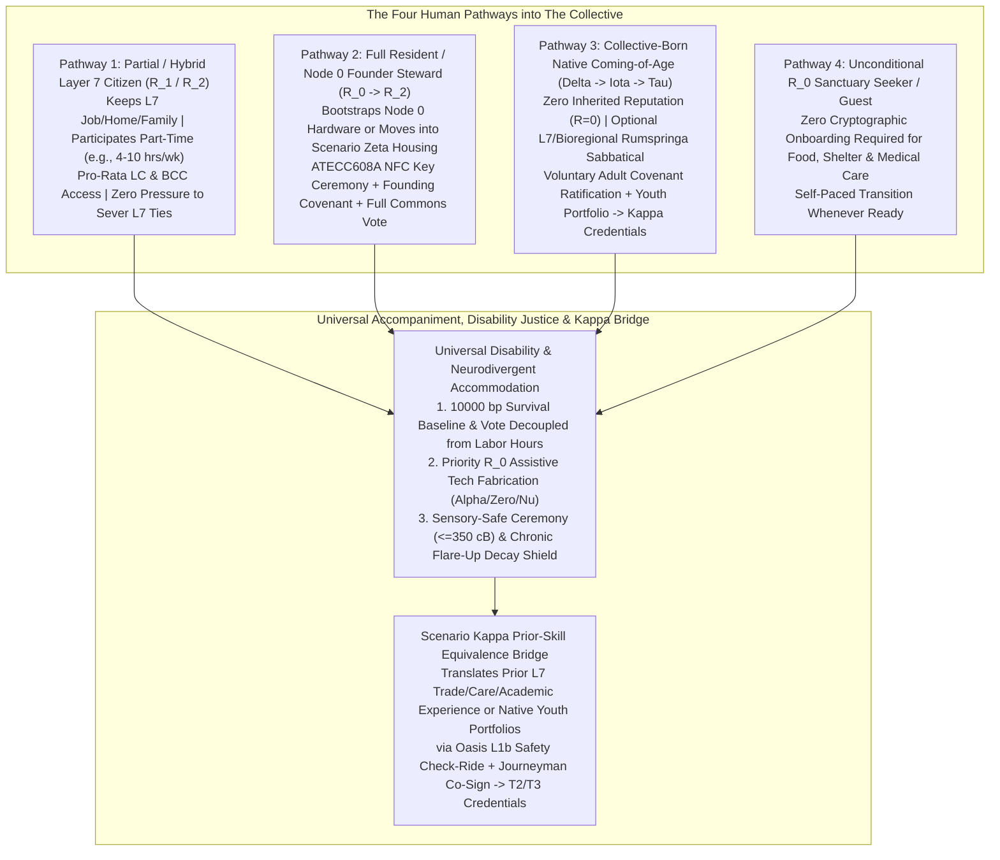
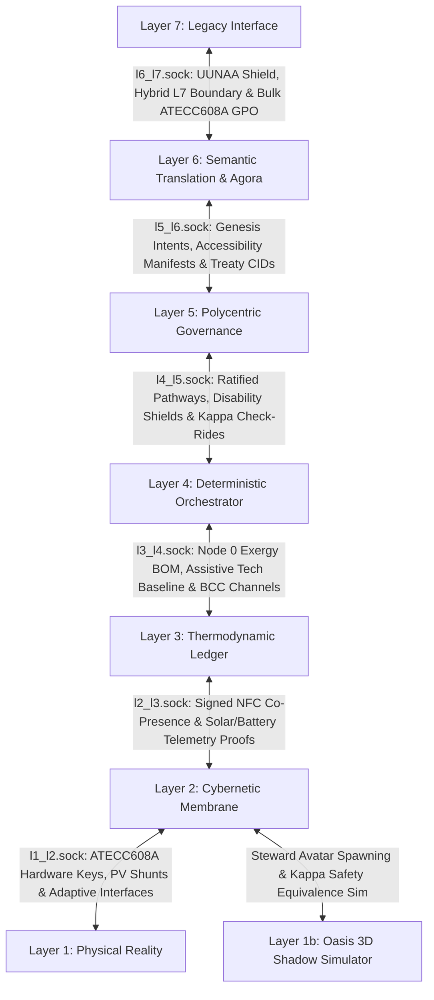
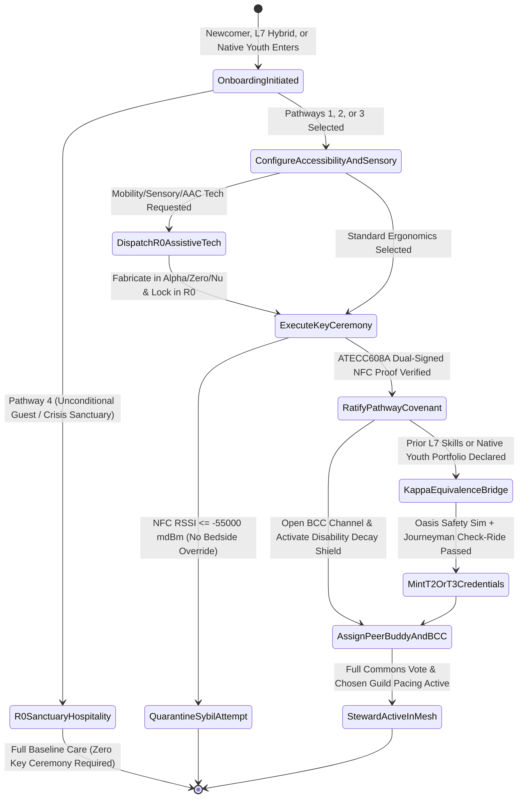

# Scenario Tau: Steward & Node Genesis (Multi-Pathway Onboarding, Kappa Equivalence, Native Coming-of-Age & Universal Disability Justice)

*   **Identifier:** `SCN-TAU-GENESIS`
*   **System Epic:** Oasis Steward Instantiation, Node 0 Hardware Bootstrap, Partial/Hybrid Layer 7 Integration, Scenario Kappa Prior-Skill Equivalence, Collective-Born Native Coming-of-Age, and Universal Disability & Neurodivergent Accommodation
*   **Primary Layers Tested:** L1 (Physical Reality), L1b (Oasis 3D Shadow Simulator), L2 (Cybernetic Membrane), L3 (Thermodynamic Ledger), L4 (Deterministic Orchestrator), L5 (Polycentric Governance), L6 (Semantic Translation & Agora), L7 (Legacy Interface)
*   **Pass/Fail Metric:** Deterministic bootstrap of Node 0 physical hardware (`6400 W` PV, `14340 Wh` LiFePO4 battery, `48 V` DC bus, 4-stage thermal cascade) and ATECC608A hardware root-of-trust; seamless support for all **Four Human Integration Pathways** (Full Resident Steward, Partial/Hybrid L7 Member, Collective-Born Native Youth, and Unconditional $R_0$ Sanctuary Guest); cryptographic bridging of prior Layer 7 skills into Scenario Kappa (`SCN-KAPPA-APPRENTICE`) credentials; constitutional enforcement of **Universal Disability Justice** ($10000\,\mathrm{bp}$ unconditional survival baseline and full voting standing decoupled from physical labor output, automatic $R_0$ assistive-tech fabrication, and sensory-safe onboarding); zero inherited Reputational Wealth ($\mathcal{R}_{\mathrm{inherited}} = 0$); zero IEEE 754 floating-point math; and zero-sum Pairwise Bilateral Clearing Channel ($B_{u \to v}(t) + B_{v \to u}(t) = 0$) initialization.

---

## Architectural Council Ratification & 5-Perspective Synthesis

This scenario specification has been ratified by unanimous consensus of the 5-Persona Architectural Council:

| Council Persona | Disciplinary Representative | Core Contribution to Scenario |
| :--- | :--- | :--- |
| **Game Designer** | Lead Systems & Gameplay Designer | **Oasis Steward Creation, 4 Integration Pathways & Disability-Inclusive Gameplay:** Expands character and citizen creation beyond a single "Founder 01" template. Models (1) **Full Stewards**, (2) **Partially Integrated Hybrid Citizens** who keep their Layer 7 jobs/families while contributing part-time, (3) **Collective-Born Native Youth** celebrating their voluntary Coming-of-Age choice or Rumspringa sabbatical, and (4) **Disabled & Neurodivergent Stewards** whose bespoke assistive technology (`SCN-ALPHA-FAB` wheelchairs, prosthetics, AAC rigs) and sensory pacing are celebrated as core community strengths (`"Welcomed with custom-fitted titanium mobility chair and sensory-calm garden ceremony (+4500 bp belonging morale)"`). Bridges prior Layer 7 life skills directly into Scenario Kappa check-rides. |
| **Game Engineer** | Principal C++ Simulation & Engine Architect | **Flecs ECS Multi-Pathway Identity & Accessibility Components:** Encapsulates steward traits, `IntegrationPathway` enums, `AccessibilityAndSensoryProfile`, `KappaEquivalencePortfolio`, and `Node0HardwareBOM` into cache-aligned C++20 structs and 32-bit compact voxels (`material_id = 30` `GENESIS_TERMINAL`, `material_id = 31` `ASSISTIVE_TECH_FIT_BAY`). Executes $10\,\mathrm{Hz}$ deterministic BPMN v2 onboarding workflows using pure fixed-point SI integer arithmetic (`uint64_t` $\mu\mathrm{J}$, `int32_t` $\mathrm{mdBm}$, `uint32_t` $\mathrm{bp}$, zero floats). |
| **Sovereign Stack Specialist** | Sovereign Stack Systems Architect | **7-Layer Strict Adjacency, Non-Inheritable Reputation & Sybil-Resistant Web-of-Trust:** Enforces strict socket boundaries (`l1_l2.sock` through `l6_l7.sock`, traversing `/run/collective/ipc/l4_l5.sock`). Hardware Ed25519 keys are generated inside Microchip `ATECC608A` secure elements with mutual NFC tap verification (or verified bedside visits for homebound stewards). Enforces the **Anti-Dynastic Invariant**: Collective-born natives start with $\mathcal{R} = 0$ Reputational Wealth at adulthood (preventing feudal inheritance) while retaining full 1-person-1-vote Commons Chamber equality. |
| **Solarpunk Thinker** | Bioregional Regenerative Ecologist | **Permeable Membranes Over Cult Isolation & Node 0 Energetic Seed:** Rejects sectarian "all-or-nothing" commune isolation. Welcomes neighbors who can only participate 4 hours a week alongside full-time stewards, creating a permeable, healing social membrane with Layer 7. Grounds Node 0 in a convivial `6400 W` solar / `14340 Wh` battery / 4-stage thermal cascade seed that anyone can bootstrap in a suburban home. |
| **Scenario Specialist** | Disability Justice Ergonomist, SSI Identity Architect & Sociologist | **Universal Design, Somatic Pacing & Recognition of Prior Learning (`RPL`):** Codifies the **Anti-Ableist Constitutional Floor**: survival access ($B_{\mathrm{baseline}}$) and political voice are 100% decoupled from physical wattage or work hours. Integrates the **Disability & Care Leave Shield** (freezing reputation decay during chronic illness flare-ups), sensory-quiet onboarding protocols ($\le 350\,\mathrm{cB}$), and fast-track Scenario Kappa skill equivalence trials. |

**Unanimous Consensus Reached:** The Council unreservedly ratifies Scenario Tau as the canonical specification for human and node genesis across all bodies, minds, and life trajectories.

---

## 1. Problem Statement, Legacy Failure & The Permeable Inclusive Commons

In late-stage extractive economies (Layer 7)—and in flawed historical intentional communities—how people enter and belong to society suffers from four deep failures:
1.  **Surveillance Onboarding & The Cold-Start Debt Trap:** Entering modern economic life requires surrendering biometric identity, credit scores, and background checks to corporate monopolies, while newcomers without capital are locked out of tools and shelter.
2.  **The "Cult Rupture" Fallacy of All-or-Nothing Communes:** Many historical utopian experiments failed because they demanded that newcomers immediately sever all ties with the outside world, quit their jobs, and hand over their life savings. This alienated working parents, caretaking relatives, and gradual adopters who wanted to contribute without abandoning their existing responsibilities.
3.  **Dynastic Feudalism vs. Forced Conscription of the Native-Born:** Communities that survive past the first generation often fall into two traps: either founders' children inherit unearned status (creating an oligarchic dynasty), or youth are pressured into staying without ever making an autonomous adult choice.
4.  **Productivist Ableism:** Both capitalist wage markets and naive labor-hour cooperatives often measure human worth by raw physical output—marginalizing disabled, chronically ill, neurodivergent, deaf/blind, or mobility-impaired citizens as "dependents" rather than equal co-creators of the commons.

### 1A. How Scenario Tau Spins the Steward & Welcomes Every Human Trajectory

Scenario Tau (`SCN-TAU-GENESIS`) serves as both **Oasis's (`L1b`) Steward Creation & Spawning Engine** and **The Collective's Real-World Human & Node Onboarding Protocol**, uniting four distinct pathways of belonging with **Scenario Kappa (`SCN-KAPPA-APPRENTICE`)** skill recognition and **Universal Disability Justice**:



1.  **Oasis (`L1b`) Steward Spawning & Scenario Kappa (`SCN-KAPPA-APPRENTICE`) Equivalence Bridge:**
    *   Whether spinning up the player's primary Steward in Oasis or onboarding a real-world neighbor, Scenario Tau initializes a rich, non-reductive human profile: Big-Five personality facets (`0..10000 bp`), Core Values (`Autonomy`, `Stewardship`, `Solidarity`, `Inquiry`, `Craft`, `Care`), Somatic & Sensory Preferences, and **Prior Life Experience**.
    *   **Honoring Prior Life Experience (`Kappa Equivalence Bridge`):** A newcomer who spent 20 years in Layer 7 as a machinist, midwife, cook, software developer, or botanist is never forced to start from scratch as an uncredentialed novice. Scenario Tau matches them with a local **Peer Buddy & Guild Journeyman** and schedules a **Fast-Track Equivalence Check-Ride**:
        *   The candidate completes the domain's Oasis (`L1b`) adversarial safety scenarios (`SCN-KAPPA-APPRENTICE`) and demonstrates practical somatic mastery alongside a local `T3/T4` steward.
        *   Upon counter-signature, `col-kmsd` immediately mints their W3C `T2_APPRENTICE` or `T3_JOURNEYMAN` capability credential, unlocking physical workshop interlocks across Scenarios Alpha, Gamma, Eta, Theta, or Zero!
2.  **Pathway 1 — Partial / Hybrid Layer 7 Integration ("One Foot in Layer 7, One Foot in the Commons"):**
    *   A person can join The Collective while continuing to live in a conventional apartment, work a Layer 7 job, or care for non-member relatives.
    *   Hybrid stewards hold a verified `did:peer` identity and `ATECC608A` token, participate in specific guilds or weekly shifts at their own chosen bandwidth (e.g., `4` to `12 hours/week`), earn pro-rata Labor Credits (`LC`) and Reputational Wealth ($\mathcal{R}$) in those domains, and can fluidly scale their integration up or down as their life evolves—with zero ideological shaming.
3.  **Pathway 2 — Full Resident Steward & Node 0 Household Bootstrap:**
    *   When a household bootstraps a new Stage 1 `Node 0` (installing the `6400 W` solar array, `14340 Wh` LiFePO4 battery bank, `48 V` DC bus, 4-stage thermal cascade, and `col-*` homelab server) or moves full-time into Scenario Zeta (`SCN-ZETA-LODGING`), they execute the physical **In-Person Web-of-Trust Key Ceremony**, ratify the **Tripartite Founding Covenant (`Treaty_CID`)**, and enter full $R_2$ Commons stewardship.
4.  **Pathway 3 — Collective-Born "Native" Citizens & The Voluntary Coming-of-Age Covenant:**
    *   Children born in Scenario Delta (`SCN-DELTA-CHILDCARE`) and raised through Scenario Omicron kinship pods and Scenario Iota (`SCN-IOTA-EPISTEMIC`) Inquiry Circles enjoy unconditional $R_0$ care with zero ledger tracking and **zero inherited Reputational Wealth ($\mathcal{R}_{\mathrm{inherited}} = 0$)**, preventing dynastic hierarchies.
    *   Upon reaching young adulthood, native youth are **never automatically conscripted**:
        *   They are offered an optional, community-supported **Exploration Sabbatical (*Rumspringa*)**—free to travel across inter-bioregional nodes ($R_4/R_5$) or experience Layer 7 cities with an unconditional return guarantee.
        *   When and if they choose to ratify the Founding Covenant as sovereign adults, they mint their own adult `ATECC608A` identity key, and the hands-on project portfolios they built during their youth in Scenario Iota and Scenario Kappa are immediately converted into adult `T2_APPRENTICE` or `T3_JOURNEYMAN` guild credentials.
5.  **Universal Disability Justice, Neurodivergent Respect & Bespoke Assistive Tech (`Alpha` + `Zero` + `Nu` + `Chi`):**
    *   **Unconditional Dignity & Political Equality (`decoupled_from_labor == true`):** Access to housing (`Zeta`), nutrient-dense meals (`Gamma`), healthcare (`Chi`), culture (`Lambda`), and full `1-person-1-vote` standing in the Commons Chamber is **never conditioned on physical ability or hours worked**.
    *   **Bespoke $R_0$ Assistive Technology Fabrication:** Onboarding a steward with mobility, sensory, or communication disabilities automatically triggers a **Tier-2 Survival Baseline Fabrication Intent** across Scenario Alpha (`SCN-ALPHA-FAB`), Scenario Zero (`SCN-ZERO-SOFTWARE`), and Scenario Nu (`SCN-NU-TEXTILES`):
        *   Custom-fitted titanium or mass-timber wheelchairs, tracked forest-trail mobility rigs, 3D-printed myoelectric or mechanical prosthetics, and breathable pressure-relief cushions (`SCN-NU-TEXTILES`);
        *   Open-hardware Refreshable Braille terminals, tactile haptic wayfinding beacons, eye-gaze / sip-and-puff CNC controllers, and offline zero-surveillance AAC speech synthesizers (`SCN-ZERO-SOFTWARE`).
        *   All personal prosthetics, wheelchairs, and AAC devices are constitutionally locked into **Trust Ring $R_0$ (`non_requisitionable == true`, `r0_public_ledger_tracked == false`)**—they are part of the steward's own body!
    *   **Sensory-Safe Onboarding & The Disability Flare-Up Shield:** Neurodivergent stewards and those with sensory or mobility needs can opt into a **Sensory-Safe / Bedside Key Ceremony** (quiet garden or home setting $\le 350\,\mathrm{cB}$ [$35\,\mathrm{dBA}$], zero forced eye contact, tactile/Braille or sign-language covenants), while the **Disability & Care Leave Shield** permanently protects their Layer 5 Reputational Wealth ($\mathcal{R}$) from exponential decay during episodic illness or recovery (`SCN-SIGMA-BURNOUT` / `SCN-CHI-PARAMEDIC`).

---

## 2. The Collective Workflow (7-Layer Traversal)

Scenario Tau orchestrates hardware root-of-trust provisioning, multi-pathway human onboarding, assistive technology fabrication, and Scenario Kappa skill bridging across the 7-layer stack without layer-skipping.



### Layer 1: Physical Ground Truth & Layer 1b: Oasis 3D Shadow Simulator
*   **Node 0 Physical Hardware Seed (`Layer 1`):**
    *   **Solar & Storage Core:** `6400 W` (`6400000 mW`) monocrystalline PV array, `14340 Wh` (`51609600000000 uJ`) LiFePO4 battery bank on a unified `48000 mV` (`48 V`) DC bus with Class-T fusing, and a `5000 W` isolated hybrid inverter with physical UL 1741 transfer disconnects.
    *   **4-Stage Thermal Exergy Cascade:** Stage 1 workshop exhaust capture ($750000\,\mathrm{mK}$ to $850000\,\mathrm{mK}$) $\to$ Stage 2 hydronic radiant floor heating ($330000\,\mathrm{mK}$ to $350000\,\mathrm{mK}$) $\to$ Stage 3 domestic hot water & greenhouse root warming ($305000\,\mathrm{mK}$ to $325000\,\mathrm{mK}$) $\to$ Stage 4 earth-tube ground sink ($285000\,\mathrm{mK}$).
    *   **Universal Design & Adaptive Hardware:** Step-free ramps ($\le 500\,\mathrm{bp}$ slope), height-adjustable workbenches (`700 mm` to `1100 mm`), Braille/tactile tool labels, and open-hardware adaptive controllers (eye-gaze, foot pedals, sip-and-puff switches).
*   **Oasis 3D Shadow Simulator (`Layer 1b`):**
    *   **Steward Spawning & Accessibility Preview:** Spawns the steward's virtual twin with their chosen somatic, sensory, and personality traits, allowing disabled stewards to test-fit custom wheelchair geometry or workshop bench reach envelopes in 3D before Scenario Alpha mills the physical titanium/timber frame.
    *   **Scenario Kappa Equivalence Sandbox:** Runs the interactive 100-scenario safety stress-test so newcomers with prior Layer 7 skills (or native youth coming of age) can demonstrate hazard mastery and fast-track to `T2/T3` guild credentials.

### Layer 2: The Cybernetic Membrane
*   **Hardware Root-of-Trust & Co-Presence Ceremony (`col-sensord`):**
    *   Steward Ed25519 keys are generated inside a tamper-resistant **Microchip `ATECC608A` secure element** (private keys never leave hardware silicon).
    *   In-person sponsorship is verified via mutual NFC tap within `40 mm` (`nfc_rssi_mdbm > -55000`), either at a communal hearth meal or via a **Homebound / Sensory-Calm Bedside Visit** ($\le 350\,\mathrm{cB}$ ambient noise) conducted by two visiting stewards.
*   **Strict Ban on Biometric Surveillance:** Layer 2 never scans retinas, fingerprints, DNA, or facial geometry to authenticate stewards, and never tracks personal $R_0$ assistive devices (`biometric_packets_captured == 0`).

### Layer 3: The Thermodynamic Ledger
*   **Unconditional Survival Baseline ($B_{\mathrm{baseline}}$) Including Assistive Tech:**
    *   Layer 3 provisions every steward's food, shelter, energy, and **$R_0$ Assistive Technology & Mobility Hardware** directly from the node's Tier 2 Survival Baseline ($B_{\mathrm{baseline}}$)—never charging debt or requiring prior labor hours.
*   **Pairwise Bilateral Clearing Channels (BCC):**
    *   Opens zero-sum bilateral channels ($B_{u \to v}(t) + B_{v \to u}(t) = 0$) bounded by mutual-aid credit headroom $[-C_{u \to v}, +C_{v \to u}]$ tailored to the steward's chosen integration pathway (full resident headroom or partial hybrid headroom).

### Layer 4: The Deterministic Orchestrator
*   **State Machine Daemon:** `col-execd` executes a $10\,\mathrm{Hz}$ deterministic BPMN v2 state machine over `/run/collective/ipc/l4_l5.sock` and `/run/collective/ipc/l3_l4.sock`:
    *   Routes newcomers through their chosen **Integration Pathway** (`PARTIAL_HYBRID_L7`, `FULL_RESIDENT_STEWARD`, `NATIVE_COMING_OF_AGE`, or `R0_SANCTUARY_GUEST`).
    *   Dispatches priority assistive-tech fabrication orders to Scenarios Alpha/Zero/Nu when an `AccessibilityManifest` is present.
    *   Schedules Scenario Kappa equivalence check-rides for declared competencies and assigns a welcoming Peer Buddy.



### Layer 5: Polycentric Governance
*   **Equal Political Standing Across Pathways & Abilities:**
    *   Every ratified resident steward—regardless of physical disability or how many hours they are able to work—holds an equal `1-person-1-vote` voice in the local **Commons Chamber**, while **Partially Integrated Hybrid Stewards** hold voting standing in the specific working circles ($R_1 / R_2$) they actively steward.
*   **Anti-Dynastic Native Rule ($\mathcal{R}_{\mathrm{inherited}} = 0$):**
    *   Layer 5 (`col-kmsd`) enforces that Reputational Wealth $\mathcal{R}$ cannot be gifted, bequeathed, or inherited by children. When a Collective-born native ratifies the covenant at adulthood, their initial $\mathcal{R}$ starts cleanly from their own verified Scenario Kappa/Iota learning and craft contributions.
*   **The Disability & Chronic Illness Decay Shield:**
    *   Extends the Care Leave Shield (`SCN-DELTA-CHILDCARE` / `SCN-SIGMA-BURNOUT`) to chronic illness and episodic disabilities: whenever a steward experiences a health flare-up or sensory burnout, setting `disability_flare_shield_active = true` freezes the exponential decay of their Layer 5 Reputational Wealth ($\frac{d\mathcal{R}}{dt} = 0$) so disabled stewards never lose guild standing due to medical rest.

### Layer 6: Semantic Translation & Agora
*   **Tripartite Ricardian Treaties (`Treaty_CID`):** Bind the natural-language Founding Covenant, JSON-LD pathway and accessibility parameters, and BPMN onboarding state machines.
*   **Agora Semantic Knowledge Branches:**
    1.  `GenesisOnboardingIntent`: Declares chosen pathway (`PARTIAL_HYBRID_L7`, `FULL_RESIDENT_STEWARD`, `NATIVE_COMING_OF_AGE`), personality/value profile, and Node 0 hardware inventory.
    2.  `AccessibilityAndSensoryManifest`: Privately specifies mobility, sensory, neurodivergent, and assistive-technology requirements (`R_0` protected) and triggers priority baseline fabrication.
    3.  `KappaEquivalenceClaim`: Requests fast-track Scenario Kappa recognition for prior Layer 7 trade experience or native youth Inquiry Circle portfolios.

### Layer 7: The Legacy Interface & Permeable Hybrid Carapace
*   **Protecting Hybrid Layer 7 Citizens (*NAACP v. Alabama* Membership Blinding):**
    *   Because Partially Integrated Hybrid Stewards still work for Layer 7 employers or rent from Layer 7 landlords who might retaliate against cooperative organizing, `col-adversaryd` enforces strict cryptographic blinding between their external Layer 7 legal identity and their internal `did:peer` handle.
*   **Tripartite Legal Chassis & ADA/Universal Design Supremacy:**
    *   Combines **UUNAA § 6** (Unincorporated Nonprofit Association), **Subchapter T (`26 USC 1381`)** cooperative agreements, and **Irrevocable CLT** ground leases while exceeding **Americans with Disabilities Act (`ADA`)** accessibility standards across every physical and digital surface.

---

## 3. 3-Stage Incremental Node Facility Blueprints (Node Growth Pattern)

Scenario Tau scales from a single household's kitchen-table genesis into a bioregional welcome sanctuary and assistive-technology atelier.

### Stage 1: Founder 01 Domestic Node 0 Bootstrap & Kitchen-Table Onboarding ($R_0 / R_1$ Seed)
*   **Physical Footprint:** A founding household's garage/utility wall (`6400 W` solar array, `14340 Wh` LiFePO4 battery bank, `48 V` DC bus, and homelab server running `col-*`) plus a welcoming kitchen table or quiet backyard garden (`20 m2`).
*   **Onboarding & Accessibility Capabilities:**
    *   Hosts intimate, sensory-calm 1-on-1 or small-group dinners (`SCN-GAMMA-KITCHEN`) where neighbors, weekend hybrid contributors, and founding stewards tap `ATECC608A` hardware tokens over NFC and ratify the Founding Covenant.
    *   Provides portable wooden entry ramps, quiet sensory-refuge rooms ($\le 350\,\mathrm{cB}$), and 3D-printed adaptive tool grips (`SCN-ALPHA-FAB`) for neighbors with mobility or dexterity needs.

### Stage 2: Urban Welcome Hearth, Assistive-Tech Atelier & Kappa Orientation Hub ($R_2$ Municipal Shell)
*   **Physical Footprint:** `200 m2` to `400 m2` ground-floor, step-free storefront or courtyard wing co-located with Scenario Epsilon (`SCN-EPSILON-COWORKING`), Scenario Alpha (`SCN-ALPHA-FAB`), and Scenario Gamma (`SCN-GAMMA-KITCHEN`).
*   **Integrated Zones:**
    1.  **The Permeable Welcome Hearth & Café:** Where curious neighbors and Partially Integrated Hybrid Citizens can share a meal, browse open guild quests, and onboard into part-time $R_1/R_2$ circles without pressure.
    2.  **The Assistive Technology & Ergonomic Customization Lab (`Alpha` + `Zero` + `Nu`):** Equipped with volatile-RAM optical limb/posture scanners, CNC titanium/timber wheelchair frame jigs, custom prosthetic socket thermoformers, and open-hardware Braille/eye-gaze/AAC speech synthesis workbenches.
    3.  **The Oasis (`L1b`) Orientation & Kappa Equivalence Pod:** VR/desktop simulation bays where newcomers with prior Layer 7 trade skills take their safety check-rides alongside Guild Journeymen to unlock immediate `T2/T3` workshop credentials.

### Stage 3: Bioregional Welcome Sanctuary, Youth Coming-of-Age Pavilion & Universal-Design Village ($R_2 / R_3 / R_4$ CLT/PPT)
*   **Physical Footprint:** `2` to `8 hectares` at the gateway of the Community Land Trust campus (`SCN-XI-ARCH`), connected to Scenario Beta's step-free light-rail and low-floor electric transit hub.
*   **Custom Ecological & Social Architecture:**
    *   **100% Universal-Design Sensory Landscape:** Every path, workshop, amphitheatre, and agroecological terrace across the village is engineered with gentle $\le 500\,\mathrm{bp}$ ($1:20$) wheelchair grades, tactile paving, audio-inductive loops, and quiet sensory-decompression gardens.
    *   **Sanctuary Guest Cottages (`SCN-ZETA-LODGING`):** Welcoming cottages for $R_0$ sanctuary seekers, visiting $R_3/R_4$ apprentices, and prospective stewards exploring community life.
    *   **The Native Coming-of-Age Pavilion:** A timber-and-stone amphitheatre overlooking the watershed where Collective-born youth celebrate their transition to adulthood—either receiving their exploration sabbatical (*Rumspringa*) blessing or ratifying the Founding Covenant with their own adult `ATECC608A` key and converting their youth portfolios into Journeyman standing.

---

## 4. Machine-Readable Schemas

### 4A. Layer 6 Knowledge Artifact: Multi-Pathway & Disability-Inclusive Genesis Intent (`genesis_intent.jsonld`)

```json
{
  "@context": [
    "https://schema.org/",
    "https://collective.network/ontology/v1/"
  ],
  "@type": "GenesisOnboardingIntent",
  "identifier": "urn:uuid:7a9b8c7d-1234-4567-89ab-cdef01234567",
  "issuerDid": "did:peer:2Ez6Mks3_candidate_elara",
  "creationTimestamp": "2026-10-25T14:00:00Z",
  "integrationPathway": "PATHWAY_1_PARTIAL_HYBRID_L7_AND_DISABILITY_ACCOMMODATED",
  "stewardProfile": {
    "alias": "Elara Vance",
    "bigFiveFacetsBps": {
      "openness": 8500,
      "conscientiousness": 7200,
      "extraversion": 4500,
      "agreeableness": 8800,
      "neuroticism": 3000
    },
    "coreValues": ["Stewardship", "Autonomy", "Solidarity", "Inquiry"],
    "sustainableWeeklyContributionSeconds": 28800,
    "retainsExternalL7EmploymentOrHome": true,
    "inheritedReputationPoints": 0
  },
  "accessibilityAndSensoryManifest": {
    "mobilityAccommodation": "Custom_All_Terrain_Titanium_Wheelchair_And_Adjustable_Bench",
    "sensoryCeremonyMode": "SENSORY_CALM_GARDEN_CEREMONY_MAX_350_CB",
    "assistiveTechFabricationBounty": [
      "SCN-ALPHA-FAB:custom_titanium_wheelchair_frame_r0",
      "SCN-NU-TEXTILES:breathable_wool_pressure_relief_cushion_r0",
      "SCN-ZERO-SOFTWARE:adaptive_cnc_trackball_and_voice_interface"
    ],
    "r0AssistiveTechNonRequisitionable": true,
    "disabilityFlareDecayShieldEnabled": true
  },
  "kappaEquivalenceBridge": {
    "declaredPriorCompetencies": [
      "Precision_CAD_CAM_Machining_12_Years_L7",
      "Botanical_Apothecary_Formulation"
    ],
    "oasisSafetyStressTestPassed": true,
    "journeymanCheckRideCoSignerDid": "did:peer:2Ez6Mkd9_master_dave",
    "grantedInitialKappaTier": "T3_JOURNEYMAN"
  },
  "channelSponsorship": {
    "sponsorDid": "did:peer:2Ez6Mkd9_master_dave",
    "initialCreditHeadroomUj": 18000000000000
  }
}
```

### 4B. Layer 2 Telemetry Attestation: Sensory-Safe Key Ceremony & Node 0 Proof (`genesis_attestation.json`)

```json
{
  "@context": "https://collective.network/ontology/v1/",
  "@type": "CovenantRatificationAttestation",
  "intentRef": "urn:uuid:7a9b8c7d-1234-4567-89ab-cdef01234567",
  "treatyCid": "ba7816bf8f01cfea414140de5dae2223b00361a396177a9cb410ff61f20015ad",
  "candidateDid": "did:peer:2Ez6Mks3_candidate_elara",
  "sponsorDid": "did:peer:2Ez6Mkd9_master_dave",
  "telemetryProof": {
    "ceremonyTimestamp": "2026-10-25T15:30:12Z",
    "hardwareRootOfTrust": "ATECC608A_SECURE_ELEMENT",
    "nfcRssiMeanMilliDbm": -46500,
    "ceremonyAmbientNoiseCbA": 320,
    "biometricPacketsCaptured": 0,
    "mutualSignatureSha256": "8c6976e5b5410415bde908bd4dee15dfb167a9c873fc4bb8a81f6f2ab448a918"
  },
  "node0HardwareSeedVerification": {
    "pvPeakPowerMw": 6400000,
    "batteryCapacityUj": 51609600000000,
    "dcBusPotentialMv": 48000
  },
  "status": "RATIFIED_ACTIVE_WITH_R0_ASSISTIVE_TECH_AND_T3_EQUIVALENCE"
}
```

---

## 5. Oasis Engine Implementation Specification

### 5A. Memory Allocation, Voxel State & Multi-Pathway Components
The genesis and onboarding hub coordinates simulation states in $32^3$ voxel chunks (`ChunkManager`):
*   Steward Genesis & Key-Ceremony Terminal voxel initialized with `material_id = 30` (`STEWARD_GENESIS_NODE`).
*   Assistive Technology & Ergonomic Fitting Bay voxel initialized with `material_id = 31` (`ASSISTIVE_TECH_FIT_BAY`), fabricating $R_0$ inviolable mobility and sensory gear from Scenarios Alpha, Zero, and Nu.
*   Steward entities spawn with full support for all 4 `IntegrationPathway` states, `AccessibilityProfile`, and `KappaEquivalenceClaim`, guaranteeing $10000\,\mathrm{bp}$ survival baseline ($B_{\mathrm{baseline}}$) and zero inherited reputation ($\mathcal{R} = 0$).

### 5B. Self-Contained C++20 Reference & Test Harness

```cpp
// engine/tests/scenario_tau_genesis_test.cpp
#include <cassert>
#include <cstdint>
#include <iostream>
#include <string>
#include <vector>

namespace oasis::tau {

// Fixed-point constants:
// 10000 bp = 100%
// Power in milliwatts (mW), Energy in microjoules (uJ), Potential in millivolts (mV)
// Sound pressure in centi-Bels (cB): 350 cB = 35 dBA sensory-calm ceiling
// NFC RSSI in millidBm (mdBm): > -55000 mdBm required for physical tap proximity

enum class IntegrationPathway : uint8_t {
    PATHWAY_1_PARTIAL_HYBRID_L7 = 1,          // Keeps L7 job/home, part-time commons steward
    PATHWAY_2_FULL_RESIDENT_STEWARD = 2,      // Full-time node resident / Node 0 founder
    PATHWAY_3_COLLECTIVE_BORN_NATIVE = 3,     // Born in Delta, voluntary adult covenant or Rumspringa
    PATHWAY_4_UNCONDITIONAL_R0_GUEST = 4      // Sanctuary seeker / guest (zero key ceremony required)
};

enum class KappaTier : uint8_t {
    UNCREDENTIALED = 0,
    T1_NOVICE_OBSERVER = 1,
    T2_APPRENTICE_CO_OPERATOR = 2,
    T3_JOURNEYMAN_STEWARD = 3,
    T4_MASTER_MENTOR = 4
};

struct Node0HardwareBOM {
    uint64_t pv_peak_power_mw{6400000ULL};           // 6400 W PV array
    uint64_t battery_capacity_uj{51609600000000ULL}; // 14340 Wh LiFePO4
    uint64_t inverter_rating_mw{5000000ULL};         // 5000 W inverter
    uint32_t dc_bus_voltage_mv{48000};               // 48 V DC bus
    uint32_t cascade_stage1_mk{800000};              // 800 K workshop exhaust
    uint32_t cascade_stage2_mk{340000};              // 340 K hydronic floor
    uint32_t cascade_stage3_mk{315000};              // 315 K root zone
    uint32_t cascade_stage4_mk{285000};              // 285 K ground sink
};

struct AccessibilityAndSensoryProfile {
    bool requires_custom_mobility_or_prosthetic{false};
    bool requires_braille_or_aac_interface{false};
    bool requires_sensory_calm_ceremony{false};
    bool homebound_bedside_ceremony_authorized{false};
    bool disability_flare_decay_shield_enabled{false};
    uint32_t sustainable_weekly_hours{24}; // Self-paced (can be 0..24+ hours without losing baseline!)
};

struct KappaEquivalenceClaim {
    bool has_prior_l7_or_native_youth_portfolio{false};
    bool passed_oasis_100_safety_simulations{false};
    bool journeyman_check_ride_cosigned{false};
    KappaTier target_equivalence_tier{KappaTier::T1_NOVICE_OBSERVER};
};

struct StewardCitizen {
    std::string did;
    IntegrationPathway pathway{IntegrationPathway::PATHWAY_2_FULL_RESIDENT_STEWARD};
    uint32_t survival_baseline_access_bps{0}; // Must be 10000 bp (100%) unconditionally!
    bool has_commons_chamber_vote{false};
    bool retains_external_l7_ties{false};
    bool taking_rumspringa_sabbatical{false};
    uint32_t reputation_points{0};
    KappaTier granted_kappa_tier{KappaTier::UNCREDENTIALED};
    bool r0_assistive_tech_fabricated_and_locked{false};
    uint32_t belonging_morale_bps{10000};
};

struct BCCChannel {
    std::string peer_u;
    std::string peer_v;
    int64_t balance_u_to_v_uj{0};
    int64_t balance_v_to_u_uj{0};
    int64_t credit_headroom_uj{18000000000000LL};
    bool active{false};
};

class SovereignGenesisEngine {
public:
    bool verify_node0_hardware_seed(const Node0HardwareBOM& bom) const {
        return bom.pv_peak_power_mw >= 6400000ULL &&
               bom.battery_capacity_uj >= 51609600000000ULL &&
               bom.dc_bus_voltage_mv == 48000 &&
               bom.cascade_stage1_mk > bom.cascade_stage2_mk &&
               bom.cascade_stage2_mk > bom.cascade_stage3_mk &&
               bom.cascade_stage3_mk > bom.cascade_stage4_mk;
    }

    // Executes onboarding across all 4 pathways with Kappa Equivalence & Universal Disability Justice
    bool onboard_steward(
        StewardCitizen& candidate,
        const AccessibilityAndSensoryProfile& access,
        const KappaEquivalenceClaim& kappa_claim,
        int32_t nfc_rssi_mdbm,
        uint32_t ceremony_ambient_noise_cb,
        uint32_t parent_reputation_points, // Used to test Anti-Dynastic zero-inheritance rule!
        BCCChannel& channel
    ) const {
        // 1. Unconditional Survival Baseline (10000 bp) for ALL human beings regardless of pathway or work hours
        candidate.survival_baseline_access_bps = 10000;

        // 2. Priority R0 Assistive Technology Fabrication (Wheelchairs, Prosthetics, Braille/AAC)
        if (access.requires_custom_mobility_or_prosthetic || access.requires_braille_or_aac_interface) {
            candidate.r0_assistive_tech_fabricated_and_locked = true; // Locked in R0, zero cost
        }

        // 3. Pathway 4: Unconditional R0 Guest / Sanctuary Seeker needs zero key ceremony
        if (candidate.pathway == IntegrationPathway::PATHWAY_4_UNCONDITIONAL_R0_GUEST) {
            candidate.granted_kappa_tier = KappaTier::UNCREDENTIALED;
            candidate.belonging_morale_bps = 12500;
            return true;
        }

        // 4. Sensory-Calm Ceremony Gate (<= 350 cB / 35 dBA when requested by neurodivergent steward)
        if (access.requires_sensory_calm_ceremony && ceremony_ambient_noise_cb > 350) {
            return false; // Must move ceremony to quiet garden / sanctuary room
        }

        // 5. Sybil-Resistant Physical Co-Presence Check (NFC > -55000 mdBm or bedside medical visit)
        if (nfc_rssi_mdbm <= -55000 && !access.homebound_bedside_ceremony_authorized) {
            channel.active = false;
            return false; // Reject remote Sybil bot spoofing
        }

        // 6. Anti-Dynastic Invariant: zero inherited reputation from parents!
        (void)parent_reputation_points;
        candidate.reputation_points = 0;

        // 7. Pathway-Specific Governance & Integration Setup
        if (candidate.pathway == IntegrationPathway::PATHWAY_1_PARTIAL_HYBRID_L7) {
            candidate.retains_external_l7_ties = true;
            candidate.has_commons_chamber_vote = true; // Voice in active working circles
        } else if (candidate.pathway == IntegrationPathway::PATHWAY_2_FULL_RESIDENT_STEWARD) {
            candidate.has_commons_chamber_vote = true;
        } else if (candidate.pathway == IntegrationPathway::PATHWAY_3_COLLECTIVE_BORN_NATIVE) {
            if (candidate.taking_rumspringa_sabbatical) {
                // Native youth exploring Layer 7 / other bioregions retains unconditional return & baseline
                candidate.has_commons_chamber_vote = false;
                return true;
            }
            candidate.has_commons_chamber_vote = true;
        }

        // 8. Scenario Kappa Prior-Skill Equivalence Bridge
        if (kappa_claim.has_prior_l7_or_native_youth_portfolio &&
            kappa_claim.passed_oasis_100_safety_simulations &&
            kappa_claim.journeyman_check_ride_cosigned) {
            candidate.granted_kappa_tier = kappa_claim.target_equivalence_tier;
        } else {
            candidate.granted_kappa_tier = KappaTier::T1_NOVICE_OBSERVER;
        }

        // 9. Open Zero-Sum Pairwise Bilateral Clearing Channel
        channel.active = true;
        channel.balance_u_to_v_uj = 0;
        channel.balance_v_to_u_uj = 0;
        candidate.belonging_morale_bps = 14500; // +4500 bp welcoming & belonging uplift
        return true;
    }

    // Verifies that the Disability & Care Leave Shield freezes reputation decay during flare-ups
    uint32_t step_reputation_decay_window(
        uint32_t current_reputation,
        const AccessibilityAndSensoryProfile& access,
        bool experiencing_disability_flare_up
    ) const {
        if (access.disability_flare_decay_shield_enabled && experiencing_disability_flare_up) {
            return current_reputation; // Zero decay during medical/sensory flare-up!
        }
        return (current_reputation * 9500) / 10000; // Normal periodic decay
    }
};

void test_scenario_tau_all_four_pathways_and_disability_justice() {
    SovereignGenesisEngine engine;

    // 1. Verify Node 0 Physical Hardware Seed
    Node0HardwareBOM node0_bom{};
    assert(engine.verify_node0_hardware_seed(node0_bom));

    // 2. Test Pathway 1 (Partial/Hybrid L7 Citizen) + Disability Accommodation + Kappa T3 Equivalence
    // Elara works part-time (8 hrs/wk), keeps her L7 home, uses a custom titanium wheelchair,
    // and brings 12 years of prior L7 CAD/CAM machining experience!
    StewardCitizen elara{
        .did = "did:peer:2Ez6Mks3_elara_hybrid",
        .pathway = IntegrationPathway::PATHWAY_1_PARTIAL_HYBRID_L7
    };
    AccessibilityAndSensoryProfile elara_access{
        .requires_custom_mobility_or_prosthetic = true,
        .requires_braille_or_aac_interface = false,
        .requires_sensory_calm_ceremony = true,
        .homebound_bedside_ceremony_authorized = false,
        .disability_flare_decay_shield_enabled = true,
        .sustainable_weekly_hours = 8
    };
    KappaEquivalenceClaim elara_kappa{
        .has_prior_l7_or_native_youth_portfolio = true,
        .passed_oasis_100_safety_simulations = true,
        .journeyman_check_ride_cosigned = true,
        .target_equivalence_tier = KappaTier::T3_JOURNEYMAN_STEWARD
    };
    BCCChannel elara_channel{"did:peer:node0", elara.did, 0, 0, 18000000000000LL, false};

    bool onboarded = engine.onboard_steward(
        elara, elara_access, elara_kappa, -46500, 320, 0, elara_channel
    );
    assert(onboarded);
    assert(elara.survival_baseline_access_bps == 10000);          // 100% baseline regardless of 8 hr/wk schedule
    assert(elara.r0_assistive_tech_fabricated_and_locked == true); // Custom wheelchair fabricated & locked in R0
    assert(elara.retains_external_l7_ties == true);               // Hybrid L7 life respected
    assert(elara.granted_kappa_tier == KappaTier::T3_JOURNEYMAN_STEWARD); // Prior L7 skill bridged!
    assert(elara_channel.active == true);
    assert(elara_channel.balance_u_to_v_uj + elara_channel.balance_v_to_u_uj == 0);

    // Verify Disability Flare-Up Shield freezes reputation decay
    elara.reputation_points = 500;
    assert(engine.step_reputation_decay_window(elara.reputation_points, elara_access, true) == 500);

    // 3. Test Pathway 3: Collective-Born Native Youth Coming-of-Age (Anti-Dynastic + Portfolio Bridge)
    StewardCitizen native_youth{
        .did = "did:peer:2Ez6MkwQ_kian_native",
        .pathway = IntegrationPathway::PATHWAY_3_COLLECTIVE_BORN_NATIVE
    };
    AccessibilityAndSensoryProfile standard_access{};
    KappaEquivalenceClaim youth_portfolio{
        .has_prior_l7_or_native_youth_portfolio = true,
        .passed_oasis_100_safety_simulations = true,
        .journeyman_check_ride_cosigned = true,
        .target_equivalence_tier = KappaTier::T2_APPRENTICE_CO_OPERATOR
    };
    BCCChannel youth_channel{"did:peer:node0", native_youth.did, 0, 0, 18000000000000LL, false};

    // Even though Kian's parent has 9000 reputation points, Kian inherits 0 dynastic reputation,
    // while earning T2 Apprentice standing from his own Iota/Kappa youth portfolio!
    assert(engine.onboard_steward(
        native_youth, standard_access, youth_portfolio, -45000, 420, 9000, youth_channel
    ));
    assert(native_youth.reputation_points == 0); // Anti-dynastic invariant
    assert(native_youth.granted_kappa_tier == KappaTier::T2_APPRENTICE_CO_OPERATOR);
    assert(native_youth.has_commons_chamber_vote == true);
}

void test_scenario_tau_sybil_and_sensory_violation_guards() {
    SovereignGenesisEngine engine;
    StewardCitizen sybil_bot{"did:peer:sybil_01", IntegrationPathway::PATHWAY_2_FULL_RESIDENT_STEWARD};
    AccessibilityAndSensoryProfile access{.requires_sensory_calm_ceremony = true};
    KappaEquivalenceClaim claim{};
    BCCChannel ch{};

    // 1. Reject noisy ceremony (> 350 cB) when sensory-calm accommodation was requested
    assert(engine.onboard_steward(sybil_bot, access, claim, -45000, 520, 0, ch) == false);

    // 2. Reject remote Sybil spoofing (NFC RSSI -75000 mdBm <= -55000 mdBm threshold)
    assert(engine.onboard_steward(sybil_bot, access, claim, -75000, 310, 0, ch) == false);
    assert(ch.active == false);
}

} // namespace oasis::tau

int main() {
    oasis::tau::test_scenario_tau_all_four_pathways_and_disability_justice();
    oasis::tau::test_scenario_tau_sybil_and_sensory_violation_guards();
    std::cout << "Scenario Tau Multi-Pathway Genesis, Kappa Bridge & Disability Justice tests passed." << std::endl;
    return 0;
}
```

---

## 6. Acceptance Test Gates (Pass/Fail)

| Checkpoint | Validation Method | Pass Condition |
| :--- | :--- | :--- |
| **G1: Node 0 Thermodynamic Hardware Seed** | Physical BOM & Cascade Audit | Verifies `6400 W` PV, `14340 Wh` LiFePO4 battery, `48000 mV` DC bus, and 4-stage thermal cascade ($800000\,\mathrm{mK} \to 340000\,\mathrm{mK} \to 315000\,\mathrm{mK} \to 285000\,\mathrm{mK}$) with zero-sum BCC conservation. |
| **G2: Four Integration Pathways (Including Partial Hybrid L7)** | Pathway State Machine Audit | Supports Full Resident Stewards, Partially Integrated Hybrid L7 Citizens (`retains_external_l7_ties == true`), Collective-Born Natives, and Unconditional $R_0$ Guests without sectarian coercion. |
| **G3: Scenario Kappa Prior-Skill Equivalence Bridge** | Oasis Safety Sim & Co-Sign Check | Newcomers with prior Layer 7 trade/care experience or native youth portfolios who pass the 100-scenario Oasis safety stress-test and Journeyman check-ride directly unlock `T2` or `T3` credentials. |
| **G4: Universal Disability Justice & $R_0$ Assistive Tech** | Baseline & Accessibility Audit | Guarantees $10000\,\mathrm{bp}$ ($100\%$) survival baseline and Commons vote regardless of sustainable work hours; fabricates custom wheelchairs/prosthetics/AAC devices locked in $R_0$; enforces sensory-calm ceremony bounds ($\le 350\,\mathrm{cB}$) and flare-up reputation decay shields. |
| **G5: Anti-Dynastic Native Coming-of-Age** | Reputation Inheritance Guard | Collective-born native youth enjoy optional Rumspringa sabbaticals and start adult covenant life with zero inherited parental reputation (`reputation_points == 0`). |
| **G6: Sybil Resistance & *NAACP v. Alabama* Blinding (`L7`)** | NFC Proximity & DMZ Audit | Rejects remote NFC spoofing (`<= -55000 mdBm` unless bedside medical override is co-signed) and blinds internal `did:peer` rosters from external Layer 7 employers/authorities. |
