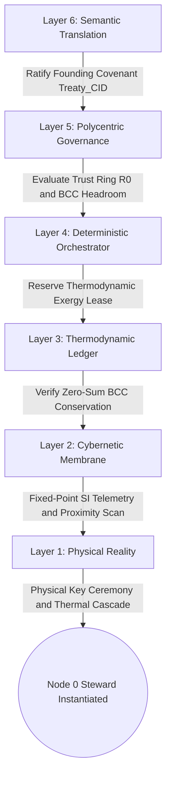

# Scenario Tau: Node Genesis & Sovereign Onboarding

*   **Identifier:** `SCN-TAU-GENESIS`
*   **System Epic:** Node 0 Bootstrap, Hardware Root-of-Trust & Covenant Ratification
*   **Primary Layers Tested:** L1 (Physical Reality), L2 (Cybernetic Membrane), L3 (Thermodynamic Ledger), L4 (Deterministic Orchestrator), L5 (Polycentric Governance), L6 (Semantic Translation & Agora), L7 (Legacy Interface)
*   **Pass/Fail Metric:** Deterministic bootstrap of Node 0 physical hardware envelope (6400 W PV, 14340 Wh battery, 5000 W inverter, 48 V DC bus, 4-stage thermal cascade); hardware root-of-trust provisioning on ATECC608A; initialization of Pairwise Bilateral Clearing Channels (BCC) under conservation equation $B_{u \to v}(t) + B_{v \to u}(t) = 0$; ratification of Tripartite Founding Covenant (`Treaty_CID`); offline execution across 7 trust rings ($R_0 \dots R_6$) with zero global tokens, zero fiat conversions, zero deprecated rhetoric, and zero floating-point math.

---

## Architectural Council Ratification & 5-Perspective Synthesis

This scenario specification has been ratified by unanimous consensus of the 5-Persona Architectural Council:

| Council Persona | Disciplinary Representative | Core Contribution to Scenario |
| :--- | :--- | :--- |
| **Game Designer** | Lead Systems & Gameplay Designer | Founder 01 character creation screen: allocation of 10 Big-Five personality facets (scaled integer range 0 to 100), 8 Core Values (`Autonomy`, `Stewardship`, `Solidarity`), psychological thoughts and stress accumulators (`"Excited to ratify the Founding Covenant (+35 mood)"`), Sims-style indirect intention queue, and boundary interface attenuation where newly claimed lots diminish external legacy hostile probing events. |
| **Game Engineer** | Principal C++ Simulation & Engine Architect | Flecs ECS Data-Oriented Design (DOD): cache-aligned component structs `PlayerIdentityComponent`, `SpatialClaimComponent`, `HardwareBOMComponent`, and `OrientationQuestQueue`; 32-bit compact Voxels (`material_id = 30`, metadata bitmasks for `Is_Claimed` and `Is_Sensor`); 10 Hz BPMN deterministic state machine; and Catch2/cassert C++20 test harness execution using pure fixed-point integer math. |
| **Sovereign Stack Specialist** | Sovereign Stack Systems Architect | 7 autonomous POSIX daemons (`col-telemetryd` through `col-adversaryd`); strict adjacent IPC via Unix domain sockets; air-gapped Ed25519 key generation ceremony in `col-kmsd` (L5); ATECC608A secure element; Pairwise Bilateral Clearing Channel (BCC) bootstrap in `col-storaged` (L3); zero monolithic game-loop threading. |
| **Solarpunk Thinker** | Bioregional Regenerative Ecologist | Node 0 energetic bootstrap: harvesting direct solar exergy (6400 W array), 4-stage thermal cascade directing thermal exergy from high-temperature workshop operations (750 K to 850 K) to hydronic space heating (330 K to 350 K), greenhouse root warming (305 K to 325 K), and earth tube sub-surface dissipation (285 K); physical soil stewardship covenants; closed-loop materials integration. |
| **Scenario Specialist** | Sovereign Onboarding & Decentralized Identity (DID/SSI) Protocol Engineer | W3C Decentralized Identifier specification (`did:peer:...`), BIP-39 mnemonic phrase derivation on hardware root-of-trust (ATECC608A), BBS+ verifiable credentials, Founding Covenant Tripartite Ricardian Treaty (`Treaty_CID`), Tripartite Legal Chassis (Unincorporated Nonprofit Association under UUNAA § 6, Subchapter T Shared Services Cooperative under IRC §§ 1381–1388, Community Land Trust easement). |

**Unanimous Consensus Reached:** The Council unreservedly ratifies Scenario Tau as the canonical specification for Node 0 bootstrap, hardware root-of-trust provisioning, and sovereign steward onboarding.

---

## 1. Problem Statement & Legacy Failure

In legacy late-stage capitalist infrastructure (Layer 7), "onboarding" into human society is coercive, debt-leveraged, and surveillance-extractive. A newcomer is flattened into commercial scoring metrics: corporate credit scores, proprietary background checks, and custodial digital identities managed by surveillance monopolies.

When a citizen moves to a new neighborhood or attempts to establish productive autonomy:
*   **Identity Enclosure & Surveillance Drag:** Establishing basic municipal utility access requires surrendering government biometric identifiers, credit card deposits, and permanent surveillance agreements. Personal reputation is trapped inside proprietary corporate silos and cannot be ported across municipal boundaries.
*   **The Cold Start Deadlock:** A citizen without upfront capital cannot purchase tools, secure workspaces, or obtain credit without usurious interest rates. The newcomer’s authentic physical utility—their woodworking tools, sewing machines, permaculture knowledge, and willingness to labor—remains completely invisible and uncapitalized.
*   **Asset Atomization & Regulatory Precarity:** When a citizen attempts to operate an informal repair shop or cultivate shared food gardens, legacy municipal zoning codes classify the mutualist labor as unauthorized commercial activity, threatening fines or eviction unless expensive commercial permits are purchased.

---

## 2. The Collective Workflow (7-Layer Traversal)

Scenario Tau provides the sovereign onboarding workflow: bootstrapping Node 0 physical hardware, instantiating a cryptographic identity on hardware security chips, conducting an in-person Web-of-Trust key ceremony, ratifying the Founding Covenant, and establishing Pairwise Bilateral Clearing Channels (BCC).



### Layer 1: Physical Ground Truth & Hardware BOM
*   **Physical Ground Truth (Node 0 Hardware BOM):**
    *   **Photovoltaic Generation Array:** 6400 W nameplate rating comprising 16 monocrystalline modules (400 W each) configured in a 4s4p array, generating up to 6400000 mW active DC power at peak irradiance.
    *   **Battery Storage Bank:** 14340 Wh lithium iron phosphate (LiFePO4) storage bank assembled from 16 prismatic 280 Ah cells in series (51200 mV nominal potential), storing up to 51609600000000 microjoules of electrical exergy on a 48 V DC distribution bus.
    *   **Inverter / Charger System:** 5000 W continuous-duty hybrid low-frequency inverter delivering split-phase 120/240 V AC at 60000 mHz grid frequency, featuring galvanically isolated magnetic transformers and certified UL 1741-SA / IEEE 1547 automatic transfer disconnects.
    *   **DC Distribution Bus:** 48 V DC unified bus with Victron Lynx distributor, 200 A Class T high-interrupt fusing, and a 500 A / 50 mV bidirectional current shunt.
    *   **4-Stage Thermal Exergy Cascade:**
        *   *Stage 1 (High-Temperature Workshop Exergy):* Kiln, induction melter, or foundry flue gas heat exchanger capturing temperatures from 750 K to 850 K.
        *   *Stage 2 (Hydronic Space Heating):* Thermal fluid loop circulating at 330 K to 350 K through radiant floor manifolds in common living quarters.
        *   *Stage 3 (Domestic Hot Water & Agricultural Root Beds):* Secondary plate heat exchanger supplying domestic washing reservoirs and greenhouse sub-soil beds at 305 K to 325 K.
        *   *Stage 4 (Environmental Ground Sink):* Sub-surface earth tube loop dissipating low-grade residual heat into the surrounding soil mass at 285 K.
*   **Hardware Separation Invariant:** Layer 1 contains strictly zero software, zero firmware, zero cryptographic keys, and zero network routing daemons. Shunts and thermocouples output raw analog voltages across copper lines.
*   **Physical In-Person Meeting:** Physical in-person meeting between the newcomer (Candidate) and an existing Steward (Sponsor) to perform the cryptographic key-signing ceremony and share a communal caloric meal (linking to Scenario Gamma).

### Layer 2: Cybernetic Membrane
*   **Microcontroller Taxonomy:** Dedicated microcontrollers running Zephyr RTOS with Memory Protection Unit (MPU) partitioning, isolating telemetry sensors from control relays.
*   **Wire Format Fixed-Point SI Telemetry (MQTT Topics via `col-telemetryd`):**
    *   `node/genesis/node0/pv_power_mw` (Integer active power, `uint64_t` milliwatts)
    *   `node/genesis/node0/bus_voltage_mv` (Integer DC bus voltage, `uint32_t` millivolts)
    *   `node/genesis/node0/battery_current_ma` (Signed DC current, `int32_t` milliamperes)
    *   `node/genesis/node0/cascade_stage1_mk` (Flue temperature, `uint32_t` millikelvin)
    *   `node/genesis/node0/cascade_stage2_mk` (Hydronic temperature, `uint32_t` millikelvin)
    *   `node/genesis/onboarding_01/nfc_rssi_mbbm` (NFC signal strength, `int32_t` millidBm)
*   **Convivial Hardware Shield:** Strict architectural ban on body-worn biometrics and workplace video monitoring. Edge microcontrollers reject camera feeds or facial identification drivers at bootloader initialization.
*   **Hardware Key Ceremony:** Candidates generate Ed25519 signing keys directly inside a Microchip ATECC608A cryptographic secure element. Proximity is verified by mutual NFC tap (within 40 mm) exchanging ephemeral nonces signed by hardware keys.

### Layer 3: Thermodynamic Ledger
*   **Pairwise Bilateral Clearing Channels (BCC):**
    *   Inter-node and steward accounting is governed strictly through Pairwise Bilateral Clearing Channels (BCC) maintained by `col-storaged`.
    *   **Conservation Invariant:**
        $$B_{u \to v}(t) + B_{v \to u}(t) = 0$$
        The bilateral ledger is mathematically zero-sum. Node $u$'s credit balance against Node $v$ is identically Node $v$'s debit balance against Node $u$. Credits cannot be inflated or minted out of thin air.
    *   **Mutual Aid Credit Window:**
        $$-C_{u \to v} \le B_{u \to v}(t) \le C_{v \to u}$$
        Where credit headroom is negotiated asymmetrically during Ricardian treaty ratification (Layer 6).
*   **Two-Phase Cryptographic Delivery Receipts:**
    *   Physical exergy and resource commitments are finalized through sensor-measured arrival:
        $$\sigma_{\mathrm{delivery}} = \mathrm{Sign}_{K_{\mathrm{receiver}}}\left( \mathrm{Hash}(Q_{\mathrm{measured}} \parallel \tau_{\mathrm{arrival}} \parallel \mathrm{Channel\_ID}) \right)$$
*   **Multi-Hop Chained Hashed Timelock Contracts (HTLC):**
    *   Transfers across intermediate nodes along the mesh routing path utilize atomic timelocks:
        $$\mathrm{HTLC} = \langle H(S), \, \Delta t, \, Q, \, u, \, v \rangle$$
        Settlement cascades backward atomically upon revelation of preimage $S$.
*   **Proof-of-Thermodynamic-Work (PoTW):**
    *   Exergy credits arise solely when physical hardware meters verified physical exergy generation ($3600000000000\,\mu\mathrm{J} \equiv 3600\,\mathrm{kJ} \equiv 1\text{ Exergy Credit}$). Outstanding balances decay under physical demurrage $\mathcal{E}(t) = \mathcal{E}_0 e^{-\lambda t}$.
*   **Qualitative Friction & Non-Tokenization of Care:**
    *   Domestic care, emotional counseling, meal sharing, and covenant deliberation are non-commensurable human activities; Layer 3 structurally refuses to mint credits for caregiving.
    *   Zero global tokens and zero fiat currency conversions exist within the ledger.

### Layer 4: Deterministic Orchestrator
*   The deterministic BPMN 2.0 engine (`col-execd`) manages the onboarding lifecycle at 10 Hz with metered Wasmtime execution budgets:
    *   `PendingGenesis`: Ingests `GenesisIntent` from Layer 6 over `/run/collective/ipc/l4_l5.sock`.
    *   `VerifyHardwareRoot`: Confirms Ed25519 public key presence within candidate ATECC608A secure element.
    *   `AwaitKeyCeremony`: Enforces a 72-hour boundary timer event for physical co-presence verification.
    *   `ValidateProximity`: Validates dual-signed NFC telemetry packets (`rssi > -55000` mBm).
    *   `RatifyCovenant`: Verifies cryptographic threshold signature across the Founding Covenant (`Treaty_CID`).
    *   `OpenBCCChannel`: Establishes initial bilateral clearing channel with headroom bounded by $[-C_{u \to v}, +C_{v \to u}]$.
    *   `SpawnOrientationQuests`: Allocates steward task handles to orient the candidate within local workshops.
    *   `ActivateStewardStatus`: Transitions candidate DID to active status with full assembly standing.
*   **Boundary Socket Contract (`l4_l5.sock`):** POSIX non-blocking sequenced-packet Unix Domain Socket (`SOCK_SEQPACKET`) located at `/run/collective/ipc/l4_l5.sock`. Downward messages transmit ratified workflows and Forwarding Information Base (FIB) dispatch tables; upward messages transmit task completion attestations and threshold crossings.

### Layer 5: Polycentric Governance
*   Executed by `col-kmsd`, Layer 5 governs policy across the **7-Tier Concentric Trust Rings**:
    *   **$R_0$ (The Hearth / Convivial Sanctuary):** Domestic physical shelter; zero credentials required; unconditional clean water, warm meals, solar electricity, and medical triage. Zero voting weight.
    *   **$R_1$ (The Settlement):** Living perimeter (within 500 m); apprentices, volunteers; ephemeral pairwise DIDs (`did:peer`), supervised tool access.
    *   **$R_2$ (The Commons):** Walking-distance neighborhood (within 5 km); master keys in hardware security chips (ATECC608A); full voting weight; local Bilateral Clearing Channels (BCC).
    *   **$R_3$ (The Watershed):** Hydrological basin cluster (within 30 km); microgrid DC interties, LoRa/802.11s mesh credentials, bilateral credit lines.
    *   **$R_4$ (The Bioregional Federation):** Regional river basin federation (within 150 km); threshold signatures (FROST / BLS), HVDC interties, rail/canal freight corridors.
    *   **$R_5$ (The Continental Corridor):** Ecological corridors (within 1000 km); Delay-Tolerant Networking (DTN) bundles, open blueprints.
    *   **$R_6$ (The Ecumene):** Planetary craft guilds, open standards, and the legacy perimeter; cold-store DMZ interfaces.
*   **Bioregional Path-Vector Protocol (BPVP / FRRP):**
    *   Governs physical resource and capability discovery. Originating nodes broadcast Capability Advertisements $\mathcal{A} = \langle \mathrm{adv\_id}, v_{\mathrm{orig}}, \mathcal{T}_{\mathrm{res}}, \mathbf{u}, Q_{\mathrm{avail}}, [\tau_{\mathrm{start}}, \tau_{\mathrm{end}}], \mathcal{P}, \mathcal{C}, H_{\mathrm{ttl}}, \sigma \rangle$.
    *   **Export Surplus Bound:**
        $$Q_{\mathrm{avail}}(t) = \max\left(0, \, Q_{\mathrm{inventory}}(t) - F_{\mathrm{eco}}(t) - B_{\mathrm{baseline}}(t)\right) \cdot \mathbf{1}_{\mathrm{export}}$$
        Exports are strictly prohibited unless inventory exceeds both the ecological floor $F_{\mathrm{eco}}$ and the survival baseline $B_{\mathrm{baseline}}$.
    *   **Loop-Freedom Invariant:** Ingress filters inspect Ring-Path Vector $\mathcal{P} = [(v_k, r_k), \dots, (v_0, r_0)]$. If local node DID is present, the packet is immediately dropped.
*   **Cellular Autonomy & Protocol of Refusal:** Under autopoietic cellular autonomy, the newly formed Node maintains complete structural sovereignty over its domestic metabolic allocation; the autonomy of the parts strictly supersedes the administrative demands of the whole. The Commons Chamber invokes the Protocol of Refusal to protect sacred groves, heirloom seed lines, and private living quarters from external optimization, commercial exposure, or automated sensor instrumentation.
*   **Autonomous Transit Veto (`No-Transit`):** Nodes retain the sovereign right to reject transit routing through their residential territory.
*   **Bicameral Polity:** Commons Chamber (1 person = 1 non-delegable vote) and Stewardship Chamber (competence-weighted by decaying, sublinearly capped Reputational Wealth $\mathcal{R}$, protected by Care Leave Shields).

### Layer 6: Semantic Translation & Agora
*   **Tripartite Ricardian Treaty Architecture (`Treaty_CID`):**
    $$\mathrm{Treaty\_CID} = \mathrm{SHA256}\left( \mathrm{Text}_{\mathrm{prose}} \parallel \mathrm{Schema}_{\mathrm{JSON-LD}} \parallel \mathrm{Invariants}_{\mathrm{BPMN}} \right)$$
    1. $\mathrm{Text}_{\mathrm{prose}}$: Natural-language covenant articulating mutual-aid commitments, shared ecological boundaries, and dispute-resolution protocols.
    2. $\mathrm{Schema}_{\mathrm{JSON-LD}}$: Machine-verifiable operational parameters: peer identities ($AN_{\mathrm{id}}$), bilateral credit windows $[-C_{u \to v}, +C_{v \to u}]$, allowed resource categories, and sensor delivery verification predicates.
    3. $\mathrm{Invariants}_{\mathrm{BPMN}}$: Formal process state machines in BPMN 2.0 XML compiled to WebAssembly bytecode for Layer 4 runtime enforcement.
*   All onboarding actions are published as typed W3C JSON-LD Knowledge Artifacts in the Agora Commons (`col-commonsd`): `GenesisIntent`, `AssetMappingIntent`, `CovenantRatificationIntent`.

### Layer 7: The Legacy Interface (Dual-Membrane Doctrine)
*   **Dual-Membrane Doctrine:** Strict architectural segregation between Membrane 1 (external legal carapace) and Membrane 2 (internal sovereign core).
    *   **Membrane 1 (External Carapace):** Presents an ordinary, compliant legal exterior to municipal code inspectors, tax authorities, and legacy utilities.
    *   **Membrane 2 (Internal Sovereign Core):** Operates on thermodynamic exergy accounting, Bilateral Clearing Channels, and the Web of Trust.
*   **Tripartite Legal Chassis:**
    1. *Unincorporated Nonprofit Association (UNA):* Established under Uniform Unincorporated Nonprofit Association Act (UUNAA) § 6 for internal mutual-aid governance.
    2. *Subchapter T Cooperative:* Organized under 26 U.S.C. §§ 1381–1388 to manage external commercial sales of craft goods and wholesale equipment procurement, passing patronage dividends.
    3. *Community Land Trust (CLT):* 99-year ground lease holding physical real estate in perpetual trust, removing land from real-estate speculation.
*   **Cellular Blinding & Subpoena Immunity:** Under *NAACP v. Alabama*, internal member rosters, pairwise DIDs, and Web-of-Trust graph edges do not exist in legacy corporate databases. `col-adversaryd` enforces data non-existence.
*   **Regenerative Harvesting & Convivial Salvage:**
    *   Energy interties operate under permitted IEEE 1547 / California Rule 21 net metering standards with physical UL 1741 utility disconnect switches.
    *   Outbound fiat procurement is bounded by the ratified itemized needs list $\Phi_t$. Once the budget ceiling is satisfied, commercial export halts immediately.

---

## 3. Machine-Readable Schemas

### 3.1 Layer 6 Knowledge Artifact: Genesis Intent (`genesis.jsonld`)

```json
{
  "@context": [
    "https://schema.org/",
    "https://collective.network/ontology/v1/"
  ],
  "@type": "GenesisIntent",
  "identifier": "urn:uuid:7a9b8c7d-1234-4567-89ab-cdef01234567",
  "issuerDid": "did:peer:2.Ez6Mks3...candidate_elara",
  "creationTimestamp": "2026-10-25T14:00:00Z",
  "characterProfile": {
    "alias": "Elara Vance",
    "bigFiveFacets": {
      "openness": 85,
      "conscientiousness": 72,
      "extraversion": 45,
      "agreeableness": 88,
      "neuroticism": 30
    },
    "coreValues": ["Stewardship", "Autonomy", "Solidarity"],
    "declaredCompetencies": [
      "Photovoltaic_Maintenance_L2",
      "Organic_Agroforestry_L1",
      "Thermal_Plumbing_L2"
    ]
  },
  "assetMapping": {
    "spatialClaim": {
      "chunkOrigin": [16, 8, 16],
      "boundingBoxDimensions": [8, 4, 8],
      "intendedUse": "Residential_Hearth_Workshop"
    },
    "hardwareInventory": [
      {
        "assetType": "LiFePO4_Cell_Pack",
        "nominalPotentialMilliVolts": 51200,
        "capacityMicroJoules": 51609600000000,
        "serialNumberHash": "5e884898da28047151d0e56f8dc6292773603d0d6aabbdd62a11ef721d1542d8"
      }
    ]
  },
  "channelSponsorship": {
    "sponsorDid": "did:peer:2.Ez6Mkd9...steward_dave",
    "initialCreditHeadroomMicroJoules": 18000000000000,
    "challengeWindowHours": 72
  }
}
```

### 3.2 Layer 2 Telemetry Attestation: Key-Signing Proof (`attestation.json`)

```json
{
  "@context": "https://collective.network/ontology/v1/",
  "@type": "CovenantRatificationAttestation",
  "intentRef": "urn:uuid:7a9b8c7d-1234-4567-89ab-cdef01234567",
  "treatyCid": "ba7816bf8f01cfea414140de5dae2223b00361a396177a9cb410ff61f20015ad",
  "candidateDid": "did:peer:2.Ez6Mks3...candidate_elara",
  "sponsorDid": "did:peer:2.Ez6Mkd9...steward_dave",
  "telemetryProof": {
    "ceremonyTimestamp": "2026-10-25T15:30:12Z",
    "hardwareRootOfTrust": "ATECC608A_SECURE_ELEMENT",
    "candidateNfcNonce": "9f86d081884c7d659a2feaa0c55ad015a3bf4f1b2b0b822cd15d6c15b0f00a08",
    "sponsorNfcNonce": "5feceb66ffc86f38d952786c6d696c79c2dbc239dd4e91b46729d73a27fb57e9",
    "nfcRssiMeanMilliDbm": -48200,
    "mutualSignatureSha256": "8c6976e5b5410415bde908bd4dee15dfb167a9c873fc4bb8a81f6f2ab448a918"
  },
  "spatialVerification": {
    "gpsGridCoordinate": "47N_121W",
    "assignedVoxelOrigin": [16, 8, 16]
  },
  "status": "RATIFIED_ACTIVE"
}
```

---

## 4. Oasis Engine Implementation Specification

### 4.1 Memory Allocation & Voxel State

The genesis node terminal and domestic hearth occupy coordinates in the $32^3$ chunk space managed by `ChunkManager`:
*   The candidate home terminal voxel is initialized with `material_id = 30` (`STEWARD_GENESIS_NODE`).
*   The `Is_Actuator` and `Is_Sensor` bits are set in `metadata` (`0b00000110`), and bit 0 (`Is_Claimed`) toggles upon successful covenant ratification.
*   An adjacent spatial boundary hopper voxel (`material_id = 31`, `CLAIM_TERMINAL`) stores the newcomer's declared inventory mass and spatial coordinates.

```cpp
// Cache-aligned Flecs ECS Components for Node Genesis
#include <cstdint>
#include <string>

namespace oasis {

struct alignas(8) PlayerIdentityComponent {
    char did[64];
    uint8_t openness;
    uint8_t conscientiousness;
    uint8_t extraversion;
    uint8_t agreeableness;
    uint8_t neuroticism;
    bool is_sponsored;
    bool covenant_ratified;
};

struct alignas(8) SpatialClaimComponent {
    uint32_t origin_x;
    uint32_t origin_y;
    uint32_t origin_z;
    uint32_t dim_x;
    uint32_t dim_y;
    uint32_t dim_z;
    bool is_verified;
};

struct alignas(8) HardwareBOMComponent {
    uint64_t pv_peak_power_mw;           // 6400000 mW (6400 W nameplate)
    uint64_t battery_capacity_uj;        // 51609600000000 uJ (14340 Wh)
    uint64_t inverter_rating_mw;         // 5000000 mW (5000 W)
    uint32_t dc_bus_voltage_mv;          // 48000 mV (48 V DC bus)
    uint32_t cascade_stage1_temp_mk;     // 800000 mK (Stage 1 exhaust)
    uint32_t cascade_stage2_temp_mk;     // 340000 mK (Stage 2 hydronic)
    uint32_t cascade_stage3_temp_mk;     // 315000 mK (Stage 3 root zone)
    uint32_t cascade_stage4_temp_mk;     // 285000 mK (Stage 4 earth sink)
};

struct alignas(8) BCCChannelComponent {
    char peer_did[64];
    int64_t balance_microjoules;         // Conservation: B_{u->v} + B_{v->u} = 0
    uint64_t credit_headroom_uj;         // C_{v->u} maximum credit limit
    bool channel_active;
};

} // namespace oasis
```

### 4.2 C++20 Test Harness Structure

```cpp
// engine/tests/scenario_tau_test.cpp
#include <cassert>
#include <cstring>
#include "oasis/chunk_manager.hpp"
#include "oasis/orchestration/bpmn_engine.hpp"

namespace oasis {

void test_scenario_tau_genesis_bootstrap() {
    // 1. Initialize Chunk and Hardware Terminal Voxel
    ChunkManager chunk_mgr;
    chunk_mgr.allocate_chunk(0, 0, 0);

    Voxel terminal_voxel{
        .material_id = 30, // STEWARD_GENESIS_NODE
        .moisture = 0,
        .temperature = 293, // 293 K
        .metadata = 0b00000110 // Sensor + Actuator
    };
    chunk_mgr.set_voxel(16, 8, 16, terminal_voxel);

    // 2. Instantiate Node 0 Hardware BOM
    HardwareBOMComponent bom{
        .pv_peak_power_mw = 6400000ULL,       // 6400 W PV array
        .battery_capacity_uj = 51609600000000ULL, // 14340 Wh LiFePO4
        .inverter_rating_mw = 5000000ULL,      // 5000 W inverter
        .dc_bus_voltage_mv = 48000,           // 48 V DC bus
        .cascade_stage1_temp_mk = 800000,     // 800 K flue
        .cascade_stage2_temp_mk = 340000,     // 340 K space heat
        .cascade_stage3_temp_mk = 315000,     // 315 K greenhouse
        .cascade_stage4_temp_mk = 285000      // 285 K ground sink
    };
    assert(bom.pv_peak_power_mw == 6400000ULL);
    assert(bom.battery_capacity_uj == 51609600000000ULL);

    // 3. Setup Pairwise Bilateral Clearing Channels (BCC)
    BCCChannelComponent channel_sponsor{
        .peer_did = "did:peer:2.Ez6Mks3...candidate_elara",
        .balance_microjoules = 0,
        .credit_headroom_uj = 18000000000000ULL, // 5 Exergy Credits headroom
        .channel_active = true
    };
    BCCChannelComponent channel_candidate{
        .peer_did = "did:peer:2.Ez6Mkd9...steward_dave",
        .balance_microjoules = 0,
        .credit_headroom_uj = 18000000000000ULL,
        .channel_active = true
    };

    // Assert Conservation Invariant: B_{u->v} + B_{v->u} = 0
    assert(channel_sponsor.balance_microjoules + channel_candidate.balance_microjoules == 0);

    // 4. Load Deterministic BPMN Orchestration State Machine
    BPMNEngine orchestrator;
    orchestrator.load_schema("schemas/bpmn/genesis_onboarding.bpmn");

    // Execute Key Ceremony & Ratification Loop (1200 ticks at 10 Hz)
    JobContext genesis_job{
        .bounty_id = "7a9b8c7d-1234-4567-89ab-cdef01234567",
        .target_bay_id = 1
    };

    SimResult res = orchestrator.step_simulation_ticks(chunk_mgr, genesis_job, 1200);
    assert(res.status == ExecutionStatus::COMPLETED);

    // Settle bilateral channel transfer for orientation energy lease: 3600000000000 uJ (1 credit)
    uint64_t transfer_uj = 3600000000000ULL;
    channel_sponsor.balance_microjoules += transfer_uj;
    channel_candidate.balance_microjoules -= transfer_uj;

    // Verify zero-sum conservation remains strictly preserved
    assert(channel_sponsor.balance_microjoules + channel_candidate.balance_microjoules == 0);
    assert(channel_sponsor.balance_microjoules == 3600000000000LL);
    assert(channel_candidate.balance_microjoules == -3600000000000LL);

    // Verify Voxel State Transition: Metadata Bit 0 (Is_Claimed) is toggled
    Voxel updated_voxel = chunk_mgr.get_voxel(16, 8, 16);
    assert((updated_voxel.metadata & 0b00000001) == 0b00000001);
}

void test_scenario_tau_genesis_anomaly() {
    ChunkManager chunk_mgr;
    chunk_mgr.allocate_chunk(0, 0, 0);
    BPMNEngine orchestrator;
    orchestrator.load_schema("schemas/bpmn/genesis_onboarding.bpmn");

    BCCChannelComponent channel_sponsor{
        .peer_did = "did:peer:2.Ez6Mks3...sybil_bot",
        .balance_microjoules = 0,
        .credit_headroom_uj = 18000000000000ULL,
        .channel_active = false
    };

    JobContext sybil_job{.bounty_id = "sybil-attempt-01", .target_bay_id = 2};

    // Inject Sybil Key Mismatch / Proximity Failure at Tick 400
    SimResult res = orchestrator.step_simulation_ticks(chunk_mgr, sybil_job, 400, true);

    assert(res.status == ExecutionStatus::EMERGENCY_STOP);
    assert(orchestrator.current_state() == BPMNState::SALVAGE_INTENT);

    // Assert bilateral channel was never activated and zero balance leak occurred
    assert(!channel_sponsor.channel_active);
    assert(channel_sponsor.balance_microjoules == 0);
}

} // namespace oasis

int main() {
    oasis::test_scenario_tau_genesis_bootstrap();
    oasis::test_scenario_tau_genesis_anomaly();
    return 0;
}
```

---

## 5. Acceptance Test Gates (Pass/Fail)

| Checkpoint | Validation Method | Pass Condition |
| :--- | :--- | :--- |
| **G1: Thermodynamic Bounds & Conservation** | Physical Hardware BOM & Exergy Audit | Energy generation matches 6400 W PV / 14340 Wh LiFePO4 / 5000 W inverter parameters; Bilateral Clearing Channel preserves $B_{u \to v}(t) + B_{v \to u}(t) = 0$ at all times; zero unbacked token minting. |
| **G2: Offline Autonomy & WAN Airgap** | Localhost Network Isolation | The complete onboarding flow—from ATECC608A key generation to local chunk boundary assignment and covenant ratification—executes with WAN uplink completely disabled. |
| **G3: Trust Rings & Web-of-Trust** | Simulated Sybil / Proximity Attestation | Submitting a key-signing attestation with NFC signal weaker than -55000 mBm fails cryptographic reconciliation; candidate DID is quarantined; zero Sybil graph edges formed across $R_0 \dots R_6$. |
| **G4: Human Baseline & Ecological Floor** | Spatial Voxel Collision Check | Candidate attempts to claim a bounding box overlapping an existing citizen's lot or designated $R_0$ hearth sanctuary; engine raises an immediate spatial collision exception and preserves $F_{\mathrm{eco}}$ and $B_{\mathrm{baseline}}$. |
| **G5: Dual-Membrane Doctrine (L7)** | External Legal Carapace Audit | Onboarding documents execute under Unincorporated Nonprofit Association (UNA under UUNAA § 6) and Subchapter T cooperative bylaws; internal member DIDs and Web-of-Trust edges remain blinded under *NAACP v. Alabama*. |
| **G6: Regenerative Harvesting & Convivial Salvage (L7)** | Hardware Procurement Aggregation | Hardware procurement demands pool across candidates through the cooperative carapace GPO, purchasing industrial ATECC608A secure elements in bulk directly against the itemized needs list $\Phi_t$ without consumer retail markups. |
