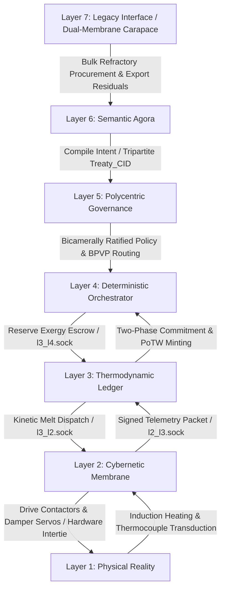
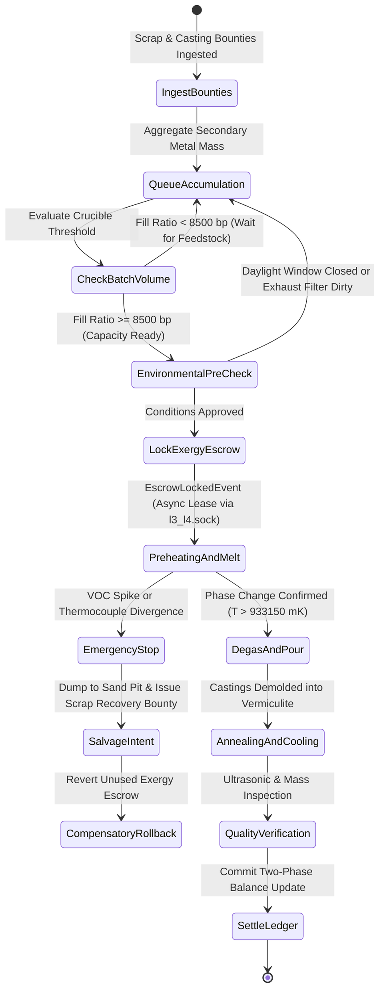
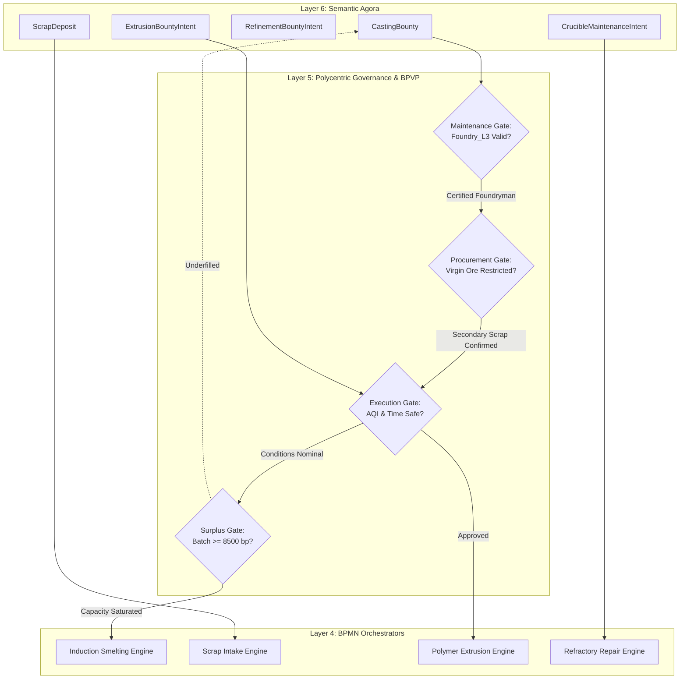
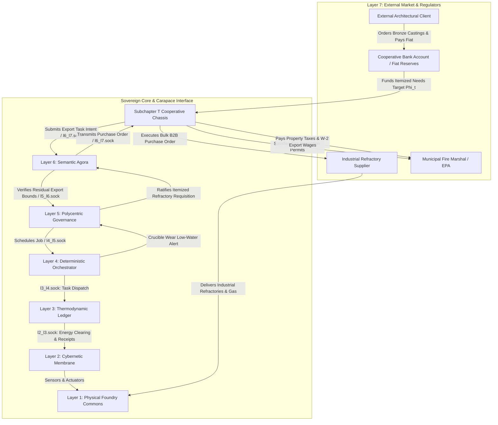

# Scenario Theta: The Extraction & Refinement Foundry

*   **Identifier:** `SCN-THETA-FOUNDRY`
*   **System Epic:** Heavy Exergy Processing, Resource Refinement & Localized Pyrometallurgy
*   **Primary Layers Tested:** L1 (Physical Reality), L2 (Cybernetic Membrane), L3 (Thermodynamic Ledger), L4 (Deterministic Orchestrator), L5 (Polycentric Governance), L6 (Semantic Translation & Agora), L7 (Legacy Interface)
*   **Pass/Fail Metric:** Safe, localized pyrometallurgical refinement of scrap and secondary ores into standardized industrial manufacturing stock; strict automated batching threshold ($\ge 8500\,\mathrm{bp}$ crucible capacity); zero unmitigated toxic emissions or fire code violations; thermodynamic exergy expenditure verified by Proof-of-Thermodynamic-Work (PoTW); zero centralized server dependencies; Pairwise Bilateral Clearing Channel (BCC) settlement with zero-sum conservation ($B_{u \to v}(t) + B_{v \to u}(t) = 0$).

---

## Architectural Council Ratification & 5-Perspective Synthesis

This scenario specification has been ratified by unanimous consensus of the 5-Persona Architectural Council:

| Council Persona | Disciplinary Representative | Core Contribution to Scenario |
| :--- | :--- | :--- |
| **Game Designer** | Lead Systems & Gameplay Designer | Dwarf Fortress magma workshop danger and artisanal passions: Founder 01 managing extreme heat hazards, protective bunker gear, and high-stakes pouring; psychological thoughts and stress accumulators (`"Proud of casting a perfect bronze impeller (+40 mood)"` vs. `"Terrified by furnace fire outbreak (-60 stress)"`); Cities Skylines industrial zoning, localized emissions plumes, and heat dissipation corridors; boundary interface attenuation where localized metal and polymer autarky shields the settlement from legacy supply chokepoints. |
| **Game Engineer** | Principal C++ Simulation & Engine Architect | Flecs ECS Data-Oriented Design (DOD): cache-aligned structs `HighTempVoxel`, `CrucibleBatchComponent`, `EmissionsMonitorComponent`, and `ExergyEscrowComponent`; 32-bit compact Voxels (`material_id = 40` `FOUNDRY_INDUCTION_CRUCIBLE`, `material_id = 41` `FIREBRICK_HEARTH`, `material_id = 42` `LIQUID_ALUMINUM`); cellular automata heat bleed simulation; phase change transitions at melting points; 10 Hz BPMN batching state machine (`col-execd`); compilable C++20 test harness strictly utilizing fixed-point SI integer math (`uint64_t` microjoules, `uint64_t` milligrams, `uint32_t` millikelvin, `int64_t` milliwatts). |
| **Sovereign Stack Specialist** | Sovereign Stack Systems Architect | 7-layer strict adjacency without layer skipping (`l1_l2.sock` through `l6_l7.sock`); zero software or daemons in Layer 1; Layer 2 Zephyr RTOS zero-trust membrane (`col-sensord`, `col-actuated`) reading RS-485 Modbus pyrometry and thermocouple telemetry; zero-software physical fail-safes (Klixon bimetallic snap-switches and ASME pressure relief valves in Layer 1); Layer 3 Pairwise Bilateral Clearing Channels (BCC) with zero-sum conservation $B_{u \to v}(t) + B_{v \to u}(t) = 0$, mutual aid credit windows, and two-phase delivery receipts; multi-hop HTLCs; Layer 5 Bioregional Path-Vector Protocol (BPVP / FRRP); Tripartite Ricardian Treaties ($\mathrm{Treaty\_CID}$). |
| **Solarpunk Thinker** | Bioregional Regenerative Ecologist | Closed-loop industrial ecology: waste heat cogeneration routed to warm community aquaponics and winter district greenhouses via Stage 0/1 of the 4-Stage Thermal Exergy Cascade; 100% secondary scrap recycling prioritized; negentropic urban mining; 10x thermodynamic replacement cost penalty on virgin ore extraction to prevent bioregional soil degradation. |
| **Scenario Specialist** | Pyrometallurgical & Industrial Ecology Engineer | Micro-foundry thermodynamic phase-change energy equations in SI integer microjoules ($Q = m \cdot c_p \cdot \Delta T + m \cdot \Delta H_f$ with latent heat of fusion $\Delta H_f = 397000\,\mathrm{J/kg}$ for aluminum), ASTM B26 aluminum casting standards, A356 alloy degassing kinetics with pure argon sparging, multi-stage catalytic and activated carbon off-gas scrubber specification, and Type-K thermocouple telemetry tolerances ($\pm 1500\,\mathrm{mK}$). |

Unanimous Consensus Reached across all five disciplinary perspectives.

---

## 1. Problem Statement & Legacy Failure

In legacy late-stage capitalist infrastructure (Layer 7), material production relies on high-entropy, opaque, and catastrophic supply chains. Bauxite is strip-mined in Australia, shipped across oceans to fossil-powered alumina refineries, smelted into ingots in coal-heavy smelters, extruded in East Asia, and sold to western consumers as atomized replacement parts wrapped in single-use petrochemical packaging.

When physical machinery breaks or industrial replacement parts are required:
*   **Global Carbon Drag & Supply Latency:** A damaged aluminum mounting bracket or bronze pump bushing requires ordering a new cast part from overseas, incurring thousands of metric tons of shipping carbon drag and weeks of lead time.
*   **"Wish-Cycling" & Material Wastage:** Suburban waste management collects domestic aluminum cans and scrap metal, yet downcycles them into low-grade alloys or exports them to overseas scrap yards where they are processed under toxic, unregulated conditions.
*   **The Thermodynamic Trap of Single-Piece Processing:** Operating an electric melting furnace or plastic extruder for a single 150-gram component dissipates $>90\%$ of the consumed electrical exergy into the ambient atmosphere as waste heat, making small-scale on-demand metallurgy thermodynamically ruinous unless intelligently batched.

---

## 2. The Collective Workflow (7-Layer Traversal)

Scenario Theta establishes a localized, neighborhood-scale industrial refinement commons. It converts community scrap metals, post-consumer engineering plastics, and e-waste into standardized ingots, billets, and 3D printing filaments with closed-loop thermodynamic accounting. The workflow traverses canonically across all seven layers without layer skipping.



### Layer 1: Physical Ground Truth
*   **Hardware Nodes (Smelting & Casting Hub):** Pure physical pyrometallurgical equipment: a 15-kilowatt high-frequency electric induction furnace equipped with silicon-carbide and clay-graphite crucibles, an automated argon degassing lance, Petrobond greensand molding benches, and refractory brick lining.
*   **Hardware Nodes (Polymer & Stone Hub):** Dual-shaft industrial plastic shredder, desiccant hopper dryer, single-screw filament extruder, and diamond-bladed wet stone saw.
*   **Zero-Software Physical Fail-Safes:** Autonomous mechanical protection devices wired directly into physical circuits:
    *   Klixon bimetallic snap-action thermal cutoff switches wired in series with the main 480V contactor coil, physically opening the circuit if chamber skin temperature exceeds $850^\circ\mathrm{C}$ without software intervention.
    *   Class T fast-acting industrial fuses and mechanical ASME pressure relief valves on cooling water loops.
*   **Thermal Exergy Cascade Intertie:** Furnace jacket cooling water ($>60^\circ\mathrm{C}$) routes directly into Stage 0/1 of the 4-Stage Thermal Exergy Cascade, warming community aquaponics flumes and greenhouse root beds.
*   **Strict Layer Separation:** Layer 1 contains **zero software, zero firmware, zero cryptographic keys, and zero network routing**. All digital computation, bus protocol decoding, and cryptographic signing reside strictly in Layer 2.

### Layer 2: Cybernetic Membrane & Telemetry
*   **Microcontroller Architecture:** Zero-trust edge microcontrollers (STM32H7 / ESP32-S3) executing the Zephyr RTOS sandbox, interfacing with Layer 1 thermocouples via isolated ADC instrumentation amplifiers and optically isolated RS-485 Modbus transceivers.
*   **Cryptographic Secure Element:** Dedicated hardware security chips (Microchip ATECC608A) holding private keys for hardware-level telemetry attestation.
*   **Fixed-Point SI Integer Ingress Telemetry (POSIX Sockets / CBOR):**
    *   `node/foundry/kiln_01/telemetry/temp_mk` (Crucible temperature in millikelvin, `uint32_t`, e.g., $983150\,\mathrm{mK} \equiv 710^\circ\mathrm{C}$)
    *   `node/foundry/kiln_01/telemetry/power_mw` (True RMS electrical power draw in milliwatts, `int64_t`, e.g., $14800000\,\mathrm{mW}$)
    *   `node/foundry/exhaust_01/telemetry/pm25_ug_m3` (Particulate density in micrograms per cubic meter, `uint32_t`, e.g., $14\,\mu\mathrm{g/m}^3$)
    *   `node/foundry/exhaust_01/telemetry/voc_ppb` (Volatile organic compounds in parts per billion, `uint32_t`, e.g., $80\,\mathrm{ppb}$)
    *   `node/foundry/kiln_01/status` (`COLD`, `PREHEATING`, `LIQUID_POOL`, `POURING`, `EMERGENCY_STOP`)
*   **Actuator Control Invariant ($\mathbf{\Phi}$):** Physical actuation commands from Layer 3 are executed by `col-actuated` only after verifying five invariant safety predicates:
    1.  Crucible cooling water loop flow confirmed $>2000\,\mathrm{mL/s}$.
    2.  Catalytic off-gas scrubber active with exhaust $\mathrm{VOC} < 100\,\mathrm{ppb}$.
    3.  Thermodynamic heating rate $\frac{dT}{dt}$ matches true electrical power draw.
    4.  Furnace hood positive-pressure ventilation damper open.
    5.  Secondary emergency dump sand pit sensor confirms clear drop zone.

### Layer 3: Thermodynamic Ledger
*   **Pairwise Bilateral Clearing Channels (BCC):**
    Inter-node metal, ingot, and casting transfers settle through peer-to-peer bilateral clearing channels between peering nodes $u$ and $v$:
    $$B_{u \to v}(t) + B_{v \to u}(t) = 0$$
    The ledger is zero-sum. Balances are bounded by negotiated mutual aid credit windows:
    $$-C_{u \to v} \le B_{u \to v}(t) \le C_{v \to u}$$
*   **Proof-of-Thermodynamic-Work (PoTW):**
    Exergy value is minted strictly when Layer 2 sensors verify useful physical work performed by integrated physical hardware:
    $$1\text{ Exergy Credit} \equiv 3600000\,\mathrm{J} = 3{,}600{,}000{,}000{,}000\,\mu\mathrm{J}$$
    Melt exergy expenditure is denominated in integer microjoules ($\mu\mathrm{J}$):
    $$\mathcal{E}_{\mathrm{foundry}} = \int_{0}^{t} P_{\mathrm{induction}}(\tau)\,d\tau + m_{\mathrm{metal}} \cdot \left[ c_p \Delta T + \Delta H_f \right] + C_{\mathrm{crucible\_wear}} + \Phi_{\mathrm{virgin\_penalty}}$$
    Where $c_p$ is specific heat capacity in integer units, $\Delta H_f = 397000\,\mathrm{J/kg}$ is latent heat of fusion for aluminum, $C_{\mathrm{crucible\_wear}}$ covers refractory depreciation, and $\Phi_{\mathrm{virgin\_penalty}} = 10 \cdot \lambda_{ERC} \cdot m_{\mathrm{ore}}$ is an asymptotic penalty applied if virgin ores are requested while secondary scrap reserves exist.
*   **Two-Phase Sensor Delivery Receipts:**
    When Node $u$ casts stock for Node $v$, exergy credits remain in escrow until receiving hardware emits an Ed25519-signed delivery receipt:
    $$\sigma_{\mathrm{delivery}} = \mathrm{Sign}_{K_{\mathrm{receiver}}}\left( \mathrm{Hash}(Q_{\mathrm{measured}} \parallel \tau_{\mathrm{arrival}} \parallel \mathrm{Channel\_ID}) \right)$$
    Upon verification of $\sigma_{\mathrm{delivery}}$, `col-storaged` atomically updates the bilateral balance:
    $$B_{u \to v}(t^+) = B_{u \to v}(t) + Q_{\mathrm{measured}}$$
*   **Multi-Hop Chained HTLCs:**
    For indirect metal transfers across multi-hop routes, chained Hashed Timelock Contracts $\langle H(S), \Delta t, Q, u, v \rangle$ clear intermediated channels atomically upon revelation of preimage $S$.
*   **Physical Demurrage:** Outstanding metal credits in storage decay according to oxidation and warehouse entropy constants, preventing static hoarding.
*   **Zero Global Ledgers and Currency Purity:** Layer 3 operates with zero planetary tokens, zero fiat currencies, and zero automated market makers (AMMs).

### Layer 4: Deterministic Orchestrator
The deterministic BPMN 2.0 engine (`col-execd`) governs the pyrometallurgical workflow at 10 Hz, preventing inefficient partial melts through rigorous batching logic:



*   **Boundary Socket Contract (`l4_l5.sock`):** POSIX non-blocking sequenced-packet Unix Domain Socket (`SOCK_SEQPACKET`) located at `/run/collective/ipc/l4_l5.sock`. Downward messages transmit ratified workflows and dispatch tables; upward messages transmit task completion attestations and threshold alerts.

### Layer 5: Polycentric Governance & Bioregional Routing
Executed by `col-kmsd`, Layer 5 mediates environmental covenants, competency verification, and capability routing:
*   **Cellular Autonomy & Protocol of Refusal:** Every Node possesses absolute internal constitutional sovereignty. Sacred groves, community sanctuaries, and non-industrial glades designated under the Protocol of Refusal are completely off-limits to foundry placement or heavy metal transport corridors.
*   **Autonomous Transit Veto (`No-Transit`):** Nodes retain the absolute right to refuse liquid metal or heavy crucible transit across their residential paths, forcing freight onto waterways or perimeter corridors.
*   **7-Tier Concentric Trust Rings ($R_0 \dots R_6$):**
    *   **$R_0$ (The Hearth):** Domestic cooking; pyrometallurgy strictly prohibited; unconditional warmth and food baseline.
    *   **$R_1$ (The Settlement / Guild Commons):** Supervised scrap sorting and sand mold tamping ($\le 500\,\mathrm{m}$); non-voting advisory standing.
    *   **$R_2$ (The Village Commons):** Scrap intake and tool library casting ($\le 5\,\mathrm{km}$); hardware master keys (ATECC608A); full voting standing.
    *   **$R_3$ (The Watershed Guild):** Bilateral clearing channels ($BCC$) between neighboring foundry and fabrication nodes ($\le 30\,\mathrm{km}$); heavy induction melting.
    *   **$R_4$ (Bioregional Federation):** Regional metal scrap pooling, ingot standardization, and canal freight corridors ($\le 150\,\mathrm{km}$) governed by River Basin Assemblies.
    *   **$R_5$ (Continental Macro-Mesh):** Open metallurgical blueprints and alloy recipes via Delay-Tolerant Networking ($\le 1{,}000\,\mathrm{km}$).
    *   **$R_6$ (The Ecumene):** Global pyrometallurgical standards and legacy perimeter interfaces.
*   **Bioregional Path-Vector Protocol (BPVP / FRRP):**
    Metal ingot and scrap routing across the mesh uses Capability Advertisements ($\mathcal{A}$):
    $$\mathcal{A} = \big\langle \mathrm{adv\_id}, \, v_{\mathrm{orig}}, \, \mathcal{T}_{\mathrm{res}}, \, \mathbf{u}, \, Q_{\mathrm{avail}}, \, [\tau_{\mathrm{start}}, \tau_{\mathrm{end}}], \, \mathcal{P}, \, \mathcal{C}, \, H_{\mathrm{ttl}}, \, \sigma \big\rangle$$
    *   **Export Surplus Bound ($Q_{\mathrm{avail}}$):**
        $$Q_{\mathrm{avail}}(t) = \max\left(0, \, Q_{\mathrm{inventory}}(t) - F_{\mathrm{eco}}(t) - B_{\mathrm{baseline}}(t)\right) \cdot \mathbf{1}_{\mathrm{export}}$$
        Standardized ingots can **never** be exported unless local inventory exceeds the ecological structural buffer $F_{\mathrm{eco}}$ and the community repair baseline $B_{\mathrm{baseline}}$.
    *   **Loop-Freedom Invariant:** Nodes discard any advertisement where their own DID appears in Ring-Path Vector $\mathcal{P}$.
*   **Decaying & Capped Reputational Wealth ($\mathcal{R}$):** Foundry masters and molders earn non-financial Reputational Wealth subject to exponential decay ($\tau_{\mathrm{half}} = 2\,\mathrm{years}$) and sublinear voting caps ($\mathcal{W}_{\mathrm{steward}} \le 8\%$). Care Leave Shields freeze decay during parental or medical leave.

### Layer 6: Semantic Intent & Agora Ontology
Executed by `col-commonsd`, Layer 6 categorizes pyrometallurgical intents as typed W3C JSON-LD Knowledge Artifacts and binds multi-node contracts into Tripartite Ricardian Treaties:
$$\mathrm{Treaty\_CID} = \mathrm{SHA256}\left( \mathrm{Text}_{\mathrm{prose}} \parallel \mathrm{Schema}_{\mathrm{JSON-LD}} \parallel \mathrm{Invariants}_{\mathrm{BPMN}} \right)$$

The Foundry Ontology defines five primary intent branches:
1.  **`CastingBounty`:** Engineering request to melt, alloy, and pour metal into a specific geometry.
2.  **`ScrapDeposit`:** Inbound deposit of weighed, spectrographically sorted secondary metal clippings.
3.  **`RefinementBountyIntent`:** Requisition for chemical or induction separation of complex e-waste.
4.  **`ExtrusionBountyIntent`:** Requisition for granulating and extruding post-consumer polymers into calibrated spools.
5.  **`CrucibleMaintenanceIntent`:** Automated hardware care request for refractory patching or coil inspection.



### Layer 7: The Legacy Interface (Dual-Membrane Doctrine)
The Foundry connects with legacy capital and municipal regulators through the Social Purpose Corporation (SPC) or Worker Cooperative under the Dual-Membrane Doctrine:

1.  **Membrane 1 (External Legal Carapace):** The Node interfaces with the legacy state through an unremarkable legal chassis (a Worker Cooperative operating under Subchapter T, 26 U.S.C. §§ 1381–1388). It holds municipal fire safety inspection permits, complies with NFPA 86 standards, and pays industrial three-phase electricity demand fees.
2.  **Membrane 2 (Internal Sovereign Core):** The internal foundry commons operates exclusively in physical exergy, bilateral clearing channels, and secondary scrap recycling. Fiat currency **never** enters the internal ledger, and Exergy Credits **never** convert into fiat.
3.  **Outward Export Residual ($R_t$):** To fund property taxes, commercial liability insurance, and industrial grid intertie charges, the cooperative produces bespoke bronze hardware and architectural castings for external heritage preservation clients. Export occurs strictly from calculated exergy residual $R_t$ after internal commons needs are met, halting immediately when the cycle's fiat target $\Phi_t$ is met. External clients pay standard commercial fiat into the cooperative bank account, paying lawful W-2 export wages in accordance with the Alamo defense.
4.  **Inbound Wholesale Group Purchasing (GPO):** High-temperature refractory ceramics, silicon-carbide crucibles, and pure argon shielding gas cylinders are requisitioned by Layer 5 as an itemized needs list. The cooperative pools procurement orders across multiple regional nodes and executes bulk B2B purchases directly from industrial suppliers, eliminating retail markup.
5.  **Language Discipline:** All predatory and extractive metaphors are permanently retired per Chapter 8 §8.9.4 in favor of the Dual-Membrane Doctrine, regenerative harvesting, lawful engineering interties, and honest dealing.



---

## 3. Machine-Readable Schemas

### 3.1 Layer 6 Knowledge Artifact: Casting Bounty (`casting.jsonld`)

```json
{
  "@context": [
    "https://schema.org/",
    "https://collective.network/ontology/v1/"
  ],
  "@type": "CastingBounty",
  "identifier": "urn:uuid:f0e1d2c3-b4a5-6789-0123-456789abcdef",
  "issuerDid": "did:peer:2.Ez6MksT1...engineerTom",
  "creationTimestamp": 1792404000000,
  "treatyCid": "bafybeihdwdcefgh4dqkjv67uzcmw7ojee6xedeet6wfvikrwho3qnwjxye",
  "metallurgyProfile": {
    "targetAlloy": "Aluminum_A356_Secondary",
    "massMilligrams": 1450000000,
    "moldType": "Petrobond_GreenSand",
    "patternUri": "ipfs://bafybeih.../pump_impeller_v3.stl",
    "pourTemperatureMillikelvin": 983150
  },
  "processConstraints": {
    "requiresArgonDegassing": true,
    "maxAllowedPorosityBasisPoints": 150,
    "secondaryScrapRatioBasisPoints": 10000
  },
  "batchingTolerance": {
    "minCrucibleFillRatioBasisPoints": 8500,
    "maxWaitHours": 168
  },
  "settlementCriteria": {
    "maxExergyMicrojoules": 3800000000000,
    "allocatedFeeMicrocredits": 28500000,
    "timeoutMilliseconds": 864000000
  }
}
```

### 3.2 Layer 2 Telemetry Attestation: Foundry Melt Proof (`attestation.json`)

```json
{
  "@context": "https://collective.network/ontology/v1/",
  "@type": "FoundryMeltAttestation",
  "bountyRef": "urn:uuid:f0e1d2c3-b4a5-6789-0123-456789abcdef",
  "furnaceHardwareDid": "did:peer:2.Ez6MkuP8...inductionFurnace01",
  "operatorDid": "did:peer:2.Ez6MkwR4...stewardMarcus",
  "executionMetrics": {
    "startTimestampMs": 1792588500000,
    "endTimestampMs": 1792594110000,
    "durationMilliseconds": 5610000,
    "peakChamberTempMillikelvin": 1005550,
    "pourTempMillikelvin": 985250,
    "energyConsumedMicrojoules": 53280000000000,
    "activePowerMeanMilliwatts": 9497326,
    "degassingDurationMilliseconds": 180000,
    "exhaustPm25PeakMicrograms": 14,
    "exhaustVocPeakPpb": 80,
    "anomalyDetected": false
  },
  "sandMoldIdentifier": "MOLD-A356-042",
  "deliveryReceiptSignature": "0x8e7a6b5c4d3e2f...ed25519_delivery_sig",
  "ingotBatchProofHash": "e3b0c44298fc1c149afbf4c8996fb92427ae41e4649b934ca495991b7852b855"
}
```

---

## 4. Oasis Engine Implementation Specification

### 4.1 Memory Allocation & Voxel State

The foundry node occupies dedicated coordinates within the $32^3$ chunk grid:
*   The induction crucible voxel is initialized with `material_id = 40` (`FOUNDRY_INDUCTION_CRUCIBLE`).
*   The hearth surrounds the crucible with refractory voxels `material_id = 41` (`FIREBRICK_HEARTH`).
*   Molten charge transitions dynamically to `material_id = 42` (`LIQUID_ALUMINUM`) when temperature crosses $933150\,\mathrm{mK}$ ($660^\circ\mathrm{C}$).
*   Adjacent structural voxels receive conduction ticks; thermal runaway triggers the emergency sand dump.
*   Compact ECS components maintain pure fixed-point integer representations.

### 4.2 C++20 Test Harness Structure

```cpp
// engine/tests/scenario_theta_test.cpp
#include <cassert>
#include <cstdint>
#include <string>
#include "oasis/chunk_manager.hpp"
#include "oasis/orchestration/bpmn_engine.hpp"
#include "oasis/ledger/pairwise_channel.hpp"

namespace oasis {

struct HighTempVoxel {
    uint32_t temperature_mk;
    uint64_t thermal_mass_mg;
    bool is_liquid;
};

struct CrucibleBatchComponent {
    uint64_t current_mass_mg;
    uint64_t max_capacity_mg;
    uint32_t fill_ratio_bp;
    bool batch_threshold_met;
};

struct FoundryJobContext {
    std::string bounty_id;
    uint64_t required_scrap_mass_mg;
    uint64_t estimated_energy_uj;
    uint32_t target_bay_id;
};

void test_scenario_theta_foundry() {
    ChunkManager chunk_mgr;
    chunk_mgr.allocate_chunk(0, 0, 0);

    // 1. Initialize Crucible and Firebrick Hearth
    Voxel crucible_voxel{
        .material_id = 40, // FOUNDRY_INDUCTION_CRUCIBLE
        .moisture = 0,
        .temperature = 295150, // Ambient 295150 mK
        .metadata = 0b00000110 // Sensor + Actuator
    };
    chunk_mgr.set_voxel(16, 8, 16, crucible_voxel);

    Voxel firebrick{
        .material_id = 41, // FIREBRICK_HEARTH
        .moisture = 0,
        .temperature = 295150,
        .metadata = 0b00000000
    };
    chunk_mgr.set_voxel(16, 8, 17, firebrick);

    // 2. Setup Pairwise Bilateral Clearing Channel (BCC) between Nodes u and v
    // Conservation Invariant: B_{u -> v}(t) + B_{v -> u}(t) = 0
    PairwiseChannel channel("did:peer:node04_engineer", "did:peer:node04_foundry", 
                            10000000000000ULL, 10000000000000ULL); // 10 MJ headroom
    assert(channel.balance_u_to_v() + channel.balance_v_to_u() == 0);

    // 3. Load & Run BPMN Orchestration State Machine
    BPMNEngine orchestrator;
    orchestrator.load_schema("schemas/bpmn/foundry_smelt_pipeline.bpmn");

    FoundryJobContext job{
        .bounty_id = "f0e1d2c3-b4a5-6789-0123-456789abcdef",
        .required_scrap_mass_mg = 1450000000ULL, // 1450 g scrap in milligrams
        .estimated_energy_uj = 53000000000000ULL, // 53 MJ in microjoules
        .target_bay_id = 2
    };

    // Assert Escrow Reservation Lease (Phase 1)
    uint64_t reservation_fee_uj = 28500000000000ULL;
    bool lease_granted = channel.reserve_outbound_lease(reservation_fee_uj);
    assert(lease_granted == true);

    // Verify batching threshold: 1450g / 1700g capacity = 8529 bp >= 8500 bp
    CrucibleBatchComponent batch{
        .current_mass_mg = 1450000000ULL,
        .max_capacity_mg = 1700000000ULL,
        .fill_ratio_bp = 8529,
        .batch_threshold_met = true
    };
    assert(batch.fill_ratio_bp >= 8500);

    // Step simulation: heating, melting (T > 933150 mK), degassing, pouring (5600 ticks)
    SimResult res = orchestrator.step_simulation_ticks(chunk_mgr, job, 5600);
    assert(res.status == ExecutionStatus::COMPLETED);

    // Verify Phase Change: Metal became liquid aluminum during processing
    Voxel processed_voxel = chunk_mgr.get_voxel(16, 8, 16);
    assert(processed_voxel.temperature > 973150); // Above 700°C in millikelvin

    // Phase 2: Sensor-Verified Delivery Commitment
    DeliveryReceipt receipt{
        .bounty_id = job.bounty_id,
        .measured_mass_mg = 1445000000ULL,
        .arrival_timestamp_ms = 1792594110000ULL,
        .signature_valid = true
    };
    bool committed = channel.commit_delivery(receipt, reservation_fee_uj);
    assert(committed == true);

    // Verify Zero-Sum Conservation Invariant Post-Transfer
    assert(channel.balance_u_to_v() + channel.balance_v_to_u() == 0);
    assert(channel.balance_v_to_u() == static_cast<int64_t>(reservation_fee_uj));
}

void test_scenario_theta_foundry_anomaly() {
    ChunkManager chunk_mgr;
    chunk_mgr.allocate_chunk(0, 0, 0);

    Voxel crucible_voxel{.material_id = 40, .moisture = 0, .temperature = 295150, .metadata = 0b00000110};
    chunk_mgr.set_voxel(16, 8, 16, crucible_voxel);

    PairwiseChannel channel("did:peer:node04_engineer", "did:peer:node04_foundry", 
                            10000000000000ULL, 10000000000000ULL);

    BPMNEngine orchestrator;
    orchestrator.load_schema("schemas/bpmn/foundry_smelt_pipeline.bpmn");

    FoundryJobContext job{.bounty_id = "anomaly-voc-spike", .required_scrap_mass_mg = 1000000000ULL};

    uint64_t lease_uj = 28500000000000ULL;
    channel.reserve_outbound_lease(lease_uj);

    // Inject Toxic VOC Off-gassing / Scrubber failure at tick 1800
    SimResult res = orchestrator.step_simulation_ticks(chunk_mgr, job, 1800, true);
    assert(res.status == ExecutionStatus::EMERGENCY_STOP);
    assert(orchestrator.current_state() == BPMNState::SALVAGE_INTENT);

    // Rollback Saga: Uncommitted reservation burns and reverts to pre-transfer state
    channel.abort_reservation(lease_uj);
    assert(channel.balance_u_to_v() == 0);
    assert(channel.balance_v_to_u() == 0);
    assert(channel.balance_u_to_v() + channel.balance_v_to_u() == 0);
}

} // namespace oasis

int main() {
    oasis::test_scenario_theta_foundry();
    oasis::test_scenario_theta_foundry_anomaly();
    return 0;
}
```

---

## 5. Acceptance Test Gates (Pass/Fail)

| Checkpoint | Validation Method | Pass Condition |
| :--- | :--- | :--- |
| **G1: Thermodynamic Bounds & Conservation** | Virtual Microjoules vs. Latent Heat | Electrical consumption matches theoretical phase change minimum ($Q = m c_p \Delta T + m \Delta H_f \pm 10\%$ in microjoules); Pairwise Bilateral Clearing Channel confirms zero-sum conservation $B_{u \to v}(t) + B_{v \to u}(t) = 0$. |
| **G2: Offline Autonomy & Local Mesh Severance** | Localhost Network Isolation | Crucible heating, batching queue verification, and automated power relay actuation execute successfully while disconnected from WAN/Internet. |
| **G3: Byzantine Detection & Sensor Verification** | Simulated Scrubber / Sensor Spoof | Reporting temperature above liquidus ($>933150\,\mathrm{mK}$) while thermocouple electrical telemetry reports zero milliwatts fails cryptographic reconciliation; power cutoff trips instantly and reservation rolls back cleanly. |
| **G4: Material & Batch Tracking** | Crucible Batch Threshold Gate | A casting bounty for $200000\,\mathrm{mg}$ aluminum remains suspended in the queue; furnace actuation is mathematically blocked until aggregated batch mass $\ge 8500\,\mathrm{bp}$ crucible capacity. |
| **G5: Dual-Membrane Wholesale Procurement (L7)** | External Webhook Isolation & B2B Order | External commercial bronze casting orders deposit fiat payments strictly into the cooperative bank account to service property taxes and W-2 payroll without minting internal tokens; unprocurable refractory liners aggregate into a batched B2B GPO order. |
| **G6: Convivial Salvage & Regenerative Harvesting (L7)** | 100% Secondary Scrap Recycling | The foundry operates entirely on secondary post-consumer scrap metal and off-cuts, rejecting virgin ore extraction; zero predatory or extractive rhetoric in logs or governance records. |
