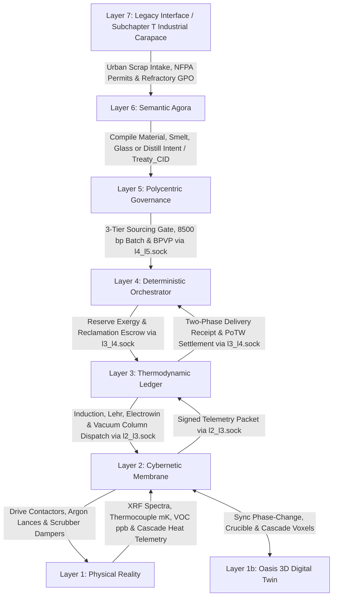
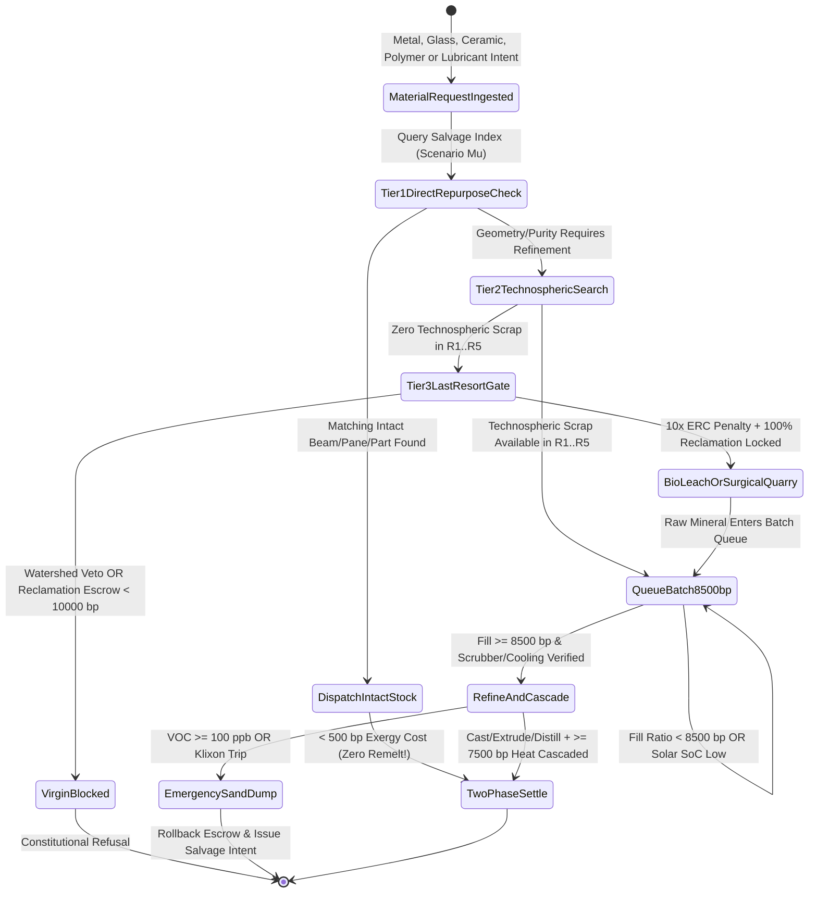

# Scenario Theta: Technospheric Mining, Heavy Metallurgy, Glass/Ceramics, Polymer/Hydrocarbon Upcycling & Last-Resort Geospheric Extraction Foundry

*   **Identifier:** `SCN-THETA-FOUNDRY`
*   **System Epic:** Three-Tier Raw Material Sourcing Hierarchy (Tier 1 Direct Repurposing $\to$ Tier 2 Technospheric Urban Mining & Multi-Material Refinement $\to$ Tier 3 Last-Resort Surgical Geospheric Extraction), Multi-Alloy Pyrometallurgy, Hydrometallurgical E-Waste & Battery Refining, Glass/Ceramic & Geopolymer Works, Polymer & Closed-Loop Hydrocarbon Distillation, 4-Stage Thermal Exergy Cascade & 3-Stage Node Evolution
*   **Primary Layers Tested:** L1 (Physical Reality), L1b (Oasis 3D Digital Twin & Phase-Change Simulator), L2 (Cybernetic Membrane), L3 (Thermodynamic Ledger), L4 (Deterministic Orchestrator), L5 (Polycentric Governance), L6 (Semantic Translation & Agora), L7 (Legacy Interface)
*   **Pass/Fail Metric:** Strict enforcement of the 3-Tier Material Sourcing Hierarchy where virgin geospheric extraction is mathematically blocked whenever reachable technospheric scrap exists across Rings $R_1 \dots R_5$ (`technospheric_scrap_avail_mg > 0`), and when unlocked as a last resort incurs a $10\times$ Ecological Replacement Cost penalty ($\Phi_{\mathrm{virgin}} = 10 \cdot \lambda_{\mathrm{ERC}} \cdot m_{\mathrm{ore}}$) plus a $10000\,\mathrm{bp}$ ($100\%$) Reclamation Escrow; automated crucible and kiln batching threshold ($\ge 8500\,\mathrm{bp}$ capacity) preventing single-piece thermal dissipation; zero unmitigated toxic emissions ($\mathrm{VOC} < 100\,\mathrm{ppb}$, $\mathrm{PM25} < 25\,\mu\mathrm{g/m}^3$); $\ge 7500\,\mathrm{bp}$ ($75\%$) waste-heat capture into the 4-Stage Thermal Exergy Cascade; Pairwise Bilateral Clearing Channel (BCC) settlement with zero-sum conservation ($B_{u \to v}(t) + B_{v \to u}(t) = 0$).

---

## Architectural Council Ratification & 5-Perspective Synthesis

This scenario specification has been ratified by unanimous consensus of the 5-Persona Architectural Council:

| Council Persona | Disciplinary Representative | Core Contribution to Scenario |
| :--- | :--- | :--- |
| **Game Designer** | Lead Systems & Gameplay Designer | *Dwarf Fortress* magma-workshop mastery, urban-mining treasure hunts, and artisanal pride: Stewards disassembling derelict legacy machinery or pouring a flawless batch of recycled bronze impellers gain `"Proud of transmuting technospheric scrap into sovereign stock (+45 mood)"`; attempting to strip-mine virgin earth while urban scrap piles sit unrefined triggers immediate guild refusal and community shame (`"Outraged by unnecessary scar upon the watershed (-50 mood)"`). *Cities: Skylines* industrial symbiosis: foundry waste heat warms adjacent Scenario Gamma greenhouses and Scenario Zeta bathhouses, while closed-loop scrubbers keep neighborhood air pristine. |
| **Game Engineer** | Principal C++ Simulation & Engine Architect | Flecs ECS Data-Oriented Design (DOD): cache-aligned structs `MaterialSourcingHierarchyComponent`, `CrucibleBatchComponent`, `HydrometallurgyElectrowinComponent`, `PolymerHydrocarbonDistillComponent`, and `ThermalCascadeRecoveryComponent`; 32-bit compact Voxels (`material_id = 40` `FOUNDRY_INDUCTION_CRUCIBLE`, `material_id = 41` `FIREBRICK_HEARTH`, `material_id = 42` `LIQUID_METAL_CHARGE`, `material_id = 43` `GLASS_CULLET_LEHR`, `material_id = 44` `VACUUM_HYDROCARBON_COLUMN`, `material_id = 45` `ELECTROWINNING_CELL`); deterministic 10 Hz BPMN 2 state engine (`col-execd`); compilable C++20 test harness strictly utilizing fixed-point SI integer math. |
| **Sovereign Stack Specialist** | Sovereign Stack Systems Architect | 7-layer strict adjacency without layer skipping (`l1_l2.sock` through `l6_l7.sock`, with `/run/collective/ipc/l4_l5.sock` bridging governance and orchestration); zero software or daemons in Layer 1; Layer 1 Klixon bimetallic thermal cutoffs and ASME mechanical relief valves; Layer 2 Zephyr RTOS zero-trust membrane (`col-sensord`, `col-actuated`) reading XRF alloy spectra, NIR polymer sensors, Type-K/S thermocouples, and off-gas VOC/PM25 analyzers; Layer 3 Pairwise Bilateral Clearing Channels (BCC) with zero-sum conservation $B_{u \to v}(t) + B_{v \to u}(t) = 0$; Layer 5 Bioregional Path-Vector Protocol (BPVP / FRRP) enforcing the Technospheric-First Sourcing Invariant. |
| **Solarpunk Thinker** | Bioregional Regenerative Ecologist | Recognizing that two centuries of industrial extraction have already brought more than enough metals, minerals, glass, plastics, and hydrocarbons to the Earth's surface; making Scenario Theta—alongside Scenario Eta (forest biomaterials) and Scenario Mu (organic/deconstruction cycles)—the primary weapon to halt extractive ecological collapse; treating landfills, derelict sprawl, and e-waste as high-grade technospheric mines; locking virgin Earth extraction behind a constitutional last-resort gate with mandatory bacterial bio-leaching and full ecological restoration. |
| **Scenario Specialist** | Pyrometallurgist, Silicate/Ceramic Engineer & Chemical Process Specialist | Multi-alloy induction smelting (Aluminum `A356`/`6061` at $983150\,\mathrm{mK}$, `SAE 660` Bronze at $1323150\,\mathrm{mK}$, Ductile Iron / Recycled Steel at $1773150\,\mathrm{mK}$); closed-loop hydrometallurgical electrowinning of copper, silver, gold, and LFP battery salts; cullet glass melting ($1473150\,\mathrm{mK}$), foamed cellular glass insulation, and alkali-activated geopolymer stone; NIR-sorted polymer extrusion ($1750\,\mu\mathrm{m}$ filament) and oxygen-free fractional vacuum distillation of waste oils/polyolefins into industrial lubricants and dielectric fluids. |

Unanimous Consensus Reached across all five disciplinary perspectives.

---

## 1. Problem Statement & Legacy Failure

In legacy extractive capitalism (Layer 7), raw material sourcing is an ecological doomsday machine built on linear extraction, single-use disposal, and thermodynamic waste:

1.  **The Insanity of Virgin Mining Amidst Technospheric Abundance:** Humanity has already extracted billions of metric tons of iron, aluminum, copper, precious metals, silica glass, aggregates, plastics, and petroleum hydrocarbons from the Earth's crust. Yet legacy industry continues to blast open-pit mines, strip-mine rainforests for bauxite, and drill deep-water oil wells while discarding used circuit boards (which contain $40\text{–}80\times$ higher gold and $10\text{–}30\times$ higher copper concentrations than virgin sulfide ores), structural steel, glass bottles, and waste oils into landfills and oceans.
2.  **Toxic Downcycling & Overseas Dumping:** Municipal "wish-cycling" mixes incompatible alloys and polymers, downcycling high-grade engineering metals into brittle scrap or shipping e-waste and plastics to unregulated overseas dumpsites where open-air burning poisons watersheds.
3.  **The Thermodynamic Trap of Unbatched & Uncascaded Heat:** Operating a furnace or kiln for small, unbatched runs dissipates $> 9000\,\mathrm{bp}$ ($90\%$) of electrical exergy into the sky as waste heat, while industrial smelters reject megawatts of high-grade thermal energy into cooling towers instead of cascading it into district heating, timber kilns, and greenhouses.

---

## 2. Macro-Domain Architecture: The Six Pillars of the Raw Resource & Refinement Commons

Together with [Scenario Eta (`eta_coppice.md`)](file:///Users/raffaine/dev/collective/docs/scenarios/eta_coppice.md) (living silviculture, mycology, and botanical phytochemistry) and [Scenario Mu (`mu_extraction.md`)](file:///Users/raffaine/dev/collective/docs/scenarios/mu_extraction.md) (organic nutrient closure and deconstruction salvage), **Scenario Theta** forms The Collective's primary defense against extractive ecological collapse. It supplies standardized raw materials—metals, glass, ceramics, stone, polymers, and functional hydrocarbons—to [Scenario Alpha (`alpha_fabrication.md`)](file:///Users/raffaine/dev/collective/docs/scenarios/alpha_fabrication.md), [Scenario Beta (`beta_transit.md`)](file:///Users/raffaine/dev/collective/docs/scenarios/beta_transit.md), [Scenario Gamma (`gamma_kitchen.md`)](file:///Users/raffaine/dev/collective/docs/scenarios/gamma_kitchen.md), [Scenario Zeta (`zeta_lodging.md`)](file:///Users/raffaine/dev/collective/docs/scenarios/zeta_lodging.md), and [Scenario Xi (`xi_architecture.md`)](file:///Users/raffaine/dev/collective/docs/scenarios/xi_architecture.md).

### Pillar I: The 3-Tier Resource Sourcing Hierarchy (Repurpose $\to$ Technospheric Mine $\to$ Last-Resort Earth)
Scenario Theta enforces a strict thermodynamic and ecological ordering on every material request entering Layer 6:
1.  **Tier 1 — Direct Non-Destructive Repurposing & Dimensional Salvage (Lowest Exergy):**
    Before any metal beam is melted, any glass pane is crushed, or any stone block is pulverized, inbound salvage from [Scenario Mu (`mu_extraction.md`)](file:///Users/raffaine/dev/collective/docs/scenarios/mu_extraction.md) is scanned via handheld **X-Ray Fluorescence (XRF)** alloy analyzers, ultrasonic flaw detectors, and optical dimensional gauges. Intact structural steel I-beams, `6061` aluminum extrusions, tempered glass panels, granite slabs, electric motors, and precision bearings are cleaned, passivated, and indexed directly into the mesh feedstock ledger at $< 500\,\mathrm{bp}$ ($5\%$) of the exergy cost of remelting.
2.  **Tier 2 — Technospheric Urban Mining & Multi-Modal Refinement (Primary Feedstock Engine):**
    When components are damaged, contaminated, or require geometric/chemical transformation, Scenario Theta refines them from the existing **Technosphere** (scrap metal yards, deconstructed sprawl, e-waste, cullet glass, post-consumer plastics, and waste oils). Because humanity has already extracted vast surpluses of almost every industrial element, Tier 2 satisfies $> 9900\,\mathrm{bp}$ ($> 99\%$) of The Collective's ongoing material needs.
3.  **Tier 3 — Last-Resort Surgical Geospheric Extraction (`VirginExtractionLastResortGate`):**
    Sourcing raw minerals directly from the Earth's crust is constitutionally prohibited whenever usable technospheric stock exists within Concentric Rings $R_1 \dots R_5$ (`technospheric_scrap_avail_mg > 0`). Only when a bioregional BPVP query proves zero available secondary stock for a needed mineral (such as local aluminosilicate clay, silica sand, agricultural/culinary limestone, basalt remineralization rock dust, or trace alloying elements) **and** the Watershed Assembly ($R_4$) ratifies an ecological permit does Tier 3 unlock:
    *   **The $10\times$ Ecological Replacement Cost Penalty:** Layer 3 applies an automatic $10\times$ thermodynamic surcharge ($\Phi_{\mathrm{virgin}} = 10 \cdot \lambda_{\mathrm{ERC}} \cdot m_{\mathrm{ore}}$), making technospheric recovery overwhelmingly preferable whenever physically possible.
    *   **Low-Impact Bio-Mining & Tailings Reprocessing First:** Even within Tier 3, stewards prioritize reprocessing abandoned legacy mine tailings using chemolithoautotrophic bacteria (*Acidithiobacillus ferrooxidans* bio-leaching) and electric precision quarrying over disturbing intact habitats.
    *   **$10000\,\mathrm{bp}$ ($100\%$) Topographical & Mycorrhizal Reclamation Escrow:** Before a single gram of virgin rock or clay is extracted, full exergy escrow must be locked to fund post-extraction grading, topsoil creation ([Scenario Mu](file:///Users/raffaine/dev/collective/docs/scenarios/mu_extraction.md)), and mycorrhizal forest re-inoculation ([Scenario Eta](file:///Users/raffaine/dev/collective/docs/scenarios/eta_coppice.md)).

### Pillar II: Multi-Alloy Pyrometallurgy & Hydrometallurgical E-Waste/Battery Refinery
*   **High-Frequency Electric Induction Smelting & Continuous/Sand Casting:**
    To prevent the thermodynamic waste of single-part melting, `col-execd` holds casting and ingot bounties in queue until aggregated secondary charge reaches $\ge 8500\,\mathrm{bp}$ ($85\%$) of crucible capacity **and** [Scenario Beta (`beta_transit.md`)](file:///Users/raffaine/dev/collective/docs/scenarios/beta_transit.md) signals solar/wind microgrid surplus:
    *   *Light Alloys (`983150 mK` / `710 C`):* Secondary Aluminum (`A356`, `6061`) degassed via pure argon rotary lances ($\le 150\,\mathrm{bp}$ porosity) and cast into Petrobond greensand molds, lost-PLA investment shells, or continuous-cast CNC billets and extrusion bars for [Scenario Alpha (`alpha_fabrication.md`)](file:///Users/raffaine/dev/collective/docs/scenarios/alpha_fabrication.md).
    *   *Copper & Bearing Bronzes (`1323150 mK` / `1050 C`):* Recycled copper busbars/pipe, `SAE 660` bearing bronze, and silicon bronze for marine hardware, low-friction bushings, and [Scenario Zeta (`zeta_lodging.md`)](file:///Users/raffaine/dev/collective/docs/scenarios/zeta_lodging.md) counter-flow Drain-Water Heat Recovery coils.
    *   *Ferrous Metallurgy (`1773150 mK` / `1500 C`):* Recycled gray/ductile cast iron for heavy machine-tool beds (damping vibration in [Scenario Alpha](file:///Users/raffaine/dev/collective/docs/scenarios/alpha_fabrication.md) lathes and mills) and induction-refined carbon/alloy steels rolled or forged into structural plates, shafts, and cutting tool blanks.
*   **Closed-Loop Hydrometallurgical E-Waste & Battery Black-Mass Refinery:**
    Discarded circuit boards, burnt motor windings, and end-of-life lithium batteries are refined in sealed, zero-effluent hydrometallurgical loops:
    *   Mechanical shredding, magnetic ferrous extraction, and density/eddy-current separation isolate metallic fractions from fiberglass PCB substrates.
    *   Closed-loop organic/acid leaching and **electrowinning cells** plate out $9990\,\mathrm{bp}$ ($999\text{ permille}$) pure electrolytic copper cathodes, silver, gold, palladium, and tin solder for [Scenario Alpha](file:///Users/raffaine/dev/collective/docs/scenarios/alpha_fabrication.md) electronics fabrication, while precipitating battery-grade lithium carbonate ($\mathrm{Li_2CO_3}$), iron phosphate ($\mathrm{FePO_4}$), and graphite to remanufacture local microgrid cells.

### Pillar III: Silicates, Glassworks, Technical Ceramics & Geopolymer Stone
Rocks, sand, clay, and waste glass constitute the heaviest mass fraction of human civilization. Scenario Theta processes them in zero-fossil electric and solar-concentrator kilns:
*   **Cullet Glass Furnace, Blowing/Pressing & Annealing Lehr (`1473150 mK` / `1200 C`):**
    Crushed post-consumer soda-lime and borosilicate glass cullet is remelted and formed into standardized wide-mouth fermentation/canning jars for [Scenario Gamma (`gamma_kitchen.md`)](file:///Users/raffaine/dev/collective/docs/scenarios/gamma_kitchen.md), borosilicate Soxhlet extractors and flasks for [Scenario Eta (`eta_coppice.md`)](file:///Users/raffaine/dev/collective/docs/scenarios/eta_coppice.md), architectural window panes for [Scenario Zeta (`zeta_lodging.md`)](file:///Users/raffaine/dev/collective/docs/scenarios/zeta_lodging.md), and **foamed cellular glass aggregate** (waste glass powder foamed at $1123150\,\mathrm{mK}$ with $200\,\mathrm{bp}$ silicon carbide/calcium carbonate into lightweight, load-bearing, waterproof sub-slab insulation that replaces petrochemical XPS styrofoam!).
*   **Technical Ceramics & Refractories (`1573150 mK` / `1300 C`):**
    Firing high-alumina refractory firebricks, silicon-carbide crucibles, high-voltage porcelain insulators for [Scenario Beta (`beta_transit.md`)](file:///Users/raffaine/dev/collective/docs/scenarios/beta_transit.md) HVDC microgrids, microporous ceramic water filters, and glazed sanitary porcelain (no-mix urine-diverting toilets and bathhouse tiles for [Scenario Zeta (`zeta_lodging.md`)](file:///Users/raffaine/dev/collective/docs/scenarios/zeta_lodging.md)).
*   **Wet Stone Sawing & Low-Carbon Geopolymer Binders:**
    Diamond-bladed wet stone saws dimension salvaged granite, basalt (for surface plates and machine bases), and slate, while rock crushers and ball mills grind demolished concrete, metallurgical slag, and calcined clay into **alkali-activated geopolymer cement**—cutting embodied carbon by $> 8000\,\mathrm{bp}$ ($80\%$) compared to legacy Portland cement for [Scenario Xi (`xi_architecture.md`)](file:///Users/raffaine/dev/collective/docs/scenarios/xi_architecture.md).

### Pillar IV: Polymer Upcycling, Elastomers & Closed-Loop Hydrocarbon/Lubricant Refining
Humanity has already synthesized billions of tons of plastics and refined oils; Scenario Theta ensures they are perpetually cycled as durable engineering materials and industrial fluids rather than burned or leaked into the biosphere:
*   **Optical NIR Polymer Sorting, Washing & Precision Extrusion:**
    Near-Infrared (NIR) spectrographic sorters separate post-consumer polymers by resin code (`PET`, `HDPE`, `PP`, `ABS`, `PC`, `PA-Nylon`, `TPU`, `PEEK`). Flakes are hot-washed, dried in desiccant hoppers to $< 20\,\mathrm{bp}$ ($2000\,\mathrm{ppm}$) moisture, and extruded through laser-micrometer-controlled single- and twin-screw extruders into $1750\,\mu\mathrm{m}$ diameter 3D printing filament spools, injection-molding pellets, structural `HDPE` sheets, and `PEX`/`HDPE` water/conduit piping for [Scenario Alpha (`alpha_fabrication.md`)](file:///Users/raffaine/dev/collective/docs/scenarios/alpha_fabrication.md) and [Scenario Beta (`beta_transit.md`)](file:///Users/raffaine/dev/collective/docs/scenarios/beta_transit.md).
*   **Closed-Loop Hydrocarbon Re-Refining & Catalytic Polyolefin Depolymerization:**
    Every mechanical workshop, CNC spindle, vacuum pump, hydraulic press, and electrical transformer requires high-grade oils, greases, and seals. Instead of purchasing virgin fossil petrochemicals, Scenario Theta operates an **Oxygen-Free Fractional Vacuum Distillation & Catalytic Cracking Column** (`623150–723150 mK` / `350–450 C` under vacuum):
    *   *Used Lubricating, Hydraulic & Transformer Oil Re-Refining:* Dehydration, clay/activated-bauxite adsorption, and short-path vacuum distillation strip oxidation products and metal wear particles from used motor, hydraulic, and cooking oils, restoring virgin-grade **base lubricating stocks, spindle oils, biodegradable cutting fluids, and dielectric cooling oils**.
    *   *Unrecyclable Mixed Polyolefin Conversion:* Cross-linked or degraded `PE`/`PP` plastics that can no longer be mechanically extruded are thermally depolymerized in an inert nitrogen atmosphere into **paraffin waxes** (for lost-wax investment casting and canvas waterproofing in [Scenario Nu (`nu_fashion.md`)](file:///Users/raffaine/dev/collective/docs/scenarios/nu_fashion.md)), synthetic hydrocarbon lubricants, and monomer feedstocks—with zero dioxin emissions and zero open combustion.

### Pillar V: 4-Stage High-Temperature Thermal Exergy Cascade & Zero-Emission Off-Gas Scrubbing
*   **4-Stage Thermal Exergy Cascade ($\eta_{\mathrm{cascade}} \ge 7500\,\mathrm{bp}$):**
    High-temperature smelting and glassmaking exergy is captured via water-cooled induction jackets and ceramic recuperative heat exchangers and cascaded downward across four temperature tiers:
    *   *Stage 0 ($> 800000\,\mathrm{mK}$):* Preheats incoming scrap metal and glass cullet charge, cutting melt energy by $2500\,\mathrm{bp}$.
    *   *Stage 1 ($400000\text{–}600000\,\mathrm{mK}$):* Drives [Scenario Eta (`eta_coppice.md`)](file:///Users/raffaine/dev/collective/docs/scenarios/eta_coppice.md) solar-thermal timber kilns and [Scenario Gamma (`gamma_kitchen.md`)](file:///Users/raffaine/dev/collective/docs/scenarios/gamma_kitchen.md) pressure-canning retorts.
    *   *Stage 2 ($330000\text{–}360000\,\mathrm{mK}$):* Feeds [Scenario Zeta (`zeta_lodging.md`)](file:///Users/raffaine/dev/collective/docs/scenarios/zeta_lodging.md) communal bathhouse hot plunges and hydronic floor heating via [Scenario Beta (`beta_transit.md`)](file:///Users/raffaine/dev/collective/docs/scenarios/beta_transit.md) insulated PEX-a arteries.
    *   *Stage 3 ($295000\text{–}310000\,\mathrm{mK}$):* Warms [Scenario Gamma (`gamma_kitchen.md`)](file:///Users/raffaine/dev/collective/docs/scenarios/gamma_kitchen.md) winter aquaponics tanks and greenhouse root zones.
*   **Multi-Stage Off-Gas Scrubbing & Mechanical Fail-Safes:**
    All furnace, kiln, and distillation hoods route through cyclone spark arrestors, PTFE baghouse filters, catalytic oxidizers, and activated-carbon beds. Layer 2 locks out actuation if exhaust $\mathrm{VOC} \ge 100\,\mathrm{ppb}$ or $\mathrm{PM25} \ge 25\,\mu\mathrm{g/m}^3$, while Layer 1 hardware Klixon bimetallic snap-switches physically sever contactor power if skin temperatures exceed $1123150\,\mathrm{mK}$ ($850^\circ\mathrm{C}$).

### Pillar VI: 3-Stage Incremental Node Facility Blueprints
1.  **Stage 1 — Suburban Garage Technospheric Sorting, Polymer Filament Extruder & Benchtop E-Waste/Kiln Hub:**
    *   *Physical Footprint:* A residential garage or backyard outbuilding ($25\text{–}50\,\mathrm{m}^2$) operating within strict residential acoustic ($\le 550\,\mathrm{cB}$) and fire-safety envelopes (zero heavy open-pour smelting in dense housing).
    *   *Operations:* Serves as the neighborhood **Urban Mining & Repurposing Depot**. Stewards use handheld XRF/multimeter diagnostics to harvest intact motors, bearings, extrusions, and fasteners from discarded appliances (Tier 1); shred, wash, and extrude sorted `PET`/`PLA`/`HDPE` waste into calibrated $1750\,\mu\mathrm{m}$ 3D-printing filament spools for [Scenario Alpha (`alpha_fabrication.md`)](file:///Users/raffaine/dev/collective/docs/scenarios/alpha_fabrication.md); run a sealed benchtop copper/silver electrowinning cell; and fire small technical ceramics or lost-PLA aluminum/bronze parts in an enclosed $3\,\mathrm{kW}$ $240\,\mathrm{V}$ tabletop kiln with HEPA + activated-carbon filtration.
    *   *Layer 7 Legal & Municipal Shield:* Protected under **UUNAA § 6** as a private member hobbyist/maker recycling collective with zero commercial walk-in traffic or outdoor scrap heaps (preventing HOA or municipal blight citations).
2.  **Stage 2 — Leased Industrial-Zoned Foundry, Cullet Glassworks & Oil Re-Refinery:**
    *   *Physical Footprint:* A $300\text{–}800\,\mathrm{m}^2$ leased warehouse in an `M-1` / `M-2` industrial zone with $480\,\mathrm{V}$ three-phase power, overhead bridge crane, NFPA 86 fire-marshal permits, and a [Scenario Epsilon (`epsilon_coworking.md`)](file:///Users/raffaine/dev/collective/docs/scenarios/epsilon_coworking.md) Subchapter T cooperative carapace.
    *   *Operations & Self-Sustenance:* Operates $15\text{–}50\,\mathrm{kW}$ induction furnaces (Aluminum, Bronze, Cast Iron), a glass cullet furnace and annealing lehr, an industrial plastic sheet/pipe extruder, a PCB hydrometallurgical line, and a vacuum waste-oil re-refinery. Bounded external Layer 7 sales ($\Phi_t$) of bespoke architectural bronze/iron castings, recycled plastic structural panels, and refined copper/precious metal ingots pay industrial utility/lease costs and accumulate capital in the **Brownfield & Quarry Remediation Escrow**.
3.  **Stage 3 — Custom-Built Bioregional Material Park & Remediated Brownfield/Quarry Sanctuary:**
    *   *Physical Footprint:* Acquiring a defunct industrial brownfield, retired landfill, or exhausted legacy quarry into an **Irrevocable Perpetual Purpose Trust (PPT) / Industrial Commons Trust**.
    *   *Operations:* Houses solar-arc and heavy induction steel/iron/glass furnaces, continuous bar/wire rolling mills, geopolymer stone plants, and full battery black-mass remanufacturing, directly plumbed into the settlement's 4-Stage Thermal Exergy Cascade. When and only when the Tier 3 Last-Resort Gate is constitutionally unlocked (`technospheric_scrap_avail_mg == 0`), executes surgical electric quarrying and bacterial bio-leaching of legacy mine tailings while regenerating surrounding quarry walls into living forest and wetland habitats.

---

## 3. The Collective Workflow (7-Layer Traversal)

The workflow traverses canonically across all seven layers without layer skipping:



### Layer 1: Physical Ground Truth
*   **Tier 1 & Tier 2 Sorting & Refining Hardware:** Handheld XRF alloy spectrometers, optical NIR polymer sorters, dual-shaft shredders, magnetic and eddy-current separators, $15\text{–}100\,\mathrm{kW}$ high-frequency electric induction furnaces with silicon-carbide and clay-graphite crucibles, rotary argon degassing lances, Petrobond greensand and lost-PLA investment casting benches, closed-loop hydrometallurgical leaching vats and copper/precious-metal electrowinning cells.
*   **Silicate, Polymer & Hydrocarbon Hardware:** Electric cullet glass furnaces ($1473150\,\mathrm{mK}$), annealing lehrs, cellular foam-glass kilns, high-alumina ceramic kilns, diamond wet stone saws, ball mills for geopolymer cement, laser-micrometer $1750\,\mu\mathrm{m}$ filament extruders, and oxygen-free fractional vacuum distillation columns ($623150\text{–}723150\,\mathrm{mK}$).
*   **Zero-Software Physical Fail-Safes & Thermal Cascade:** Series-wired Klixon bimetallic snap-action thermal cutoff switches ($1123150\,\mathrm{mK}$ / $850^\circ\mathrm{C}$ hardware trip), Class T fast-acting fuses, mechanical ASME pressure relief valves, dry-sand emergency dump pits, and liquid-to-liquid shell-and-tube heat exchangers feeding the 4-Stage Thermal Exergy Cascade.
*   **Strict Layer Separation:** Layer 1 contains **zero software, zero firmware, zero cryptographic keys, and zero network routing**.

### Layer 2: Cybernetic Membrane & Telemetry
*   **Microcontroller Architecture:** Zero-trust edge microcontrollers (`STM32H7` / `ESP32-S3`) running the Zephyr RTOS sandbox (`col-sensord`, `col-actuated`) with `ATECC608A` hardware cryptographic secure elements and optically isolated RS-485 Modbus / ADC instrumentation amplifiers.
*   **Fixed-Point SI Integer Ingress Telemetry (POSIX Sockets / CBOR):**
    *   `node/foundry/xrf_01/telemetry/secondary_scrap_purity_bp` (XRF verified alloy purity in basis points, `uint16_t`, e.g., $9850\,\mathrm{bp}$)
    *   `node/foundry/kiln_01/telemetry/temp_mk` (Crucible/lehr temperature in millikelvin, `uint32_t`, e.g., $983150\,\mathrm{mK}$ for `A356` Al, $1323150\,\mathrm{mK}$ for Bronze, $1473150\,\mathrm{mK}$ for Glass)
    *   `node/foundry/kiln_01/telemetry/power_mw` (True RMS electrical power draw in milliwatts, `int64_t`)
    *   `node/foundry/exhaust_01/telemetry/pm25_ug_m3` (Exhaust particulate density in $\mu\mathrm{g/m}^3$, `uint32_t`, requiring $< 25\,\mu\mathrm{g/m}^3$)
    *   `node/foundry/exhaust_01/telemetry/voc_ppb` (Exhaust volatile organic compounds in parts per billion, `uint32_t`, requiring $< 100\,\mathrm{ppb}$)
    *   `node/foundry/cascade_01/telemetry/heat_recovered_bp` (Fraction of furnace thermal exergy captured into Stages 0–3 in basis points, `uint16_t`, requiring $\ge 7500\,\mathrm{bp}$)
*   **Actuator Control Invariant ($\mathbf{\Phi}$):** Physical actuation commands from Layer 3 are executed by `col-actuated` only after verifying six invariant safety predicates:
    1.  Crucible/column cooling water loop flow confirmed $> 2000\,\mathrm{mL/s}$ and Thermal Cascade heat-sink valves open.
    2.  Multi-stage cyclone, baghouse, catalytic, and activated-carbon scrubber active with exhaust $\mathrm{VOC} < 100\,\mathrm{ppb}$ and $\mathrm{PM25} < 25\,\mu\mathrm{g/m}^3$.
    3.  Crucible or kiln batch fill ratio confirmed $\ge 8500\,\mathrm{bp}$ ($85\%$) to prevent single-part exergy waste.
    4.  Thermodynamic heating rate $dT/dt$ matches true RMS electrical power draw (`power_mw`).
    5.  Emergency dry-sand dump pit optical/load sensors confirm clear drop zone.
    6.  For any Tier 3 virgin geospheric extraction actuation, hardware interlock verifies a signed `LastResortGeosphericPermit` with `technospheric_scrap_avail_mg == 0` and $10000\,\mathrm{bp}$ Reclamation Escrow locked.

### Layer 3: Thermodynamic Ledger
*   **Pairwise Bilateral Clearing Channels (BCC):**
    All inter-node transfers of metal billets/castings ([Scenario Alpha](file:///Users/raffaine/dev/collective/docs/scenarios/alpha_fabrication.md)), copper busbars and ceramic insulators ([Scenario Beta](file:///Users/raffaine/dev/collective/docs/scenarios/beta_transit.md)), glass jars ([Scenario Gamma](file:///Users/raffaine/dev/collective/docs/scenarios/gamma_kitchen.md)), Soxhlet glassware ([Scenario Eta](file:///Users/raffaine/dev/collective/docs/scenarios/eta_coppice.md)), foam-glass insulation and DWHR copper coils ([Scenario Zeta](file:///Users/raffaine/dev/collective/docs/scenarios/zeta_lodging.md)), geopolymer cement ([Scenario Xi](file:///Users/raffaine/dev/collective/docs/scenarios/xi_architecture.md)), and distilled lubricants settle via Pairwise Bilateral Clearing Channels:
    $$B_{u \to v}(t) + B_{v \to u}(t) = 0, \quad -C_{u \to v} \le B_{u \to v}(t) \le C_{v \to u}$$
*   **3-Tier Thermodynamic Cost Equation & $10\times$ Virgin Extraction Penalty:**
    $$\mathcal{E}_{\mathrm{foundry}} = \int_{0}^{t} P_{\mathrm{elec}}(\tau)\,d\tau - E_{\mathrm{cascade\_recovered}} + m_{\mathrm{mat}} \cdot \left[ c_p \Delta T + \Delta H_f \right] + C_{\mathrm{refractory\_wear}} + \Phi_{\mathrm{virgin\_penalty}}$$
    *   **Tier 1 (Direct Repurposing):** $\Delta H_f = 0$ and $\Phi_{\mathrm{virgin\_penalty}} = 0$ (only cleaning, XRF assay, and transport exergy).
    *   **Tier 2 (Technospheric Recycling):** $\Phi_{\mathrm{virgin\_penalty}} = 0$, and $E_{\mathrm{cascade\_recovered}}$ credits back $\ge 7500\,\mathrm{bp}$ of captured waste heat delivered to neighboring nodes.
    *   **Tier 3 (Last-Resort Virgin Earth Extraction):** Blocked if `technospheric_scrap_avail_mg > 0`; if unlocked when technospheric scrap is zero, incurs $\Phi_{\mathrm{virgin\_penalty}} = 10 \cdot \lambda_{\mathrm{ERC}} \cdot m_{\mathrm{ore}}$ plus mandatory $10000\,\mathrm{bp}$ Reclamation Escrow.

### Layer 4: Deterministic Orchestrator
The deterministic BPMN 2 engine (`col-execd`) governs the 3-tier sourcing and multi-modal refinement pipeline at 10 Hz over `/run/collective/ipc/l4_l5.sock`:



*   **Boundary Socket Contract (`l4_l5.sock`):** Non-blocking `SOCK_SEQPACKET` Unix Domain Socket at `/run/collective/ipc/l4_l5.sock`. Downward messages transmit ratified 3-tier sourcing authorizations, $\ge 8500\,\mathrm{bp}$ batching policies, and Tier 3 Last-Resort permits; upward messages report completed melts, XRF assay certificates, thermal cascade recovery ratios, and scrubber telemetry.

### Layer 5: Polycentric Governance & Bioregional Routing
Executed by `col-kmsd`, Layer 5 enforces the Technospheric-First Sourcing Constitution:
*   **Constitutional Technospheric-First Mandate:** No node may schedule virgin geospheric mining while secondary scrap, cullet glass, demolished concrete, or waste polymer/oil feedstock for that material class is advertised as available anywhere within Concentric Rings $R_1 \dots R_5$.
*   **Bioregional Path-Vector Protocol (BPVP / FRRP):**
    Nodes advertise both their **refined feedstock surpluses** ($Q_{\mathrm{avail}}$) and their **unrefined technospheric scrap reserves** across Rings $R_1 \dots R_5$, allowing regional Stage 2/3 foundries to aggregate scrap from dozens of Stage 1 neighborhood sorting hubs until the $\ge 8500\,\mathrm{bp}$ batch threshold is met.

### Layer 6: Semantic Intent & Agora Ontology
Executed by `col-commonsd`, Layer 6 binds raw-material sourcing and refinement workflows into Tripartite Ricardian Treaties ($\mathrm{Treaty\_CID}$):
1.  **`Tier1RepurposeMatchIntent`:** Matches an engineering request directly to an XRF-verified intact salvaged beam, plate, glass pane, or bearing without remelting.
2.  **`PyrometallurgyAndElectrowinIntent`:** Batches secondary aluminum, bronze, cast iron, steel, or shredded e-waste PCBs/batteries for induction smelting or hydrometallurgical electrowinning.
3.  **`SilicateAndGeopolymerIntent`:** Schedules cullet glass melting (jars, labware, foam-glass insulation), technical ceramics, or low-carbon geopolymer binder grinding.
4.  **`PolymerAndHydrocarbonDistillIntent`:** Schedules NIR-sorted polymer filament/pipe extrusion or fractional vacuum distillation of waste oils/polyolefins into lubricants, cutting fluids, and casting waxes.
5.  **`LastResortGeosphericExtractionIntent`:** Constitutional exception workflow requiring proof of `technospheric_scrap_avail_mg == 0` across $R_1 \dots R_5$, $10\times$ ERC penalty escrow, and $10000\,\mathrm{bp}$ ecological reclamation escrow.

### Layer 7: The Legacy Interface (Dual-Membrane Doctrine)
1.  **Technospheric Tipping-Fee Inversion (Stage 1 & Stage 2 Scrap Intake):** Legacy demolition contractors, e-waste recyclers, auto shops, and municipalities pay tipping fees to dispose of scrap metal, cullet glass, used motor/cooking oil, and electronics. Scenario Theta's external Cooperative Carapace (hosted via [Scenario Epsilon (`epsilon_coworking.md`)](file:///Users/raffaine/dev/collective/docs/scenarios/epsilon_coworking.md)) signs municipal waste-diversion contracts, receiving high-value technospheric raw materials at zero cost (or negative cost via diversion stipends).
2.  **Bounded Specialty Castings & Recycled Material Exports ($\Phi_t$):** To pay industrial three-phase grid intertie charges, NFPA 86 fire-inspection permits, and fund the Brownfield/Quarry Acquisition Escrow, the foundry exports bespoke architectural bronze/iron castings, recycled `HDPE` structural panels, and refined precious metals from export residual $R_t$, halting automatically once $\Phi_t$ is reached.
3.  **Inbound Wholesale Group Purchasing (GPO):** Silicon-carbide crucibles, high-alumina refractories, pure argon shielding cylinders, and diamond saw segments are procured in bulk B2B GPO orders.

---

## 4. Machine-Readable Schemas

### 4A. Layer 6 Knowledge Artifact: Multi-Modal Technospheric Refinement & Sourcing Treaty (`foundry_sourcing_intent.jsonld`)

```json
{
  "@context": [
    "https://schema.org/",
    "https://collective.network/ontology/v1/"
  ],
  "@type": "FoundryMultiModalRefinementIntent",
  "identifier": "urn:uuid:f0e1d2c3-b4a5-6789-0123-456789abcdef",
  "issuerDid": "did:peer:2.Ez6MksT1...engineerTom",
  "creationTimestampMs": 1792404000000,
  "treatyCid": "bafybeihdwdcefgh4dqkjv67uzcmw7ojee6xedeet6wfvikrwho3qnwjxye",
  "nodeEvolutionStage": "STAGE_2_INDUSTRIAL_FOUNDRY_AND_REFINERY",
  "sourcingHierarchyAudit": {
    "tier1DirectRepurposeChecked": true,
    "tier2TechnosphericScrapAvailableMg": 18500000000,
    "tier3VirginGeosphericExtractionPermitted": false,
    "secondaryScrapRatioBasisPoints": 10000
  },
  "metallurgyAndElectrowinBatch": {
    "targetAlloy": "Bronze_SAE660_And_Electrolytic_Copper",
    "massMilligrams": 1450000000,
    "pourTemperatureMillikelvin": 1323150,
    "minCrucibleFillRatioBasisPoints": 8500,
    "electrowinCopperPurityTargetBp": 9990,
    "downstreamRecipient": "SCN_ALPHA_CNC_AND_SCN_ZETA_DWHR"
  },
  "silicateAndGlassBatch": {
    "feedstock": "Crushed_SodaLime_And_Borosilicate_Cullet",
    "kilnTempMillikelvin": 1473150,
    "outputs": [
      "SCN_GAMMA_CANNING_JARS",
      "SCN_ETA_SOXHLET_BOROSILICATE_LABWARE",
      "SCN_ZETA_FOAMED_GLASS_SUBSLAB_INSULATION"
    ]
  },
  "polymerAndHydrocarbonBatch": {
    "nirSortedPolymer": "HDPE_And_TPU_Filament_1750um",
    "vacuumDistillationFeedstock": "Used_Motor_And_Hydraulic_Oil",
    "distillationTempMillikelvin": 653150,
    "distilledOutputs": [
      "SCN_ALPHA_CNC_SPINDLE_AND_WAY_LUBRICANT",
      "SCN_BETA_DIELECTRIC_TRANSFORMER_FLUID",
      "INVESTMENT_CASTING_PARAFFIN_WAX"
    ]
  },
  "thermalCascadeAndScrubberBounds": {
    "minThermalCascadeRecoveryBp": 7500,
    "maxAllowedExhaustVocPpb": 100,
    "maxAllowedExhaustPm25UgM3": 25
  }
}
```

### 4B. Layer 2 Telemetry Attestation: Multi-Modal Foundry, Electrowinning & Cascade Proof (`foundry_attestation.json`)

```json
{
  "@context": "https://collective.network/ontology/v1/",
  "@type": "FoundryMultiModalAttestation",
  "bountyRef": "urn:uuid:f0e1d2c3-b4a5-6789-0123-456789abcdef",
  "furnaceHardwareDid": "did:peer:2.Ez6MkuP8...inductionFoundry01",
  "operatorDid": "did:peer:2.Ez6MkwR4...stewardMarcus",
  "executionMetrics": {
    "crucibleFillRatioBp": 8850,
    "peakMeltTempMillikelvin": 1335150,
    "electrowinCopperPurityBp": 9992,
    "glassLehrTempMillikelvin": 1473150,
    "vacuumColumnTempMillikelvin": 653150,
    "totalElectricalInputMicrojoules": 84000000000000,
    "thermalCascadeRecoveredMicrojoules": 65520000000000,
    "thermalCascadeRecoveryBp": 7800,
    "coolingWaterFlowMlPerSec": 2650,
    "exhaustPm25PeakUgM3": 11,
    "exhaustVocPeakPpb": 42,
    "klixonThermalTripTriggered": false
  },
  "hardwareSignature": "0x8e7a6b5c4d3e2f...atecc608a_ed25519_sig"
}
```

---

## 5. Oasis Engine Implementation Specification

### 5A. Modular Domain Representation in Oasis (Layer 1b)

In the Oasis 3D Digital Twin, Scenario Theta occupies high-exergy industrial workcells within the $32^3$ chunk grid, connected via thermal pipes to adjacent Scenario Eta, Gamma, and Zeta chunks:
*   `material_id = 40` (`FOUNDRY_INDUCTION_CRUCIBLE`): Multi-alloy electric induction furnace supporting Aluminum ($983150\,\mathrm{mK}$), Bronze ($1323150\,\mathrm{mK}$), and Iron/Steel ($1773150\,\mathrm{mK}$) once batch fill reaches $\ge 8500\,\mathrm{bp}$.
*   `material_id = 41` (`FIREBRICK_HEARTH`): High-alumina refractory surround with series-wired Klixon thermal cutoff (`<= 1123150 mK`).
*   `material_id = 43` (`GLASS_CULLET_LEHR`): Remelts waste glass cullet into jars, labware, panes, and foamed cellular glass insulation.
*   `material_id = 44` (`VACUUM_HYDROCARBON_COLUMN`): Oxygen-free fractional vacuum distillation unit converting waste oils and unrecyclable polyolefins into lubricants, cutting fluids, and waxes.
*   `material_id = 45` (`ELECTROWINNING_CELL`): Closed-loop hydrometallurgical cell recovering $9990\,\mathrm{bp}$ pure copper, silver, gold, and battery salts from e-waste.

### 5B. C++20 Test Harness Structure (Fixed-Point SI Integer Math)

```cpp
// engine/tests/scenario_theta_test.cpp
#include <cassert>
#include <cstdint>
#include <string>

namespace collective::scenario_theta {

enum class SourcingTier : uint8_t {
    TIER_1_DIRECT_REPURPOSE = 1,
    TIER_2_TECHNOSPHERIC_REFINEMENT = 2,
    TIER_3_LAST_RESORT_GEOSPHERIC = 3,
    REJECTED_CONSTITUTIONAL_VIOLATION = 0
};

// 1. Pillar I: 3-Tier Resource Sourcing Hierarchy & Virgin Earth Last-Resort Gate
struct MaterialSourcingRequest {
    std::string material_class;
    uint64_t requested_mass_mg{0};
    uint64_t tier1_intact_salvage_avail_mg{0};    // Intact beams/panes/parts ready for direct reuse
    uint64_t tier2_technospheric_scrap_avail_mg{0}; // Scrap metal, cullet glass, e-waste, waste plastic/oil in R1..R5
    bool watershed_last_resort_permit_ratified{false};
    uint32_t reclamation_escrow_locked_bp{0};     // Must be 10000 bp (100%) for Tier 3
    uint64_t base_erc_rate_uj_per_kg{1000000000ULL};
};

inline SourcingTier evaluate_resource_sourcing_hierarchy(const MaterialSourcingRequest& req,
                                                         uint64_t& required_erc_escrow_uj) {
    if (req.requested_mass_mg == 0) return SourcingTier::REJECTED_CONSTITUTIONAL_VIOLATION;
    uint64_t requested_kg = req.requested_mass_mg / 1000000ULL;

    // Tier 1: Direct Non-Destructive Repurposing is always selected first if intact stock exists
    if (req.tier1_intact_salvage_avail_mg >= req.requested_mass_mg) {
        required_erc_escrow_uj = 0; // Zero remelting or virgin extraction penalty
        return SourcingTier::TIER_1_DIRECT_REPURPOSE;
    }

    // Tier 2: Technospheric Urban Mining & Recycling selected if secondary scrap exists in R1..R5
    if (req.tier2_technospheric_scrap_avail_mg >= req.requested_mass_mg) {
        required_erc_escrow_uj = requested_kg * req.base_erc_rate_uj_per_kg;
        return SourcingTier::TIER_2_TECHNOSPHERIC_REFINEMENT;
    }

    // Tier 3: Last-Resort Geospheric Extraction is STRICTLY BLOCKED if ANY technospheric scrap exists!
    if (req.tier2_technospheric_scrap_avail_mg > 0) {
        required_erc_escrow_uj = 0;
        return SourcingTier::REJECTED_CONSTITUTIONAL_VIOLATION;
    }

    // Even when technospheric scrap == 0, Tier 3 requires a ratified Watershed Permit + 10000 bp Reclamation Escrow
    if (!req.watershed_last_resort_permit_ratified || req.reclamation_escrow_locked_bp < 10000) {
        required_erc_escrow_uj = 0;
        return SourcingTier::REJECTED_CONSTITUTIONAL_VIOLATION;
    }

    // Apply the mandatory 10x Ecological Replacement Cost Penalty for virgin geospheric extraction
    required_erc_escrow_uj = requested_kg * req.base_erc_rate_uj_per_kg * 10ULL;
    return SourcingTier::TIER_3_LAST_RESORT_GEOSPHERIC;
}

// 2. Pillar II–V: Multi-Modal Foundry Batching (>= 8500 bp), Scrubber Safety & 4-Stage Thermal Cascade
struct FoundryBatchAndCascadeTelemetry {
    uint64_t crucible_charge_mg{1450000000ULL};
    uint64_t crucible_capacity_mg{1700000000ULL};
    uint32_t cooling_water_flow_ml_s{2650};       // Must be > 2000 mL/s
    uint32_t exhaust_voc_ppb{42};                 // Must be < 100 ppb
    uint32_t exhaust_pm25_ug_m3{11};              // Must be < 25 ug/m3
    uint32_t chamber_skin_temp_mk{780000};        // Klixon physical cutoff trips at >= 1,123,150 mK (850 C)
    uint64_t total_electrical_input_uj{84000000000000ULL};
    uint64_t thermal_cascade_recovered_uj{65520000000000ULL}; // Must recover >= 7500 bp (75%) into Stages 0..3
    uint16_t electrowin_copper_purity_bp{9992};   // Must be >= 9990 bp (999 permille)
};

inline bool verify_foundry_batch_and_safety_invariants(const FoundryBatchAndCascadeTelemetry& f) {
    if (f.crucible_capacity_mg == 0 || f.total_electrical_input_uj == 0) return false;

    // 1. Batching threshold >= 8500 bp (85%) prevents single-piece thermal dissipation
    uint64_t fill_ratio_bp = (f.crucible_charge_mg * 10000ULL) / f.crucible_capacity_mg;
    if (fill_ratio_bp < 8500) return false;

    // 2. Hardware safety & off-gas scrubber invariants
    if (f.cooling_water_flow_ml_s <= 2000) return false;
    if (f.exhaust_voc_ppb >= 100 || f.exhaust_pm25_ug_m3 >= 25) return false;
    if (f.chamber_skin_temp_mk >= 1123150) return false; // Klixon mechanical snap-switch trip

    // 3. 4-Stage Thermal Exergy Cascade must recover >= 7500 bp (75%) of input heat
    uint64_t cascade_recovery_bp = (f.thermal_cascade_recovered_uj * 10000ULL) / f.total_electrical_input_uj;
    if (cascade_recovery_bp < 7500) return false;

    // 4. Hydrometallurgical electrowinning cathode purity >= 9990 bp
    return f.electrowin_copper_purity_bp >= 9990;
}

// 3. Layer 3 Pairwise Bilateral Clearing Channel (BCC) Settlement
struct BccFoundryChannel {
    int64_t balance_foundry_to_peer_uj{0};
    int64_t balance_peer_to_foundry_uj{0};
    int64_t credit_limit_uj{500000000000000LL};
};

inline bool settle_foundry_delivery(BccFoundryChannel& ch, uint64_t net_exergy_uj) {
    if (ch.balance_peer_to_foundry_uj + static_cast<int64_t>(net_exergy_uj) > ch.credit_limit_uj) {
        return false;
    }
    ch.balance_peer_to_foundry_uj += static_cast<int64_t>(net_exergy_uj);
    ch.balance_foundry_to_peer_uj -= static_cast<int64_t>(net_exergy_uj);
    return (ch.balance_peer_to_foundry_uj + ch.balance_foundry_to_peer_uj) == 0;
}

void run_all_scenario_theta_tests() {
    uint64_t erc_escrow_uj = 0;

    // Test 1A: Tier 1 Direct Structural Repurposing takes precedence when intact salvage exists
    MaterialSourcingRequest beam_request{
        .material_class = "Structural_Steel_IBeam",
        .requested_mass_mg = 500000000ULL,             // 500 kg
        .tier1_intact_salvage_avail_mg = 800000000ULL, // 800 kg intact salvaged beams in Scenario Mu depot
        .tier2_technospheric_scrap_avail_mg = 5000000000ULL
    };
    assert(evaluate_resource_sourcing_hierarchy(beam_request, erc_escrow_uj) ==
           SourcingTier::TIER_1_DIRECT_REPURPOSE);
    assert(erc_escrow_uj == 0);

    // Test 1B: Tier 2 Technospheric Urban Mining selected when geometry requires smelting/extrusion
    MaterialSourcingRequest bronze_request{
        .material_class = "Bronze_SAE660_Impeller",
        .requested_mass_mg = 1000000000ULL,            // 1,000 kg
        .tier1_intact_salvage_avail_mg = 0,
        .tier2_technospheric_scrap_avail_mg = 4000000000ULL,
        .base_erc_rate_uj_per_kg = 1000000000ULL
    };
    assert(evaluate_resource_sourcing_hierarchy(bronze_request, erc_escrow_uj) ==
           SourcingTier::TIER_2_TECHNOSPHERIC_REFINEMENT);
    assert(erc_escrow_uj == 1000000000000ULL);

    // Test 1C: Attempting Virgin Earth Extraction while technospheric scrap > 0 MUST FAIL!
    MaterialSourcingRequest premature_mining = bronze_request;
    premature_mining.tier2_technospheric_scrap_avail_mg = 200000000ULL; // Partial scrap still exists!
    premature_mining.watershed_last_resort_permit_ratified = true;
    premature_mining.reclamation_escrow_locked_bp = 10000;
    assert(evaluate_resource_sourcing_hierarchy(premature_mining, erc_escrow_uj) ==
           SourcingTier::REJECTED_CONSTITUTIONAL_VIOLATION);

    // Test 1D: Tier 3 Last-Resort Surgical Geospheric Extraction unlocked ONLY when technospheric stock == 0
    // and enforces the 10x Ecological Replacement Cost penalty + 10000 bp Reclamation Escrow
    MaterialSourcingRequest last_resort_clay{
        .material_class = "High_Alumina_Refractory_Clay",
        .requested_mass_mg = 1000000000ULL, // 1,000 kg
        .tier1_intact_salvage_avail_mg = 0,
        .tier2_technospheric_scrap_avail_mg = 0, // Zero technospheric stock in R1..R5
        .watershed_last_resort_permit_ratified = true,
        .reclamation_escrow_locked_bp = 10000,
        .base_erc_rate_uj_per_kg = 1000000000ULL
    };
    assert(evaluate_resource_sourcing_hierarchy(last_resort_clay, erc_escrow_uj) ==
           SourcingTier::TIER_3_LAST_RESORT_GEOSPHERIC);
    assert(erc_escrow_uj == 10000000000000ULL); // 10x penalty verified!

    // Test 2: Multi-Modal Foundry Batching (>= 8500 bp), Scrubber Safety & 4-Stage Thermal Cascade (>= 7500 bp)
    FoundryBatchAndCascadeTelemetry nominal_melt{};
    assert(verify_foundry_batch_and_safety_invariants(nominal_melt) == true);

    // Underfilled crucible (< 8500 bp) or VOC spike (>= 100 ppb) must be blocked!
    FoundryBatchAndCascadeTelemetry underfilled = nominal_melt;
    underfilled.crucible_charge_mg = 500000000ULL; // 2941 bp (< 8500 bp)
    assert(verify_foundry_batch_and_safety_invariants(underfilled) == false);

    FoundryBatchAndCascadeTelemetry voc_spike = nominal_melt;
    voc_spike.exhaust_voc_ppb = 250;
    assert(verify_foundry_batch_and_safety_invariants(voc_spike) == false);

    // Test 3: Pairwise BCC Zero-Sum Settlement
    BccFoundryChannel bcc{};
    assert(settle_foundry_delivery(bcc, 18480000000000ULL) == true);
    assert(bcc.balance_peer_to_foundry_uj + bcc.balance_foundry_to_peer_uj == 0);
}

} // namespace collective::scenario_theta

int main() {
    collective::scenario_theta::run_all_scenario_theta_tests();
    return 0;
}
```

---

## 6. Acceptance Test Gates (Pass/Fail)

| Checkpoint | Validation Method | Pass Condition |
| :--- | :--- | :--- |
| **G1: 3-Tier Sourcing Hierarchy & Virgin Last-Resort Gate** | BPVP Technospheric Query & Escrow Audit | Tier 1 direct repurposing is selected first; Tier 2 technospheric recycling is selected second; Tier 3 virgin geospheric extraction is mathematically blocked whenever `technospheric_scrap_avail_mg > 0`, and when unlocked as a last resort enforces a $10\times$ ERC penalty ($\Phi_{\mathrm{virgin}} = 10 \cdot \lambda_{\mathrm{ERC}} \cdot m_{\mathrm{ore}}$) plus $10000\,\mathrm{bp}$ ($100\%$) Reclamation Escrow. |
| **G2: Multi-Modal Refinement Coverage** | Metallurgy, E-Waste, Glass, Polymer & Hydrocarbon Outputs | Verifies production of secondary Aluminum/Bronze/Iron/Steel stock, $9990\,\mathrm{bp}$ electrowon copper/precious metals from e-waste, cullet glass jars/labware/foam-glass insulation, geopolymer cement, $1750\,\mu\mathrm{m}$ NIR-sorted filament, and vacuum-distilled lubricants/waxes from waste oils and polyolefins. |
| **G3: Crucible & Kiln Batching Gate ($\ge 8500\,\mathrm{bp}$)** | Batch Fill Ratio Check | Furnace and kiln actuation remains suspended in queue until aggregated batch mass reaches $\ge 8500\,\mathrm{bp}$ ($85\%$) capacity, preventing single-piece thermal dissipation. |
| **G4: 4-Stage Thermal Exergy Cascade ($\ge 7500\,\mathrm{bp}$)** | Heat Exchanger Calorimetry | At least $7500\,\mathrm{bp}$ ($75\%$) of high-temperature furnace and kiln thermal exergy is captured and cascaded into Stage 0 charge preheating, Stage 1 Scenario Eta timber kilns, Stage 2 Scenario Zeta bathhouses, and Stage 3 Scenario Gamma greenhouses. |
| **G5: Scrubber & Hardware Fail-Safe Verification** | Exhaust VOC/PM25 & Klixon Trip Audit | Any exhaust excursion ($\mathrm{VOC} \ge 100\,\mathrm{ppb}$ or $\mathrm{PM25} \ge 25\,\mu\mathrm{g/m}^3$) or skin temperature $\ge 1123150\,\mathrm{mK}$ ($850^\circ\mathrm{C}$) triggers immediate contactor trip, sand-pit dump, and escrow rollback. |
| **G6: 3-Stage Node Evolution & Tipping-Fee Inversion (L7)** | Stage 1–3 Blueprint Audit | Verifies progression from Stage 1 suburban garage sorting/filament/electrowinning bench (UUNAA § 6 shield) to Stage 2 leased `M-1`/`M-2` industrial foundry/glassworks/oil-refinery to Stage 3 custom-built Bioregional Material Park & Remediated Brownfield/Quarry PPT. |
