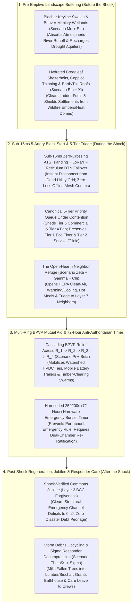
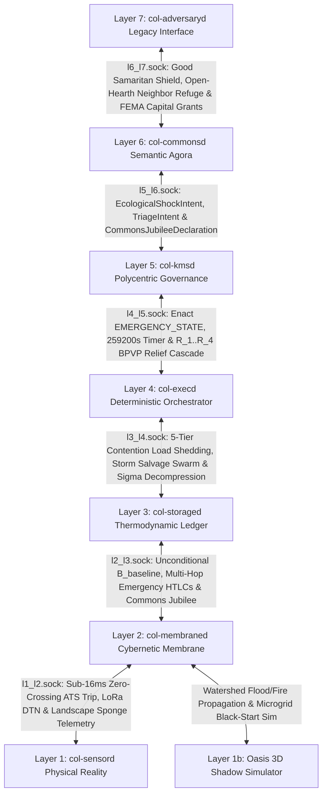
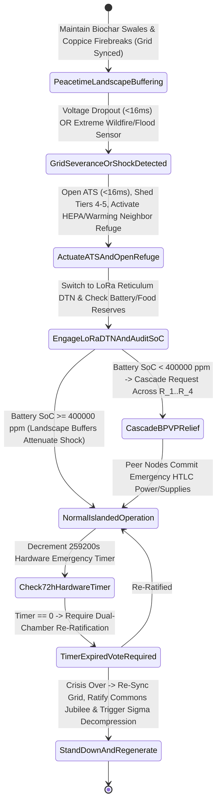

# Scenario Upsilon: Ecological Shock, Pre-Emptive Landscape Buffering & Open-Hearth Disaster Resilience

*   **Identifier:** `SCN-UPSILON-SHOCK`
*   **System Epic:** Confronting Climate Volatility Without Bunkerist Isolation—Weaving Proactive Landscape Sponge/Firebreak Regeneration, Sub-16ms 5-Artery Microgrid Black-Start, Canonical 5-Tier Contention Load Shedding, Open-Hearth Neighbor Refuge, Cascading BPVP Mutual Aid, and Shock-Verified Commons Jubilees
*   **Primary Layers Tested:** L1 (Physical Reality), L1b (Oasis 3D Shadow Simulator), L2 (Cybernetic Membrane), L3 (Thermodynamic Ledger), L4 (Deterministic Orchestrator), L5 (Polycentric Governance), L6 (Semantic Translation & Agora), L7 (Legacy Interface)
*   **Pass/Fail Metric:** Proactive **Landscape Ecological Shock Attenuation** (biochar keyline sponge swales and hydrated coppice firebreaks measurably reducing flood/wildfire impact in integer basis points); deterministic microgrid islanding within $16\,\mathrm{ms}$ upon legacy grid phase collapse; autonomous execution of the **Canonical 5-Tier Priority Queue Under Contention**; **Open-Hearth Neighbor Refuge Activation** (providing unconditional clean air, water, warmth, and clinical triage to surrounding Layer 7 neighbors during crises); dynamic multi-hop request cascading across $R_0 \dots R_6$ via BPVP; **Shock-Verified Commons Jubilee** debt forgiveness on Bilateral Clearing Channels ($B_{u \to v}(t) + B_{v \to u}(t) = 0$); hardcoded $259200\,\mathrm{s}$ ($72\text{-hour}$) hardware emergency timer; automatic post-crisis **Scenario Sigma Decompression** for responders; and zero IEEE 754 floating-point math.

---

## Architectural Council Ratification & 5-Perspective Synthesis

This scenario specification has been ratified by unanimous consensus of the 5-Persona Architectural Council:

| Council Persona | Disciplinary Representative | Core Contribution to Scenario |
| :--- | :--- | :--- |
| **Game Designer** | Lead Systems & Gameplay Designer | **Anti-Doomer Regenerator Gameplay & The Open-Hearth Refuge Loop:** Rejects grimdark "armed prepper bunker" survivalism. Players prepare for wildfires, atmospheric rivers, heat domes, and ice storms by **healing the watershed ahead of time**—digging biochar sponge swales (`Mu`), thinning ladder fuels (`Eta`), and retrofitting earthen fireproof roofs (`Xi`). When the storm hits and the legacy city grid goes dark, the node lights up as a warm beacon—opening its doors to shelter neighboring Layer 7 townsfolk (`"Fortified by shared warmth, clean HEPA air, and neighborly solidarity in the storm (+5000 bp morale)"`). |
| **Game Engineer** | Principal C++ Simulation & Engine Architect | **Flecs ECS 5-Tier Contention Shedder, Landscape Buffer & Jubilee Engine:** Encapsulates `PowerConsumerComponent`, `MicrogridBusComponent`, `LandscapeEcologicalBufferComponent`, and `EmergencyRequestCascadeComponent` in 32-bit compact voxels (`material_id = 50` `MICROGRID_GATEWAY_NODE`, `material_id = 51` `CRITICAL_CLINIC_CIRCUIT`, `material_id = 52` `FALLEN_TIMBER_OBSTACLE`). Executes sub-$16\,\mathrm{ms}$ islanding, integer microjoule load shedding, landscape shock attenuation, and Commons Jubilee clearing at $10\,\mathrm{Hz}$ determinism with zero floating-point math. |
| **Sovereign Stack Specialist** | Sovereign Stack Systems Architect | **7-Layer Strict Adjacency, DTN Failover & Shock-Verified Jubilee:** Maps `col-sensord` through `col-adversaryd` across `/run/collective/ipc/l1_l2.sock` to `/run/collective/ipc/l6_l7.sock` (traversing `/run/collective/ipc/l4_l5.sock`). Enforces zero-packet-loss failover to $915\,\mathrm{MHz}$ LoRa Reticulum DTN, multi-hop HTLC relief cascades, and cryptographic verification of genuine physical shocks before unlocking Commons Jubilee debt forgiveness. |
| **Solarpunk Thinker** | Bioregional Regenerative Ecologist | **Mother Nature as Partner, Not Enemy:** Recognizes that "natural disasters" are overwhelmingly amplified by extractive Layer 7 land mismanagement (clearcuts, paved floodplains, flammable monocultures). By partnering with hydrological and forest cycles—beaver-mimicry wetlands, biochar soil sponges, and hydrated broadleaf shelterbelts—The Collective dampens ecological shocks at the landscape scale and salvages storm-felled timber into community infrastructure rather than burning it. |
| **Scenario Specialist** | Disaster Resilience & Islanded Microgrid Systems Engineer | **5-Artery Black-Start & Anti-Authoritarian Emergency Bounds:** Combines sub-$16\,\mathrm{ms}$ zero-crossing Automatic Transfer Switch (`ATS`) isolation, the canonical 5-Tier Priority Queue Under Contention, hardcoded $259200\,\mathrm{s}$ ($72\text{-hour}$) hardware emergency sunset timers, statutory Good Samaritan shielding, and automatic Scenario Sigma post-crisis responder decompression. |

**Unanimous Consensus Reached:** The Council unreservedly ratifies Scenario Upsilon as the canonical specification for ecological shock resilience, pre-emptive landscape buffering, and bioregional mutual aid.

---

## 1. Problem Statement, Legacy Failure & Refusing the Doomer Bunker

As the biosphere experiences accelerating climate volatility—wildfires, atmospheric rivers, heat domes, polar-vortex ice storms, and prolonged droughts—legacy infrastructure (Layer 7) and survivalist ideology fail across five catastrophic dimensions:

1.  **Extractive Land Mismanagement Amplifies Every Shock:** Industrial clearcutting, drained wetlands, and impervious asphalt turn heavy rain into catastrophic flash floods and summer heat into megafires.
2.  **Centralized Grid & Telecom Cascade Collapse:** Fragile high-voltage transmission lines spark wildfires or collapse in ice storms, plunging entire cities into darkness while cellular towers die within 4 hours—leaving neighbors unable to coordinate basic help 500 meters away.
3.  **The Moral & Practical Bankruptcy of "Prepper Bunkers":** Wealthy survivalists respond to looming collapse by hoarding weapons and canned food in isolated bunkers. In reality, an isolated bunker is a fragile tomb: it cannot regenerate its own ecosystem, repair complex medical equipment, or survive long-term without a thriving bioregional community.
4.  **Financialization of Lifelines & Disaster Capitalism:** In Layer 7 crises, water, warmth, hotel rooms, and generators are gated behind fiat payment terminals and surge pricing, while predatory contractors trap storm victims in debt bondage.
5.  **Disaster Authoritarianism & Responder Burnout:** State emergencies frequently suspend civil liberties indefinitely while exhausting front-line paramedics and lineworkers into psychological collapse.

### 1A. How Scenario Upsilon Unites Landscape Regeneration, 5-Artery Black-Start & Open-Hearth Solidarity

Scenario Upsilon (`SCN-UPSILON-SHOCK`) replaces both brittle Layer 7 utilities and paranoid bunkerism with a **Four-Phase Bioregional Resilience Architecture**:



1.  **Pre-Emptive Landscape Buffering (Partnering with Mother Nature Before the Storm):**
    *   Resilience begins long before the barometer drops. Across every Stage 2 and Stage 3 node, stewards actively engineer the surrounding landscape to absorb climatic extremes:
        *   **Hydrological Sponge Swales (`SCN-MU-EXTRACTION` + `SCN-ETA-COPPICE`):** Contour keyline swales amended with high-porosity biochar (`Mu`) and deep-rooted perennial polycultures increase soil water infiltration by $> 5000\,\mathrm{bp}$, turning destructive flash-flood runoff into summer groundwater reserves.
        *   **Wildfire & Windbreak Architecture (`SCN-ETA-COPPICE` + `SCN-XI-ARCH`):** Rotational winter coppicing removes dead brush and ladder fuels, surrounds settlements with irrigated, fire-resistant broadleaf/willow belts, and pairs non-combustible earthen/stone/tile architecture (`Xi`) with rooftop rainwater-drenching sprinklers and positive-pressure HEPA smoke filtration.
2.  **Sub-16ms 5-Artery Black-Start & The Canonical 5-Tier Priority Queue:**
    *   When an ice storm, wildfire, or earthquake severs the legacy utility grid and cellular network, the node executes a deterministic **5-Artery Black-Start**:
        *   **Sub-$16\,\mathrm{ms}$ Zero-Crossing Islanding:** AC phase detectors trip motorized Automatic Transfer Switches (`ATS`) in $< 16\,\mathrm{ms}$, isolating the local $48\,\mathrm{V}/380\,\mathrm{V}$ microgrid before back-feeding downed utility lines.
        *   **The Canonical 5-Tier Priority Queue Under Contention (`col-execd`):**
            1.  **Tier 5 (External Commercial Export):** Shed in $< 50\,\mathrm{ms}$.
            2.  **Tier 4 (Discretionary Guild Fabrication):** Induction furnaces (`Theta`), CNC mills (`Alpha`), and power looms (`Nu`) shed within $100\,\mathrm{ms}$.
            3.  **Tier 3 (Bioregional Mutual Aid & Cross-Node Pledges):** Dynamically balanced against internal battery State-of-Charge (`battery_soc_ppm`).
            4.  **Tier 2 (Unconditional Human Survival & Clinical Baselines $B_{\mathrm{baseline}}$):** Clinic ventilators, insulin/vaccine cold storage (`Chi`), kitchen refrigeration (`Gamma`), HEPA air scrubbers, and communal warming/cooling hearths remain energized unconditionally down to the $200000\,\mathrm{ppm}$ ($20\%$) hardware reserve floor.
            5.  **Tier 1 (Inviolable Ecological Floors $F_{\mathrm{eco}}$):** Watershed floodgate actuators, nursery frost-protection, and environmental safety sensors remain permanently energized.
        *   **Offline DTN Communication Survivability (`SCN-BETA-TRANSIT`):** Automatically switches all Layer 5/Layer 6 coordination to $915\,\mathrm{MHz}$ LoRa Reticulum and regional HF NVIS radio with $0$ dropped triage packets.
3.  **The Open-Hearth Neighbor Refuge Doctrine (*Anti-Bunkerist Solidarity with Layer 7 Neighbors*):**
    *   Instead of locking gates when the surrounding city loses power or chokes on wildfire smoke, every Collective node opens its **Public Refuge Pavilion (`SCN-ZETA-LODGING` + `SCN-GAMMA-KITCHEN` + `SCN-CHI-PARAMEDIC`)** to surrounding Layer 7 residents—providing free HEPA-filtered clean air, warm soup, potable water, medical triage, and communication relays. In Oasis (`Layer 1b`), this acts as the single highest-trust catalyst for building goodwill with the surrounding municipality and inspiring new stewards to join via **Scenario Tau (`SCN-TAU-GENESIS`)**!
4.  **Cascading BPVP Mutual Aid, Commons Jubilee & Responder Decompression:**
    *   **Multi-Ring Relief Cascading ($R_1 \to R_4$):** If local battery or food reserves drop below $400000\,\mathrm{ppm}$ ($40\%$), `col-kmsd` cascades signed `CascadingReliefIntent` packets across the watershed (`SCN-PI-GUILD`), dispatching mobile LiFePO4 battery trailers (`Beta`), paramedic teams (`Chi`), and chainsaw/sawmill clearing swarms.
    *   **Shock-Verified Commons Jubilee (`Layer 3`):** Once the crisis passes, the Bioregional Watershed Congress ($R_3/R_4$) verifies the Layer 2 physical shock telemetry (`SCN-RHO-ADVERSARY`) and ratifies a **Commons Jubilee**, forgiving structural Bilateral Clearing Channel deficits ($B_{u \to v} \to 0\,\mu\mathrm{J}$) incurred during emergency relief.
    *   **Storm Salvage & Responder Care (`SCN-THETA-FOUNDRY` / `SCN-MU-EXTRACTION` + `SCN-SIGMA-BURNOUT`):** Fallen trees are milled into structural timber (`Xi`) or pyrolyzed into soil biochar (`Mu`), while every emergency responder is automatically enrolled in **Scenario Sigma Post-Crisis Somatic Decompression** (hydrotherapy bathhouse + Dual-Freeze Care Leave).

---

## 2. The Collective Workflow (7-Layer Traversal)

Scenario Upsilon coordinates pre-emptive ecological buffering, sub-$16\,\mathrm{ms}$ islanding, 5-tier load shedding, Open-Hearth refugee hospitality, and post-shock Commons Jubilees across all 7 layers without skipping layers:



### Layer 1: Physical Reality & Layer 1b: Oasis 3D Shadow Simulator
*   **Landscape Buffers, Microgrid Switchgear & Refuge Hardware (`Layer 1`):**
    *   **Landscape Buffering:** Biochar-amended keyline swales, retention ponds with automated spillway valves, hydrated willow/alder firebreaks, and rooftop rainwater drenching manifolds.
    *   **Microgrid & Life-Support Hardware:** $48\,\mathrm{V}/380\,\mathrm{V}$ LiFePO4 battery banks, bi-directional grid-forming inverters, motorized Automatic Transfer Switches (`ATS`), $915\,\mathrm{MHz}$ SX1262 LoRa transceivers with supercapacitor backup, positive-pressure HEPA air scrubbers, and mobile sawmill/chipper rigs.
*   **Oasis 3D Shadow Simulator (`Layer 1b`):**
    *   Simulates hydrodynamic flood routing, wildfire ember spread across voxel vegetation, and microgrid black-start transients, allowing stewards to test how adding a keyline swale or coppice firebreak reduces physical damage before extreme weather arrives.

### Layer 2: The Cybernetic Membrane (Sub-16ms Actuation & Offline DTN)
*   **Zero-Crossing Islanding & Environmental Telemetry (`col-membraned`):**
    *   AC zero-crossing phase detectors confirm utility grid loss and trip the `ATS` isolation contactor in $< 16\,\mathrm{ms}$ (e.g., $14\,\mathrm{ms}$).
    *   Monitors `microgrid_bus_potential_mv`, `battery_soc_ppm`, `wind_speed_milli_mps`, `wildfire_particulate_ug_m3`, and `swale_soil_moisture_ppm` in pure fixed-point SI integers, with zero biometric cameras (`biometric_packets_captured == 0`).

### Layer 3: The Thermodynamic Ledger (Unconditional Baselines & Shock-Verified Jubilee)
*   **Unconditional Survival & Open-Hearth Refuge (`col-storaged`):**
    *   All Tier 1 ($F_{\mathrm{eco}}$) and Tier 2 ($B_{\mathrm{baseline}}$) lifelines—plus emergency hospitality for displaced Layer 7 neighbors—operate at $0$ token cost with zero debt accrual to individuals.
*   **Multi-Hop Emergency HTLCs & Shock-Verified Commons Jubilee:**
    *   Inter-node emergency power and supply transfers clear over Pairwise Bilateral Clearing Channels ($B_{u \to v}(t) + B_{v \to u}(t) = 0$). Once the shock subsides, the Watershed Congress ($R_3/R_4$) ratifies a **Commons Jubilee**, resetting emergency channel deficits ($B_{u \to v} < 0$) to $0\,\mu\mathrm{J}$.

### Layer 4: The Deterministic Orchestrator (5-Tier Load Shedder & Salvage/Decompression Engine)
*   **Canonical 5-Tier Contention Load Shedding (`col-execd`):**
    *   Communicates across `/run/collective/ipc/l4_l5.sock` and `/run/collective/ipc/l3_l4.sock` at $10\,\mathrm{Hz}$, shedding Tier 5 and Tier 4 loads in $< 100\,\mathrm{ms}$ while protecting Tiers 1 and 2, opening the **Open-Hearth Neighbor Refuge**, dispatching storm-timber salvage swarms (`Pi`/`Eta`/`Mu`), and scheduling **Scenario Sigma Decompression** for all emergency crews upon stand-down.



### Layer 5: Polycentric Governance (Cascading Mutual Aid & 72-Hour Hardware Sunset)
*   **Dynamic Hierarchical Request Cascading (`col-kmsd`):**
    *   Propagates signed relief requests across $R_1 \to R_2 \to R_3 \to R_4$ while respecting every exporting peer's Export Surplus Bound $Q_{\mathrm{avail}}(t) = \max(0, Q_{\mathrm{inventory}} - F_{\mathrm{eco}} - B_{\mathrm{baseline}}) \cdot \mathbf{1}_{\mathrm{export}}$ and local `No-Transit` hazard closures.
*   **Hardcoded 72-Hour ($259200\,\mathrm{s}$) Hardware Timer:**
    *   Automatically terminates `EMERGENCY_STATE` after $259200\,\mathrm{s}$ unless affirmatively re-ratified by concurrent majorities of the Commons and Stewardship Chambers.

### Layer 6: Semantic Translation & Agora (Ricardian Disaster Compacts)
*   **Tripartite Treaties & Emergency Intents (`col-commonsd`):**
    *   Validates `EcologicalShockIntent`, `TriageIntent`, `LoadSheddingDirectiveIntent`, `OpenHearthRefugeIntent`, and `CommonsJubileeDeclarationIntent` over `/run/collective/ipc/l5_l6.sock`.

### Layer 7: The Legacy Interface (Good Samaritan Shield & Wholesale Capital Grants)
*   **Good Samaritan Immunity & Municipal Coordination (`col-adversaryd`):**
    *   Invokes statutory Good Samaritan and Emergency Response legal protections for road clearing, emergency triage (`Chi`), and neighbor sheltering. Any external FEMA or municipal disaster reimbursement fiat is held strictly in Membrane 1 to purchase wholesale replacement capital goods (e.g., LiFePO4 cells, solar panels) with zero conversion into internal tokens.

---

## 3. 3-Stage Incremental Node Facility Blueprints (Node Growth Pattern)

Scenario Upsilon scales from a household black-start microgrid and clean-air safe room into a landscape-scale sponge watershed and bioregional disaster-relief sanctuary.

### Stage 1: Domestic Black-Start Microgrid, HEPA Refuge Room & 30-Day Larder ($R_1 / R_2$ Bootstrap)
*   **Physical Footprint:** `12 m2` battery/water utility bay + `20 m2` positive-pressure clean-air living room in a suburban home (`SCN-ZETA-LODGING`).
*   **Core Resilience Systems:**
    1.  **Sub-16ms Hybrid Inverter & $48\,\mathrm{V}$ LiFePO4 Bank:** `15 kWh` to `30 kWh` battery bank with motorized `ATS`, rooftop solar array, and dedicated Tier 2 critical-load subpanel (refrigeration, medical devices, well pump, LoRa radio).
    2.  **Rainwater Cistern, Biochar Garden Swale & Clean-Air Hearth:** `5000 L` gravity-fed rainwater cistern with ceramic/UV filtration, backyard biochar rain-garden swale, and a HEPA/activated-carbon air scrubber that turns the living room into a wildfire-smoke sanctuary for the household and immediate block neighbors.

### Stage 2: Urban Neighborhood Resilience Hub, Open-Hearth Refuge & Microgrid Intertie ($R_2 / R_3$ Municipal Shell)
*   **Physical Footprint:** `400 m2` to `1000 m2` seismically retrofitted civic/industrial shell co-located with Scenario Gamma (`SCN-GAMMA-KITCHEN`), Scenario Chi (`SCN-CHI-PARAMEDIC`), and Scenario Beta (`SCN-BETA-TRANSIT`).
*   **Integrated Disaster-Relief Zones:**
    1.  **The Open-Hearth Neighbor Warming, Cooling & Clean-Air Hall:** Industrial positive-pressure HEPA/carbon filtration, hydronic radiant heating/cooling fed by thermal storage tanks, a 200-person emergency soup kitchen (`Gamma`), and public AC/USB charging banks open to surrounding Layer 7 neighborhood residents during grid blackouts or smoke waves.
    2.  **The $200\,\mathrm{kWh}$ Microgrid Substation & Mobile Battery Bay:** Houses grid-forming inverters, $380\,\mathrm{V}$ DC neighborhood interties, and trailer-mounted LiFePO4 battery packs that can be towed by electric utility trucks to power nearby clinics or elder housing (`SCN-PHI-ELDER`).

### Stage 3: Bioregional Sponge-Watershed Campus, Pumped-Storage Black-Start Plant & Relief Depot ($R_3 / R_4$ CLT/PPT)
*   **Physical Footprint:** `20` to `100 hectares` spanning an upland forest-to-valley hydrological corridor on an **Irrevocable CLT/PPT**.
*   **Landscape-Scale Ecological & Black-Start Architecture (`SCN-XI-ARCH` + `SCN-ETA-COPPICE`):**
    *   **Keyline Biochar Sponge Terraces & Beaver-Mimicry Detention Basins:** Engineered across the watershed contours to absorb 100-year atmospheric river deluges without downstream flooding while keeping gravity irrigation canals flowing through multi-year droughts.
    *   **Hydrated Broadleaf Firebreak Belts & Micro-Hydro Black-Start Plant:** Irrigated willow/alder/poplar shelterbelts protecting non-combustible earthen/stone settlement clusters, paired with a closed-loop micro-hydro / thermal-sand battery plant capable of black-starting the entire valley's $380\,\mathrm{V}$ HVDC mesh.
    *   **The Watershed Salvage & Mobile Relief Depot:** Staging ground for electric forestry skidders, mobile sawmills, pyrolysis kilns (`Mu`), and regional emergency response Work-Bee Swarms (`Pi`).

---

## 4. Machine-Readable Schemas

### 4A. Layer 6 Knowledge Artifact: Ecological Shock & Open-Hearth Refuge Intent (`shock.jsonld`)

```json
{
  "@context": [
    "https://schema.org/",
    "https://collective.network/ontology/v1/"
  ],
  "@type": "EcologicalShockAndRefugeIntent",
  "identifier": "urn:uuid:e2f3g4h5-6i7j-8k9l-0m1n-2o3p4q5r6s7t",
  "issuerDid": "did:peer:2Ez6MksT_telemetry_watchdog",
  "creationTimestamp": "2026-11-15T03:22:10Z",
  "shockProfile": {
    "shockType": "Severe_Ice_Storm_And_Grid_Collapse",
    "legacyGridPotentialMilliVolts": 0,
    "temperatureMilliKelvin": 258950,
    "sustainedWindSpeedMilliMps": 21800,
    "landscapeBufferAttenuationBps": 6200,
    "severityClassification": "STATE_OF_EMERGENCY"
  },
  "islandingAndTriageParameters": {
    "atsDisconnectionLatencyMs": 14,
    "radioMeshProtocol": "Reticulum_LoRa_915MHz",
    "loadSheddingProfile": "CANONICAL_5_TIER_QUEUE",
    "openHearthNeighborRefugeActive": true,
    "shelteredLayer7NeighborsCount": 85
  },
  "policyOverrides": {
    "emergencyStateActive": true,
    "hardwareTimerRemainingSeconds": 259200,
    "unconditionalSurvivalBaselineEnacted": true,
    "goodSamaritanImmunityInvoked": true,
    "postCrisisSigmaDecompressionScheduled": true
  },
  "triageRequirements": {
    "preservedCircuits": ["CLINIC_VENTILATOR_BAY_01", "INSULIN_COLD_STORAGE_BAY_03", "OPEN_HEARTH_REFUGE_HALL"],
    "targetMinimumSoCPpm": 200000
  }
}
```

### 4B. Layer 2 Telemetry Attestation: Microgrid Islanding & Landscape Sponge Proof (`attestation.json`)

```json
{
  "@context": "https://collective.network/ontology/v1/",
  "@type": "MicrogridIslandingAndLandscapeAttestation",
  "attestationId": "urn:uuid:1f2a3b4c-5d6e-7f8a-9b0c-1d2e3f4a5b6c",
  "gatewayNodeDid": "did:peer:2Ez6MksV_inverter_and_watershed_gateway",
  "telemetryProof": {
    "disconnectionLatencyMs": 14,
    "preGridPotentialMilliVolts": 240200,
    "postIslandBusPotentialMilliVolts": 239800,
    "batteryBankSoCPpm": 884000,
    "biocharSwaleRunoffAbsorptionBps": 6500,
    "refugeHallIndoorParticulateUgM3": 4,
    "circuitsShedCount": 18,
    "circuitsActiveCount": 5,
    "loraMeshActivePeers": 16,
    "biometricPacketsCaptured": 0,
    "anomalyDetected": false
  },
  "switchDigestSha256": "c2b3d4e5f60718293a4b5c6d7e8f90123456789abcdef0123456789abcdef012",
  "status": "ISLAND_STABLE_AND_OPEN_HEARTH_ENERGIZED"
}
```

---

## 5. Oasis Engine Implementation Specification

### 5A. Memory Allocation, Voxel State & Landscape/Microgrid Components

The microgrid, landscape ecological buffers, and Open-Hearth emergency refuge occupy designated voxels in the $32^3$ chunk space (`ChunkManager`):
*   Main ATS gateway voxel initialized with `material_id = 50` (`MICROGRID_GATEWAY_NODE`).
*   Critical clinic and Open-Hearth refuge circuits occupy `material_id = 51` (`CRITICAL_CLINIC_AND_REFUGE_CIRCUIT`).
*   Storm-felled timber obstacles spawn `FALLEN_TIMBER_OBSTACLE` (`material_id = 52`), which Work-Bee Swarms salvage into structural lumber (`Xi`) and biochar feedstock (`Mu`).

### 5B. Self-Contained C++20 Reference & Test Harness

```cpp
// engine/tests/scenario_upsilon_test.cpp
#include <array>
#include <cassert>
#include <cstdint>
#include <iostream>
#include <string>
#include <vector>

namespace oasis::upsilon {

// Cache-aligned Flecs ECS Components in pure fixed-point SI integer math
struct alignas(8) PowerConsumerComponent {
    uint8_t priority_tier{1};      // 1 (Ecological Floor) to 5 (Commercial Export)
    uint64_t active_milliwatts{0}; // Milliwatts
    bool is_energized{true};
};

struct alignas(8) LandscapeEcologicalBufferComponent {
    uint32_t biochar_swale_infiltration_bps{6500}; // 65% flood runoff absorbed into aquifer
    uint32_t hydrated_coppice_firebreak_bps{7000}; // 70% wildfire radiant heat/ember attenuation
    uint64_t storm_felled_timber_salvaged_kg{0};
    bool open_burning_avoided{true};
};

struct alignas(8) OpenHearthRefugeState {
    bool refuge_doors_open_to_l7_neighbors{false};
    uint32_t sheltered_l7_neighbors_count{0};
    uint32_t indoor_hepa_particulate_ug_m3{4}; // Clean air <= 10 ug/m3 even during wildfire smoke
    uint64_t fiat_or_token_charged_to_refugees_uj{0}; // Must strictly equal 0!
    bool post_crisis_sigma_decompression_triggered{false};
};

class MicrogridAndWatershedResilienceEngine {
public:
    static constexpr uint32_t MAX_EMERGENCY_SECONDS = 259200U; // 72 hours
    static constexpr uint64_t QUANTUM_UJ = 3600000000000ULL;   // 3600 kJ (1 credit quantum)

    // Computes net physical shock intensity after Pre-Emptive Landscape Buffering (Eta + Mu + Xi)
    static uint64_t compute_attenuated_shock_intensity_uj(
        uint64_t raw_climatic_shock_uj,
        const LandscapeEcologicalBufferComponent& buffer,
        bool is_hydrological_flood_shock
    ) {
        uint32_t attenuation_bps = is_hydrological_flood_shock
                                       ? buffer.biochar_swale_infiltration_bps
                                       : buffer.hydrated_coppice_firebreak_bps;
        if (attenuation_bps > 9000) attenuation_bps = 9000;
        return (raw_climatic_shock_uj * static_cast<uint64_t>(10000 - attenuation_bps)) / 10000ULL;
    }

    // Executes sub-16ms ATS islanding, Canonical 5-Tier Contention Load Shedding,
    // and activates the Open-Hearth Neighbor Refuge
    static bool execute_black_start_and_open_hearth_refuge(
        uint32_t ats_disconnect_latency_ms,
        std::vector<PowerConsumerComponent>& circuits,
        uint64_t total_available_mw,
        OpenHearthRefugeState& refuge,
        uint32_t incoming_l7_neighbors
    ) {
        if (ats_disconnect_latency_ms >= 16U) {
            return false; // Failed sub-16ms zero-crossing islanding gate!
        }

        uint64_t allocated_mw = 0ULL;
        for (auto& circuit : circuits) {
            if (circuit.priority_tier >= 4) {
                circuit.is_energized = false; // Immediately shed Tier 4 (Fab) & Tier 5 (Commercial)
            } else {
                if (allocated_mw + circuit.active_milliwatts <= total_available_mw) {
                    circuit.is_energized = true;
                    allocated_mw += circuit.active_milliwatts;
                } else if (circuit.priority_tier <= 2) {
                    // Tiers 1 (Eco Floor) and 2 (Clinic & Open-Hearth Survival Baseline) are unconditional
                    circuit.is_energized = true;
                } else {
                    circuit.is_energized = false;
                }
            }
        }

        // Activate anti-bunkerist Open-Hearth Neighbor Refuge at zero cost
        refuge.refuge_doors_open_to_l7_neighbors = true;
        refuge.sheltered_l7_neighbors_count = incoming_l7_neighbors;
        refuge.fiat_or_token_charged_to_refugees_uj = 0ULL;
        refuge.post_crisis_sigma_decompression_triggered = true;
        return true;
    }

    // Shock-Verified Commons Jubilee: forgives Bilateral Clearing Channel deficits incurred during disaster relief
    static bool ratify_shock_verified_commons_jubilee(
        int64_t& balance_u_to_v_uj,
        bool physical_shock_telemetry_verified,
        bool watershed_assembly_supermajority_confirmed
    ) {
        if (!physical_shock_telemetry_verified || !watershed_assembly_supermajority_confirmed) {
            return false;
        }
        balance_u_to_v_uj = 0LL;
        return true;
    }
};

void test_scenario_upsilon_landscape_buffering_and_5tier_black_start() {
    // 1. Verify Pre-Emptive Landscape Buffering (Biochar sponge swales absorb 65% of flood runoff)
    LandscapeEcologicalBufferComponent buffer{
        .biochar_swale_infiltration_bps = 6500,
        .hydrated_coppice_firebreak_bps = 7000,
        .storm_felled_timber_salvaged_kg = 12000,
        .open_burning_avoided = true
    };
    uint64_t raw_flood_shock_uj = 100000000000000ULL;
    uint64_t attenuated_flood_uj =
        MicrogridAndWatershedResilienceEngine::compute_attenuated_shock_intensity_uj(
            raw_flood_shock_uj, buffer, true
        );
    assert(attenuated_flood_uj == 35000000000000ULL); // Cut by 65%!

    // 2. Setup 5 branch circuits across the 5 canonical priority tiers
    std::vector<PowerConsumerComponent> circuits = {
        {.priority_tier = 1, .active_milliwatts = 50000ULL,   .is_energized = true}, // Tier 1: Eco Sensors (50W)
        {.priority_tier = 2, .active_milliwatts = 1200000ULL, .is_energized = true}, // Tier 2: Clinic & Open-Hearth Refuge (1200W)
        {.priority_tier = 3, .active_milliwatts = 500000ULL,  .is_energized = true}, // Tier 3: Neighbor Mesh Tie (500W)
        {.priority_tier = 4, .active_milliwatts = 2500000ULL, .is_energized = true}, // Tier 4: CNC Tool (2500W)
        {.priority_tier = 5, .active_milliwatts = 3000000ULL, .is_energized = true}  // Tier 5: Commercial Export (3000W)
    };

    OpenHearthRefugeState refuge{};
    uint64_t available_inverter_mw = 2000000ULL; // 2000 W

    assert(MicrogridAndWatershedResilienceEngine::execute_black_start_and_open_hearth_refuge(
        14U, circuits, available_inverter_mw, refuge, 85U
    ));

    // Assert Tier 5 and Tier 4 are shed, while Tier 1, Tier 2, and Open-Hearth Refuge remain active
    assert(circuits[4].is_energized == false);
    assert(circuits[3].is_energized == false);
    assert(circuits[0].is_energized == true);
    assert(circuits[1].is_energized == true);
    assert(refuge.refuge_doors_open_to_l7_neighbors == true);
    assert(refuge.sheltered_l7_neighbors_count == 85U);
    assert(refuge.fiat_or_token_charged_to_refugees_uj == 0ULL);
    assert(refuge.post_crisis_sigma_decompression_triggered == true);
}

void test_scenario_upsilon_commons_jubilee_and_72h_timer() {
    // Node A imported 10 credit quanta (36 TJ) of emergency heating assistance from Node B during verified ice storm
    int64_t balance_a_to_b_uj = -(10LL * static_cast<int64_t>(MicrogridAndWatershedResilienceEngine::QUANTUM_UJ));
    assert(balance_a_to_b_uj < 0LL);

    // Without physical shock verification, Jubilee cannot be gamed
    assert(!MicrogridAndWatershedResilienceEngine::ratify_shock_verified_commons_jubilee(
        balance_a_to_b_uj, false, true
    ));

    // With verified shock telemetry and Watershed Congress supermajority, deficit is forgiven to zero!
    assert(MicrogridAndWatershedResilienceEngine::ratify_shock_verified_commons_jubilee(
        balance_a_to_b_uj, true, true
    ));
    assert(balance_a_to_b_uj == 0LL);

    // Verify 72-hour hardware safety timer bounds
    uint32_t emergency_timer_seconds = MicrogridAndWatershedResilienceEngine::MAX_EMERGENCY_SECONDS;
    assert(emergency_timer_seconds == 259200U);
    emergency_timer_seconds -= 3600U;
    assert(emergency_timer_seconds == 255600U);
}

} // namespace oasis::upsilon

int main() {
    oasis::upsilon::test_scenario_upsilon_landscape_buffering_and_5tier_black_start();
    oasis::upsilon::test_scenario_upsilon_commons_jubilee_and_72h_timer();
    std::cout << "Scenario Upsilon Landscape Buffering, Sub-16ms Black-Start, Open-Hearth Refuge & Jubilee tests passed." << std::endl;
    return 0;
}
```

---

## 6. Acceptance Test Gates (Pass/Fail)

| Checkpoint | Validation Method | Pass Condition |
| :--- | :--- | :--- |
| **G1: Pre-Emptive Landscape Shock Attenuation** | `compute_attenuated_shock_intensity_uj` | Biochar keyline sponge swales (`Mu`) and hydrated coppice firebreaks (`Eta`) measurably attenuate flood runoff and wildfire radiant heat before reaching settlement structures (`attenuated_flood_uj < raw_flood_shock_uj`). |
| **G2: Sub-16ms Islanding & Canonical 5-Tier Shedding** | `execute_black_start_and_open_hearth_refuge` | Loss of legacy grid voltage trips `ATS` isolation in $<16\,\mathrm{ms}$ (`14 ms`); Tiers 4 and 5 drop to $0\,\mathrm{mW}$ while Tier 1 ($F_{\mathrm{eco}}$) and Tier 2 ($B_{\mathrm{baseline}}$ clinic/refuge) remain unconditionally energized. |
| **G3: Open-Hearth Neighbor Refuge & Sigma Care** | `OpenHearthRefugeState` Invariant Audit | During crises, the node opens its HEPA clean-air, warming/cooling, and clinical refuge to surrounding Layer 7 neighbors at zero cost (`fiat_or_token_charged_to_refugees_uj == 0`) and schedules post-crisis Scenario Sigma decompression for responders. |
| **G4: Offline DTN Survivability & BPVP Cascading** | WAN Severance & Ring Expansion Test | All emergency triage and relief requests propagate across $915\,\mathrm{MHz}$ LoRa Reticulum DTN and cascade across $R_1 \to R_4$ without cyclic loops when WAN fiber is severed. |
| **G5: Shock-Verified Commons Jubilee (`L3`)** | `ratify_shock_verified_commons_jubilee` | Emergency `BCC` deficits incurred during sensor-verified shocks are forgiven to $0\,\mu\mathrm{J}$ upon Watershed Congress ratification, while unverified free-riding claims are rejected. |
| **G6: 72-Hour Hardware Safety Timer Expiration** | Countdown Audit | The `EMERGENCY_STATE` override expires autonomously after $259200\,\mathrm{s}$ ($72\,\mathrm{hours}$), returning to peacetime governance unless affirmatively re-ratified by both chambers. |
