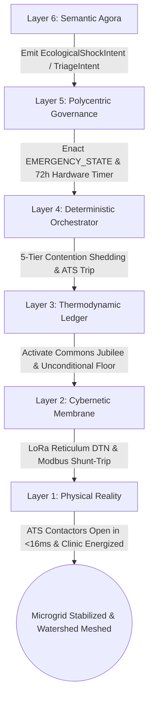
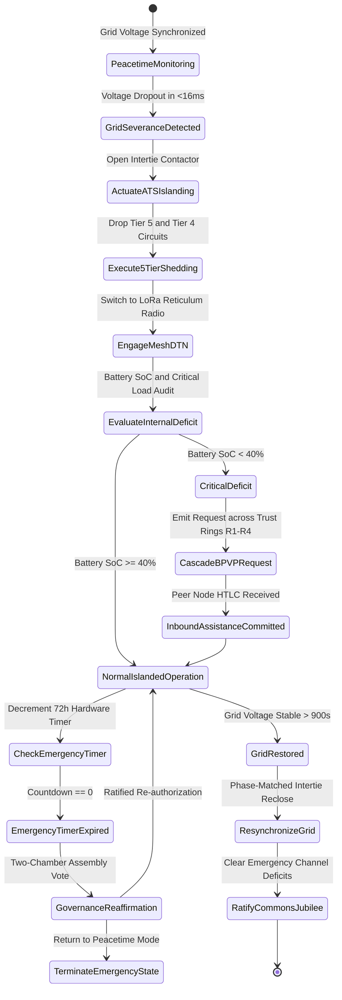
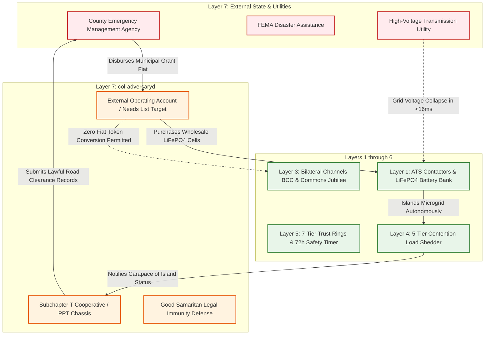

# Scenario Upsilon: Ecological Shock (Disaster Resilience & Nurture)

*   **Identifier:** `SCN-UPSILON-SHOCK`
*   **System Epic:** Disaster Response, Islanded Microgrid Autonomy & Proactive Ecological Nurture
*   **Primary Layers Tested:** L1 (Physical), L2 (Cybernetic Membrane), L3 (Thermodynamic Ledger), L4 (Deterministic Orchestrator), L5 (Polycentric Governance), L6 (Semantic Agora), L7 (Legacy Interface)
*   **Pass/Fail Metric:** Deterministic islanding within 16 milliseconds upon legacy grid phase collapse; autonomous execution of the canonical 5-Tier Priority Queue Under Contention; dynamic multi-hop request cascading across 7-tier trust rings ($R_0 \dots R_6$) via BPVP; Layer 3 Bilateral Clearing Channel (BCC) settlement with Commons Jubilee debt forgiveness; hardcoded 72-hour emergency state expiration; zero deaths from power interruption.

---

## Architectural Council Ratification & 5-Perspective Synthesis

This scenario specification has been ratified by unanimous consensus of the 5-Persona Architectural Council:

| Council Persona | Disciplinary Representative | Core Contribution to Scenario |
| :--- | :--- | :--- |
| **Game Designer** | Lead Systems & Gameplay Designer | Dwarf Fortress extreme weather trauma and subterranean refuge psychology: Founder 01 coordinating mutual-aid survival through howling blizzards and atmospheric river floods; psychological stress accumulators (thoughts like `"Terrified by howling blizzard gale (-25 stress)"` transitioning to `"Deeply fortified by shared warmth in the microgrid commons (+50 mood)"`); community gathering in the convivial hearth ($R_0$); Cities: Skylines disaster response loops; stochastic Boundary Interface weather shocks attenuated by living windbreaks, drainage swales, and energy sovereignty. |
| **Game Engineer** | Principal C++ Simulation & Engine Architect | Flecs ECS Data-Oriented Design (DOD): cache-aligned `PowerConsumerComponent` enforcing the canonical 5-Tier Priority Queue Under Contention, `MicrogridBusComponent`, and `EmergencyRequestCascadeComponent`; 32-bit compact voxel grid representation (`material_id = 50`, `MICROGRID_GATEWAY_NODE`, `material_id = 51`, `CRITICAL_CLINIC_CIRCUIT`); 10 Hz deterministic BPMN state engine; compilable C++20 test harness executing integer microjoule load shedding, ATS islanding under 16 milliseconds, and Commons Jubilee balance clearing. |
| **Sovereign Stack Specialist** | Sovereign Stack Systems Architect | 7-layer defense architecture across autonomous POSIX daemons (`col-sensord`, `col-membraned`, `col-storaged`, `col-execd`, `col-kmsd`, `col-commonsd`, `col-adversaryd`); strict adjacent IPC via Unix domain sockets; delay-tolerant networking (DTN) gossip spool over Reticulum/LoRa; Pairwise Bilateral Clearing Channels (BCC) with conservation equation $B_{u \to v}(t) + B_{v \to u}(t) = 0$; multi-hop HTLCs; Commons Jubilee debt forgiveness mechanisms in Layer 3; zero monolithic threading. |
| **Solarpunk Thinker** | Bioregional Regenerative Ecologist | Proactive ecological nurture as authentic civil defense: wildfire fuel reduction via rotational coppice thinning (Scenario Eta); biochar swale sponges mitigating flash flood runoffs (Scenario Mu); storm debris salvage converted into firewood and building timber rather than burned; treating disaster response not as militarized emergency, but as deepened kinship solidarity and watershed stewardship. |
| **Scenario Specialist** | Disaster Resilience & Islanded Microgrid Systems Engineer | Microgrid power balance equation in fixed-point SI integer units; sub-16-millisecond Automatic Transfer Switch (ATS) zero-crossing isolation; canonical 5-Tier Priority Queue Under Contention; Bioregional Path-Vector Protocol (BPVP) request cascading across concentric Trust Rings ($R_0 \dots R_6$); Commons Jubilee mutual debt clearance ratified by Watershed Councils; hardcoded 72-hour hardware emergency countdown timer. |

**Council Ratification Verdict:** Unanimous Consensus Reached.

---

## 1. Problem Statement & Legacy Failure

In legacy digital and physical infrastructure (Layer 7), climate resilience is reactive, brittle, and privatized. The centralized power grid relies on fragile, high-voltage transmission corridors routed through unmanaged, combustible wildlands. When ecological shocks hit (severe ice storms, atmospheric rivers, wildfires):

1.  **Grid Collapse & Cascade Failure:** A single downed transmission tower or frozen natural gas wellhead triggers catastrophic regional blackouts. Centralized distribution substations lack micro-islanding capability; power is severed equally to industrial factories and home medical ventilators.
2.  **Telecommunication Blackout & Cloud Paralysis:** Cellular base stations exhaust backup battery reserves within 4 hours. Cloud-dependent platforms, remote payment terminals, and municipal dispatch portals become completely unreachable. Neighborhoods are rendered blind, deaf, and unable to coordinate life-support aid 500 meters down the road.
3.  **Bureaucratic Relief Failure & Inequitable Recovery:** Centralized emergency management agencies (e.g., FEMA) take days or weeks to mobilize. Low-income neighborhoods suffer prolonged neglect, while commercial contractors exploit disaster zones through price gouging, debt bondage, and predatory repair contracts.
4.  **Financialization of Lifelines:** In legacy crises, food, potable water, and warmth are gated behind fiat payment rails. When electronic banking networks freeze, citizens with empty pockets are turned away from life-saving resources, transforming physical infrastructure failures into humanitarian catastrophes.

A sovereign Genesis Node operates an autonomous "Emergency Override" protocol. It transitions the community instantly from daily optimization to an economy of biological triage, unconditional survival baselines ($B_{\mathrm{baseline}}$), and proactive bioregional meshing.

---

## 2. The Collective Workflow (7-Layer Traversal)

Scenario Upsilon executes the autonomous emergency triage loop across the 7-layer stack:



### Layer 1: Physical Reality (Microgrid Islanding & Life Support)
*   **Physical Ground Truth:** 48V LiFePO4 battery storage banks (14340 Wh capacity), 5000 W bi-directional inverter-chargers, motorized AC automatic transfer switches (ATS) for physical islanding, RS-485 Modbus branch power meters, and high-amperage solid-state DC contactors.
*   **Relief Transducers:** 915 MHz SX1262 LoRa radio mesh nodes with supercapacitor buffers, chainsaws, hydraulic wood splitters, gravity-fed water filtration manifolds, and clean room medicine cold-storage refrigerators.
*   **Strict Layer Separation:** Layer 1 contains zero software, zero firmware, zero cryptographic keys, and zero network routing. It consists purely of mechanical switches, physical busbars, contactor coils, and raw analog sensors.
*   **Action:** Physical opening of the grid intertie contactor to sever legacy grid connection in under 16 milliseconds; clearing fallen trees from emergency access lanes; distributing warm meals and medical power.

### Layer 2: The Cybernetic Membrane (Telemetry & Deterministic Actuation)
*   **Microcontroller Enclave:** Zephyr RTOS microcontrollers communicating over isolated CAN and RS-485 buses with lock-free `/dev/shm` ring buffer IPC. Strict fixed-point SI integer wire encoding (microjoules, milliwatts, millikelvin, millivolts, milliamperes, milliseconds).
*   **Ingress Telemetry:**
    *   `microgrid_bus_potential_mv` (Millivolts AC/DC)
    *   `battery_soc_ppm` (Battery State-of-Charge, parts per million, e.g. 884000 ppm)
    *   `circuit_breaker_state_bitmask` (Bitmask of powered vs shed branch circuits)
    *   `wind_speed_milli_mps` (Anemometer velocity, millimeters per second)
    *   `mesh_dtn_loss_ppm` (Packet loss, parts per million)
*   **Deterministic Actuation:** AC zero-crossing phase detectors confirm loss of grid synchronization in under 16 milliseconds, driving shunt-trip contactors to isolate the node before back-feeding dead utility wires.
*   **Anti-Panopticon Hardware Shield:** Edge hardware strictly rejects body-worn biometrics or workplace cameras, verifying triage status purely through non-human circuit telemetry and physical emergency pull-boxes.

### Layer 3: The Thermodynamic Ledger (BCC, HTLCs & Commons Jubilee)
*   **Topology:** Pairwise Bilateral Clearing Channels (BCC) between peered nodes $u$ and $v$ with conservation invariant:
    $$B_{u \to v}(t) + B_{v \to u}(t) = 0$$
*   **Unconditional Human Survival Baseline ($B_{\mathrm{baseline}}$):** Life-critical survival lifelines (potable water, clinical refrigeration, baseline heating) are guaranteed unconditionally at zero price. No exergy tokens, chore points, or debt obligations are demanded from distressed humans.
*   **Multi-Hop HTLC Emergency Relays:** When power or medical supplies are transferred across intermediate nodes, chained Hashed Timelock Contracts $\langle H(S), \Delta t, Q, u, v \rangle$ clear balances atomically along the BPVP path upon signed delivery receipts $\sigma_{\mathrm{delivery}}$ and cascading backward settlement.
*   **Commons Jubilee Debt Forgiveness:**
    When catastrophic shocks cause structural deficits on Bilateral Clearing Channels ($B_{u \to v}(t) \to -C_{u \to v}$) due to emergency deliveries, the Bioregional Watershed Congress ($R_3/R_4$) ratifies a **Commons Jubilee**:
    Structural debt accumulated during ratified emergency periods is forgiven and cleared to zero, preventing debt peonage and restoring mutual aid headroom across the watershed.

### Layer 4: The Deterministic Orchestrator (5-Tier Contention Load Shedding)
*   **Runtime:** Sandboxed BPMN 2.0 VM (`col-execd`) executing at 10 Hz with strict FIFO priority queues. Communicates with Layer 5 across `/run/collective/ipc/l4_l5.sock`.
*   **The Canonical 5-Tier Priority Queue Under Contention:**
    When total load exceeds generation and battery discharge budgets, `col-execd` sheds loads strictly in descending order:
    1.  **Tier 5 (External Commercial Export):** Shed instantly ($<50\text{ ms}$) upon grid loss.
    2.  **Tier 4 (Discretionary Guild Fabrication):** 3D printers, metal foundries, circular textile looms shed within 100 milliseconds.
    3.  **Tier 3 (Bioregional Mutual Aid & Cross-Node Pledges):** Power sharing across watershed interties is balanced against internal reserves.
    4.  **Tier 2 (Human Survival Baselines $B_{\mathrm{baseline}}$):** Community kitchen refrigeration, clinic ventilators, warm communal hearth circuits are preserved unconditionally down to minimum battery floor ($20\%$ SoC).
    5.  **Tier 1 (Inviolable Ecological Floors $F_{\mathrm{eco}}$):** Critical watershed sensors, automated dam spillway valves, and environmental life-support telemetry remain permanently energized.



### Layer 5: Polycentric Governance (Trust Rings & Request Cascading)
*   **Daemon:** `col-kmsd` enforcing `EMERGENCY_STATE` policies.
*   **Concentric Trust Rings ($R_0 \dots R_6$):**
    *   $R_0$ (The Hearth): Unconditional shelter, clean water, warm food, medical triage.
    *   $R_1$ (The Settlement): Physical neighbor volunteer crews, local tool libraries.
    *   $R_2$ (The Commons): Local microgrid circuits, shared cold storage, dual-chamber assembly.
    *   $R_3$ (The Watershed Guild): Hydrological river basin cluster ($\le 30\text{ km}$); HVDC interties, utility electric trucks, bilateral credit lines.
    *   $R_4$ (Bioregional Federation): River basin federation ($\le 150\text{ km}$); shared grain reserves, rail freight corridors.
    *   $R_5$ (Continental Corridor): Trans-continental disaster relief bundles, heavy machinery dispatch.
    *   $R_6$ (Ecumene): External legacy perimeter interface.
*   **Dynamic Hierarchical Request Cascading:**
    When local reserves face a projected deficit, `col-kmsd` broadcasts a signed Resource Request Intent $\mathcal{Q} = \langle \mathrm{req\_id}, v_{\mathrm{requester}}, \mathcal{T}_{\mathrm{res}}, \mathbf{u}, Q_{\mathrm{req}}, \tau_{\mathrm{deadline}}, R_{\mathrm{curr}}, \sigma \rangle$.
    1.  *Phase 1 ($R_0 / R_1$):* Local settlement conservation and battery throttling.
    2.  *Phase 2 ($R_2$):* Village neighbors borrow portable LiFePO4 packs via cargo bikes ($\le 5\text{ km}$).
    3.  *Phase 3 ($R_3$):* Watershed cluster activates bilateral HVDC microgrid interties or dispatches utility trucks ($\le 30\text{ km}$).
    4.  *Phase 4 ($R_4$):* Bioregional federation mobilizes regional mobile generator reserves ($\le 150\text{ km}$).
    *   Exporting peers evaluate their Export Surplus Bound:
        $$Q_{\mathrm{avail}}(t) = \max\left(0, Q_{\mathrm{inventory}}(t) - F_{\mathrm{eco}}(t) - B_{\mathrm{baseline}}(t)\right) \cdot \mathbf{1}_{\mathrm{export}}$$
*   **Hardcoded 72-Hour Hardware Timer:**
    The `EMERGENCY_STATE` override is bounded by a hardcoded 72-hour hardware countdown timer ($259{,}200\text{ seconds}$). It terminates automatically unless affirmatively re-ratified by concurrent majorities in the Commons and Stewardship Chambers, preventing authoritarian state-of-emergency entrenchment.
*   **Cellular Autonomy, Protocol of Refusal & Autonomous Transit Veto (`No-Transit`):** Even during acute bioregional shocks, autopoietic cellular autonomy guarantees that local nodes retain inviolable control over their internal survival reserves, affirming that the preservation of the parts holds absolute priority over the administrative dictates of the whole. Communities retain the Protocol of Refusal to withhold critical emergency caches, seed sanctuaries, and uncontaminated water wells from regional expropriation. In addition, affected nodes enforce an Autonomous Transit Veto (`No-Transit`), closing washed-out or hazardous local residential paths to non-emergency heavy transit and rerouting outside supply convoys onto hardened arterial corridors.

### Layer 6: Semantic Agora & Ricardian Treaties (Ontology & Intents)
*   **Daemon:** `col-commonsd` parsing structured JSON-LD schemas.
*   **Ricardian Treaty Architecture (`Treaty_CID`):**
    All inter-node mutual aid covenants are cryptographically anchored by a Tripartite Treaty_CID:
    $$\mathrm{Treaty\_CID} = \mathrm{SHA256}\left( \mathrm{Text}_{\mathrm{prose}} \parallel \mathrm{Schema}_{\mathrm{JSON-LD}} \parallel \mathrm{Invariants}_{\mathrm{BPMN}} \right)$$
*   **Typed Schemas:**
    1.  `EcologicalShockIntent`: Declaration of grid loss, storm threshold, or wildfire perimeter.
    2.  `TriageIntent`: Priority request for life-critical baseline support (ventilator power, insulin cooling).
    3.  `LoadSheddingDirectiveIntent`: Command envelope executing 5-tier load shedding down to Tier 2.
    4.  `CommonsJubileeDeclarationIntent`: Ratified mutual debt forgiveness across Bilateral Clearing Channels.
    5.  `CascadingReliefIntent`: Multi-hop resource request cascading across Trust Rings $R_1 \dots R_4$.

### Layer 7: The Legacy Interface (Dual-Membrane Carapace & Mutual Aid)
*   **Daemon:** `col-adversaryd` (Legacy Gateway & Municipal Interface Daemon).
*   **Dual-Membrane Carapace:** The cooperative entity operates under Subchapter T / UUNAA § 6.
*   **Good Samaritan & Emergency Doctrines:**
    During natural disasters, external legal interactions invoke recognized statutory Good Samaritan protections and Emergency Response Doctrines. The cooperative coordinates road clearance and warming sanctuaries without exposing internal volunteers to personal tort liability.
*   **FEMA & Municipal Relief Grants:**
    External emergency relief grants or municipal reimbursements are received in corporate bank accounts as external fiat. Under the Meshing-First rule, this fiat is used exclusively to pay property taxes or purchase non-local wholesale capital goods (replacement inverter modules, bulk LiFePO4 cells); it is **strictly prohibited** from converting into internal exergy credits.



---

## 3. Machine-Readable Schemas

### 3.1 Layer 6 Knowledge Artifact: Ecological Shock Intent (`shock.jsonld`)

```json
{
  "@context": [
    "https://schema.org/",
    "https://collective.network/ontology/v1/"
  ],
  "@type": "EcologicalShockIntent",
  "identifier": "urn:uuid:e2f3g4h5-6i7j-8k9l-0m1n-2o3p4q5r6s7t",
  "issuerDid": "did:peer:2.Ez6MksT...telemetry_watchdog",
  "creationTimestamp": "2026-11-15T03:22:10Z",
  "shockProfile": {
    "shockType": "Severe_Ice_Storm",
    "legacyGridPotentialMilliVolts": 0,
    "temperatureMilliKelvin": 258950,
    "sustainedWindSpeedMilliMps": 21800,
    "severityClassification": "STATE_OF_EMERGENCY"
  },
  "islandingParameters": {
    "atsDisconnectionLatencyMs": 14,
    "radioMeshProtocol": "Reticulum_LoRa_915MHz",
    "loadSheddingProfile": "CANONICAL_5_TIER_QUEUE"
  },
  "policyOverrides": {
    "emergencyStateActive": true,
    "hardwareTimerRemainingSeconds": 259200,
    "unconditionalSurvivalBaselineEnacted": true,
    "goodSamaritanImmunityInvoked": true
  },
  "triageRequirements": {
    "preservedCircuits": ["CLINIC_VENTILATOR_BAY_01", "INSULIN_COLD_STORAGE_BAY_03"],
    "targetMinimumSoCPpm": 200000
  }
}
```

### 3.2 Layer 2 Telemetry Attestation: Microgrid Islanding Proof (`attestation.json`)

```json
{
  "@context": "https://collective.network/ontology/v1/",
  "@type": "MicrogridIslandingAttestation",
  "attestationId": "urn:uuid:1f2a3b4c-5d6e-7f8a-9b0c-1d2e3f4a5b6c",
  "gatewayNodeDid": "did:peer:2.Ez6MksV...victron_inverter_gateway",
  "telemetryProof": {
    "disconnectionLatencyMs": 14,
    "preGridPotentialMilliVolts": 240200,
    "postIslandBusPotentialMilliVolts": 239800,
    "batteryBankSoCPpm": 884000,
    "circuitsShedCount": 18,
    "circuitsActiveCount": 4,
    "loraMeshActivePeers": 16,
    "anomalyDetected": false
  },
  "switchDigestSha256": "c2b3d4e5f60718293a4b5c6d7e8f90123456789abcdef0123456789abcdef012",
  "status": "ISLAND_STABLE"
}
```

---

## 4. Oasis Engine Implementation Specification

### 4.1 Memory Allocation & Voxel State

The microgrid and emergency relief commons occupy designated voxels in the $32^3$ chunk space:
*   The main ATS gateway voxel is initialized with `material_id = 50` (`MICROGRID_GATEWAY_NODE`).
*   Critical clinic and survival circuits occupy `material_id = 51` (`CRITICAL_CLINIC_CIRCUIT`).
*   Dynamic winter storm obstacles spawn `FALLEN_TIMBER_OBSTACLE` (`material_id = 52`) blocking transit routes.
*   Voxels store a 5-tier priority level in their `metadata` byte: Tier 5 (commercial) down to Tier 1 (ecological floor). Tiers 4 and 5 are shed immediately; Tiers 1 and 2 remain energized.

```cpp
#include <cstdint>

// Cache-aligned Flecs ECS Components in pure fixed-point SI integer math
struct alignas(8) PowerConsumerComponent {
    uint8_t priority_tier;      // 1 (Ecological Floor) to 5 (Commercial Export)
    uint64_t active_milliwatts; // Milliwatts
    bool is_energized;
};

struct alignas(8) MicrogridBusComponent {
    uint64_t bus_potential_mv;  // Millivolts
    uint64_t battery_capacity_uj; // Microjoules
    uint64_t battery_remaining_uj;// Microjoules
    uint32_t battery_soc_ppm;   // Parts per million (e.g. 884000 ppm)
    bool islanded_from_grid;
    uint32_t emergency_timer_seconds; // 72-hour countdown (259,200s)
};

struct alignas(8) EmergencyRequestCascadeComponent {
    uint32_t requester_ring_id; // R_0 to R_6
    uint64_t requested_energy_uj;// Microjoules
    uint64_t promised_htlc_secret_hash;
    bool request_satisfied;
    bool commons_jubilee_ratified;
};
```

### 4.2 C++20 Test Harness Structure

```cpp
// engine/tests/scenario_upsilon_test.cpp
#include <cstdint>
#include <cassert>
#include <string>
#include <vector>
#include <array>

namespace oasis {

// Fixed-point microgrid islanding and 5-tier contention controller
class MicrogridEmergencyController {
public:
    static const uint32_t MAX_EMERGENCY_SECONDS = 259200ULL; // 72 hours
    static const uint64_t QUANTUM_UJ = 3600000000000ULL;    // 3600 kJ (1 credit quantum)

    // Execute 5-tier priority load shedding
    static void execute_load_shedding(
        std::vector<PowerConsumerComponent>& circuits,
        uint64_t total_available_mw
    ) {
        // Tiers: 1 = Eco Floor, 2 = Survival Baseline, 3 = Bioregional Aid,
        //        4 = Guild Fabrication, 5 = Commercial Export
        // Under emergency islanding, shed Tier 5 and Tier 4 immediately
        uint64_t allocated_mw = 0ULL;

        for (auto& circuit : circuits) {
            if (circuit.priority_tier >= 4) {
                circuit.is_energized = false; // Shed Tier 4 & 5
            } else {
                if (allocated_mw + circuit.active_milliwatts <= total_available_mw) {
                    circuit.is_energized = true;
                    allocated_mw += circuit.active_milliwatts;
                } else if (circuit.priority_tier <= 2) {
                    // Tiers 1 and 2 are unconditional survival baselines
                    circuit.is_energized = true;
                } else {
                    circuit.is_energized = false;
                }
            }
        }
    }

    // Bilateral channel debt forgiveness (Commons Jubilee)
    static bool ratify_commons_jubilee(
        int64_t& balance_u_to_v_uj,
        bool assembly_supermajority_confirmed
    ) {
        if (!assembly_supermajority_confirmed) {
            return false;
        }
        // If node u ran into deep deficit due to disaster relief exports/imports,
        // structural deficit is forgiven to zero
        balance_u_to_v_uj = 0LL;
        return true;
    }
};

} // namespace oasis

void test_scenario_upsilon_islanding_and_5tier_shedding() {
    using namespace oasis;

    // Setup 5 branch circuits across the 5 canonical priority tiers
    std::vector<PowerConsumerComponent> circuits = {
        {.priority_tier = 1, .active_milliwatts = 50000ULL,  .is_energized = true}, // Tier 1: Eco Sensors (50W)
        {.priority_tier = 2, .active_milliwatts = 800000ULL, .is_energized = true}, // Tier 2: Clinic Ventilator (800W)
        {.priority_tier = 3, .active_milliwatts = 500000ULL, .is_energized = true}, // Tier 3: Neighbor Mesh Tie (500W)
        {.priority_tier = 4, .active_milliwatts = 2500000ULL,.is_energized = true}, // Tier 4: CNC Tool (2500 W)
        {.priority_tier = 5, .active_milliwatts = 3000000ULL,.is_energized = true}  // Tier 5: Commercial Export (3kW)
    };

    // Microgrid storage bank with 2000 W inverter capacity under storm conditions
    uint64_t available_inverter_mw = 2000000ULL; // 2,000 W

    // Execute 5-Tier contention load shedding
    MicrogridEmergencyController::execute_load_shedding(circuits, available_inverter_mw);

    // Assert Tier 5 and Tier 4 are shed
    assert(circuits[4].is_energized == false); // Tier 5 Commercial shed
    assert(circuits[3].is_energized == false); // Tier 4 Fabrication shed

    // Assert Tier 1 and Tier 2 remain energized
    assert(circuits[0].is_energized == true);  // Tier 1 Eco Floor preserved
    assert(circuits[1].is_energized == true);  // Tier 2 Clinic Baseline preserved
}

void test_scenario_upsilon_commons_jubilee_and_72h_timer() {
    using namespace oasis;

    // Simulate bilateral clearing channel deficit incurred during disaster relief
    // Node A imported 10 credit quanta (36 MJ) of emergency heating assistance from Node B
    int64_t balance_a_to_b_uj = - (10LL * 3600000000000LL);
    assert(balance_a_to_b_uj < 0LL);

    // Watershed Council ratifies Commons Jubilee debt forgiveness
    bool assembly_supermajority = true;
    bool jubilee_success = MicrogridEmergencyController::ratify_commons_jubilee(
        balance_a_to_b_uj,
        assembly_supermajority
    );

    assert(jubilee_success);
    assert(balance_a_to_b_uj == 0LL); // Channel deficit forgiven to zero

    // Verify 72-hour hardware safety timer bounds
    uint32_t emergency_timer_seconds = MicrogridEmergencyController::MAX_EMERGENCY_SECONDS;
    assert(emergency_timer_seconds == 259200U);

    // Simulate clock progression
    emergency_timer_seconds -= 3600U; // 1 hour elapsed
    assert(emergency_timer_seconds == 255600U);
}

int main() {
    test_scenario_upsilon_islanding_and_5tier_shedding();
    test_scenario_upsilon_commons_jubilee_and_72h_timer();
    return 0;
}
```

---

## 5. Acceptance Test Gates (Pass/Fail)

| Checkpoint | Validation Method | Pass Condition |
| :--- | :--- | :--- |
| **G1: Sub-16ms Islanding & Microgrid Balance** | AC Phase Dropout Simulation | Simulating loss of grid voltage triggers Automatic Transfer Switch (ATS) isolation in $<16\text{ ms}$; microgrid bus stabilizes frequency at $60000\text{ mHz}$ without inverter tripping. |
| **G2: Canonical 5-Tier Contention Shedding** | Voxel Circuit Telemetry Audit | Upon islanding under constrained battery capacity, circuits in Tier 5 (commercial) and Tier 4 (fabrication) drop load to $0\text{ mW}$ in $<50\text{ ms}$; Tier 1 (ecological floor) and Tier 2 (clinical baseline) remain powered down to $200000\text{ ppm}$ SoC. |
| **G3: Bioregional Request Cascading via BPVP** | Trust Ring Expansion Check | When local storage drops below baseline thresholds, resource requests cascade progressively across Trust Rings ($R_1 \to R_2 \to R_3 \to R_4$) over Reticulum mesh without cyclic route loops. |
| **G4: Offline DTN Communication Survivability** | WAN Uplink Severance Test | All emergency dispatch and triage intents propagate across local 915 MHz LoRa nodes with the WAN gateway completely disabled; zero telemetry packets are dropped. |
| **G5: Commons Jubilee Channel Reconciliation** | Bilateral Ledger Audit | Emergency heating and power transfers settle across Pairwise Bilateral Clearing Channels (BCC); post-disaster Watershed Council ratifies Commons Jubilee forgiveness, clearing structural channel deficits to zero. |
| **G6: 72-Hour Hardware Safety Timer Expiration** | State Machine Countdown Audit | The `EMERGENCY_STATE` override expires autonomously after exactly $259200\text{ seconds}$ ($72\text{ hours}$), returning the stack to peacetime governance unless affirmatively re-ratified by concurrent majorities in the Two-Chamber Assembly. |
