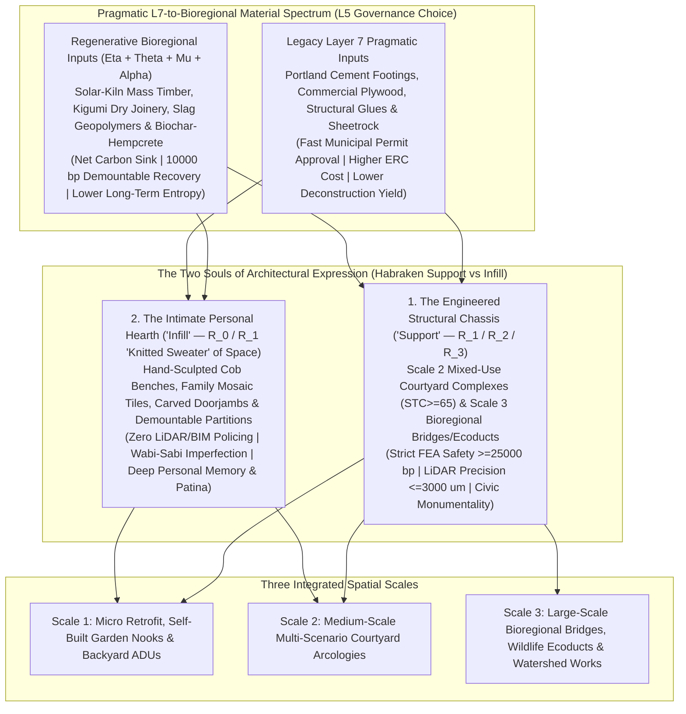
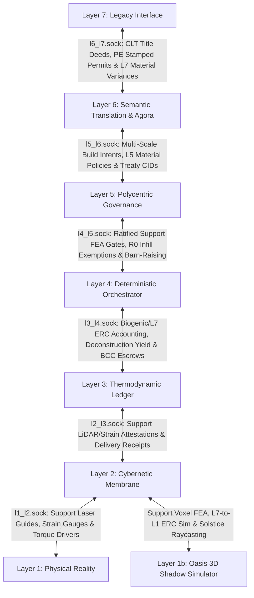
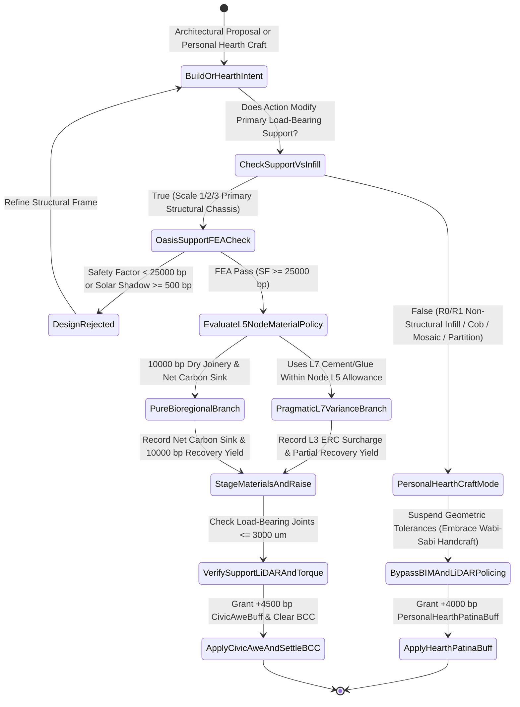

# Scenario Xi: Ecological Architecture, Medium-Scale Integrated Complexes, Bioregional Civil Works & The Intimate Hearth

*   **Identifier:** `SCN-XI-ARCH`
*   **System Epic:** Multi-Scale Architecture & Civil Engineering—Blending Structural Mechanics, Pragmatic Layer 7-to-Layer 1 Transition Tradeoffs, Medium-Scale Courtyard Complexes, Large-Scale Bioregional Bridges/Ecoducts, and the Intimate "Knitted Sweater" of Personal Hearth Craft ($R_0$)
*   **Primary Layers Tested:** L1 (Physical Reality), L1b (Oasis 3D Shadow Simulator), L2 (Cybernetic Membrane), L3 (Thermodynamic Ledger), L4 (Deterministic Orchestrator), L5 (Polycentric Governance), L6 (Semantic Translation & Agora), L7 (Legacy Interface)
*   **Pass/Fail Metric:** Life-safety Finite-Element Analysis (`FEA`) on primary load-bearing structures achieving a Factor of Safety $\ge 25000\,\mathrm{bp}$ ($250\%$ of yield load); dynamic simulation of **Layer 5 Community Governance Covenants** (allowing each node to choose its own pragmatic balance between legacy Layer 7 materials like Portland cement/adhesives and circular bioregional geopolymers/dry joinery, while accurately pricing the resulting Ecological Replacement Cost `ERC` and future deconstruction recovery yield on Layer 1); constitutional protection of **$R_0$ Intimate Hearth Infill & *Wabi-Sabi* Handcraft** (exempting personal rooms, hand-sculpted cob nooks, and domestic expression from LiDAR/BIM precision policing); bare land title locked in a Community Land Trust (CLT) / Perpetual Purpose Trust (PPT); zero fractional real-estate tokens; and zero IEEE 754 floating-point math.

---

## Architectural Council Ratification & 5-Perspective Synthesis

This scenario specification has been ratified by unanimous consensus of the 5-Persona Architectural Council:

| Council Persona | Disciplinary Representative | Core Contribution to Scenario |
| :--- | :--- | :--- |
| **Game Designer** | Lead Systems & Gameplay Designer | **Embracing Imperfection (L7 $\leftrightarrow$ L1 Tradeoffs) & The "Knitted Sweater" of Personal Architecture:** Avoids rigid ideological bans by turning material choices into meaningful gameplay and governance tradeoffs. A bootstrapping node can pour a quick Layer 7 Portland-cement slab or use commercial plywood/glue to beat a winter freeze or satisfy a rigid municipal inspector (`l7_permit_friction_bps` drops), accepting higher embodied `ERC` and lower future deconstruction yield (`demountable_yield_bps = 6500`). Simultaneously models **Two Axes of Architectural Meaning**: grand civic awe (`+4500 bp` `CivicArchitecturalAweBuff` from bridges and vaults) and intimate domestic warmth (`+4000 bp` `PersonalHearthPatinaBuff` from a hand-carved window seat, family mosaic tiles, or a slightly crooked cob bench sculpted with friends—the architectural equivalent of a hand-knitted sweater). |
| **Game Engineer** | Principal C++ Simulation & Engine Architect | **Open-Building Support-vs-Infill Voxel Architecture:** Separates voxels into **Primary Load-Bearing Support (`is_primary_structural = true`)**—which requires strict FEA safety checks ($\ge 25000\,\mathrm{bp}$) and LiDAR alignment ($\le 3000\,\mu\mathrm{m}$)—and **Non-Structural $R_0 / R_1$ Personal Infill (`is_primary_structural = false`)**, where stewards freely sculpt, paint, and modify voxels with zero LiDAR deviation alarms. Computes integer `ERC` penalties and deconstruction recovery yields across mixed Layer 7 / bioregional material assemblies with zero floating-point math. |
| **Sovereign Stack Specialist** | Sovereign Stack Systems Architect | **7-Layer Strict Adjacency, Polycentric Policy Choice & CLT Tenure:** Enforces strict socket boundaries (`l1_l2.sock` through `l6_l7.sock`, traversing `/run/collective/ipc/l4_l5.sock`). Material standards (such as geopolymer vs. Portland cement allowances or dry-joinery targets) are governed by **Layer 5 Node-Local Covenants (`NodeArchitecturalPolicy`)**, never hardcoded as universal dogma. Bare land title is held in an Irrevocable CLT/PPT (`real_estate_tokens_minted == 0`), while Pairwise Bilateral Clearing Channels (BCC) and multi-hop HTLCs clear inter-node timber, stone, and hardware. |
| **Solarpunk Thinker** | Bioregional Regenerative Ecologist | **Transitional Realism, Carbon Sinks & Bioregional Connectivity:** Recognizes that communities emerge inside an imperfect, concrete-heavy Layer 7 world. Provides a realistic evolutionary pathway from adaptive reuse of imperfect suburban/urban shells toward carbon-sequestering mass timber (`SCN-ETA-COPPICE`), biochar-hempcrete (`SCN-MU-EXTRACTION`), slag/clay geopolymers (`SCN-THETA-FOUNDRY`), and large-scale **Wildlife Overpass Ecoducts** that heal fragmented ecosystems. |
| **Scenario Specialist** | Principal Structural Engineer, Master Timber Framer & Open-Building Theorist | **Habraken Support-and-Infill & Multi-Scale Structural Physics:** Applies N.J. Habraken's *Open Building* theory: engineered longevity for the shared structural chassis (Scale 2 multi-story mixed-use complexes with `STC >= 65` acoustic isolation and Scale 3 long-span timber/stone bridges) paired with soulful, unpoliced human agency for the interior domestic hearth. |

**Unanimous Consensus Reached:** This specification was formally ratified by all 5 personas, establishing Scenario Xi as a deeply human, non-dogmatic, multi-scale architectural and civil engineering keystone.

---

## 1. Problem Statement, Legacy Failure & The Two Souls of Architecture

In late-stage extractive economies (Layer 7), the built environment traps humanity between two extremes—speculative commercial uniformity and rigid bureaucratic enclosure:
1.  **The Mortgage Debt Trap & High-Entropy Defaults:** Conventional real estate forces households into 30-year compounding debt for disposable light-frame boxes built from clear-cut timber, high-emissions materials, and toxic glues that cannot be repaired or adapted without demolition.
2.  **The Danger of Top-Down Ecological Dogma:** Conversely, when utopian movements attempt to impose rigid, absolute bans on every legacy material from day one, they paralyze bootstrapping communities. A fledgling node converting a leaky 1970s suburban house or an old concrete warehouse—or dealing with a municipal building inspector who refuses to sign off on an unfamiliar geopolymer footing—must be able to make pragmatic compromises with Layer 7 reality without being rejected by its own software stack.
3.  **Erasing the Intimate "Knitted Sweater" of Home:** Just as industrial fast fashion alienated people from making their own clothes, modernist architecture reduced shelter to sterile, standardized boxes where residents are forbidden (by landlords, HOAs, or over-zealous engineering purists) from leaving their personal mark. Yet a home or workshop nook is not an engineering diagram; like a hand-knitted sweater made by a grandmother or a custom shirt stitched for oneself (`SCN-NU-TEXTILES`), a deeply loved space holds **imperfections, handprints, memories, and personal artistry**.

### 1A. Embracing Imperfection (L7 $\leftrightarrow$ L1 Dynamics) & Blending Engineering with Intimate and Civic Expression (`Lambda`)

Scenario Xi (`SCN-XI-ARCH`) resolves these tensions through three foundational principles across all scales of the built environment:



1.  **Embracing Imperfection & Layer 5 Governance Choice (How Layer 7 Shapes Layer 1):**
    *   Rather than hardcoding dogmatic material bans into the protocol, Scenario Xi treats material selection as a **polycentric governance decision (`NodeArchitecturalPolicy`)** ratified by each node's Commons Chamber according to its local context, climate urgency, and stage of maturity.
    *   **How Layer 7 Influences Layer 1 in Gameplay & Reality:**
        *   When a Stage 1 or Stage 2 node faces a strict municipal building department (`Layer 7`) that demands a conventional poured Portland-cement foundation wall, or when stewards need to patch a roof before a winter storm using commercial hardware-store plywood and adhesive, the node's Layer 5 policy can authorize a **Pragmatic Layer 7 Material Variance**.
        *   The Stack and Oasis (`L1b`) embrace this imperfection and faithfully model its physical consequences on **Layer 1**: using Layer 7 cement or structural glue lowers immediate municipal permitting friction (`l7_permit_friction_bps`) and speeds initial erection, *but* increases the build's **Ecological Replacement Cost (`ERC`)** on Layer 3 and reduces the voxel's **Future Deconstruction Recovery Ratio** (e.g., from $10000\,\mathrm{bp}$ for dry bolted *Kigumi* timber down to $5500\,\mathrm{bp}$ for glued/cast-in-place assemblies, requiring extra jackhammering exergy in Scenario Mu when the space is eventually remodeled).
        *   As the node matures and unlocks Scenario Theta geopolymers, Scenario Eta mass timber, and Scenario Xi PE-stamped alternative material variances, the community organically migrates its buildings toward net-negative biogenic carbon sinks—turning the struggle against Layer 7 inertia into an emergent, rewarding narrative arc!
2.  **The Two Souls of Architecture (`Lambda` Synthesis): Civic Monumentality vs. The "Knitted Sweater" of the Personal Hearth ($R_0$):**
    *   **Habraken's *Support* and *Infill* Separation:** Scenario Xi divides every architectural work into two distinct layers of stewardship:
        *   **The Engineered *Support* Chassis ($R_1 / R_2 / R_3$):** The primary columns, beams, floor slabs, seismic base isolators, courtyard vaults, and bioregional bridge arches that hold up the sky and protect everyone's physical safety. Here, structural engineering and civic artistry merge: Finite-Element Analysis (`FEA` Factor of Safety $\ge 25000\,\mathrm{bp}$) and LiDAR alignment ($\le 3000\,\mu\mathrm{m}$) are strictly enforced, and structural forms (exposed reciprocal timber vaults, Guastavino compression tiles, solstice light-wells) inspire collective pride (`+4500 bp` `CivicArchitecturalAweBuff`).
        *   **The Intimate *Infill* & Personal Hearth ($R_0 / R_1$ — The "Knitted Sweater" of Space):** Once the primary structural frame is certified safe, the interior domestic sanctuaries (`SCN-ZETA-LODGING`), studio corners (`SCN-LAMBDA-CULTURE`), garden alcoves, and non-load-bearing partitions belong to the **human hand and heart**. Just like a hand-knitted sweater or a custom-stitched shirt (`SCN-NU-TEXTILES`), a person's living space is a deeply personal, tactile work of art.
        *   **Zero BIM Policing in the Hearth (`r0_hearth_exempt_from_bim == true`):** Inside an $R_0$ Hearth or non-structural community nook, **LiDAR deviation checks and algorithmic BIM tolerances are completely turned off**. A family can sculpt a slightly lumpy, curving earthen cob bench by hand; press broken heirloom teacup shards into a kitchen mosaic backsplash; carve their children's height notches into a timber doorpost; paint freehand mineral-ochre murals (`SCN-LAMBDA-CULTURE`); or build a quirky reading loft. Oasis and the Stack honor this lived-in *Wabi-Sabi* imperfection with a continuous `+4000 bp` **`PersonalHearthPatinaBuff`**, recognizing that a slightly crooked window seat built with love is far more comforting to the human psyche than a sterile, machine-perfect box.
3.  **Three Integrated Spatial Scales (`Scale 1` $\to$ `Scale 2` $\to$ `Scale 3`):**
    *   **Scale 1 (Micro / Domestic Retrofits, Self-Built Nooks & Backyard ADUs — $R_0 / R_1$):** Adapting imperfect suburban homes with hempcrete/biochar wraps, raising demountable backyard *Kigumi* studios, and hand-crafting intimate domestic hearths.
    *   **Scale 2 (Medium-Scale Integrated Multi-Scenario Courtyard Arcologies — $R_2$):** 3-to-8 story (`2000 m2` to `15000 m2`) mixed-use complexes where heavy fabrication/foundry/compute bays (`Alpha`/`Theta`/`Epsilon`) sit on acoustically isolated (`STC >= 65` / $\ge 650\,\mathrm{cB}$) ground plinths, civic kitchens/childcare/libraries/ateliers (`Gamma`/`Delta`/`Iota`/`Lambda`/`Nu`) ring a central daylit **Living Machine Courtyard**, and upper residential hearths (`Zeta`) are warmed by $\ge 8000\,\mathrm{bp}$ hydronic waste-heat cascades.
    *   **Scale 3 (Large-Scale Bioregional Architecture, Bridges, Ecoducts & Civil Works — $R_3 / R_4 / R_5$):** Long-span covered mass-timber and stone arch bridges carrying Scenario Beta's 5-artery transit across river canyons, $50\,\mathrm{m}$-wide vegetated **Wildlife Overpass Ecoducts** reconnecting forest ecosystems over highways, keyline earthworks, and subterranean aqueducts.

---

## 2. The Collective Workflow (7-Layer Traversal)

Scenario Xi coordinates structural engineering, pragmatic Layer 7 permitting/material tradeoffs, circular BOM clearing, and protected $R_0$ hearth customization across the 7-layer stack without layer-skipping.



### Layer 1: Physical Reality & Layer 1b: Oasis 3D Shadow Simulator
*   **Hardware Reality (`Layer 1`):** Physical structures spanning the full spectrum from pragmatic transitional retrofits to fully regenerative bioregional architecture:
    *   **Bioregional Structural & Hearth Materials:** Solar-kiln-dried cross-laminated timber (`CLT`), glulam arches, and black-locust roundwood poles (`SCN-ETA-COPPICE`); alkali-activated slag/clay geopolymer stone, compressed earth blocks (`CEB`), cullet glass, and silicon-bronze/recycled-steel joinery hubs (`SCN-THETA-FOUNDRY`); salvaged structural steel/brick and biochar-hempcrete insulation (`SCN-MU-EXTRACTION`); hand-mixed earthen cob, lime-ochre fresco plasters, and ceramic mosaic tiles (`SCN-LAMBDA-CULTURE`).
    *   **Pragmatic Transitional Layer 7 Materials (When Authorized by L5 Node Policy):** Existing or code-mandated Portland-cement footings, commercial structural plywood/OSB, EPDM roofing membranes, triple-pane commercial IGUs, and code-required structural fasteners/sealants.
*   **Oasis 3D Shadow Simulator (`Layer 1b`):**
    *   **Support FEA vs. Infill Freedom:** Oasis runs strict integer Finite-Element Analysis (`FEA`), seismic shake-table simulations, and solar-envelope raycasting ($\Delta \Phi_{\mathrm{solar}} < 500\,\mathrm{bp}$) on **Primary Structural Support Voxels**, while giving stewards a cozy, intuitive freeform sculpting and decorating sandbox for **$R_0 / R_1$ Personal Hearth Infill Voxels**.
    *   **Layer 7 $\leftrightarrow$ Layer 1 Tradeoff Simulator:** Before a node votes on a build plan, Oasis visualizes the exact tradeoff between using fast Layer 7 materials versus bioregional circular materials—showing Permitting Lead Time, upfront Exergy/Fiat cost, Ecological Replacement Cost (`ERC`), Net Carbon Balance, and Future Deconstruction Recovery Yield (`demountable_yield_bps`).

### Layer 2: The Cybernetic Membrane
*   **Selective Telemetry Boundary (`col-sensord`):** Low-power Zephyr RTOS microcontrollers monitor **only shared primary load-bearing support elements** (`is_primary_structural == true`) across `/run/collective/ipc/l1_l2.sock`:
    *   `node/arch/support_01/telemetry/stress_mpa` (Primary column/arch mechanical stress in integer millipascals, `uint64_t` $\mathrm{mPa}$)
    *   `node/arch/support_01/telemetry/lidar_deviation_um` (Primary frame alignment deviation in micrometers; gate $\le 3000\,\mu\mathrm{m}$ [$3\,\mathrm{mm}$] for load-bearing bents)
    *   `node/arch/complex_01/telemetry/floor_isolation_cb` (Acoustic isolation between industrial/compute ground plinths and upper residences; gate $\ge 650\,\mathrm{cB}$ [`STC >= 65`])
*   **Constitutional Exemption of $R_0$ Hearth & Handcraft (`r0_hearth_exempt_from_bim == true`):** Layer 2 **never scans, measures, or flags non-structural $R_0$ domestic interiors or hand-sculpted community art features** for LiDAR geometry deviations. Hand-built cob benches, carved mantelpieces, and custom room partitions are completely free from algorithmic precision policing.

### Layer 3: The Thermodynamic Ledger
*   **Honest Accounting of Imperfection (ERC & Deconstruction Recovery Yield):**
    *   Instead of outlawing legacy materials at the ledger level, Layer 3 accounts for the actual thermodynamic and ecological properties of every material assembly:
        $$M_{\mathrm{C,net}} = M_{\mathrm{C,biogenic\_sequestered}} - M_{\mathrm{C,process\_and\_l7\_embodied}}$$
        $$\mathrm{RecoveryYield}_{\mathrm{bps}} = \frac{\sum m_{i,\mathrm{demountable}} \times 10000}{M_{\mathrm{total}}} \in [0, 10000]\,\mathrm{bp}$$
    *   A 100% dry-joined *Kigumi* timber and geopolymer build records a net-positive carbon sink ($M_{\mathrm{C,net}} > 0$) and a $10000\,\mathrm{bp}$ ($100\%$) future deconstruction recovery yield. A pragmatic hybrid build that uses a Layer 7 Portland-cement footing or glued panels to pass a rigid municipal code inspection is lawfully recorded with its exact `ERC` surcharge and a partial recovery yield (e.g., $7200\,\mathrm{bp}$), automatically scheduling future remediation/recycling credits with Scenario Mu (`SCN-MU-EXTRACTION`) when the structure is eventually upgraded.
*   **Pairwise Bilateral Clearing Channels (BCC) & Multi-Hop HTLCs:** Inter-node timber (`SCN-ETA-COPPICE`), geopolymer stone (`SCN-THETA-FOUNDRY`), and CNC joinery (`SCN-ALPHA-FAB`) exchanges clear across Trust Rings $R_3$ and $R_4$ via zero-sum Pairwise BCCs ($B_{u \to v}(t) + B_{v \to u}(t) = 0$) and chained HTLCs, with zero fractional real-estate tokens (`real_estate_tokens_minted == 0`).

### Layer 4: The Deterministic Orchestrator
*   **State Machine Daemon:** `col-execd` executes a $10\,\mathrm{Hz}$ deterministic BPMN v2 virtual machine over `/run/collective/ipc/l4_l5.sock` and `/run/collective/ipc/l3_l4.sock`.
*   **Two-Track Orchestration (Strict Life-Safety Support vs. Convivial Personal Infill):**
    1.  **Primary Structural Support Track:** Enforces `safety_factor_bps >= 25000` ($250\%$ yield margin), neighbor solar-rights protection ($\Delta \Phi_{\mathrm{solar}} < 500\,\mathrm{bp}$), `lidar_deviation_um <= 3000` on load-bearing joints, and compliance with the local node's ratified Layer 5 `min_demountable_yield_bps_policy`.
    2.  **Personal Hearth & Handcraft Track ($R_0 / R_1$):** Verifies only that the modification does not cut or overload a primary load-bearing column/beam (`touches_primary_support == false`), then immediately unlocks tools and materials for freeform human expression without LiDAR or BIM conformity checks.



### Layer 5: Polycentric Governance
*   **Autopoietic Cellular Autonomy Over Material Standards (`NodeArchitecturalPolicy`):**
    *   Under Layer 5 polycentric governance, **every Autonomous Node democratically ratifies its own architectural material covenant** rather than obeying a rigid central ban:
        *   A Stage 1 urban retrofit node under aggressive municipal code enforcement can set `min_demountable_yield_bps_policy = 6000` and `allow_l7_portland_footings = true` so stewards can legally pour a code-required footing and get warm roofs over their heads immediately.
        *   A mature Stage 3 rural CLT village with full Scenario Eta/Theta capacity can vote to tighten its local covenant to `min_demountable_yield_bps_policy = 9500` and `require_net_carbon_sink = true`.
*   **Constitutional Protection of the $R_0$ Hearth & `Protocol of Refusal`:**
    *   No node council, architect guild, or algorithm can dictate the interior aesthetics, furniture, wall colors, hand-built alcoves, or domestic arrangements of a steward's $R_0$ Hearth (`r0_hearth_sovereignty == true`), provided primary structural bents and fire-egress paths are unharmed.
    *   The **Protocol of Refusal (`sec:l5-refusal`)** shields sacred structures, ancestral dwellings, and $R_0$ domestic interiors from LiDAR scanning or digital twin rendering.

### Layer 6: Semantic Translation & Agora
*   **Tripartite Ricardian Treaties (`Treaty_CID`):** Bind inter-node barn-raising guilds, watershed bridge maintenance easements, and CLT ground leases.
*   **Agora Semantic Knowledge Branches:**
    1.  `ParametricSupportBuildIntent`: Engineering blueprint for primary load-bearing structures (Scale 1 ADUs, Scale 2 mixed-use courtyard complexes, Scale 3 bioregional bridges/ecoducts), including its honest L7-vs-bioregional material manifest.
    2.  `PersonalHearthInfillNotice`: Lightweight check confirming a domestic or artistic customization does not compromise primary load-bearing bents, unlocking material allocations for personal craft with zero BIM tracking.
    3.  `PragmaticL7PermitVariance`: Documents where a Layer 7 municipal code forced a legacy material compromise (e.g., Portland cement or commercial drywall) and tags those voxels for Scenario Mu's long-term remediation/deconstruction queue.

### Layer 7: The Legacy Interface & Pragmatic Permitting Carapace
*   **Navigating Imperfect Municipal Building Codes:**
    *   Real-world municipal building departments (`Layer 7`) often enforce rigid prescriptive codes written by petrochemical and cement lobbies. Scenario Xi's **Cooperative Architectural & Structural Engineering Carapace** (staffed by licensed `PE` and `AIA` stewards hosted in `SCN-EPSILON-COWORKING`) uses a dual strategy:
        1.  Where the municipality accepts **Alternative Means and Methods (`IBC Section 104` / `IRC Appendix Q & AQ`)**, the PE Carapace submits sealed Finite-Element proofs from Oasis (`L1b`) to win legal approval for mass timber, rammed earth, biochar-hempcrete, and slag geopolymers.
        2.  Where a hostile or archaic jurisdiction refuses to budge on a specific element (such as requiring a standard Portland-cement grade beam or UL-listed gypsum fire assembly), the node pragmatically complies using targeted Layer 7 materials, logs the voxel boundary in Layer 3, and gets the building permitted and occupied—never letting ideological perfectionism block human shelter!
*   **Dual-Chassis CLT Land Tenure:** Bare land title across all permanent sites is locked in an **Irrevocable Community Land Trust (CLT) / Perpetual Purpose Trust (PPT)** with 99-year cooperative ground leases (`real_estate_tokens_minted == 0`).

---

## 3. 3-Stage Incremental Node Facility Blueprints (Node Growth Pattern)

Scenario Xi embraces the messy, joyful reality of evolving from an imperfect suburban house into an integrated urban complex and a bioregional architectural commons.

### Stage 1: Imperfect Suburban Retrofit, Cozy Domestic Hearth Craft & Backyard *Kigumi* ADU ($R_0 / R_1$ Bootstrap)
*   **Physical Footprint:** An existing, imperfect 1960s–1990s suburban tract house (with its existing Portland concrete slab, fiberglass batts, and drywall) plus a `40 m2` backyard ADU cottage.
*   **Pragmatic Transition & Intimate Expression:**
    *   **Embracing & Upgrading the Existing Shell:** Instead of tearing down the legacy house, stewards pragmatically seal air leaks, blow Scenario Mu biochar-cellulose into the attic, add exterior hemp-lime insulation panels as time and budget permit, and install a timber solar pergola (`SCN-BETA-TRANSIT`).
    *   **The "Knitted Sweater" Domestic Hearth ($R_0$):** Inside, residents transform sterile suburban drywall rooms into warm, deeply personal spaces—building a hand-sculpted earthen cob fireplace bench, laying broken-tile mosaics in the kitchen, carving timber doorframes, and hanging Scenario Nu woven tapestries (`+4000 bp` `PersonalHearthPatinaBuff`).
    *   **Backyard *Kigumi* Barn-Raising:** Friends gather over a weekend to bolt together a CNC-milled interlocking timber ADU (`SCN-ALPHA-FAB` + `SCN-ETA-COPPICE`) on removable helical ground screws—demonstrating $10000\,\mathrm{bp}$ demountable architecture right in the backyard.

### Stage 2: Medium-Scale Integrated Urban Courtyard Complex & Adaptive Reuse ($R_2$ Municipal Shell)
*   **Physical Footprint:** `2500 m2` to `10000 m2` adaptive reuse of an existing commercial warehouse, concrete parking garage, or former retail box into a multi-story **Integrated Multi-Scenario Courtyard Complex**.
*   **Blending Legacy Chassis with Bioregional Infill:**
    1.  **Pragmatic Structural Reuse:** Retains the warehouse's existing steel columns and concrete slab (avoiding millions of kilograms of demolition waste) while cutting open a central roof bay to create a daylit **Biophilic Courtyard & Living Machine Wetland Atrium** (`SCN-MU-EXTRACTION` + `SCN-LAMBDA-CULTURE`).
    2.  **Multi-Story Demountable `CLT` Mezzanines (`STC >= 65` Stratification):** Inserts 3-to-5 stories of bolted cross-laminated timber (`CLT`) floor plates inside the shell:
        *   **Ground Plinth (`>= 650 cB` Isolation):** Houses Scenario Alpha CNC fabrication, Scenario Theta foundry bays, and Scenario Epsilon liquid-cooled compute on elastomeric isolation pads, capturing $\ge 8000\,\mathrm{bp}$ waste heat for upper floors.
        *   **Mid-Levels:** Houses Scenario Gamma kitchens, Scenario Delta childcare, Scenario Iota labs, Scenario Nu tailoring, and Scenario Lambda chamber halls overlooking the garden court.
        *   **Upper Residential Hearths (`SCN-ZETA-LODGING`):** Provides modular structural bays where each household freely designs, builds, and decorates its own interior $R_0$ home infill without BIM policing.

### Stage 3: Large-Scale Bioregional Arcology, Mass-Timber Bridges, Ecoducts & Watershed Civil Works ($R_2 / R_3 / R_4$ CLT/PPT)
*   **Physical Footprint:** `15` to `100+ hectares` of watershed land and transit corridor easements held in an **Irrevocable Community Land Trust (CLT) / Perpetual Purpose Trust (PPT)**.
*   **Architectural, Structural & Civil Works:**
    *   **Village Arcologies & Personal Hearths:** 4-to-8 story mass-timber, rammed-earth, and Guastavino geopolymer-vaulted courtyard buildings (`CivicArchitecturalAweBuff`) whose interior residential and studio bays remain infinitely customizable, hand-crafted personal sanctuaries (`PersonalHearthPatinaBuff`).
    *   **Long-Span Bioregional Bridges & Viaducts:** $40\,\mathrm{m}$ to $150\,\mathrm{m}$ covered glulam/basalt-tendon arch bridges and geopolymer-stone viaducts ($\mathrm{SafetyFactor} \ge 25000\,\mathrm{bp}$) carrying Scenario Beta's light-rail trams, velomobiles, and HVDC microgrids across canyons.
    *   **Wildlife Overpass Ecoducts & Keyline Earthworks:** $50\,\mathrm{m}$-wide vegetated compression-vault ecoducts reconnecting forest habitats across highways, paired with terraced check-dams, gravity aqueducts, and the 1500-seat earthen festival amphitheatre (`SCN-LAMBDA-CULTURE`).

---

## 4. Machine-Readable Schemas

### 4A. Layer 6 Knowledge Artifact: Multi-Scale Support & Personal Hearth Intent (`support_and_hearth_intent.jsonld`)

```json
{
  "@context": [
    "https://schema.org/",
    "https://collective.network/ontology/v1/"
  ],
  "@type": "ArchitecturalSupportAndHearthIntent",
  "identifier": "urn:uuid:1a2b3c4d-5e6f-7a8b-9c0d-1e2f3a4b5c6d",
  "issuerDid": "did:peer:2Ez6MksF_node04_architect_sara",
  "creationTimestamp": 1791446400000,
  "architecturalScale": "SCALE_2_MEDIUM_INTEGRATED_COURTYARD_COMPLEX_WITH_R0_HEARTH_INFILL",
  "layer5NodeGovernancePolicy": {
    "minDemountableYieldBpsTarget": 7500,
    "allowPragmaticL7CodeVariance": true,
    "protectR0HearthFromBimPolicing": true
  },
  "primarySupportChassis": {
    "archetype": "Adaptive_Warehouse_With_Bolted_CLT_Mezzanines_And_Courtyard_Atrium",
    "structuralFactorOfSafetyBps": 28500,
    "plinthToResidentialAcousticIsolationCb": 680,
    "etaMassTimberGlulamAndCltMg": 420000000000,
    "thetaGeopolymerAndBiocharHempMg": 310000000000,
    "pragmaticL7PortlandFootingAndFireboardMg": 45000000000,
    "calculatedDemountableRecoveryYieldBps": 8900,
    "netBiogenicCarbonBalanceMg": 510000000000
  },
  "intimatePersonalHearthInfill": {
    "trustRing": "R0_INVIOLABLE_HEARTH_SANCTUARY",
    "touchesPrimaryLoadBearingSupport": false,
    "exemptFromLidarAndBimPrecision": true,
    "personalCraftElements": [
      "Hand_Sculpted_Earthen_Cob_Window_Seat",
      "Family_Heirloom_Broken_Ceramic_Kitchen_Mosaic",
      "Grandfather_Carved_Growth_Chart_Timber_Doorjamb",
      "Lambda_Mineral_Ochre_Bedroom_Fresco"
    ]
  },
  "legacyCompliance": {
    "landTenure": "IRREVOCABLE_CLT_AND_PPT_GROUND_LEASE",
    "realEstateTokensMinted": 0,
    "peStampStatus": "SEALED_IBC_WITH_L7_FIREBOARD_VARIANCE"
  }
}
```

### 4B. Layer 2 Telemetry Attestation: Support Structural Proof & $R_0$ Hearth Privacy (`assembly_attestation.jsonld`)

```json
{
  "@context": "https://collective.network/ontology/v1/",
  "@type": "StructuralAndHearthAttestation",
  "buildIntentRef": "urn:uuid:1a2b3c4d-5e6f-7a8b-9c0d-1e2f3a4b5c6d",
  "siteNode": "did:peer:2Ez6MksL_node04_support_strain_array",
  "supportChassisMetrics": {
    "scanTimestamp": 1791450000000,
    "maxSupportLidarDeviationUm": 1950,
    "installedDryJoineryBoltsCount": 1420,
    "measuredFloorAcousticIsolationCb": 680,
    "solarShadowViolationDetected": false,
    "supportStructuralStatus": "PRIMARY_CHASSIS_CERTIFIED_SAFE"
  },
  "r0HearthPrivacyVerification": {
    "r0InteriorLidarScansExecuted": 0,
    "wabiSabiHandcraftDeviationsFlagged": 0,
    "hearthSovereigntyStatus": "UNPOLICED_PERSONAL_EXPRESSION_PROTECTED"
  }
}
```

---

## 5. Oasis Engine Implementation Specification

### 5A. Memory Allocation, Support-vs-Infill Voxels & Dual Psychological Buffs
The architectural simulation in Oasis (`L1b`) distinguishes between engineered structural support and intimate personal infill in $32^3$ voxel chunks (`ChunkManager`):
*   Primary load-bearing mass timber (`material_id = 60` `MASS_TIMBER_SUPPORT`) and geopolymer bridge/vault stones (`material_id = 63` `GEOPOLYMER_SUPPORT`) carry metadata bit `IS_PRIMARY_SUPPORT = 1`, requiring FEA $\mathrm{SafetyFactor} \ge 25000\,\mathrm{bp}$ and LiDAR precision $\le 3000\,\mu\mathrm{m}$.
*   Pragmatic Layer 7 legacy materials (`material_id = 62` `PRAGMATIC_L7_CONCRETE_OR_BOARD`) are permitted whenever authorized by the node's Layer 5 `NodeArchitecturalPolicy`, dynamically adjusting the structure's `demountable_yield_bps` and `l3_erc_surcharge_uj` to reflect how Layer 7 constraints shape Layer 1 physical reality.
*   Personal $R_0 / R_1$ Hearth & Infill voxels (`material_id = 64` `PERSONAL_HEARTH_COB_AND_MOSAIC`, with `IS_PRIMARY_SUPPORT = 0`) bypass all LiDAR/BIM geometric tolerance checks (`r0_lidar_scans == 0`), awarding inhabitants the `+4000 bp` **`PersonalHearthPatinaBuff`** (the "knitted sweater" comfort of a personally crafted home) alongside the `+4500 bp` **`CivicArchitecturalAweBuff`** from the building's shared courtyard vaults and bridges.

### 5B. Self-Contained C++20 Reference & Test Harness

```cpp
// engine/tests/scenario_xi_architecture_test.cpp
#include <cassert>
#include <cstdint>
#include <iostream>
#include <string>
#include <vector>

namespace oasis::xi {

// Fixed-point constants:
// 10000 bp = 100% (e.g., 25000 bp = 250% safety factor)
// Stress in millipascals (mPa), Mass in milligrams (mg), Energy in microjoules (uJ)
// Acoustic isolation in centi-Bels (cB): 650 cB = 65 dB (STC 65)

enum class ArchitecturalScale : uint8_t {
    SCALE_1_SUBURBAN_RETROFIT_AND_ADU = 1,
    SCALE_2_MEDIUM_INTEGRATED_COURTYARD_COMPLEX = 2,
    SCALE_3_BIOREGIONAL_BRIDGE_AND_ECODUCT = 3
};

// Layer 5 Polycentric Governance Covenant: each node sets its own pragmatic thresholds!
struct NodeArchitecturalPolicy {
    std::string node_did;
    uint32_t min_demountable_yield_bps_target{7000}; // e.g., 7000 bp (70%) in Stage 2 urban adaptive reuse
    bool allow_pragmatic_l7_materials{true};         // Allows L7 cement/fireboard when needed for permits/weather
    bool protect_r0_hearth_from_bim_policing{true};  // Constitutional R0 infill freedom
};

struct PrimarySupportChassisSpec {
    std::string project_id;
    ArchitecturalScale scale{ArchitecturalScale::SCALE_2_MEDIUM_INTEGRATED_COURTYARD_COMPLEX};
    uint64_t yield_strength_mpa{45000000000ULL};
    uint64_t peak_applied_stress_mpa{15000000000ULL};
    uint64_t bioregional_demountable_mass_mg{730000000000ULL}; // Eta timber + Theta geopolymer + Mu hempcrete
    uint64_t pragmatic_l7_glued_or_cast_mass_mg{45000000000ULL}; // L7 footing or code-mandated fireboard
    uint32_t acoustic_isolation_cb{680};                       // >= 650 cB (STC 65) for Scale 2
    uint32_t neighbor_solar_shadow_loss_bps{210};              // < 500 bp
    uint32_t support_lidar_deviation_um{1950};                 // <= 3000 um on load-bearing joints
    bool civic_lambda_vaults_and_solstice_oculus{true};
    bool clt_ppt_land_title_locked{true};
};

// The "Knitted Sweater" of Architecture: intimate R0/R1 personal hearth infill
struct PersonalHearthInfillSpec {
    std::string hearth_id;
    std::string resident_did;
    bool touches_primary_load_bearing_support{false}; // Must be false to bypass FEA/BIM policing
    uint32_t handcraft_geometric_imperfection_um{45000}; // 45 mm organic cob/mosaic curve (embraced!)
    bool has_hand_sculpted_cob_or_mosaic{true};
    bool has_family_memory_patina_or_fresco{true};
};

struct BuildEvaluationResult {
    bool approved{false};
    uint32_t safety_factor_bps{0};
    uint32_t demountable_recovery_yield_bps{0};
    uint64_t l3_erc_surcharge_uj{0};          // Tracks L7 material entropy impact on Layer 1
    uint32_t l7_permit_friction_bps{0};       // Lower when pragmatic L7 code variance is used
    uint32_t r0_hearth_lidar_scans_run{0};    // Must be 0 (never police personal hearth infill)
};

struct InhabitantSteward {
    std::string did;
    uint32_t civic_architectural_awe_bps{10000};
    uint32_t personal_hearth_patina_bps{10000};
    uint32_t architecture_reputation_points{0};
};

class EcologicalArchitectureEngine {
public:
    uint32_t compute_safety_factor_bps(const PrimarySupportChassisSpec& support) const {
        if (support.peak_applied_stress_mpa == 0) return 0;
        return static_cast<uint32_t>(
            (support.yield_strength_mpa * 10000ULL) / support.peak_applied_stress_mpa
        );
    }

    uint32_t compute_demountable_yield_bps(const PrimarySupportChassisSpec& support) const {
        uint64_t total_mass_mg = support.bioregional_demountable_mass_mg +
                                 support.pragmatic_l7_glued_or_cast_mass_mg;
        if (total_mass_mg == 0) return 0;
        return static_cast<uint32_t>(
            (support.bioregional_demountable_mass_mg * 10000ULL) / total_mass_mg
        );
    }

    // Evaluates both the engineered Support Chassis (under L5 Node Policy) and the intimate R0 Hearth Infill
    BuildEvaluationResult evaluate_and_build(
        const NodeArchitecturalPolicy& policy,
        const PrimarySupportChassisSpec& support,
        const PersonalHearthInfillSpec& hearth,
        std::vector<InhabitantSteward>& inhabitants
    ) const {
        BuildEvaluationResult res{};
        res.safety_factor_bps = compute_safety_factor_bps(support);
        res.demountable_recovery_yield_bps = compute_demountable_yield_bps(support);

        // 1. Hard Life-Safety Gate on Primary Load-Bearing Support (>= 25000 bp / 250%)
        if (res.safety_factor_bps < 25000) return res;
        if (support.support_lidar_deviation_um > 3000) return res;
        if (support.neighbor_solar_shadow_loss_bps >= 500) return res;
        if (!support.clt_ppt_land_title_locked) return res;

        if (support.scale == ArchitecturalScale::SCALE_2_MEDIUM_INTEGRATED_COURTYARD_COMPLEX &&
            support.acoustic_isolation_cb < 650) {
            return res;
        }

        // 2. Evaluate Layer 5 Community Material Policy (Accommodating L7 Imperfection vs Purity)
        if (support.pragmatic_l7_glued_or_cast_mass_mg > 0 && !policy.allow_pragmatic_l7_materials) {
            return res; // Rejected only if this specific node's L5 assembly voted to disallow L7 materials
        }
        if (res.demountable_recovery_yield_bps < policy.min_demountable_yield_bps_target) {
            return res;
        }

        // 3. Honest L7 -> L1 Accounting: compute ERC surcharge for future Mu deconstruction
        // 2000 uJ per mg of non-demountable L7 material, while lowering L7 municipal permit friction
        res.l3_erc_surcharge_uj = support.pragmatic_l7_glued_or_cast_mass_mg * 2000ULL;
        res.l7_permit_friction_bps = (support.pragmatic_l7_glued_or_cast_mass_mg > 0) ? 1500 : 4500;

        // 4. Evaluate R0 Intimate Personal Hearth ("Knitted Sweater" Infill)
        if (hearth.touches_primary_load_bearing_support) {
            return res; // Cannot cut into primary columns without a Support FEA review
        }
        // Constitutional R0 protection: zero LiDAR scans or BIM rejections on personal handcraft!
        res.r0_hearth_lidar_scans_run = 0;
        res.approved = true;

        // 5. Grant both Civic Monumental Awe (+4500 bp) and Personal Hearth Patina (+4000 bp)
        for (auto& steward : inhabitants) {
            if (support.civic_lambda_vaults_and_solstice_oculus) {
                steward.civic_architectural_awe_bps = 14500;
            }
            if (hearth.has_hand_sculpted_cob_or_mosaic && hearth.has_family_memory_patina_or_fresco) {
                steward.personal_hearth_patina_bps = 14000;
            }
            steward.architecture_reputation_points += 40;
        }
        return res;
    }

    uint64_t real_estate_tokens_minted() const { return 0; }
};

void test_scenario_xi_pragmatic_l7_tradeoff_and_personal_hearth() {
    EcologicalArchitectureEngine engine;
    std::vector<InhabitantSteward> stewards = {
        {"did:peer:2Ez6MksF_architect_sara", 10000, 10000, 100},
        {"did:peer:2Ez6MkwQ_resident_julio", 10000, 10000, 80}
    };

    // 1. Stage 2 Node Policy: Embraces pragmatic L7 code compromises (>= 7500 bp demountable target)
    NodeArchitecturalPolicy stage2_urban_policy{
        .node_did = "did:peer:2Ez6MksF_node04_urban",
        .min_demountable_yield_bps_target = 7500,
        .allow_pragmatic_l7_materials = true,
        .protect_r0_hearth_from_bim_policing = true
    };

    // Scale 2 Integrated Courtyard Complex reusing a warehouse slab + L7 fireboard (9419 bp demountable)
    PrimarySupportChassisSpec courtyard_support{
        .project_id = "complex_courtyard_node_04",
        .scale = ArchitecturalScale::SCALE_2_MEDIUM_INTEGRATED_COURTYARD_COMPLEX,
        .yield_strength_mpa = 45000000000ULL,
        .peak_applied_stress_mpa = 15000000000ULL, // SF = 30000 bp >= 25000 bp
        .bioregional_demountable_mass_mg = 730000000000ULL,
        .pragmatic_l7_glued_or_cast_mass_mg = 45000000000ULL,
        .acoustic_isolation_cb = 680,
        .neighbor_solar_shadow_loss_bps = 210,
        .support_lidar_deviation_um = 1950,
        .civic_lambda_vaults_and_solstice_oculus = true,
        .clt_ppt_land_title_locked = true
    };

    // Intimate R0 Hearth Infill: hand-sculpted cob window seat with 45000 um organic curve!
    PersonalHearthInfillSpec cozy_hearth{
        .hearth_id = "hearth_apartment_3B",
        .resident_did = stewards[1].did,
        .touches_primary_load_bearing_support = false,
        .handcraft_geometric_imperfection_um = 45000, // 15x support tolerance, but welcomed in R0!
        .has_hand_sculpted_cob_or_mosaic = true,
        .has_family_memory_patina_or_fresco = true
    };

    BuildEvaluationResult res = engine.evaluate_and_build(
        stage2_urban_policy, courtyard_support, cozy_hearth, stewards
    );
    assert(res.approved == true);
    assert(res.safety_factor_bps == 30000);
    assert(res.demountable_recovery_yield_bps == 9419); // 9419 bp >= 7500 bp policy target
    assert(res.l3_erc_surcharge_uj > 0);                // Honestly prices L7 concrete/fireboard entropy
    assert(res.l7_permit_friction_bps == 1500);         // Pragmatic variance eased L7 municipal permit!
    assert(res.r0_hearth_lidar_scans_run == 0);         // Zero BIM policing on the personal hearth!
    assert(stewards[1].civic_architectural_awe_bps == 14500);
    assert(stewards[1].personal_hearth_patina_bps == 14000);
    assert(engine.real_estate_tokens_minted() == 0);

    // 2. Stage 3 Mature Bioregional Node Policy: Votes for 10000 bp pure circularity on a new Bridge/Ecoduct
    NodeArchitecturalPolicy stage3_clt_policy{
        .node_did = "did:peer:2Ez6MkwQ_node09_forest_clt",
        .min_demountable_yield_bps_target = 10000,
        .allow_pragmatic_l7_materials = false,
        .protect_r0_hearth_from_bim_policing = true
    };

    PrimarySupportChassisSpec bridge_support{
        .project_id = "bridge_ecoduct_watershed_01",
        .scale = ArchitecturalScale::SCALE_3_BIOREGIONAL_BRIDGE_AND_ECODUCT,
        .yield_strength_mpa = 52000000000ULL,
        .peak_applied_stress_mpa = 18000000000ULL,
        .bioregional_demountable_mass_mg = 920000000000ULL,
        .pragmatic_l7_glued_or_cast_mass_mg = 0, // Zero L7 cement
        .acoustic_isolation_cb = 500,
        .neighbor_solar_shadow_loss_bps = 100,
        .support_lidar_deviation_um = 2200,
        .civic_lambda_vaults_and_solstice_oculus = true,
        .clt_ppt_land_title_locked = true
    };

    BuildEvaluationResult bridge_res = engine.evaluate_and_build(
        stage3_clt_policy, bridge_support, cozy_hearth, stewards
    );
    assert(bridge_res.approved == true);
    assert(bridge_res.demountable_recovery_yield_bps == 10000);
    assert(bridge_res.l3_erc_surcharge_uj == 0);
}

void test_scenario_xi_structural_safety_guard() {
    EcologicalArchitectureEngine engine;
    NodeArchitecturalPolicy policy{"did:peer:node01", 6000, true, true};
    PrimarySupportChassisSpec unsafe_support{
        .project_id = "unsafe_span",
        .scale = ArchitecturalScale::SCALE_3_BIOREGIONAL_BRIDGE_AND_ECODUCT,
        .yield_strength_mpa = 30000000000ULL,
        .peak_applied_stress_mpa = 20000000000ULL // SF = 15000 bp < 25000 bp life-safety floor
    };
    PersonalHearthInfillSpec hearth{"h1", "did:peer:u1", false, 10000, true, true};
    std::vector<InhabitantSteward> stewards;

    BuildEvaluationResult res = engine.evaluate_and_build(policy, unsafe_support, hearth, stewards);
    assert(res.approved == false);
}

} // namespace oasis::xi

int main() {
    oasis::xi::test_scenario_xi_pragmatic_l7_tradeoff_and_personal_hearth();
    oasis::xi::test_scenario_xi_structural_safety_guard();
    std::cout << "Scenario Xi Multi-Scale Architecture, L7-L1 Pragmatism & Personal Hearth tests passed." << std::endl;
    return 0;
}
```

---

## 6. Acceptance Test Gates (Pass/Fail)

| Checkpoint | Validation Method | Pass Condition |
| :--- | :--- | :--- |
| **G1: Primary Support FEA Life-Safety Floor** | Integer Voxel FEA Audit | Primary load-bearing support structures across Scale 1, Scale 2, and Scale 3 satisfy $\mathrm{SafetyFactor}_{\mathrm{bps}} \ge 25000\,\mathrm{bp}$ ($250\%$ yield margin) and support joint LiDAR deviation $\le 3000\,\mu\mathrm{m}$. |
| **G2: Polycentric L5 Material Policy & L7 $\leftrightarrow$ L1 Tradeoffs** | `NodeArchitecturalPolicy` & `L3` Audit | Communities set their own local demountability and Layer 7 material policies; pragmatic use of Layer 7 cement/boards lowers permitting friction (`l7_permit_friction_bps`) while accurately recording `l3_erc_surcharge_uj` and partial recovery yield (`demountable_recovery_yield_bps`). |
| **G3: The "Knitted Sweater" $R_0$ Hearth Sovereignty** | Support-vs-Infill Boundary Check | Non-structural $R_0 / R_1$ domestic hearth and handcraft modifications (`touches_primary_load_bearing_support == false`) bypass all LiDAR/BIM geometric policing (`r0_hearth_lidar_scans_run == 0`) and grant `+4000 bp` `PersonalHearthPatinaBuff`. |
| **G4: Medium-Scale Complex Symbiosis & Civic Awe** | Edge `cB` & Hydronic Telemetry | Scale 2 mixed-use complexes verify $\ge 650\,\mathrm{cB}$ (`STC >= 65`) acoustic isolation between ground-floor industrial/compute bays and upper residential hearths, $\ge 8000\,\mathrm{bp}$ heat recovery, and `+4500 bp` `CivicArchitecturalAweBuff`. |
| **G5: Bioregional Connectivity & Wildlife Ecoducts** | Scale 3 Corridor Audit | Long-span bridges and vegetated wildlife ecoducts carry Scenario Beta's 5-artery transit and restore forest habitat continuity across $R_3 / R_4$. |
| **G6: Dual-Chassis CLT Tenure & PE/AIA Carapace (`L7`)** | Legal Title & Financial Audit | Bare land title is permanently locked in an Irrevocable CLT/PPT (`real_estate_tokens_minted == 0`), while external PE/Architect consultancy revenues ($\Phi_t$) fund municipal permits and land acquisition. |
