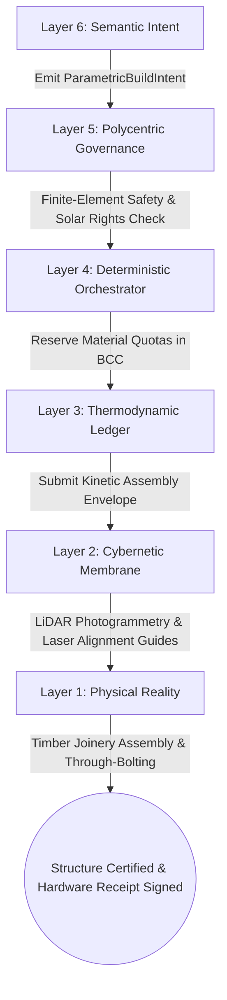
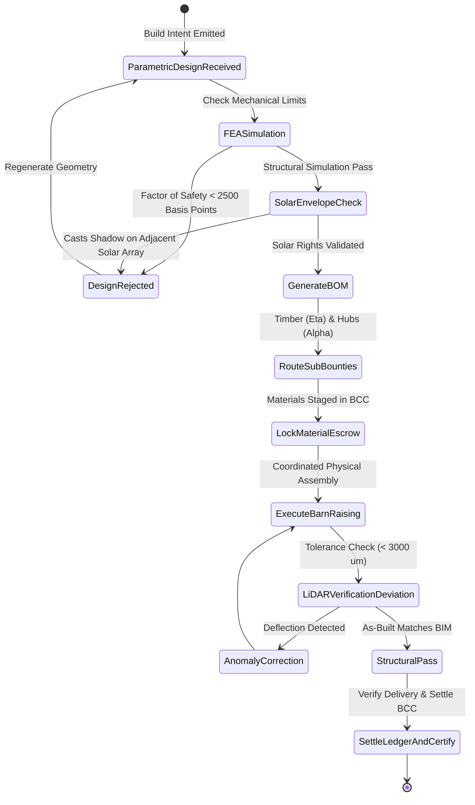
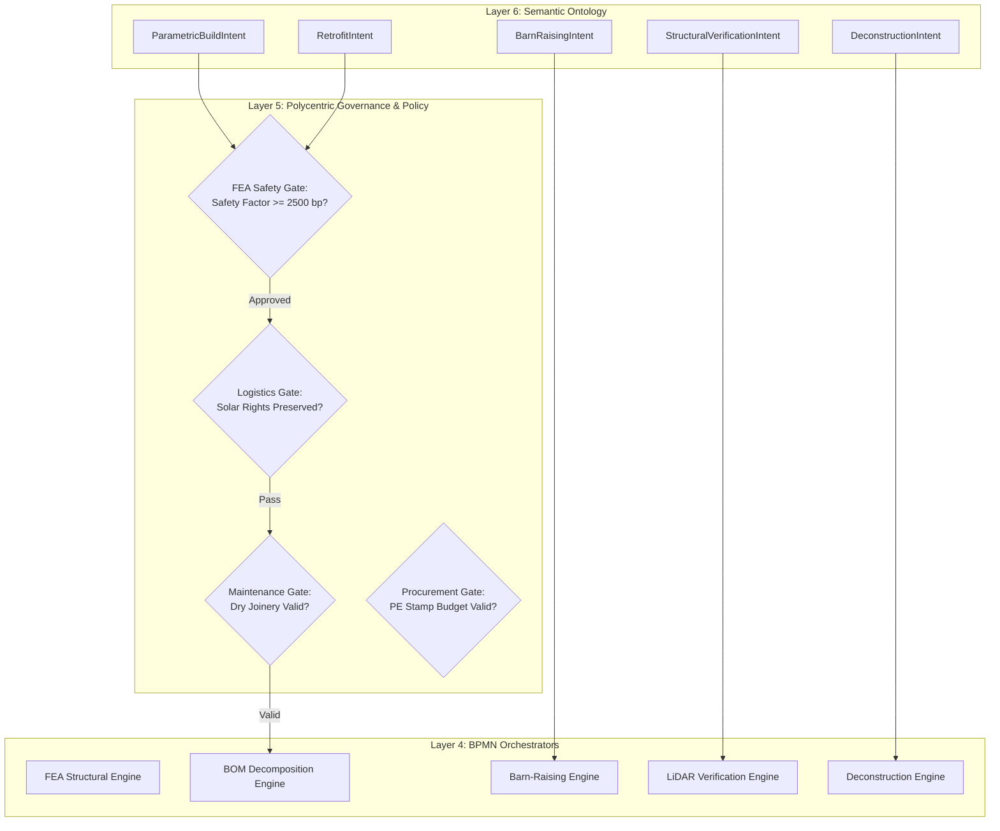
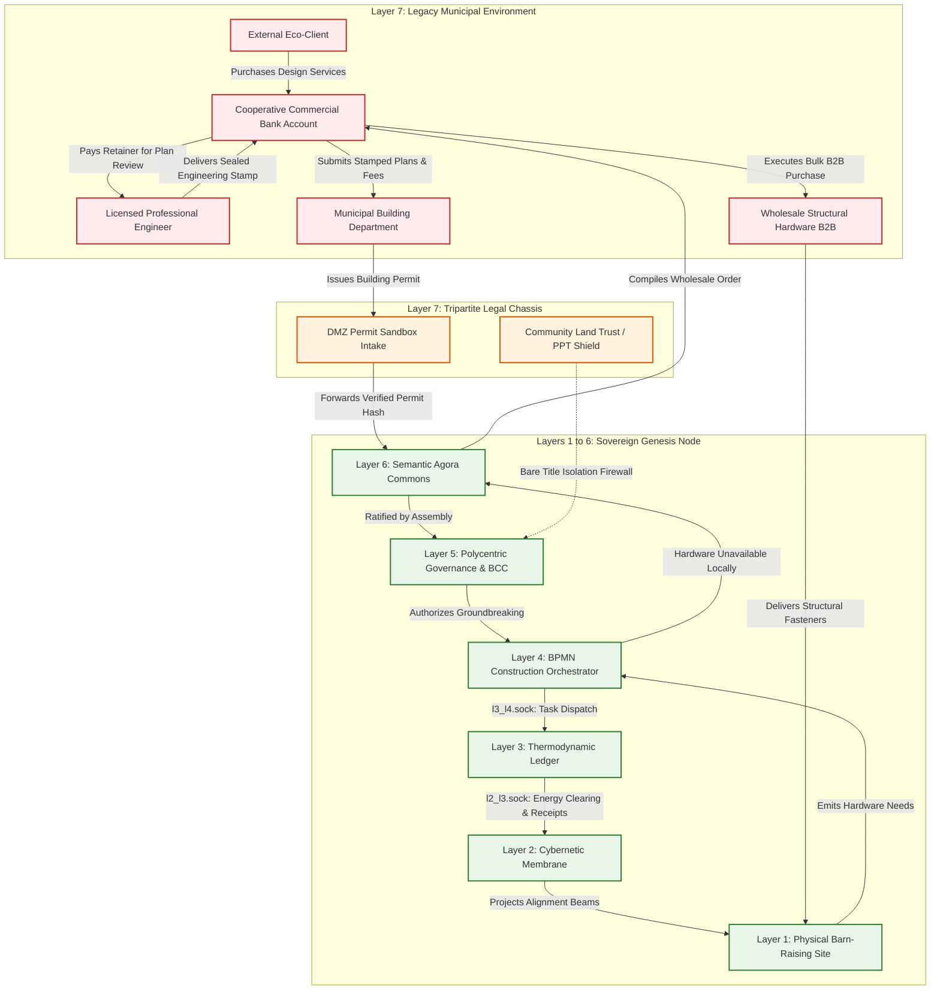

# Scenario Xi: Living Architecture & Algorithmic Urban Retrofit

*   **Identifier:** `SCN-XI-ARCH`
*   **System Epic:** Living Architecture, Parametric Structural Joinery, and Dual-Chassis Urban Retrofit
*   **Primary Layers Tested:** L1 (Physical Reality), L2 (The Cybernetic Membrane), L3 (The Thermodynamic Ledger), L4 (The Deterministic Orchestrator), L5 (Polycentric Governance), L6 (Semantic Translation & Agora), L7 (The Legacy Interface)
*   **Pass/Fail Metric:** Procedural generation of structural blueprints matching localized physical materials inventories; finite-element load simulation ensuring factor of safety $\ge 2500\text{ basis points}$ prior to physical assembly; bare land title held in Community Land Trust / PPT with reciprocal easements; zero software in Layer 1; zero fractional real estate equity tokens; multi-hop clearing of timber and hardware across Pairwise Bilateral Clearing Channels ($B_{u \to v}(t) + B_{v \to u}(t) = 0$); successful municipal permit intake via Layer 6/7 DMZ sandbox.

---

## Architectural Council Ratification & 5-Perspective Synthesis

This scenario specification has been ratified by unanimous consensus of the 5-Persona Architectural Council:

| Council Persona | Disciplinary Representative | Core Contribution to Scenario |
| :--- | :--- | :--- |
| **Game Designer** | Lead Systems & Gameplay Designer | Dwarf Fortress structural stability & cave-in dread: Founder 01 coordinating timber joinery alongside neighbors; psychological thoughts and stress accumulators (`"Astonished by the beauty of the timber arch (+45 mood)"` vs `"Dreaded structural sagging warning sound (-50 stress)"`); Sims-style spatial remodeling satisfaction; Cities Skylines solar shadow envelope raycasting; boundary interface structural hardening where physical retrofits reduce thermal dissipation and weaken legacy utility extortion. |
| **Game Engineer** | Principal C++ Simulation & Engine Architect | Flecs ECS DOD architecture: `StructuralVoxelComponent`, `JoineryLoadComponent`, `BccMaterialClearingComponent`, `LiDarAttestationComponent`; 32-bit compact voxels: `material_id = 60` `TIMBER_STRUT_VOXEL`, `material_id = 61` `PETG_CONNECTOR_HUB`, `material_id = 62` `PHANTOM_BLUEPRINT_VOXEL`; structural load propagation cellular automata; 10 Hz BPMN barn-raising state machine; compilable C++20 fixed-point test harness verifying load yield limits, BCC material ledger settlement, and anomaly rollbacks with zero IEEE 754 floats. |
| **Sovereign Stack Specialist** | Sovereign Stack Systems Architect | 7-layer strict adjacency without layer skipping via `l1_l2.sock` through `l6_l7.sock`; zero software, zero firmware, and zero keys in Layer 1; bare land title in Community Land Trust / PPT with reciprocal easements; Pairwise Bilateral Clearing Channels ($B_{u \to v}(t) + B_{v \to u}(t) = 0$); multi-hop HTLCs; zero global tokens; zero fiat conversions; zero monolithic game-loop threading. |
| **Solarpunk Thinker** | Bioregional Regenerative Ecologist | Buildings as active carbon sinks: sequestering coppiced roundwood timber from Scenario Eta and biochar insulation from Scenario Mu; strict deconstruction mandates requiring dry joinery: bolts and wooden pegs over toxic chemical adhesives; passive solar envelope orientation; zero Portland cement footprint. |
| **Scenario Specialist** | Computational Architect & Structural Biomaterials Engineer | Finite-element voxel beam load formula $\sigma_{\mathrm{actual}} = \frac{M y}{I} + \frac{F_{\mathrm{axial}}}{A} \le \sigma_{\mathrm{allowable}}$ in integer millipascals; International Residential Code IRC Appendix AQ timber framing engineering variance standards; solar vector shadow raycasting algorithm $\vec{S} \cdot \hat{n} > 0$; procedural bill of materials BOM compilation. |

**Ratification Statement:** Unanimous Consensus Reached. All five council personas have formally validated that this scenario specification adheres strictly to the 7-Layer Sovereign Stack architecture, eliminates all deprecated rhetoric, replaces floating-point math with fixed-point SI integer arithmetic, enforces bare land title holding in Community Land Trusts with reciprocal easements, eliminates software from Layer 1, and anchors materials clearance in Pairwise Bilateral Clearing Channels.

---

## 1. Problem Statement & Legacy Failure

In legacy late-stage capitalist infrastructure (Layer 7), architecture and shelter have been captured by financialization, globalized carbon-heavy supply chains, and hostile municipal zoning. Standard construction relies on high-embodied-energy materials (Portland cement, virgin rolled steel, petrochemical fiberglass insulation) designed for rapid speculative assembly rather than longevity or thermodynamic performance.

When an intentional community or homeowner attempts to build or retrofit shelter:
*   **The Financialized Mortgage Debt Trap:** Constructing or modifying physical shelter requires borrowing hundreds of thousands of dollars in debt under 30-year mortgages at compounding interest rates. Mutual aid labor and collective "Sweat Equity" are completely uncapitalized and unrecognized by legacy banking institutions.
*   **High-Entropy Material Supply Drag:** Dimensional lumber is harvested from distant, clear-cut monoculture plantations, kiln-dried with fossil fuels, and trucked across continents, while native, locally coppiced hardwood and secondary materials remain neglected.
*   **Bureaucratic Permit Enclosure & Partition Fragility:** Municipal building departments enforce rigid, prescriptive building codes that outlaw non-standard materials (e.g., roundwood poles, straw-clay infill, 3D-printed structural brackets) unless prohibitive fees are paid to commercial engineering firms. Furthermore, speculative property titles expose communities to predatory judicial auctions and tax foreclosure seizures.

---

## 2. The Collective Workflow (7-Layer Traversal)

Scenario Xi deploys open-source parametric design and algorithmic structural engineering to dynamically match architecture to localized material inventories, orchestrating community "Barn-Raising" events capitalized via thermodynamic mutual aid without debt. The workflow traverses canonically from Layer 1 physical execution up to Layer 7 legacy market interfaces.



### Layer 1: Physical Reality
*   **Hardware Nodes (Assembly & Fabrication Hardware):** CNC timber joinery routers, high-torque battery framing impact drivers, rotary laser leveling transits, portable rigging winches, and scaffolding towers. Layer 1 contains zero software, zero firmware, zero cryptographic keys, and zero network routing daemons. It consists purely of structural roundwood poles, 3D-printed joint hubs, through-bolts, and analog load transducers.
*   **Hardware Nodes (Verification Transducers):** High-resolution LiDAR scanners, digital torque wrenches, and embedded piezoelectric strain gauges.
*   **Inventory & Feedstock:** Seasoned coppiced black locust and alder roundwood poles (Scenario Eta), heavy-duty 3D-printed recycled PETG joint hubs (Scenario Alpha), biochar-clay thermal insulation blocks (Scenario Mu), and M12 galvanized through-bolts.
*   **Action:** Physical erection of timber bents, insertion of through-bolts, mortise-and-tenon pinning, tamping of carbon-sequestering biochar insulation, and weatherproofing with raw linseed oil.

### Layer 2: The Cybernetic Membrane
*   **Embedded Controllers & Daemons:** Zephyr RTOS microcontrollers executing `col-sensord` and `col-actuated` across `/run/collective/ipc/l1_l2.sock`. Microcontrollers hold hardware roots of trust (ATECC608A) for signing sensor receipts.
*   **Canonical Fixed-Point SI Wire Formats:**
    *   Structural Mechanical Stress: `uint64_t` millipascals ($\mathrm{mPa}$).
    *   Spatial LiDAR Deviation: `uint32_t` micrometers ($\mu\mathrm{m}$, where $3000\,\mu\mathrm{m} \equiv 3\text{ mm}$).
    *   Plumbness Alignment Error: `uint32_t` millidegrees ($\mathrm{mdeg}$, where $120\text{ mdeg} \equiv 12\text{ centidegrees}$).
    *   Bolt Torque: `uint32_t` millinewton-meters ($\mathrm{mN\cdot m}$).
    *   Piezoelectric Microstrain: `uint32_t` microstrain units ($\mu\varepsilon$).
    *   Thermodynamic Temperature: `uint32_t` millikelvin ($\mathrm{mK}$).
*   **Verification:** Drone photogrammetry overlaying physical assembly against the parametric BIM model in $<600000\text{ ms}$ (10 minutes); flagging any joinery misalignment exceeding $3000\,\mu\mathrm{m}$ before upper purlins are placed.
*   **Actuator Control:** Automated optical alignment laser guides projecting target mortise coordinates directly onto physical wooden timbers.

### Layer 3: The Thermodynamic Ledger
*   **Pairwise Bilateral Clearing Channels (BCC):** Sourcing raw roundwood poles from Scenario Eta and biochar blocks from Scenario Mu settles through pairwise channels satisfying the conservation invariant:
    $$B_{u \to v}(t) + B_{v \to u}(t) = 0$$
    bounded by mutual aid credit windows:
    $$-C_{u \to v} \le B_{u \to v}(t) \le C_{v \to u}$$
*   **Proof-of-Thermodynamic-Work (PoTW) Materials Accounting:** Instead of speculative mortgage debt, structural materials are cleared against physical exergy and biomass metrics:
    $$\Delta \mathcal{E}_{\mathrm{build}} = \sum_{i=1}^{n} \left( \mathcal{E}_{\mathrm{kinetic}, i} + m_{\mathrm{biomaterial}, i} \cdot k_{\mathrm{embodied}} \right)$$
    Where $m_{\mathrm{biomaterial}, i}$ is mass in integer milligrams ($\mathrm{mg}$) and mechanical energy is in integer microjoules ($\mu\mathrm{J}$).
*   **Absolute Ban on Fractional Occupancy Tokens:** Layer 3 structurally refuses to mint fractional equity tokens, real estate shares, or tradable deeds. Physical shelter is held in common stewardship. Stewards obtain unalienable occupancy covenants through membership standing, never through capital ownership.
*   **Multi-Hop Chained Hashed Timelock Contracts (HTLC):** Inter-node freight for structural hardware delivered across watershed corridors clears via multi-hop HTLCs $\langle H(S), \Delta t, Q, u, v \rangle$, settling atomically upon signed physical delivery receipts $\sigma_{\mathrm{delivery}}$.

### Layer 4: The Deterministic Orchestrator
The deterministic BPMN 2.0 engine (`col-execd`) coordinates design decomposition, sub-bounty routing, and assembly milestones over `/run/collective/ipc/l4_l5.sock`:



### Layer 5: Polycentric Governance
Layer 5 (`col-kmsd`) evaluates designs and assembly plans against community covenants across concentric Trust Rings:
*   **7-Tier Concentric Trust Rings ($R_0 \dots R_6$):**
    *   $R_0$ (Hearth): Domestic living sanctuary, unconditional emergency structural shoring.
    *   $R_1$ (Settlement): Neighborhood workshop bents, shared tool trailers within 500 meters.
    *   $R_2$ (Commons): Village barn-raisings within 5 kilometers, dual-chamber assembly voting.
    *   $R_3$ (Watershed): Roundwood timber harvesting from coppice woodlots (Scenario Eta) within 30 kilometers.
    *   $R_4$ (Bioregional Federation): 3D-printed PETG hubs and biochar blocks (Scenarios Alpha and Mu) within 150 kilometers.
    *   $R_5$ (Continental Corridor): Open-source structural blueprints, FEA models, and seismic engineering standards.
    *   $R_6$ (Ecumene / Legacy Perimeter): Municipal building inspectors, licensed Professional Engineers, and zoning boards.
*   **Cellular Autonomy, Protocol of Refusal & Autonomous Transit Veto (`No-Transit`):** Under autopoietic cellular autonomy, sovereign nodes retain absolute authority over their physical built environment. The Commons Chamber may invoke the Protocol of Refusal to declare ancient heritage dwellings, burial grounds, and sacred groves permanently exempt from structural demolition, modification, or algorithmic BIM optimization. Furthermore, heavy timber freight convoys strictly honor local nodes' Autonomous Transit Veto (`No-Transit`) declarations, routing around sensitive quiet commons and residential paths onto designated perimeter bypasses.
*   **Bioregional Path-Vector Protocol (BPVP / FRRP):** Structural material deficits (shortages of seasoned black locust poles or M12 galvanized through-bolts) emit BPVP Resource Request Intents cascading outward across Trust Rings ($R_1 \to R_4$) to match capability advertisements from sister nodes, governed by deterministic loop-freedom.
*   **Execution Gate (Structural Safety Factor):** The design must pass an automated finite element analysis (FEA) demonstrating a safety factor $\ge 2500\text{ basis points}$ under regional 50-year snow and wind load models.
*   **Maintenance Gate (Deconstruction Mandate):** To prevent future toxic demolition waste, designs must be 10000 basis points (100%) mechanically demountable. Adhesives, glues, and composite foams are strictly vetoed in favor of bolted and pinned dry joinery.
*   **Procurement Gate (Professional Engineer Fiat Budget):** When submitting plans to municipal authorities, Layer 5 gates the allocation of the cooperative's fiat budget for PE plan stamping, requiring a 3-of-5 Trust Ring multi-sig.
*   **Logistics Gate (Solar Rights Protection):** Procedural raycasting ensures the new structure does not violate adjacent properties' solar envelopes ($\Delta \Phi_{\text{solar}} < 500\text{ basis points}$).
*   **Reputational Wealth ($\mathcal{R}$) & Care Leave Shields:** Barn-raising labor, timber joinery craft, and site coordination earn domain-specific Reputational Wealth. Reputational wealth decays exponentially ($\tau_{\mathrm{half}} = 2\text{ years}$), is capped sublinearly ($\le 800\text{ basis points}$), and cannot be financialized. Taking care leave completely freezes decay.

### Layer 6: Semantic Translation & Agora
All architectural blueprints and assembly events are categorized as typed W3C JSON-LD Knowledge Artifacts in `col-commonsd`:
1.  **`ParametricBuildIntent`:** Master intent detailing bounding volumes, archetypes, and physical specifications.
2.  **`RetrofitIntent`:** Commands digital scanning and parametric augmentation of legacy suburban facades (passive-solar awnings, room subdivisions).
3.  **`BarnRaisingIntent`:** Mobilizes community members for physical assembly sessions.
4.  **`StructuralVerificationIntent`:** Coordinates drone LiDAR scans and digital twin reconciliation.
5.  **`DeconstructionIntent`:** Reverses assembly sequence, disassembling joints to recover timber and hardware into commons inventory.
6.  **`ArchitecturalSalvageIntent`:** Salvages buildings scheduled for municipal demolition to harvest old-growth timber, structural rebar, and brick.
7.  **`Treaty_CID`:** Inter-node material procurement and shared barn-raising guilds are formalized under Tripartite Ricardian Treaties:
    $$\mathrm{Treaty\_CID} = \mathrm{SHA256}\left( \mathrm{Text}_{\mathrm{prose}} \parallel \mathrm{Schema}_{\mathrm{JSON-LD}} \parallel \mathrm{Invariants}_{\mathrm{BPMN}} \right)$$
    binding timber specifications, reciprocal tool access, and mutual aid credit terms between autonomous nodes.

### The Governance Router Flowchart



### Layer 7: The Legacy Interface (The Dual-Membrane Carapace)
The Node shields its architectural experiments from municipal code enforcement and predatory tax foreclosures through the Tripartite Legal Chassis:
1.  **Dual-Chassis Land Tenure (CLT Title & Cooperative Ground Lease):**
    Bare underlying land title is held in perpetuity by an Irrevocable Community Land Trust (CLT) or Perpetual Purpose Trust (PPT), removing the soil permanently from the speculative real estate market. The building improvements are leased to a resident housing cooperative under a 99-year ground lease with reciprocal easements. This structure provides absolute partition immunity against individual member bankruptcies or judicial foreclosure auctions.
2.  **Architectural Consulting & Inbound Fiat Extraction:**
    The cooperative operates an outward-facing architectural engineering consultancy. It licenses parametric optimization, timber joinery design, and passive-solar thermal models to external commercial eco-builders for fiat fees. Inbound fiat is deposited directly into the cooperative bank account strictly up to the ratified needs ceiling $\Phi_t$, covering licensed Professional Engineer (PE) plan stamping fees, municipal building permit fees, builder's risk insurance, and property tax endowments.
3.  **Strict Adjacency & DMZ Permitting Pipeline:**
    Layer 7 never commands physical construction. When municipal building departments issue an approved building permit, the PDF and zoning variance are received by `col-adversaryd` and submitted across `/run/collective/ipc/l6_l7.sock` to Layer 6's intake sandbox (`col-commonsd`). Human stewards review the permit; Layer 5 ratifies; Layer 5 dispatches assembly authorization downward to Layer 4 across `/run/collective/ipc/l4_l5.sock`. Zero direct arrows exist between Layer 7 and Layer 4 or Layer 1.
4.  **Bulk Group Purchasing Organization (GPO):**
    Industrial-grade triple-pane glazed window units, heavy galvanized M12/M16 structural bolts, and EPDM waterproofing membranes cannot be fabricated on-site. The cooperative acts as a non-profit GPO, aggregating orders across multiple building projects to execute bulk B2B purchases directly from manufacturers at wholesale discounts.

### Layer 7 Dual-Membrane Intertie Flowchart



---

## 3. Machine-Readable Schemas

### 3.1 Layer 6 Knowledge Artifact: Parametric Build Intent (`build_intent.jsonld`)

```json
{
  "@context": [
    "https://schema.org/",
    "https://collective.network/ontology/v1/"
  ],
  "@type": "ParametricBuildIntent",
  "identifier": "urn:uuid:1a2b3c4d-5e6f-7a8b-9c0d-1e2f3a4b5c6d",
  "issuerDid": "did:peer:2.Ez6MksF...node04_architect_sara",
  "creationTimestamp": 1791446400000,
  "designParameters": {
    "archetype": "Timber_Reciprocal_Frame_Roundwood",
    "boundingVolumeCubicMeters": 68,
    "spatialOriginChunk": [12, 5, 8],
    "structuralFactorOfSafetyBasisPoints": 2850
  },
  "structuralConstraints": {
    "groundSnowLoadPascals": 2154,
    "basicWindSpeedMillimetersPerSecond": 40233,
    "maxAllowableDeflectionRatioBasisPoints": 277
  },
  "materialBOMInventory": {
    "primaryStruts": {
      "materialType": "Seasoned_Black_Locust_Poles",
      "quantityUnits": 36,
      "meanDiameterMillimeters": 160
    },
    "connectionNodes": {
      "materialType": "PETG_3D_Printed_Hubs",
      "quantityUnits": 18,
      "sourceScenario": "SCN-ALPHA-FAB"
    }
  },
  "legacyCompliance": {
    "peStampStatus": "SEALED_PDF_FILED",
    "permitApplicationId": "MUNI-BLD-2026-0842"
  }
}
```

### 3.2 Layer 2 Telemetry Attestation: Structural Assembly Proof (`assembly_attestation.jsonld`)

```json
{
  "@context": "https://collective.network/ontology/v1/",
  "@type": "StructuralAssemblyAttestation",
  "buildIntentRef": "urn:uuid:1a2b3c4d-5e6f-7a8b-9c0d-1e2f3a4b5c6d",
  "siteNode": "did:peer:2.Ez6MksL...node04_lidar_02",
  "inspectingStewardHandle": "anon_handle_9e2b1c4f",
  "executionMetrics": {
    "scanTimestamp": 1791450000000,
    "maxLidarDeviationMicrometers": 2100,
    "meanPlumbnessErrorMillidegrees": 120,
    "installedBoltCount": 72,
    "torqueVerificationPassRateBasisPoints": 10000,
    "piezoelectricStrainMicrostrain": 142,
    "solarShadowViolationDetected": false,
    "anomalyDetected": false
  },
  "asBuiltPointcloudHash": "4a5e6f7a8b9c0d1e2f3a4b5c6d7e8f90123456789abcdef0123456789abcdef0",
  "status": "STRUCTURALLY_CERTIFIED"
}
```

---

## 4. Oasis Engine Implementation Specification

### 4.1 Memory Allocation & Voxel State
The architectural construction site occupies dedicated space in the $32^3$ chunk space:
*   Structural roundwood timbers occupy `material_id = 60` (`TIMBER_STRUT_VOXEL`).
*   3D-printed connector hubs occupy `material_id = 61` (`PETG_CONNECTOR_HUB`).
*   Unassembled target geometry displays as `material_id = 62` (`PHANTOM_BLUEPRINT_VOXEL`).
*   Cellular automata propagate vertical load down the voxel columns; if accumulated load exceeds `max_bearing_capacity_millinewtons`, the voxel triggers an emergency structural stop.

### 4.2 C++20 Test Harness Code

```cpp
// engine/tests/scenario_xi_test.cpp
#include <cassert>
#include <cstdint>
#include <string>
#include "oasis/chunk_manager.hpp"
#include "oasis/orchestration/bpmn_engine.hpp"

namespace oasis {

struct StructuralVoxelFixed {
    uint64_t mass_milligrams;
    uint64_t current_load_millinewtons;
    uint64_t max_bearing_capacity_millinewtons;
    bool is_bearing_safe() const {
        return current_load_millinewtons <= max_bearing_capacity_millinewtons;
    }
};

struct BlueprintPhantomFixed {
    uint32_t x, y, z;
    uint8_t target_material_id;
    bool is_placed;
};

struct BccTimberChannel {
    std::string peer_u;
    std::string peer_v;
    int64_t balance_u_to_v_uj{0}; // Conservation: B_{u->v} + B_{v->u} == 0
    int64_t credit_limit_uj{100000000000000ULL}; // 100 MJ
};

inline bool verify_timber_bcc_conservation(const BccTimberChannel& c1, const BccTimberChannel& c2) {
    return (c1.balance_u_to_v_uj + c2.balance_u_to_v_uj) == 0;
}

struct ArchitectureJobContextFixed {
    std::string bounty_id;
    uint32_t required_timber_poles;
    uint64_t estimated_energy_uj;
    uint32_t target_bay_id;
};

} // namespace oasis

void test_scenario_xi_architecture_normal() {
    using namespace oasis;

    ChunkManager chunk_mgr;
    chunk_mgr.allocate_chunk(0, 0, 0);

    // Initialize Column Base Voxel (Timber)
    Voxel column_base{
        .material_id = 60, // TIMBER_STRUT_VOXEL
        .moisture = 12,
        .temperature = 291150, // 291150 mK
        .metadata = 0b00000110 // Sensor (bit 2) + Actuator (bit 1)
    };
    chunk_mgr.set_voxel(16, 8, 16, column_base);

    // Phantom Blueprint at Level 9
    Voxel phantom_roof{
        .material_id = 62, // PHANTOM_BLUEPRINT_VOXEL
        .moisture = 0,
        .temperature = 291150,
        .metadata = 0b00000000
    };
    chunk_mgr.set_voxel(16, 9, 16, phantom_roof);

    // Setup Pairwise Bilateral Clearing Channel with Coppice Forestry (Scenario Eta)
    BccTimberChannel ch_arch_eta{"node_arch", "node_eta_coppice", 0, 100000000000000ULL};
    BccTimberChannel ch_eta_arch{"node_eta_coppice", "node_arch", 0, 100000000000000ULL};
    assert(verify_timber_bcc_conservation(ch_arch_eta, ch_eta_arch));

    BPMNEngine orchestrator;
    orchestrator.load_schema("schemas/bpmn/barn_raising_pipeline.bpmn");

    ArchitectureJobContextFixed job{
        .bounty_id = "1a2b3c4d-5e6f-7a8b-9c0d-1e2f3a4b5c6d",
        .required_timber_poles = 36,
        .estimated_energy_uj = 1620000000000ULL, // 1620000000000 uJ
        .target_bay_id = 3
    };

    // Verify FEA Factor of Safety: 2850 basis points >= 2500 basis points
    uint32_t factor_of_safety_bp = 2850;
    assert(factor_of_safety_bp >= 2500);

    // Execute Barn Raising and LiDAR Verification (4800 ticks at 10 Hz)
    SimResult res = orchestrator.step_simulation_ticks(chunk_mgr, job, 4800);
    assert(res.status == ExecutionStatus::COMPLETED);

    // Replace Phantom Voxel with Physical Timber
    Voxel completed_roof{
        .material_id = 60,
        .moisture = 12,
        .temperature = 291150,
        .metadata = 0b00000110
    };
    chunk_mgr.set_voxel(16, 9, 16, completed_roof);
    assert(chunk_mgr.get_voxel(16, 9, 16).material_id == 60);

    // Settle timber clearing across Bilateral Clearing Channel (BCC)
    uint64_t timber_clearing_uj = 36000000000000ULL; // 36 MJ
    ch_arch_eta.balance_u_to_v_uj += timber_clearing_uj;
    ch_eta_arch.balance_u_to_v_uj -= timber_clearing_uj;
    assert(verify_timber_bcc_conservation(ch_arch_eta, ch_eta_arch));

    assert(ch_arch_eta.balance_u_to_v_uj == 36000000000000LL);
    assert(ch_eta_arch.balance_u_to_v_uj == -36000000000000LL);
}

void test_scenario_xi_architecture_overload_anomaly() {
    using namespace oasis;

    ChunkManager chunk_mgr;
    chunk_mgr.allocate_chunk(0, 0, 0);

    // Insufficient load capacity voxel
    StructuralVoxelFixed weak_strut{
        .mass_milligrams = 45000000,
        .current_load_millinewtons = 85000000,
        .max_bearing_capacity_millinewtons = 50000000 // Overloaded
    };
    assert(!weak_strut.is_bearing_safe());

    BPMNEngine orchestrator;
    orchestrator.load_schema("schemas/bpmn/barn_raising_pipeline.bpmn");

    ArchitectureJobContextFixed job{
        .bounty_id = "structural-collapse-test",
        .required_timber_poles = 50,
        .estimated_energy_uj = 2000000000000ULL,
        .target_bay_id = 9
    };

    // Inject Over-Span Structural Failure at Tick 2200
    SimResult res = orchestrator.step_simulation_ticks(chunk_mgr, job, 2200, true);

    assert(res.status == ExecutionStatus::EMERGENCY_STOP);
    assert(orchestrator.current_state() == BPMNState::SALVAGE_INTENT);
}

int main() {
    test_scenario_xi_architecture_normal();
    test_scenario_xi_architecture_overload_anomaly();
    return 0;
}
```

---

## 5. Acceptance Test Gates (Pass/Fail)

| Checkpoint | Validation Method | Pass Condition |
| :--- | :--- | :--- |
| **G1: Thermodynamic Bounds & Finite-Element Yield Verification** | Load vs Yield Stress Limits | Finite-element simulation ensures stress remains within allowable limits ($\sigma_{\text{actual}} \le \frac{\sigma_{\text{yield}}}{2500\text{ bp}}$); factor of safety $\ge 2500\text{ basis points}$; zero catastrophic collapses under static dead load. |
| **G2: Offline Autonomy & Local-First Photogrammetry** | Localhost Network Isolation | Parametric blueprint calculation, inventory BOM matching, and local LiDAR deviation checks execute completely offline without WAN connectivity. |
| **G3: Byzantine Detection & LiDAR Structural Reconciliation** | Spoofed Pointcloud Rejection | Injecting an attestation claiming alignment with $< 1000\,\mu\mathrm{m}$ error while real-time strain sensors detect excessive joint deflection fails cryptographic reconciliation and triggers safety audit. |
| **G4: Circular Materials Routing & Deconstruction Verification** | Dry Joinery & BCC Inventory Clearance | 10000 basis points (100%) of joinery is mechanically demountable (dry bolts and wooden pegs); materials sourced from Scenario Eta and Alpha settle atomically over Pairwise Bilateral Clearing Channels ($B_{u \to v} + B_{v \to u} = 0$). |
| **G5: Dual-Membrane Protection & Municipal Permit Carapace** | Strict Adjacency Permitting Pipeline | Municipal building permits intake through the Layer 7/6 DMZ sandbox across `l6_l7.sock`, ratifying in Layer 5 before reaching Layer 4; zero direct L7 to L4 bypass; fiat consulting revenues fund licensed PE stamps strictly up to $\Phi_t$. |
| **G6: Cooperative Mutual-Aid Chassis & Dual-Tenure Land Trust** | CLT & Ground Lease Covenant Audit | Underlying soil title is permanently held in a Community Land Trust with reciprocal easements; residential improvements are held in cooperative tenancy; absolute ban on fractional occupancy shares or speculative real estate equity tokens. |
