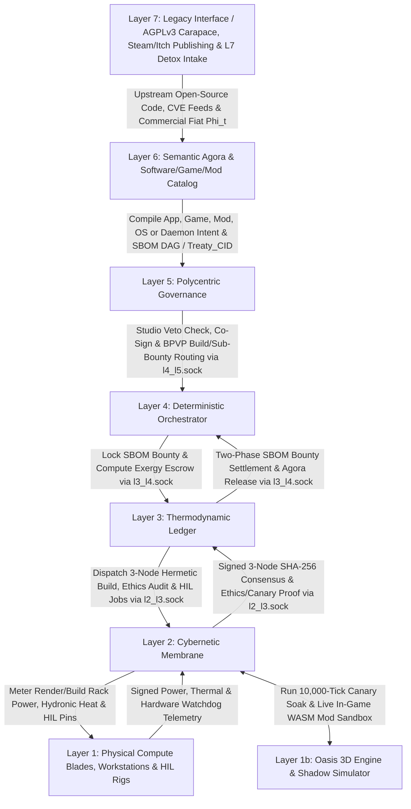
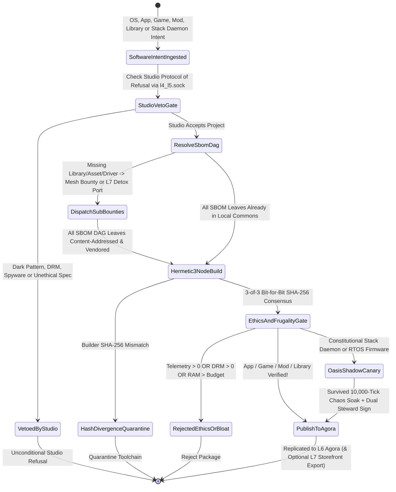

# Scenario Zero: The Sovereign Software, Operating System, Application, Game, Mod & Digital Library Commons (Meta-Scenario)

*   **Identifier:** `SCN-ZERO-SOFTWARE`
*   **System Epic:** Meta-Scenario — The Software & Digital Asset Industry of The Collective: Operating Systems, L6 Native & L7-Detoxed Applications, Video Games (Oasis & Beyond), Community Mods, Reusable Libraries, Recursive SBOM DAGs, Reproducible Toolchains, and Autopoietic Self-Hosting of the 7-Layer Stack
*   **Primary Layers Tested:** L1 (Physical Compute, Peripherals & HIL Hardware), L1b (Oasis 3D Digital Twin, Game Engine & Canary Sandbox), L2 (Cybernetic Membrane, Drivers & RTOS Firmware), L3 (Thermodynamic Compute & Guild Bounty Ledger), L4 (Deterministic CI/CD, SBOM DAG & BPMN Orchestrator), L5 (Polycentric Studio Governance, Studio Veto & Release Ratification), L6 (Software/Game/Mod Agora, AST & Ontology Registry), L7 (Copyleft Carapace, L7 App/Game Publishing & Open-Source Detox Bridge)
*   **Pass/Fail Metric:** Full-spectrum production, verification, distribution, modding, and operation of Operating Systems, end-user Applications, Video Games, Mods, Reusable Libraries, and the 7-Layer Sovereign Stack daemons across the local-first mesh with zero reliance on centralized cloud forges or DRM app stores; unconditional Sovereign Studio Veto (`Protocol of Refusal`) over dark patterns, surveillance, and unethical commissions; recursive Software Bill of Materials (SBOM DAG) resolution across guild rings $R_1 \dots R_6$; bit-for-bit reproducible binary consensus across $\ge 3$ independent builder nodes (`builder_hash_consensus_count >= 3`); zero unauthorized telemetry, zero DRM locks, and zero predatory microtransaction loops (`SovereignAppEthicsGate`); mandatory $10000\text{-tick}$ Oasis shadow-twin canary soak for constitutional stack/firmware updates; $\ge 8000\,\mathrm{bp}$ ($80\%$) build/render cluster waste heat recovery; Pairwise Bilateral Clearing Channel (BCC) settlement with zero-sum conservation ($B_{u \to v}(t) + B_{v \to u}(t) = 0$).

---

## Architectural Council Ratification & 5-Perspective Synthesis

This meta-scenario specification has been ratified by unanimous consensus of the 5-Persona Architectural Council:

| Council Persona | Disciplinary Representative | Core Contribution to Scenario |
| :--- | :--- | :--- |
| **Game Designer** | Lead Systems & Gameplay Designer | *The Living Software, Game & Modding Culture:* Scenario Zero is to digital goods what Scenario Alpha is to physical goods. Citizens don't just maintain infrastructure—they form indie game studios, build desktop/mobile OSes, craft creative DAW/3D/CAD apps, and publish total-conversion mods (including mods for **Oasis** itself!). *Dwarf Fortress* creative & scholarly moods: shipping a beloved cooperative game, a buttery-smooth OS update for 15-year-old laptops, or a popular Oasis mod grants `"Thrilled by community joy in our digital craft (+45 mood)"`. Studios exercise an absolute **Sovereign Studio Veto** against building surveillance spyware, DRM lock-in, or addictive lootbox mechanics. |
| **Game Engineer** | Principal C++ Simulation & Engine Architect | Multi-tier software artifact pipeline: cache-aligned ECS structs `SoftwareCatalogCapabilityComponent`, `RecursiveSbomDagComponent`, `SandboxedWasmModComponent`, `ReproducibleBuildJobComponent`, and `OasisCanarySoakComponent`; 32-bit compact Voxels (`material_id = 120` `STUDIO_WORKSTATION_POD`, `material_id = 121` `REPRODUCIBLE_BUILD_RENDER_BLADE`, `material_id = 122` `HIL_DRIVER_TEST_BENCH`, `material_id = 123` `COLD_STORAGE_MDISC_VAULT`); first-class WebAssembly (`wasm32`) and Lua sandboxed modding ABI allowing players to hot-reload mods and custom apps inside Oasis; compilable C++20 test harness strictly utilizing fixed-point SI integer math. |
| **Sovereign Stack Specialist** | Sovereign Stack Systems Architect | Dual-role architecture: (1) horizontal software industry producing OSes, L6-native apps, games, mods, and libraries distributed over the Layer 6 Agora; (2) vertical autopoietic self-hosting of the 7-layer stack daemons (`col-sensord` through `col-gatewayd`) across `l1_l2.sock` through `l6_l7.sock` (with `/run/collective/ipc/l4_l5.sock` bridging governance and orchestration); Diverse Double-Compiling across $\ge 3$ independent builder nodes; local-first CRDT P2P multiplayer and collaborative editing with zero central servers. |
| **Solarpunk Thinker** | Bioregional Regenerative Ecologist | Abolishing planned hardware obsolescence, subscription SaaS rent-seeking, DRM enclosure, and surveillance bloatware; "detoxing" legacy Layer 7 open-source applications into lean, offline-first Layer 6 communal tools that run briskly on $20\text{-year-old}$ salvaged computers; turning zero-marginal-cost Layer 7 commercial game and app publishing (e.g., selling commercial editions of Oasis and indie games on Steam/GOG/itch) into an ecologically weightless fiat revenue engine ($\Phi_t$) that funds physical land and tool acquisition for the bioregion. |
| **Scenario Specialist** | Operating Systems Architect, Game Engine Director & Reproducible-Builds Specialist | Capability-secure OS distributions and unikernels; recursive Software Bill of Materials (SBOM Merkle DAG) dependency resolution with 100% vendored offline source caches; static & dynamic binary auditing (enforcing zero telemetry beacons, zero DRM, and zero float opcodes in deterministic L2–L5 daemons); deterministic rollback netcode and Automerge/Yrs CRDT state sync for serverless multiplayer games and collaborative creative suites. |

Unanimous Consensus Reached across all five disciplinary perspectives.

---

## 1. Problem Statement & Legacy Failure

In legacy corporate capitalism (Layer 7), the software, operating system, app, and video game industries have been corrupted from tools of human empowerment into engines of extraction, surveillance, and artificial scarcity:

1.  **SaaS Rent-Seeking, DRM & Digital Feudalism:** Creative tools (CAD, video editing, DAWs, graphic design), productivity suites, and enterprise apps are locked behind perpetual monthly cloud subscriptions. If a user stops paying or the vendor shuts down its authentication servers, citizens are locked out of their own files and creative work.
2.  **Surveillance Bloatware & Forced Hardware Obsolescence:** Commercial operating systems (Windows, macOS, iOS, Android) and Electron-wrapped web apps bundle gigabytes of background ad-trackers, cloud telemetry, and AI spyware. Perfectly functional $10\text{-year-old}$ laptops and phones are artificially bricked by mandatory OS updates or dropped driver support, driving millions of tons of toxic e-waste into [Scenario Theta (`theta_foundry.md`)](file:///Users/raffaine/dev/collective/docs/scenarios/theta_foundry.md) recovery streams.
3.  **Enshittification of Video Games & War on Modding:** Corporate game publishers replace artistic play with psychologically manipulative dark patterns—lootboxes, FOMO battle-passes, kernel-level rootkit DRM, and "always-online" single-player games that become unplayable coasters the day the publisher shuts down the central server. Meanwhile, community modders are hit with cease-and-desist letters or forced into exploitative proprietary marketplaces.
4.  **Fragile Centralized Forges & Supply-Chain Malware:** Both open-source and proprietary developers rely on centralized cloud monopolies (GitHub, AWS, npm, PyPI, Apple/Google App Stores) where a single compromised maintainer account, non-reproducible binary, or corporate censorship edict can break thousands of downstream projects overnight.

---

## 2. Macro-Domain Architecture: The Six Pillars of the Sovereign Software, App, Game & OS Commons

Just as [Scenario Alpha (`alpha_fabrication.md`)](file:///Users/raffaine/dev/collective/docs/scenarios/alpha_fabrication.md) is how The Collective designs, manufactures, and repairs physical goods and tools, **Scenario Zero** is how The Collective designs, produces, verifies, distributes, mods, and operates **all software assets**—spanning Operating Systems, End-User Applications, Video Games, Community Mods, Reusable Libraries, and the 7-Layer Sovereign Stack itself.

### Pillar I: The Full-Spectrum Software & Digital Asset Taxonomy (OSes, Apps, Games, Mods, Libraries & Stack Daemons)
Scenario Zero organizes the software industry into five mutually reinforcing asset classes in Layer 6 (and their Layer 7 counterparts):
1.  **Operating Systems, Kernels, Drivers & RTOS Distributions (`OS_AND_KERNEL_DISTRO`):**
    *   *Sovereign Desktop, Workstation & Mobile OSes:* Lean, telemetry-free Linux/BSD desktop distributions, de-Googled mobile operating systems for repurposed smartphones/tablets, and capability-secure microkernels (`seL4`/unikernel profiles) engineered under the **20-Year Hardware Longevity Mandate**—running briskly in $< 256\,\mathrm{MiB}$ idle RAM so salvaged computers from [Scenario Theta (`theta_foundry.md`)](file:///Users/raffaine/dev/collective/docs/scenarios/theta_foundry.md) remain fast and useful for decades.
    *   *Embedded RTOS & Open-Silicon Firmware:* Deterministic Zephyr RTOS images, RISC-V/ARM bootloaders, and open-source hardware drivers for CNC machines ([Scenario Alpha](file:///Users/raffaine/dev/collective/docs/scenarios/alpha_fabrication.md)), microgrid inverters ([Scenario Beta](file:///Users/raffaine/dev/collective/docs/scenarios/beta_transit.md)), and medical monitors ([Scenario Chi](file:///Users/raffaine/dev/collective/docs/scenarios/chi_paramedic.md)).
2.  **End-User Applications, Creative Suites & Domain Tools (`L6_NATIVE_AND_DETOXED_APP`):**
    *   *L6-Native Collaborative Applications:* Built directly on Layer 6 JSON-LD ontologies and Layer 3 Automerge/Yrs CRDTs—parametric CAD/CAM & BIM modelers (feeding [Scenario Alpha](file:///Users/raffaine/dev/collective/docs/scenarios/alpha_fabrication.md) and [Scenario Xi](file:///Users/raffaine/dev/collective/docs/scenarios/xi_architecture.md)), Digital Audio Workstations (DAWs), 3D modeling/rendering/VFX suites, raster/vector illustration studios, personal & community knowledge graphs, encrypted local-first messengers, agronomic/mycological planners ([Scenario Gamma](file:///Users/raffaine/dev/collective/docs/scenarios/gamma_kitchen.md) / [Scenario Eta](file:///Users/raffaine/dev/collective/docs/scenarios/eta_coppice.md)), and clinical EHR/DICOM viewers ([Scenario Chi](file:///Users/raffaine/dev/collective/docs/scenarios/chi_paramedic.md)).
    *   *L7-to-L6 "Detoxed" Counterpart Applications:* Software guilds systematically fork high-value Layer 7 open-source applications (e.g., Blender, KiCad, FreeCAD, Godot, LibreOffice, Ardour, GIMP, Krita), strip out any cloud sign-in walls or third-party telemetry, add native Layer 6 CRDT multi-user collaboration and Blueprint Commons export plugins, and maintain them in the Sovereign App Agora.
3.  **Video Games, Simulation Engines, Virtual Worlds & Mods (`GAME_ENGINE_AND_MOD`):**
    *   *Oasis & Sovereign Game Studios:* Video games are celebrated as a primary artistic, educational, and recreational medium (co-created with [Scenario Lambda (`lambda_cultural.md`)](file:///Users/raffaine/dev/collective/docs/scenarios/lambda_cultural.md) composers, writers, and visual artists). Studios build **Oasis** (both a deep settlement/bioregional simulation game and our Layer 1b digital twin), alongside narrative RPGs, cooperative puzzle/strategy games, physics sandboxes, and VR/spatial experiences.
    *   *First-Class Community Mods & Total Conversions:* Every game and engine in the Commons exposes a documented, capability-sandboxed **WebAssembly (`wasm32`) / Lua / Shader / Asset Modding API**. Any player or citizen can create new gameplay mechanics, custom UI dashboards, new scenarios, shader packs, or total conversions, publishing them as content-addressed mod layers that stack cleanly without corrupting base game files.
4.  **Reusable Libraries, SDKs, Compilers, Protocols & Open-Weight AI Models (`LIBRARY_AND_SDK`):**
    *   Foundational C++20, Rust, C, Zig, WGSL, and TypeScript/WASM libraries: ECS frameworks, fixed-point deterministic math/physics solvers, cryptographic primitives (`BBS+`, `Ed25519`, `Noise`), UI widget toolkits, audio DSP filters, and locally fine-tuned open-weight AI models (coding assistants, OCR, speech-to-text, botanical/medical image classifiers).
5.  **Constitutional 7-Layer Stack Daemons (`CONSTITUTIONAL_STACK_DAEMON`):**
    *   The core daemons (`col-sensord`, `col-actuated`, `col-storaged`, `col-meshd`, `col-execd`, `col-kmsd`, `col-commonsd`, `col-gatewayd`, `col-adversaryd`) and BPMN 2 / JSON-LD schemas that run The Collective itself.

### Pillar II: Studio Capability Advertising, Unconditional Studio Veto & Recursive SBOM Workflow Chaining
Scenario Zero mirrors Scenario Alpha's distributed production architecture in the software domain:
*   **Catalog-Specific Capability Advertising & Unconditional Studio Veto (`Protocol of Refusal`):**
    Software nodes and studios advertise their specialized capabilities (`KERNEL_RUST_CPP`, `WEBGPU_RENDER_ENGINE`, `CRDT_COLLAB_APP`, `AUDIO_DSP_SYNTH`, `GAME_NARRATIVE_MOD`, `FORMAL_SECURITY_AUDIT`) and their `Ratified_Software_Set` over Layer 5 BPVP. Crucially, studios hold an **Unconditional Sovereign Veto**: a studio can refuse any software commission or feature request it disagrees with ethically or artistically—such as refusing to implement user-tracking analytics, DRM lockouts, casino/lootbox mechanics, or military targeting code, even if the studio has the exact technical skills required.
*   **Recursive Software Bill of Materials (SBOM DAG) Chaining & Layer 7 Clean-Room Bridge:**
    Just as building a CNC router in Scenario Alpha chains mechanical, electrical, and casting sub-workflows across multiple nodes, building a major OS release, creative suite, or video game resolves a **Recursive SBOM Merkle DAG**:
    1.  **Local & Mesh Commons Resolution ($R_1 \dots R_6$):** `col-execd` checks the Vendored Software Commons for existing verified libraries, engines, shaders, and font/audio packs.
    2.  **Inter-Guild Sub-Bounty Chaining:** If a game or app needs a new deterministic fluid-dynamics library, a Wayland compositor patch, or an original soundtrack ([Scenario Lambda](file:///Users/raffaine/dev/collective/docs/scenarios/lambda_cultural.md)), `col-execd` decomposes the SBOM DAG and dispatches child bounties (`LibraryBountyIntent`, `DriverPortIntent`, `GameAssetIntent`) to specialist guilds across the mesh, settling over Pairwise BCCs.
    3.  **Layer 7 Clean-Room Ingestion & Detox Bridge:** If a leaf dependency (e.g., a new hardware codec or math library) only exists in Layer 7, a guild ingests the upstream source snapshot through the **L7 Detox Quarantine Pipeline**—stripping network phone-home calls, auditing licenses (requiring OSI/FSF libre compatibility), vendoring all transitive sources into the offline Merkle archive, and compiling it reproducibly before it can be linked into any L6 package.

### Pillar III: The Sovereign App, Game & Mod Agora (Zero-DRM Distribution & Serverless P2P Multiplayer)
*   **The Layer 6 Software, Game & Mod Agora (`col-commonsd`):**
    Replaces Steam, Apple App Store, Google Play, Flathub, npm, and crates.io with a single decentralized, censorship-resistant catalog replicated across [Scenario Beta (`beta_transit.md`)](file:///Users/raffaine/dev/collective/docs/scenarios/beta_transit.md) fiber, Reticulum radio, and DTN sneakernet drives.
    *   Every package displays a cryptographic **Capability Nutrition Label** enforced by the OS sandbox (e.g., `Filesystem: Read/Write Project Folder Only`, `Network: Local P2P Mesh Only`, `Microphone/Camera: Hardware Switch Gated`, `External Telemetry: 0 Endpoints`).
    *   **Zero DRM & Permanent Offline Playability:** Every game, app, and OS installed from the Agora runs $100\%$ offline forever without license servers or activation dongles.
*   **Serverless P2P Multiplayer & Collaborative Studio State:**
    Multiplayer games (including cooperative multi-node Oasis sessions!) and multi-user creative apps (collaborative CAD, DAWs, document editors) use **Deterministic Rollback Netcode** and **Automerge/Yrs CRDTs** over peer-to-peer WebRTC/QUIC mesh channels. Because there is no central corporate matchmaking or state server, no game or collaborative tool can ever be "sunset" or bricked by a publisher!
*   **Composable Modding & Automatic Upstream Attribution:**
    When a citizen creates a mod for Oasis or another game, or writes a plugin for a CAD/DAW suite, the mod is published as a signed `ModLayerArtifact` referencing the parent `GameOrApp_CID`. Players can toggle and stack compatible mods in one click, while Layer 5 automatically splits Reputational Wealth ($\mathcal{R}$) recognition across both the modder and the upstream engine/asset creators.

### Pillar IV: Hermetic Reproducible Builds, Anti-Dark-Pattern Gates & Oasis Shadow-Twin Canarying
Every software artifact published to the Agora passes through an automated Layer 4 (`col-execd`) verification pipeline scaled to its criticality class:
1.  **Universal Gate A — 100% Vendored Hermetic Build & 3-Node Bit-for-Bit Consensus (`All Classes`):**
    Compiled inside network-isolated sandboxes (`SOURCE_DATE_EPOCH = 0`, `external_network_calls_during_build == 0`). At least **$3$ topologically independent builder nodes** across diverse hardware (`x86_64`, `ARM64`, `RISC-V`) and bootstrap compilers must produce the **exact same SHA-256 binary/bundle hash**, mathematically defeating supply-chain malware and compiler backdoors.
2.  **Universal Gate B — Sovereign App & Game Ethics Audit (`Apps, Games, Mods, OSes`):**
    Static and dynamic sandbox analysis verifies:
    *   `unauthorized_telemetry_endpoints == 0` (zero hidden analytics, ad SDKs, or phone-home beacons).
    *   `drm_or_anti_modding_locks == 0` (zero obfuscated license checks or modding blocks).
    *   `predatory_dark_patterns_detected == 0` (zero real-money lootboxes, pay-to-win timers, or deceptive UI traps).
    *   **Hardware Frugality Gate:** Verifies the app, OS, or game meets its target frame-time and memory budget on baseline salvaged hardware profiles.
3.  **Constitutional Gate C — Zero-Float Static ELF Audit & $10000\text{-Tick}$ Oasis Shadow Canary (`7-Layer Stack Daemons, Oasis Core & Layer 2 RTOS Firmware`):**
    For software that governs ledgers, treaties, or physical Layer 1 hardware:
    *   Disassembler confirms `floating_point_opcodes_detected == 0` in deterministic Layer 2–5 paths and `layer_skipping_imports_detected == 0`.
    *   Passes all 25 C++20 Scenario test suites under `ASan`/`UBSan`.
    *   Survives a **$10000\text{-tick}$ Time-Warp Shadow Canary Soak** inside a sandboxed **Oasis 3D Digital Twin** while `col-adversaryd` injects Byzantine network, sensor, and power faults, followed by Hardware-in-the-Loop (HIL) bench verification and atomic `A/B` watchdog rollout.

### Pillar V: Sovereign AI Co-Creation, Cross-Domain Guild Co-Design & Compute Heat Recovery
*   **Local-First Open-Weight AI Assistants (Code, Shaders, Testing, Localization & Formal Proofs):**
    Studios run open-weight coding, shader-optimization, automated fuzzing, localization/translation, and formal-verification (Lean 4 / TLA+) models locally on [Scenario Epsilon (`epsilon_coworking.md`)](file:///Users/raffaine/dev/collective/docs/scenarios/epsilon_coworking.md) liquid-cooled compute clusters—never leaking source code or citizen prompts to external cloud APIs.
*   **Human Creative & Constitutional Sovereignty:**
    AI tools accelerate boilerplates, port drivers, generate unit tests, and check mathematical proofs, but **human Stewards hold sole authorship and governance authority** (`ai_unsupervised_deploy_attempted == false`). Any domain application or workflow change requires dual co-signatures from both a **Software Steward** and an active **Domain Guild Steward** (e.g., a chef from Scenario Gamma for kitchen software, or a midwife from Scenario Delta for perinatal software).
*   **Thermodynamic Compute Accounting & Hydronic Heat Cascade ($\ge 8000\,\mathrm{bp}$):**
    Heavy OS compilation, 3D game lightmap/asset baking, CI fuzzing, and AI inference are scheduled during [Scenario Beta (`beta_transit.md`)](file:///Users/raffaine/dev/collective/docs/scenarios/beta_transit.md) solar microgrid peaks, while $\ge 8000\,\mathrm{bp}$ ($80\%$) of server heat is captured into [Scenario Zeta (`zeta_lodging.md`)](file:///Users/raffaine/dev/collective/docs/scenarios/zeta_lodging.md) bathhouses and [Scenario Gamma (`gamma_kitchen.md`)](file:///Users/raffaine/dev/collective/docs/scenarios/gamma_kitchen.md) greenhouses.

### Pillar VI: Layer 7 Commercial App/Game Publishing Carapace ($\Phi_t$) & 3-Stage Studio Blueprints
*   **Dual-Membrane Copyleft & Commercial Publishing Engine ($\Phi_t$):**
    Inside The Collective ($R_0 \dots R_6$), every OS, application, library, game (including **Oasis**), and mod is a free, open-source commons protected by **GNU AGPLv3 / GPLv3 / CC-BY-SA / Defensive Patent License (DPL v1)**. Simultaneously, because digital goods replicate at near-zero physical exergy cost, Scenario Zero is a premier **Layer 7 Revenue-Capture Axis**:
    *   Through the [Scenario Epsilon (`epsilon_coworking.md`)](file:///Users/raffaine/dev/collective/docs/scenarios/epsilon_coworking.md) Subchapter T Cooperative Carapace, Collective game studios and software guilds sell commercial binary editions, supporter packs, and soundtrack bundles of **Oasis** and other Collective indie/AA games on legacy storefronts (Steam, GOG, itch.io, consoles), alongside commercial desktop/mobile apps, audio DSP plugins, and enterprise support contracts.
    *   $100\%$ of net external fiat revenue ($\Phi_t$) flows into the settlement's **Land Acquisition Escrow**, **Property Tax Endowment**, and **Layer 7 GPO Hardware Budget**—converting collective creativity and code into debt-free physical land, timber, solar arrays, and machine tools!
*   **3-Stage Incremental Software & Game Studio Blueprints:**
    1.  **Stage 1 — Bedroom Indie Coder, Modder & Homelab Node:**
        *   *Physical Footprint:* A home desk or bedroom corner ($2\text{–}6\,\mathrm{m}^2$, $< 380\,\mathrm{cB}$) with salvaged laptops, a quiet mini-PC/NAS running a local Git/CRDT forge + hermetic Nix/Bazel builder, and a USB `STM32`/`ESP32` HIL breadboard.
        *   *Operations:* Develops mods, L6 apps, reusable libraries, L7 open-source detox ports, and indie games; participates in 3-node reproducible build verification over WireGuard; captures initial Layer 7 indie game/app sales or bug bounties. Shielded under **UUNAA § 6** and constitutional source-code speech protections.
    2.  **Stage 2 — Co-Located Scenario Epsilon Software & Game Studio, Render/Build Farm & HIL Lab:**
        *   *Physical Footprint:* A $60\text{–}200\,\mathrm{m}^2$ studio co-located inside a [Scenario Epsilon (`epsilon_coworking.md`)](file:///Users/raffaine/dev/collective/docs/scenarios/epsilon_coworking.md) commercial shell, sharing acoustic recording/foley booths with [Scenario Lambda (`lambda_cultural.md`)](file:///Users/raffaine/dev/collective/docs/scenarios/lambda_cultural.md) and fabrication bays with [Scenario Alpha (`alpha_fabrication.md`)](file:///Users/raffaine/dev/collective/docs/scenarios/alpha_fabrication.md) (for custom game controllers, arcade cabinets, and open hardware).
        *   *Operations & Self-Sustenance:* Operates multi-architecture (`x86_64`, `ARM64`, `RISC-V`) build/render blades, local AI coding/shader servers, a couch-co-op playtesting lounge, and a 7-layer physical HIL rack. External commercial game/app publishing and B2B engineering contracts ($\Phi_t$) pay the lease and rapidly capitalize the **Settlement Land Acquisition Escrow**.
    3.  **Stage 3 — Custom-Built Bioregional Software, Game & Cybernetics Conservatory:**
        *   *Physical Footprint:* Purpose-built timber-and-hempcrete studio campus and subterranean vault on permanent Community Land Trust (CLT) acreage.
        *   *Operations:* Houses solar-powered, liquid-cooled build/render/verification clusters plumbed into the district hydronic grid ($\ge 8000\,\mathrm{bp}$ heat recovery), motion-capture and spatial-audio stages, an open-silicon/RTOS driver lab, and a $1000\text{-year}$ zero-power **M-DISC / Quartz-Glass Cold-Storage Software, Game & Cultural Archive**.

---

## 3. The Collective Workflow (7-Layer Traversal)

Whether shipping a new cooperative video game, an L6 CAD application, a desktop OS image, or a core `col-execd` daemon patch, the workflow traverses all seven layers without layer skipping:



### Layer 1: Physical Ground Truth
*   **Workstations, Salvaged Client Hardware & Render/Build Blades:** Multi-architecture servers (`x86_64`, `ARM64`, `RISC-V`), salvaged 15-to-20-year-old community laptops/phones (used as mandatory frugality benchmark targets), direct-to-chip copper water-blocks, custom open-hardware game controllers, and optical M-DISC archival writers.
*   **Hardware-in-the-Loop (HIL) Test Benches:** Physical `STM32H7` / `ESP32-S3` / `RISC-V` boards, `ATECC608A` secure elements, programmable load banks, and hardware watchdog relays.
*   **Strict Layer Separation:** Layer 1 is purely physical silicon, copper, cooling water, and electrical current; all OS kernels, compilers, game engines, and cryptographic keys reside in Layer 2 and above.

### Layer 2: Cybernetic Membrane & Telemetry
*   **Hardware Attestation & HIL Membrane:** `col-sensord` and `col-actuated` measure build/render cluster power (`power_mw`), hydronic coolant temperatures (`inlet_temp_mk`, `outlet_temp_mk`), and HIL oscilloscope/watchdog timings, signing hardware attestations via `ATECC608A` / TPM chips.
*   **Fixed-Point SI Integer Ingress Telemetry (POSIX Sockets / CBOR):**
    *   `node/forge/job_88/telemetry/compute_energy_uj` (Electrical energy consumed by build, asset bake, or canary run in $\mu\mathrm{J}$, `uint64_t`)
    *   `node/forge/job_88/telemetry/heat_recovered_bp` (Fraction of server heat captured into hydronic loops in basis points, `uint16_t`, requiring $\ge 8000\,\mathrm{bp}$ in Stage 2/3)
    *   `node/forge/job_88/telemetry/unauthorized_telemetry_endpoints` (Static/dynamic network sandbox count of unapproved phone-home endpoints, `uint32_t`, requiring `== 0`)
    *   `node/forge/job_88/telemetry/baseline_ram_mib` (Measured idle RAM footprint on benchmark salvaged laptop in MiB, `uint32_t`)

### Layer 3: Thermodynamic Ledger
*   **Pairwise Bilateral Clearing Channels (BCC) for Recursive SBOM Bounties & Compute:**
    When a Game or App Studio $u$ commissions a physics library, audio DSP plugin, or artwork pack from Peer Guild $v$ (or rents render/compile time on an Epsilon compute cluster), settlement occurs over Pairwise Bilateral Clearing Channels with zero-sum conservation:
    $$B_{u \to v}(t) + B_{v \to u}(t) = 0, \quad -C_{u \to v} \le B_{u \to v}(t) \le C_{v \to u}$$
*   **Zero Digital Scarcity Inside the Commons:**
    While development labor, recursive SBOM bounties, and physical compile/render exergy settle via BCCs during production, **once a software asset, OS, library, game, or mod is published to the Layer 6 Agora, copying and installing it carries zero per-copy license fee inside The Collective**.

### Layer 4: Deterministic Orchestrator
`col-execd` orchestrates recursive SBOM resolution, 3-node hermetic builds, ethics auditing, and Oasis canarying at 10 Hz over `/run/collective/ipc/l4_l5.sock`:



*   **Boundary Socket Contract (`l4_l5.sock`):** Non-blocking `SOCK_SEQPACKET` Unix Domain Socket at `/run/collective/ipc/l4_l5.sock`. Downward messages deliver ratified studio capabilities, SBOM dependency treaties, and release approvals; upward messages report 3-node build hashes, ethics/frugality audit results, and Oasis canary proofs.

### Layer 5: Polycentric Governance & Bioregional Routing
Executed by `col-kmsd`, Layer 5 governs the Software Commons:
*   **Unconditional Sovereign Studio Veto & Right to Fork (`Protocol of Refusal`):** Every studio has the absolute right to refuse unethical software work, and every Node has the absolute right to pin or fork any OS, app, game, or daemon version.
*   **Anti-Enclosure & Anti-Dark-Pattern Constitution:** Layer 5 mathematically blocks any software artifact containing DRM, non-consensual telemetry, or predatory monetization from entering the ratified Agora catalog.
*   **Automatic Mod & Dependency Reputation Attribution:** When citizens play a game, install a mod, or use an application, Layer 5's non-financial Reputational Wealth ($\mathcal{R}$) decay-refresh credits propagate along the SBOM Merkle DAG to recognize upstream library authors, artists ([Scenario Lambda](file:///Users/raffaine/dev/collective/docs/scenarios/lambda_cultural.md)), and maintainers.

### Layer 6: Semantic Intent & Agora Ontology
Executed by `col-commonsd`, Layer 6 indexes the entire software universe as W3C JSON-LD Knowledge Artifacts:
1.  **`SoftwareOrGameProductionIntent`:** Initiates development or porting of an OS, L6 native app, L7 detoxed app, video game, or library, complete with its recursive `sbomDependencyDag`.
2.  **`CommunityModPublicationIntent`:** Publishes a sandboxed WASM/Lua/asset mod layer linked to a parent `targetGameOrAppCid`.
3.  **`AgoraCapabilityPackageManifest`:** Declares an artifact's reproducible SHA-256 hash, hardware frugality metrics, sandbox capability permissions, and zero-telemetry attestation.

### Layer 7: The Legacy Interface (Dual-Membrane Doctrine)
1.  **L7-to-L6 Open-Source Detox & Ingestion Bridge:** Ingests useful legacy open-source projects, strips cloud dependencies and telemetry trackers, adds local-first CRDT sync, and vendors them into the offline Commons.
2.  **Outbound Commercial Game, App & Enterprise Publishing ($\Phi_t$):** Publishes commercial builds of **Oasis**, Collective indie/AA video games, creative suites, and audio/CAD plugins to external Layer 7 storefronts (Steam, GOG, itch.io, B2B contracts) via the [Scenario Epsilon (`epsilon_coworking.md`)](file:///Users/raffaine/dev/collective/docs/scenarios/epsilon_coworking.md) Cooperative Carapace, capturing zero-material-depletion fiat revenue ($\Phi_t$) to fund settlement expansion.
3.  **AGPLv3 / GPLv3 / CC-BY-SA / DPL Legal Shield:** Prevents corporate strip-mining of Collective software and engines.

---

## 4. Machine-Readable Schemas

### 4A. Layer 6 Knowledge Artifact: Full-Spectrum Software/Game Release, SBOM DAG & Mod Manifest (`software_agora_manifest.jsonld`)

```json
{
  "@context": [
    "https://schema.org/",
    "https://collective.network/ontology/v1/"
  ],
  "@type": "SoftwareAgoraPackageManifest",
  "identifier": "urn:uuid:0000c9f1-8b2a-4d3e-9f10-1a2b3c4d5e6f",
  "packageName": "Oasis_Bioregional_Simulator_And_SolarCAD_Suite",
  "assetCategory": "GAME_ENGINE_AND_L6_COLLABORATIVE_APP",
  "versionTag": "v2_4_0_solarpunk",
  "sourceCommitCid": "bafybeigdyrzt5sfp7udm7hu76uh7y26nf3efuylqabf3oclgtqy55fbzdi",
  "vendoredSbomMerkleRoot": "e3b0c44298fc1c149afbf4c8996fb92427ae41e4649b934ca495991b7852b855",
  "recursiveSbomDependencies": [
    {
      "dependencyName": "libcollective_crdt_automerge",
      "assetCategory": "LIBRARY_AND_SDK",
      "sourceRing": "R2_LOCAL_STUDIO_COMMONS",
      "merkleCid": "bafybeihdwdcefgh4dqkjv67uzcmw7ojee6xedeet6wfvikrwho3qnwjxye"
    },
    {
      "dependencyName": "scenario_lambda_acoustic_orchestra_pack",
      "assetCategory": "GAME_AUDIO_AND_SHADER_ASSET",
      "sourceRing": "R3_WATERSHED_CULTURAL_GUILD",
      "merkleCid": "bafybeicg24uqu4p2local_lambda_soundtrack_v1"
    },
    {
      "dependencyName": "freecad_detoxed_parametric_kernel",
      "assetCategory": "L7_DETOXED_LIBRARY_PORT",
      "sourceRing": "L7_CLEAN_ROOM_INGESTION_DIODE",
      "telemetryStrippedVerified": true,
      "merkleCid": "bafybeifx7detoxed_step_brep_kernel_v4"
    }
  ],
  "moddingAndMultiplayerCapabilities": {
    "exposesSandboxedWasmModAbi": true,
    "supportedModHooks": [
      "CUSTOM_SCENARIO_RULESET",
      "CUSTOM_VOXEL_SHADER",
      "CUSTOM_BPMN_WORKFLOW_UI"
    ],
    "multiplayerArchitecture": "P2P_DETERMINISTIC_ROLLBACK_AND_CRDT_ZERO_SERVER"
  },
  "ethicsAndFrugalityProfile": {
    "unauthorizedTelemetryEndpoints": 0,
    "drmLocksDetected": 0,
    "predatoryDarkPatternsDetected": 0,
    "minSalvagedHardwareRamMiB": 512,
    "licenseSpdx": "AGPL-3-0-or-later_AND_DPL-1-0"
  },
  "layer7CommercialExportBridge": {
    "exportToExternalStorefrontsPermitted": true,
    "externalStorefrontTargets": [
      "Steam_DRM_Free_Build",
      "GOG_Offline_Installer",
      "Itch_Io_Coop_Bundle"
    ],
    "revenueRoutingTarget": "SCN_EPSILON_LAND_ACQUISITION_ESCROW_PHI_T"
  }
}
```

### 4B. Layer 2 & Layer 1b Combined Attestation: 3-Node Reproducible Build, Ethics Audit & Oasis Canary Proof (`software_verification_attestation.json`)

```json
{
  "@context": "https://collective.network/ontology/v1/",
  "@type": "SoftwareVerificationAttestation",
  "packageRef": "urn:uuid:0000c9f1-8b2a-4d3e-9f10-1a2b3c4d5e6f",
  "reproducibleConsensusMetrics": {
    "builderNodeDids": [
      "did:peer:2.Ez6MkBuilderNode01_x86",
      "did:peer:2.Ez6MkBuilderNode02_ARM64",
      "did:peer:2.Ez6MkBuilderNode03_RISCV"
    ],
    "agreedOutputBinarySha256": "9f86d081884c7d659a2feaa0c55ad015a3bf4f1b2b0b822cd15d6c15b0f00a08",
    "bitForBitConsensusVerified": true,
    "externalNetworkCallsDuringBuild": 0
  },
  "sovereignEthicsAndFrugalityAudit": {
    "unauthorizedTelemetryEndpoints": 0,
    "drmLocksDetected": 0,
    "predatoryDarkPatternsDetected": 0,
    "measuredIdleRamMiB": 310,
    "runs60FpsOn15YearOldSalvagedLaptop": true
  },
  "constitutionalStackCanaryMetrics": {
    "isConstitutionalStackOrFirmware": true,
    "floatingPointOpcodesDetected": 0,
    "layerSkippingImportsDetected": 0,
    "scenarioSuitesPassedCount": 25,
    "oasisShadowCanaryTicksCompleted": 12000,
    "adversaryFaultsSurvived": 480,
    "unhandledPanicsOrDeadlocks": 0
  },
  "thermodynamicComputeMetrics": {
    "totalCompileAndBakeEnergyUj": 7200000000ULL,
    "hydronicHeatRecoveredUj": 6048000000ULL,
    "hydronicRecoveryBp": 8400
  },
  "hardwareSignature": "0x3a9f1c8e7d2b4a...atecc608a_ed25519_sig"
}
```

---

## 5. Oasis Engine Implementation Specification

### 5A. Modular Domain Representation in Oasis (Layer 1b Self-Hosting & In-Game Studio Loop)

In **Oasis**, Scenario Zero is playable both as a **Creative Software & Game Studio Tycoon/Commons Loop** and as the **Live Meta-Modding Engine** of the simulation itself:
*   `material_id = 120` (`STUDIO_WORKSTATION_POD`): Ergonomic workstation where simulated programmers, OS hackers, and game designers write apps, OS updates, and indie games, collaborating with Scenario Lambda artists.
*   `material_id = 121` (`REPRODUCIBLE_BUILD_RENDER_BLADE`): Liquid-cooled server rack that compiles SBOM DAGs, bakes 3D game shaders, runs local AI coding/prover models, and pumps $\ge 8000\,\mathrm{bp}$ ($80\%$) waste heat into settlement hydronic pipes.
*   `material_id = 122` (`HIL_DRIVER_TEST_BENCH`): Hardware-in-the-Loop oscilloscope bench for testing open-source device drivers and Layer 2 RTOS firmware.
*   `material_id = 123` (`COLD_STORAGE_MDISC_VAULT`): Zero-power optical vault storing the bioregion's OS images, games, libraries, and blueprints for $1000\,\mathrm{years}$.
*   **In-Game App, Game & Mod Creation:** Players can assign stewards to detox bloated Layer 7 software into clean L6 apps (boosting productivity across Scenarios Alpha, Gamma, and Chi), release indie games/mods that boost settlement morale and capture external Layer 7 fiat ($\Phi_t$), or open the built-in **Oasis Modding & BPMN Canary Editor** to live-edit simulation workflows and test them at $10000\times$ time-warp!

### 5B. C++20 Test Harness Structure (Fixed-Point SI Integer Math)

```cpp
// engine/tests/scenario_zero_test.cpp
#include <cassert>
#include <cstdint>
#include <string>
#include <vector>

namespace collective::scenario_zero {

enum class SoftwareAssetCategory : uint8_t {
    OS_AND_KERNEL_DISTRO = 1,
    L6_NATIVE_OR_DETOXED_APP = 2,
    VIDEO_GAME_OR_ENGINE = 3,
    COMMUNITY_WASM_MOD = 4,
    REUSABLE_LIBRARY_OR_SDK = 5,
    CONSTITUTIONAL_STACK_DAEMON = 6
};

// 1. Pillar I & II: Studio Capability Advertisement, Unconditional Studio Veto & Recursive SBOM DAG
struct SoftwareCommissionSpec {
    std::string project_id;
    SoftwareAssetCategory category;
    bool contains_surveillance_telemetry{false};
    bool contains_drm_lock_in{false};
    bool contains_predatory_dark_patterns{false};
    bool vetoed_by_studio_conscience{false}; // Unconditional Protocol of Refusal
    uint32_t total_sbom_dependencies{0};
    uint32_t vendored_and_detoxed_sbom_dependencies{0};
};

inline bool evaluate_studio_veto_and_sbom_dag(const SoftwareCommissionSpec& spec) {
    // 1. Unconditional Sovereign Studio Veto (Protocol of Refusal)
    if (spec.vetoed_by_studio_conscience) return false;

    // 2. Anti-Surveillance, Anti-DRM & Anti-Dark-Pattern Constitutional Gate
    if (spec.contains_surveillance_telemetry || spec.contains_drm_lock_in ||
        spec.contains_predatory_dark_patterns) {
        return false;
    }

    // 3. Every SBOM dependency in the DAG must be 100% vendored & detoxed (zero live L7 cloud tethers)
    return spec.vendored_and_detoxed_sbom_dependencies == spec.total_sbom_dependencies;
}

// 2. Pillar III & IV: 3-Node Reproducible Build, 20-Year Hardware Frugality & Oasis Canary Gate
struct SoftwareVerificationReport {
    SoftwareAssetCategory category;
    std::string builder_1_sha256;
    std::string builder_2_sha256;
    std::string builder_3_sha256;
    uint32_t external_network_calls_during_build{0}; // Must be 0 (hermetic sandbox)
    uint32_t idle_ram_mib_on_salvaged_laptop{240};
    uint32_t max_ram_budget_mib{512};                // 20-year hardware longevity frugality gate
    bool exposes_sandboxed_mod_abi{true};
    // Constitutional Stack / RTOS extra gates:
    uint32_t floating_point_opcodes_detected{0};
    uint32_t layer_skipping_imports_detected{0};
    uint32_t oasis_shadow_soak_ticks{12000};
    uint32_t unhandled_panics_or_deadlocks{0};
    bool human_steward_co_signed{true};
    bool ai_unsupervised_deploy_attempted{false};
};

inline bool verify_software_release_pipeline(const SoftwareVerificationReport& r) {
    if (r.ai_unsupervised_deploy_attempted || !r.human_steward_co_signed) return false;
    if (r.external_network_calls_during_build > 0) return false;

    // 3-Node Bit-for-Bit Reproducible Hash Consensus
    if (r.builder_1_sha256.empty() || r.builder_1_sha256 != r.builder_2_sha256 ||
        r.builder_2_sha256 != r.builder_3_sha256) {
        return false;
    }

    // 20-Year Salvaged Hardware Frugality Gate
    if (r.idle_ram_mib_on_salvaged_laptop > r.max_ram_budget_mib) return false;

    // Games and Apps must expose the composable Modding/Plugin ABI
    if ((r.category == SoftwareAssetCategory::VIDEO_GAME_OR_ENGINE ||
         r.category == SoftwareAssetCategory::L6_NATIVE_OR_DETOXED_APP) &&
        !r.exposes_sandboxed_mod_abi) {
        return false;
    }

    // Constitutional Stack Daemons additionally require 0 float opcodes, 0 layer skipping & >= 10,000-tick Oasis Canary Soak
    if (r.category == SoftwareAssetCategory::CONSTITUTIONAL_STACK_DAEMON) {
        if (r.floating_point_opcodes_detected > 0 || r.layer_skipping_imports_detected > 0) return false;
        if (r.oasis_shadow_soak_ticks < 10000 || r.unhandled_panics_or_deadlocks > 0) return false;
    }
    return true;
}

// 3. Pillar V & VI: Thermodynamic Compute Heat Recovery (>= 8000 bp) & Pairwise BCC Bounty Settlement
struct BccSoftwareChannel {
    int64_t balance_studio_to_peer_uj{0};
    int64_t balance_peer_to_studio_uj{0};
    int64_t credit_limit_uj{200000000000000LL};
};

inline bool settle_sbom_bounty_and_compute_bcc(BccSoftwareChannel& ch,
                                               uint64_t sbom_bounty_uj,
                                               uint64_t gross_compile_render_uj,
                                               uint64_t hydronic_heat_recovered_uj) {
    if (gross_compile_render_uj == 0) return false;
    uint64_t recovery_bp = (hydronic_heat_recovered_uj * 10000ULL) / gross_compile_render_uj;
    if (recovery_bp < 8000) return false; // Must recover >= 8000 bp (80%) of server heat

    uint64_t net_compute_uj = gross_compile_render_uj - hydronic_heat_recovered_uj;
    uint64_t total_transfer_uj = sbom_bounty_uj + net_compute_uj;
    if (ch.balance_peer_to_studio_uj + static_cast<int64_t>(total_transfer_uj) > ch.credit_limit_uj) {
        return false;
    }
    ch.balance_peer_to_studio_uj += static_cast<int64_t>(total_transfer_uj);
    ch.balance_studio_to_peer_uj -= static_cast<int64_t>(total_transfer_uj);
    return (ch.balance_peer_to_studio_uj + ch.balance_studio_to_peer_uj) == 0;
}

void run_all_scenario_zero_tests() {
    // Test 1: Studio Veto, L7-to-L6 Detoxed App/Game Commission & Recursive SBOM DAG Verification
    SoftwareCommissionSpec oasis_coop_game{
        .project_id = "game_oasis_bioregional_sim_v2",
        .category = SoftwareAssetCategory::VIDEO_GAME_OR_ENGINE,
        .contains_surveillance_telemetry = false,
        .contains_drm_lock_in = false,
        .contains_predatory_dark_patterns = false,
        .vetoed_by_studio_conscience = false,
        .total_sbom_dependencies = 18,
        .vendored_and_detoxed_sbom_dependencies = 18
    };
    assert(evaluate_studio_veto_and_sbom_dag(oasis_coop_game) == true);

    // A commission requesting DRM lock-in, lootbox dark patterns, or vetoed by studio conscience MUST FAIL!
    SoftwareCommissionSpec drm_lootbox_commission = oasis_coop_game;
    drm_lootbox_commission.contains_drm_lock_in = true;
    assert(evaluate_studio_veto_and_sbom_dag(drm_lootbox_commission) == false);

    SoftwareCommissionSpec studio_refusal = oasis_coop_game;
    studio_refusal.vetoed_by_studio_conscience = true;
    assert(evaluate_studio_veto_and_sbom_dag(studio_refusal) == false);

    // Test 2A: Video Game / L6 App Release Pipeline (3-Node Reproducible Build + 20-Year Laptop Frugality + Mod ABI)
    SoftwareVerificationReport verified_game_report{
        .category = SoftwareAssetCategory::VIDEO_GAME_OR_ENGINE,
        .builder_1_sha256 = "9f86d081884c7d659a2feaa0c55ad015a3bf4f1b2b0b822cd15d6c15b0f00a08",
        .builder_2_sha256 = "9f86d081884c7d659a2feaa0c55ad015a3bf4f1b2b0b822cd15d6c15b0f00a08",
        .builder_3_sha256 = "9f86d081884c7d659a2feaa0c55ad015a3bf4f1b2b0b822cd15d6c15b0f00a08",
        .external_network_calls_during_build = 0,
        .idle_ram_mib_on_salvaged_laptop = 310,
        .max_ram_budget_mib = 512,
        .exposes_sandboxed_mod_abi = true
    };
    assert(verify_software_release_pipeline(verified_game_report) == true);

    // Bloated software exceeding the salvaged-hardware RAM budget must be rejected!
    SoftwareVerificationReport bloated_electron_app = verified_game_report;
    bloated_electron_app.idle_ram_mib_on_salvaged_laptop = 2048;
    assert(verify_software_release_pipeline(bloated_electron_app) == false);

    // Test 2B: Constitutional Stack Daemon Release Pipeline (Zero Float Opcodes + 10,000-Tick Oasis Canary Soak)
    SoftwareVerificationReport stack_daemon_report = verified_game_report;
    stack_daemon_report.category = SoftwareAssetCategory::CONSTITUTIONAL_STACK_DAEMON;
    assert(verify_software_release_pipeline(stack_daemon_report) == true);

    SoftwareVerificationReport float_violation = stack_daemon_report;
    float_violation.floating_point_opcodes_detected = 1;
    assert(verify_software_release_pipeline(float_violation) == false);

    // Test 3: Recursive SBOM Bounty + Render/Compile Heat Recovery (>= 8000 bp) & BCC Zero-Sum Settlement
    BccSoftwareChannel bcc{};
    assert(settle_sbom_bounty_and_compute_bcc(bcc, 25000000000000ULL, 7200000000ULL, 6048000000ULL) == true);
    assert(bcc.balance_peer_to_studio_uj + bcc.balance_studio_to_peer_uj == 0);
}

} // namespace collective::scenario_zero

int main() {
    collective::scenario_zero::run_all_scenario_zero_tests();
    return 0;
}
```

---

## 6. Acceptance Test Gates (Pass/Fail)

| Checkpoint | Validation Method | Pass Condition |
| :--- | :--- | :--- |
| **G1: Full-Spectrum Asset Coverage & Unconditional Studio Veto** | Catalog & `Protocol of Refusal` Audit | Supports OSes, L6 native/detoxed apps, video games, WASM mods, libraries, and stack daemons; studios can unconditionally veto unethical commissions; zero DRM, zero unauthorized telemetry, and zero dark patterns permitted. |
| **G2: Recursive SBOM DAG & L7 Clean-Room Detox Bridge** | Offline Dependency Tree Verification | Every transitive dependency in an app, OS, or game SBOM DAG is 100% vendored and content-addressed (`external_network_calls_during_build == 0`), with L7 imports stripped of telemetry before linking. |
| **G3: 3-Node Bit-for-Bit Reproducible Build Consensus** | Multi-Architecture SHA-256 Audit | At least $3$ independent builder nodes (`x86_64`, `ARM64`, `RISC-V`) produce identical SHA-256 binary hashes from the same commit. |
| **G4: 20-Year Hardware Frugality & First-Class Modding ABI** | Salvaged-Hardware Benchmark & Mod Loader | OSes, apps, and games run within strict RAM/frame-time budgets on $15\text{–}20\text{-year-old}$ salvaged laptops and expose a sandboxed WebAssembly/Lua modding ABI. |
| **G5: Constitutional Stack Audit & Oasis Shadow Canary Soak** | ELF Disassembler & $10000\text{-Tick}$ Chaos Soak | Stack daemons and RTOS firmware verify `floating_point_opcodes_detected == 0`, `layer_skipping_imports_detected == 0`, and survive $\ge 10000$ ticks of `col-adversaryd` chaos injection inside Oasis. |
| **G6: 3-Stage Studio Evolution & L7 Publishing Carapace ($\Phi_t$)** | AGPLv3/DPL & Storefront Export Audit | Verifies progression from Stage 1 bedroom coder/modder to Stage 2 Epsilon indie game/app studio to Stage 3 Cybernetics Conservatory & M-DISC vault, capturing external Layer 7 game/app revenue ($\Phi_t$) with $\ge 8000\,\mathrm{bp}$ server heat recovery. |
