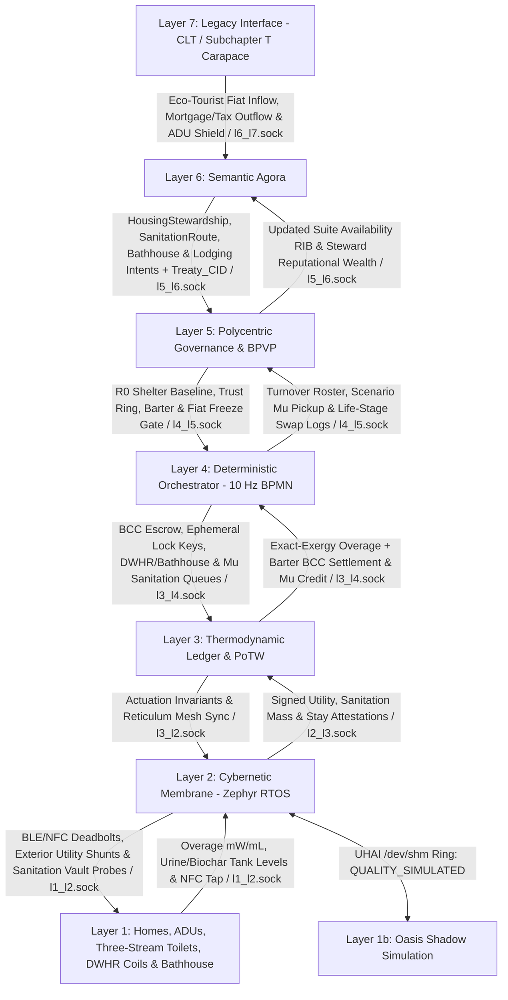
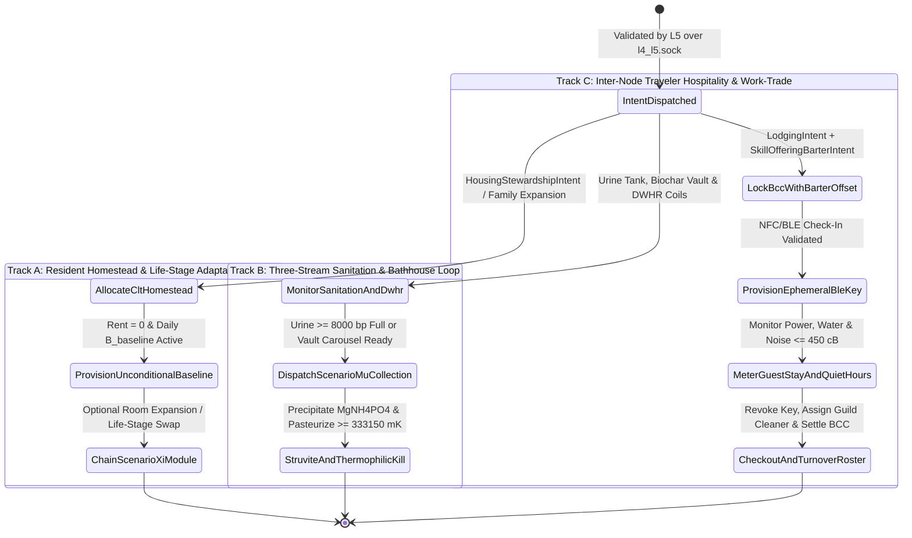

# Scenario Zeta: Resident Housing Commons, Domestic Sanitation Loops, Bathhouse Sanctuary & Inter-Node Hospitality

*   **Identifier:** `SCN-ZETA-LODGE`
*   **System Epic:** Decommodified Resident Housing ($B_{\mathrm{baseline}}$ Shelter), Adaptive Life-Stage Homesteads, Three-Stream Domestic Sanitation & Nutrient Separation (Urine/Blackwater/Greywater Bridge to Scenario Mu), Communal Bathhouse & Laundry Exergy Recovery, and Inter-Node Traveler Hospitality
*   **Primary Layers Tested:** L1 (Physical Reality), L1b (Oasis Shadow Simulation), L2 (Cybernetic Membrane), L3 (Thermodynamic Ledger), L4 (Deterministic Orchestrator), L5 (Polycentric Governance & BPVP), L6 (Semantic Translation & Agora), L7 (Legacy Interface)
*   **Pass/Fail Metric:** $10000\text{ basis points}$ ($100\%$) of settlement residents housed in rent-free, non-speculative Community Land Trust (CLT) / Perpetual Purpose Trust (PPT) dwellings with unconditional baseline thermal comfort ($291150\,\mathrm{mK}$–$297150\,\mathrm{mK}$), water, and electricity; $\ge 5500\,\mathrm{bp}$ ($55\%$) drain-water heat recovery (DWHR) in domestic showers and communal bathhouses; $\ge 9000\,\mathrm{bp}$ ($90\%$) separation of domestic human nitrogen/phosphorus (urine diversion + biochar humanure vaults) routed to Scenario Mu with zero raw sewage discharge; peer-to-peer inter-node traveler stays settled via Pairwise Bilateral Clearing Channels ($B_{u \to v}(t) + B_{v \to u}(t) = 0$) and skill-barter offsets; bounded external eco-tourism halting strictly at monthly fiat ceiling $\Phi_t$; zero floating-point math.

---

## Architectural Council Ratification & 5-Perspective Synthesis

This scenario specification has been ratified by unanimous consensus of the 5-Persona Architectural Council to establish how The Collective satisfies the foundational human needs for permanent shelter, domestic hygiene, sanitation loop closure, and hospitality:

| Council Persona | Disciplinary Representative | Core Contribution to Scenario |
| :--- | :--- | :--- |
| **Game Designer** | Lead Systems & Gameplay Designer | Closing the core human-needs loop in Oasis (Shelter + Rest + Hygiene + Sanitation): agents sleep in cozy **Resident Hearth Dwellings** (`"Slept in a warm, debt-free timber home (+40 mood)"`), soak in the **Communal Bathhouse & Sauna** after forestry/foundry shifts (`+30 somatic recovery`), and use **Source-Separating Sanitation** that visibly feeds Scenario Mu's struvite and compost vats; inter-node travelers bring news, blueprints, and work-trade carpentry/gardening labor. |
| **Game Engineer** | Principal C++ Simulation & Engine Architect | Flecs ECS Data-Oriented Design (DOD): `ResidentHomesteadComponent`, `SanitationSeparationComponent`, `DrainWaterHeatRecoveryComponent`, `LodgingSuiteComponent`, and `BccTravelerLedgerComponent`; 32-bit compact voxels for dwellings, smart deadbolts, bathhouse heat exchangers, and urine/biochar diversion vaults; deterministic $10\,\mathrm{Hz}$ BPMN state engine (`col-execd`); self-contained C++20 fixed-point test harness with zero IEEE 754 floats. |
| **Sovereign Stack Specialist** | Sovereign Stack Systems Architect | Strict 7-layer adjacency across POSIX Unix Domain Sockets (`l1_l2.sock` through `l6_l7.sock`); zero software in Layer 1 (cryptographic HMAC-SHA256 BLE/NFC door challenge runs in Layer 2 Zephyr microcontrollers); unconditional Tier 2 Survival Baseline ($B_{\mathrm{baseline}}$) for resident housing and utility floors; Pairwise Bilateral Clearing Channels ($B_{u \to v}(t) + B_{v \to u}(t) = 0$) and multi-hop HTLCs for inter-node traveler hospitality. |
| **Solarpunk Thinker** | Bioregional Regenerative Ecologist | Abolishing both landlord rent-serfdom and the ecological insanity of flushing $10\text{ Liters}$ of potable drinking water to dispose of human nutrients; establishing **Three-Stream Domestic Sanitation** (Yellowwater urine $\to$ Scenario Mu struvite $\mathrm{MgNH_4PO_4 \cdot 6H_2O}$; Blackwater solids + biochar $\to$ thermophilic sanitation; Greywater showers/laundry $\to$ DWHR copper heat-exchangers + reed-bed wetlands) and communal Nordic/Japanese bathhouses heated by kiln/compute waste heat. |
| **Scenario Specialist** | Cooperative Housing Counsel, Ecological Sanitation Engineer & Hospitality Architect | 99-year CLT Homestead Leases and Limited-Equity Housing Cooperative structures; counter-flow copper Drain-Water Heat Recovery ($\eta_{\mathrm{DWHR}} \ge 5500\,\mathrm{bp}$); negative-pressure biochar composting vaults and thermophilic pathogen eradication ($\ge 333150\,\mathrm{mK}$); 3-stage incremental housing blueprints (`Suburban Co-Living & ADU` $\to$ `Fence-Removed Courtyard Co-Housing & Eco-Hostel` $\to$ `Debt-Free CLT Eco-Village`). |

**Ratification Statement:** Unanimous Consensus Reached across all five disciplinary perspectives.

---

## 1. Problem Statement, Legacy Failure & Macro-Domain Vision

In legacy industrial-capitalist infrastructure (Layer 7), the most basic physical requirements of human shelter, domestic hygiene, sanitation, and travel hospitality are trapped in extractive and ecologically linear systems:
1.  **Landlord Rent-Serfdom & Speculative Mortgage Bondage:** Shelter—a non-negotiable biological necessity—is treated as a speculative financial asset. Workers surrender $3500\text{ to } 6000\,\mathrm{bp}$ ($35\%$ to $60\%$) of their life energy to pay landlords or thirty-year compound-interest bank mortgages, while private-equity firms buy up residential neighborhoods for short-term vacation rentals, driving homelessness and displacement.
2.  **Mismatch of Housing to Life-Stage Needs:** Nuclear families with newborns (Scenario Delta) are squeezed into cramped apartments while empty-nesters and isolated elders (Scenario Phi) rattle around in high-maintenance suburban houses because speculative real-estate transaction costs and property-tax resets punish cooperative resizing.
3.  **The Flush-and-Forget Sanitation Catastrophe:** Legacy residential plumbing uses purified, chlorinated drinking water to flush human urine and feces into centralized sewers—wasting $3000\,\mathrm{bp}$ ($30\%$) of household potable water while dumping millions of tons of dietary phosphorus ($\mathrm{P}$), nitrogen ($\mathrm{N}$), and potassium ($\mathrm{K}$) into rivers and ocean dead zones, forcing farmers to mine depleted rock-phosphate deposits.
4.  **Unmetered Thermal Waste & Extractive Hospitality Platforms:** Every domestic hot shower dumps $313150\,\mathrm{mK}$ ($40^\circ\mathrm{C}$) water straight down the drain without heat recovery, while commercial travel platforms siphon $1500\text{ to } 3000\,\mathrm{bp}$ ($15\%$ to $30\%$) of stay value and rely on exploited gig-economy cleaners.

### The Collective Macro-Domain Vision
Scenario Zeta is **The Housing, Domestic Hygiene, Sanitation Loop & Convivial Hospitality Commons of The Collective**. Together with Scenario Gamma (Nourishment), Scenario Beta (Water, Power & Data Conduits), and Scenario Delta (Family Care), Scenario Zeta closes the loop on **foundational human physiological needs** across **six integrated pillars**:
1.  **Decommodified Permanent Resident Housing & Life-Stage Stewardship ($R_0 \dots R_1$):** Rent-free, speculation-proof homesteads held in a Community Land Trust (CLT) / Perpetual Purpose Trust (PPT), with voluntary life-stage housing adaptation and unconditional baseline utility floors ($B_{\mathrm{baseline}}$).
2.  **Three-Stream Domestic Sanitation & Nutrient Separation (Direct Bridge to Scenario Mu & Gamma):** Closing the human metabolic loop inside every bathroom—separating **Yellowwater (urine)** for struvite phosphorus precipitation, **Blackwater (humanure solids + biochar)** for thermophilic pathogen eradication and forestry humus, and **Greywater (showers/laundry)** for reed-bed filtration.
3.  **Communal Bathhouses, Saunas, Shared Laundry & Drain-Water Heat Recovery:** High-efficiency domestic and communal bathing/laundry infrastructure recapturing $\ge 5500\,\mathrm{bp}$ ($55\%$) of hot-water exergy via copper counter-flow heat exchangers and district PEX-a thermal cascades.
4.  **Inter-Node Convivial Hospitality & Traveler Mesh ($R_2 \dots R_5$):** Welcoming traveling guild stewards, apprentices, and visitors into dedicated guest suites settled via Pairwise Bilateral Clearing Channels ($BCC$) and reciprocal work-trade skill barter (`SkillOfferingBarterIntent`), plus unconditional $R_0$ storm/emergency sanctuary.
5.  **Bounded Layer 7 Eco-Tourism & Mortgage-Elimination Carapace ($\Phi_t$):** Utilizing excess guest suite capacity to host external tourists/retreats strictly up to the monthly fiat ceiling $\Phi_t$ to pay down legacy mortgages and property taxes until the settlement's housing stock is $100\%$ debt-free.
6.  **Incremental Node Facility Blueprints (Suburban Co-Living to Bioregional Eco-Village):** Scaling from a single shared suburban house + backyard ADU (`Stage 1`) to a fence-removed multi-lot co-housing cluster (`Stage 2`) to a custom-built CLT Eco-Village (`Stage 3`).

---

## 2. The Six Pillars of Shelter, Sanitation & Hospitality

| Pillar Domain | Physical Infrastructure (L1) | Core Thermodynamic / Governance Rule | Primary Scenarios Chained |
| :--- | :--- | :--- | :--- |
| **1. Permanent Resident Housing ($R_0/R_1$)** | CLT/PPT cottages, apartments, family hearths, modular ADUs, triple-pane passive-solar envelopes. | **Inalienable Shelter Baseline ($B_{\mathrm{baseline}}$):** Zero internal rent/mortgages; unconditional thermal ($291150\text{–}297150\,\mathrm{mK}$), water & power floor. | **Scenario Xi** (Living Architecture), **Scenario Delta** (Family Expansion), **Scenario Phi** (Elder Access). |
| **2. Three-Stream Domestic Sanitation** | Urine-diverting porcelain toilets, negative-pressure biochar composting vaults, vacuum biogas lines. | $\ge 9000\,\mathrm{bp}$ ($90\%$) human $\mathrm{N/P/K}$ nutrient separation; mandatory $\ge 333150\,\mathrm{mK}$ ($60^\circ\mathrm{C}$) thermophilic pathogen kill in Scenario Mu. | **Scenario Mu** (Struvite $\mathrm{MgNH_4PO_4}$, Biochar & Biogas), **Scenario Gamma/Eta** (Fertilizer). |
| **3. Bathhouse, Laundry & Heat Recovery** | Domestic showers, communal *sento*/sauna bathhouse, solar-thermal laundry, copper DWHR coils. | Counter-flow Drain-Water Heat Recovery $\eta_{\mathrm{DWHR}} \ge 5500\,\mathrm{bp}$ ($55\%$); greywater routed to subsurface reed beds. | **Scenario Beta** (PEX-a Thermal Cascade & Reed Beds), **Scenario Epsilon** (Server Heat). |
| **4. Inter-Node Traveler Hospitality** | Dedicated guest ADUs/cabins, BLE/NFC deadbolts, welcome baskets, rotational guild turnover. | Settled via Pairwise BCC ($B_{u \to v} + B_{v \to u} = 0$) net of verified `SkillOfferingBarterIntent`; zero gig-cleaning apps. | **Scenario Kappa** (Visiting Apprentices), **ScenarioGamma** (Welcome Baskets). |
| **5. Layer 7 Eco-Retreat Carapace ($\Phi_t$)** | Outward-facing guest cabins & educational retreat bookings managed via `col-adversaryd`. | External tourist fiat pays property taxes & legacy mortgages strictly up to $\Phi_t$; automatic freeze at $10000\,\mathrm{bp}$ ($100\%$). | **Scenario Epsilon** (Shared Legal/Tax Carapace), **Scenario Omega** (Debt Decoupling). |
| **6. Incremental Housing Blueprints** | `Stage 1: Co-Living House + ADU` $\to$ `Stage 2: Fence-Removed Co-Housing Block` $\to$ `Stage 3: CLT Eco-Village`. | Progressive removal of speculative debt and fences; $100\%$ non-commodification of land and dwellings. | **Scenario Xi** (Modular Retrofit), **Scenario Mu** (Sprawl Deconstruction). |

### Pillar I: Decommodified Permanent Resident Housing & Life-Stage Stewardship ($R_0 \dots R_1$)
In The Collective, housing is never a commodity for rent extraction or speculative flipping; it is the physical vessel of the **Convivial Sanctuary ($R_0$)**:
1.  **Zero-Rent CLT Homestead Tenure:** Land and structural envelopes are held permanently in the settlement's **Community Land Trust (CLT) / Irrevocable Perpetual Purpose Trust (PPT)**. Resident stewards hold an inheritable, non-marketable **99-Year Homestead Stewardship Lease**. Because there is no landlord profit margin and no speculative land inflation, internal residents pay **zero rent**.
2.  **Unconditional Domestic Utility Floor ($B_{\mathrm{baseline}}$):** Every domestic dwelling receives an unconditional daily allocation of $48\,\mathrm{V}$ DC electricity (lighting, refrigeration, communications), potable water, and hydronic radiant heating/cooling ($291150\,\mathrm{mK}$ to $297150\,\mathrm{mK}$ / $18^\circ\mathrm{C}$ to $24^\circ\mathrm{C}$). Only luxury overage consumption above the household baseline is metered against the household's Exergy Credit balance.
3.  **Adaptive Life-Stage Housing & Modular Expansion (Chained to Scenario Delta, Phi & Xi):**
    *   When a household registers a pregnancy or birth in **Scenario Delta**, or welcomes aging parents in **Scenario Phi**, they can submit a `HousingAdaptationIntent`.
    *   The settlement either coordinates a voluntary, non-monetary homestead swap with an empty-nest household desiring a smaller cottage, or dispatches **Scenario Xi (`xi_architecture.md`)** and **Scenario Alpha (`alpha_fabrication.md`)** stewards to bolt on a pre-fabricated, dry-joinery mass-timber/hempcrete bedroom module!
4.  **Absolute Domestic Privacy (`R_0` Sanctuary Invariant):** Resident homes contain **zero Layer 2 telemetry sensors inside private living or sleeping quarters**. Boundary utility meters (total electrical shunt and total water flow pulse counter) sit strictly on the exterior service manifold outside the home's physical envelope.

### Pillar II: Three-Stream Domestic Sanitation & Nutrient Loop Closure (Bridge to Scenario Mu)
Scenario Zeta eliminates the ecological dead-end of flush-sewer pollution by designing every residential bathroom, guest suite, and communal bathhouse around **Three-Stream Source-Separating Sanitation**, feeding directly into **Scenario Mu (`mu_extraction.md`)**:

1.  **Stream 1 — Yellowwater (Source-Separating Urine Diversion $\to$ Struvite Phosphorus Recovery):**
    *   Every toilet features a hydro-dynamically sculpted front urine-diversion bowl (glazed ceramic or electropolished `316L` stainless steel fabricated via Scenario Theta/Alpha) equipped with an odor-blocking mechanical membrane trap (requiring zero flush water or a $50\,\mathrm{mL}$ mist).
    *   Diverted urine flows through dedicated PVC/HDPE gravity lines into sealed subterranean neighborhood holding tanks routed to **Scenario Mu's Struvite Reactor**. By dosing magnesium oxide ($\mathrm{MgO}$) at $\mathrm{pH} = 8800\text{–}9200\,\mathrm{mpH}$, $> 9500\,\mathrm{bp}$ ($95\%$) of human-excreted orthophosphate and ammonium precipitates as odorless, crystalline **struvite ($\mathrm{MgNH_4PO_4 \cdot 6H_2O} \downarrow$)**—returning pure mineral fertilizer to **Scenario Gamma's** market gardens and closing the human phosphorus loop!
2.  **Stream 2 — Blackwater / Solid Humanure (Biochar-Indexed Dry Vaults or Vacuum Biogas Digesters):**
    *   *Option A (Dry Biochar-Indexed Carousel Vaults for Cottages & ADUs):* Solid excreta drops vertically through a straight chute into a negatively pressurized basement carousel chamber (where a $5\,\mathrm{W}$ $48\,\mathrm{V}$ DC solar exhaust fan pulls continuous downdraft air through an exterior bio-charcoal filter, guaranteeing **zero bathroom odor**). Each use triggers a mechanical auger dosing $150\,\mathrm{g}$ of **Scenario Mu pyrolysis biochar fines** mixed with **Scenario Alpha/Eta hardwood sawdust** ($25 \le C:N \le 30$). Biochar's high cation-exchange capacity traps $100\%$ of volatile ammonia. Filled carousels rotate to cure and transfer via sealed drums to Scenario Mu's thermophilic sanitation bays (**$\ge 333150\,\mathrm{mK}$ / $60^\circ\mathrm{C}$ for $\ge 604{,}800{,}000\,\mathrm{ms}$ = $7\text{ continuous days}$**, followed by $12\text{-month}$ mycelial curing) for exclusive application to **Scenario Eta non-food timber trees**.
    *   *Option B (Ultra-Low-Flush Vacuum Biogas Lines for Multi-Story Co-Housing):* Uses $500\,\mathrm{mL}$ per flush (a $9500\,\mathrm{bp}$ / $95\%$ water reduction vs. legacy toilets) to pull solids into a sealed **Scenario Mu Anaerobic Digester**, generating methane ($\mathrm{CH_4}$) for kiln firing while thermally pasteurizing the digestate.
3.  **Stream 3 — Greywater (Showers, Sinks & Laundry $\to$ Heat Recapture + Constructed Wetlands):**
    *   Because all soaps, shampoos, and laundry detergents provisioned in Scenario Zeta are $100\%$ biocompatible potassium-salt and saponin formulations (free of boron, sodium lauryl sulfate, and synthetic fragrances), domestic wash water contains zero toxins.
    *   After passing through lint/hair traps and copper heat-recovery coils, greywater flows directly into **Scenario Beta's** subsurface horizontal-flow *Typha* and *Phragmites* constructed wetlands ($BOD_5$ and nitrate polishing), recharging local groundwater swales.

### Pillar III: Communal Bathhouses, Shared Laundry & Drain-Water Heat Recovery (DWHR)
Beyond private bathrooms, Scenario Zeta restores one of humanity's oldest convivial traditions: the **Neighborhood Bathhouse & Sauna Commons ($R_1$)**:
1.  **Counter-Flow Copper Drain-Water Heat Recovery ($\eta_{\mathrm{DWHR}} \ge 5500\,\mathrm{bp}$):**
    *   In both private showers and the communal bathhouse, outgoing warm greywater ($311150\,\mathrm{mK}$ / $38^\circ\mathrm{C}$) spirals down a vertical copper drain pipe wrapped tightly by incoming cold potable water supply coils ($283150\,\mathrm{mK}$ / $10^\circ\mathrm{C}$).
    *   Conductive heat exchange pre-warms incoming cold water to $\ge 298150\,\mathrm{mK}$ ($25^\circ\mathrm{C}$) before it ever enters the hot-water tank—recovering $\ge 5500\,\mathrm{bp}$ ($55\%$) of bathing thermal exergy automatically under pure Layer 1 physics!
2.  **The Convivial Bathhouse & Sauna (Powered by Compute & Kiln Waste Heat):**
    *   Heated by **Scenario Beta's** district PEX-a hydronic cascade (drawing $333150\,\mathrm{mK}$–$353150\,\mathrm{mK}$ water from **Scenario Epsilon** liquid-cooled server racks and **Scenario Mu/Theta** biochar kilns), the bathhouse offers hot soaking pools, cedar steam saunas, and cold plunges. After heavy physical shifts in forestry, foundry, or construction, stewards soak and socialize, dissolving physical fatigue and building community cohesion.
3.  **Shared Solar-Thermal Laundry Commons:**
    *   Rather than every apartment running an inefficient consumer washing machine and resistive electric dryer, residential clusters share commercial high-spin ($400\,\mathrm{G}$ extraction) front-load washers fed by solar-thermal hot water and heat-pump/solar-breeze drying yards (alongside Scenario Delta's dedicated autoclave diaper loop).

### Pillar IV: Inter-Node Convivial Hospitality & Traveler Mesh ($R_2 \dots R_5$)
To support free movement, cross-pollination of craft skills, and bioregional solidarity without commercial hotel extraction:
*   **Unconditional $R_0$ Traveler Sanctuary:** Any human arriving in distress or caught in severe weather is guaranteed unconditional emergency shelter, clean water, warm Scenario Gamma broth, and device charging in the $R_0$ Sanctuary Lodge without keys, fees, or identity checks.
*   **Peer-to-Peer Guest Suites & Work-Trade Barter ($R_2 \dots R_5$):** Settlements maintain dedicated guest ADUs and cabins (`LodgingOffering`) discoverable over BPVP. Visiting stewards from peered nodes lock a reservation across Pairwise BCCs (`LodgingIntent`), which is settled upon checkout against exact metered electrical/water overage minus verified **Work-Trade Stewardship (`SkillOfferingBarterIntent`)**—such as $6\text{ hours}$ of timber joinery in Scenario Xi, harvest help in Scenario Gamma, or teaching a seminar in Scenario Kappa!
*   **Rotational Guild Turnover (Zero Gig-Economy Exploitation):** Suite cleaning and linen sanitization are performed by rotational Hospitality Guild stewards using anonymous claim handles (`anon_handle_...`), earning Reputational Wealth ($\mathcal{R}$) protected by Care Leave Shields.

### Pillar V: Bounded Layer 7 Eco-Tourism & Mortgage-Elimination Carapace ($\Phi_t$)
How does a community transition existing houses from legacy bank mortgages into debt-free CLT commons?
*   During seasons when guest cabins or retreat suites are not needed by internal mesh travelers, `col-adversaryd` lists designated perimeter cabins (`ADU-CEDAR-CABIN`) on external eco-tourism channels or hosts weekend ecological/permaculture retreats for legacy visitors.
*   All inbound fiat flows directly into the cooperative's Layer 7 bank account to pay down legacy mortgages, municipal property taxes, and water/sewer minimums up to the monthly ceiling $\Phi_t$.
*   **Automatic Booking Freeze:** The moment cumulative monthly fiat reaches $\Phi_t$, `col-adversaryd` automatically freezes commercial tourist calendars for the rest of the month, returning $100\%$ of guest suites to internal commons use.

### Pillar VI: Incremental Node Facility Blueprints (Suburban Co-Living to CLT Eco-Village)
Scenario Zeta provides a concrete, three-stage spatial and legal blueprint for liberating housing from the speculative market:

1.  **Stage 1: Retrofitted Suburban Co-Living House & Backyard ADU (`R_0`–`R_1` Bootstrap):**
    *   **Physical Footprint:** A single suburban home shared by $3\text{–}6$ founding members or an extended family that builds/places a high-performance backyard Accessory Dwelling Unit (ADU) or tiny home on wheels. Retrofitted with a copper DWHR shower pipe, a laundry-to-landscape greywater diverter valve feeding backyard fruit trees (Scenario Gamma), and a urine-diverting biochar composting toilet in the ADU.
    *   **Layer 7 Protective Carapace (ADU Preemption, Functional-Family Zoning & HOA Shielding):** Municipal zoning codes often restrict "unrelated occupants," and HOAs oppose tiny homes. Stage 1 utilizes **State ADU Preemption Statutes** (which void municipal and HOA bans on permitted ADUs), structures the main house as a **Single Functional Co-Living Household** sharing a common kitchen and pantry under a **UUNAA § 6** domestic agreement (protected under state constitutional privacy/association doctrines), and retains the legacy municipal sewer hookup on the main house to satisfy building inspectors while shifting actual nutrient load into permitted greywater/compost loops.
2.  **Stage 2: Fence-Removed Multi-Lot Co-Housing Cluster & Eco-Hostel (`R_1`–`R_3` Self-Sustenance):**
    *   **Physical Footprint:** As adjacent suburban houses or a $6\text{–}20\text{ unit}$ courtyard apartment/motel are leased or acquired, stewards **physically remove the wooden dividing fences between the backyards**—merging isolated suburban lots into a contiguous park-like **Settlement Commons ($R_1$)** with a shared **Scenario Gamma** hearth kitchen, a **Scenario Delta** childcare play glade, a wood/hydronic **Communal Bathhouse & Sauna**, shared solar laundry, and $2\text{–}4$ dedicated traveler/eco-retreat suites!
    *   **Layer 7 Self-Sustaining Carapace ($\Phi_t$):** Title is transferred into a **Limited-Equity Housing Cooperative / CLT** docked with **Scenario Epsilon's** Subchapter T carapace. Bounded external eco-retreat bookings and guest stays generate the fiat required to service the underlying blanket mortgage and property taxes ($\Phi_t$), systematically amortizing legacy bank debt toward zero.
3.  **Stage 3: Custom-Built / Ecologically Deconstructed Bioregional CLT Eco-Village (`R_0`–`R_5` Bioregional Maturity):**
    *   **Physical Footprint:** Debt-free land held in an **Irrevocable Perpetual Purpose Trust (PPT) / CLT**, built with **Scenario Xi** mass-timber, hempcrete, cob, and salvaged urbanite. Dwellings are clustered around car-free `No-Transit` garden courtyards connected by buried PEX-a district heating, $48\,\mathrm{V}$ DC / $380\,\mathrm{V}$ HVDC microgrids, and full three-stream source-separating sanitation feeding **Scenario Mu's** struvite and biochar reactors—guaranteeing permanent, rent-free housing to every citizen for generations.

---

## 3. The Collective Workflow (7-Layer Traversal)



### Layer 1: Physical Reality ( & Layer 1b: Oasis Shadow Simulation)
*   **Domestic & Hospitality Envelopes:** Passive-solar mass-timber, hempcrete, and cellulose-insulated homes, cottages, and ADUs (`MAT_LODGING_SUITE_TERMINAL = 70`), triple-pane glazing, radiant hydronic floors, and motorized deadbolt solenoids with interior mechanical thumb-turns ("Red Lever" rule: humans can always exit or lock their doors mechanically without power).
*   **Three-Stream Sanitation & Bathhouse Hardware:** Glazed porcelain / `316L` stainless source-separating urine-diverting toilets, negative-pressure basement biochar-composting carousels with mechanical sawdust/biochar augers, copper counter-flow Drain-Water Heat Recovery (DWHR) vertical pipe coils, cedar steam saunas, and high-spin commercial solar-thermal washing machines.
*   **Strict Layer Separation:** Layer 1 contains **zero software, zero firmware, zero cryptographic keys, and zero network routing daemons.**

### Layer 2: The Cybernetic Membrane (`col-sensord`, `col-actuated`, `col-membraned`)
*   **Convivial Anti-Panopticon Shield (`R_0` Domestic Sanctity):**
    *   **Permanent resident homes contain zero interior sensors.** Utility shunts and pulse water meters sit strictly on the exterior service manifold to verify baseline vs. overage consumption.
    *   In guest suites, cryptographic HMAC-SHA256 BLE/NFC door challenge verification runs in Layer 2 Zephyr microcontrollers (`ATECC608A`), and nighttime quiet-hours sensors emit scalar integer centibels ($\mathrm{cB}$, limit $\le 450\,\mathrm{cB}$ between $22{:}00$ and $07{:}00$) with **zero audio recording capability**.
*   **Canonical Fixed-Point SI Wire Formats (CBOR over `/run/collective/ipc/l2_l3.sock`):**
    *   `node/housing/manifold_04/telemetry/power_mw` & `water_ml`: Exterior manifold electrical draw (`int64_t`, $\mathrm{mW}$) and water volume (`uint32_t`, $\mathrm{mL}$).
    *   `node/bathhouse/dwhr_01/telemetry/cold_in_mk` & `preheated_out_mk`: DWHR heat-exchanger temperatures (`uint32_t`, millikelvin; verifying $\eta_{\mathrm{DWHR}} \ge 5500\,\mathrm{bp}$).
    *   `node/sanitation/urine_tank_02/telemetry/volume_ml`: Diverted yellowwater volume ready for Scenario Mu struvite precipitation (`uint32_t`, milliliters).
    *   `node/sanitation/biochar_vault_02/telemetry/mass_mg` & `exhaust_dp_pa`: Solid humanure+biochar vault mass (`uint64_t`, milligrams) and negative-pressure downdraft fan differential pressure (`int32_t`, pascals).

### Layer 3: The Thermodynamic Ledger (`col-storaged`)
*   **Inalienable Resident Housing & Utility Baseline ($B_{\mathrm{baseline}}$):**
    Resident homestead leases carry **zero rent and zero debt service** on Layer 3. Each resident household is credited an unconditional daily utility baseline $B_{\mathrm{baseline}}(\mathrm{household})$ covering heating/cooling, potable water, and domestic power; only consumption exceeding $B_{\mathrm{baseline}}$ is debited in microjoules ($1\text{ Exergy Credit} \equiv 3{,}600{,}000{,}000{,}000\,\mu\mathrm{J}$).
*   **Inter-Node Traveler Exact-Exergy & Work-Trade Barter Settlement:**
    For inter-node guest stays (`LodgingIntent`), Layer 3 locks an HTLC/BCC reservation across peering nodes $u$ and $v$ ($B_{u \to v}(t) + B_{v \to u}(t) = 0$) and settles at checkout according to exact physical consumption net of DWHR heat recovery and verified work-trade labor:
    $$\Delta \mathcal{E}_{\mathrm{lodging}} = \max\left(0, \; \mathcal{E}_{\mathrm{base\_turnover}} + \int_{0}^{T} \Big[ P_{\mathrm{elec}}(t) + \dot{V}_{\mathrm{water}}(t) \cdot \lambda_{\mathrm{thermal}} \cdot (1 - \eta_{\mathrm{DWHR}}) \Big] dt - \mathcal{E}_{\mathrm{skill\_barter}} \right)$$

### Layer 4: The Deterministic Orchestrator (`col-execd`)
Communicating with Layer 5 over `/run/collective/ipc/l4_l5.sock` and Layer 3 over `/run/collective/ipc/l3_l4.sock`, the $10\,\mathrm{Hz}$ BPMN state engine coordinates resident housing stewardship, three-stream sanitation routing, and traveler hospitality:



### Layer 5: Polycentric Governance & BPVP (`col-kmsd`)
*   **Unconditional $R_0$ Sanctuary & Anti-Eviction Guarantee:** Under the Entrenched Core of the Constitution (`Chapter 6`), no resident member or family can ever be evicted from their $R_0$ homestead for lack of labor, illness, old age, or Exergy Credit balance.
*   **Protocol of Refusal & `No-Transit` Living Glades:** Private homes, bathhouses, and residential courtyards are permanently shielded from interior digital-twin sensors under the Protocol of Refusal and assert `No-Transit` attributes in BPVP to keep motor vehicles on settlement perimeters.
*   **Hospitality & Sanitation Guild Stewardship:** Stewards who maintain bathhouses, launder guest linens, or manage three-stream sanitation vaults claim tasks via anonymous handles (`anon_handle_...`) and earn decaying, sublinearly capped ($\le 800\,\mathrm{bp}$) Reputational Wealth ($\mathcal{R}$), protected by Care Leave Shields.

### Layer 6: Semantic Translation & Agora (`col-commonsd`)
Layer 6 structures housing, sanitation, and hospitality workflows into W3C JSON-LD Knowledge Artifacts:
1.  **`HousingStewardshipIntent` & `HousingAdaptationIntent`:** Assigns 99-year CLT homestead leases, coordinates voluntary life-stage housing swaps (e.g., growing Scenario Delta families trading with downsizing elders), or chains modular room additions to **Scenario Xi**.
2.  **`SanitationCollectionIntent` (Scenario Mu Bridge):** Automatically dispatches sealed vacuum/drum collection when source-separated urine tanks or biochar-composting carousels reach $8000\,\mathrm{bp}$ ($80\%$) capacity, routing yellowwater to struvite reactors and solid vaults to thermophilic composting.
3.  **`LodgingIntent` & `SkillOfferingBarterIntent`:** Books inter-node guest suites with optional work-trade skill barter offsets governed by a Tripartite Ricardian Treaty ($\mathrm{Treaty\_CID}$).

```mermaid
graph TD
    subgraph Layer 6: Housing, Sanitation & Hospitality Ontology
        L6_Home[HousingStewardshipIntent & AdaptationIntent]
        L6_San[SanitationCollectionIntent: <br>Yellowwater, Biochar Solids & Greywater]
        L6_Guest[LodgingIntent + SkillOfferingBarterIntent]
    end

    subgraph Layer 5: Polycentric Governance Gates
        P_Base{Constitutional Shelter Gate: <br>Unconditional R0 Tenure & B_baseline}
        P_Eco{Sanitation & DWHR Gate: <br>Zero Raw Sewage & DWHR >= 5500 bp?}
        P_Guest{Traveler & Fiat Gate: <br>R0 Sanctuary, BCC Peer or Tourist < Phi_t?}
    end

    subgraph Layer 4: Deterministic BPMN Orchestrators
        BPMN_Home[CLT Homestead & Scenario Xi Expansion Engine]
        BPMN_San[Three-Stream Sanitation & Scenario Mu Bridge]
        BPMN_Hostel[Guest Lock, Work-Trade & Turnover Engine]
    end

    L6_Home --> P_Base
    P_Base -->|Guaranteed| BPMN_Home

    L6_San --> P_Eco
    P_Eco -->|Verified| BPMN_San

    L6_Guest --> P_Guest
    P_Guest -->|Approved| BPMN_Hostel
```

### Layer 7: The Legacy Interface (The Dual-Membrane Carapace)
Executed by `col-adversaryd` (frequently docked with **Scenario Epsilon's** shared administrative carapace):
1.  **CLT / PPT Title Holding & Homestead Tax Exemptions:** Real estate title is held in the Community Land Trust / Perpetual Purpose Trust, filing state low-income/cooperative homestead property-tax exemptions where applicable and insulating individual residents from municipal liens.
2.  **ADU, Greywater & On-Site Sanitation Code Compliance:** Stage 1/2 retrofits utilize state ADU preemption laws, NSF/ANSI 41 certified composting toilet standards, and laundry-to-landscape greywater tiers while maintaining required municipal backflow preventers (RPZ).
3.  **Bounded Eco-Tourism Mortgage Amortization ($\Phi_t$):** External tourist stays pay down legacy property mortgages and municipal taxes strictly up to $\Phi_t$, freezing automatically once the monthly target is met.

---

## 4. Machine-Readable Schemas

### Layer 6 Knowledge Artifact: Homestead Sanitation Loop & Inter-Node Traveler Work-Trade Intent (`zeta_shelter_and_hospitality.jsonld`)

```json
{
  "@context": [
    "https://schema.org/",
    "https://collective.network/ontology/v1/"
  ],
  "@type": "ShelterSanitationAndLodgingManifest",
  "identifier": "urn:uuid:e5f6a9b2-33cc-4e1a-9f01-8c4d2e1f5b6c",
  "settlementNodeDid": "did:peer:2.Ez6MksD...duvall_clt_housing_commons",
  "facilityStageBlueprint": "STAGE_2_FENCE_REMOVED_COHOUSING_AND_ECO_HOSTEL",
  "creationTimestampMs": 1791446400000,
  "treatyCid": "bafybeihdwdcefgh4dqkjv67uzcmw7ojee6xedeet6wfvikrwho3qnwjxye",
  "residentHomesteadCluster": {
    "cltLeaseTenureYears": 99,
    "internalMonthlyRentMicrojoules": 0,
    "internalMonthlyRentFiatCents": 0,
    "householdsHousedCount": 14,
    "dailyUnconditionalUtilityBaselineMicrojoules": 43200000000000,
    "interiorPrivateSensorsInstalled": 0
  },
  "threeStreamSanitationAndBathhouse": {
    "yellowwaterUrineDivertedMilliliters": 185000,
    "targetScenarioMuStruviteReactor": "MU-STRUVITE-REACTOR-01",
    "blackwaterBiocharSolidsMassMilligrams": 42000000,
    "biocharDoseRatioBasisPoints": 9200,
    "requiredThermophilicSanitationTempMillikelvin": 333150,
    "greywaterDwhrEfficiencyBasisPoints": 5800,
    "greywaterRoutedToReedBedMilliliters": 640000
  },
  "interNodeTravelerBooking": {
    "travelerDid": "did:peer:2.Ez6MksT...node09_traveler_kai",
    "suiteIdentifier": "ADU-CEDAR-CABIN-02",
    "stayDurationMilliseconds": 345600000,
    "skillBarterOffering": {
      "declaredSkill": "Carpentry_Timber_Repair_L2",
      "offeredDurationMilliseconds": 21600000,
      "chainedScenarioRef": "SCN-XI-ARCH",
      "exergyOffsetMicrojoules": 86400000000000
    },
    "maxBaseExergyMicrojoules": 234000000000000,
    "htlcHashDigest": "0x7b8c9d0e1f2a3b4c5d6e7f8a9b0c1d2e3f4a5b6c7d8e9f0a1b2c3d4e5f6a7b8c"
  }
}
```

### Layer 2 & Layer 3 Combined Attestation: Sanitation Routing, DWHR Recovery & Stay Settlement (`zeta_sanitation_and_stay_attestation.jsonld`)

```json
{
  "@context": "https://collective.network/ontology/v1/",
  "@type": "SanitationAndLodgingAttestation",
  "intentRef": "urn:uuid:e5f6a9b2-33cc-4e1a-9f01-8c4d2e1f5b6c",
  "suiteNodeDid": "did:peer:2.Ez6MksD...cabin_02_gateway",
  "anonGuestHandle": "anon_handle_5a2d8e1f",
  "sanitationAndThermalMetrics": {
    "dwhrColdInletTempMillikelvin": 283150,
    "dwhrPreheatedOutletTempMillikelvin": 299350,
    "dwhrShowerDrainTempMillikelvin": 311150,
    "verifiedDwhrEfficiencyBasisPoints": 5785,
    "urineTransferredToScenarioMuMilliliters": 185000,
    "biocharVaultNegativePressurePascals": -45,
    "rawSewageDischargedMilliliters": 0
  },
  "guestStayExecutionMetrics": {
    "durationMilliseconds": 344023000,
    "electricalEnergyMicrojoules": 80640000000000,
    "waterConsumedMilliliters": 340500,
    "maxAcousticNoiseNightCentibels": 412,
    "barterWorkCompletedMilliseconds": 21600000,
    "netBccSettlementMicrojoules": 228240000000000,
    "smartLockFinalState": "DEADBOLT_ENGAGED"
  },
  "hardwareReceiptSignature": "0x7b8c9d0e1f2a3b4c5d6e7f8a9b0c1d2e3f4a5b6c7d8e9f0a1b2c3d4e5f6a7b8c"
}
```

---

## 5. Oasis Engine Implementation Specification

### Voxel & ECS Representation in Oasis (Layer 1b)
Within Oasis, Scenario Zeta's residential dwellings, bathhouses, three-stream sanitation loops, and guest cabins occupy dedicated voxel material IDs and Flecs ECS components:
*   **Resident Homestead & Guest Suite Voxels (`MAT_RESIDENT_HEARTH_BED = 65`, `MAT_LODGING_SUITE_TERMINAL = 70`, `MAT_SMART_LOCK_DOOR_VOXEL = 71`):** Providing sleep/rest recovery, unconditional $R_0$ shelter buffs, and temporal voxel occupancy locks during active stays.
*   **Three-Stream Sanitation Voxels (`MAT_URINE_DIVERSION_TOILET = 66`, `MAT_BIOCHAR_COMPOST_VAULT = 67`):** Separating yellowwater (milliliters routed to Scenario Mu struvite vats) and blackwater solids (milligrams mixed with biochar/sawdust routed to Scenario Mu thermophilic composters), eliminating sewage pollution.
*   **Communal Bathhouse & DWHR Voxels (`MAT_BATHHOUSE_SAUNA_POOL = 75`, `MAT_COPPER_DWHR_COIL = 76`):** Coupled to Scenario Beta's PEX-a thermal pipes (`MAT_THERMAL_PEX_PIPE = 46`) and reed-bed swales (`MAT_SWALE = 5`), recovering $\ge 5500\,\mathrm{bp}$ of shower heat and restoring agent stamina.

### C++20 Test Harness Code (Fixed-Point SI Integer Math)

```cpp
// engine/tests/scenario_zeta_test.cpp
#include <cassert>
#include <cstdint>
#include <string>
#include <vector>

namespace oasis::scenario_zeta {

// 1. Pillar I: Decommodified CLT Resident Housing & Unconditional Utility Baseline
struct ResidentHomesteadState {
    std::string household_did;
    uint32_t clt_lease_years{99};
    uint64_t monthly_rent_fiat_cents{0};
    uint64_t monthly_rent_exergy_uj{0};
    uint32_t interior_surveillance_sensors{0};
    uint64_t daily_baseline_allowance_uj{43200000000000ULL}; // 43,200 kJ/day unconditional floor
    uint64_t actual_daily_consumption_uj{0};
};

inline bool verify_resident_homestead_invariants(const ResidentHomesteadState& home,
                                                 uint64_t& billable_overage_uj) {
    // Constitutional shelter invariants: zero rent, >= 99-year CLT tenure, zero interior sensors
    if (home.monthly_rent_fiat_cents > 0 || home.monthly_rent_exergy_uj > 0) return false;
    if (home.clt_lease_years < 99 || home.interior_surveillance_sensors > 0) return false;

    // Only utility usage strictly exceeding the unconditional daily baseline is billed
    if (home.actual_daily_consumption_uj > home.daily_baseline_allowance_uj) {
        billable_overage_uj = home.actual_daily_consumption_uj - home.daily_baseline_allowance_uj;
    } else {
        billable_overage_uj = 0;
    }
    return true;
}

// 2. Pillar II & III: Three-Stream Domestic Sanitation & Copper Drain-Water Heat Recovery (DWHR)
struct SanitationAndDwhrTelemetry {
    uint64_t total_excreted_nutrients_mg{0};
    uint64_t separated_to_scenario_mu_mg{0};  // Urine -> Struvite + Solids/Biochar -> Thermophilic Compost
    uint32_t raw_sewage_discharged_ml{0};
    int32_t biochar_vault_pressure_pa{-45};   // Negative pressure (< 0 Pa) prevents bathroom odor
    uint32_t cold_water_inlet_mk{283150};     // 10 C (283,150 mK)
    uint32_t dwhr_preheated_outlet_mk{299350};// 299,350 mK preheated outlet
    uint32_t shower_drain_inlet_mk{311150};   // 38 C (311,150 mK)
};

inline bool verify_three_stream_sanitation_and_dwhr(const SanitationAndDwhrTelemetry& san) {
    if (san.raw_sewage_discharged_ml > 0 || san.biochar_vault_pressure_pa >= 0) return false;
    if (san.total_excreted_nutrients_mg == 0) return false;

    // Must separate and route >= 9000 bp (90%) of N/P/K nutrients to Scenario Mu
    uint64_t nutrient_capture_bp = (san.separated_to_scenario_mu_mg * 10000ULL) / san.total_excreted_nutrients_mg;
    if (nutrient_capture_bp < 9000) return false;

    // Verify Copper Counter-Flow Drain-Water Heat Recovery efficiency >= 5500 bp (55%)
    if (san.shower_drain_inlet_mk <= san.cold_water_inlet_mk) return false;
    if (san.dwhr_preheated_outlet_mk <= san.cold_water_inlet_mk) return false;
    uint64_t delta_recovered_mk = san.dwhr_preheated_outlet_mk - san.cold_water_inlet_mk;
    uint64_t max_possible_delta_mk = san.shower_drain_inlet_mk - san.cold_water_inlet_mk;
    uint64_t dwhr_efficiency_bp = (delta_recovered_mk * 10000ULL) / max_possible_delta_mk;
    return dwhr_efficiency_bp >= 5500;
}

// 3. Pillar IV: Inter-Node Traveler Hospitality, Work-Trade Barter & Pairwise BCC
struct BccHospitalityChannel {
    int64_t balance_host_to_guest_uj{0};
    int64_t balance_guest_to_host_uj{0};
    int64_t credit_limit_uj{300000000000000LL};
};

inline bool settle_traveler_stay_with_barter(BccHospitalityChannel& ch,
                                             uint64_t base_stay_uj,
                                             uint64_t metered_utility_uj,
                                             uint64_t verified_skill_barter_uj,
                                             uint32_t max_night_noise_cb) {
    // Quiet hours compliance check (<= 450 cB = 45 dBA)
    if (max_night_noise_cb > 450) return false;
    uint64_t gross_stay_uj = base_stay_uj + metered_utility_uj;
    uint64_t net_due_uj = (gross_stay_uj > verified_skill_barter_uj)
                              ? (gross_stay_uj - verified_skill_barter_uj)
                              : 0;
    if (ch.balance_guest_to_host_uj + static_cast<int64_t>(net_due_uj) > ch.credit_limit_uj) return false;

    ch.balance_guest_to_host_uj += static_cast<int64_t>(net_due_uj);
    ch.balance_host_to_guest_uj -= static_cast<int64_t>(net_due_uj);
    return (ch.balance_guest_to_host_uj + ch.balance_host_to_guest_uj) == 0;
}

void run_all_scenario_zeta_tests() {
    // Test 1: Decommodified CLT Resident Housing & Unconditional Daily Utility Baseline
    ResidentHomesteadState family_hearth{
        .household_did = "did:peer:family_08",
        .clt_lease_years = 99,
        .monthly_rent_fiat_cents = 0,
        .monthly_rent_exergy_uj = 0,
        .interior_surveillance_sensors = 0,
        .daily_baseline_allowance_uj = 43200000000000ULL,
        .actual_daily_consumption_uj = 38000000000000ULL // Within unconditional baseline
    };
    uint64_t billable_overage_uj = 999;
    assert(verify_resident_homestead_invariants(family_hearth, billable_overage_uj) == true);
    assert(billable_overage_uj == 0); // Zero charge for baseline living!

    // Attempting to charge rent or install interior surveillance sensors must fail!
    ResidentHomesteadState landlord_violation = family_hearth;
    landlord_violation.monthly_rent_fiat_cents = 150000;
    assert(verify_resident_homestead_invariants(landlord_violation, billable_overage_uj) == false);

    // Test 2: Three-Stream Sanitation Separation (-> Scenario Mu) & Copper DWHR (>= 5500 bp)
    SanitationAndDwhrTelemetry eco_bathhouse{
        .total_excreted_nutrients_mg = 50000000ULL,
        .separated_to_scenario_mu_mg = 48200000ULL, // 9640 bp captured for struvite/compost
        .raw_sewage_discharged_ml = 0,
        .biochar_vault_pressure_pa = -45,
        .cold_water_inlet_mk = 283150,
        .dwhr_preheated_outlet_mk = 299350,         // +16,200 mK recovered out of 28,000 mK (5785 bp)
        .shower_drain_inlet_mk = 311150
    };
    assert(verify_three_stream_sanitation_and_dwhr(eco_bathhouse) == true);

    // Raw sewage discharge (> 0 mL) or positive vault pressure (odor leak) must fail!
    SanitationAndDwhrTelemetry sewage_leak = eco_bathhouse;
    sewage_leak.raw_sewage_discharged_ml = 6000;
    assert(verify_three_stream_sanitation_and_dwhr(sewage_leak) == false);

    // Test 3: Inter-Node Traveler Stay with Carpentry Work-Trade Barter & BCC Conservation
    BccHospitalityChannel bcc{};
    uint64_t base_stay_uj = 234000000000000ULL;
    uint64_t utility_uj   = 80640000000000ULL;
    uint64_t barter_uj    = 86400000000000ULL; // 6 hours carpentry in Scenario Xi
    assert(settle_traveler_stay_with_barter(bcc, base_stay_uj, utility_uj, barter_uj, 412) == true);
    assert(bcc.balance_guest_to_host_uj == 228240000000000LL);
    assert(bcc.balance_host_to_guest_uj == -228240000000000LL);
}

} // namespace oasis::scenario_zeta

int main() {
    oasis::scenario_zeta::run_all_scenario_zeta_tests();
    return 0;
}
```

---

## 6. Acceptance Test Gates (Pass/Fail)

| Checkpoint | Validation Method | Pass Condition |
| :--- | :--- | :--- |
| **G1: Decommodified CLT Resident Housing & Utility Floor ($B_{\mathrm{baseline}}$)** | Homestead Lease & Exterior Shunt Audit | $10000\,\mathrm{bp}$ ($100\%$) of resident households hold $\ge 99\text{-year}$ CLT/PPT leases at $0$ rent with $0$ interior sensors; daily water, heating, and power consumption up to $B_{\mathrm{baseline}}$ incurs $0$ Exergy Credit deductions. |
| **G2: Three-Stream Domestic Sanitation & Scenario Mu Bridge** | Mass Balance & Vault Pressure Check | $\ge 9000\,\mathrm{bp}$ ($90\%$) of domestic human nitrogen/phosphorus is separated via urine-diverting toilets ($\to$ Scenario Mu struvite $\mathrm{MgNH_4PO_4 \cdot 6H_2O}$) and negatively pressurized ($< 0\,\mathrm{Pa}$) biochar-composting vaults ($\to$ thermophilic sanitation $\ge 333150\,\mathrm{mK}$), with $0\,\mathrm{mL}$ raw sewage discharge. |
| **G3: Bathhouse & Shower Drain-Water Heat Recovery (DWHR)** | Thermocouple Delta-T Verification | Counter-flow copper DWHR coils pre-heat incoming cold shower/bathhouse water with verified thermal recovery efficiency $\eta_{\mathrm{DWHR}} \ge 5500\,\mathrm{bp}$ ($55\%$) before greywater enters Scenario Beta reed beds. |
| **G4: Inter-Node Traveler BCC & Work-Trade Barter Settlement** | Bilateral Ledger & Lock Token Audit | Ephemeral HMAC-SHA256 BLE/NFC guest keys operate $100\%$ offline; stays settle across Pairwise BCCs ($B_{u \to v}(t) + B_{v \to u}(t) = 0$) deducting verified `SkillOfferingBarterIntent` labor (e.g., Scenario Xi carpentry). |
| **G5: 3-Stage Incremental Housing Growth & Fence Removal** | Spatial Blueprint & Mortgage Audit | Supports progression from `Stage 1` (Suburban Co-Living House + Backyard ADU under state ADU preemption & UUNAA § 6) $\to$ `Stage 2` (Fence-Removed Multi-Lot Co-Housing & Eco-Hostel) $\to$ `Stage 3` (Debt-Free CLT Eco-Village). |
| **G6: Bounded Eco-Retreat Fiat Ceiling ($\Phi_t$)** | `col-adversaryd` Treasury Monitor | External tourist/retreat bookings amortize legacy mortgages and property taxes strictly up to monthly fiat target $\Phi_t$, automatically freezing commercial bookings once $\Phi_t$ is reached. |
