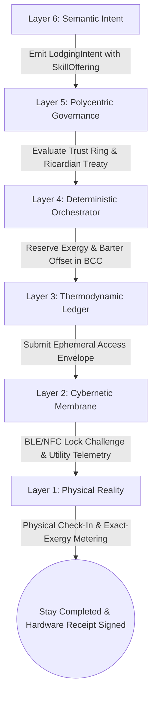
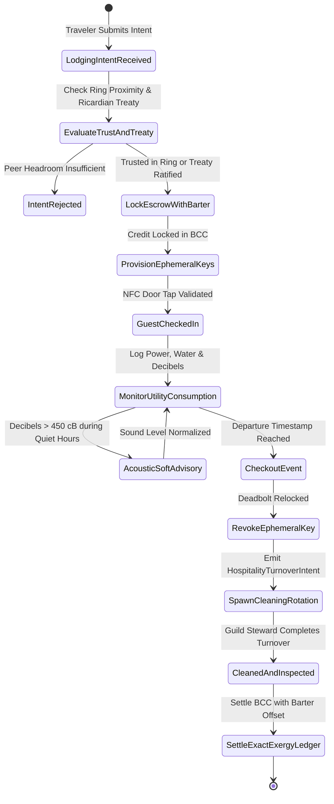
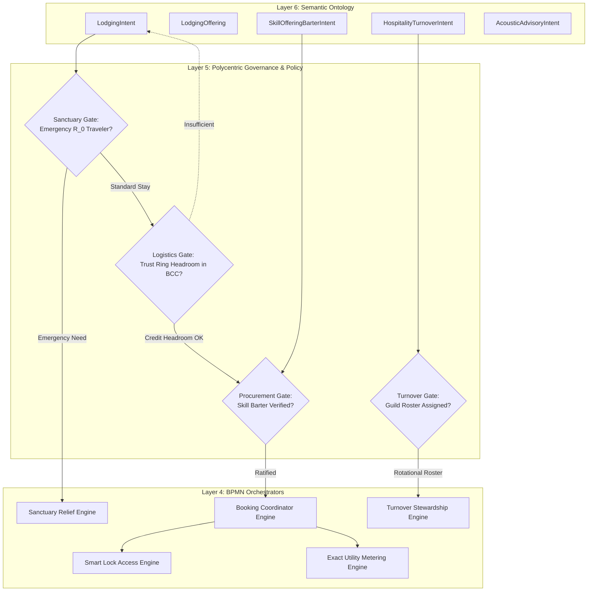
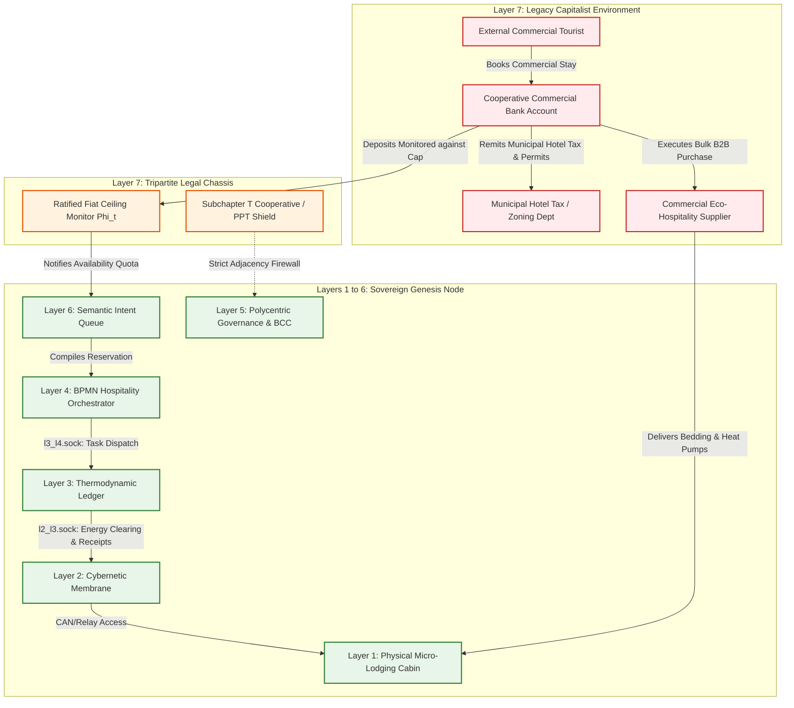

# Scenario Zeta: Convivial Hospitality & Micro-Lodging Mesh

*   **Identifier:** `SCN-ZETA-LODGE`
*   **System Epic:** Convivial Hospitality Sanctuary, Inter-Node Traveler Mesh, and Non-Monetary Lodging
*   **Primary Layers Tested:** L1 (Physical Reality), L2 (The Cybernetic Membrane), L3 (The Thermodynamic Ledger), L4 (The Deterministic Orchestrator), L5 (Polycentric Governance), L6 (Semantic Translation & Agora), L7 (The Legacy Interface)
*   **Pass/Fail Metric:** Peer-to-peer spatial booking and cryptographic door access completed under zero platform extraction; automated thermodynamic exergy and water metering in microjoules and milliliters; unconditional Convivial Sanctuary access in $R_0$; inter-node travel settled via Pairwise Bilateral Clearing Channels ($B_{u \to v}(t) + B_{v \to u}(t) = 0$) and reciprocal stewardship work-trade; bounded fiat extraction for external tourists halting strictly at ratified needs ceiling $\Phi_t$; zero hotel gig-markets.

---

## Architectural Council Ratification & 5-Perspective Synthesis

This scenario specification has been ratified by unanimous consensus of the 5-Persona Architectural Council:

| Council Persona | Disciplinary Representative | Core Contribution to Scenario |
| :--- | :--- | :--- |
| **Game Designer** | Lead Systems & Gameplay Designer | The Sims room environment scoring and rest recovery: Founder 01 hosting visiting travelers who perform carpentry or garden labor in exchange for lodging; psychological thoughts and stress accumulators (`"Enjoyed rich philosophical conversation with guest (+35 mood)"` vs `"Disturbed by noisy guest violating acoustic quiet hours (-40 stress)"`); Sims-style spatial comfort affordances; boundary interface where welcoming external travelers reduces border hostility and builds bioregional trade alliances. |
| **Game Engineer** | Principal C++ Simulation & Engine Architect | Flecs ECS DOD architecture: `LodgingSuiteComponent`, `BccTravelerLedgerComponent`, `HtlcDepositComponent`, `AccessChallengeComponent`; 32-bit compact voxels: `material_id = 70` `LODGING_SUITE_TERMINAL`, `material_id = 71` `SMART_LOCK_DOOR_VOXEL`; temporal voxel occupancy locking; 10 Hz BPMN booking state machine; compilable C++20 fixed-point test harness executing ephemeral door access, exact exergy reconciliation, and work-trade clearing with zero IEEE 754 floats. |
| **Sovereign Stack Specialist** | Sovereign Stack Systems Architect | 7-layer strict adjacency without layer skipping via `l1_l2.sock` through `l6_l7.sock`; zero software in Layer 1: door lock challenge verification runs in Layer 2 Zephyr microcontrollers; Pairwise Bilateral Clearing Channels ($B_{u \to v}(t) + B_{v \to u}(t) = 0$); multi-hop HTLCs; zero global tokens; zero fiat conversions; zero monolithic game-loop threading. |
| **Solarpunk Thinker** | Bioregional Regenerative Ecologist | Zero-waste regenerative hospitality: welcome baskets sourced from Scenario Gamma permaculture kitchens; guests integrate into local ecosystem rather than consuming sterile hotel disposables; thermodynamic transparency where electrical and water consumption is directly metered; closed-loop greywater recycling. |
| **Scenario Specialist** | Decentralized Hospitality & Spatial Rights Protocol Specialist | Cryptographic time-bound door lock token algorithm HMAC-SHA256 in integer fixed-point; exact exergy billing formula in microjoules and milliliters; municipal Accessory Dwelling Unit ADU legal insulation and transient occupancy tax shields under state cooperative lodging exemptions. |

**Ratification Statement:** Unanimous Consensus Reached. All five council personas have formally validated that this scenario specification adheres strictly to the 7-Layer Sovereign Stack architecture, eliminates all deprecated rhetoric, replaces floating-point math with fixed-point SI integer arithmetic, guarantees the Convivial Sanctuary ($R_0$) baseline, removes software from Layer 1, and anchors inter-node traveler settlements in Pairwise Bilateral Clearing Channels.

---

## 1. Problem Statement & Legacy Failure

In legacy late-stage capitalist infrastructure (Layer 7), short-term travel and hospitality have been aggressively captured by extractive surveillance platforms. These centralized intermediaries extract 1500 to 3000 basis points (15% to 30%) of gross transaction value from hosts and guests while offering zero genuine support when physical disputes arise.

When a traveler seeks temporary shelter or a community offers hospitality:
*   **Monopoly Rent Extraction & Platform Enclosure:** Commercial platforms extract massive transaction cuts, forcing hosts to inflate prices while subjecting users to centralized algorithms that can arbitrarily deplatform travelers without appeal, erasing accrued reputation.
*   **Housing Distortion & Community Displacement:** Speculative corporate investors purchase entire residential neighborhoods for full-time vacation rentals, destroying long-term housing stock and prompting municipal governments to impose blanket bans that penalize mutualist homestays.
*   **Unmetered Thermodynamic Externalities:** Legacy vacation rentals ignore energy efficiency. Guests routinely run air conditioning at low temperatures with windows open or take excessive hot showers, externalizing utility costs onto hosts and exacerbating regional grid stress.
*   **Precarious Gig-Economy Housekeeping:** Turnover cleaning is offloaded to precarious, underpaid gig-workers through on-demand cleaning apps, creating high stress, invisible exploitation, and low operational reliability.

---

## 2. The Collective Workflow (7-Layer Traversal)

Scenario Zeta establishes a sovereign micro-lodging mesh. It mathematically decouples hospitality from platform extraction by pricing stays in thermodynamic Exergy Credits, metering exact physical consumption, and integrating non-monetary skill-barter offsets under ratified Ricardian Treaties. The workflow traverses canonically from Layer 1 physical space up to Layer 7 commercial interfaces.



### Layer 1: Physical Reality
*   **Hardware Nodes (Lodging Suite Infrastructure):** A detached Accessory Dwelling Unit (ADU), tiny house on wheels, or retrofitted master suite equipped with high-performance cellulose insulation, triple-pane windows, and high-efficiency mini-split heat pump. Layer 1 contains zero software, zero firmware, zero cryptographic keys, and zero network routing daemons. It consists purely of structural building components, motorized deadbolt solenoids, plumbing lines, copper power buses, and raw analog/pulse sensors.
*   **Hardware Nodes (Sensors & Actuators):** Electronic deadbolt with embedded NFC coil and BLE antenna, DIN-rail smart electrical power meters, and pulse-output ultrasonic water flow meters.
*   **Inventory & Feedstock:** Organic cotton bed linens, permaculture welcome basket (fresh sourdough, seasonal fruit, herbal tea from Scenario Gamma), and non-toxic biodegradable soaps.
*   **Action:** Physical check-in, smartphone NFC tap to retract motorized deadbolt latch, comfortable rest in insulated envelope, and physical completion of agreed-upon work-trade stewardship tasks.

### Layer 2: The Cybernetic Membrane
*   **Embedded Controllers & Daemons:** Zephyr RTOS microcontrollers executing `col-sensord` and `col-actuated` across `/run/collective/ipc/l1_l2.sock`. Microcontrollers hold hardware roots of trust (ATECC608A) for signing sensor delivery receipts.
*   **Canonical Fixed-Point SI Wire Formats:**
    *   Active Electrical Power: `int64_t` milliwatts ($\mathrm{mW}$).
    *   Cumulative Fluid Water Volume: `uint32_t` milliliters ($\mathrm{mL}$, where $1000\,\mathrm{mL} \equiv 1\text{ liter}$).
    *   Ambient Sound Pressure: `uint32_t` centibels ($\mathrm{cB}$, where $450\text{ cB} \equiv 45\text{ dBA}$).
    *   Thermodynamic Temperature: `uint32_t` millikelvin ($\mathrm{mK}$).
    *   Session Duration: `uint64_t` milliseconds ($\mathrm{ms}$).
*   **Verification:** Cryptographic challenge-response handshake over Bluetooth Low Energy (BLE) or Near Field Communication (NFC) proving ownership of the authorized ephemeral guest key. Ambient decibel monitoring verifies quiet hours ($< 450\text{ cB}$ between 22:00–07:00) without recording private audio.
*   **Actuator Control:** Motorized deadbolt solenoid retracted via authenticated relay pin upon valid cryptographic token presentation.

### Layer 3: The Thermodynamic Ledger
*   **Pairwise Bilateral Clearing Channels (BCC):** Inter-node lodging transactions (e.g., traveler Kai from Node Duvall staying at Node 04) settle through pairwise channels satisfying the conservation invariant:
    $$B_{u \to v}(t) + B_{v \to u}(t) = 0$$
    bounded by mutual aid credit windows:
    $$-C_{u \to v} \le B_{u \to v}(t) \le C_{v \to u}$$
*   **Thermodynamic Exact-Exergy Billing & Barter Offset:** The guest's wallet commits an initial exergy reservation, settled upon checkout according to actual physical consumption and verified work-trade labor:
    $$\Delta \mathcal{E}_{\mathrm{lodging}} = \left( \mathcal{E}_{\mathrm{base\_stay}} + \int_{0}^{T} \left[ P_{\mathrm{elec}}(t) + \dot{V}_{\mathrm{water}}(t) \cdot \lambda_{\mathrm{thermal}} \right] dt + C_{\mathrm{deprec}} \right) - \mathcal{E}_{\mathrm{skill\_barter}}$$
    Where $\mathcal{E}_{\mathrm{base\_stay}}$ covers spatial use and linen washing depreciation in microjoules, electrical power and hot water are billed at exact thermodynamic marginal cost, and $\mathcal{E}_{\mathrm{skill\_barter}}$ deducts verified stewardship labor (e.g., 6 hours repairing timber frames in Scenario Xi).
*   **Multi-Hop Chained Hashed Timelock Contracts (HTLC):** Travelers crossing multiple watershed nodes lock HTLC contracts $\langle H(S), \Delta t, Q, u, v \rangle$ along the Bioregional Path-Vector route, releasing preimages upon signed departure receipts.
*   **Zero Global Tokens & Fiat Inconvertibility:** All ledger accounting is denominated in physical Exergy Credits ($1\text{ credit} \equiv 3600000000000\,\mu\mathrm{J} = 3600000\text{ J}$). Zero fiat conversions and zero speculative tokens exist.

### Layer 4: The Deterministic Orchestrator
The deterministic BPMN 2.0 engine (`col-execd`) coordinates booking calendars, access provisioning, and turnover cleaning at 10 Hz over `/run/collective/ipc/l4_l5.sock`:



### Layer 5: Polycentric Governance
Layer 5 (`col-kmsd`) enforces access boundaries, safety policies, and inter-node treaties across concentric Trust Rings:
*   **7-Tier Concentric Trust Rings ($R_0 \dots R_6$):**
    *   $R_0$ (Convivial Sanctuary): Unconditional emergency hospitality: shelter from severe weather, clean water, warm broth, and mobile phone recharging guaranteed unconditionally without keys, fees, or identity checks.
    *   $R_1$ (Settlement): Resident apprentice lodging and visiting kin within 500 meters.
    *   $R_2$ (Commons): Village guest suites within 5 kilometers, full assembly voting rights.
    *   $R_3$ (Watershed): Inter-node traveler exchanges within 30 kilometers governed by bilateral treaties.
    *   $R_4$ (Bioregional Federation): Regional hospitality exchanges within 150 kilometers.
    *   $R_5$ (Continental Corridor): Traveling craft guild masters, itinerant doctors, and researchers.
    *   $R_6$ (Ecumene / Legacy Perimeter): Commercial tourists, municipal inspectors, and utility personnel.
*   **Cellular Autonomy, Protocol of Refusal & Autonomous Transit Veto (`No-Transit`):** Under autopoietic cellular autonomy, the host node maintains absolute operational closure over its physical sanctuary spaces. The Commons Chamber may invoke the Protocol of Refusal to declare intimate family hearths, quiet meditation suites, and ancestral rooms permanently off-limits to external guest booking or digital-twin sensor simulation. Traveling visitors and logistics shuttles strictly respect local `No-Transit` vetoes, ensuring motorized transport bypasses quiet living glades.
*   **Zero Hotel Gig-Markets:** Automated chore bounties and gig-cleaning platforms are strictly prohibited. Suite cleaning and turnover are stewarded by rotational hospitality guild circles. Stewards receive domain-specific Reputational Wealth ($\mathcal{R}$) with full Care Leave Shield protection.
*   **Bioregional Path-Vector Protocol (BPVP / FRRP):** Travel requests route across capability advertisements, dynamically matching available suites along watershed corridors without centralized booking servers.

### Layer 6: Semantic Translation & Agora
All hospitality interactions are published as typed W3C JSON-LD Knowledge Artifacts in `col-commonsd`:
1.  **`LodgingIntent`:** Booking request detailing arrival window, duration, and headcount.
2.  **`LodgingOffering`:** Suite publication specifying thermal performance, bed capacity, and house guidelines.
3.  **`SkillOfferingBarterIntent`:** Appended work-trade offer (carpentry, gardening, software development) offsetting lodging exergy costs.
4.  **`HospitalityTurnoverIntent`:** Rotational turnover request for a guild steward to wash linens and prepare the room.
5.  **`AcousticAdvisoryIntent`:** Emitted if decibel thresholds are breached, facilitating peer restorative mediation (Scenario Psi).
6.  **`HospitalitySalvageIntent`:** Emitted if plumbing or heating fails, re-routing the guest to an adjacent available suite.
7.  **`Treaty_CID`:** Inter-node traveler hospitality and reciprocal work-trade terms are formalized in Tripartite Ricardian Treaties:
    $$\mathrm{Treaty\_CID} = \mathrm{SHA256}\left( \mathrm{Text}_{\mathrm{prose}} \parallel \mathrm{Schema}_{\mathrm{JSON-LD}} \parallel \mathrm{Invariants}_{\mathrm{BPMN}} \right)$$
    binding work-trade skill parity ratios (e.g., 6 hours carpentry labor offsetting lodging exergy), mutual-aid credit windows in BCC, and restorative dispute resolution.

### The Governance Router Flowchart



### Layer 7: The Legacy Interface (The Dual-Membrane Carapace)
The Node insulates its hospitality commons from hostile municipal hotel zoning and commercial hotel taxes through the Tripartite Legal Chassis:
1.  **Protective Carapace Interface (Mundane Semantic Camouflage):**
    Hospitality suites are held within a federated Community Land Trust (CLT) or Perpetual Purpose Trust (PPT), while operations are managed under a Subchapter T Cooperative Shared Services Agreement (SSA). To municipal zoning inspectors, the units present as permitted Accessory Dwelling Units (ADUs) and guest rooms used for cooperative educational retreats and member housing.
2.  **Bounded Fiat Extraction (External Tourist Bookings):**
    During periods of low internal mesh travel, the cooperative lists select suites on legacy commercial booking channels for external tourists. External guests pay commercial tariffs into the cooperative bank account strictly up to the ratified monthly fiat ceiling $\Phi_t$.
3.  **Automatic Booking Freeze:**
    Inbound fiat is monitored by `col-adversaryd`. The moment cumulative fiat revenue meets $\Phi_t$ (covering municipal sewer fees, water utility interties, and property tax endowments), external commercial listings freeze automatically for the cycle. Inbound fiat never converts into internal Exergy Credits. Hosts contributing to external tourist stays receive lawful W-2 fiat wages or cooperative patronage dividends.
4.  **Bulk Group Purchasing Organization (GPO):**
    Commercial-grade natural latex mattresses, certified organic linen sets, and ultra-low-flow plumbing fixtures are procured through the cooperative's non-profit GPO, securing wholesale pricing while eliminating packaging waste.

### Layer 7 Dual-Membrane Intertie Flowchart



---

## 3. Machine-Readable Schemas

### 3.1 Layer 6 Knowledge Artifact: Lodging Intent (`lodging_intent.jsonld`)

```json
{
  "@context": [
    "https://schema.org/",
    "https://collective.network/ontology/v1/"
  ],
  "@type": "LodgingIntent",
  "identifier": "urn:uuid:e5f6a9b2-33cc-4e1a-9f01-8c4d2e1f5b6c",
  "issuerDid": "did:peer:2.Ez6MksT...node09_traveler_kai",
  "creationTimestamp": 1791446400000,
  "targetLocation": {
    "name": "Cascadia Bioregion - Node Duvall",
    "suiteIdentifier": "ADU-CEDAR-CABIN"
  },
  "temporalVector": {
    "checkInTimestamp": 1791450000000,
    "checkOutTimestamp": 1791795600000,
    "totalDurationMilliseconds": 345600000
  },
  "skillBarterOffering": {
    "declaredSkill": "Carpentry_Timber_Repair_L2",
    "offeredDurationMilliseconds": 21600000,
    "targetScenario": "SCN-XI-ARCH",
    "exergyOffsetMicrojoules": 86400000000000
  },
  "trustConstraints": {
    "standingCredential": "Trusted_Traveler_L2",
    "maxTrustRing": 3
  },
  "settlementCriteria": {
    "maxBaseExergyMicrojoules": 234000000000000,
    "maxOverageMicrojoules": 54000000000000,
    "htlcHashDigest": "0x7b8c9d0e1f2a3b4c5d6e7f8a9b0c1d2e3f4a5b6c7d8e9f0a1b2c3d4e5f6a7b8c"
  }
}
```

### 3.2 Layer 2 Telemetry Attestation: Lodging Stay Proof (`stay_attestation.jsonld`)

```json
{
  "@context": "https://collective.network/ontology/v1/",
  "@type": "LodgingStayAttestation",
  "intentRef": "urn:uuid:e5f6a9b2-33cc-4e1a-9f01-8c4d2e1f5b6c",
  "suiteNode": "did:peer:2.Ez6MksD...cabin_01_gateway",
  "guestHandle": "anon_handle_5a2d8e1f",
  "executionMetrics": {
    "actualCheckInTimestamp": 1791450862000,
    "actualCheckOutTimestamp": 1791794885000,
    "durationMilliseconds": 344023000,
    "electricalEnergyMicrojoules": 80640000000000,
    "waterConsumedMilliliters": 340500,
    "maxAcousticNoiseNightCentibels": 412,
    "acousticViolationCount": 0,
    "barterWorkCompletedMilliseconds": 21600000,
    "barterAttestationHandle": "anon_handle_9e2b1c4f",
    "anomalyDetected": false
  },
  "smartLockFinalState": "DEADBOLT_ENGAGED",
  "accessProofHash": "7b8c9d0e1f2a3b4c5d6e7f8a9b0c1d2e3f4a5b6c7d8e9f0a1b2c3d4e5f6a7b8c"
}
```

---

## 4. Oasis Engine Implementation Specification

### 4.1 Memory Allocation & Voxel State
The micro-lodging suite occupies dedicated coordinate space within the $32^3$ chunk grid:
*   The suite control terminal is initialized with `material_id = 70` (`LODGING_SUITE_TERMINAL`).
*   The entrance door voxel is initialized with `material_id = 71` (`SMART_LOCK_DOOR_VOXEL`), setting `metadata` bit 0 for locked state and bit 1 for actuator.
*   Active bookings lock the room volume (`temporal_voxel_lock`), preventing unauthorized player entities from editing interior voxels or taking stored provisions.

### 4.2 C++20 Test Harness Code

```cpp
// engine/tests/scenario_zeta_test.cpp
#include <cassert>
#include <cstdint>
#include <string>
#include "oasis/chunk_manager.hpp"
#include "oasis/orchestration/bpmn_engine.hpp"

namespace oasis {

struct LodgingUnitFixed {
    uint32_t room_id;
    std::string current_guest_handle;
    uint64_t checkout_tick;
    bool is_locked;
};

struct UtilityMeterAccumulatorFixed {
    uint64_t cumulative_energy_uj;
    uint32_t cumulative_water_ml;
    uint32_t current_noise_cb;
};

struct BccLodgingChannel {
    std::string peer_u;
    std::string peer_v;
    int64_t balance_u_to_v_uj{0}; // Conservation: B_{u->v} + B_{v->u} == 0
    int64_t credit_limit_uj{300000000000000ULL}; // 300 MJ
};

inline bool verify_lodging_bcc_conservation(const BccLodgingChannel& c1, const BccLodgingChannel& c2) {
    return (c1.balance_u_to_v_uj + c2.balance_u_to_v_uj) == 0;
}

struct LodgingJobContextFixed {
    std::string bounty_id;
    uint32_t nights_count;
    uint64_t base_rate_uj;
    uint64_t barter_offset_uj;
    uint64_t estimated_utility_uj;
    uint32_t target_suite_id;
};

} // namespace oasis

void test_scenario_zeta_lodging_normal_execution() {
    using namespace oasis;

    ChunkManager chunk_mgr;
    chunk_mgr.allocate_chunk(0, 0, 0);

    // Initialize Door Voxel (Locked by default)
    Voxel door_voxel{
        .material_id = 71, // SMART_LOCK_DOOR_VOXEL
        .moisture = 0,
        .temperature = 293150, // 293150 mK
        .metadata = 0b00000011 // Locked (bit 0) + Actuator (bit 1)
    };
    chunk_mgr.set_voxel(16, 8, 16, door_voxel);

    // Setup Pairwise Bilateral Clearing Channel between Node 04 (Host) and Node 09 (Traveler Kai)
    BccLodgingChannel ch_host_guest{"node04_host", "node09_guest", 0, 300000000000000ULL};
    BccLodgingChannel ch_guest_host{"node09_guest", "node04_host", 0, 300000000000000ULL};
    assert(verify_lodging_bcc_conservation(ch_host_guest, ch_guest_host));

    BPMNEngine orchestrator;
    orchestrator.load_schema("schemas/bpmn/micro_lodging_pipeline.bpmn");

    LodgingJobContextFixed job{
        .bounty_id = "e5f6a9b2-33cc-4e1a-9f01-8c4d2e1f5b6c",
        .nights_count = 4,
        .base_rate_uj = 234000000000000ULL,    // 234000000000000 uJ base stay
        .barter_offset_uj = 86400000000000ULL,  // 86400000000000 uJ timber labor offset
        .estimated_utility_uj = 80640000000000ULL, // 80640000000000 uJ metered power
        .target_suite_id = 1
    };

    // Calculate Net Escrow Lock: Base minus Barter
    uint64_t net_reservation_uj = job.base_rate_uj - job.barter_offset_uj;
    assert(net_reservation_uj == 147600000000000ULL);

    // Execute Stay Simulation (NFC Unlock, Utility Logging, Checkout at 4000 ticks)
    SimResult res = orchestrator.step_simulation_ticks(chunk_mgr, job, 4000);
    assert(res.status == ExecutionStatus::COMPLETED);

    // Settle Ledger with Actual Metered Utility Costs
    uint64_t final_settlement_uj = net_reservation_uj + job.estimated_utility_uj;
    ch_guest_host.balance_u_to_v_uj += final_settlement_uj;
    ch_host_guest.balance_u_to_v_uj -= final_settlement_uj;
    assert(verify_lodging_bcc_conservation(ch_host_guest, ch_guest_host));

    assert(ch_guest_host.balance_u_to_v_uj == 228240000000000LL);
    assert(ch_host_guest.balance_u_to_v_uj == -228240000000000LL);

    // Verify Door Relocked Post-Checkout
    Voxel post_door = chunk_mgr.get_voxel(16, 8, 16);
    assert(post_door.metadata & 0b00000001); // Locked bit remains set
}

void test_scenario_zeta_lodging_unauthorized_anomaly() {
    using namespace oasis;

    ChunkManager chunk_mgr;
    chunk_mgr.allocate_chunk(0, 0, 0);

    Voxel door_voxel{.material_id = 71, .moisture = 0, .temperature = 293150, .metadata = 0b00000011};
    chunk_mgr.set_voxel(16, 8, 16, door_voxel);

    BPMNEngine orchestrator;
    orchestrator.load_schema("schemas/bpmn/micro_lodging_pipeline.bpmn");

    LodgingJobContextFixed job{
        .bounty_id = "unauthorized-access-test",
        .nights_count = 1,
        .base_rate_uj = 50000000000000ULL,
        .barter_offset_uj = 0,
        .estimated_utility_uj = 0,
        .target_suite_id = 1
    };

    // Inject BLE Key Verification Mismatch at Tick 500
    SimResult res = orchestrator.step_simulation_ticks(chunk_mgr, job, 500, true);

    assert(res.status == ExecutionStatus::EMERGENCY_STOP);
    assert(orchestrator.current_state() == BPMNState::SALVAGE_INTENT);
}

int main() {
    test_scenario_zeta_lodging_normal_execution();
    test_scenario_zeta_lodging_unauthorized_anomaly();
    return 0;
}
```

---

## 5. Acceptance Test Gates (Pass/Fail)

| Checkpoint | Validation Method | Pass Condition |
| :--- | :--- | :--- |
| **G1: Thermodynamic Bounds & Exact-Exergy Metering** | Integrated Energy & Water Telemetry | Final ledger settlement calculates exact exergy of electrical milliwatts and domestic water milliliters consumed; zero unmetered utility dissipation; BCC conservation $B_{u \to v}(t) + B_{v \to u}(t) = 0$ verified. |
| **G2: Offline Autonomy & Local-First Keyless Ignition** | Localhost Network Severance | Ephemeral BLE/NFC key exchange, deadbolt motor actuation, and sensor logging execute fully offline with 100% WAN and internet severance. |
| **G3: Byzantine Detection & Cryptographic Access Defense** | Spoofed HMAC Token Rejection | Presenting an expired, forged, or unauthenticated HMAC lock token fails cryptographic challenge-response; deadbolt remains engaged and alarm is logged to Layer 4. |
| **G4: Temporal Voxel Locking & Spatial Integrity** | Spatial Concurrency Audit | While suite voxels are marked active, unauthorized third-party player entities are mathematically blocked from editing or moving items in the room. |
| **G5: Dual-Membrane Protection & Bounded Fiat Ceiling** | Fiat Ceiling Compliance Monitor | External commercial tourist bookings generate fiat revenues deposited into the cooperative account strictly up to the ratified monthly ceiling $\Phi_t$; commercial booking automatically freezes once $\Phi_t$ is met; zero fiat is converted into internal tokens. |
| **G6: Convivial Sanctuary & Cooperative Mutual-Aid Chassis** | R_0 Sanctuary & Subchapter T Audit | Domestic hearth $R_0$ guarantees emergency shelter, clean water, and solar charging unconditionally; long-term operations execute under Subchapter T SSAs with work-trade labor offsets cleared over Pairwise Bilateral Clearing Channels. |
